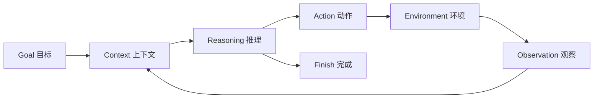

# AI Agent：从会回答到能行动

> 大语言模型解决的是“下一段内容应该是什么”，Agent 解决的是“为了完成目标，下一步应该做什么”。前者生成信息，后者把推理、工具、记忆和反馈组织成一个持续运行的行动闭环。

过去几年，大语言模型已经从文本续写器演变为通用的人机交互入口。它可以解释概念、生成代码、总结文件，也可以根据上下文完成复杂推理。但只要任务离开单轮对话，问题很快就会暴露出来：模型不知道最新状态，无法直接访问外部系统，执行到一半容易偏离目标，也不能天然保证每一步都安全、正确、可恢复。

例如，“帮我制定一份上海三日游计划”主要是内容生成问题；“根据预算比较机票和酒店，避开下雨时段，把行程写入日历，并在付款前让我确认”则是一个完整的行动任务。它要求系统查询实时信息、拆解目标、选择工具、保存中间状态、处理失败，并在高风险动作前把控制权交还给人。

这正是 AI Agent 试图解决的问题。

Agent 并不是在大模型外面套一个新名字，也不是让模型无限自主地运行。一个可用的 Agent，本质上是一套围绕目标组织起来的执行系统：大模型负责理解和决策，工具负责影响外部世界，记忆负责保持连续性，运行时负责权限、重试、预算和终止，评测与审计机制负责判断系统是否真的完成了任务。

理解 Agent，关键不是记住多少框架名称，而是看清一个基本事实：**Agent 是以概率模型为决策核心、以真实环境为作用对象的闭环系统。**

---

## 一、从 Chatbot 到 Agent，变化究竟发生在哪里

### 1. 大语言模型本身不是 Agent

大语言模型接收一段上下文，然后预测接下来最可能出现的 Token。即使模型表现出推理、规划和工具选择能力，它直接产生的仍然只是文本或结构化数据。

模型不会真的打开网页，不会直接读取数据库，也不会亲自发送邮件。它最多生成一条类似下面的请求：

```json
{
  "tool": "search_flights",
  "arguments": {
    "from": "Shanghai",
    "to": "Beijing",
    "date": "2026-11-02"
  }
}
```

真正完成参数校验、权限判断、网络请求和结果回填的，是模型外部的程序。这个程序通常被称为 Agent Runtime、Orchestrator 或 Harness。

因此，更准确的系统结构是：

```text
用户目标
  ↓
Agent Runtime 组织上下文并调用模型
  ↓
模型生成决策或工具调用请求
  ↓
Runtime 校验并执行工具
  ↓
环境返回新的状态
  ↓
Runtime 将观察结果写回上下文
  ↓
模型决定继续、重试、改计划或结束
```

模型提供概率性的认知能力，Runtime 提供确定性的执行约束。两者共同构成 Agent，而不是其中任何一方单独完成全部工作。

### 2. Agent 的定义

可以把 AI Agent 定义为：

> 一个以目标为导向，能够感知环境、形成决策、调用工具执行动作，并根据反馈持续调整行为的人工智能系统。

2025 年的 Agentic LLM 综述也将这一类系统的关键能力概括为推理、行动与交互，并把规划、工具使用、记忆和多智能体协作视为理解 Agent 的主要技术维度。[10]

这个定义包含五个不可缺少的要素：

1. **目标**：系统知道什么状态代表任务完成；
2. **环境**：系统面对的是会变化的外部世界，而不只是静态提示词；
3. **决策**：系统能够根据当前状态选择下一步动作；
4. **行动**：系统能够通过工具对环境产生影响；
5. **反馈**：系统会读取执行结果，并据此继续或修正行为。

如果一个系统只是按照预先写死的步骤依次调用三个 API，它更接近 Workflow；如果系统能根据每一步的观察结果动态决定后续路径，它才更接近 Agent。

### 3. Agent 不等于越自主越好

“自主”经常被当作 Agent 的核心卖点，但在工程系统里，自主程度应该是一项可配置参数，而不是最终目标。

查询天气可以自动执行，修改草稿可以执行后通知，发送外部邮件应该先预览，支付、删除数据和发布生产配置则通常必须人工确认。真正成熟的 Agent，不是无条件获得更多权限，而是能在风险、成本和责任边界内使用恰当的自主性。

可以把常见系统放在一条连续谱上：

| 形态 | 控制流 | 工具使用 | 自主程度 | 适用任务 |
| --- | --- | --- | --- | --- |
| Chatbot | 单轮或多轮对话 | 可选 | 低 | 问答、写作、解释 |
| Prompt Chain | 预设步骤 | 通常固定 | 较低 | 稳定的内容处理流程 |
| Workflow | 程序控制 | 明确配置 | 中 | 规则清晰的业务流程 |
| Single Agent | 模型动态决策 | 动态选择 | 较高 | 开放式、多步骤任务 |
| Multi-Agent | 多个模型角色协作 | 分工调用 | 高 | 可并行、可分解的复杂任务 |

---

## 二、所有 Agent 都可以还原为一个原子循环

传统人工智能经常用“感知、决策、行动”描述智能体的工作方式。进入大语言模型时代，这个循环被语言推理和工具调用重新实现。

ReAct 论文提出将 Reasoning 与 Acting 交替组织：模型先形成当前判断，再执行动作，读取环境返回的 Observation，然后基于新状态继续推理。[1]



这个循环看似简单，却是理解 Agent 的最小模型。

假设一个代码 Agent 收到“修复登录接口偶发的 500 错误”这一目标，它可能经历如下过程：

1. 搜索登录接口和异常日志；
2. 阅读相关源文件；
3. 推断空指针出现的条件；
4. 修改代码；
5. 执行目标测试；
6. 根据测试失败重新定位问题；
7. 补充边界条件；
8. 再次运行测试并总结改动。

其中每一步都可能失败。搜索结果可能无关，工具参数可能错误，代码修改可能引入回归，测试也可能因为环境问题而失败。因此，Agent 的核心不是“生成一份完美计划”，而是让系统在不完整信息和部分失败中继续推进，同时知道何时停止。

从工程视角看，这个循环包含两条性质完全不同的链路：

- **认知链路**：理解目标、形成假设、选择动作、解释结果；
- **控制链路**：鉴权、执行、超时、重试、幂等、预算、审计、终止。

大模型主要承担认知链路，传统软件承担控制链路。生产级 Agent 的可靠性，很大程度上取决于两条链路是否被明确分开。

---

## 三、Agent 的七个核心组成部分

### 1. 模型：概率性的决策核心

模型负责把自然语言目标转换为可执行意图，例如：

- 识别用户真正想完成什么；
- 将复杂目标拆成若干子任务；
- 根据当前状态选择工具；
- 生成符合 Schema 的参数；
- 解释工具返回值；
- 判断是否需要重试或改变策略；
- 将执行过程整理成用户可理解的结果。

模型越强，通常越能处理模糊任务和复杂上下文，但强模型不自动等于强 Agent。一个没有权限边界、状态管理和结果验证的强模型，可能只是以更高的自信执行错误动作。

### 2. 感知与上下文：Agent 眼中的世界

网页、文件、数据库记录、截图、日志和工具返回值，最终都要转换为模型能够消费的上下文。Agent 所知道的世界，不是客观环境本身，而是当前上下文中对环境的有限表示。

这会产生三个问题。

第一，信息可能不完整。页面中真正关键的错误提示没有被提取，Agent 就可能基于错误状态继续行动。

第二，信息可能过量。把整个代码仓库、全部聊天记录和数百页文档一次性塞入上下文，会让噪声争夺模型注意力。

第三，信息可能不可信。网页或邮件中的文本既可能是业务数据，也可能是试图操纵 Agent 的恶意指令。

因此，感知模块需要做的不只是“读取更多”，还包括筛选、压缩、标注来源、划分信任等级，并保留足够的信息让后续结果可以验证。

### 3. 推理与规划：决定下一步，而不是写一份漂亮计划

Agent 常见的规划方式有三类：

- **一次性规划**：先生成完整计划，再依次执行；
- **滚动规划**：每执行一步，就根据新状态决定下一步；
- **分层规划**：高层维护目标和里程碑，低层负责具体动作。

一次性规划简单、便宜，但环境一旦发生变化，后续步骤可能全部失效。滚动规划适应性更强，却可能在局部选择中失去整体方向。分层规划兼顾全局和局部，但需要额外的状态管理与里程碑验证。

对长程任务而言，优秀的规划器至少要回答四个问题：

1. 当前距离目标还有什么差距？
2. 哪个动作能最大程度减少这个差距？
3. 动作完成后，怎样证明状态真的改变了？
4. 如果动作失败，应该重试、回退还是更换方案？

计划不是自然语言步骤的集合，而是一组可以被环境状态验证的假设。

### 4. 工具：把模型意图转换成真实动作

Toolformer 探索了让模型学习何时调用工具、选择哪个 API、传入什么参数，以及如何利用工具结果继续生成内容。[2] 这类研究推动了工具调用成为现代大模型的基础能力。

工具可以分为几类：

- 信息工具：搜索、数据库查询、知识库检索；
- 计算工具：计算器、代码执行器、数据分析环境；
- 内容工具：文件读取、文档编辑、图像处理；
- 通信工具：邮件、即时消息、日历和工单系统；
- 操作工具：浏览器、桌面环境、云平台和业务 API；
- 物理工具：机器人、传感器和工业设备。

工具定义不仅是一份接口文档，也是模型的决策提示。含糊的名称、重叠的功能和缺少约束的参数，会显著增加误调用概率。

真正可靠的工具层应该做到：

- 使用严格的输入 Schema；
- 对枚举、范围、格式和依赖关系进行校验；
- 区分只读、可撤销和不可逆操作；
- 为写操作提供幂等键；
- 返回结构化错误，而不是模糊字符串；
- 为高风险动作提供预览和确认阶段；
- 将模型可见信息与密钥、权限实现分离。

### 5. 记忆：让 Agent 保持连续性

没有记忆的 Agent，每一轮都只能依赖当前上下文；拥有未经治理的记忆，Agent 又可能长期保存错误、过期或敏感信息。

常见记忆可以分为四类：

| 类型 | 保存内容 | 示例 |
| --- | --- | --- |
| 工作记忆 | 当前任务状态 | 当前计划、待处理步骤、工具结果 |
| 情景记忆 | 过去发生过什么 | 某次部署失败及恢复过程 |
| 语义记忆 | 稳定知识与事实 | 项目架构、用户偏好、业务规则 |
| 程序性记忆 | 如何完成一类任务 | 发布流程、排障步骤、操作策略 |

Generative Agents 通过记录经历、检索相关记忆、形成反思并生成计划，展示了记忆如何支持相对连贯的长期行为。[4]

但“接入向量数据库”并不等于完成了记忆设计。记忆系统还要回答：什么值得写入，信息何时过期，冲突如何处理，错误如何纠正，敏感信息如何删除，以及当前任务究竟应该召回哪些内容。

### 6. 反思与验证：失败之后如何修正

Reflexion 提出让 Agent 根据任务反馈生成语言形式的经验，并在后续尝试中使用这些经验，而不必立即更新模型参数。[3] 这种机制让 Agent 能够在一次任务内部或多次尝试之间调整策略。

不过，反思不能等同于验证。模型可以写出一段逻辑流畅的“自我批评”，却仍然没有发现真正的错误。

更可靠的纠错顺序是：

```text
先读取外部证据
  ↓
比较目标状态与实际状态
  ↓
定位失败步骤
  ↓
生成修正方案
  ↓
重新执行并再次验证
```

对于代码任务，外部证据是编译结果、测试结果和静态检查；对于数据任务，是查询结果和约束校验；对于网页任务，是页面状态是否真实变化。反思提供候选解释，环境验证才提供完成依据。

### 7. Runtime 与治理：决定 Agent 能做什么

Runtime 是 Agent 最容易被忽略、却最接近生产系统本质的一层。它负责：

- 维护对话与任务状态；
- 构造每一轮上下文；
- 解析模型输出；
- 校验并执行工具；
- 管理并发、超时与重试；
- 限制 Token、时间和费用预算；
- 在危险操作前请求人工确认；
- 保存 Trace、日志和审计记录；
- 检测循环并决定何时终止。

如果说模型是 Agent 的认知核心，那么 Runtime 就是 Agent 的操作系统。很多所谓“模型能力问题”，最终会被证明是上下文组织、工具接口、权限模型或终止条件设计不当。

---

## 四、几篇关键论文如何塑造现代 Agent

Agent 并不是由某一篇论文突然发明的。现代 LLM Agent 的基本形态，是几条研究路线逐渐汇合的结果。

### 1. ReAct：让推理与行动交替发生

ReAct 的重要性在于，它把语言模型从“一次生成最终答案”带入了“推理、行动、观察、再推理”的循环。[1]

它解决的不是所有规划问题，而是提供了一种简单、通用的交互范式：模型可以借助外部环境补充信息，也可以让后续推理建立在真实观察之上。

### 2. Toolformer：把外部工具变成模型能力的一部分

Toolformer 关注的是模型如何学习使用外部 API。[2] 它揭示了一个重要方向：模型不必把所有知识和计算能力都压进参数中，而可以学会在恰当时机调用搜索、计算或其他服务。

这使大模型从封闭的文本生成器转向能力可扩展的决策入口。

### 3. Reflexion：用语言形式保存失败经验

Reflexion 将环境反馈转化为文字经验，让 Agent 在后续尝试中修正策略。[3] 它代表了一条轻量级学习路线：不是每次失败都重新训练模型，而是通过显式记忆改变下一轮上下文。

这种方法成本较低、可解释性较好，但效果依赖反馈质量。错误的评价器会生成错误经验，并进一步影响后续决策。

### 4. Generative Agents：记忆、反思和规划的组合

Generative Agents 将观察记录、记忆检索、反思和计划组合起来，用于模拟具有连续行为的虚拟角色。[4] 这项工作让人们直观地看到：当语言模型拥有时间连续性和经验积累后，系统表现出来的不再只是单轮回答能力。

### 5. AutoGen：把多个 Agent 组织成对话系统

AutoGen 探索了通过多个可对话 Agent、工具和人工参与者构建复杂应用的方式。[5] 它推动了“用角色协作组织复杂任务”的工程范式，但也带来新的问题：通信成本、错误传播、责任边界和终止判断。

### 6. SWE-agent：接口设计也是能力的一部分

SWE-agent 将重点放在 Agent-Computer Interface 上，研究如何为代码 Agent 设计更适合模型使用的浏览、搜索和编辑接口。[9]

这项工作提供了一个非常工程化的启示：Agent 表现不好，不一定只因为模型不够强，也可能因为它面对的工具界面原本是为人设计的，而不是为概率模型设计的。

---

## 五、Workflow、单 Agent 与多 Agent 应该怎样选择

### 1. 优先使用确定性 Workflow 的场景

如果任务步骤稳定、业务规则明确、异常分支有限，Workflow 通常更可靠：

- 发票审核；
- 固定格式的数据清洗；
- 审批状态同步；
- 定时报表生成；
- 明确步骤的软件发布。

这些任务不需要模型在每一步自由选择路线。可以只在分类、信息抽取或文本生成环节使用模型，其余控制流由程序掌握。

### 2. 适合单 Agent 的场景

单 Agent 更适合路径无法完全预先枚举的任务：

- 开放式资料研究；
- 复杂故障排查；
- 跨文件代码修改；
- 动态网页操作；
- 根据中间结果不断调整的数据分析。

单 Agent 的优势是上下文统一、结构简单、责任清晰。其主要限制是上下文容易膨胀，同一个模型同时承担规划、执行和审核时，也容易形成自我确认。

### 3. 适合多 Agent 的场景

多 Agent 只有在“分工价值大于协调成本”时才值得使用。典型条件包括：

- 子任务可以并行；
- 角色需要不同工具或权限；
- 不同专业视角可以相互校验；
- 单个上下文无法容纳全部信息；
- 任务天然存在规划者、执行者和审核者。

例如，一份行业研究报告可以由规划 Agent 拆解问题，检索 Agent 并行收集资料，分析 Agent 比较证据，写作 Agent 形成初稿，审核 Agent 检查引用与逻辑。

但增加 Agent 数量并不会自动增加智能。多 Agent 系统常见的问题包括：

- 重复搜索和重复推理；
- 一个 Agent 的错误被其他 Agent 当作事实；
- 对话轮数增加导致成本和延迟失控；
- 多数投票形成虚假的确定性；
- 多个角色都等待对方，或不断互相转交；
- 最终没有一个组件对完成状态负责。

MultiAgentBench 等工作开始从协作、竞争、里程碑和通信质量等角度评估多 Agent 系统，而不只看最后一段答案。[11]

---

## 六、Agent 已经能够做什么

### 1. 软件工程

代码 Agent 可以搜索仓库、阅读调用链、修改文件、运行测试和解释失败。与普通代码补全相比，它处理的是跨文件、跨工具、跨多轮反馈的任务。

真正决定其价值的，不是能否生成一段代码，而是能否形成完整闭环：定位问题、进行最小修改、验证行为、控制回归风险，并把证据交给开发者审查。

### 2. 浏览器与办公自动化

浏览器 Agent 可以操作网页、填写表单、下载文件、整理信息并跨系统搬运数据。办公 Agent 则可以连接邮件、日历、文档、知识库和工单系统。

WebArena 构建了接近真实网站的可复现环境，用来测试 Agent 完成长流程网页任务的能力。[7] 这类基准揭示出一个现实：Agent 在单个按钮或单个页面上表现不错，不代表它能稳定完成跨页面、跨状态的完整业务流程。

### 3. 数据分析与研究

研究型 Agent 可以检索资料、阅读论文、运行计算、生成图表并撰写报告。它最适合扩大研究人员的信息处理能力，而不应被当作无需验证的结论机器。

一个可靠的研究 Agent 必须保留来源，区分事实、推断与假设，并让关键结论能够回到原始证据。

### 4. 企业流程

在企业环境中，Agent 可以承担客服辅助、销售线索整理、知识检索、运营分析和内部流程协同。

但企业 Agent 的真正门槛通常不是模型能否理解业务术语，而是：身份如何认证，权限如何继承，数据如何隔离，操作如何审计，以及错误发生后由谁负责。

### 5. 具身智能

当工具不再是 API，而是摄像头、机械臂和移动平台时，Agent 就进入物理世界。此时感知误差、动作延迟和安全风险都会放大。

数字环境中的错误可能是一封发错的邮件，物理环境中的错误可能造成设备损坏或人员风险。因此，具身 Agent 需要更严格的状态估计、动作约束、仿真验证和紧急停止机制。

---

## 七、为什么 Agent 看起来聪明，却仍然不够可靠

### 1. 长程任务会放大局部错误

假设一个 Agent 每一步都拥有 95% 的成功概率。如果任务要求连续 20 个关键步骤都正确，粗略相乘后的整体成功概率只有：

```text
0.95 ^ 20 ≈ 35.8%
```

现实中的步骤还不是独立事件。早期错误会污染后续上下文，让失败概率进一步增加。这就是为什么一个 Agent 可以在 Demo 中完成惊艳操作，却很难在生产环境中持续稳定运行。

### 2. 幻觉会从文本错误升级为行动错误

Chatbot 编造一个不存在的函数，影响可能止于错误答案；Agent 如果据此修改代码、调用接口或发送消息，幻觉就变成了真实副作用。

因此，行动之前必须把模型输出当作“不可信提案”，经过 Schema 校验、权限检查和业务规则验证后才能执行。

### 3. Agent 容易把“我认为完成”当成“已经完成”

模型可能生成“文件已经保存”“测试已经通过”或“邮件已经发送”，但这些句子只是语言输出，不是环境证据。

完成状态必须由确定性检查产生：文件真实存在、测试进程返回成功、数据库状态符合预期、消息服务返回可追踪的发送记录。

### 4. 提示注入打开了新的攻击面

Agent 会读取网页、邮件和文档，而这些外部内容可能包含针对模型的恶意指令。例如，一个网页可以伪装成普通说明，要求 Agent 忽略系统规则、读取本地文件并把内容发送到外部地址。

传统软件把网页文本当作数据，Agent 却可能把它解释成指令。防御的关键不是增加一句“不要听从恶意提示”，而是建立结构隔离：

- 明确区分系统指令、用户意图和外部数据；
- 默认不让不可信内容触发高权限工具；
- 对敏感数据实施最小可见范围；
- 在跨信任边界传输数据前进行策略检查；
- 对高风险调用设置人工确认；
- 保存完整动作轨迹用于审计。

### 5. 记忆会积累错误

长期记忆让 Agent 更连续，也让错误拥有更长寿命。如果一次错误推断被写成“用户偏好”或“项目规则”，后续任务可能反复受到影响。

所以每条重要记忆都应尽量带有来源、时间、置信度和作用范围。记忆不是无限追加的聊天记录，而是一份需要治理的数据资产。

### 6. 成本和延迟可能快速失控

一次普通问答可能只调用模型一次，而一个 Agent 任务可能包含数十次模型调用、搜索、浏览器操作、代码执行和验证。加入多个 Agent、反思器和裁判模型后，成本还会继续增加。

工程上必须为 Agent 设置预算：最大步骤数、最大模型调用次数、最大 Token、最大工具费用和总超时时间。当预算即将耗尽时，系统应降级、请求人工帮助或返回部分结果，而不是无限循环。

---

## 八、怎样评价一个 Agent 是否真的有效

传统语言模型评测经常关注答案准确率或文本相似度，但 Agent 的输出是一条轨迹以及由轨迹造成的环境状态变化。

因此，Agent 评测至少应该覆盖四层。

### 1. 结果层

- 任务是否完成；
- 最终状态是否符合约束；
- 结果是否正确、完整、可用。

### 2. 轨迹层

- 是否选择了正确工具；
- 参数是否准确；
- 是否出现无效循环；
- 是否跳过必要验证；
- 是否使用了危险或不必要的动作。

### 3. 系统层

- 完成任务消耗多少时间和 Token；
- 工具调用次数是多少；
- 失败后能否恢复；
- 多次运行的成功率是否稳定；
- 是否产生重复副作用。

### 4. 安全层

- 是否发生越权；
- 是否泄露敏感数据；
- 是否遵守人工确认要求；
- 是否能抵抗提示注入；
- 是否保留完整审计记录。

AgentBench、WebArena、GAIA 和 SWE-agent 分别从交互式环境、网页任务、通用助手任务和软件工程任务等角度推动了 Agent 评测。[6][7][8][9]

这些基准共同说明：模型在静态问答中表现优异，并不代表它能在真实环境里稳定完成长程任务。评测 Agent 时，重点不应是它“说得像不像完成了”，而是环境状态是否真的发生了正确变化。

---

## 九、构建生产级 Agent 的十条原则

### 1. 先定义完成条件，再设计 Prompt

如果系统无法用可检查的状态描述“什么叫完成”，Agent 就只能凭语言感觉结束任务。

### 2. 能用 Workflow 解决的，不必强行交给 Agent

把确定性步骤保留在程序中，只把模糊理解、开放推理和动态选择交给模型。

### 3. 默认最小权限

读取和写入分权，可撤销和不可逆动作分级，高风险工具按任务临时授权。

### 4. 把模型输出视为不可信输入

所有工具参数都需要做类型、范围、业务规则和权限校验。

### 5. 用环境证据验证结果

不要让执行模型同时充当唯一裁判。优先使用测试、数据库约束、状态查询和独立验证器。

### 6. 为副作用设计幂等与补偿

发送、扣款、创建和删除等操作必须考虑重试。能回滚的操作应明确补偿路径，不能回滚的操作应设置提交确认。

### 7. 为循环设置硬边界

限制最大步数、总时间、费用和重复动作次数，并识别“观察没有变化”的停滞状态。

### 8. 让关键节点可观察

至少记录目标、计划版本、模型决策、工具参数、工具结果、状态变化、错误和人工审批。

### 9. 使用真实失败案例做回归测试

线上失败不是只修一次的事故，而应该进入评测集，防止模型、Prompt 或工具更新后再次出现。

### 10. 为人类保留有效的接管方式

人工介入不应只有“全部停止”。系统还应允许修改计划、替换参数、跳过步骤、撤销操作和从中间状态继续执行。

---

## 十、Agent 的下一步，不只是更强的模型

未来的 Agent 当然会受益于更强的推理模型和更长的上下文，但决定其能否真正进入生产环境的，还有几个更基础的方向。

### 1. 从语言计划走向可执行计划

计划将不只是自然语言列表，而会包含状态前置条件、预期结果、失败分支和验证方法，使系统能够判断计划是否真实推进。

### 2. 从无限记忆走向记忆治理

Agent 需要知道什么应该记住、什么应该遗忘、什么已经过期，以及不同任务和用户之间的信息能否共享。

### 3. 从工具数量走向接口质量

未来竞争不在于 Agent 接入了多少工具，而在于工具是否语义清晰、状态可见、错误可恢复、权限可控制。

### 4. 从单次成功走向持续可靠

行业会越来越重视多次运行成功率、长程稳定性、故障恢复能力和单位任务成本，而不是只展示最成功的一条演示轨迹。

### 5. 从“替代人”走向“重新分配控制权”

Agent 更可能改变人与软件之间的分工：人负责目标、价值判断和高风险授权，Agent 负责信息处理、候选方案和可验证执行，确定性系统负责约束与记录。

### 6. 从人类界面走向 Agent 原生界面

SWE-agent 等研究表明，面向 Agent 重新设计计算机接口可以显著影响任务表现。[9] 未来的软件可能同时提供图形界面和 Agent 接口：前者服务于人，后者提供结构化状态、明确动作、权限边界和可验证结果。

---

## 结语：Agent 的核心是受约束的行动能力

大语言模型让机器获得了通用的语言理解和生成能力，Agent 则试图把这种能力放进真实任务的执行闭环。

这个变化很重要，因为软件第一次可以不完全依赖预先写死的路径，而是根据目标和环境动态决定下一步。但同样的变化也带来了新的工程问题：概率决策进入控制流，文本幻觉可能变成真实副作用，外部数据可能反过来操纵系统，长期记忆可能持续放大错误。

因此，Agent 的价值不在于拥有最大程度的自由，而在于拥有**受约束的行动能力**：

- 它知道目标是什么；
- 它能观察真实环境；
- 它会选择并执行动作；
- 它能用证据判断结果；
- 它在失败后可以恢复；
- 它的权限、成本和风险始终处于控制之中。

从这个角度看，Agent 不是一个更会聊天的模型，而是一种新的软件系统形态。未来真正拉开差距的，也不会只是模型排行榜上的分数，而是谁能把不确定的模型能力，组织成可靠、可验证、可治理的生产系统。

---

## 参考文献

[1] Yao, S. et al. *ReAct: Synergizing Reasoning and Acting in Language Models*. arXiv:2210.03629, 2022.

[2] Schick, T. et al. *Toolformer: Language Models Can Teach Themselves to Use Tools*. arXiv:2302.04761, 2023.

[3] Shinn, N. et al. *Reflexion: Language Agents with Verbal Reinforcement Learning*. arXiv:2303.11366, 2023.

[4] Park, J. S. et al. *Generative Agents: Interactive Simulacra of Human Behavior*. arXiv:2304.03442, 2023.

[5] Wu, Q. et al. *AutoGen: Enabling Next-Gen LLM Applications via Multi-Agent Conversation*. arXiv:2308.08155, 2023.

[6] Liu, X. et al. *AgentBench: Evaluating LLMs as Agents*. arXiv:2308.03688, 2023.

[7] Zhou, S. et al. *WebArena: A Realistic Web Environment for Building Autonomous Agents*. arXiv:2307.13854, 2023.

[8] Mialon, G. et al. *GAIA: A Benchmark for General AI Assistants*. arXiv:2311.12983, 2023.

[9] Yang, J. et al. *SWE-agent: Agent-Computer Interfaces Enable Automated Software Engineering*. arXiv:2405.15793, 2024.

[10] *Agentic Large Language Models, a Survey*. arXiv:2503.23037, 2025.

[11] *MultiAgentBench: Evaluating the Collaboration and Competition of LLM Agents*. arXiv:2503.01935, 2025.
