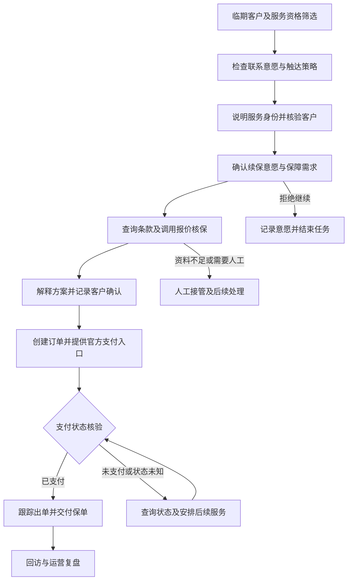
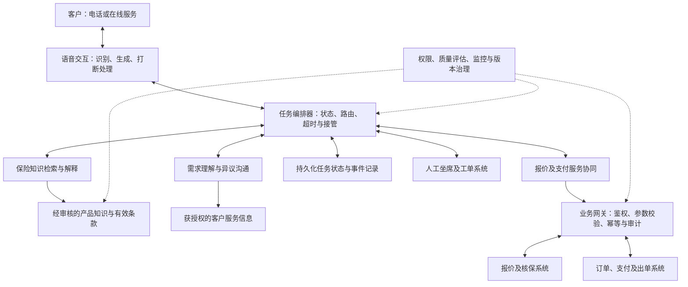
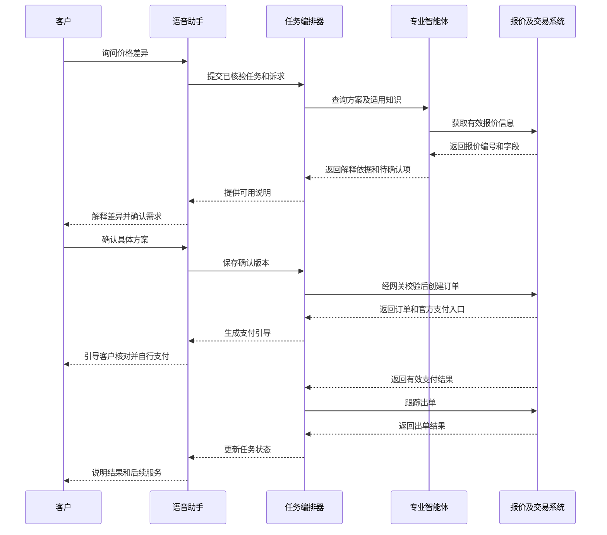
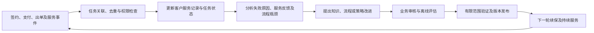

# AI 原生全链路智能续保平台：大模型语音智能体与 MAS 多智能体协同实践

> 从客户触达到续保成交，构建有温度、可执行、可追溯的存量客户运营体系。
>
> 文档类型：案例场景分析与参考技术方案｜编写日期：2026 年 10 月 22 日

**材料说明。**本文以需求方提供的“某全国性头部财险机构智能续保”描述及四张平台演示截图为案例材料，以车险续保为示例展开。截图呈现了 Agent OS、专家协作、任务编排和结果回流等设计表达；它们能够补充方案结构，不能单独证明系统已经投产或达到某项经营指标。下文注明“截图呈现”的内容来自所提供图片，任务字段、执行机制、对话和验收办法属于本文据此提出的工程设计。机构身份、实际部署和经营成果仍待项目材料核实。原始材料中的“吸收 60% 以上重复性负荷”属于待验证的案例方陈述；“毫秒间完成全链路闭环”调整为“低延迟交互与跨系统业务闭环”。引用论文用于说明技术方法及研究依据，不用于证明匿名项目的经营成效。

## 一、建设背景：把一次续保触达变成持续服务

客户接到续保电话时，真正想解决的问题往往很具体：今年的价格为什么变化，现有保障是否合适，去年处理过的问题是否已经解决，自己还需要提供哪些材料。平台能否理解这些问题，并把解释、确认和办理衔接起来，决定了这次联系能否继续。

本文将续保运营中的待解决问题归为三类。第一类是重复劳动：身份确认、信息核对、标准问题解释和进度提醒占用坐席时间。第二类是服务中断：客户已经表达需求，却在报价等待、渠道切换或人工交接时反复说明情况。第三类是结果不清：系统记录了“已联系”“已发送链接”，却没有确认客户是否完成支付、订单是否成功出单。

围绕这些问题，AI 原生全链路智能续保平台的建设目标是：让同一项续保任务在多轮对话和多个系统之间持续推进，并在每个关键节点留下可核实的结果。语音智能体负责理解和沟通，MAS（Multi-Agent System，多智能体系统）组织专业能力，业务系统负责定价、核保、交易及出单，人工处理需要判断、协调和承诺的复杂事项。

在这一设计中，“数字员工”可以承担持续在线的服务入口和标准任务处理工作。其价值需要体现为客户少重复说明、人工少重复操作、异常更早被发现，以及续保任务更稳定地完成。只有这些变化被运营数据验证，平台建设才形成可信的业务收益。

| 业务环节 | 待解决问题 | 平台预期改善 | 验证证据 |
|---|---|---|---|
| 客户触达 | 联系时间不合适、重复联系 | 按客户意愿和配置策略安排触达 | 触达日志、拒绝记录、预约记录 |
| 需求确认 | 重复询问、关键信息遗漏 | 提取需求并定点确认关键字段 | 对话记录、客户确认记录 |
| 保障解释 | 产品版本混淆、解释依据不清 | 按有效条款提供有来源的说明 | 条款版本、引用片段、质检结果 |
| 报价跟进 | 多系统切换、等待后失去上下文 | 查询报价并延续当前任务 | 报价编号、接口回执、任务状态 |
| 支付与出单 | 把发送链接当作办理完成 | 核验支付状态并继续跟踪出单 | 支付回执、订单及保单状态 |

## 二、平台定位：用任务状态连接完整业务链路

本文将“AI 原生”定义为：平台从设计之初就围绕语言理解、任务执行和人工协同组织业务，而模型行为始终受明确的权限和流程约束。客户可以用自然语言提出问题、补充条件、改变方案，系统据此更新待办事项和已确认信息，再决定下一项允许执行的动作。

一笔续保业务建议维护独立的任务记录，包含客户与原保单关联标识、当前需求、待核实字段、有效报价、客户确认版本、订单状态、后续安排和责任归属。这样，即使客户结束电话后转到线上渠道，也能在核验身份后恢复任务。

“全链路”需要覆盖成功、等待、拒绝和异常等不同结果。客户明确拒绝后结束联系，报价失败后转人工，客户预约次日再沟通，都是合理的流程终点或暂停状态。业务闭环意味着状态明确、责任明确、下一步明确，不能把所有对话都压向成交。

平台应把三个容易混淆的概念分开。“服务可用”表示客户可发起咨询或系统可接收事件；“主动外呼”表示平台向客户发起联系；“业务完成”表示支付、出单等结果已由相应系统确认。7×24 小时可用性应作为服务设计目标，主动外呼仍按适用要求、机构策略和客户约定执行，交易接口维护期间则应明确告知等待状态。

本文以车险为示例。扩展至企业财产险、责任险等场景时，客户资料、核保要求、报价路径和人工参与程度均需重新定义，不能直接复用车险自动化完成率作为目标。

## 三、总体架构：让对话、协作与交易各有依据

建议采用“交互入口—任务编排—专业能力—业务执行”的结构，并由权限、知识和观测体系贯穿各层。架构设计的核心是明确每类信息和操作的权威来源。

交互入口负责把客户表达转化为可处理的信息，并将结果以适当节奏呈现。任务编排器决定当前允许进行哪些步骤，维护等待与失败状态。专业能力承担知识查询、需求整理和异议沟通。业务网关则对工具请求执行身份、权限、参数与重复操作检查。

这一分工对应三项约束。保险价格和核保结果取自业务系统；保障解释依据当前适用条款；客户确认与交易结果保存在可追溯的任务记录中。模型生成的总结可以帮助坐席理解情况，但不能覆盖系统记录中的已确认事实。

对外部系统的调用建议区分查询与变更。查询类操作可以在授权范围内用于准备解释；创建订单、调整方案等变更类操作必须满足流程前置条件。对支付状态不明的交易，应先查询原订单，避免因重试创建重复交易。

金融智能体综述讨论了数值推理、提示敏感性、实时适应与机构部署约束等问题，为上述设计提供背景依据。[7] 本文据此采取的工程选择是把可变化的语言能力与确定的业务控制配合使用；这些控制仍需在实际系统中实现和验证。

### 3.1 从截图理解平台：数据、运行环境、专家与任务

四张截图共同呈现了一条组织思路：续保信号进入专家协作过程，分散能力围绕同一目标被编排成连续路径，关键任务依次执行，签约和服务结果再回到下一轮运营。第一张截图以 Agent OS 为核心，周围配置产品、精算、政策法律咨询、销售及售后／客服专家；界面同时出现“数据宇宙”和 Agent Workforce 等名称。[图1—图4]

这些名称可作为平台的概念结构。截图没有展示它们的接口和实现细节，本文将其进一步解释为以下可建设的职责，而不据此认定已有对应产品组件：

| 截图中的概念 | 本文建议赋予的工程职责 | 与原有架构的关系 |
|---|---|---|
| 数据宇宙 | 关联客户、产品、保单、报价、任务及服务事件，提供有来源和版本的数据视图 | 为知识层、客户信息访问和任务记录提供数据基础 |
| Agent OS | 管理会话、任务状态、工具权限、执行调度、恢复与人工接管 | 对应任务编排及智能体运行管理能力 |
| Agent Workforce | 按业务岗位组织专家职责、可用工具、作业规范及评估标准 | 对应专业能力的组织与运营方式 |
| 任务类别、具体任务、任务描述 | 把业务能力逐步细化为有输入、输出和验收条件的执行单元 | 连接专业角色与实际业务操作 |

“同一上下文”应理解为共享与本次任务有关的事实及判断依据。各角色按权限获取必要字段，不能因为参与同一任务就读取所有客户信息。销售需要知道客户诉求和可用方案，精算需要经授权的风险及定价输入，售后需要已生效合同和待处理事项；这些视图通过任务标识关联，但可见范围不同。

### 3.2 续保信号进入协作过程

截图中的续保过程由销售发起，再让相关专家围绕同一上下文参与判断。[图1] 工程实现可将销售创建任务、保单临期事件或客户主动咨询转化为标准任务入口，并在入口处检查联系意愿、客户资格和重复任务。

一个建议的初始任务包包括：任务标识、客户与原保单关联标识、触发来源、目标保险期间、授权状态、已知需求、缺失资料、当前责任人及后续服务安排。报价、客户确认、签约和售后记录随后关联到同一任务。临期信号只代表存在服务机会，不代表客户已经授权投保或支付。

Agent OS 据此组织下一步动作：资料不足时先补齐；需要风险判断时提交相应审核；资料与规则满足时调用正式报价；客户拒绝时终止当前联系。任务来源不同，但后续执行使用一致的身份、权限和状态校验机制。

## 四、MAS 协作：按专业能力分工，按业务状态推进

MAS 的设计价值在于让知识、沟通与执行能力具备清晰边界。AutoGen 展示了可配置智能体通过对话、工具和人类输入协作的通用方式。[2] 将这种思想用于续保时，应进一步约束协作路径、调用轮数和终止条件，避免多个角色在客户等待期间反复讨论。

### 4.1 角色设计

| 角色 | 主要输入 | 主要输出 | 权限与边界 |
|---|---|---|---|
| 任务编排智能体 | 客户意图、当前状态、规则检查结果 | 下一步任务、路由建议、接管请求 | 状态变更由流程引擎校验 |
| 客户需求智能体 | 已核验资料、客户本轮表达 | 结构化需求、缺失信息、待确认项 | 不把推测写成客户确认事实 |
| 保险知识智能体 | 产品及条款版本、客户问题 | 带来源的解释、适用限制 | 无有效依据时停止确定性回答 |
| 报价协同智能体 | 已确认参数、客户调整要求 | 报价查询请求、方案差异说明 | 价格和核保结论来自正式接口 |
| 异议沟通智能体 | 客户疑问、有效方案、历史服务摘要 | 针对性说明、可选择的下一步 | 不生成未经授权的承诺 |
| 支付与服务智能体 | 已确认方案、有效订单 | 官方支付引导、进度说明、服务安排 | 以交易回执确认支付和出单 |

这些角色是逻辑职责，不必分别部署六个独立模型。初期可以由一个模型配合不同工具权限与角色配置承担；只有当知识、权限、评估或负载隔离存在明确需要时，再拆成独立服务。

### 4.2 共享事实，限制重复推理

一次客户咨询中，可以并行查询有效条款和已有报价；需要客户确认的方案变更则按顺序执行。建议由编排器提供任务摘要和必要证据，专业智能体返回结构化结果，避免每个角色重复读取全部录音和完整历史记录。

共享状态至少区分三类内容：业务系统返回的事实、客户已经确认的信息、模型提出的候选解释。假如客户说“今年想便宜一点”，需求智能体可以记录预算敏感这一待澄清诉求，但不能据此直接删除某项保障。

不同结果发生冲突时，应先比较来源、版本和查询时间。例如，历史报价与当前报价不一致，应明确分别对应的条件；知识检索返回两个版本的条款，应按产品和生效条件筛选。仍无法消除冲突时暂停相关步骤，交由人工处理。

### 4.3 用业务规则约束协作

任务编排器可由模型提出下一步，但流程引擎必须验证当前状态是否允许该动作。例如，“客户已确认方案”才能进入相应订单创建步骤；“收到有效支付回执”才能标记已支付；客户修改了保障内容，就需要生成新方案并重新确认。

同样需要设置单轮工具调用预算、重复失败上限和超时策略。客户等待过长时，平台可以说明正在查询的事项，或经客户同意安排后续联系。人工接管时应交付已核验信息、客户原始诉求、当前报价、未完成事项和工具回执，避免客户重新讲述全过程。

是否采用多智能体应通过对比决定。建议用相同模型能力、知识库、工具和样本，对比固定工作流、单智能体与多智能体方案，同时观察成功率、延迟、成本及错误类型。只有质量收益覆盖新增协作成本时，才扩大角色拆分。

### 4.4 将五类业务专家映射到执行能力

截图中的专家围绕业务岗位组织，前文角色表围绕执行能力组织，两者可以映射到同一套平台。一个业务专家可以使用多项执行能力，同一项知识检索或支付查询能力也可以服务多个岗位，避免为每个名称重复部署模型和接口。

| 截图中的业务专家 | 在续保中的建议职责 | 交付给后续任务的结果 | 对应执行能力 |
|---|---|---|---|
| 销售专家 | 发起任务、理解需求、解释方案并组织客户确认 | 结构化诉求、待确认方案、确认记录与后续安排 | 需求理解、异议沟通、任务编排 |
| 精算专家 | 分析风险与定价依据，协同处理特殊案件 | 风险判断依据、审核意见、正式报价所需条件 | 报价协同、风险审核工具 |
| 产品专家 | 解释保障结构、匹配产品及说明方案差异 | 适用产品版本、保障组合与限制条件 | 保险知识、方案解释 |
| 政策法律咨询专家 | 提供条款适用及机构审核规则的依据，标记待核实事项 | 有来源的检查结果、问题清单与升级建议 | 知识检索、规则检查、人工审查路由 |
| 售后／客服专家 | 接收签约后的服务任务、组织回访和后续提醒 | 交接确认、服务工单、客户反馈及跟进计划 | 支付与服务、工单管理、回访支持 |

图片任务描述还出现“基于风险数据建立定价模型”“确保产品条款符合监管要求”等内容。[图4] 本文将前者区分为离线的模型分析与审核工作，以及在线的已批准定价服务调用；在线续保智能体只使用批准版本，不能自行修改费率。后者对应检索、规则检查和专业审查支持，最终审核责任仍由机构确定。

同样，“与客户协商合同条款”应落在机构允许选择或调整的范围内。涉及未授权条款变更时，系统记录客户诉求并提交专业人员处理；产品专家或销售专家不能通过生成一段新文本直接改变正式保险合同。

### 4.5 从能力目录到可执行任务

第二张截图强调分散能力被编排为连续路径，第三张进一步强调上一项任务的产出成为下一项任务的输入。[图2][图3] 要实现这一目标，每个任务需要定义触发条件、责任角色、输入依据、允许工具、输出结构、完成条件及异常去向。

例如，“报价方案生成”任务的输入是已核验风险资料、产品版本和客户确认的需求；输出包含报价编号、保障明细、金额、有效期及系统回执。仅生成一段报价说明不能标记任务完成。客户修改需求后，系统应能识别哪些输入已经变化，并使依赖旧输入的报价和确认进入重新核验状态。

建议按单笔任务维护证据关系：需求版本关联报价版本，报价版本关联客户确认，客户确认关联订单与合同，合同关联后续服务。这样，系统和人工都能查明某次操作依据的具体方案，避免不同角色使用过期上下文。

## 五、关键技术：把自然沟通接到可靠执行上

### 5.1 实时语音：分别管理回答延迟和办理耗时

续保语音交互应关注客户能否自然插话、系统能否听清修正，以及关键金额和保障内容是否被准确表达。候选技术路线包括语音识别、语言模型和语音合成组成的流式链路，也包括直接处理语音的模型；项目选型应使用真实电话音频、产品术语和目标并发进行评估。

Moshi 研究了全双工语音对话，报告理论延迟为 160 毫秒、实际约 200 毫秒。[1] 这一结果提供了低延迟交互的研究依据，不能直接作为本平台电话链路、中文保险业务或交易接口的性能承诺。

平台应至少记录三个时间：从客户表达结束到首段有效回答的延迟，从发起工具请求到取得可用结果的时间，以及从任务开始到业务终态的总耗时。客户思考、确认和支付所花时间也属于完整服务历程，不能用模型首响应代替。

客户打断时，系统应停止过时播报并重新识别意图。如果客户在报价播报中纠正车辆信息，旧报价应标记为待重新核验，后续流程使用新参数。短暂的“嗯”“好的”与明确的投保确认需要区别处理，关键确认采用明确问题及可留存记录。

### 5.2 专业共情：回应具体顾虑并提供有效下一步

EmpatheticDialogues 研究提出了围绕情绪情境的对话数据和评估方法，说明共情表达可以作为独立能力接受人工评价。[5] 它讨论的是开放域对话，保险术语、承诺边界和业务准确性需要另行评估。

本文建议将共情设计为四个动作：识别客户在意的具体问题，确认理解，提供有依据的解释，提出客户可接受的下一步。客户说“去年沟通了几次都没解决”，系统应先明确待解决事项并提供人工服务渠道，而非立即回到报价推介。

质量评估应同时检查尊重程度、事实准确性和任务帮助程度。语气友好但错误解释保障，或者在客户明确拒绝后持续推动成交，都不应被评为高质量服务。对客户心理状态的判断也应保持克制，避免把语音情绪推测作为定价、资格或优先级的依据。

### 5.3 知识增强：每段保障解释有适用版本

RAG 将检索获得的外部材料与语言生成结合，为知识密集型问题提供方法基础。[4] 本文建议在此基础上建立保险知识处理链路：先按产品、地区和适用时间筛选材料，再检索相关条款，最后基于来源生成解释并检查引用。

知识库应保留材料名称、版本、有效区间、审核状态和来源位置。经审核的条款、产品说明和常见问答应与历史对话分开管理；客户历史表达可以帮助理解问题，不能作为产品规则。索引更新、缓存失效和旧版本撤回也应纳入发布流程。

如果检索结果缺乏关键条件，智能体应说明哪些信息尚未确认。RAG 不能自动保证解释正确，仍需评估证据是否适用、回答是否遗漏责任限制，以及是否把一般说明误写成对具体理赔结果的承诺。

### 5.4 工具调用：用外部结果校正下一步

ReAct 将推理与行动交替组织，让模型借助外部信息更新任务处理过程。[3] 本文借鉴这种“获取信息—执行动作—根据结果继续”的方式，同时把交易权限和状态校验放在业务网关中。

工具输出应明确成功、失败、处理中和结果未知，不能将接口超时直接等同于操作失败。创建订单请求超时后，系统首先通过业务请求标识查询原操作；只有确认未创建且允许重试时，才使用受控重试。支付回调重复到达时，也只能产生一次有效状态变更。

建议把方案编号、报价有效期和客户确认版本绑定。客户确认后若报价失效或保障变化，原确认不得直接用于新方案。关键数字优先从结构化字段生成播报内容，并保留客户可核对的官方页面。

### 5.5 持续优化：让问题进入可重复评估

运营中发现的误解、错误解释和操作失败，可在授权、脱敏和审核后形成评估样本。样本应记录期望结果与禁止动作，并保留一部分未参与调优的数据作为独立验证集。

每次模型、提示词、知识库或工具定义变更，都应说明版本范围和预期影响。上线前验证典型场景及历史高风险失败样本，上线后按有限范围观察真实指标。客户会话不应未经筛选直接回流训练；人工修订也要经过知识审核后再进入正式服务。

## 六、典型场景：一笔车险续保任务如何完成

以下为虚构示例，用于解释平台行为；金额、人物和过程均非真实客户数据。

客户林女士的车险临近到期。系统已根据配置策略和联系意愿安排服务，并在说明智能助手身份、完成必要核验后进入续保沟通。

> 客户：“去年三千多，今年怎么四千多？我先想知道差在哪。”
>
> 智能助手：“您主要想核对今年和去年的价格差异。我先查询两份方案，再逐项说明。”

需求智能体记录“比较报价”的诉求。报价协同智能体查询可比较的历史方案及本次有效报价，知识智能体准备对应保障说明。若业务系统只能提供项目金额和方案差异，助手应解释这些已确认内容；无法取得的定价原因，交由有权限的人员核实。

> 智能助手：“当前方案中有一项保障与去年不同。我可以先说明差异，您确认需求后再决定是否调整。”
>
> 客户：“先保留去年主要的保障，其他的再看看。”

这句话尚不足以形成具体投保方案。助手逐项确认客户希望保留和讨论的保障，再提交重新报价。系统保存新报价编号和有效条件，旧报价保留用于追溯，但不再作为当前待确认方案。

客户确认方案后，平台按机构交易流程创建订单，并提供官方支付入口。助手说明客户可在该入口核对投保主体、保险期间、保障及金额，敏感支付验证由客户在官方支付流程中完成。

> 客户：“我刚刚付过了，你这里还没显示？”
>
> 智能助手：“我先核对这笔订单的支付状态，请稍候。”

此时，支付智能体触发状态查询。收到有效支付结果后，平台进入出单跟踪；若仍无法确认，则记录“支付状态待核验”，安排查询或人工处理。只有出单系统返回成功，才能向客户确认保单已生成，并说明交付方式。

异常处理与成功路径同样重要。客户明确拒绝继续时结束沟通并记录意愿；报价服务超时后限制重试次数；客户改约时间时保存任务并停止当前触达；涉及投诉或需要授权承诺时转交人工。每一种处理都应有负责人和可恢复的任务记录。

### 6.1 将截图中的关键任务接入续保主线

第三张截图明确展示了从续期提醒、风险审核、报价生成到条款确认与客户交接的主线，并强调保留前一步判断。[图3] 结合第四张截图中的任务描述，可进一步形成下表所示的任务输入与交接设计。输入字段、异常动作及完成条件为本文补充，并非截图提供的接口定义。

| 任务 | 前置输入 | 主要协作角色 | 可核验的输出与完成条件 |
|---|---|---|---|
| 续期提醒 | 到期信息、联系意愿和触达安排 | 销售、售后／客服 | 联系结果、续保意愿或客户预约；拒绝时更新联系策略 |
| 承保风险审核 | 已核验资料、客户变更事项、适用审核规则 | 精算、产品及人工核保 | 审核结论、附加条件或人工待办，保留依据与版本 |
| 报价方案生成 | 已确认需求、风险审核结果、有效产品及定价版本 | 精算、产品、销售 | 正式报价编号、保障明细、价格与有效期 |
| 销售表达准备 | 当前报价、产品特点与客户问题 | 销售、产品、政策法律咨询 | 经约束的解释内容及必要说明；内容与当前方案一致 |
| 条款确认与签约协同 | 有效报价、允许选择的合同内容、客户明确确认 | 销售、政策法律咨询 | 确认记录和签约状态；发生实质变更时重新确认 |
| 支付及出单跟踪 | 有效订单、支付回执及出单请求 | 支付与服务能力、人工服务 | 真实支付状态、出单结果和保单交付记录 |
| 客户交接与回访 | 生效合同、未结事项、服务偏好及后续安排 | 销售、售后／客服 | 接收方确认、服务责任人、回访计划与处理结果 |

提醒、风险审核、报价及签约的具体顺序还应适配产品流程。表中的支付与出单环节是为衔接本文原有闭环补充的设计，不表示截图已经展示了相关集成。付款、签约与出单分别记录状态，以正式业务系统返回结果为准。

### 6.2 把客户交接变成有接收结果的任务

第四张截图提出“签约后将客户信息移交售后服务”“定期回访，收集服务反馈”和“提前提醒客户缴纳续期保费”。[图4] 这使流程从本次成交延伸到持续服务。对于本文车险场景，提醒应依据实际到期日和续保安排；其他产品如存在分期或续期缴费，则按对应合同与账务信息确定提醒条件。

客户交接包建议包括客户标识、合同或保单标识、保障及保险期间、客户已确认事项、未结问题、联系偏好、下一项任务和责任人。销售环节形成的任何服务承诺，都应核对其授权与履行状态，不能仅靠模型摘要作为承诺依据。

交接发送后，系统还应取得接收方确认。无人接收、责任人不明确或超时未处理时，建立待办并升级；客户已支付但尚未出单时，应将“待出单”状态原样交接，不能标记全部完成。回访反馈则关联到具体保单与服务事项，便于下一次咨询继续处理。

## 七、数据安全与运营治理：把控制权落实到数据和动作

原始案例强调“数据安全主权”。本文将这一目标具体化为：机构能够决定哪些数据被采集、保存在哪里、谁可访问、能用于什么用途，以及哪些操作可以执行。项目是否达到这一目标，需要以部署方案、合同约定和审计证据验证；以下为设计要求，不作为实际合规结论。

### 7.1 明确数据流向及部署边界

部署方案应画清电话音频、转写文本、客户资料、知识检索请求、模型输入输出和业务回执的流向。若采用私有化推理，应核实监控、故障日志、备份及外部依赖是否仍产生数据外传；若使用外部服务，应逐项确认传输字段、留存安排和使用范围。

建议按任务提供必要数据。保障解释通常无需完整身份信息，报价协同也不应读取无关服务记录。客户标识可在模型可见上下文中使用受控代号，由业务网关完成真实身份映射。录音、文本、日志和评估样本分别设置访问控制与保存策略。

### 7.2 将权限检查放到执行入口

工具权限应关联当前客户、任务、操作者及用途，由服务端检查，不能仅依赖角色提示词。客户的自然语言指令、检索材料及工具返回文本都不能提升调用权限。例如，知识材料中出现要求导出客户名单的文本，也只能作为非授权内容处理。

对创建订单、变更方案等操作，网关应同时核验有效参数、任务状态和确认记录。对配置修改、知识发布等管理操作，应设置独立权限和审批机制。执行失败时记录失败原因，避免模型凭自行推测继续办理。

### 7.3 保留足够证据并控制留存范围

建议为每笔任务关联客户确认、引用材料、模型与配置版本、工具请求标识、执行回执及人工处理结果。审计的目标是还原“依据什么、执行什么、得到什么结果”，无需保存模型内部思维过程。

日志应避免无差别保存完整敏感字段。质量分析可使用脱敏样本，交易争议需要的证据则按机构确定的制度保管。留存期限、跨域传输和销售信息披露等要求，需在项目实施时由对应责任部门依据适用规则落实。

### 7.4 将人工接管设计成可用服务

平台应设置清晰的接管条件，包括客户主动要求、关键问题无法确认、连续工具失败及投诉等。自动服务需要持续监控转人工队列和响应安排；人工暂不可用时，应告知实际服务时间并记录后续联系任务。

模型或核心接口异常时，系统可退回经审核的固定说明、暂停相关交易动作或切换人工。7×24 小时服务目标应由容量、监控、恢复演练和实际可用性数据支撑，不能仅凭模型可以持续运行就认定实现。

## 八、成效评估与实施路径：让经营价值可计算

### 8.1 先定义任务成功，再评价对话表现

τ-bench 使用动态用户对话、业务工具与领域规则，并通过会话结束后的数据库状态评估任务结果，还考察多次运行的一致性。[6] 本文借鉴这一方法，建议为续保任务定义可检查的目标状态，而非只给通话内容评分。

成功条件应与客户意图对应：客户要求报价，检查报价是否有效且解释正确；客户确认续保，检查办理状态是否真实；客户要求停止联系，检查意愿是否记录且触达策略是否更新。不同目标不应全部归入成交率。

续保评估集应包含噪声与口音、客户打断、金额识别修正、条款版本变化、报价失效、重复支付回调、接口超时及跨渠道恢复等场景。对关键任务进行重复运行，检查系统能否稳定遵守规则。τ-bench 的实验结果来自其特定环境，不能作为本项目成功率预测。

### 8.2 用统一口径观察效率、质量和收益

| 指标 | 建议定义 | 比较时需控制的因素 |
|---|---|---|
| 有效触达率 | 达到预设有效沟通条件的客户数／纳入观察的合格客户数 | 去重方式、联系次数和观察窗口 |
| 报价完成率 | 获得有效报价的任务数／需要报价且具备必要条件的任务数 | 资料完整度、核保规则与接口可用性 |
| 支付完成率 | 已核验支付成功的订单数／进入支付阶段的有效订单数 | 订单去重及截止时间 |
| 续保率 | 在指定期限内完成续保的保单数／纳入比较的到期保单数 | 统计单位、客户构成和渠道归属 |
| 人工介入率 | 发生人工处理的任务数／纳入观察的任务数 | 抽检、异常处理与客户主动转人工分列 |
| 人工工时 | 同口径任务的实际人工投入 | 纳入复核、返工、接管及售后处理 |
| 单笔成功续保成本 | 分摊到观察期的服务成本／成功续保笔数 | 电话、推理、人工、平台及运维成本 |
| 服务质量 | 错误解释、错误执行、投诉及满意度指标 | 明确每项分母并关注未成交客户 |

服务等待时间、成本和成功率应一起观察。增加角色数量可能提高部分任务质量，也可能带来更多模型调用；减少通话时长若伴随客户问题未解决，也不能作为效率改善。报告应展示适用范围、样本量及结果波动，避免只呈现最有利的单项数字。

### 8.3 如何验证“吸收 60% 以上重复性负荷”

原始材料没有说明“重复性负荷”的统计单位。建议首先确定以任务量、操作次数还是人工工时计算；三者不能相互替代。若选择人工工时口径，可采用：

**重复任务人工工时减少比例＝（同口径基线工时－试点实际人工工时）／同口径基线工时。**

其中，试点实际人工工时应纳入相关复核、异常接管、返工和售后处理。客户规模、任务难度或观察周期不一致时，应先按可比任务进行归一化，再计算减少比例。

例如，仅作计算演示：同一规模和任务构成下，原有重复任务投入 1,000 小时，试点后包括复核及返工在内投入 400 小时，则减少比例为 60%。若另有遗漏的人工异常处理，必须补计。这不是本案例实测结果，也不意味着总用工减少 60%、成本降低 60%或续保率提高 60%。

效果验证优先采用随机分组或分阶段试点，尽量平衡客户构成、渠道、到期月份和营销活动。无法随机分组时，说明匹配方法及剩余偏差。只有观察窗口覆盖续保结果与后续服务，才能完整判断平台收益。

### 8.4 分阶段推进能力与责任

| 阶段 | 建设内容 | 进入下一阶段的证据 |
|---|---|---|
| 业务与数据准备 | 明确任务边界、客户意愿、知识来源、工具权限和指标基线 | 核心数据可用，责任与评估口径明确 |
| 坐席辅助试点 | 检索条款、生成摘要、辅助解释及准备工具参数 | 人工审核质量达标，错误类型可控 |
| 有限范围自主服务 | 在选定客群中完成受控触达、需求确认和报价协同 | 延迟、任务完成率和服务质量达到预设标准 |
| 交易流程贯通 | 接入确认、订单、支付核验和出单跟踪 | 重复操作、状态未知和故障恢复场景通过验证 |
| 规模化运营 | 扩大客群与渠道，完善容量、成本和持续评估 | 多周期效果稳定，监控、接管与回退可用 |

阶段验收阈值应在试点前由业务、技术、运营和治理责任方共同确定，并按风险程度区分关键错误与一般体验问题。不能在试点结束后仅根据最好看的结果重新选择成功标准。

### 8.5 执行结果回流：让本轮服务成为下一轮运营的依据

第四张截图强调签约、服务和客户反馈重新进入“数据宇宙”，用于后续定价、触达和服务策略调整。[图4] 本文将其拆成数据回流、问题分析、审核验证和受控发布四个步骤，避免把反馈收集直接等同于模型自动更新。

数据回流可按用途分开处理。客户要求变更联系时间或停止联系，核实后应及时更新服务状态；客户认为条款解释不清，可形成知识改进候选；异常报价或风险判断偏差，可提交定价与核保团队分析。定价模型和费率的更新遵循机构既定流程，客户情绪、拒绝购买或销售对话反馈不能直接用于即时改变个人报价。

反馈事件建议携带任务标识、关联保单、事件类型、发生时间、来源系统、结果状态及相关版本。以此区分“客户没有接听”“报价接口失败”“客户不认可方案”和“支付待核验”等原因，避免把不同问题都归为销售效果不足。

回流数据用于评估或训练前仍应执行第五章的授权、脱敏与审核要求。新版策略上线后，继续观察其对投诉、返工和复杂客群的影响；若效果下降，能够恢复到已验证版本。

### 8.6 验证截图所表达的协作与闭环是否真正实现

截图呈现的是组织方式与业务路径，验收应进一步证明信息能够传递、任务能够恢复、服务有人接收，以及回流数据确实支持受控改进。以下指标可与前文业务指标一起使用：

| 验收对象 | 建议指标或场景 | 核验证据 |
|---|---|---|
| 共享上下文 | 使用当前有效方案及已确认需求的任务比例 | 需求、报价、确认记录及版本关系 |
| 连续任务编排 | 需要交接的任务中，带齐必要输入并被下游成功接收的比例 | 前后任务标识、输入校验与接收日志 |
| 变更传播 | 客户修改保障后，旧报价与旧确认是否被及时阻止继续使用 | 状态变更记录及受控场景验证 |
| 客户交接 | 应交接任务的按时接收率、超时数及未分配责任人数 | 接收回执、责任人和待办记录 |
| 结果回流 | 应回流事件的完整率、延迟及重复事件处理结果 | 源系统事件与平台记录对账 |
| 策略改进 | 反馈形成的问题能否追溯到审核、验证和发布结果 | 问题记录、评估报告及版本记录 |

这些指标的分母与时间窗口应在试点前约定。任务之间出现连线、角色之间能够交流，只能说明存在协作入口；对应输入、权限和完成条件得到验证后，才能认定续保服务形成了可运行的闭环。

对于这家匿名财险机构，后续最需要补齐的材料是：实际业务范围与投产日期、上线架构及部署边界、60% 指标的原始口径、对照期与试点期数据，以及服务质量和故障处理记录。这些证据将决定本文哪些参考设计可以进一步改写为真实案例实践。

平台的长期建设应围绕客户任务持续推进：客户提出的问题有人理解，业务操作有明确授权，办理进度能够查询，异常得到妥善处理。随着这些环节形成稳定记录，机构才能用真实数据判断哪些服务适合自动完成，哪些值得投入更多专业人工，并持续改善续保经营。

## 参考论文与使用范围

以下书目信息已核对论文原始页面。研究结论只在对应任务、数据和实验设置下成立，文中平台架构及落地要求为基于研究方法提出的工程设计。

**[1] Défossez, A., et al. (2024). _Moshi: a speech-text foundation model for real-time dialogue_. arXiv:2410.00037.**

研究全双工语音对话，为实时交互路线提供参考。论文报告的约 200 毫秒实际延迟不等于续保全链路耗时，不代表中文电话业务实测性能。原文地址：`https://arxiv.org/abs/2410.00037`。

**[2] Wu, Q., et al. (2023). _AutoGen: Enabling Next-Gen LLM Applications via Multi-Agent Conversation_. arXiv:2308.08155.**

为智能体角色、工具、人类参与及可编程协作提供方法参考。论文中的通用任务结果不直接证明续保转化提升。原文地址：`https://arxiv.org/abs/2308.08155`。

**[3] Yao, S., et al. (2023). _ReAct: Synergizing Reasoning and Acting in Language Models_. ICLR 2023; arXiv:2210.03629（预印本首次发布于 2022 年）。**

为模型通过行动取得外部信息并调整后续步骤提供方法参考。交易权限、幂等及审批仍需另外实现。原文地址：`https://arxiv.org/abs/2210.03629`。

**[4] Lewis, P., et al. (2020). _Retrieval-Augmented Generation for Knowledge-Intensive NLP Tasks_. arXiv:2005.11401.**

为检索与生成结合提供研究依据。保险条款的适用性、版本治理和回答审核属于本文提出的领域化设计。原文地址：`https://arxiv.org/abs/2005.11401`。

**[5] Rashkin, H., Smith, E. M., Li, M., & Boureau, Y.-L. (2019). _Towards Empathetic Open-domain Conversation Models: A New Benchmark and Dataset_. ACL 2019, 5370–5381.**

为共情对话及其人工评估提供参考，不构成保险专业正确性或销售适当性的验证。DOI：10.18653/v1/P19-1534。原文地址：`https://aclanthology.org/P19-1534/`。

**[6] Yao, S., Shinn, N., Razavi, P., & Narasimhan, K. (2024). _τ-bench: A Benchmark for Tool-Agent-User Interaction in Real-World Domains_. arXiv:2406.12045.**

为动态对话、工具操作、业务规则和重复运行可靠性评估提供参考。本文使用其评估思路，不将该基准实验成绩作为保险项目预期表现。原文地址：`https://arxiv.org/abs/2406.12045`。

**[7] Dong, Y., et al. (2025). _Large Language Model Agents in Finance: A Survey Bridging Research, Practice, and Real-World Deployment_. Findings of EMNLP 2025, 17889–17907.**

为金融机构应用约束及研究与实际部署之间的差距提供背景参考。该综述覆盖多类金融任务，不是匿名财险机构续保项目的案例证据。DOI：10.18653/v1/2025.findings-emnlp.972。原文地址：`https://aclanthology.org/2025.findings-emnlp.972/`。

## 附录：补充图片与正文对应关系

本次补充使用需求方提供的四张本地截图。图号按业务叙事顺序排列，时间戳仅用于识别文件，不代表平台事件发生时间。图片文字通过本地 OCR 提取，并对放大后的结果进行比对；部分细小标签及数字仍无法可靠确认，未据此添加性能、转化率或收益结论。

| 来源 | 文件名 | 可辨识的核心信息 | 对应正文 |
|---|---|---|---|
| 图1 | `screenshot_2026-10-22_17-55-24.png` | Agent OS 居中；销售、精算、产品、政策法律咨询与售后／客服围绕同一上下文协作 | 3.1—3.2、4.4 |
| 图2 | `screenshot_2026-10-22_17-55-39.png` | 分散能力围绕续保目标编排为连续路径；界面按任务类别、具体任务和任务描述组织内容 | 3.1、4.5 |
| 图3 | `screenshot_2026-10-22_17-55-53.png` | 续期提醒、风险审核、报价生成、条款确认与客户交接依次推进；保留前一步判断并传递产出 | 4.5、6.1 |
| 图4 | `screenshot_2026-10-22_17-56-12.png` | 任务涉及风险定价、个性化报价、销售表达、条款检查、签约、售后交接及回访；执行结果回流至后续运营 | 4.4、6.2、8.5—8.6 |

截图补充的是平台的设计表达与业务任务。本文新增的状态字段、角色权限、事件处理、交接确认和验收指标是对这些表达的工程化展开，实际实现仍需以项目接口、运行记录和验收材料核实。
