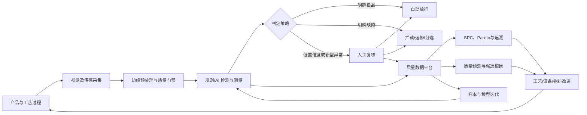
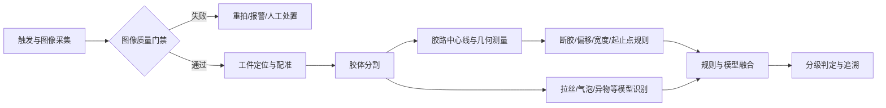
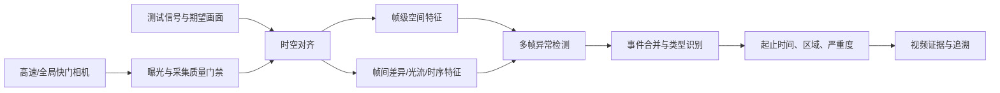

# AI 赋能智能制造质量检测与分析：典型场景与落地经验

> 面向点胶缺陷检测、AI 增强 AOI、屏幕显示缺陷检测与质量分析的工程实践指南

## 摘要

制造业质量检测正在从“依靠人工抽检或固定规则判断”转向“机器视觉全检、AI 复判、质量预测和工艺闭环”。但在真实产线中，模型精度只是系统能力的一部分。成像稳定性、缺陷标准、产品追溯、工位节拍、异常恢复、人工复核和模型持续迭代，共同决定项目能否进入生产环境。

本文围绕点胶缺陷检测、AI 增强 AOI、屏幕花屏及显示缺陷检测、质量分析与根因定位四类典型场景，给出从业务定义、数据建设、算法设计、边缘部署到项目验收的完整方法。核心主张是：**AI 质检不是孤立的分类模型，而是一套从采集、检测、复核、追溯、分析到工艺改进的闭环生产系统。**

本文引用的论文数据用于说明技术路线和研究证据，不直接作为项目承诺。实际目标值应依据产品风险、质量标准、历史基线、产线节拍和现场验收集共同确定。

**关键词：** 智能制造；机器视觉；点胶检测；AOI；屏幕花屏；异常检测；预测性质量；根因分析；MLOps

## 目录

1. AI 质检的价值、边界与建设原则
2. 从检测到工艺改进的总体架构
3. 点胶缺陷检测：几何测量与复杂缺陷识别结合
4. AI 增强 AOI：从智能复判到多工序质量闭环
5. 屏幕缺陷检测：静态面板缺陷与动态花屏分治
6. 质量分析：从缺陷统计到预测与根因验证
7. 数据与模型全生命周期治理
8. 项目实施、验证与验收
9. 常见失败模式与经验总结
10. 分阶段建设路线图
11. 场景选型与文献证据矩阵
12. 参考文献与标准

---

## 1. AI 质检的价值、边界与建设原则

### 1.1 为什么传统质检需要 AI 增强

传统人工目检的优势是灵活、能够理解复杂语义，但容易受到疲劳、人员经验和判定尺度变化影响，也难以支持高速全检。传统机器视觉规则具有速度快、结果可解释的特点，但在反光、纹理干扰、产品变型和缺陷形态复杂时，规则数量会迅速膨胀，维护成本随之上升。

AI 的价值不是简单替代所有规则，而是补足以下能力：

- 识别形态多变、边界模糊、难以显式编程的缺陷；
- 从大量误报中筛出真正风险项，降低人工复判压力；
- 在少量或没有缺陷样本时，通过异常检测发现偏离正常分布的区域；
- 联合图像、工艺参数、设备状态和物料批次，预测产品质量风险；
- 将检测结果沉淀为结构化数据，为质量分析和工艺改进提供依据。

AI 同样有明确边界。极少出现的新型缺陷、成像系统漂移、标签错误和工艺分布变化都会导致模型失效。涉及安全、法规或重大质量风险的缺陷，不能只依赖单一模型置信度作最终放行，应保留确定性规则、冗余检测或人工复核。

### 1.2 先定义质量问题，再选择模型

项目立项时，应先回答五个问题：

1. **检测对象是什么：** 是产品表面、装配状态、胶路几何，还是屏幕显示信号？
2. **缺陷标准是什么：** 缺陷名称、位置、尺寸、严重度和允收边界是否可操作？
3. **检测结果如何使用：** 告警、拦截、分选、返修、设备调参，还是趋势分析？
4. **错误代价如何分配：** 漏检与过杀哪一个风险更高，哪些缺陷必须零容忍？
5. **真值从哪里来：** 人工复判、维修确认、电测、破坏性测试或客户反馈，哪一层才是最终标签？

如果这些问题没有形成书面口径，模型训练会把组织内部的判定分歧固化下来。所谓“准确率不高”，往往并非模型能力不足，而是样本单元、标签粒度或验收口径不一致。

### 1.3 三类技术范式各有位置

| 技术范式 | 适用问题 | 主要优势 | 主要限制 |
|---|---|---|---|
| 几何与图像规则 | 尺寸、位置、颜色、连通性、确定性边界 | 可解释、数据要求低、部署稳定 | 复杂背景下规则维护困难 |
| 监督学习 | 缺陷类别明确且有足够标注样本 | 分类和定位能力强，性能可量化 | 长尾缺陷、标签质量和分布漂移敏感 |
| 无监督/单类异常检测 | 良品充足、缺陷少或种类不断变化 | 降低缺陷样本依赖，可发现未知异常 | 异常分数不等于质量结论，误报治理难 |

成熟方案通常采用混合架构。例如，先用定位和配准规则消除姿态差异，再用分割模型提取胶路，最后用几何阈值判定胶宽、偏移和断胶；AOI 则保留原有规则召回能力，由 AI 承担复判和缺陷分类。

### 1.4 生产系统的五项建设原则

**原则一：成像优先。** 光学、治具、触发和曝光问题不能靠不断换模型解决。进入算法前，应先证明同一良品重复采集的一致性。

**原则二：以风险而非平均准确率驱动。** 分类别观察漏检和过杀，关键缺陷单独设门槛，不用一个总体 Accuracy 掩盖长尾风险。

**原则三：保留证据链。** 每次判定应能追溯产品、工位、时间、配方、图像、模型版本、阈值和复核结论。

**原则四：人机协同。** 低置信度、新型异常和高风险缺陷进入复核队列，复核结果反向进入训练闭环。

**原则五：先辅助决策，再自动闭环。** 模型在影子模式中证明稳定后，才逐步取得告警、拦截和工艺调节权限。

---

## 2. 从检测到工艺改进的总体架构

### 2.1 AI 质量闭环



这套架构包含两个不同速度的闭环：

- **实时闭环：** 在毫秒到秒级完成采集、推理、判定和 PLC/MES 交互，服务当前产品处置；
- **改进闭环：** 在小时到周级完成统计分析、根因验证、模型迭代和工艺优化，服务过程能力提升。

实时闭环追求确定性和故障可降级，改进闭环追求可解释、可验证和跨系统关联。两者不能共用一套松散的数据接口。

### 2.2 分层系统设计

| 层级 | 核心组件 | 关键职责 |
|---|---|---|
| 设备与采集层 | 相机、镜头、光源、3D 传感器、编码器、触发器、工控机 | 稳定获取与产品身份绑定的原始证据 |
| 边缘检测层 | 图像质检、配准、规则引擎、模型推理、判定引擎 | 在节拍内输出缺陷位置、类型、测量值和置信度 |
| 产线控制层 | PLC、机器人、AOI、分选机构、返修站 | 执行停线、拦截、分流、返修和异常恢复 |
| 制造运营层 | MES、QMS、SPC、设备管理、配方管理 | 管理工单、质量标准、复核、追溯和处置流程 |
| 数据智能层 | 数据湖仓、特征平台、分析服务、训练平台、模型注册库 | 质量分析、预测建模、模型治理和跨工序优化 |

### 2.3 最小可追溯数据模型

视觉结果不能只保存一张打框图片。每个检测单元至少应记录：

- `product_id`：序列号、面板 ID、PCB 条码或载具 ID；
- `work_order`、`product_model`、`recipe_version`；
- `station_id`、`equipment_id`、`camera_id`、`timestamp`；
- 原始图像或视频地址、采集参数、图像质量状态；
- 缺陷类型、位置、尺寸、数量、严重度、模型分数；
- `model_name`、`model_version`、推理配置和判定阈值；
- 自动判定、人工复判、维修确认和最终质量结论；
- 关联的材料批次、设备参数、工艺参数和环境数据。

产品身份绑定是整个闭环的基础。若图像只能关联到“某天某工位”，无法关联到具体产品和工艺窗口，后续的预测质量与根因分析只能停留在相关性猜测。

### 2.4 边云协同与故障降级

在线推理通常部署在靠近工位的工业 PC 或边缘服务器，以减少网络抖动和数据外传。中心平台承担训练、注册、发布、监控和批量分析。生产系统应定义以下降级策略：

- 模型服务不可用时，切回原规则、人工复检或安全停机；
- 图像质量门禁失败时，输出“采集失败”而不是“良品”；
- MES/QMS 暂时不可用时，本地缓存结果并保证有序补传；
- 新模型回滚时，模型、阈值、配方和运行时依赖作为同一发布单元回退；
- 任何自动工艺调整都设置上下限、速率限制和人工接管入口。

### 2.5 与国家标准对齐

系统设计可参考现行国家标准 [S1] `GB/T 40659-2021《智能制造 机器视觉在线检测系统 通用要求》`。项目测试可参考 [S2] `GB/T 42980-2023《智能制造 机器视觉在线检测系统 测试方法》`，后者覆盖准确性、速度、可靠性、精度、兼容性、一致性和安全性等方面。标准给出通用框架，具体缺陷定义、抽样方式、风险门槛和验收数据集仍需由项目双方结合工艺制定。

---

## 3. 点胶缺陷检测：几何测量与复杂缺陷识别结合

点胶广泛应用于电子封装、汽车零部件、动力电池、家电和大型构件制造。胶体往往同时承担粘接、密封、绝缘、导热或结构增强作用。点胶质量不仅与视觉外观相关，还受出胶压力、针头高度、运动速度、胶液温黏度和固化条件共同影响。

### 3.1 缺陷体系与检测边界

典型点胶缺陷包括：

- 少胶、缺胶、断胶和起止点异常；
- 多胶、堆胶、溢胶和胶宽不均；
- 胶路偏移、轨迹变形和接头错位；
- 拉丝、拖尾、飞溅和挂胶；
- 气泡、异物、针孔和表面破损；
- 胶高、截面积或体积不足。

2D 视觉擅长检测平面轮廓、颜色、连通性、胶宽和位置偏差，但单视角强度图无法稳定恢复胶高和胶量。胶体透明、半透明、强反光或与基材颜色接近时，应评估结构光、激光轮廓、光度立体、多角度成像或称重等补充方案。项目初期必须明确“外观合格”是否足以代表“功能合格”。若密封性、粘接强度或导热性能才是最终质量目标，需要用泄漏、拉力、切片或热测试建立视觉指标与功能质量的关联。

### 3.2 成像系统设计

点胶检测的第一难点通常不是网络结构，而是稳定地区分胶体和基材。工程设计应优先考虑：

- 根据胶体和基材的颜色、透明度、反射特性选择同轴光、低角度环形光、穹顶光、背光或偏振组合；
- 固定曝光、增益、白平衡和焦距，关闭会改变灰度分布的自动参数；
- 通过治具或视觉定位控制工件姿态，并保存定位偏差；
- 对高反光表面使用交叉偏振或多曝光，降低亮斑造成的胶路断裂假象；
- 对曲面和高度变化明显的工件，设计景深、自动对焦或多相机覆盖；
- 用同一良品重复上料和采集，量化胶宽、面积等测量结果的重复性。

若成像系统不能稳定复现同一产品，模型会学习光照和姿态噪声，后续扩充样本只能暂时掩盖问题。

### 3.3 推荐算法链



这一链路体现了不同算法的职责边界：

1. **图像质量门禁：** 检查模糊、过曝、欠曝、遮挡和触发丢帧，防止采集故障被判为良品。
2. **定位与配准：** 将实际工件变换到标准模板坐标，避免把装夹偏差误判为胶路偏移。
3. **胶体分割：** 可用传统阈值、颜色空间、轻量语义分割或提示式分割，输出胶体像素区域。
4. **几何测量：** 对分割结果提取中心线、胶宽、面积、间断长度、边界到基准轨迹的距离。
5. **复杂缺陷识别：** 用检测、分割或异常检测模型识别拉丝、飞溅、气泡和异物。
6. **判定融合：** 按产品配方应用尺寸公差、区域权重和风险规则，输出缺陷等级而非单一分数。

### 3.4 标注与样本建设

点胶样本应覆盖产品型号、胶水批次、针头规格、设备、班次、光源老化和工艺窗口。建议保留三类标签：

- **像素或轮廓标签：** 胶体区域、气泡、拉丝等，用于分割和精确测量；
- **几何标签：** 标准轨迹、允差带、关键转角、起止点和禁入区；
- **质量标签：** 缺陷类型、严重度、处置结果和功能测试结论。

训练集不应仅由“典型良品”和“明显缺陷”组成。最有价值的样本通常位于允收边界附近。对于争议样本，应由工艺和质量人员共同裁决，记录裁决依据；无法统一结论的样本可以标为“不确定”，进入人工复核而不是强行作为训练真值。

数据划分应以生产批次、时间段或产品序列为单位，不能把同一件产品的相邻图像随机分散到训练集和测试集，否则会产生数据泄漏和虚高指标。

### 3.5 阈值、判定与验收

点胶检测不宜只报告分类准确率。建议至少验收：

- 各缺陷类别的产品级召回率、精确率、漏检率和过杀率；
- 胶宽、偏移、间断长度、面积或胶高的测量误差；
- 同一产品重复检测的结果一致性和量具重复性；
- 不同工件位置、设备、批次和班次下的稳定性；
- 单件端到端处理时间、重拍率和设备可用率；
- 图像质量异常、模型异常和通信中断时的处置正确性。

阈值应从业务风险反推。关键密封区可以提高召回并接受更多复核，非关键外观区则可控制过杀。若一个产品包含多个胶段，还需明确像素级、胶段级和产品级判定的聚合规则。

### 3.6 点胶场景经验总结

相关研究已经证明机器视觉与 AI 可用于点胶过程监控和质量控制 [1][2]。落地经验可以归纳为三点：第一，优先把胶路转化为可测量的几何对象；第二，仅将形态复杂、难以显式描述的缺陷交给学习模型；第三，用功能测试校验视觉指标，避免系统只学会“看起来像合格”。

---

## 4. AI 增强 AOI：从智能复判到多工序质量闭环

自动光学检测（AOI）在 PCB、SMT、半导体封装和精密装配中已广泛使用。传统 AOI 通常依靠模板差分、颜色、形状和几何阈值实现高召回，但面对器件公差、焊点反光、丝印差异、板弯和多品种小批量时，容易产生大量误报。AI 的最佳切入点通常不是立即替换 AOI，而是先承担智能复判。

### 4.1 三种落地模式

| 模式 | 系统位置 | 适用条件 | 主要收益 | 主要风险 |
|---|---|---|---|---|
| AOI 智能复判 | 接收 AOI 报警图及上下文，判断真缺陷/假缺陷 | 既有 AOI 召回较高但误报多 | 改造小、见效快、降低人工复判 | 受 AOI 裁剪图和报警范围限制 |
| 独立 AI 检测工位 | AI 直接处理原始大图或多视角图像 | 新建产线或原 AOI 能力不足 | 可统一定位、检测和分类 | 成像、节拍和设备集成成本高 |
| 多工序质量融合 | 关联 SPI、贴片、回流焊、AOI、AXI、电测和维修 | 产品身份贯通、数据基础较好 | 可预测风险并定位过程来源 | 时钟、追溯和数据治理复杂 |

推荐采用渐进路径：先在影子模式下对 AOI 告警复判，不改变产线处置；稳定后自动放行高置信度假报；最后才考虑自动拦截、跨工序决策或替换部分规则。

### 4.2 缺陷分类与真值层级

以 SMT 为例，常见缺陷包括缺件、错件、偏移、反向、立碑、侧立、桥连、少锡、多锡、虚焊、焊球、引脚翘起、污染和丝印异常。不同工厂、产品和设备对同一名称的定义可能不同，因此要建立可版本化的缺陷字典：

- 缺陷代码、名称和层级；
- 适用器件或工艺；
- 可观测特征与反例；
- 严重度和处置规则；
- 与 MES、QMS、维修系统代码的映射。

尤其不能把 AOI 原始报警直接当作训练真值。建议保存四层结果：

1. `aoi_judgement`：设备或规则系统的初判；
2. `operator_review`：在线人员的复判；
3. `repair_confirmation`：维修拆解或返修时的确认；
4. `final_quality_outcome`：电测、功能测试或客户侧的最终质量结果。

不同任务选用不同真值。训练“替代人工复判”的模型可以使用稳定的复判结论；训练“预测功能失效”的模型则必须尽可能关联最终质量结果。

### 4.3 数据输入与模型策略

仅使用一张缺陷裁剪图，模型容易把背景、器件型号或 AOI 标记学成捷径。更稳健的输入可以包括：

- 当前检测图、标准模板或黄金样本、二者差分图；
- 缺陷局部图与更大范围上下文图；
- 器件类型、封装、位号、板号、检测程序版本；
- AOI 规则测量值、报警类型和置信度；
- 同一焊点的多光源、多角度或 3D 高度信息；
- 上游 SPI 锡膏体积、贴片偏移和设备工艺参数。

常见模型组合包括：分类模型用于真假缺陷复判，多任务模型同时预测缺陷类型和严重度，目标检测或实例分割用于独立 AI 工位，异常检测用于缺陷样本极少的新产品。上线初期应按器件族、缺陷族和产品型号分层评估，不因总体样本量大而忽略某个关键器件只有少量样本。

### 4.4 决策策略与人工工作台

模型输出不能直接等同于生产指令。判定层可以设置三个区间：

- **高置信度良品：** 自动放行，但按比例抽审并持续监控逃逸；
- **高置信度缺陷：** 自动拦截或进入维修，关键缺陷可要求二次确认；
- **不确定区间：** 进入人工复判队列，优先展示差分图、规则测量值和相似历史样本。

复判工作台应记录操作人、结论、原因、耗时和是否修改缺陷类型。频繁被人工推翻的报警组合是规则优化或模型重训的优先对象。对人工结论也应做一致性抽检，不能默认所有人工标签都正确。

### 4.5 多工序关联的实际价值

单站 AOI 回答“现在看见了什么”，多工序关联进一步回答“缺陷可能从哪里产生”。例如：

- AOI 焊点少锡与 SPI 锡膏体积不足关联；
- 器件偏移与贴片机吸嘴、供料器、坐标补偿关联；
- 桥连与钢网开口、锡膏黏度、回流曲线关联；
- 间歇性虚焊与炉温区参数、板弯或物料批次关联。

这些关系首先是候选假设，不能因模型发现统计相关就直接改变工艺。正确做法是定位时间窗口和受影响产品，结合设备记录、维修证据和受控试验验证。

### 4.6 AOI 场景验收

除分类别召回率、精确率和混淆矩阵外，AOI 智能复判应重点衡量：

- 误报削减率和人工复判工作量下降比例；
- 每百万机会漏检数或关键缺陷逃逸数；
- 自动放行覆盖率及其抽审错误率；
- 新产品换型所需样本量和调试周期；
- 单报警推理延迟、整板处理时间和峰值吞吐；
- 按产品、器件、位号、设备和班次分层后的性能稳定性。

AOI 与质量监控研究综述 [3][4] 表明，深度学习正在扩展传统 AOI 的复杂缺陷识别能力；公开 AOI 数据集研究 [5] 也可用于理解数据结构和实验方法。但公开数据与现场在相机、器件、缺陷比例和判定标准上存在明显域差异，只适合技术预研，不应代替现场验收集。

---

## 5. 屏幕缺陷检测：静态面板缺陷与动态花屏分治

“屏幕缺陷”常被作为一个任务提出，实际上至少包含两类机制不同的问题：

- **静态面板与显示均匀性缺陷：** 坏点、亮点、暗点、亮暗线、Mura、漏光、色偏、污渍、划伤等；
- **动态显示异常：** 花屏、闪烁、撕裂、冻结、跳帧、黑屏、白屏、错色、局部块状失真和短时噪点。

前者主要依赖标准测试画面、光学成像和空间特征，后者依赖视频序列、时间一致性和测试信号上下文。若把动态花屏压缩成单帧分类，短暂事件会被漏掉，相机伪影也容易被当成真实故障。

### 5.1 静态屏幕缺陷检测

静态检测通常播放黑、白、红、绿、蓝、灰阶或特定棋盘格画面，再采集屏幕图像。典型处理流程为：

1. 定位屏幕边界，完成透视校正和有效区域裁剪；
2. 校正镜头畸变、亮度渐晕和相机固定图样噪声；
3. 根据测试画面进行亮度、颜色、纹理和频域分析；
4. 使用规则、监督分割或异常检测定位缺陷；
5. 按缺陷尺寸、对比度、位置和 JND 等感知指标分级判定。

对坏点、亮暗线等局部高对比缺陷，局部统计和形态学方法通常足够稳定；对低对比、非均匀的 Mura，应结合背景拟合、频域滤波、多尺度增强和人眼可感知性评价。经典研究 [7] 使用离散余弦变换进行背景滤除并结合“恰可察觉差异”量化 Mura，为“缺陷可检测”与“缺陷可感知”的区分提供了方法基础。近年来的综述 [6] 则覆盖 LCD/OLED 缺陷的传统视觉和深度学习路线。

### 5.2 动态花屏与显示异常检测

动态异常检测的首要任务，是排除采集链制造的假缺陷。常见干扰包括：

- 屏幕刷新率与相机帧率或曝光时间不匹配造成的明暗带；
- 滚动快门与逐行扫描产生的条纹或局部撕裂；
- 屏幕像素阵列与相机传感器阵列叠加产生的摩尔纹；
- 自动曝光、自动白平衡和自动对焦引起的全局变化；
- 相机抖动、屏幕反光、环境光变化和视频压缩噪声；
- 测试内容本身的转场、粒子效果、快速运动和黑场。

因此，检测系统应同步掌握测试内容、刷新率、分辨率、信号接口和预期帧序列。对于可控测试，应尽量将实际采集画面与参考画面或渲染输出对齐；对于不可控内容，则使用时空异常模型学习正常动态模式。



### 5.3 动态检测的算法层次

可以按数据可控程度选择四类方法：

**参考帧比对。** 已知每一时刻期望画面时，先做几何、时间和颜色对齐，再计算结构相似度、感知差异或局部残差。该方法证据直观，但对同步误差和正常渲染差异敏感。

**规则化时序检测。** 用帧均值、直方图、边缘、块统计、哈希和帧间差分检测黑白屏、冻结、闪烁、跳变和大面积噪点。适合定义清楚的故障，应作为基础能力保留。

**监督视频识别。** 使用 2D CNN 加时序聚合、3D CNN、ConvLSTM 或视频 Transformer 识别已知故障类型。需要覆盖不同内容和设备的事件级标注，并防止模型只记住测试视频。

**弱监督或无监督异常检测。** 仅使用视频级标签或正常视频学习正常分布，适合难以逐帧标注和未知异常发现。图形处理单元和游戏画面异常相关预印本 [8][9] 展示了弱监督视觉异常检测与视频伪影检测的可行性，但这两项工作属于预印本证据，不能直接等同于经过量产验证的工业方案。

实际系统可以先用低成本规则筛选候选片段，再用时序模型分类，最后将连续异常帧合并为一个事件。这样既降低算力，也避免同一故障被重复计数。

### 5.4 事件标注与测试集设计

动态屏幕数据的基本标注单元应是“事件”，至少包含：

- 故障类型和严重度；
- 起始帧、结束帧及持续时间；
- 屏幕区域或掩膜；
- 测试内容、分辨率、刷新率和信号接口；
- 显示设备、主板/GPU、驱动或固件版本；
- 是否为相机伪影、内容正常效果或真实显示异常。

测试集应按设备、内容和时间隔离。若同一个测试视频的相邻片段同时出现在训练集与测试集，模型可能只识别内容场景而不是故障。还应专门构造困难负样本，如快速转场、闪光特效、字幕滚动、低照度场景和正常丢帧容忍区间。

### 5.5 验收指标

动态检测不应以逐帧准确率为主指标。正常帧占比通常极高，即使模型始终输出正常也会得到虚高准确率。建议使用：

- 事件级召回率和精确率；
- 每小时或每段测试的误报事件数；
- 从异常发生到告警的检测延迟；
- 预测起止时间与真实事件边界的偏差；
- 各故障类型混淆矩阵和严重度一致性；
- 跨分辨率、刷新率、设备、内容、驱动版本的泛化性能；
- 相机条纹、摩尔纹和正常视觉特效的误报率。

静态屏幕缺陷则应按点、线、面缺陷分别评价定位、尺寸测量和检出能力，并纳入不同灰阶、视场位置和重复采集条件。

### 5.6 场景经验总结

屏幕检测的核心经验是“先分清故障来自被测屏幕还是采集系统”。静态缺陷要控制测试画面和光学条件，动态花屏要控制时钟与序列上下文。最终证据应保存异常前后的视频片段、相机参数和测试信号信息，以便研发定位显示模组、信号链路、GPU、驱动或固件问题。

---

## 6. 质量分析：从缺陷统计到预测与根因验证

视觉检测解决“这个产品是否异常”，质量分析进一步解决“异常集中在哪里、接下来是否会发生、应该先排查什么”。要获得这一能力，必须把检测结果与设备、工艺、材料、人员、环境和时间窗口连接起来。

### 6.1 四级质量分析能力

| 层级 | 核心问题 | 常用方法 | 输出 |
|---|---|---|---|
| 描述性分析 | 发生了什么 | 良率、Pareto、SPC、趋势和分层统计 | 缺陷分布、异常时段、受影响范围 |
| 诊断性分析 | 可能为什么发生 | 对比分析、关联规则、聚类、特征重要性、知识图谱 | 候选原因及证据 |
| 预测性质量 | 接下来可能发生什么 | 分类、回归、时序模型、剩余过程窗口预测 | 产品风险分数、质量值预测、提前预警 |
| 处方与闭环优化 | 应该采取什么行动 | 约束优化、DOE、因果分析、维护与 CAPA 流程 | 参数建议、检查计划、纠正预防措施 |

建设顺序通常由低到高。基础追溯和缺陷编码不完整时，直接训练“根因大模型”不会跳过数据治理，只会把不一致的历史记录包装成看似合理的解释。

### 6.2 描述性分析：先建立统一质量事实

基础看板至少需要支持按产品、工单、设备、工位、模具/治具、物料批次、班次和时间窗口切片，并展示：

- FPY、直通率、报废率、返修率和复检率；
- 缺陷数量、缺陷率和严重度分布；
- 缺陷 Pareto、空间热力图和趋势；
- 控制图、过程能力指数和异常规则；
- 自动判定与人工复判差异；
- 模型版本、配方版本和质量指标变化。

统计口径必须一致。例如“缺陷率”是缺陷个数/检测机会数，还是不良产品数/生产产品数，两者不能混用。一个产品存在多个缺陷时，产品级良率与缺陷级 Pareto 也需要分别计算。

### 6.3 预测性质量建模

预测性质量研究的系统综述 [10] 表明，机器学习和深度学习已被广泛用于根据过程数据预测质量类别或连续质量值。工程上可按以下步骤实施：

1. **定义预测时点。** 只能使用该时点之前已经产生的数据，避免把后工序结果泄漏到特征中。
2. **定义标签。** 使用最终质量、功能测试、可靠性试验或客户结果，而不是方便获得但偏差明显的中间标签。
3. **构建时间窗口。** 对连续设备数据进行窗口聚合，并考虑工艺停留时间和传输延迟。
4. **按时间切分数据。** 用未来批次验证模型，模拟真实上线后的分布变化。
5. **处理类别不平衡。** 采用代价敏感学习、合理采样和 PR 曲线，不以总体准确率判断稀有缺陷。
6. **概率校准与分层评估。** 风险分数要经过校准，并按产品、设备和批次检查稳定性。

预测结果可以用于提前复检、动态抽样、维护排程和风险排序。除非有充分的安全论证，不应直接根据概率模型放宽关键质量检验。

### 6.4 根因分析不是特征重要性排名

制造根因分析相关综述 [11][12] 总结了机器学习在零缺陷制造和工业根因分析中的应用，也指出数据异构、因果关系、解释性和现场验证仍是核心挑战。

随机森林特征重要性、SHAP、注意力权重或相关系数回答的是“模型在当前数据中依赖哪些变量”，并不自动证明变量是物理根因。出现高重要性可能因为：

- 变量只是与真正原因共同变化的代理；
- 某个产品型号同时改变参数和缺陷率，形成混杂；
- 数据采集或标签在某个时间点发生变化；
- 下游变量泄漏了质量结果；
- 设备操作人员在异常后主动调整参数，产生反向因果。

因此，报告应使用“候选原因”“关联因素”或“优先排查项”，除非已经通过工艺机理和受控验证确认。

### 6.5 可执行的根因分析流程

推荐采用以下闭环：

1. **界定问题：** 明确缺陷、产品、时间窗口、工位和严重度，冻结统一事实集。
2. **划定影响范围：** 找出异常前后、受影响与未受影响的产品集合。
3. **分层比较：** 按设备、物料、班次、程序、参数区间和环境条件比较缺陷率。
4. **生成候选原因：** 结合统计检验、模型解释、过程知识、FMEA 和历史案例排序。
5. **检查时间顺序与混杂：** 确保原因先于结果，控制产品结构和工艺路线差异。
6. **受控验证：** 通过复现、对照实验、DOE、部件替换或参数回退验证候选原因。
7. **实施措施：** 修改工艺窗口、维护设备、隔离物料或更新作业标准。
8. **验证效果并固化：** 观察措施后的缺陷率和过程稳定性，将结论写入知识库、FMEA 和控制计划。

### 6.6 多模态质量知识的作用

质量问题的证据分散在图像、时序参数、报警日志、维修记录、8D 报告、FMEA 和人员经验中。可以建立以“产品—工序—设备—参数—物料—缺陷—措施”为核心的质量知识模型，支持：

- 从缺陷快速定位相关工序和可疑参数；
- 检索历史相似案例及当时的处置结果；
- 约束分析模型只在合理工艺路径上寻找原因；
- 将模型生成的分析说明绑定到原始数据和查询条件。

大模型可以辅助查询、归纳和报告生成，但数值计算应由可审计的数据服务完成，根因结论应引用具体批次、趋势、检验结果和验证记录，不能由语言模型独立裁决。

---

## 7. 数据与模型全生命周期治理

### 7.1 数据治理比一次训练更重要

生产数据持续变化：新产品导入、供应商切换、相机维护、光源衰减、工艺调参和质量标准修订都会改变数据分布。数据治理至少应覆盖：

- 数据采集协议、字段字典和产品身份绑定；
- 原图、裁剪图、叠加图和视频证据的分层存储；
- 缺陷字典、标注指南和标签版本；
- 样本来源、标注人、裁决记录和数据授权；
- 训练、验证、测试、验收集的隔离和版本固化；
- 数据保留周期、访问权限、脱敏和审计。

原始证据与派生数据应分开保存。叠加了框线或文字的图片不能替代原图，因为覆盖区域可能影响复核，也无法在模型升级后重新推理。

### 7.2 主动学习与难例闭环

无差别标注大量重复良品的收益很低。更有效的样本选择策略包括：

- 模型置信度位于不确定区间的样本；
- 模型与规则、模型与人工意见不一致的样本；
- 新产品、新设备、新物料或新工艺窗口样本；
- 聚类后位于稀疏区域或新簇中的样本；
- 已上线模型的漏检、过杀和客户逃逸样本；
- 对关键缺陷边界有代表性的困难样本。

生产反馈不应直接自动进入训练集。应经过去重、质量校验、标签裁决和数据泄漏检查，再形成可审计的新数据版本。

### 7.3 模型注册与发布单元

一次可复现的发布不只是一个权重文件，还应包含：

- 模型结构、权重、前后处理代码和运行时依赖；
- 输入尺寸、颜色空间、归一化和图像裁剪规则；
- 产品配方、类别映射、阈值、区域规则和判定逻辑；
- 训练数据版本、代码版本、随机种子和评估报告；
- 目标硬件上的性能测试、安全检查和回滚版本；
- 审批人、发布时间、适用产品和已知限制。

模型版本与配方版本必须同时记录。相同权重使用不同阈值或允差带，可能产生完全不同的生产结果。

### 7.4 上线流程

推荐按照以下权限阶梯发布：

1. **离线验证：** 在冻结测试集和历史回放集上评估；
2. **影子运行：** 在线接收真实数据，但不影响设备判定；
3. **辅助复判：** 向人员提供建议，保留人工最终决定；
4. **有限自动化：** 仅处理高置信度、低风险或指定产品范围；
5. **正式闭环：** 在受控边界内自动放行、拦截或触发工艺动作。

每一级都应预先定义进入条件、观察周期、退出条件和回滚操作。不能把“模型已部署”当作“模型已获得生产决策权”。

### 7.5 生产监控

生产监控分为四类：

- **输入健康：** 丢帧、模糊、亮度、对比度、视场偏移、曝光和设备温度；
- **服务健康：** 推理延迟、队列深度、GPU/CPU、内存、错误码和重启次数；
- **数据漂移：** 产品构成、特征分布、置信度分布和异常分数变化；
- **效果漂移：** 抽审错误率、人工推翻率、漏检、过杀和最终质量结果。

只有输入漂移而没有标签反馈时，不能断言模型效果已经下降；但它应触发加密抽审和风险评估。效果漂移确认后，应判断是成像故障、产品变化、标签口径变化还是模型失配，再决定修复硬件、更新规则或重训模型。

---

## 8. 项目实施、验证与验收

### 8.1 阶段一：场景定义与可行性验证

立项输出物应包括缺陷字典、质量标准、现状基线、节拍、错误成本、数据可得性和系统接口。可行性验证重点回答：

- 缺陷在物理上是否可被现有传感方式观测；
- 成像重复性是否满足测量要求；
- 缺陷真值是否可获得且判定一致；
- 样本是否覆盖主要产品和工艺变化；
- 预期收益是否高于设备、集成和持续运维成本。

这一阶段的结论可以是“不适合纯视觉”，例如内部气泡需要 X 射线、胶高需要 3D、功能性失效需要电测。及时改变传感方案比继续优化错误问题更有价值。

### 8.2 阶段二：数据基线与原型

建立最小数据链路，在固定成像条件下采集代表性样本；先实现可解释的规则基线，再比较监督学习或异常检测。原型报告应提供：

- 数据组成、切分方式和标签一致性；
- 各缺陷类别的样本量和性能，不只给总体指标；
- 典型漏检、过杀、相机伪影和边界样本；
- 目标硬件上的延迟、吞吐和资源占用；
- 对未覆盖产品、缺陷和工况的限制说明。

### 8.3 阶段三：工程集成与影子运行

完成相机触发、产品 ID、PLC、MES/QMS、复判工作台、日志、缓存和异常恢复。影子运行至少覆盖有代表性的产品、班次、设备维护和工艺变化周期。期间不只收集模型错例，也要验证：

- 触发和产品身份是否错位；
- 图像、结果与返修记录能否完整追溯；
- 断网、断电、服务重启和磁盘满时是否按预案处置；
- 峰值流量是否造成排队和产线阻塞；
- 操作员是否能理解并高效完成复判。

### 8.4 阶段四：三层验收

**算法层**关注检测能力：

- 按类别和严重度统计召回率、精确率、漏检率、过杀率；
- 提供混淆矩阵、PR 曲线和阈值选择依据；
- 点胶等测量任务提供绝对误差、重复性和与基准量具的一致性；
- 动态屏幕任务提供事件召回、每小时误报和检测延迟。

常用定义如下，其中 `TP` 为正确检出的缺陷，`FN` 为漏检，`FP` 为误报：

```text
召回率 Recall = TP / (TP + FN)
精确率 Precision = TP / (TP + FP)
漏检率 = FN / (TP + FN) = 1 - Recall
```

“过杀率”必须在协议中明确分母。可定义为被错误判退的良品数占全部良品数的比例，也可定义为自动判退中误判的比例；两种定义不可混用。

**工程层**关注生产可用性：

- 端到端延迟、峰值吞吐、节拍裕量和结果抖动；
- 系统可用率、连续运行稳定性、重拍率和异常恢复时间；
- 产品身份、图像、模型版本和结果的追溯完整率；
- 不同设备、产品、班次和环境条件下的一致性；
- 权限、安全、日志、备份和回滚机制。

**业务层**关注实际收益：

- 人工复检工时和误报处理量下降；
- 报废、返工、质量成本和客户投诉变化；
- FPY、过程能力和异常处置时长改善；
- 新产品导入周期和规则维护成本变化；
- 综合设备、软件、标注、集成和运维后的 ROI。

### 8.5 验收数据集和统计要求

验收集必须在模型与阈值冻结前隔离，尽量来自不同批次和后续时间段。建议同时准备：

- **自然分布集：** 反映真实缺陷比例，用于评估业务运行结果；
- **缺陷挑战集：** 增加稀有和关键缺陷，验证分类别检出能力；
- **鲁棒性集：** 覆盖光照、位置、设备、批次和工艺边界；
- **故障注入集：** 验证相机断开、图像异常、服务超时和网络中断。

指标应报告样本量和置信区间。关键缺陷样本过少时，即使全部检出，也不能据此承诺接近 100% 的真实召回。论文中的单点准确率同样受数据集和实验条件限制，不能直接转换为量产验收目标。

### 8.6 组织分工

| 角色 | 主要责任 |
|---|---|
| 质量工程 | 缺陷定义、严重度、验收口径、复核与质量风险 |
| 工艺工程 | 机理分析、工艺窗口、样本复现和根因验证 |
| 自动化/设备 | 成像硬件、治具、触发、PLC、节拍和故障恢复 |
| IT/OT 与数据 | MES/QMS 接口、身份追溯、存储、安全和数据服务 |
| 算法与平台 | 数据版本、模型开发、部署、监控和迭代 |
| 产线运营 | 标准作业、复判执行、异常反馈和变更管理 |

项目责任不能只落在算法团队。缺陷标准、光学系统和工艺验证缺一项，模型都无法独立补齐。

---

## 9. 常见失败模式与经验总结

### 9.1 只追求模型榜单，不控制成像

**表现：** 离线测试很高，上线后随白天夜间、设备振动或光源衰减波动。

**原因：** 训练集把采集条件当作稳定前提，而生产输入并不稳定。

**改进：** 先做成像重复性、量具 R&R 或等价分析；固定自动参数；上线图像质量门禁和相机健康监控。

### 9.2 用设备报警或单人判断充当真值

**表现：** 模型很好地复制了 AOI 误报，或不同标注人结论冲突。

**原因：** 初判、复判、维修和最终质量结果没有分层。

**改进：** 建立标签层级、双人抽检和专家裁决；对边界样本允许“不确定”，持续度量标注一致性。

### 9.3 随机切分高度相似的生产图像

**表现：** 实验指标异常高，新批次性能明显下降。

**原因：** 同一产品、相邻帧或同批次近重复样本同时进入训练和测试。

**改进：** 按产品 ID、批次、时间、设备或视频片段分组切分，并做感知哈希去重。

### 9.4 只看总体准确率

**表现：** 正常样本占绝大多数，模型 Accuracy 很高却持续漏掉关键缺陷。

**改进：** 按缺陷类别和严重度报告召回、精确率、PR 曲线；动态故障采用事件级指标；关键缺陷设置独立门槛。

### 9.5 把异常检测分数当成缺陷结论

**表现：** 新产品、位置偏移或正常纹理变化引发大量误报。

**原因：** “不同于训练良品”不等于“违反质量标准”。

**改进：** 对异常区域增加配准、规则和人工确认；按产品或区域建模；用真实生产负样本调阈值。

### 9.6 把相关性解释成根因

**表现：** 根据 SHAP 排名直接调整工艺，缺陷没有改善甚至恶化。

**改进：** 将模型结果作为候选原因，检查时间顺序与混杂，再通过设备检查、对照和 DOE 验证。

### 9.7 一次上线后长期不管

**表现：** 产品、工艺和相机已经变化，模型仍使用旧阈值；现场通过绕过系统维持生产。

**改进：** 设定模型和配方责任人，监控输入与效果漂移，执行定期抽审、变更评估、复验和回滚演练。

### 9.8 一开始就追求自动调参闭环

**表现：** 模型错误通过控制动作被放大，难以区分原始异常和调参影响。

**改进：** 按“观察—建议—审批执行—受限自动化”逐级授权，使用参数上下限、变化速率限制、互锁和人工接管。

---

## 10. 分阶段建设路线图

### 10.1 第一阶段：单点可见、可测、可追溯

选择缺陷标准清晰、成像可控、质量损失较大的一个工位。完成稳定采集、规则或模型检测、人工复核和产品级追溯。目标是证明系统能够在真实节拍下持续工作，而不只是完成一次演示。

### 10.2 第二阶段：人机协同和多工位复制

建设统一复核工作台、缺陷字典、样本库和模型发布流程。将相同平台复制到点胶、AOI 或屏幕检测的多个工位，模型和配方按产品隔离。目标是降低人工负担并形成可持续迭代机制。

### 10.3 第三阶段：跨工序质量分析

贯通产品身份，关联检测、设备、工艺、物料和最终质量结果。上线 Pareto、SPC、空间热力图和候选原因分析，形成异常到批次、设备和参数窗口的追溯。目标是从“检出不良”转向“减少不良发生”。

### 10.4 第四阶段：预测与受控闭环

在高质量数据和已验证机理基础上建立质量预测，应用于动态抽样、风险排序和维护决策。成熟场景可在约束边界内给出工艺建议或自动调整，并通过持续对照验证收益。目标是形成可审计、可回滚的质量优化闭环。

### 10.5 建设优先级评分

候选场景可按五项评分：质量损失、人工成本、缺陷可观测性、真值可获得性、集成复杂度。优先选择“价值高、可观测、标签可靠、集成适中”的场景。稀有但高风险的缺陷即使 ROI 难以直接量化，也应按风险控制单独决策。

---

## 11. 场景选型与文献证据矩阵

### 11.1 四类场景选型对照

| 场景 | 建议首个切入点 | 关键传感与数据 | 推荐技术组合 | 最重要验收项 |
|---|---|---|---|---|
| 点胶缺陷 | 胶宽、偏移、断胶及典型拉丝 | 稳定 2D 成像；胶高要求 3D | 配准 + 分割 + 几何测量 + 缺陷模型 | 分类别召回、测量误差、重复性 |
| AI 增强 AOI | 对现有 AOI 告警做智能复判 | 告警图、上下文、复判和维修结论 | 分类/多任务模型 + 三段式判定 | 误报削减、关键缺陷逃逸、自动放行覆盖 |
| 静态屏幕缺陷 | 标准画面下的点线缺陷和 Mura | 受控测试画面、相机标定、亮色度 | 校正 + 频域/局部规则 + 分割/异常检测 | 定位与尺寸、JND/对比度、重复性 |
| 动态花屏 | 黑白屏、冻结、闪烁和块状失真 | 视频、测试内容、刷新率和设备配置 | 规则筛选 + 时序模型 + 事件合并 | 事件召回、每小时误报、检测延迟 |
| 质量分析 | Pareto、SPC 和重点缺陷追溯 | 视觉结果 + 产品 ID + 工艺/设备/物料 | 统计分析 + 预测模型 + 候选根因排序 | 数据完整性、预警提前量、措施后收益 |

### 11.2 文献证据如何使用

| 文献 | 支持的判断 | 不应直接外推的内容 |
|---|---|---|
| [1][2] 点胶视觉研究 | 视觉和 AI 可监控胶路质量，几何与学习方法可结合 | 特定设备和样本上的精度不能直接作为其他胶体、基材的验收值 |
| [3][4] AOI 综述 | AOI 从传统规则向深度学习、复杂缺陷识别和质量监控发展 | 综述列举的高指标不代表任意现场都可复现 |
| [5] AOI 数据论文 | 可参考 AOI 数据组织、缺陷样本和实验设计 | 公开数据无法代表本厂器件、相机和质量口径 |
| [6][7] 屏幕缺陷研究 | 静态屏幕缺陷需要背景校正、特征增强和感知量化 | Mura 方法不自动覆盖花屏、冻结等动态故障 |
| [8][9] 动态视觉异常预印本 | 弱监督和视频异常检测可用于图形输出伪影识别 | 预印本不是量产能力证明，也不等同于同行评审结论 |
| [10] 预测性质量综述 | 过程数据可用于质量分类和质量值预测 | 历史相关性模型不能自动给出可执行工艺因果结论 |
| [11][12] 根因分析综述 | ML 可辅助候选原因发现，因果、异构数据和解释性是难点 | SHAP 或特征重要性不能单独证明根因 |

### 11.3 项目启动检查表

在进入模型开发前，建议逐项确认：

- [ ] 缺陷字典、严重度和允收边界已由质量与工艺共同签字；
- [ ] 检测单元、产品级聚合规则和处置动作已定义；
- [ ] 同一良品重复采集的成像与测量结果稳定；
- [ ] 产品 ID 能关联图像、工艺、设备和最终质量结论；
- [ ] 初判、复判、维修确认和最终结果分别保存；
- [ ] 数据按产品、批次或时间隔离，避免训练测试泄漏；
- [ ] 关键缺陷、边界样本和困难负样本已纳入测试；
- [ ] 算法、工程和业务三层指标均有现状基线和验收口径；
- [ ] 断网、断电、采集失败、服务超时和模型回滚有预案；
- [ ] 上线权限、抽审比例、责任人和持续监控机制已明确。

---

## 结论

AI 赋能智能制造质量的真正价值，不在于将一个视觉模型接到相机后面，而在于把原本分散的检测证据、人工判断、设备参数和质量结果组织成持续改进闭环。

点胶场景应以配准、分割和几何测量为基础，再处理形态复杂缺陷；AOI 场景应优先利用 AI 降低误报，并保留初判到最终质量结果的标签链；屏幕检测必须区分静态面板缺陷与动态花屏，控制相机伪影和时序上下文；质量分析应从统一事实和统计分析起步，将模型解释视为候选原因，通过工艺验证后才能称为根因。

从工程角度看，稳定成像、可靠真值、产品追溯、故障降级和持续监控，与模型结构同等重要。按照“影子运行—辅助决策—有限自动化—受控闭环”的阶梯建设，才能在不放大生产风险的前提下，把 AI 从一次性演示转化为可运营的质量能力。

---

## 12. 参考文献与标准

> 检索说明：以下文献围绕点胶视觉、AOI、屏幕缺陷、动态视觉异常、预测性质量和根因分析选取。链接优先使用 DOI、出版社或论文官方页面。预印本已明确标注。检索与核对日期为 2026-11-04。

### 12.1 点胶缺陷检测

[1] *AI-enhanced vision system for dispensing process monitoring and quality control in manufacturing of large parts*. Procedia CIRP, 2022. [ScienceDirect](https://www.sciencedirect.com/science/article/pii/S2212827122004280)

[2] 《基于机器视觉的点胶质量检测方法》, 2020. DOI: [10.13462/j.cnki.mmtamt.2020.11.023](https://doi.org/10.13462/j.cnki.mmtamt.2020.11.023)

### 12.2 AOI 与 PCB 缺陷检测

[3] *A Review and Analysis of Automatic Optical Inspection and Quality Monitoring Methods in Electronics Industry*. IEEE Access, 2020. DOI: [10.1109/ACCESS.2020.3029127](https://doi.org/10.1109/ACCESS.2020.3029127)

[4] *Review of vision-based defect detection research and its perspectives for printed circuit board*. Journal of Manufacturing Systems, 2023. [ScienceDirect](https://www.sciencedirect.com/science/article/pii/S0278612523001693)

[5] *Data of automated optical inspection of surface-mounted technology electronic production*. Data in Brief, 2024. DOI: [10.1016/j.dib.2024.110110](https://doi.org/10.1016/j.dib.2024.110110)

### 12.3 屏幕静态缺陷与动态视觉异常

[6] 《基于视觉的液晶屏/OLED屏缺陷检测方法综述》, 2024. DOI: [10.11834/jig.230518](https://doi.org/10.11834/jig.230518)

[7] *Automatic TFT-LCD mura defect inspection using discrete cosine transform-based background filtering and “just noticeable difference” quantification strategies*. Measurement Science and Technology, 2008. DOI: [10.1088/0957-0233/19/1/015507](https://doi.org/10.1088/0957-0233/19/1/015507)

[8] *A Weak Supervision Approach to Detecting Visual Anomalies for Automated Testing of Graphics Units*. arXiv preprint, 2019. [arXiv:1912.04138](https://arxiv.org/abs/1912.04138)

[9] *Automating Artifact Detection in Video Games*. arXiv preprint, 2020. [arXiv:2011.15103](https://arxiv.org/abs/2011.15103)

### 12.4 预测性质量与根因分析

[10] *Machine learning and deep learning based predictive quality in manufacturing: a systematic review*. Journal of Intelligent Manufacturing, 2022. DOI: [10.1007/s10845-022-01963-8](https://doi.org/10.1007/s10845-022-01963-8)

[11] *A systematic review on machine learning methods for root cause analysis towards zero-defect manufacturing*. Frontiers in Manufacturing Technology, 2022. DOI: [10.3389/fmtec.2022.972712](https://doi.org/10.3389/fmtec.2022.972712)

[12] *Root Cause Analysis in Industrial Manufacturing: A Scoping Review of Current Research, Challenges and the Promises of AI-Driven Approaches*. Journal of Manufacturing and Materials Processing, 2024. [Publisher page](https://www.mdpi.com/2504-4494/8/6/277)

### 12.5 国家标准

[S1] GB/T 40659-2021，《智能制造 机器视觉在线检测系统 通用要求》，2021。可通过[全国标准信息公共服务平台](https://std.samr.gov.cn/)按标准号查询。

[S2] GB/T 42980-2023，《智能制造 机器视觉在线检测系统 测试方法》，2023。可通过[全国标准信息公共服务平台](https://std.samr.gov.cn/)按标准号查询。


