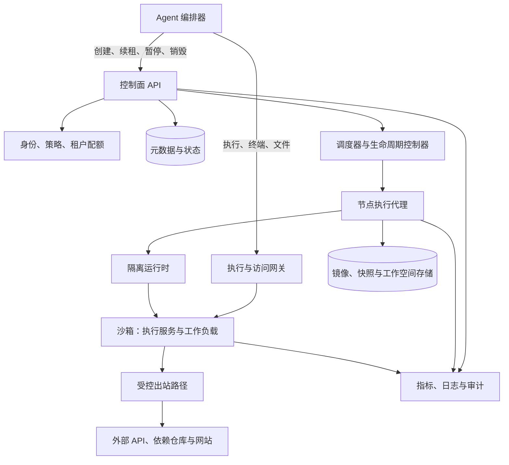
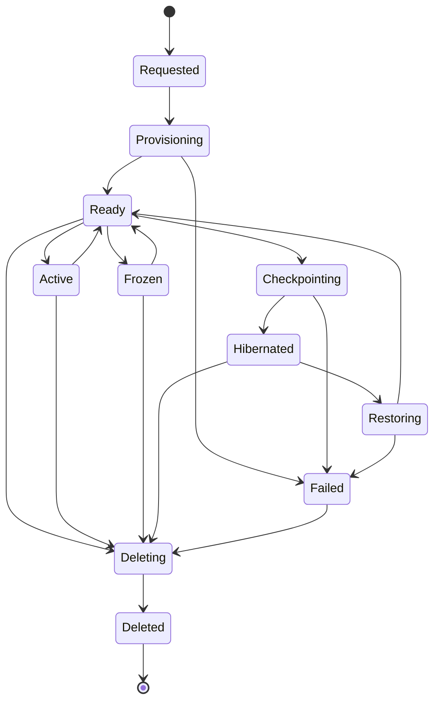

# Agent 基础设施：沙箱的架构设计、资源占用与成本优化

> 沙箱不是给 Agent 配一台“随便折腾的机器”，而是把不确定的执行行为，放进一个权限有边界、资源有上限、状态可恢复、成本可核算的运行环境。

一个编程 Agent 收到任务：修复项目中的错误，运行测试，再启动浏览器验证页面。

模型负责理解需求和选择下一步动作，但真正的工作发生在模型之外：下载代码、安装依赖、启动编译器、执行测试、打开浏览器、保存截图。这个过程中，Agent 可能执行错误命令，第三方依赖可能运行安装脚本，网页内容也可能诱导它访问不该访问的数据。

即使暂时不考虑攻击，这套环境依然有很多工程问题：依赖装在哪里？多个任务会不会互相污染？测试失控后谁负责终止？等待模型回复时，浏览器是否还占着内存？用户离开之后，工作目录应该保留多久？

这些问题共同指向 Agent 基础设施中的一个核心组件：**沙箱。**

本文围绕两个问题展开：

1. **如何设计一套适合 Agent 的沙箱系统？**
2. **如何理解和控制它的资源占用，而不是只看一个启动时间或内存数字？**

**阅读范围与证据说明：**本文以 Linux 云端执行为主，兼顾本地开发场景；依据文末列出的开源仓库和官方资料进行机制分析。架构建议属于工程设计，不代表所有项目已经实现。文中的容量数字均明确标注为假设，不是项目实测结果；模型推理成本与沙箱执行成本分开讨论。项目能力会随版本变化，生产选型仍需固定版本并验证。

---

## 一、为什么 Agent 需要沙箱

### 1.1 从“调用工具”到“执行不可信工作负载”

普通业务系统通常执行开发者提前确定的代码。Agent 则可能在运行时生成脚本、拼装命令、安装软件，再决定下一步操作。

这不意味着 Agent 的每一步都恶意，而是意味着：**平台不能把模型输出当成可信的系统管理指令。**

沙箱通常承载以下工作：

| 工作负载 | 典型行为 | 主要风险或资源特征 |
| --- | --- | --- |
| 脚本与数据处理 | Python 分析、文件转换、调用命令行工具 | 非法文件访问、大文件展开、内存峰值 |
| 编程与构建 | 拉取仓库、安装依赖、编译、测试 | 安装脚本执行、供应链风险、CPU 与磁盘突发 |
| 浏览器自动化 | 打开网页、登录、点击、截图 | 网页诱导、会话凭证泄露、多进程内存占用 |
| 长期工作空间 | 保留仓库、服务进程和用户上下文 | 状态污染、资源长期驻留、补丁与回收困难 |
| 批量评估与训练环境 | 并行创建大量相似环境 | 创建风暴、镜像和快照读取竞争、回收积压 |

沙箱至少提供四类约束：

- **权限约束：**能读写哪些文件、访问哪些网络、使用哪些凭证。
- **资源约束：**最多使用多少 CPU、内存、磁盘、进程和运行时间。
- **状态约束：**哪些数据可以保留，哪些必须随任务销毁。
- **管理约束：**谁创建、谁使用、谁付费、出了问题如何追溯。

### 1.2 沙箱不解决什么

沙箱不是完整的 Agent 安全方案。

如果 Agent 拿到了有效的生产数据库凭证，又被允许访问数据库，那么它在沙箱里执行的删除操作仍可能真实生效。文件系统隔离不会自动阻止经过授权通道发生的数据外泄，虚拟机也不会自动判断一笔转账是否合理。

因此必须区分三道防线：

```text
业务授权：这个任务有没有资格做这件事？
工具策略：这次调用是否在范围内，是否需要审批？
执行隔离：即使代码或工具失控，影响能否被限制？
```

**提示注入防护、业务授权、执行隔离互相补充，不能互相替代。**

### 1.3 先决定“一个沙箱服务谁”

隔离粒度会直接影响安全性和成本：

| 隔离粒度 | 优点 | 代价与适用边界 |
| --- | --- | --- |
| 每次工具调用一个 | 生命周期短，残留状态少 | 启动频繁，难以保留连续工作上下文 |
| 每个任务一个 | 便于归因和清理，任务间污染较少 | 多轮任务需要明确持久化策略 |
| 每个会话一个 | 多轮操作自然共享工作空间 | 等待用户和模型时容易闲置驻留 |
| 每个用户或项目一个 | 适合持续开发环境 | 状态复杂，资源和补丁管理成本更高 |

一种常见起点是：**租户间严格隔离，任务或会话内按需复用；文件持久化与进程驻留分开设计。**

同一个用户的两个任务也不一定具有相同信任级别。处理外部仓库、陌生网页或第三方文档时，仍应考虑独立环境。

---

## 二、先分清层次：沙箱平台不等于隔离运行时

“沙箱”这个词经常同时指 API 产品、Kubernetes 控制器、容器运行时和微虚拟机。它们并不是同一类东西。

### 2.1 四层心智模型

```text
Agent 应用层
  任务编排、模型调用、工具选择、人工审批
          ↓
沙箱平台层
  生命周期 API、配额、调度、执行接口、文件与会话管理
          ↓
隔离运行时层
  普通容器、gVisor、Kata 集成的虚拟机、直接管理的 microVM
          ↓
宿主机与资源层
  Linux / KVM、CPU、内存、磁盘、网络、节点运维
```

例如：

- OpenSandbox 更接近**统一沙箱平台**。
- Kubernetes Agent Sandbox 更接近**沙箱对象与生命周期编排**。
- gVisor 是**用户态内核隔离方案**。
- Firecracker 是**microVM 的虚拟机监控器（VMM）**。
- Kata Containers 将**基于虚拟机的隔离接入容器生态**，并支持不同虚拟化后端。

这些项目既可能替代，也可能组合。不能因为它们都使用了“sandbox”一词，就放在同一张性能榜上直接排名。

### 2.2 主要隔离路径及资源账单

| 路径 | 核心机制 | 主要资源增量 | 需要验证的边界 |
| --- | --- | --- | --- |
| 本地进程级限制 | 操作系统访问控制、文件限制、受控代理等 | 包装进程、代理、策略处理 | 与宿主机共享内核；平台差异与权限配置很重要 |
| 普通容器 | namespace、cgroup、capability、seccomp 等 | 容器运行与应用进程、可写层、辅助服务 | 共享宿主内核；错误挂载和特权配置可能破坏边界 |
| gVisor | 在应用与宿主之间引入用户态内核 Sentry | Sentry、文件访问辅助组件、系统调用和 I/O 路径成本 | 系统调用兼容性、文件与网络性能依赖负载及配置 |
| microVM | 硬件虚拟化、精简设备模型、独立 guest 内核 | VMM、guest 内核和服务、工作负载、宿主辅助组件 | KVM 可用性、设备与文件系统能力、镜像与快照管理 |
| Kata Containers | 通过 OCI/CRI 集成虚拟机隔离 | shim、VMM、guest agent、guest 内核等 | 后端差异、Pod/VM 映射、容器生态兼容性 |

硬件虚拟化通常提供比普通共享内核容器更强的隔离边界，但不是“绝对安全”。VMM、设备实现、宿主内核、网络与存储配置仍是攻击面。

Kata 的资源统计应先确定“一台 VM 对应几个容器或哪个 Pod”，而不是机械地按每个容器叠加一份 VM 成本。其 OCI/CRI 集成与多后端设计可参考[官方架构文档](https://github.com/kata-containers/kata-containers/blob/main/docs/design/architecture/README.md)。

WASM 也可以用于受限代码、插件或计算任务，但完整 Shell、常见 Linux 工具链和浏览器并不天然等同于 WASM 工作负载。是否采用，应先看工具兼容性，而不是只比较运行时体积。

### 2.3 三个不能直接使用的“漂亮数字”

**第一，VMM 开销不是整个沙箱内存。**

Firecracker 的[规格说明](https://github.com/firecracker-microvm/firecracker/blob/main/SPECIFICATION.md)在特定实例、资源充足、1 vCPU、128 MiB guest 内存和特调内核等条件下，给出 VMM 线程内存开销不超过 5 MiB 的指标，并说明开销受工作负载和配置影响。

它不是在说“一个运行 Python 和浏览器的 Agent 沙箱只需要 5 MiB”。guest 内核、应用、缓存与其他服务都需要另外核算。

**第二，虚拟机启动时间不是环境可用时间。**

同一规格说明中的启动指标，测量的是收到启动请求到 guest 的 `/sbin/init` 开始运行，而不是仓库下载完毕、依赖安装完成、浏览器可以点击页面。

**第三，某类负载的性能损耗不是通用损耗。**

gVisor 的[性能分析](https://github.com/google/gvisor/blob/master/g3doc/architecture_guide/performance.md)区分结构性与实现性成本，且具体测试具有平台和环境条件。纯计算、频繁系统调用、大量小文件操作、网络密集型任务，可能呈现不同结果。旧测试的平台结果也不能直接代表新版本或其他平台。

---

## 三、开源项目应该怎么研究

选型时不应只问“哪个项目最火”，而应问：**它覆盖了哪一层？还需要自己补什么？**

### 3.1 值得对照阅读的仓库

| 项目 | 所处层次与已公开的方向 | 对本文最有价值的研究点 |
| --- | --- | --- |
| [OpenSandbox](https://github.com/opensandbox-group/OpenSandbox) | 统一沙箱 API、Docker/Kubernetes 后端、沙箱内执行组件与网络控制 | 控制面、执行面、运行时适配和网络治理如何解耦 |
| [E2B Runtime](https://github.com/e2b-dev/runtime) | 基于 Firecracker 的执行后端，包括 API、节点编排、VM 内服务、路由和模板构建 | 快照创建、暂停恢复、节点缓存与数据路径 |
| [Kubernetes Agent Sandbox](https://github.com/kubernetes-sigs/agent-sandbox) | `Sandbox` 及模板、申领、预热池等 CRD 与控制器 | 如何把状态化单实例环境纳入声明式管理 |
| [microsandbox](https://github.com/superradcompany/microsandbox) | 本地 microVM、CLI 与可编程 SDK | 单机或嵌入式环境的固定成本与使用体验 |
| [Firecracker](https://github.com/firecracker-microvm/firecracker) | 精简 microVM VMM | guest、VMM 与宿主资源如何分层核算 |
| [gVisor](https://github.com/google/gvisor) | 用户态内核与 `runsc` 容器运行时 | 隔离层如何影响系统调用、内存与 I/O |
| [Kata Containers](https://github.com/kata-containers/kata-containers) | 虚拟机隔离与容器运行时集成 | Kubernetes 场景下的 VM 边界与适配成本 |
| [Anthropic Sandbox Runtime](https://github.com/anthropics/sandbox-runtime) | 对任意进程实施操作系统级文件与网络限制 | 本地 Agent、命令与 MCP 服务的低额外层级限制 |

这不是统一基准测试，也不是功能、许可证或成熟度完全相同的候选名单。使用前应核对具体版本、许可证、安全公告、宿主条件及维护情况。

### 3.2 从三个平台项目读出架构规律

**OpenSandbox：统一 API，不代表所有后端语义一致。**

其[架构文档](https://github.com/opensandbox-group/OpenSandbox/blob/main/docs/architecture/index.md)区分生命周期管理、执行与服务访问、出站控制等路径。开发者可以使用统一入口，但容器与 microVM 的快照、网络、存储和暂停能力仍取决于具体后端。

设计自己的平台时，可以借鉴它的分层，而不应让上层误以为“任意运行时都支持相同恢复保证”。

**E2B Runtime：快照和缓存是系统主路径，不只是附加按钮。**

其 README 描述了从快照恢复沙箱、按需加载内存页、写时复制文件系统，以及控制面与节点执行面分离等设计。研究重点应是：快照存在哪里、缓存命中与未命中差多少、缺页读取发生在什么时刻、暂停后哪些进程与资源被释放。

它也提供[单机 Embed 部署说明](https://github.com/e2b-dev/runtime/blob/main/embed/README.md)。但“可以单机部署”并不等于生产规模下无需考虑高可用、存储增长、升级和节点故障。

**Kubernetes Agent Sandbox：编排对象不产生新的隔离边界。**

该项目明确将自身定位为 sandbox orchestrator，并通过 `RuntimeClass` 等机制使用底层安全运行时。创建一个名叫 `Sandbox` 的对象，不意味着工作负载就已经运行在独立虚拟机中。

它的预热池能力也提示了一个成本事实：**低等待时间往往来自提前占用资源。**

### 3.3 本地进程限制是另一条路线

Anthropic Sandbox Runtime 的官方说明使用 macOS 的 `sandbox-exec`、Linux 的 bubblewrap 与代理式网络过滤等机制，并将项目标注为研究预览。其价值是为已有命令和进程增加访问限制，而不是完整复制一套云端虚拟机平台。

这种路线没有独立 guest OS 的那一份成本，但仍有代理和被执行程序的成本。**文件和网络限制也不自动等于 CPU、内存、进程数或租户配额控制。**

---

## 四、生产沙箱平台的架构设计

一个可用的执行环境，和一套可运营的执行平台，是两件不同的事。

### 4.1 推荐的控制面与执行面划分



这是一份参考架构，不要求所有模块独立部署；小规模可以合并服务，但应保留职责边界。

- **控制面：**决定谁可以创建、在哪个节点创建、资源上限多少、生命周期如何变化。
- **执行面：**真正运行命令、传输文件、建立终端、转发浏览器或应用流量。
- **节点代理：**负责本地运行时、网络、挂载、资源回收和故障上报。
- **存储与观测：**承载持久状态、恢复材料和操作证据。

长时间命令输出、截图或文件下载，不宜全部穿过生命周期 API。否则一个高流量任务可能拖慢所有租户的创建和回收请求。

同时，绕过控制面传输数据不等于绕过授权：执行网关仍需校验租户、沙箱身份、会话权限和令牌有效期。

### 4.2 生命周期必须有明确语义

下面是一组建议状态，并非某个项目的实际 API：



三个容易混淆的状态必须分开：

| 状态 | 含义 | 资源变化 |
| --- | --- | --- |
| Ready / Idle | 环境就绪，没有前台命令 | 仍可能存在浏览器、后台服务、内存与网络连接 |
| Frozen | 暂停进程或 vCPU 执行 | CPU 活动下降，但不保证释放内存 |
| Hibernated | 状态已持久化，并释放主要执行资源 | 内存驻留通常显著下降，存储和恢复成本上升 |

产品 API 都叫 `pause` 时，也必须继续问：它是冻结、做快照后停止，还是其他实现？

状态转换还应具备：

1. **幂等键：**客户端重试创建时，不重复产生多个收费实例。
2. **租约与过期策略：**会话失联后最终能够回收，但续租需经过配额与授权检查。
3. **并发控制：**暂停、执行、续租和删除同时发生时，有明确的序列或拒绝规则。
4. **故障协调：**数据库显示存活而节点已经退出时，能发现并修正；反过来也能处理孤儿资源。
5. **分阶段清理：**终止工作负载、撤销访问、删除网络和挂载、释放存储引用，失败步骤可重试。

“删除 API 返回成功”和“所有节点资源已经释放”可以是不同时间点，应提供最终状态和清理延迟指标。

### 4.3 命令执行接口不应只是一个 `exec(string)`

至少需要定义：

- 命令使用 argv 还是 Shell；工作目录、环境变量和用户身份如何指定。
- 同步、异步、PTY 和后台进程之间的区别。
- 超时后是终止主进程、整个进程树，还是整个任务执行域。
- 客户端断线后，命令继续执行还是被取消。
- 标准输出如何限流、截断、保存和按序恢复。
- 命令完成、退出码、任务完成之间是什么关系。
- 重试是否可能产生重复写文件、重复提交或重复外部调用。

尤其是外部副作用，不能靠“重启沙箱”实现回滚。命令在支付接口返回之前超时，不代表支付没有发生；重试策略应由具备业务语义的工具层控制。

### 4.4 文件状态与进程状态分开管理

建议把存储分为四类：

| 类别 | 内容 | 策略 |
| --- | --- | --- |
| 基础镜像与模板 | OS、工具链、通用依赖 | 尽量只读、版本化、可验证、可缓存 |
| 临时可写层 | 构建中间物、下载文件、临时目录 | 限额，通常随实例删除 |
| 持久工作空间 | 代码修改、用户数据、需继续处理的文件 | 租户隔离，独立保留期限与备份策略 |
| 产物和恢复材料 | 报告、截图、快照、运行记录 | 按敏感性分级，设置保留与清理策略 |

“保留项目文件”不一定要求浏览器进程和整个内存空间一直驻留。先保存工作空间、下次重建运行环境，可能比长期保活更便宜，也更容易升级基础镜像。

反过来，文件恢复不等于进程恢复；内存快照也不能保证数据库、对象存储和外部服务处于一致时间点。

### 4.5 网络与凭证应遵循最小权限

默认允许所有出站访问，通常会放大数据外泄和横向访问风险。策略至少应覆盖：

- 依赖仓库、模型服务、业务 API、公共网页分别需要什么权限。
- 是否禁止访问云元数据地址、节点管理地址、控制面和未授权内网。
- DNS、直接 IP、代理变量、其他协议和已有连接是否可能绕过策略。
- 重定向、DNS 变化、IPv6 和连接复用是否被纳入检查。
- 入站浏览器、终端和调试端口是否需要独立认证。

域名白名单只有在所有相关流量确实经过执行点时才有意义；也不能把“允许访问某个域名”理解为“对这个域名的任何请求都安全”。

凭证优先使用短时、限范围、绑定任务或沙箱身份的授权。条件允许时，可由受信代理代发请求或注入凭证，避免把长期密钥直接写入环境变量和磁盘。但代理本身也必须限制目标、操作和参数，否则只是换了泄露通道。

内存快照、日志、终端输出和构建缓存都可能包含秘密，必须进入同一套敏感数据治理，而不能只扫描最终产物。

---

## 五、资源占用：先建立正确的账本

“一个沙箱占多少资源”如果不附带口径，几乎没有可比性。

### 5.1 必须区分四种数字

| 口径 | 回答的问题 | 常见误解 |
| --- | --- | --- |
| 配置与调度口径 | 允许用多少、调度时预留多少 | 把 limit 当成即时占用，把 request 当成硬上限 |
| 实例实际使用 | 当前进程、cgroup 或 VM 消耗多少 | 只看主进程，漏掉子进程与辅助服务 |
| 宿主机实际消耗 | 整个节点为这些实例增加了多少负担 | 直接相加 RSS，重复计算共享页或漏算节点成本 |
| 计费口径 | 云厂商或平台按什么收费 | 把低 CPU 使用率理解为不会收取 CPU 费用 |

在 Kubernetes 中，request 影响调度资源判断，limit 用于相关资源的运行期限制；它们与实际使用量并不相同。虚拟机配置的内存、宿主机实际驻留内存，以及云产品计费内存，也可能是三种数字。

### 5.2 内存不能只看工作负载进程

可以使用下面的概念模型理解账单：

```text
单沙箱增量内存 ≈
  应用工作负载
  + 隔离层及必要 guest 系统
  + 执行服务、代理与辅助组件
  + 可归因的缓存、缓冲和元数据
```

但这是概念分解，不是把所有监控数字直接相加的公式。对于 microVM，应用内存位于 guest 内存中；宿主机看到的 VMM 进程驻留内存可能已经包含 guest 映射。再把 guest 应用 RSS 加上去，就可能重复计算。

实际监控建议保留两条视角：

- **guest 内部：**解释是应用、内核还是缓存消耗了空间。
- **宿主外部：**解释节点到底失去了多少可用资源，是否出现回收压力和争抢。

gVisor 的[资源模型](https://github.com/google/gvisor/blob/master/g3doc/architecture_guide/resources.md)同样说明，沙箱对宿主表现为不同于普通应用进程树的资源形态，内部任务、文件和内存需要按其运行模型理解，不能照搬普通容器的逐进程观察方式。

### 5.3 容器资源控制应落实到执行域

Linux cgroup v2 提供 CPU、内存、I/O 和进程数等管理接口。常用字段及用途如下，具体支持与行为以部署内核为准：

| 接口 | 主要用途 | 需要注意 |
| --- | --- | --- |
| `cpu.max` | 设定 CPU 时间带宽上限 | 不是独占物理核心；限流会影响完成时间 |
| `cpu.stat` | 查看 CPU 时间与限流等统计 | 用累计 CPU 时间解释计算量，而非只看瞬时百分比 |
| `memory.current` | 查看 cgroup 当前内存使用 | 不等于应用堆大小，也不只包含匿名 RSS |
| `memory.peak` | 查看记录的内存峰值 | 需核对内核支持、统计窗口和重置语义 |
| `memory.high` | 施加回收压力与节流边界 | 不是简单的硬上限 |
| `memory.max` | 内存硬限制 | 无法回收时可能触发域内 OOM |
| `memory.swap.max` | 限制 swap 使用 | swap 也会改变尾延迟与磁盘负担 |
| `pids.max` | 限制任务数量 | 需要给正常多线程及浏览器留空间 |
| `io.max` / `io.stat` | 块设备 I/O 控制与统计 | 挂载路径、文件系统和缓存会影响观察结果 |
| `cgroup.freeze` | 冻结执行 | 不表示把内存转存后归还宿主 |

定义来源见 [Linux cgroup v2 官方文档](https://www.kernel.org/doc/html/latest/admin-guide/cgroup-v2.html)。

只限制沙箱内主进程还不够：节点上的文件代理、网络代理、快照上传器和共享网关，也需要明确限额与归因。否则租户可以通过制造大量 I/O 或快照工作，把资源压力转移到未受限的服务上。

### 5.4 CPU 应按时间与并发共同观察

```text
平均使用的 CPU 核数 = CPU 时间增量 / 墙钟时间增量
```

例如，一个任务在 10 秒墙钟时间内累计使用 20 CPU 秒，意味着这段时间平均使用约 2 个核心。这只是指标解释，不是性能基准。

Agent 经常在“等待模型—运行命令—等待网页—继续推理”之间切换。平均 CPU 低，仍可能出现短时间高并发编译；过强的 CPU 限流又会延长执行时间，进而增加内存驻留时长。

因此至少需要同时观察：CPU 秒、完成时间、并行度、限流时间、队列等待，而不是只盯住 CPU 利用率。

### 5.5 磁盘和网络往往是隐藏成本

磁盘需要区分：镜像逻辑大小、实际下载量、共享缓存、可写层增量、持久卷、快照和日志。它们既不是同一份空间，也不是相同的保留期限。

网络需要区分：外部下载、节点间传输、对象存储读取、快照上传、浏览器流量和日志上报。大量实例同时恢复，即使 CPU 和内存有余量，也可能被带宽和存储请求能力卡住。

还应设置磁盘容量、inode、输出日志、截图数量与产物大小限制。一个反复生成大文件的任务，不需要突破内存限制就能拖垮共享节点。

### 5.6 轻量运行时不等于轻量工作负载

空环境执行 `sleep`，只能说明空载基础成本。真实 Agent 可能同时运行：

```text
执行守护进程
  + Python / Node / JVM 等语言运行时
  + 编译器和测试子进程
  + 浏览器主进程、渲染进程和共享内存
  + 本地开发服务
  + 文件与依赖缓存
```

浏览器、编译器、大型数据处理本身可能成为主项。把隔离层优化几十 MiB，并不意味着整个工作负载也按同样比例下降。

---

## 六、容量规划：在线会话数不等于执行并发数

### 6.1 至少分清五个数量

- **逻辑会话数：**产品仍认为存在的会话，包括已休眠者。
- **驻留实例数：**当前仍有主要执行资源的实例，包括闲置和冻结者。
- **活跃实例数：**正在执行有意义工作的实例。
- **预热实例数：**尚未分配、为降低等待时间而准备的实例。
- **排队请求数：**资源或策略暂时不允许启动的请求。

平台宣传支持多少个会话，不能直接推导出多少个浏览器可以同时运行。

### 6.2 从生命周期推导平均驻留量

在稳定系统、统计边界一致且平均值存在的条件下，可以用 Little 定律：

```text
平均驻留实例数 = 实例进入驻留状态的平均速率 × 平均驻留时间
```

**假设示例：**每分钟进入 6 个新会话，每个会话平均驻留 20 分钟，则平均驻留实例约 120 个。如果通过休眠策略将每个会话累计驻留时间降到 4 分钟，并保持相同业务到达率、没有额外重建放大，则平均驻留规模约降到 24 个；逻辑会话数不因此自动减少。

如果一个会话多次恢复，就要把所有驻留区间都计入，或者改用恢复请求作为到达单位。不能把“首次创建速率”和“单次恢复停留时间”混在一个公式里。

这个结果是平均值，不是高峰容量，更不是允许关闭剩余所有节点的直接依据。

### 6.3 按状态而不是按一个统一规格估算

```text
节点内存 ≈ 固定系统开销
         + 活跃实例数 × 活跃平均增量内存
         + 闲置实例数 × 闲置平均增量内存
         + 预热实例数 × 预热平均增量内存
         + 未包含在上述口径内的共享开销
```

CPU、磁盘与网络也需要自己的约束。实际可承载数量取决于最先到达边界的那一项，而不是只取内存除法的结果。

平均值适合做资源账本；生产准入还需要并发分布、相关峰值、节点故障冗余和保守的安全余量。**多个实例的 P95 相加也不自动等于节点总量的 P95。**

### 6.4 一个完整的假设算例

> 以下数字全部用于说明计算方法，不代表任何开源项目或机器的实测表现。

假设一台节点有 32 vCPU、128 GiB 内存：

- 系统与共享组件预留 6 vCPU、16 GiB。
- 剩余 26 vCPU、112 GiB 中，只使用 80% 作为正常准入预算。
- 因而 CPU 预算为 20.8 核，内存预算为 89.6 GiB。

假设节点共有 100 个驻留环境，其中 80 个已分配、20 个待分配预热：

| 状态 | 数量 | 假设平均增量内存 | 假设平均 CPU 核数 | 合计内存 | 合计 CPU |
| --- | ---: | ---: | ---: | ---: | ---: |
| 活跃 | 28 | 1.40 GiB | 0.500 | 39.2 GiB | 14.00 |
| 闲置 | 52 | 0.45 GiB | 0.010 | 23.4 GiB | 0.52 |
| 预热 | 20 | 0.30 GiB | 0.005 | 6.0 GiB | 0.10 |
| 合计 | 100 | — | — | 68.6 GiB | 14.62 |

这个状态落在预算内。即使每个环境的配置上限都是 4 GiB，也不能说节点当前实际使用了 400 GiB；但同样不能据此保证每个环境都能同时用满上限。

如果 80 个已分配环境中有 `A` 个活跃，其他都闲置，预热数量不变，则：

```text
内存 = 1.40A + 0.45(80 − A) + 20 × 0.30
     = 42 + 0.95A GiB

CPU  = 0.500A + 0.010(80 − A) + 20 × 0.005
     = 0.90 + 0.49A 核
```

按上述平均模型计算，内存预算允许约 50 个活跃实例，CPU 预算只允许约 40 个。**此时 CPU 更早成为瓶颈。**

如果预热实例也全部被分配并同时活跃，100 个实例按相同活跃均值估算会需要 140 GiB 和 50 核，明显超过预算。

所以这个节点能够维持“100 个环境存在”，不等于承诺“100 个任务同时全速执行”。这些计算还没有替代真实峰值、I/O 和故障条件下的压测。

### 6.5 超卖必须配合准入与背压

需要同时设置：

- 租户和任务类型的活跃并发上限。
- 节点可用内存与压力阈值，而不只是 CPU 利用率。
- 任务队列、排队时限和公平调度。
- 创建、恢复、镜像拉取和快照上传的独立并发限制。
- OOM、磁盘压力、网络拥塞和节点故障时的降级规则。

如果调度器实际按 request 放置实例，request 总量可能先限制可调度密度。不能仅根据平均使用量的除法，声称 Kubernetes 就一定能放下同样数量的 Pod。

---

## 七、成本优化：先优化生命周期，再优化毫秒

### 7.1 成本有两本账

**资源效率账：**实际消耗了多少 CPU 秒、GiB·小时、存储字节和网络流量。

**财务账：**采购或租用了多少节点，哪些服务按预留规格收费，哪些按使用量收费。

自建节点中，把 CPU 利用率从 30% 降到 20%，如果节点数完全没变，账单可能不会随之下降。但释放出的容量可以承载更多工作，或在之后缩容。

```text
每个成功任务的沙箱成本 =
  分摊后的计算、存储、网络和平台运行成本
  ÷ 成功完成的任务数
```

分子应包含失败、重试、预热闲置和清理的消耗，不能只统计成功路径。模型 Token 和外部业务 API 成本可另行关联，避免混淆。

### 7.2 优先缩短无意义驻留

可以按任务类型设置分级策略：

```text
短等待：保留环境，避免频繁恢复
中等待：按能力冻结或收缩，但确认内存是否真的释放
长等待：保存工作空间或做检查点，释放执行资源
超期：销毁实例，按策略保留必要产物
```

不要只用 CPU 低来判断空闲。文件上传、网络等待、外部审批、长轮询以及后台任务可能仍在进行。应综合命令状态、I/O、连接、租约和业务心跳。

### 7.3 预热分层，不必总是养着完整实例

预热可以发生在不同层：

1. 节点已启动，镜像尚未拉取。
2. 镜像与通用依赖已经缓存。
3. 模板和快照在本地可读取。
4. 完整环境已恢复，只等分配给用户。

越接近第四层，分配路径通常越短，驻留资源也通常越多。

沿用前面的假设，20 个预热环境、每个 0.30 GiB，占用 6 GiB。若连续维持 30 天，即 720 小时，就产生：

```text
6 GiB × 720 小时 = 4,320 GiB·小时的内存驻留量
```

这不是直接账单金额，但清楚展示了低延迟的资源代价。预热池应随到达率和服务目标调整，而不是永久维持最大规模。

预热池被大量消耗后，还会产生补池负载。一次突发可能同时触发“用户任务执行”和“后台环境创建”，必须分别限流。

### 7.4 快照是把成本从一种资源搬到另一种资源

快照可能减少重新启动与初始化，但会增加：

- 写入、压缩、上传和元数据维护。
- 快照存储及保留期成本。
- 恢复时的下载、缺页、缓存和校验负担。
- 基础镜像更新后的兼容性处理。

惰性恢复可以降低初始读取量，但把部分成本移到第一次访问内存页或文件时。**恢复 API 很快返回，不等于第一条真实命令也很快。**

完整快照、增量快照、压缩量、逻辑 guest 内存大小、实际对象存储用量，是不同口径。不能拿其中一个替代其他指标。

快照还需处理：外部连接过期、时间推进、凭证失效、文件系统一致性、克隆后身份与随机状态，以及特定设备或进程是否支持恢复。

### 7.5 缓存复用必须有安全边界

可以优先复用只读基础镜像、可验证的软件包和不含用户状态的模板。

需要谨慎处理：

- 用户源代码、私有依赖和构建日志。
- 含登录态的浏览器目录。
- 带凭证的环境变量、配置与内存快照。
- 可被用户修改的“公共”构建缓存。

跨租户复用不能只靠删除几个目录。最安全的预热基线通常是在注入用户数据和凭证之前制作的干净模板。

缓存需要明确可信来源、写入权限、完整性校验和作用域；对于高敏感租户，还应评估共享缓存与硬件资源带来的侧信道风险。

### 7.6 通过工作负载分级减少浪费

| 类型 | 优先保障 | 可以优先尝试的优化 |
| --- | --- | --- |
| 短脚本 | 快速启动、低固定成本 | 小规格、短 TTL、复用只读工具链 |
| 编译测试 | CPU 吞吐、文件系统性能 | 限制并行度、依赖缓存、构建节点池 |
| 浏览器任务 | 内存、共享内存、页面响应 | 限制标签页、及时关闭上下文、减少不必要媒体加载 |
| 长期开发环境 | 状态可延续、交互体验 | 工作空间持久化、空闲休眠、分级规格 |
| 批量评估 | 高吞吐、隔离一致性 | 模板复用、批量准入、分批启动与回收 |

优化应以“每个成功任务的总资源”和服务目标为准。减少内存上限导致频繁 OOM、压低 CPU 导致运行时间翻倍，都可能让总成本变高。

---

## 八、如何做一次可信的验证与选型

### 8.1 固定环境，而不是比较两张宣传图

每组测试至少记录：

- 项目版本或 commit、运行时模式与配置。
- CPU 架构和型号、是否裸机或嵌套虚拟化、KVM 条件。
- 宿主与 guest 内核、容器运行时、文件系统及存储位置。
- 镜像、模板、依赖、浏览器版本与工作目录大小。
- vCPU、内存、swap、磁盘与进程数限制。
- 网络条件、缓存状态、日志和观测开销。

不同方案要尽量执行相同的业务步骤、使用相同输入和验收标准。对于不支持的能力，应明确写“不支持或未验证”，而不是用空载测试代替。

### 8.2 分开测试四条启动路径

| 路径 | 前置条件 | 重点观察 |
| --- | --- | --- |
| 冷启动 | 新节点或本地无相关镜像、模板、快照缓存 | 下载、解包、初始化和整体就绪时间 |
| 温启动 | 节点与缓存就绪，但没有可直接分配的运行实例 | 创建或恢复路径与首次真实命令 |
| 预热池分配 | 已有可用实例等待领取 | 分配、绑定身份、授权和首次操作 |
| 休眠恢复 | 已有任务状态，需要恢复继续执行 | 状态完整性、首次命令、连接和凭证重建 |

记录 P50、P95、P99、样本数与失败率。要说明是否把失败样本排除了；只公布成功请求的延迟，可能掩盖严重问题。

建议按统一时间点拆分：

```text
请求进入 → 配额通过 → 调度完成 → 镜像/快照可读
        → 隔离环境启动 → 执行服务就绪 → 第一条有效命令完成
```

对浏览器任务，还应额外记录页面可交互、首次动作成功或业务步骤完成的时间。

### 8.3 用四类工作负载覆盖真实差异

1. **空载基线：**仅启动必要服务，测试固定成本，不用于代表完整 Agent。
2. **脚本任务：**读取固定数据、执行计算、生成文件，记录 CPU 时间和内存峰值。
3. **构建测试：**同一个仓库、锁定依赖、分别测试缓存命中与未命中。
4. **浏览器流程：**固定页面与步骤，记录进程树、共享内存、截图和整体成功率。

长期会话还需要测试：多轮操作后内存是否持续增长、空闲回收是否生效、恢复是否保留必要状态。

### 8.4 不只测单实例，还要测相关突发

关键场景包括：

- 大量实例同时创建，镜像与快照缓存尚未命中。
- 大量闲置实例同时恢复并进入编译或浏览器阶段。
- 任务集中结束，同时上传产物、日志和快照。
- 预热池耗尽，补池与正常任务竞争。
- 节点突然失联，控制面重试、接管与清理。
- 出站服务变慢，引发驻留增长与请求堆积。

验收不应只有吞吐量，还要包括：是否错误跨租户访问、是否漏清理资源、是否重复执行有副作用的命令、是否出现无法恢复的状态。

### 8.5 建议的最小观测与报告

| 维度 | 建议指标 |
| --- | --- |
| 生命周期 | 创建/恢复/删除延迟、失败率、清理延迟、孤儿资源数量 |
| 使用状态 | 活跃、闲置、冻结、休眠、预热与排队数量 |
| CPU | CPU 秒、限流时间、运行时间、节点争抢 |
| 内存 | 当前值、峰值、宿主可用量、回收压力、OOM 事件 |
| 存储 | 读写量、峰值可写层、镜像与快照缓存、inode、清理积压 |
| 网络 | 出入站字节、连接数量、对象存储请求、策略拒绝 |
| 质量 | 任务成功率、恢复后验收通过率、超时与重试 |
| 成本 | 每个成功任务的资源量与分摊成本、闲置比例、预热占比 |

关联字段至少包括租户、任务、沙箱、节点、镜像/模板版本和 trace ID。监控标签应控制基数，具体任务和命令细节更适合进入日志或追踪系统；日志必须脱敏。

最终报告应给出“某版本、某配置、某负载、某缓存状态下”的结论，而不是“某项目永远最快”。

---

## 九、落地建议：从最小闭环到规模化

### 9.1 第一阶段：把边界做对

先明确威胁模型、租户边界和隔离运行时，再完成：

- 创建、执行、取消、文件读写、最终回收。
- CPU、内存、磁盘、进程数、输出和时间限制。
- 出站策略、访问认证、短时凭证和操作审计。
- 工作空间与临时状态的保留规则。
- 超时、断线、节点退出和重复请求处理。

如果这一步没有做完，提前追求大规模预热和复杂快照，只会让失控资源和敏感状态更多。

### 9.2 第二阶段：把账算清

用真实任务建立资源画像，分开测固定开销、活跃峰值、闲置驻留和恢复成本。建立按租户及工作负载的准入与背压，先保证系统在容量边缘能够有序拒绝和排队。

### 9.3 第三阶段：针对瓶颈优化

- 启动慢：区分下载、初始化、分配和应用准备，再决定缓存还是预热。
- 内存贵：优先检查浏览器、后台服务、闲置驻留和规格分级。
- 构建慢：检查 CPU 限流、文件系统、依赖缓存和并行度。
- 恢复抖动：检查快照缓存、存储读吞吐、缺页与恢复并发。
- 节点利用率低：先确认调度 request、租户策略和规格碎片，再考虑超卖。

小团队可以优先验证 OpenSandbox 或 E2B Runtime 等平台路线；已有 Kubernetes 体系的团队可以研究 Agent Sandbox 与 gVisor/Kata 等运行时的组合；本地工具可以从进程级限制或 microsandbox 这类本地 microVM 路线入手。

这只是研究入口，不是无需评估的选型结论。成熟度、运维能力、恢复需求和安全边界，通常比仓库热度更重要。

---

## 结语

Agent 沙箱的设计，不是简单地选择 Docker 还是虚拟机，而是同时回答四个问题：

1. **执行边界在哪里？**哪些代码、数据、网络和凭证需要被限制？
2. **状态如何延续？**哪些保存为文件，哪些保留为进程，哪些能够快照恢复？
3. **资源如何归因？**应用、隔离层、代理、缓存、预热和平台分别花了多少？
4. **过载时如何收敛？**谁排队、谁被回收、谁可以重试，如何避免影响其他租户？

开源项目提供了不同层次的积木，但生产能力来自把这些积木组织成一个有边界的系统。

**真正应该优化的，不是“空沙箱启动得有多快”，而是“在满足安全边界和交付质量的前提下，每个成功任务需要付出多少资源与运维成本”。**

---

## 参考资料与进一步阅读

以下优先使用项目仓库与官方文档；检索与核对日期为 2026-11-12。链接中的 `main` / `master` 会更新，复现时请固定 commit 或发布版本。本文未对项目部署或运行基准测试。

1. **OpenSandbox**：[项目仓库](https://github.com/opensandbox-group/OpenSandbox)；[架构说明](https://github.com/opensandbox-group/OpenSandbox/blob/main/docs/architecture/index.md)。用于理解生命周期、执行接口、后端和网络的分层。
2. **E2B**：[Runtime 后端](https://github.com/e2b-dev/runtime)；[SDK 与 CLI](https://github.com/e2b-dev/E2B)；[Embed 部署说明](https://github.com/e2b-dev/runtime/blob/main/embed/README.md)。用于研究 microVM 平台、快照、恢复和单机部署形态。
3. **Kubernetes Agent Sandbox**：[项目仓库](https://github.com/kubernetes-sigs/agent-sandbox)。用于理解 `Sandbox`、`SandboxTemplate`、`SandboxClaim`、`SandboxWarmPool` 及其与底层运行时的关系。
4. **microsandbox**：[项目仓库](https://github.com/superradcompany/microsandbox)。用于研究本地、嵌入式 microVM 使用方式。
5. **Firecracker**：[项目仓库](https://github.com/firecracker-microvm/firecracker)；[规格与指标口径](https://github.com/firecracker-microvm/firecracker/blob/main/SPECIFICATION.md)。用于区分 VMM 开销、guest 内存和启动阶段。
6. **gVisor**：[项目仓库](https://github.com/google/gvisor)；[资源模型](https://github.com/google/gvisor/blob/master/g3doc/architecture_guide/resources.md)；[性能模型](https://github.com/google/gvisor/blob/master/g3doc/architecture_guide/performance.md)。用于理解用户态内核的资源形态及负载相关开销。
7. **Kata Containers**：[项目仓库](https://github.com/kata-containers/kata-containers)；[架构说明](https://github.com/kata-containers/kata-containers/blob/main/docs/design/architecture/README.md)。用于理解虚拟机隔离如何接入 OCI/CRI 与 Kubernetes。
8. **Anthropic Sandbox Runtime**：[项目仓库与机制说明](https://github.com/anthropics/sandbox-runtime)。用于理解本地进程的文件系统与网络限制。
9. **Linux cgroup v2**：[官方文档](https://www.kernel.org/doc/html/latest/admin-guide/cgroup-v2.html)；[内核源码中的文档](https://github.com/torvalds/linux/blob/master/Documentation/admin-guide/cgroup-v2.rst)。用于核对 CPU、内存、I/O、进程数与冻结接口的定义。