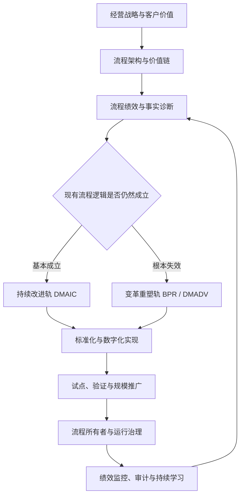
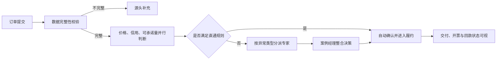

# BPM 与精益六西格玛：从持续改进到变革性流程重塑

一家企业发现“订单到回款”周期过长，于是分别推动了几项工作：销售部门简化审批，财务部门上线自动对账，运营团队开展精益改善，信息部门引入工作流和 RPA。每个项目似乎都取得了局部成果，但客户仍然需要反复提交信息，订单仍会在部门交接处停留，异常仍然依赖管理者人工协调，企业的现金周转也没有出现预期改善。

问题不一定出在工具无效，而可能出在企业把一个端到端流程问题拆成了多个部门任务。局部效率提高了，流程整体却没有被重新审视；自动化减少了手工操作，却把历史规则、冗余审批和系统断点一起固化下来；改善项目解决了已知缺陷，却没有回答现有流程是否仍然适合新的客户需求和经营战略。

这正是业务流程管理（Business Process Management，BPM）、精益六西格玛（Lean Six Sigma，LSS）与业务流程重塑（Business Process Redesign/Reengineering，BPR）需要协同使用的原因：

- BPM 负责建立端到端流程视角、生命周期管理和持续治理机制；
- Lean 负责识别非增值活动、缩短流动时间并改善资源配置；
- Six Sigma 负责降低波动和缺陷，以数据验证原因与结果；
- BPR 和 DFSS 负责在旧流程逻辑已经失效时设计新的工作方式；
- 数字技术负责放大新流程的能力，而不是替旧流程掩盖问题。

本文在相关研究基础上提出一套“**战略牵引、架构统筹、双轨改进、数字赋能、闭环治理**”的方法论。它的核心不是把几套工具机械拼接，而是解决三个管理问题：**企业应当改什么、应当改到什么程度，以及改善成果如何成为稳定的组织能力。**

> 资料口径：本文基于截至 **2026 年 10 月 27 日**可检索的 BPM、BPR、Lean Six Sigma 相关研究整理。文中框架属于面向企业实践的综合归纳，不代表任何单篇论文的原始模型。

---

## 摘要

业务流程管理、精益六西格玛和业务流程重塑分别形成于不同的管理问题与研究传统。BPM 强调流程的识别、建模、执行、监控和持续演进；精益六西格玛强调客户价值、流动效率、波动控制和结构化问题解决；BPR 强调从业务目标出发，对跨职能流程进行根本性重新思考。三者在实践中经常被割裂：BPM 容易退化为流程图和制度管理，精益六西格玛容易局限于单个改善项目，BPR 则可能因变革范围过大、证据不足和组织承接能力不足而失败。

本文通过文献梳理和方法比较，提出一套企业流程卓越框架：以战略目标和客户价值定义变革方向，以流程架构管理变革对象，以“持续改进—变革性重塑”双轨机制选择路径，以 DMAIC、DMADV/BPR 组织项目实施，以流程所有者、流程绩效和治理机制维持成果，并将流程挖掘、工作流、RPA、规则引擎、数据分析和人工智能作为新流程的能力组件。本文进一步给出分阶段实施方法、决策标准、治理角色、指标体系、路线图和示例，为企业从局部流程优化走向可持续的端到端流程变革提供参考。

**关键词：** 业务流程管理；精益六西格玛；业务流程重塑；DMAIC；DFSS；流程治理；数字化转型

---

## 一、为什么企业需要一套统一的流程变革方法

### 1. 部门绩效不能代表端到端流程绩效

企业的组织结构通常按销售、采购、研发、生产、物流、财务和客服划分，但客户获得的结果来自跨部门流程。例如，一张订单从需求确认到履约回款，可能经过客户主数据、信用检查、库存分配、生产排程、物流交付、开票和收款等多个环节。

每个部门都可能完成自己的 KPI，端到端流程仍然可能表现不佳：

- 销售追求快速签约，却向后端传递不完整或不可履约的需求；
- 生产追求设备利用率和大批量生产，却增加库存和客户等待时间；
- 财务严格控制信用和付款条件，却形成大量人工审批和重复核验；
- IT 按需求交付系统功能，却没有人对跨系统业务结果负责。

流程管理的第一个转变，是将评价对象从“部门做了多少工作”转向“流程为客户和企业产生了什么结果”。

### 2. 自动化不等于流程优化

Hammer 在 BPR 经典文献中提出，不应只是利用信息技术加速既有工作，而应重新思考工作本身[1]。Davenport 和 Short 同样强调，信息技术与流程重新设计应当相互作用，技术不仅支持流程，也能改变信息获取、协调和决策方式[2]。

这一判断在今天仍然成立。工作流、RPA、低代码和生成式 AI 都可以提高局部执行速度，但如果企业没有先处理以下问题，技术只会更快地运行一条不合理的流程：

- 为什么需要这一步；
- 这个审批控制的具体风险是什么；
- 同一信息为什么由多个岗位重复录入；
- 哪些异常可以由规则自动判定；
- 哪些活动可以并行而不是串行；
- 是否可以在流程上游消除下游检查；
- 客户需求是否必须经过现有组织边界传递。

因此，正确顺序不是“先选系统，再适配流程”，而是先定义目标流程和业务能力，再决定技术如何实现与放大这些能力。

### 3. 持续改进也有边界

Lean 和 DMAIC 擅长在现有流程基本逻辑成立时消除浪费、降低缺陷和稳定输出。然而，当商业模式、客户期望、监管环境或技术条件发生根本变化时，继续优化旧流程可能出现边际收益递减。

例如，企业可以不断缩短纸质单据的传递时间，但如果交易可以由可信数据直接触发，就应考虑取消单据；可以持续降低人工对账错误率，但如果上下游可以共享统一交易标识和规则，就应考虑重新设计结算机制。前者属于改善，后者属于重塑。

企业需要的不是在“改善”和“重塑”之间二选一，而是建立识别、选择和衔接两者的机制。

---

## 二、从 BPR、BPM 到精益六西格玛：研究脉络与互补关系

### 1. BPR：从局部自动化转向根本性重新设计

20 世纪 90 年代初期的 BPR 文献，集中批判以职能分工和局部自动化为基础的传统工作方式。其基本主张是从客户结果出发，跨越部门边界重新组合活动、角色、信息和决策权[1][2]。

后续研究开始关注 BPR 的实施条件和失败风险。Grover 等通过研究指出，流程再造不仅是技术项目，还涉及战略、组织结构、人员、管理机制和变革管理[3]。Kettinger 等对流程变革方法、技术和工具进行归纳，说明流程变革需要结构化的方法支撑，而不是依赖少数管理者的直觉[4]。Ozcelik 对美国企业项目的研究则表明，BPR 的收益需要经过时间释放，且信息技术投资与组织变革需要协同考虑[5]。

BPR 的贡献是提出了“流程可以被重新发明”，其风险则是容易被误解为一次性的大规模重组。若没有事实数据、实施节奏、人员参与和后续治理，宏大的目标流程可能停留在设计图上。

### 2. BPM：把流程变革转化为持续管理能力

BPM 将流程视为需要长期管理的组织资产。van der Aalst 将 BPM 概括为围绕业务流程设计、执行、控制和分析的一整套方法、技术与工具[6]。这意味着流程不是项目结束时交付的一张图，而是拥有目标、责任人、规则、数据、系统实现和绩效反馈的运行对象。

研究也揭示了 BPM 成功的组织条件。Trkman 将战略一致性、持续改进、信息技术、人员和治理等因素纳入 BPM 成功框架[7]。Kohlbacher 对流程导向研究的综述显示，流程导向与速度、客户满意度、质量和组织绩效之间存在积极联系，但需要组织结构和管理实践配合[8]。vom Brocke 等提出的 BPM 十项原则进一步强调情境适配、整体性、制度化、参与、共同理解、目标导向、渐进实施和技术适用性[9]。

BPM 的贡献是建立“流程生命周期”和“流程治理”，其常见弱点是方法过于宽泛：企业知道要识别、建模、监控和改进流程，却未必知道如何严谨地识别根因、验证方案和控制波动。

### 3. Lean Six Sigma：把速度、质量和证据连接起来

Lean 关注价值、价值流、连续流动、拉动和持续完善，Six Sigma 关注客户关键质量特性、过程能力、变异与缺陷。两者结合后，Lean 防止 Six Sigma 只关注统计质量而忽视等待与库存，Six Sigma 则防止 Lean 只凭经验消除活动而缺少数据验证[11][13]。

Shah 和 Ward 的研究说明，精益生产不是少数工具的集合，而是一套相互关联的社会技术实践[12]。Albliwi 等对制造业 Lean Six Sigma 文献的系统综述表明，LSS 已被广泛用于质量、成本、周期和运营绩效改善，但在理论统一性、长期效果和跨行业证据方面仍有研究空间[14]。Laureani 和 Antony 的综述进一步指出，领导力、资源支持、战略连接和文化是 LSS 成功的重要条件[15]。对 LSS 发展与研究现状的回顾也强调，方法需要从项目工具走向与战略、领导力和组织学习相连接的管理体系[16][17]。

LSS 的优势是把问题解决转化为可复用的项目机制，其局限是容易把企业转型切割成大量局部项目。当项目选择没有连接流程架构和战略目标时，项目可以按期完成，却未必改变端到端经营结果。

### 4. 融合研究：从方法并列走向生命周期协同

近年的研究开始更加明确地连接 BPM 生命周期和六西格玛设计。Kovach 等将 DFSS 融入 BPM 生命周期，试图增强流程设计、指标定义和实施验证的严谨性[18]。Scavarda 等基于长期行动研究提出面向运营卓越的 BPM 生命周期框架，强调组织分析、战略一致性、高层支持、协作环境、方法、技术和持续评估的重要性[19]。

Tsakalidis 和 Vergidis 对 57 种 BPR 方法进行系统综述，发现不少方法具备阶段结构，但真正同时满足系统性和跨情境通用性的很少[21]。Milanović 等对 BPM 与 Lean 管理整合研究的最新综述也表明，两者具有明显互补性，但统一概念、整合框架和组织级实证仍然不足[22]。

这些研究共同指向一个结论：企业不缺少单点工具，缺少的是一套能够连接**战略选择、流程架构、项目方法、数字实现、人员变革和运营治理**的统一机制。

---

## 三、三类方法解决的不是同一个问题

| 维度 | BPM | Lean Six Sigma | BPR / DFSS |
|---|---|---|---|
| 核心问题 | 如何持续管理端到端流程 | 如何消除浪费、缺陷和波动 | 现有流程逻辑是否应被替换 |
| 主要对象 | 流程体系、流程生命周期、治理机制 | 明确边界的流程问题与改善项目 | 关键价值流、目标流程和业务模式 |
| 典型方法 | 流程架构、BPMN、流程绩效、流程所有者、流程挖掘 | VSM、DMAIC、统计分析、FMEA、控制图、标准作业 | 零基设计、标杆分析、DMADV、场景设计、组织与技术重构 |
| 变革幅度 | 持续、分层、可组合 | 渐进改善为主，也可支持较大改进 | 跨职能、结构性、非连续变化 |
| 时间视角 | 长期运行 | 项目周期与持续控制 | 阶段性转型与新能力建立 |
| 主要风险 | 图纸化、制度化、缺少改善深度 | 工具化、项目孤岛、局部最优 | 范围失控、证据不足、组织阻力、难以固化 |

三者的关系可以概括为：

> **BPM 管理流程全生命周期，Lean Six Sigma 提供改善发动机，BPR/DFSS 提供结构性重设计能力。**

这不是简单的工具叠加。BPM 决定企业要管理哪些流程、谁对结果负责、哪些流程优先变革；LSS 决定如何用数据定义问题、识别原因和验证效果；BPR/DFSS 决定如何从目标和约束出发创造一条新流程。

---

## 四、统一方法论：战略牵引、架构统筹、双轨改进、数字赋能、闭环治理

### 1. 总体框架



该框架包含五项基本原则。

### 2. 原则一：战略决定流程变革优先级

流程项目不能只从“哪里抱怨最多”或“哪个部门有预算”出发。企业应先把战略目标转化为可观察的流程结果，例如：

- 增长战略对应线索转化率、产品上市周期和客户开通周期；
- 成本战略对应端到端处理成本、一次通过率和自动化率；
- 现金战略对应库存周转、订单到回款周期和应付账期执行；
- 服务战略对应按时完整交付率、首次响应时间和客户努力度；
- 风险战略对应合规偏差、授权例外、追溯完整率和风险暴露时间。

只有能够说明“改善哪项流程指标会推动哪项经营结果”，项目才进入优先级组合。

### 3. 原则二：以端到端流程架构管理变革对象

流程架构应至少包含四个层级：

```text
L0 价值链：识别企业如何创造和交付价值
L1 端到端流程：如从线索到回款、从需求到产品、从采购到付款
L2 流程域：如报价、订单、履约、结算
L3/L4 操作流程：可执行的活动、角色、规则和系统交互
```

高层流程用于战略和责任分配，底层流程用于分析和执行。企业既不能只画宏观价值链，也不能一开始就陷入岗位操作细节。

每条关键端到端流程至少应登记：客户与触发事件、输入与输出、流程所有者、关键结果指标、主要风险、支撑系统、数据对象、当前成熟度和在建项目。这样，企业才能识别项目重叠、流程断点和无人负责的灰区。

### 4. 原则三：持续改进与变革性重塑采用双轨机制

双轨机制不是按项目规模区分，而是按**问题性质**区分：

- 流程目标正确，但执行存在浪费、缺陷和波动，进入 DMAIC；
- 流程仍有价值，但局部结构需要重构，可采用 Kaizen、DMAIC 与局部设计结合；
- 流程目标、边界、角色或技术逻辑已经失效，进入 BPR/DMADV；
- 目标流程上线后，再转入 DMAIC 和日常管理持续优化。

因此，重塑与持续改进是前后衔接的能力，而不是相互替代的管理流派。

### 5. 原则四：数字技术必须服务于目标流程

数字化设计应回答三个层次的问题：

1. **消除活动：** 是否可以通过数据共享、源头校验或规则改变彻底取消该步骤；
2. **重新配置：** 是否可以并行处理、下放决策、合并角色或改变触发机制；
3. **自动执行：** 对保留下来的稳定活动，使用工作流、API、RPA、规则引擎或 AI 提升效率。

先消除、再重构、后自动化，可以避免“把浪费自动化”。

### 6. 原则五：项目交付必须回到运营治理

流程改变不是以“系统上线”或“项目验收”为终点。项目结束后，流程所有者需要持续管理：

- 目标与指标是否保持；
- 例外是否增加；
- 控制措施是否有效；
- 用户是否绕开标准流程；
- 技术规则是否需要调整；
- 新问题进入日常改善、DMAIC 还是下一轮重塑。

没有运营治理的变革，只是一次临时项目。

---

## 五、如何判断应该优化还是重塑

### 1. 六项判断维度

| 判断维度 | 倾向持续改进 | 倾向变革性重塑 |
|---|---|---|
| 战略适配 | 流程目标仍支持当前战略 | 新战略要求新的价值主张或交付模式 |
| 客户价值 | 客户认可结果，主要问题是慢或不稳定 | 客户需求、渠道或体验逻辑已经变化 |
| 流程结构 | 主要是等待、返工、差错和局部瓶颈 | 大量活动本身已无必要，边界和角色需重构 |
| 技术机会 | 技术用于提高既有步骤效率 | 技术可取消中介、改变决策位置或创造新服务 |
| 绩效差距 | 通过减少波动和浪费可达到目标 | 即使流程稳定运行也无法达到目标 |
| 组织影响 | 局部岗位和规则调整 | 跨部门权责、能力、激励和组织结构变化 |

### 2. 一个实用的决策顺序

```text
第一问：流程输出是否仍然是客户和战略需要的结果？
  否 -> 重新定义价值主张和流程目标，进入 BPR/DMADV。

第二问：现有流程逻辑在无缺陷、无等待时能否达到目标？
  否 -> 现有设计存在结构性上限，进入 BPR/DMADV。

第三问：问题是否主要来自浪费、波动、缺陷或执行偏差？
  是 -> 进入 DMAIC。

第四问：问题是否局限在明确环节，并可快速验证？
  是 -> 使用 Kaizen 或小型 DMAIC。

第五问：方案是否引发跨职能权责和核心系统改变？
  是 -> 纳入企业级转型治理，即使技术上只是局部改造。
```

### 3. 避免用预设方案定义问题

“上线 RPA”“减少两个审批”“建设流程平台”都不是问题定义。一个合格的问题陈述应包含：

- 当前绩效和基准时间；
- 目标绩效和目标时间；
- 受影响的客户或业务范围；
- 对收入、成本、现金、风险或体验的影响；
- 已知边界和暂不讨论的范围；
- 不预设具体技术方案。

例如：

> 过去六个月，标准订单从确认到可排产的中位时间为 18 小时，90 分位为 46 小时；其中 37% 因客户主数据、价格或信用信息不完整发生退回，导致平均每月 1,200 个订单延迟进入履约。目标是在六个月内将中位时间降至 4 小时、90 分位降至 12 小时，并将首次提交完整率提高至 95%。

这种定义既支持 DMAIC 分析，也为判断是否需要重塑提供证据。

---

## 六、八阶段实施方法

### 阶段 0：明确战略命题与变革边界

目标是把抽象战略转化为流程命题。

主要活动：

- 明确增长、成本、现金、客户、风险或韧性目标；
- 识别受影响的客户旅程、价值链和端到端流程；
- 建立经营指标与流程指标之间的因果假设；
- 确认发起人、流程所有者、预算和决策机制；
- 定义不可突破的法律、合规、安全和业务连续性约束。

主要交付物：战略—流程映射、变革章程、初始收益假设、治理结构。

阶段门：是否存在明确的经营理由，是否有人对端到端结果负责。

### 阶段 1：建立流程架构与项目组合

目标是避免单点项目彼此冲突，并把有限资源投入最高价值的流程。

主要活动：

- 建立 L0—L3 流程架构；
- 为关键流程指定流程所有者；
- 汇总流程 KPI、风险、系统、数据和现有项目；
- 评估战略重要性、绩效差距、客户影响、风险暴露和实施可行性；
- 将候选事项分为日常改善、DMAIC、局部重构和企业级重塑。

主要交付物：流程资产清单、流程热力图、项目组合看板、年度变革路线图。

阶段门：项目优先级是否由跨职能经营价值决定，而非单一部门诉求。

### 阶段 2：发现并还原当前流程

目标是形成对真实流程的共同理解，而不是只记录制度规定的理想流程。

主要活动：

- 通过访谈、现场观察、工单和系统日志还原实际流程；
- 使用 SIPOC 定义供应方、输入、过程、输出和客户；
- 使用 BPMN 描述事件、活动、网关、角色、消息和异常；
- 使用价值流图记录处理时间、等待时间、在制量、返工和信息流；
- 使用流程挖掘识别真实路径、变体、返工环和合规偏差；
- 将客户声音转化为 CTQ、服务水平和体验要求。

主要交付物：As-Is 模型、流程变体、客户需求、数据字典、痛点与风险清单。

阶段门：模型是否得到一线人员和跨部门共同确认，数据是否足以反映真实运行。

### 阶段 3：测量绩效并诊断根因

目标是区分症状、原因和结构性约束。

主要活动：

- 定义缺陷、单位、机会和统计口径；
- 验证数据来源、完整性、时间戳和测量系统；
- 建立周期、质量、成本、体验和风险基线；
- 分析流程周期效率、瓶颈、排队、返工、交接和长尾变体；
- 使用 Pareto、鱼骨图、5 Why、假设检验、回归或实验验证原因；
- 使用 FMEA 识别高严重度、高发生度和低可探测性的风险；
- 判断问题来自执行不稳定，还是流程设计本身存在上限。

主要交付物：绩效基线、根因证据、约束分析、风险评估、路径建议。

阶段门：核心原因是否有事实支持，团队是否已明确选择 DMAIC 或 BPR/DMADV。

### 阶段 4A：持续改进轨——DMAIC

适用于流程目标和总体逻辑成立，但存在浪费、缺陷、波动或瓶颈的场景。

| 阶段 | 核心问题 | 典型输出 |
|---|---|---|
| Define | 为什么改、为谁改、改什么 | 项目章程、VOC、CTQ、SIPOC |
| Measure | 当前表现如何、数据是否可信 | 指标定义、基线、测量系统分析、VSM |
| Analyze | 哪些原因真正驱动问题 | 根因验证、瓶颈分析、统计证据、FMEA |
| Improve | 哪种方案能消除根因 | 方案组合、试验设计、试点结果、新标准 |
| Control | 如何防止反弹 | 控制计划、SPC、看板、审计和移交机制 |

改善方案不应只追求“活动更快”，还应依次考虑：取消、合并、重排、简化、标准化、自动化。

### 阶段 4B：变革重塑轨——BPR/DMADV

适用于旧流程在边界、目标、角色或技术逻辑上已经不能满足要求的场景。

| 阶段 | 核心问题 | 典型输出 |
|---|---|---|
| Define | 新流程必须创造什么价值 | 变革愿景、客户场景、设计目标和约束 |
| Measure | 如何衡量目标流程是否成功 | CTQ、目标水平、容量、风险与成本模型 |
| Analyze | 哪些能力和设计原则可以实现目标 | 标杆、技术机会、场景权衡、设计假设 |
| Design | 新的流程、角色、规则、数据和系统如何协同 | To-Be 模型、业务规则、组织与技术蓝图 |
| Verify | 新设计能否在真实环境中稳定工作 | 原型、仿真、试点、压力测试、收益验证 |

重塑时应优先挑战以下假设：

- 活动是否必须存在；
- 信息是否必须逐层传递；
- 审批是否必须由职位而不是风险规则触发；
- 决策是否可以移动到最接近信息和客户的位置；
- 是否可以将多个岗位交接改为端到端案例负责制；
- 是否可以将事后检查改为源头防错和实时控制；
- 是否可以让客户、供应商和企业共享同一状态事实；
- 是否可以把批处理改为事件驱动和连续流动。

### 阶段 5：目标流程与数字能力协同设计

To-Be 设计不能只有流程图，应同时定义以下内容：

| 设计层 | 需要回答的问题 |
|---|---|
| 客户体验 | 客户从什么渠道进入，看到什么状态，需要付出多少努力 |
| 流程活动 | 哪些活动取消、合并、并行、前置或后置 |
| 角色权责 | 谁负责端到端结果，谁执行、审批、咨询和知会 |
| 业务规则 | 什么条件自动通过，什么情况进入人工判断或升级 |
| 数据对象 | 客户、订单、合同、产品等对象的唯一标识和主数据来源是什么 |
| 系统服务 | 哪些能力由 ERP、CRM、BPM、规则引擎、RPA 或 AI 提供 |
| 内部控制 | 风险在何处预防、探测、纠正和留痕 |
| 绩效反馈 | 哪些事件产生指标，谁在何种频率下采取行动 |

数字技术的合理分工通常是：

- **BPM/工作流平台：** 编排长流程、角色任务、状态和服务级别；
- **API 与事件平台：** 连接系统并传递可复用业务事件；
- **规则引擎：** 将可解释、频繁变化的业务判断从代码中分离；
- **RPA：** 处理暂时无法接口化、规则稳定的遗留系统操作；
- **流程挖掘：** 发现真实流程、监测偏差并验证改善效果；
- **数据分析与机器学习：** 预测风险、需求、延迟和异常；
- **生成式 AI：** 辅助非结构化信息提取、知识检索、方案建议和人机协同；
- **任务挖掘：** 识别桌面操作层面的重复劳动和自动化机会。

Lameijer 等对金融服务 RPA 的案例研究表明，DMAIC 仍可用于数字化流程优化，但团队必须具备系统生成数据的获取、准备和验证能力，也需要理解机器人所处的业务流程语境[20]。其中，AI 的输出若影响价格、信用、合规、质量或客户权益，应明确人工复核、解释、审计、数据保护和失效降级机制。

### 阶段 6：试点、验证与推广

目标是用真实业务验证流程假设，而不是一次性全面上线。

主要活动：

- 选择业务价值足够、范围可控且具有代表性的试点；
- 建立试点前基线、目标、对照和停止条件；
- 通过原型、流程仿真、沙盘演练和小批量运行降低风险；
- 同步验证流程、岗位、规则、数据、系统和内控；
- 跟踪领先指标、结果指标和非预期影响；
- 形成可复制的配置、标准、培训和迁移包；
- 按业务单元、地区、产品或客户群逐步推广。

试点成功不只意味着平均周期下降，还要确认长尾时延、异常处理、员工负荷、客户体验和风险指标没有恶化。

### 阶段 7：控制、治理与持续演进

主要活动：

- 将流程 KPI 纳入管理例会和经营复盘；
- 为关键 CTQ 建立控制图、阈值和升级机制；
- 定期分析流程变体、例外和绕行行为；
- 维护流程模型、规则、岗位、系统和控制措施之间的一致性；
- 对收益进行财务确认，区分理论收益、释放产能和实际损益；
- 将新问题导入日常改善、DMAIC 或下一轮重塑。

主要交付物：控制计划、流程仪表盘、运营手册、审计机制、收益台账、改进积压清单。

阶段门：流程所有者是否真正接管，指标异常是否能触发明确行动。

---

## 七、流程设计的十项原则

### 1. 从客户结果倒推活动

先定义客户需要的结果、时间、质量和可见性，再讨论内部如何分工。不能因为企业已有某个岗位或系统，就默认对应活动必须存在。

### 2. 围绕价值流而不是部门设计

端到端流程应尽量减少部门之间的排队、转交和责任中断。必要时建立案例经理、产品团队或跨职能流程团队，对完整结果负责。

### 3. 在源头一次性创建可信数据

同一业务事实应拥有明确的数据责任方和权威来源。后续环节复用数据，而不是重复录入、重复核对和各自解释。

### 4. 将控制嵌入流程，而不是堆叠审批

控制应对应具体风险。能够通过必填校验、职责分离、额度规则、异常检测和审计日志实现的控制，不应默认增加人工签字。

### 5. 让决策靠近信息和客户

在风险边界清晰的前提下，把授权下放到最接近事实的位置，并用规则、数据和例外升级支持决策。

### 6. 将正常流与异常流分开

高频、低风险、规则明确的业务走直通流程；低频、高风险或信息不足的业务进入人工例外处理。不要让少量异常拖慢全部交易。

### 7. 优先消除交接和等待

多数流程周期并非消耗在处理本身，而是消耗在排队、查找、等待信息和等待授权。优化应关注流动效率，而非只压缩单项操作时间。

### 8. 用模块化能力支持变化

将身份、规则、定价、信用、文档、通知等能力设计成可复用服务，减少流程变化时对大型系统的整体修改。

### 9. 同时设计人员、流程和技术

新系统不会自动产生新行为。岗位目标、绩效激励、技能、权限、团队边界和管理例会都必须与目标流程一致。

### 10. 从设计之初建立可观测性

流程事件、时间戳、状态、原因码和责任角色应在设计阶段定义。没有可观测数据，企业无法判断流程是否按设计运行，也无法开展下一轮改善。

---

## 八、组织治理：谁对跨部门流程负责

### 1. 三层治理结构

| 层级 | 典型角色 | 主要职责 |
|---|---|---|
| 企业层 | 流程治理委员会、COO、转型负责人 | 确定流程战略、投资优先级、跨部门冲突和收益目标 |
| 流程层 | 端到端流程所有者、流程架构师 | 管理流程目标、标准、指标、变革组合和生命周期 |
| 项目与运营层 | 黑带/绿带、流程分析师、产品负责人、业务专家、IT、数据与风控 | 分析、设计、实施、控制和日常运行 |

### 2. 流程所有者不是“流程文档管理员”

流程所有者至少应拥有以下职责：

- 对端到端绩效目标和客户结果负责；
- 协调跨部门规则、角色和资源；
- 发起并排序流程改善事项；
- 审批关键流程标准和设计变更；
- 监控流程风险、例外和控制有效性；
- 向治理委员会报告收益和问题。

如果流程所有者没有指标权、协调权和升级权，这一角色会沦为名义责任人。

### 3. BPM CoE 与 LSS CoE 应当协同

企业常分别建立流程管理中心和精益六西格玛办公室。更合理的分工是：

- BPM CoE 管理流程架构、建模标准、流程资产库、治理和平台；
- LSS CoE 管理项目方法、统计工具、人才认证、辅导和收益验证；
- 数字化团队负责产品、平台、数据、集成与技术架构；
- 财务负责收益口径和实际价值确认；
- 变革管理团队负责利益相关者、沟通、培训和采用。

这些团队应共享项目入口、优先级机制、阶段门和绩效口径，避免各自建立一套转型项目清单。

---

## 九、绩效体系：从项目指标走向价值实现

### 1. 五类流程指标

| 维度 | 典型指标 |
|---|---|
| 客户 | 客户满意度、客户努力度、首次响应、按时完整交付、投诉率 |
| 时间 | 端到端周期、处理时间、等待时间、响应时间、上市周期 |
| 质量 | 一次通过率、缺陷率、返工率、差错率、过程能力 |
| 成本与现金 | 单位处理成本、人工工时、库存周转、订单到回款周期、现金释放 |
| 风险与韧性 | 合规偏差、控制失败、欺诈损失、恢复时间、关键环节单点依赖 |

### 2. 同时管理结果指标和领先指标

“回款周期缩短”是结果指标，“开票信息首次完整率”可能是领先指标。只看结果，发现问题时往往已经太晚；只看活动数量，又容易产生忙碌但无价值的行为。

Van Looy 和 Shafagatova 对业务流程绩效测量文献的结构化综述说明，流程指标需要覆盖时间、质量、成本、灵活性等多种视角，不能由单一效率指标替代[10]。每条关键流程可建立一棵指标树：

```text
经营结果
  -> 端到端结果指标
      -> 流程阶段指标
          -> 关键驱动因素
              -> 可执行的控制与改善动作
```

### 3. 正确计算流程周期效率

流程周期效率可以表达为：

```text
流程周期效率 = 增值处理时间 / 端到端总历时
```

若一项业务只需 30 分钟实际处理，却需要 5 天完成，继续压缩那 30 分钟的操作时间意义有限。优先减少排队、批量等待、信息补充和交接，通常能获得更大的端到端收益。

### 4. 区分四类收益

- **收入收益：** 转化率、交付能力、留存或定价改善带来的增量收入；
- **成本收益：** 预算或实际支出下降，可反映到损益；
- **产能释放：** 同样资源可以处理更多业务，但未必立即减少成本；
- **风险避免：** 降低损失概率或影响，需要说明估算假设。

若不区分这四类收益，项目容易把“节省工时”直接等同于“财务节省”，造成价值重复计算。

---

## 十、变革管理：目标流程必须成为真实行为

流程变革会重新分配信息、决策权、工作量和绩效，因此阻力通常不是因为员工“不理解流程图”，而是因为变化影响了角色利益、能力要求和日常习惯。

### 1. 利益相关者分析

识别每类人群在变革中的收益、损失、影响力和担忧。例如，取消审批可能提高一线速度，却使中层管理者感到失去控制；自动化可能降低重复劳动，也可能引发岗位安全焦虑。

### 2. 共同设计而不是事后宣贯

让一线人员、客户接触岗位、风控、IT 和数据人员参与当前流程还原、问题诊断和目标流程验证。参与不能代替决策，但能显著提高设计质量和采用度。

### 3. 角色和能力迁移

目标流程需要明确：

- 哪些任务消失、新增或转移；
- 哪些岗位从录入转向判断、服务或异常管理；
- 哪些管理者从审批者转向规则制定者和绩效教练；
- 需要哪些数据、流程、产品和数字技能；
- 绩效指标和激励如何调整。

### 4. 用行为和结果衡量采用度

培训完成率不能证明变革已经落地。更有效的采用指标包括：标准路径使用率、系统外操作比例、例外率、数据完整率、规则绕过次数、任务按时完成率和新流程下的客户结果。

---

## 十一、示例：订单到回款流程如何从优化走向重塑

### 1. 当前问题

某企业标准订单平均需要 18 小时才能进入履约，涉及销售、商务、财务和运营四个部门。订单需要经过价格、合同、信用、库存和交付能力检查，约 37% 的订单至少退回一次。

### 2. 当前流程诊断

通过流程挖掘和样本分析，团队发现：

- 价格审批对所有订单触发，但只有 8% 的订单偏离标准价；
- 客户信用在报价和下单阶段重复检查，且使用不同数据口径；
- 客户主数据缺少统一责任人，字段缺失导致大量退回；
- 库存、产能和物流承诺由不同人员串行确认；
- 销售通过即时消息催办，系统无法记录真实优先级；
- 低风险订单与高风险订单使用完全相同的流程。

### 3. 仅做持续改进的方案

DMAIC 项目可以标准化字段、减少重复输入、优化审批队列、设置超时提醒，并通过 Pareto 分析优先解决高频退回原因。这些措施能降低缺陷和等待，但不能突破串行、全量人工审核的结构性上限。

### 4. 变革性重塑方案

目标流程按风险和业务场景进行分流：

- 标准客户、标准产品、标准价格、信用充足的订单自动校验并直通履约；
- 非标准价格只对偏差部分触发分级授权；
- 信用服务提供统一额度、占用和释放逻辑；
- 可承诺量由库存、产能和运输能力共同计算；
- 客户主数据在首次建立时完成源头治理，后续流程直接复用；
- 复杂订单由案例经理协调，避免客户在多个部门之间传递信息；
- 所有异常使用标准原因码，为下一轮 DMAIC 提供数据。



### 5. 上线后的控制

企业持续监控：直通率、首次完整率、订单确认周期、90 分位周期、异常类型、人工触点数、承诺准确率、逾期应收和客户投诉。若直通率下降，流程所有者可进一步判断是主数据质量、规则阈值、产品复杂度还是业务行为发生变化。

这个例子说明，BPR 创造新的流程结构，数字技术实现规则和协同，DMAIC 则用于上线后的稳定与持续改善。

---

## 十二、实施路线图：从试点到企业级能力

### 0—90 天：建立共同语言与选择样板流程

- 明确流程变革的经营目标和高层发起人；
- 建立初版 L0—L2 流程架构；
- 选定 1—2 条高价值、可验证的端到端流程；
- 指定流程所有者和跨职能团队；
- 建立统一问题定义、项目分流和阶段门机制；
- 完成现状发现、数据基线和初步路径判断。

### 90—180 天：完成试点并建立治理基础

- 启动 DMAIC 或 BPR/DMADV 试点；
- 建立流程模型库、指标字典和收益台账；
- 设计目标流程、数字能力和组织变化；
- 通过小范围运行验证收益与风险；
- 建立流程例会、异常升级和控制计划；
- 培养首批流程负责人、流程分析师和改善骨干。

### 180—365 天：形成规模化复制能力

- 将流程架构扩展到主要价值链；
- 把流程指标纳入经营管理体系；
- 建立 BPM、LSS、数字化、财务和风控的联合治理；
- 形成可复用的规则、数据、集成和自动化能力；
- 按优先级推广已验证的目标流程；
- 建立年度流程组合管理和持续成熟度评估。

路线图不应以“画完多少流程图”或“培训多少绿带”作为最终成功标准，而应以端到端经营结果、流程采用度和组织自我改善能力衡量。

---

## 十三、常见失败模式

### 1. 把 BPM 等同于流程建模

流程图被创建并存入平台，但没有流程所有者、指标、运行数据和变更机制。结果是文档越来越多，业务仍按旧方式运行。

### 2. 把 LSS 等同于工具培训

企业培训大量绿带和黑带，却没有战略项目漏斗、管理层评审和财务确认。项目数量增加，组织级绩效没有同步改善。

### 3. 把 BPR 等同于裁员或系统替换

单纯压缩岗位或上线新系统，没有重新定义客户结果、规则和权责，只会把原有问题转移到新组织和新平台。

### 4. 在没有基线时承诺收益

数据口径不一致、时间戳缺失或样本不具代表性，会导致团队既无法验证根因，也无法证明项目效果。

### 5. 只设计正常流程

真实业务包含取消、退回、变更、超时、缺货、争议和系统失败。若异常流未被设计，员工只能回到邮件、表格和即时消息中处理。

### 6. 只改善平均值，不关注波动和长尾

平均周期下降可能掩盖少数客户仍等待很久。应同时观察中位数、分位数、波动、缺陷和客户分群。

### 7. 项目结束后无人接管

控制计划没有进入运营例会，流程指标无人解释，规则和模型无人维护，改善成果会随人员变化和业务增长逐步反弹。

### 8. 变革组合超过组织承载能力

多个项目同时修改同一岗位、系统和数据对象，会造成优先级冲突和变革疲劳。流程架构和项目组合管理必须同时考虑依赖关系与组织容量。

---

## 十四、研究启示与进一步研究空间

现有研究分别在流程导向、BPM 生命周期、BPR 方法、Lean Six Sigma 工具和关键成功因素方面积累了丰富成果，但仍存在几类值得继续研究的问题：

1. **组织级整合证据仍然有限。** 大量研究聚焦单个项目、行业或案例，对 BPM、LSS 与 BPR 长期协同的纵向证据不足。
2. **重塑与持续改进的分流标准仍需量化。** 实践中常依赖专家判断，未来可结合流程能力、结构性上限、技术机会和变革风险构建更可靠的决策模型。
3. **流程架构与项目组合之间缺少稳定连接。** 如何将战略、端到端指标、项目优先级和资源配置动态关联，仍是企业治理难题。
4. **数字技术改变了流程设计边界。** 流程挖掘、事件驱动架构、生成式 AI 和智能决策使“发现—设计—执行—监控”的边界逐渐融合，也带来解释、责任和控制的新问题。
5. **人的因素需要更深入研究。** 流程变革不只是技术和效率问题，还涉及自主性、工作设计、技能迁移、组织认同和心理安全。
6. **运营卓越需要纳入韧性与可持续性。** 成本和速度并不是唯一目标，流程还需要在供应中断、监管变化和环境约束下保持适应能力。

2026 年发表的 BPR 系统综述指出，在其评估的 57 种方法中，同时具备系统结构与广泛适用性的方案很少[21]。这说明企业方法论不应追求一套僵化模板，而应建立稳定的决策逻辑、阶段门和治理原则，再根据行业、规模、风险和数字成熟度选择具体工具。

---

## 十五、结论

BPM、精益六西格玛和 BPR 分别回答三个不同但连续的问题：

```text
BPM：企业如何持续识别、管理和治理流程？
Lean Six Sigma：企业如何基于客户价值和数据改善流程？
BPR / DFSS：当旧流程逻辑不再成立时，企业如何设计新流程？
```

真正成熟的企业流程变革，不会把任何一种方法当作万能答案。它首先从战略和客户价值出发，通过流程架构识别关键变革对象；然后基于事实判断需要持续改进还是变革性重塑；再同步设计流程、角色、规则、数据、技术和控制；最后通过流程所有者、指标、运营机制和持续改善将成果固化。

因此，企业流程卓越不是一次“流程梳理”，也不是一批“降本项目”，而是一种组织能力：**能够持续看见工作如何真正发生，能够判断何时改良、何时重构，并能够把新的工作方式稳定地转化为客户价值和经营结果。**

---

## 附录 A：流程变革路径评分表

每项按 1—5 分评估。分数不是自动决策器，而是用于暴露团队认知差异。

| 维度 | 1 分 | 3 分 | 5 分 |
|---|---|---|---|
| 战略变化 | 战略与产品稳定 | 部分市场或模式变化 | 价值主张或商业模式根本变化 |
| 客户差距 | 轻微体验问题 | 关键场景明显落后 | 现有流程无法满足核心需求 |
| 结构冗余 | 少量非增值活动 | 多处重复与交接 | 大部分步骤可被取消或重组 |
| 技术颠覆 | 仅提高操作效率 | 可改变部分决策和协同 | 可重构渠道、角色和价值网络 |
| 绩效上限 | 优化后可达标 | 达标存在较大不确定性 | 即使稳定运行也无法达标 |
| 组织影响 | 单团队 | 多部门 | 权责、岗位和组织边界重构 |

解释建议：

- 6—13 分：优先考虑日常改善、Kaizen 或小型 DMAIC；
- 14—21 分：采用 DMAIC，并评估局部重构；
- 22—30 分：优先开展 BPR/DMADV 可行性与变革风险评估。

评分结果不能替代流程数据、客户证据、风险分析和管理决策。

---

## 附录 B：项目启动检查清单

- 是否定义了端到端客户和流程结果；
- 是否有明确的流程所有者和高层发起人；
- 是否建立当前绩效基线和数据口径；
- 是否区分症状、根因和预设方案；
- 是否评估现有流程逻辑的结构性上限；
- 是否明确选择 DMAIC、BPR/DMADV 或混合路径；
- 是否同步考虑人员、流程、数据、技术和控制；
- 是否定义试点范围、成功标准和停止条件；
- 是否建立财务收益确认规则；
- 是否明确项目结束后的运营接管机制。

---

## 参考文献

[1] HAMMER M. Reengineering work: Don't automate, obliterate[J]. Harvard Business Review, 1990, 68(4): 104-112.

[2] DAVENPORT T H, SHORT J E. The new industrial engineering: Information technology and business process redesign[J]. Sloan Management Review, 1990, 31(4): 11-27.

[3] GROVER V, JEONG S R, KETTINGER W J, et al. The implementation of business process reengineering[J]. Journal of Management Information Systems, 1995, 12(1): 109-144. DOI: 10.1080/07421222.1995.11518072.

[4] KETTINGER W J, TENG J T C, GUHA S. Business process change: A study of methodologies, techniques, and tools[J]. MIS Quarterly, 1997, 21(1): 55-80.

[5] OZCELIK Y. Do business process reengineering projects payoff? Evidence from the United States[J]. International Journal of Project Management, 2010, 28(1): 7-13. DOI: 10.1016/j.ijproman.2009.03.004.

[6] VAN DER AALST W M P. Business process management: A comprehensive survey[J]. ISRN Software Engineering, 2013, 2013: 1-37. DOI: 10.1155/2013/507984.

[7] TRKMAN P. The critical success factors of business process management[J]. International Journal of Information Management, 2010, 30(2): 125-134. DOI: 10.1016/j.ijinfomgt.2009.07.003.

[8] KOHLBACHER M. The effects of process orientation: A literature review[J]. Business Process Management Journal, 2010, 16(1): 135-152. DOI: 10.1108/14637151011017985.

[9] VOM BROCKE J, SCHMIEDEL T, RECKER J, et al. Ten principles of good business process management[J]. Business Process Management Journal, 2014, 20(4): 530-548. DOI: 10.1108/BPMJ-06-2013-0074.

[10] VAN LOOY A, SHAFAGATOVA A. Business process performance measurement: A structured literature review of indicators, measures and metrics[J]. SpringerPlus, 2016, 5(1): 1797. DOI: 10.1186/s40064-016-3498-1.

[11] ARNHEITER E D, MALEYEFF J. The integration of lean management and Six Sigma[J]. The TQM Magazine, 2005, 17(1): 5-18. DOI: 10.1108/09544780510573020.

[12] SHAH R, WARD P T. Defining and developing measures of lean production[J]. Journal of Operations Management, 2007, 25(4): 785-805. DOI: 10.1016/j.jom.2007.01.019.

[13] PEPPER M P J, SPEDDING T A. The evolution of Lean Six Sigma[J]. International Journal of Quality & Reliability Management, 2010, 27(2): 138-155. DOI: 10.1108/02656711011014276.

[14] ALBLIWI S A, ANTONY J, LIM S A H. A systematic review of Lean Six Sigma for the manufacturing industry[J]. Business Process Management Journal, 2015, 21(3): 665-691. DOI: 10.1108/BPMJ-03-2014-0019.

[15] LAUREANI A, ANTONY J. Leadership and Lean Six Sigma: A systematic literature review[J]. Total Quality Management & Business Excellence, 2019, 30(1-2): 53-81. DOI: 10.1080/14783363.2017.1288565.

[16] ANTONY J, SNEE R, HOERL R. Lean Six Sigma: Yesterday, today and tomorrow[J]. International Journal of Quality & Reliability Management, 2017, 34(7): 1073-1093. DOI: 10.1108/IJQRM-03-2016-0035.

[17] PATEL A S, PATEL K M. Critical review of literature on Lean Six Sigma methodology[J]. International Journal of Lean Six Sigma, 2021, 12(3): 627-674. DOI: 10.1108/IJLSS-04-2020-0043.

[18] KOVACH J V, CARDOSO-GRILO T, CARDOSO M, et al. Advancing business process management lifecycle implementation through the integration of the design for Six Sigma method[J]. Business Process Management Journal, 2024, 30(2): 341-365. DOI: 10.1108/BPMJ-05-2023-0333.

[19] SCAVARDA L F, CERYNO P, AZEVEDO T, et al. A business process management lifecycle framework for continuous improvement towards operational excellence: Lessons learned from a longitudinal study in a Brazilian organisation[J]. International Journal of Lean Six Sigma, 2025, 16(2): 296-327. DOI: 10.1108/IJLSS-12-2023-0218.

[20] LAMEIJER B, DE VRIES E S L, ANTONY J, et al. The implementation of Lean Six Sigma for the optimization of robotic process automation systems in financial service operations[J]. Business Process Management Journal, 2024, 30(8): 232-259. DOI: 10.1108/BPMJ-08-2023-0640.

[21] TSAKALIDIS G, VERGIDIS K. Systematicity and generalizability in business process redesign methodologies: A systematic literature review[J]. Science of Computer Programming, 2026, 248: 103392. DOI: 10.1016/j.scico.2025.103392.

[22] MILANOVIĆ I, TOMAŠEVIĆ I, STOJANOVIĆ D, et al. Integration of business process management and lean management: From literature review to framework proposal[J/OL]. International Journal of Lean Six Sigma, 2026: 1-39. DOI: 10.1108/IJLSS-07-2025-0202.
