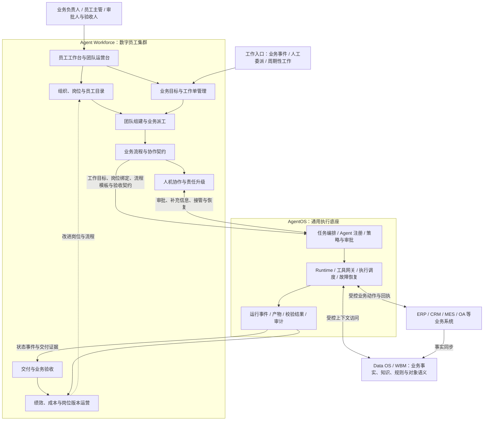

# 数字员工集群设计：AgentOS 之上的企业数字劳动力组织与协作框架

> 文档版本：v0.1 · 框架与详细大纲  
> 编写日期：2026-10-21  
> 定位：企业 AI 操作系统的 Agent Workforce 层，作为后续完整设计文档的写作与评审基础。

数字员工集群负责将企业目标组织为由明确岗位承担、跨角色协同、可验收并可持续运营的业务工作。它建立在 AgentOS 的执行、编排和治理能力之上，向业务人员提供“定义岗位、组建团队、委派工作、监督交付、改进绩效”的产品与管理能力。

本文中的“集群”指按业务目标组织起来的数字员工集合。一个集群可以跨部门、跨业务流程，底层运行在一个或多个执行资源池中；员工数量、Agent 数量和 Worker 进程数量分别管理。

本文沿用仓库中的三层架构，新增的模块、对象和交互均为设计建议，尚不代表已实现的系统能力。

## 一、设计定位与分层边界

### 1.1 三层架构

| 层次 | 核心问题 | 主要职责 | 向上交付 |
| --- | --- | --- | --- |
| Agent Workforce：数字员工集群 | 谁对什么业务结果负责，如何协作与验收 | 岗位、员工、团队、工作委派、业务流程模板、责任与绩效 | 可承担业务工作的数字团队 |
| AgentOS：智能体操作系统 | 如何把工作可靠、受控地执行完成 | Agent 注册、任务图、运行时、技术调度、工具调用、审批执行、恢复、运行记录 | 可追踪的执行过程和交付证据 |
| Data OS：企业数据与认知底座 | 业务事实是什么，依据在哪里 | 对象、关系、状态、知识、规则、数据服务及来源管理 | 可信的企业上下文 |

WBM 是三层共享的企业语义契约，用于统一对象、关系、状态、规则、动作和结果的表达。

### 1.2 上下层职责约定

- Workforce 定义岗位职责、可委派工作、交付标准、升级路径和业务权限需求；AgentOS 校验并执行实际授权。
- Workforce 定义流程模板和专业分工；AgentOS 将模板与当前输入实例化为可执行任务图，并负责节点推进。
- Workforce 进行业务派工，确定承接员工、业务优先级和预算；AgentOS 进行执行调度，确定何时、在哪个 Worker 上运行。
- Workforce 定义验收规则、验收责任人与业务结论；AgentOS 执行可自动化的校验，并保存运行证据。
- Workforce 引用工作执行状态；AgentOS 是 Task、Plan、Attempt 等运行状态的唯一写入方。
- 业务系统拥有原始业务事实，Data OS 提供受控的事实视图；员工推理结论不能直接覆盖业务事实。

## 二、数字员工集群总体框架

### 2.1 架构图



图中模块表达逻辑职责，初期可以在同一个 Workforce 应用中实现。集群层通过 AgentOS 契约执行工作，避免形成第二套运行时。

### 2.2 八个核心模块

| 模块 | 核心设计内容 | 主要产物 |
| --- | --- | --- |
| 员工工作台与团队运营台 | 查看员工能力、分配工作、跟踪交付、处理异常、查询团队绩效 | 员工主页、团队看板、工作时间线 |
| 组织、岗位与员工目录 | 组织归属、岗位职责、员工身份、能力绑定、责任人与版本 | 岗位说明书、员工档案、能力目录 |
| 业务目标与工作单管理 | 将业务诉求转为明确范围、约束、时限和验收条件的工作 | 目标、工作单、交付清单 |
| 团队组建与业务派工 | 按能力、权限、负载、成本及职责分离约束选人组队 | 团队实例、分工表、承接记录 |
| 业务流程与协作契约 | 定义串行、并行、会签、交接、复核与返工方式 | 版本化流程模板、输入输出契约 |
| 人机协作与责任升级 | 定义自主范围、业务审批、专家介入、接管和超时升级 | 人工处理事项、责任链、决策记录 |
| 交付与业务验收 | 校验交付物、证据、业务状态及最终接受条件 | 验收结论、拒收原因、返工要求 |
| 绩效、成本与岗位版本运营 | 评估业务效果、工作质量和成本，管理岗位上线与退役 | 指标看板、评测报告、版本发布记录 |

### 2.3 数字员工的基本构成

```text
数字员工 = 稳定身份与组织归属
         + 岗位职责与责任人
         + Agent 能力绑定
         + 知识与业务对象访问范围
         + 授权范围与自主等级
         + 工作承接规则与容量
         + 交付契约与验收要求
         + 生命周期、绩效与版本记录
```

岗位是可复用的职责模板；数字员工是具有稳定身份的工作承接主体；Agent Definition 是实现能力的技术定义；运行实例是某次工作中的执行过程。一个员工可以组合多种 Agent 能力，同一能力也可被多个员工复用，但各自的身份、权限和上下文必须隔离。

### 2.4 团队角色框架

| 角色 | 业务职责 | 典型岗位 | 主要约束 |
| --- | --- | --- | --- |
| 协调角色 | 理解目标、提出分工、处理冲突、汇总交付 | 供应链协调员、项目协调员 | 分工建议需要通过能力、预算和权限校验 |
| 专家角色 | 提供领域判断、证据和候选方案 | 库存分析员、排产分析员、合同分析员 | 标明证据、假设及不确定性 |
| 执行角色 | 在授权范围内操作业务系统 | 采购执行员、工单处理员 | 写操作经过 AgentOS 最终授权与结果确认 |
| 复核角色 | 检查事实、规则、计算和交付完整性 | 质量复核员、方案审查员 | 对需要独立复核的工作落实职责与信息来源分离 |
| 人类责任人 | 设定目标、批准重大动作、裁决争议、承担业务责任 | 部门主管、采购经理、业务验收人 | 明确授权范围与处理时限 |

角色可以按场景组合，无需为每一项工作配齐所有角色。小规模、规则明确的工作可以由单个员工承接。

## 三、完整设计文档大纲

以下章节用于后续展开正文，每章同时列出应回答的问题与应形成的设计产物。

### 第 1 章：背景、目标与适用边界

- 企业从 AI 助手走向承担持续岗位职责的数字员工，需要解决哪些组织与交付问题。
- 区分数字员工、Agent、工作流、机器人账号与执行 Worker。
- 明确适用场景：跨岗位分析、周期性运营、业务事件处置、持续工作队列。
- 明确业务目标、使用者、上线前提与本期范围。
- **设计产物：**业务场景清单、范围说明、关键成功指标。

### 第 2 章：总体架构与上下层契约

- 明确 Workforce、AgentOS、Data OS 与业务系统的职责和状态所有权。
- 展开八个模块之间的调用关系、事件流与数据流。
- 解释业务派工与执行调度、业务验收与运行校验之间的关系。
- 给出逻辑部署方式，以及从单应用到独立模块的拆分条件。
- **设计产物：**总体架构图、职责矩阵、集成边界表。

### 第 3 章：组织、岗位与数字员工模型

- 组织、部门、岗位、员工、能力与人类责任人的关联方式。
- 员工长期归属与临时跨部门组队规则。
- 岗位说明书：职责、输入、输出、工具需求、权限需求、升级条件、考核方式。
- 区分员工生命周期与工作容量：草稿、验证、启用、暂停、退役分别表达什么。
- 员工入职配置、岗位版本升级、授权撤销和退役后的未完成工作移交。
- **设计产物：**领域模型、岗位模板、员工档案、生命周期图。

### 第 4 章：业务目标、工作单与交付契约

- 人工委派、业务事件和周期触发如何形成工作单。
- 工作单如何绑定业务对象、目标、约束、时限、预算和责任人。
- 如何把“处理延期风险”等模糊诉求收敛为明确交付条件。
- 区分业务工作单与 AgentOS Task，明确父子工作和执行任务映射。
- 工作单如何表达范围变更、撤销、返工及后续效果观察。
- **设计产物：**工作单结构、交付契约、业务状态机。

### 第 5 章：团队组建、业务派工与容量管理

- 固定团队、临时任务团队、专家资源池分别适用哪些场景。
- 先按租户、能力、有效授权和职责分离筛选，再按负载、时限与成本排序。
- 选定工作负责人、参与员工、复核人和最终验收人。
- 处理员工忙碌、岗位不可用、截止时间冲突、重复派工和无人可接。
- 设置最大团队规模、委派深度、预算及重规划次数，防止协作无限扩张。
- 需要扩容时向 AgentOS 提出容量需求，由执行层落实资源调度。
- **设计产物：**组队策略、派工规则、容量配额、替补与升级策略。

### 第 6 章：协作模式、业务流程与工作交接

- 支持主管委派、流水线、并行分析、专家会签、独立复核等协作方式。
- 流程模板如何规定岗位需求、业务步骤、依赖关系和验收条件。
- 交接包包含目标、事实引用、证据、已完成事项、未决问题和下一步责任人。
- 多个员工对同一业务对象提出冲突动作时，如何按对象版本和业务规则仲裁。
- 交接拒收、专业意见分歧、反复返工和任务停滞如何升级。
- **设计产物：**流程模板、交接包格式、协作时序图、冲突处理规则。

### 第 7 章：知识、上下文与组织经验

- 员工访问岗位知识、企业规则、业务事实和历史案例的范围。
- 区分员工偏好、任务上下文、团队共享信息和经审核的组织经验。
- 数据按来源、对象版本、有效时间和访问权限引用，避免复制后失去控制。
- 团队共享空间如何控制读写、来源标记、敏感内容及过期清理。
- 经验如何经过评测和审核进入岗位版本或流程模板。
- **设计产物：**知识范围矩阵、上下文交接规则、经验发布流程。

### 第 8 章：自主等级、人机协作与权限治理

- 建议区分“只提供建议”“审批后执行”“有界自主执行”等岗位运行模式。
- 明确各模式适用的业务动作、金额或资源额度、对象范围及例外条件。
- 员工主管负责日常监督，动作审批人与结果验收人按工作规则配置。
- 审批、补充信息、人工接管、退回和恢复如何进入统一工作时间线。
- 权限委派只能在既有授权范围内收窄；团队组合不产生隐含权限并集。
- 人工事项逾期后提醒、升级或暂停，不因无人响应而自动批准。
- **设计产物：**自主等级矩阵、责任矩阵、升级路径、审批交互规范。

### 第 9 章：交付验收、质量控制与业务效果

- 分别检查交付物格式、事实证据、业务规则和源系统状态。
- 明确可自动判断的条件与需要人类判断的条件。
- 确定通过、拒收、返工和部分交付的业务语义。
- 区分工作完成与后续业务效果：方案交付完成后，实际交付率仍需持续观察。
- 保留验收依据、验收人、适用规则版本及证据引用。
- **设计产物：**验收清单、验收记录、质量门禁、返工流程。

### 第 10 章：员工与团队运营体系

- 员工视角：工作队列、承接容量、交付质量、异常与能力版本。
- 团队视角：端到端周期、协作等待、返工原因、人工介入和资源瓶颈。
- 业务视角：业务目标改善、单位合格交付成本及后续效果。
- 岗位与流程变更采用离线评测、有限范围试运行、版本发布和回滚。
- 评测集如何覆盖常规、异常、权限边界和业务分布变化。
- **设计产物：**指标字典、运营看板、岗位评测与发布规范。

### 第 11 章：集成契约、可靠性与多租户

- 定义工作提交、任务查询、取消、人工决策和结果订阅契约。
- 固定员工、岗位、流程、Agent 与规则版本，保留全链路关联标识。
- 处理事件重复、乱序、丢失补偿和工作单状态对账。
- AgentOS 暂时不可用时保留提交意图，使用幂等键恢复提交。
- 对写操作结果未知的工作保持待确认，查明源系统状态后再决定重试或补偿。
- 租户、员工身份与权限范围贯穿上下文访问、任务执行及审计查询。
- **设计产物：**契约清单、事件映射、异常矩阵、恢复与隔离方案。

### 第 12 章：端到端案例与分阶段实施

- 用供应商延期场景串起事件、工作单、组队、分析、复核、审批、执行和验收。
- 给出正常路径、信息不足、审批拒绝、写入超时和人工接管路径。
- 第一阶段落实固定岗位与固定流程，验证完整业务闭环。
- 第二阶段扩展多岗位团队、业务派工、返工及团队运营。
- 第三阶段在评测与治理基础上引入动态组队、跨部门协作和岗位优化。
- **设计产物：**场景时序图、样例配置、实施路线与各阶段验收清单。

## 四、核心领域对象草案

| 对象 | 含义与关键内容 | 状态所有者 |
| --- | --- | --- |
| RoleProfile 岗位定义 | 职责、能力需求、自主等级、交付要求、版本 | Workforce |
| DigitalEmployee 数字员工 | 稳定身份、组织归属、岗位版本、责任人、启用状态 | Workforce |
| CapabilityBinding 能力绑定 | 员工与 Agent 版本、工具需求和授权引用的关联 | Workforce 定义绑定，AgentOS 校验并登记执行引用 |
| TeamInstance 团队实例 | 目标、成员、分工、负责人、有效期、预算 | Workforce |
| WorkOrder 工作单 | 业务目标、对象引用、约束、时限、状态、验收标准 | Workforce |
| Assignment 工作分配 | 工作单、承接员工、承担职责、分配版本 | Workforce |
| Playbook 流程模板 | 业务步骤、岗位需求、协作方式、交接及验收契约 | Workforce |
| Task / Plan / Attempt | 运行任务、任务图与执行尝试 | AgentOS |
| Approval 审批 | 具体动作授权范围、参数摘要、有效期和审批结果 | AgentOS；Workforce 提供业务入口与责任规则 |
| DeliveryAcceptance 业务验收 | 交付引用、规则版本、验收人、结论、返工原因 | Workforce，引用 AgentOS 原始校验记录 |
| PerformanceRecord 绩效记录 | 工作质量、耗时、成本、业务效果及口径 | Workforce，关联执行事实与业务事实 |

所有对象携带租户范围。WorkOrder 与 Task 通过显式关联表连接；重试不新建业务工作单，返工与重规划记录新的关联版本。上层可保存运行状态投影用于展示，但通过事件和对账跟随 AgentOS 的权威状态。

## 五、端到端示例：供应商延期后的交付风险处置

**业务目标：**识别受影响订单，在规定时限内形成满足交期、成本和业务规则的处置方案，并对获批动作完成执行与确认。具体时限和额度由场景配置确定。

| 步骤 | Workforce 的业务动作 | AgentOS 承载的执行 | 交付或推进条件 |
| --- | --- | --- | --- |
| 1. 接收事件 | 根据延期事件创建工作单，关联供应商与订单 | 校验提交并按幂等键建立 Task | 目标、责任人、范围与验收标准齐备 |
| 2. 组织团队 | 指定协调员，分配库存、排产、采购分析与复核职责 | 解析能力绑定，校验任务图与权限 | 成员满足能力与授权条件 |
| 3. 并行分析 | 各专业岗位提交影响范围和候选措施 | 查询受控事实、执行计算、保存产物与证据 | 结论具有来源、版本与约束说明 |
| 4. 形成方案 | 协调员汇总交期、成本和资源权衡，复核员检查依据 | 执行规则与结果校验 | 方案通过验收规则中的前置检查 |
| 5. 人工决策 | 采购经理审批需要额外授权的采购动作 | 持久化审批，绑定具体动作与参数 | 授权有效，业务对象未发生影响决策的变化 |
| 6. 执行业务动作 | 指派采购执行员承接已批准工作 | 通过工具网关写入业务系统并确认结果 | 获得动作回执与源系统状态证据 |
| 7. 业务验收 | 验收人确认获批动作全部完成，未决事项已移交 | 汇总产物和校验结果 | 满足工作单定义的交付标准 |
| 8. 持续观察 | 评估后续交期改善、额外成本与岗位表现 | 提供关联运行记录和成本 | 形成可归因的效果记录与改进候选 |

若采购写入超时，工作单显示“执行结果待确认”。AgentOS 先核查源系统是否已受理，再决定后续处理；Workforce 同时展示业务影响和升级责任人，避免另派员工重复发起采购。

## 六、第一阶段的建议范围与验收条件

第一阶段选择一个业务场景，配置固定团队、版本化流程和明确的人类责任人，先验证从委派到交付的完整链路。

建议完成以下能力：

1. 岗位与员工目录：可以配置职责、能力绑定、责任人和权限范围。
2. 工作单与固定团队：可以明确目标、分配工作、跟踪交付及发起返工。
3. AgentOS 对接：支持幂等提交、状态订阅、产物引用与对账。
4. 人工处理：支持审批、补充信息、接管及超时升级。
5. 验收与运营：支持业务验收、证据追溯、周期与成本统计。

阶段验收应至少覆盖：

- 一个工作单可关联追溯到员工、团队、流程版本、执行任务、证据与验收结论。
- 重复业务事件和提交重试不会创建重复工作或重复写操作。
- 缺少能力、权限或必要信息时，工作进入可解释的待处理状态。
- 审批拒绝、员工暂停、动作结果未知和事实版本变化都有明确处理路径。
- 只有满足业务验收标准的工作进入完成状态，模型自述完成不能替代验收。
- 能够计算合格交付率、返工率、人工介入率、端到端耗时和单位合格交付成本。

指标需要规定统计窗口、适用工作类型与分母；单位合格交付成本应纳入失败和返工消耗，避免只统计成功执行。具体目标值应在试点基线建立后确定。

## 七、与现有设计的衔接资料

- [企业级 AI 操作系统总体设计](enterprise-ai-operating-system-wbm.md)：三层架构、WBM 与企业业务闭环。
- [AgentOS 架构设计](agentos-architecture-design.md)：通用编排、执行、授权、恢复和运行状态契约。
- [企业级 Agent Harness 架构设计](enterprise-agent-harness-architecture.md)：模型与工具循环、持久状态和执行内核。

后续正文按照第三节的十二章展开；第二节作为总体框架，第四至六节作为领域模型、端到端案例与实施验收的初始输入。
