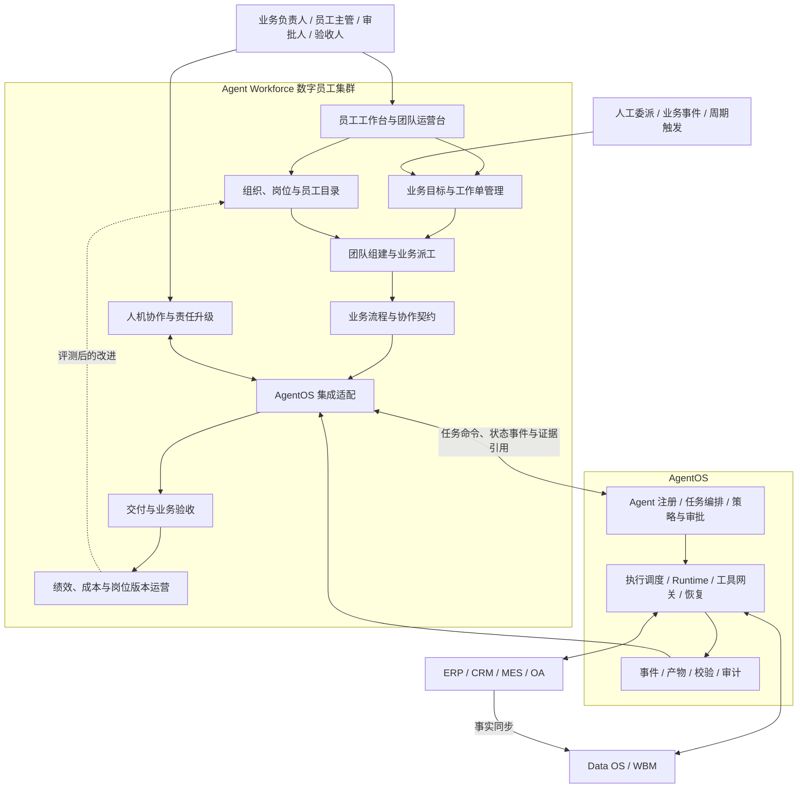
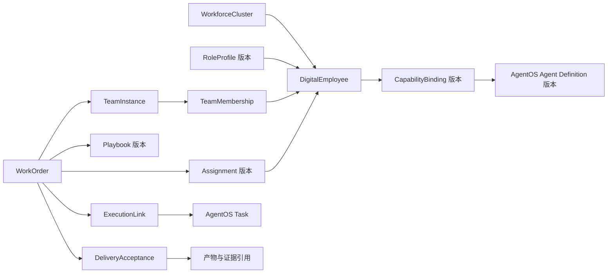
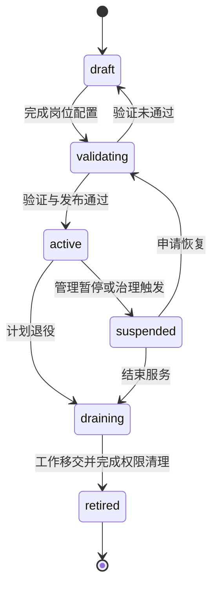
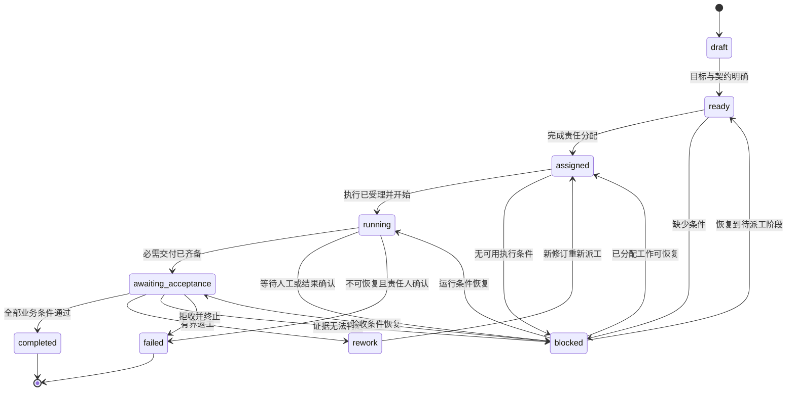
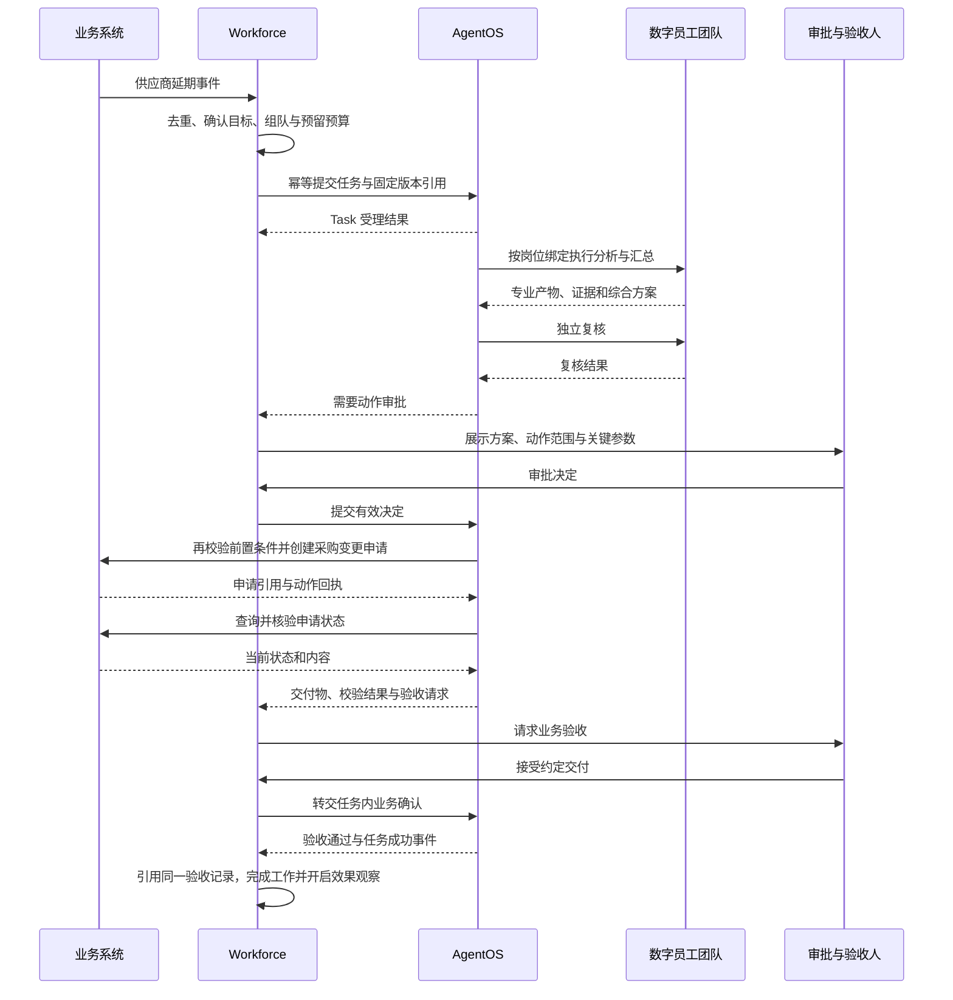

# 数字员工集群架构设计：AgentOS 之上的企业数字劳动力组织与协作体系

> 文档版本：v0.1 · 完整设计草案  
> 编写日期：2026-10-21  
> 适用范围：当前仓库企业 AI 操作系统中的 Agent Workforce 层。  
> 阅读对象：业务负责人、产品经理、架构师、平台研发与运营团队。

数字员工集群把企业目标转化为由明确岗位承担、跨角色协作、可验收且可持续运营的业务工作。AgentOS 提供通用编排和执行能力，集群层在其上定义员工身份、岗位职责、团队关系、工作委派、交付契约和业务责任，使企业能够按“岗位与工作”管理 AI 能力。

本文沿用 **Data OS → AgentOS → Agent Workforce** 三层架构，以 WBM 作为共享的企业语义契约。设计重点是建立从业务事件到工作单、从工作单到团队、从团队执行到验收与改进的闭环。模块、字段、状态、接口和样例配置均为建议方案，不代表当前仓库已经实现这些后台能力；示例数值不构成生产性能或业务收益承诺。

## 一、背景、目标与适用边界

### 1.1 从一次回答到持续承担工作

假设采购部门收到供应商延期通知。一个问答助手可以解释影响，一次 Agent 运行可以查询库存并生成报告，但真正完成处置还需要有人确认受影响订单、比较替代供应商、评估排产变化、申请额外支出、执行获批动作并确认结果。整个过程可能跨越多个岗位、多个系统和多个工作日。

数字员工集群需要把这些活动组织成持续可追踪的工作：谁负责最终交付，各专业岗位提供什么输入，何时需要人工决定，失败后由谁继续处理，最终依据什么认定工作完成。员工主管面对的是工作承诺和业务结果，执行中的模型调用、上下文组装和重试细节由 AgentOS 承载。

### 1.2 术语与对象区分

| 概念 | 本文定义 | 示例 |
| --- | --- | --- |
| 岗位 RoleProfile | 可复用、可版本化的职责与交付模板 | 采购分析岗、库存分析岗 |
| 数字员工 DigitalEmployee | 具有稳定身份、组织归属、岗位版本和人类责任人的工作承接主体 | 华东采购分析员 01 |
| Agent Definition | 实现某类推理或行动能力的技术定义 | 库存覆盖分析 Agent v3 |
| 团队 TeamInstance | 为持续职责或具体目标组织的成员及责任关系 | 订单交付风险处置团队 |
| 数字员工集群 WorkforceCluster | 共享业务运营边界、岗位目录和资源配额的员工集合 | 制造事业部供应链数字员工集群 |
| 工作单 WorkOrder | 具有业务目标、范围、承接责任和验收条件的工作记录 | 处置某采购订单延期影响 |
| 执行任务 Task | AgentOS 中按既定契约编排、执行并验收的工作单元 | 库存分析任务、采购动作执行任务 |
| Worker | 承载运行实例的技术进程或计算节点 | 通用执行资源池中的一个副本 |

一个员工可以组合多个 Agent 能力，同一种 Agent 定义也可被多个员工复用。员工的身份和历史长期存在，执行实例按工作需要创建与结束。员工数量不直接决定模型并发量或 Worker 数量。

### 1.3 设计目标

1. **责任明确：**每项工作都有业务负责人、承接员工及验收责任人，异常有明确升级对象。
2. **协作可控：**分工、交接、复核和方案变更以结构化契约表达，协作规模与成本有上限。
3. **交付可信：**完成状态由交付条件、证据和业务确认共同决定，保留可追溯依据。
4. **执行连续：**工作能跨会话、跨运行实例持续推进，员工更换和服务重启不丢失承诺。
5. **运营可衡量：**以合格交付、端到端时效、人工投入、成本和业务效果评价员工与团队。
6. **能力可演进：**岗位、流程与能力版本可以评测、试运行、发布和回退。

### 1.4 场景范围与建设前提

优先选择业务对象清晰、输入可获得、输出可检查、人工责任明确的场景，例如供应链异常处置、项目风险跟进、客户请求分类与处理、周期经营分析和设备工单分诊。

上线前需要具备可访问的业务事实、受控工具、身份与授权来源，以及可执行的验收标准。对于缺少系统接口的环节，可明确安排人工处理节点，由人工提交证据推进工作。

本层提供组织与协作能力。模型循环、技术队列、工具凭证、沙箱和故障重试复用 AgentOS；业务主数据和订单状态仍归源系统管理。本文也不预设所有业务都适合多员工协作：单岗位能稳定完成的工作应保持单岗位流程。

## 二、总体架构与上下层契约

### 2.1 三层职责

| 层次 | 负责的问题 | 主要产物 | 权威状态 |
| --- | --- | --- | --- |
| Workforce | 谁承担什么工作，如何分工和验收 | 岗位、员工、团队、工作单、流程模板、业务验收 | 组织关系、工作承诺、业务接受结论 |
| AgentOS | 如何将工作可靠、受控地执行 | Task、Plan、运行记录、产物、动作回执和校验 | 执行状态、审批决定、工具调用与恢复记录 |
| Data OS | 企业事实是什么，规则与证据来自哪里 | 企业对象、状态视图、知识与规则服务 | 受管语义对象和来源记录；原始事实归源系统 |

WBM 统一业务对象、关系、状态、规则和动作语义。例如工作单引用采购订单及其版本，流程模板引用“变更采购安排”动作，验收条件引用源系统中的订单状态，避免各层用不同名称表达同一业务含义。

### 2.2 总体架构图



集成适配是跨层契约边界，负责版本解析、可靠提交、事件消费和状态对账。它不运行模型，也不维护第二套任务图执行器。架构中的模块是逻辑划分，初期可部署为一个应用。

### 2.3 八个业务模块

| 模块 | 具体职责 | 管理的对象 |
| --- | --- | --- |
| 员工工作台与团队运营台 | 展示能力、工作队列、交付进度、待处理事项及运营结果 | 用户视图、查询投影和工作入口 |
| 组织、岗位与员工目录 | 定义组织归属、职责、身份、能力绑定和生命周期 | Cluster、RoleProfile、DigitalEmployee |
| 业务目标与工作单管理 | 固化工作范围、目标、约束、优先级和验收标准 | WorkOrder、范围修订、工作关系 |
| 团队组建与业务派工 | 筛选成员、分配职责、预留容量和安排替补 | TeamInstance、Assignment、容量预留 |
| 业务流程与协作契约 | 管理流程模板、交接规则及委派边界 | Playbook、Handoff、变更提案 |
| 人机协作与责任升级 | 路由补充信息、审批、裁决、接管与逾期升级 | HumanWorkItem、责任链、交接记录 |
| 交付与业务验收 | 组织证据、判断交付条件、记录接受或返工 | Delivery、DeliveryAcceptance |
| 绩效、成本与岗位版本运营 | 指标统计、岗位评测、试运行与版本发布 | PerformanceRecord、Evaluation、Release |

### 2.4 两类分工、两类验收

**业务派工决定谁承担责任，执行调度决定如何使用计算资源。** Workforce 根据岗位、权限需求和工作负载选择承接员工。AgentOS 在已批准的能力绑定中选择运行资源，处理队列和并发。因技术故障更换 Worker 不改变承接员工；更换承接员工则需要创建新的分配版本并重新检查身份与权限。

**AgentOS Task 的成功与 WorkOrder 的接受分别以各自契约为准。** Task 只有通过它定义的全部验收条件才能成功，其中可以包括人工业务确认。WorkOrder 汇总一个或多个 Task 的结果，再检查跨任务交付完整性与整体业务接受条件。

例如“形成有证据的库存分析”Task 可以先成功，整个“完成延期处置”工作单仍需要等待审批与执行。若顶层 Task 已包含最终业务验收节点，Workforce 展示并引用同一确认记录，不要求验收人重复确认；若工作单还有额外范围，则显式配置补充验收条件。

### 2.5 数据与控制原则

业务对象引用、工作责任与版本构成控制主线；AgentOS 事件和源系统回执构成证据主线。上层所有可见执行状态都是带有更新时间和来源的投影，运行状态的修改只能通过 AgentOS 命令进行。

跨层不使用共享数据库直接更新彼此状态。Workforce 可以请求取消、暂停或重新规划，但需等待对应受理和执行结果；页面显示“已请求取消”与“已取消”应有区别。

## 三、组织、岗位与数字员工模型

### 3.1 组织与集群结构

一个租户可建立多个数字员工集群，每个集群配置业务范围、管理员、允许使用的岗位目录、预算和资源配额。员工设置一个主要组织归属，可以在授权后加入多个团队；跨集群协作记录提供方与使用方的责任、配额占用和成本归属。

集群是管理边界，租户是隔离边界。加入团队只建立协作关系，不自动获得团队其他成员的数据和工具权限。首期建议将协作限制在同一租户；外部组织参与通过 AgentOS 外部 Agent 适配及独立的数据披露策略实现。

### 3.2 核心领域关系



TeamMembership 表示成员资格，Assignment 表示某项工作中的具体责任，两者分开保存。成员离开团队后历史责任仍然可查。ExecutionLink 记录工作单、执行目的、工作修订与 Task 的关联，不通过名称推断对应关系。

### 3.3 岗位说明书

岗位需要同时约束职责与交付。只有“擅长供应链”的描述不足以决定它可以承接什么工作。

```yaml
role_id: procurement_analyst
version: 3
name: 采购分析岗
mission: 分析供应商延期影响并提供有证据的采购处置候选方案
responsibilities:
  - 识别受影响采购订单及关联需求
  - 比较原供应商恢复与替代采购方案
  - 说明交期、增量成本和适用前提
required_capabilities:
  - supplier_risk_analysis@2
  - procurement_option_comparison@1
required_inputs:
  - purchase_order_refs
  - supplier_event_ref
outputs:
  schema_ref: procurement_options@2
  evidence_required: true
authority_requirements:
  read: [purchase_order, supplier, approved_price]
  write: []
autonomy_mode: advisory
escalate_when:
  - 关键订单或价格证据缺失
  - 候选方案全部违反硬约束
  - 多个来源的订单状态矛盾
acceptance_profile_ref: procurement_analysis_acceptance@2
```

这些字段描述岗位的能力和授权需求。实际授权由身份与权限系统提供，AgentOS 在每次执行时检查。更新岗位说明书不能直接为员工授予权限。

### 3.4 员工档案与能力绑定

| 对象 | 核心字段 | 设计约束 |
| --- | --- | --- |
| DigitalEmployee | `employee_id`、`tenant_id`、`cluster_id`、`org_unit_ref`、`role_version_ref`、`supervisor_ref`、`status` | 身份长期稳定，负责人必须可路由 |
| CapabilityBinding | `binding_id`、`version`、`employee_id`、`capability_refs`、`agent_version_refs`、`grant_refs` | 绑定固定版本，授权引用需检查有效性 |
| EmployeeCapacity | `employee_id`、`capacity_type`、`limit`、`reserved`、`version` | 容量变更原子校验，避免并发超卖 |
| TeamMembership | `team_id`、`employee_id`、`team_role`、`valid_from`、`valid_until` | 成员关系有有效期，不合并权限 |
| Assignment | `assignment_id`、`work_order_id`、`employee_id`、`responsibility`、`revision` | 同一职责的当前有效承接者必须明确 |

能力绑定在 Workforce 中表达员工岗位组合，并通过受管流程登记为 AgentOS 可解析的执行引用，与既有 Digital Worker Binding 对接。AgentOS 不接受模型提交的任意 Agent 标识来替代该绑定。密钥和工具令牌存放于受管凭证系统，档案仅保存引用。

### 3.5 生命周期与在线状态



`active` 表示可以承接工作，不表示员工当前空闲。忙碌程度、执行故障和排队量使用独立的容量与健康字段表达。这样可以避免一次工具超时将整个员工档案误判为离职或失效。

员工暂停后不再接新工作。在途任务按照暂停原因处理：普通维护允许到达安全交接点；权限撤销或紧急禁用需要通知 AgentOS 停止后续受限动作，并核查已发出的动作。计划退役进入 `draining`，待未完成工作有承接者、运行已停止或转移、凭证授权已清理后再终结。

### 3.6 版本固定与升级

工作被接受时固定岗位、能力绑定、流程模板、Agent 与验收规则版本。员工升级默认影响后续新工作，在途工作保持原配置，必要时通过显式迁移记录变更。

固定配置用于追溯，实际授权和紧急治理规则按执行时的有效状态重新检查。旧版本引用不能使已撤销的权限继续有效。

## 四、业务目标、工作单与交付契约

### 4.1 工作从哪里来

人工委派需要将自然语言目标规范化；业务事件需要根据对象、事件类型和业务规则判断是否创建工作；周期触发则需要标明统计窗口和数据截止时间。

创建工作前先检查对象可识别性、目标是否明确、证据是否可用以及是否已有对应工作。关键对象有歧义时进入待澄清状态，明确所缺信息。模型可以提出结构化草稿，真正的工作接受由规则检查和有资格的业务主体完成。

事件去重分为两层：用来源事件 ID 去除同一事件的重复投递；用业务关联键识别同一异常已经存在的处置工作。新事件若代表状态进一步恶化，应作为修订输入或关联新工作处理，不能一律丢弃。

### 4.2 工作单示例

以下为示例工作，业务处理时限、成本额度和运行预算都需要由真实场景配置。

```yaml
work_order_id: WO-SUPPLY-001
tenant_id: tenant_demo
revision: 1
work_type: supplier_delay_resolution
source:
  type: business_event
  event_ref: supplier-delay-event-001
  business_key: supplier-delay-case-001
goal: 完成受影响订单的处置方案审批及获批采购动作执行确认
object_refs:
  - type: PurchaseOrder
    id: PO-001
    version: v17
owner_ref: procurement_manager_demo
acceptance_owner_ref: supply_delivery_owner_demo
playbook_ref: supply_delay_resolution@1
deadline: '2026-10-22T10:00:00+08:00'
constraints:
  max_incremental_cost_cny: 20000
  allowed_actions: [create_purchase_change_request]
  external_write_requires_approval: true
runtime_budget:
  max_cost_cny: 100
  max_parallel_nodes: 4
acceptance:
  - id: impact_evidence_complete
    rule_ref: impacted_order_evidence@1
  - id: approved_actions_confirmed
    rule_ref: purchase_action_state_confirmed@1
  - id: business_delivery_accepted
    human_role: supply_delivery_owner
status: ready
```

业务增量成本约束采购方案，运行预算约束模型、工具和计算消耗，分别计量。预算字段不构成授权；认证主体、租户和权限由服务端生成并绑定，客户端不能通过修改 YAML 自行取得权限。

### 4.3 交付契约

一份交付契约需要规定输入前提、交付物结构、证据要求、检查规则、验收责任人与允许的返工方式。例如采购分析报告必须列出受影响订单、候选方案、预计交期、增量成本和适用条件，所有关键事实必须引用可访问且满足时效要求的证据。

每条验收规则使用稳定 ID 和版本。工作接受后更改规则需要产生修订，说明变化原因及影响；不能为了通过验收而静默降低标准。部分交付只有在契约事先规定可分段接受时才能形成局部接受记录，整体完成仍需覆盖所有必需范围。

### 4.4 业务状态机



`blocked` 必须包含阻塞原因、责任人、开始时间、恢复阶段和下一次检查时间，不能只是一个笼统状态。草稿澄清通过草稿中的待办表示，首次接受前不计为已承诺交付工作。

取消使用独立路径：任何非终态工作可以进入 `cancelling`，发出停止意图并等待执行核对；确认没有未决动作、必要补偿或人工接管已经记录后进入 `cancelled`。未发出执行的草稿可以直接取消。图中省略取消连线以突出正常与返工路径。

### 4.5 工作单与执行任务映射

首期建议一张工作单关联一个主要 Task，由 AgentOS 在其内部管理 Plan 和节点。复杂场景允许关联分析、执行、补充核验等多个 Task，每个关联记录执行目的、工作修订、对应职责与必需程度。

技术重试由 AgentOS 在同一 Task 内维护 Attempt；业务返工产生工作单修订，并根据现有任务能否继续决定创建新 Task 或提出重规划请求。保留旧产物和旧验收记录，并检查已发生业务动作，防止返工重复执行。

工作完成后发现新的业务问题，创建关联的后续工作。原完成记录保留，必要时增加更正或撤销验收记录，避免改写历史使已发布指标与审计依据失去解释。

## 五、团队组建、业务派工与容量管理

### 5.1 三种组织形态

| 形态 | 适用工作 | 成员管理 | 主要管理目标 |
| --- | --- | --- | --- |
| 固定团队 | 长期、稳定的部门流程 | 成员长期配置，按版本调整 | 稳定交付与可预测容量 |
| 临时任务团队 | 跨岗位异常处置、专项分析 | 工作开始时组建，完成后释放 | 在目标和时限内组合所需能力 |
| 专家资源池 | 多团队共享的稀缺能力 | 专家被分配到具体职责，保留主要归属 | 公平排队、容量预留和成本分摊 |

团队包括负责人、参与者、复核人与验收责任关系。协调角色可以由数字员工承担，负责提出分工、汇总信息和推动交接；最终业务责任由可识别的人类负责人承担。

团队解散只结束当前成员占用和有效关系，工作、交接与绩效记录按照保留策略保存。未完成职责必须先移交，不能随团队解散而消失。

### 5.2 派工过程

一次派工分成以下步骤：

1. 从流程模板与工作目标提取必须岗位、交付物及职责分离要求。
2. 按租户、集群范围、员工状态、能力契约、数据范围和有效授权筛选候选人。
3. 检查候选员工是否与生成、复核或审批角色存在禁止组合的关系。
4. 在可行候选中比较预计等待、截止时间、工作负载、评测结果和运行成本。
5. 原子预留所需业务容量，创建 Assignment 及版本，记录选择依据。
6. 将已批准的员工能力绑定、约束与流程模板提交 AgentOS。
7. 根据受理结果更新分配状态，失败时核对受理事实后释放或调整预留。

能力资格来自受管定义与验证记录。模型可以提出组队建议，但无权跳过筛选或创建有效授权。无法找到符合条件的员工时，工作进入待处理队列，向主管说明缺少能力、容量还是权限。

### 5.3 派工与底层能力路由的衔接

Workforce 选择的是业务主体及允许的能力集合。AgentOS 可以在该集合内选择兼容的执行实现，但必须保持输入输出契约、权限范围及审计关联。

如果替换 Agent 会改变承诺的能力版本或交付行为，需形成绑定新版本并走评测和变更流程。若只是更换同一版本的运行节点，AgentOS 自行恢复即可。这样可以保留技术弹性，同时避免底层路由悄悄改变岗位职责。

### 5.4 容量和预算

员工容量至少区分“可承接的活动工作数”和“允许同时执行的工作数”。等待审批的工作可能释放即时执行配额，但仍计入未完成承诺。释放逻辑应由容量类型和工作阶段决定。

Workforce 维护部门和团队的业务容量、成本中心与总预算；AgentOS 维护实际执行配额、模型调用预算预留和结算。两层通过统一的预算分配 ID 关联，执行层消费的是已分配额度，不能为每个子任务复制完整预算。

派工预留在同一事务中检查额度并创建记录，使用乐观锁或等价的原子条件防止超卖。尚未提交的预留可以按期释放；已被 AgentOS 受理的执行，不能仅凭预留超时就判断资源可安全复用，必须先查询任务状态并核对在途请求。

并发工作还可能竞争真实业务资源，例如同一库存批次或同一采购额度。员工容量不能代替业务资源锁定；这类竞争由源系统的预留、版本校验和业务约束处理。

### 5.5 替补与责任转移

员工暂停、长期不可用或工作超过时限时，可以提出重新分配。转移过程包括冻结新的交接输入、获取当前交付和副作用摘要、确认旧执行停止或达到交接点、创建新 Assignment 版本及重新授权。

新员工接收工作时需要看到已完成事项、未决动作和允许的下一步。如果旧执行仍有无法确认的外部写入，优先核对该动作；确需并行推进时，只能处理经确认不会冲突的独立部分。

业务分配版本的变化还需由 AgentOS 在执行授权与动作提交处识别，拒绝已失效分配产生的新动作。该检查用于阻止旧执行继续产生副作用，已经被外部系统受理的操作仍需单独确认。

### 5.6 有界协作

为每张工作单设置最大成员数、最大委派深度、任务图规模、并发上限、返工轮数、重规划次数、运行预算和绝对截止时间。配额在根工作范围内共享。

达到限制时，协调员提交目前已知事实、已完成产物、继续执行的预估收益和资源需求，由业务负责人决定缩小范围、增加预算或终止。延长时限和增加预算形成显式修订，不能通过再创建一个子任务规避限制。

## 六、协作模式、业务流程与工作交接

### 6.1 协作模式选择

| 模式 | 组织方式 | 适用条件 | 关键控制 |
| --- | --- | --- | --- |
| 单岗直办 | 一个员工完成分析与交付 | 范围明确、风险和复杂度可控 | 最小工具范围、交付验收 |
| 主管委派 | 协调员分工并汇总专业结果 | 需要跨专业整合 | 委派预算、职责和结果契约 |
| 顺序流水线 | 上一步交付作为下一步输入 | 阶段依赖稳定 | 交接校验、对象版本和失败回退 |
| 并行分析 | 多个岗位独立处理子问题后汇总 | 子问题相互独立 | 共享预算、输入快照和汇合条件 |
| 专家会签 | 多个专业角色对同一方案提出结论 | 多重规则共同约束方案 | 必需签署角色和分歧裁决 |
| 独立复核 | 生成与核验职责分离 | 事实、计算或业务风险要求较高 | 证据复查与复核范围独立 |

成员数量根据需要确定。对固定规则可直接计算的步骤使用确定性工具；需要自然语言解释、复杂归纳或候选方案生成的步骤才使用 Agent。

### 6.2 业务流程模板

Playbook 描述业务步骤、岗位需求、输入输出及控制点。AgentOS 根据模板形成并校验 Plan，维护节点状态、重试和等待。Workforce 不逐节点接管执行。

```yaml
playbook_id: supply_delay_resolution
version: 1
required_roles:
  - coordinator
  - inventory_analyst
  - procurement_analyst
  - independent_reviewer
  - procurement_executor
steps:
  - id: assess_inventory
    role: inventory_analyst
    output_schema: inventory_impact@1
  - id: assess_supply_options
    role: procurement_analyst
    output_schema: procurement_options@2
  - id: synthesize
    role: coordinator
    needs: [assess_inventory, assess_supply_options]
    output_schema: resolution_proposal@1
  - id: review
    role: independent_reviewer
    needs: [synthesize]
    acceptance_profile: resolution_review@1
  - id: approve_action
    kind: human_approval
    needs: [review]
    approver_role: procurement_manager
  - id: execute_action
    role: procurement_executor
    needs: [approve_action]
    action_ref: create_purchase_change_request@1
  - id: confirm_delivery
    kind: validation_and_business_acceptance
    needs: [execute_action]
    acceptance_profile: purchase_action_state_confirmed@1
    acceptance_role: supply_delivery_owner
limits:
  max_team_members: 5
  max_delegation_depth: 2
  max_rework_rounds: 2
```

此示例的数值仅演示配置方式。若场景需要新增排产分析员，模板、团队规模和预算都需要一并调整。

模板发布时检查岗位需求是否可满足、依赖是否有环、输入输出是否兼容、必需审批是否覆盖写动作、验收节点是否完整。固定审批、写入和验收检查点之间可以允许动态分析步骤，但候选变更仍需通过 AgentOS 计划校验。

### 6.3 交接包

员工交接的是可继续工作的业务状态与证据。推荐交接包包含：

```yaml
handoff_id: HO-001
work_order_id: WO-SUPPLY-001
work_revision: 1
from_assignment_ref: assignment-analysis@1
to_responsibility: proposal_synthesis
input_object_refs: [PurchaseOrder/PO-001@v17]
deliverable_refs: [artifact://procurement-options-001]
evidence_refs: [evidence://supplier-notice-001]
completed_items:
  - 已比较原供应商恢复与替代采购方案
open_items:
  - 替代供应商产能承诺尚待确认
assumptions:
  - 订单需求数量维持当前版本
proposed_next_action: 汇总候选方案并核对产能证据
expires_at: '2026-10-21T18:00:00+08:00'
```

接收方检查工作修订、对象版本、证据访问权限和产物契约。验收通过后才将交接结果作为有效输入。交接包声明的动作只是建议，后续执行仍需授权和前置条件检查。

接收方拒收时给出缺项、冲突或过期证据，返回原承接角色或交由协调员裁决。重复接收同一交接包只确认一次；内容修订使用新版本，避免同一 ID 指向不同业务含义。

### 6.4 协作信息与业务状态

团队可以保留讨论摘要、提问和方案意见，但只有经过结构化确认的交付、决定和动作回执才推进业务状态。对话中的“已经处理”不能作为完成依据。

上下文共享遵循任务需要。专家接收完成本职所需的对象和证据，协调员接收适合汇总的专业产物；原始敏感数据只在必要范围内授权。成员加入或退出团队时，重新计算可访问的共享内容。

### 6.5 分歧与写冲突

专业分歧应分别标明事实冲突、假设不同、规则冲突还是目标权衡。事实冲突重新核对来源，规则冲突升级规则负责人，交期与成本权衡交给有业务决定权的人。多个员工给出相同结论只能作为意见一致，不能代替事实验证。

多个任务拟修改同一业务对象时，在执行前检查源系统最新版本及业务前置条件。源系统支持时使用条件更新、业务锁或预留；不支持时，通过受控写入适配器与人工核对限制冲突窗口。审批后对象变化若影响动作范围、金额或目标，应使原批准动作失效并重新评审。

## 七、知识、上下文与组织经验

### 7.1 四类信息空间

| 空间 | 内容 | 生命周期与读取方式 |
| --- | --- | --- |
| 岗位知识 | 操作规程、业务定义、常见案例、工具使用规范 | 按岗位版本与有效权限读取 |
| 员工偏好 | 经确认的展示格式、工作习惯和稳定偏好 | 随员工保存，不能覆盖强制业务规则 |
| 工作上下文 | 当前对象、目标、约束、中间产物与交接摘要 | 跟随工作单，受保留与访问策略约束 |
| 组织经验 | 经评测和审核的案例、错误模式及流程改进 | 作为版本化知识或模板发布 |

Workforce 管理信息的业务归属与使用规则。Data OS 提供知识和事实服务，AgentOS 负责检索、组装、压缩与运行中的上下文隔离。

### 7.2 证据引用与时效

证据记录至少包含来源系统、对象或文档标识、版本、有效时间、获取时间、访问范围和内容摘要。执行采用历史快照还是最新事实由步骤契约决定。

例如报告可以分析“截至某时刻的库存”，采购写入却必须重新检查当前可用库存与订单状态。上下文摘要需保留来源引用和未决事项，不能因压缩丢掉关键限制。

若证据暂时不可访问或无法验证当前版本，结论标为无法确定，不能把历史缓存自动当成当前事实。对方有权读交接摘要也不意味着有权读其全部源材料，引用解析时仍需鉴权。

### 7.3 团队共享信息

共享区保存结构化专业产物、已确认决定和允许共享的证据引用。成员提交的推断带有作者、时间、适用条件和置信说明，与源系统事实区分。

未经审核的文档、外部消息和其他 Agent 输出均作为数据输入，其内容不能修改岗位授权、审批规则或工具范围。对高风险动作，最终约束检查在 AgentOS 工具网关和源系统侧落实。

### 7.4 经验改进闭环

一次工作完成后收集被接受的交付、人工修改、拒收原因、工具故障和实际业务结果，生成经验候选。候选须经过敏感内容处理、适用范围判断、离线评测和负责人审核，再发布到知识、岗位或流程新版本。

单次成功不直接成为通用规则。一次因为特殊客户获得的业务例外，需要保留例外条件，不能沉淀成所有员工默认可执行的授权。失败案例也要区分证据缺失、流程缺陷、能力不足和外部系统故障，避免所有问题都通过修改提示词处理。

## 八、自主等级、人机协作与权限治理

### 8.1 自主模式

自主模式是岗位与动作范围上的配置，具体工作还会受到更严格约束。下表为本方案定义的产品模式。

| 模式 | 可自主完成的事项 | 必须交给人类的事项 | 示例 |
| --- | --- | --- | --- |
| 建议模式 | 授权查询、分析、生成草案 | 对外提交与业务写入 | 生成采购方案 |
| 审批执行模式 | 分析与准备动作，获批后按批准范围执行 | 对具体业务动作授权 | 创建采购变更申请 |
| 有界自主模式 | 在明确对象、额度、时限和规则内执行允许动作 | 超出边界、规则冲突与例外处理 | 分类并分派低风险工单 |

模式按动作配置。一个员工可以自主读取订单、审批后创建申请，同时完全不允许修改付款信息。升级模式需要评测与有效授权；紧急禁用可以立即收紧运行范围。

### 8.2 人类责任关系

| 责任角色 | 主要职责 | 不应混淆的边界 |
| --- | --- | --- |
| 员工主管 | 岗位配置、日常监督、容量与人员替补 | 主管身份不自动获得所有动作审批权 |
| 工作负责人 | 确认目标、优先级、范围变更和业务结果责任 | 数字协调员不能替代最终业务责任 |
| 动作审批人 | 决定特定动作或有界动作集合能否执行 | 同意方案不必然等于授权所有后续写操作 |
| 业务验收人 | 按契约判断交付是否可接受 | 验收完成不能补授先前缺失的操作权限 |
| 平台运营人员 | 运行维护、故障处理和版本治理 | 技术管理权限不等于业务数据访问权 |

实际组织可以允许部分角色由同一人承担，但需要明确允许组合，并对要求职责分离的动作单独限制。

### 8.3 人工事项统一入口

HumanWorkItem 对补充信息、方案选择、审批、争议裁决、接管和验收提供统一展示。每条事项包含所关联工作、发起原因、处理人、截止时间、上下文摘要、可选动作及原始执行请求引用。

动作审批的权威记录属于 AgentOS Approval。Workforce 展示待审批内容并转交决定，不另存一份可独立生效的批准状态。补充信息则绑定 AgentOS 的等待请求与版本；业务范围变更先形成工作单修订，再同步执行约束。

重复点击或网络重发通过决定幂等键处理。过期、被替代或参数已变化的审批请求不能继续生效，页面应提示当前待处理事项及变化原因。

### 8.4 有效授权

有效权限由员工有效授权、当前工作允许范围、委派约束、工具契约以及当前治理策略共同限定，任何显式拒绝都具有约束作用。团队成员的权限不会自动汇总给协调员。

身份传播包含发起人、承接员工、代理服务主体和必要的委派链，便于判断谁提出请求、谁承担工作、哪个服务执行动作。下游凭证由 AgentOS 根据受管引用获取，不将用户令牌作为员工记忆保存。

审批绑定动作类型、目标对象、关键参数摘要、授权范围、有效期以及相关版本。参数、对象状态或业务范围发生实质变化时重新判断审批有效性；仅有聊天记录中的“同意”不足以形成正式授权。

### 8.5 接管与恢复

人工接管分为协助补充信息与完全接管。协助模式保留原执行等待，人类提供信息后由 AgentOS 检查并恢复；完全接管需要阻止后续自动动作，确认在途请求，再把剩余职责交给人类承接者。

人类在业务系统中完成动作后，应提交源系统对象和回执引用，由系统核验状态再推进工作。恢复自动执行时创建新的恢复决定，确认当前事实、权限、责任分配和未决事项，避免从过时步骤继续。

### 8.6 超时与升级

每个人工事项配置提醒时间、升级对象和最终处理方式。审批无人响应时可提醒、升级或停止执行，不能因超时自动转为同意。工作截止时间到达时，应记录逾期事实和原因，是否终止由业务契约决定。

待处理项没有有效责任人时进入管理员队列，并显示组织路由缺失。该问题需要修复责任配置，不能由协调 Agent 自行选择一个未授权审批人。

## 九、交付验收、质量控制与业务效果

### 9.1 四层校验

| 层次 | 检查内容 | 执行者与证据 |
| --- | --- | --- |
| 结构 | 必填字段、对象引用、交付物格式与版本 | AgentOS Schema 校验与产物清单 |
| 事实 | 来源存在、可访问、满足时效，结论与证据一致 | 数据查询、证据核对及必要的专业复核 |
| 规则 | 成本、交期、职责分离和业务前置条件 | 确定性规则、计算结果及审批引用 |
| 业务接受 | 已承诺范围完成，实际状态或交付符合目标 | 源系统状态、整体验收规则与人类确认 |

Workforce 提供场景验收契约，AgentOS 执行任务内校验并保留结果，Workforce 汇总各项证据形成整体业务接受结论。每项检查结果至少区分通过、未通过和无法确定。

对于数量、金额和状态枚举，优先使用可计算条件；对于方案可行性等判断，允许专业人员或受控复核 Agent 提供辅助意见，但保留适用前提和证据。复核 Agent 无权替代需要人类授权的决定。

### 9.2 验收记录与返工

DeliveryAcceptance 至少保存工作 ID、工作修订、交付版本、规则版本、逐项结果、证据引用、验收主体、时间和结论。若引用 AgentOS 已完成的人工验收，保存对应记录引用并校验其覆盖范围。

| 结论 | 业务含义 | 后续处理 |
| --- | --- | --- |
| 接受 | 所有必需条件通过 | 工作单进入完成 |
| 返工 | 存在可修复问题且仍有资源额度 | 指定缺陷、责任与新修订 |
| 无法确定 | 缺少必要证据或外部结果未知 | 进入阻塞并指派核对责任人 |
| 终止拒收 | 目标不可达或决定不再投入 | 进入失败并记录业务收尾 |
| 局部接受 | 契约允许的独立交付部分已通过 | 保存分段结论，整体继续推进 |

返工只重做受影响部分，并检查其他交付物是否因输入变化失效。对已经确认成功的外部动作，默认复用其回执；确需修改时创建新的受控业务动作，不能通过重跑整个流程隐式覆盖。

### 9.3 即时交付与后续效果

“已提交并确认采购变更申请”可以是本次工作完成标准；“供应商最终按期交货”通常需要更长观察期。工作单应明确它承诺的是哪个阶段。

后续效果使用 OutcomeObservation 记录，关联原工作单、观察窗口、业务指标、数据来源和外部影响因素。若观察发现新的延期或方案失效，触发后续工作。若原契约本就承诺最终交付，则必须等最终条件达成才完成，不能以动作回执提前替代。

业务指标改善不自动证明由数字员工造成。试点阶段应采用同类型工作对照、上线前后可比窗口或分阶段试运行，并说明业务量、产品结构和其他流程变化带来的影响。

### 9.4 质量问题归因

拒收和异常按缺失证据、事实冲突、规则违反、方案质量、工具故障、协作等待和目标变更分类。一个工作可包含多个原因，保留主因、辅助原因和归因依据。

该分类用于选择改进位置：岗位能力不足进入能力评测，流程遗漏修改 Playbook，证据不足补充数据接入，等待过长调整责任路由。避免仅凭失败率降低员工评分，却没有改进可以执行的环节。

## 十、员工与团队运营体系

### 10.1 产品工作台

| 页面 | 主要使用者 | 需要支持的决定 |
| --- | --- | --- |
| 岗位与员工目录 | 业务主管、平台运营 | 哪些工作可委派，员工是否可用，能力版本是否合格 |
| 工作单详情 | 工作负责人、承接人员 | 目标是什么，卡在哪里，谁处理，下一步是什么 |
| 团队看板 | 部门主管 | 哪些队列积压，哪个岗位瓶颈，是否调整优先级与容量 |
| 人工处理中心 | 审批人、专家、验收人 | 根据证据批准、退回、补充、接管或接受 |
| 运营与版本中心 | 运营、研发、业务负责人 | 哪些岗位值得扩大使用，哪些版本需要回退或改进 |

工作单时间线围绕业务事件、分工、交接、决策、动作结果和验收组织。技术 Trace 通过受控入口关联，日常业务页面优先展示用户可以采取的动作和影响范围。

### 10.2 指标字典

所有指标按租户、工作类型、复杂度、版本和统计窗口拆分，避免把简单查询与复杂跨部门处置直接平均比较。

| 指标 | 建议口径 | 解释限制 |
| --- | --- | --- |
| 最终合格交付率 | 已承诺工作队列中最终完成数 / 同队列已终结工作数 | 分母包括完成、失败与取消；同时单列取消原因和未终结数 |
| 一次验收通过率 | 首次验收即接受的工作数 / 已获得首次确定验收结论的工作数 | 无法确定的待验收项单列，不默认为通过 |
| 返工率 | 至少发生一次业务返工的工作数 / 已进入验收的工作数 | 技术重试与业务返工分别统计 |
| 按期交付率 | 截止时间落在统计窗口且按期完成数 / 同窗口全部到期的已承诺工作数 | 逾期未完成计入未达成；保留原截止时间与修订后口径 |
| 人工介入率 | 含人工处理事项的工作数 / 同队列已承诺工作数 | 必需审批、异常介入和完全接管分别统计 |
| 端到端耗时 | 从正式接受工作到终态的持续时间 | 展示中位数及尾部耗时，同时披露未结束工作的已等待时长 |
| 单位合格交付运行成本 | 同一工作队列全部运行成本 / 其中合格交付数 | 纳入失败、取消、返工和未完成工作已消耗成本，随队列成熟更新 |
| 外部结果未知积压 | 未确认写动作数量与持续时间分布 | 用于发现需核对的业务风险 |
| 后续业务效果 | 观察窗口内的交期、库存、客户响应等业务指标 | 保留基线、对照与归因限制 |

已承诺工作指从 `ready` 起正式纳入业务交付管理的工作，草稿取消单列。合格交付数为零时成本指标显示不可计算并展示总消耗，避免除零或把无交付误报为零成本。

耗时分为队列等待、有效执行、协作等待、人工等待和结果核对。工作级时间以不重叠的主阶段区间统计，节点级并行耗时另行汇总，避免并行节点相加后超过端到端时间而产生误解。

### 10.3 成本与收益

运行成本分模型、工具、计算和存储；业务增量成本分采购、物流等支出；人工处理成本按可获得的工时记录单列。不同成本口径不能混成一个缺乏解释的“AI 成本”。

团队共享调用通过固定分摊规则归属工作单，保留成本事件 ID，重试账单不重复累计。收益评估明确基线，例如同类型工作原来的人工耗时、处理时效和返工情况；减少工时不直接等同于减少现金支出。

### 10.4 岗位与流程版本发布

```text
变更提案
  → 固定候选岗位、能力与流程版本
  → 离线评测与权限检查
  → 隔离环境执行或只读影子验证
  → 限定业务范围试运行
  → 对比质量、成本和异常
  → 批准发布或回退后续新工作路由
```

评测集覆盖标准流程、缺失信息、冲突证据、过期审批、越权请求、外部写入超时和取消竞态。业务验收规则与评测规则版本固定，并保留未参与调优的样本检查泛化表现。

影子验证使用模拟写工具或隔离系统，不能让两个版本同时修改生产订单。回退只改变后续版本选择；已发生的外部动作需要业务补偿或人工处理，在途迁移也需显式检查兼容性。

### 10.5 运营节奏

日常关注积压、逾期、外部结果未知和人工待办；周期性分析返工原因、岗位能力缺口和成本变化；重大版本发布前评审场景质量与权限边界。报告以待解决问题、责任人与改进结果为主，避免只展示调用量和生成数量。

## 十一、集成契约、可靠性与多租户

### 11.1 Workforce 对外接口

以下路径为建议契约，用于表达业务职责，实施时应补充正式 Schema、错误码和鉴权规范。

| 操作 | 建议接口 | 关键语义 |
| --- | --- | --- |
| 发布岗位版本 | `POST /workforce/v1/roles/{role_id}/versions` | 校验能力、验收与治理引用，版本不可覆盖 |
| 创建员工 | `POST /workforce/v1/employees` | 绑定岗位、组织和人类主管，初始不可直接运行 |
| 变更员工状态 | `POST /workforce/v1/employees/{id}/transitions` | 检查生命周期规则及在途工作影响 |
| 创建工作单 | `POST /workforce/v1/work-orders` | 支持幂等，返回草稿或已明确的工作 |
| 接受工作 | `POST /workforce/v1/work-orders/{id}/accept` | 固定当前交付契约与版本，进入正式承诺 |
| 分配工作 | `POST /workforce/v1/work-orders/{id}/assignments` | 校验当前修订与容量，创建分配版本 |
| 查看工作 | `GET /workforce/v1/work-orders/{id}` | 返回业务状态、执行投影、阻塞与责任信息 |
| 修订工作 | `POST /workforce/v1/work-orders/{id}/revisions` | 显式记录范围、预算、时限或验收变化 |
| 请求取消 | `POST /workforce/v1/work-orders/{id}/cancel` | 先持久化意图，再异步核对执行和副作用 |
| 提交人工决定 | `POST /workforce/v1/human-items/{id}/decisions` | 按事项类型转交权威模块并防止重复决定 |
| 提交业务验收 | `POST /workforce/v1/work-orders/{id}/acceptances` | 绑定交付修订、规则与有效验收身份 |
| 查询运营指标 | `GET /workforce/v1/metrics` | 返回口径、窗口、样本量和数据更新时间 |

创建与决定类接口使用幂等键，作用域包含租户、主体和操作类型，同键不同请求摘要返回冲突。并发修改工作时检查预期修订号；长流程接口只返回已持久化的受理状态和查询引用，不将受理描述为业务成功。

### 11.2 与 AgentOS 对接

沿用现有 AgentOS 设计中的任务创建、查询、取消、输入提交、审批决定、事件订阅和产物读取接口。

| Workforce 行为 | AgentOS 契约 | 映射要求 |
| --- | --- | --- |
| 发起执行 | `POST /v1/tasks` | 传递目标、对象、约束、预算、验收及已登记能力绑定 |
| 查询或对账 | `GET /v1/tasks/{task_id}` | 读取权威状态、当前计划、验收与副作用摘要 |
| 取消执行 | `POST /v1/tasks/{task_id}/cancel` | 请求停止并保留异步核对语义 |
| 补充信息 | `POST /v1/turns/{turn_id}/inputs` | 绑定具体等待请求与版本 |
| 提交审批 | `POST /v1/approvals/{approval_id}/decisions` | 再次校验审批人、动作范围和有效期 |
| 消费事件 | `GET /v1/tasks/{task_id}/events` | 按任务游标恢复，验证订阅范围 |
| 读取交付物 | `GET /v1/artifacts/{artifact_id}` | 保持租户和对象权限检查 |

建议在任务的受管元数据中增加 `work_order_id`、`work_revision`、`team_id`、`assignment_refs`、`playbook_ref`、`binding_refs` 和 `budget_allocation_ref`。这些是本层需要协商的扩展字段，不能假定现有 API 已经支持。

暂停、接管、在途分配失效和计划变更需要明确的受理语义，现有接口清单未完整覆盖，实施前需补充 AgentOS 契约。缺少该能力时，上层应明确限制对应功能，例如只允许在已停止的任务上转派，不用直接改数据库模拟已经暂停。

### 11.3 事件与投影

建议的事件信封如下，事件类型名称用于示意，需与 AgentOS 实现共同确定。

```json
{
  "event_id": "evt-task-001-42",
  "schema_version": 1,
  "tenant_id": "tenant_demo",
  "producer": "agentos",
  "aggregate_type": "Task",
  "aggregate_id": "task-001",
  "aggregate_seq": 42,
  "type": "task.delivery_ready",
  "occurred_at": "2026-10-21T14:30:00+08:00",
  "correlation": {
    "work_order_id": "WO-SUPPLY-001",
    "work_revision": 1,
    "assignment_revision": 1
  },
  "data": {
    "artifact_refs": ["artifact://delivery-001"],
    "validation_refs": ["validation://delivery-001"],
    "unresolved_effect_count": 0
  }
}
```

事件表达已发生事实。`delivery_ready` 表示交付可供检查，不等于任务或工作已经成功；只有对应验收全部完成后才能推进相应终态。

消费方按事件 ID 去重、按同一聚合序号检查顺序，在本地事务中同时写入 Inbox 记录、更新投影及消费游标。不同 Task 之间没有天然全局顺序，工作级汇合按关联关系与验收条件判断。

旧工作修订或旧 Assignment 的事件仍进入审计，但不得覆盖当前责任与进度。若旧事件揭示真实外部副作用，必须进入核对流程并更新副作用视图，不能因为版本旧就丢弃。

### 11.4 可靠提交与对账

创建执行意图、预算预留和待发送 Outbox 在 Workforce 的同一个本地事务中保存。发送器用稳定幂等键向 AgentOS 提交，成功后保存 Task 关联；若响应丢失，以相同键和相同内容重试，确认原受理结果。

消费事件也采用本地事务，事件重复不会再次推进状态。发现序号缺口时补读，游标过期时从权威快照及新的有效游标恢复；若需要完整审计历史，则另取归档，不能声称快照包含所有历史。

周期性对账检查执行已受理但本地未关联、工作长时间无事件、Task 已终结但工作仍等待、预算未结算等情况。对账修复保存来源和修复记录，不能静默覆盖人工验收。

这套设计采用可重试提交、去重和对账保证最终收敛。外部动作能否防止重复，还取决于工具网关的动作幂等、源系统的业务唯一键与状态确认，不能仅凭消息队列去重作出端到端保证。

### 11.5 异常处理矩阵

| 异常 | Workforce 行为 | AgentOS 或源系统行为 |
| --- | --- | --- |
| AgentOS 暂时不可用 | 保留提交意图，展示排队与原因，按有界策略重试 | 恢复后按幂等键受理 |
| 提交成功但响应丢失 | 保持同一幂等键，核对原执行结果 | 返回同一受理记录 |
| 事件重复或乱序 | 去重、补读并防止状态回退 | 提供游标和权威快照 |
| 员工暂停或授权撤销 | 停止新派工，展示在途影响与移交责任 | 重检授权，停止受限动作并核对在途请求 |
| 外部写入超时 | 标记结果待确认，避免另派同一动作 | 用动作键或业务引用查询源系统结果 |
| 审批后对象版本变化 | 重新评估方案影响，必要时重新审批 | 执行动作前校验前置条件与批准范围 |
| 取消与写入并发 | 保持取消中，展示已发生和未决副作用 | 停止尚未发出的动作，核实已受理请求 |
| 返工预算耗尽 | 交负责人选择缩小范围、增补预算或终止 | 停止新增执行，保留现有证据 |
| 团队成员失联 | 寻找有资格替补并生成分配新版本 | 在安全交接后使旧分配失效 |
| 验收后发现事实错误 | 记录更正或撤销验收，建立关联处置工作 | 保留原始执行证据，按新授权处理补偿 |

### 11.6 多租户与审计

所有业务对象、事件、幂等记录、预算、缓存和检索索引都携带租户范围。服务端从认证上下文确定租户，再验证跨对象引用，不依赖客户端自报的 `tenant_id`。

员工身份与服务身份分开，组织范围与数据访问范围分开；下载产物、查询审计和查看运营明细同样进行权限检查。共享指标需要聚合与脱敏，避免通过报表暴露其他岗位无权查看的业务事实。

审计记录目标和版本、分配决定、授权与审批、可见输出、交接、工具回执、验收及人工修改。保留系统实际保存的可见决策依据和证据引用，不依赖无法取得的模型内部推理。审计按保留期限、访问控制和完整性要求存储。

### 11.7 初期部署与存储约束

建议从 Workforce 模块化应用、事务数据库、Outbox 发送器、事件消费者和对账作业起步，通过 API 与 AgentOS 集成。查询量增长后可增加运营查询库，长周期分析可读取经授权的分析数据集。

最低存储约束包括：租户内工作幂等键唯一、岗位版本不可覆盖、同一职责的有效分配受唯一性或事务约束保护、事件消费去重、验收绑定交付版本、容量与预算预留原子变更。结构化元数据保存在事务库，大产物复用 AgentOS 或受管对象存储。

应用与消费者可独立扩容，但不能依据员工数量机械扩容进程。实际容量需要按工作到达率、执行时长、人工等待、工具限流和模型配额测量后确定。

## 十二、端到端案例与分阶段实施

### 12.1 场景与业务承诺

采购订单 PO-001 的供应商发出延期通知。业务负责人要求分析受影响订单，形成满足交期和成本约束的方案，并完成获批采购变更申请的创建与状态确认。

本例的交付边界是“获批申请在源系统中成功创建且内容一致”，后续采购履行由关联观察与工作跟踪。不能因为申请创建成功，就宣称供应商延期风险已彻底消除。

### 12.2 团队与责任

| 成员 | 输入 | 负责交付 | 动作边界 |
| --- | --- | --- | --- |
| 供应链协调员 | 工作目标、业务约束、专业产物 | 综合处置方案和未决事项 | 提出分工、汇总分析，无采购写权限 |
| 库存分析员 | 订单、库存、需求与版本 | 覆盖天数、缺口、受影响对象 | 授权查询与计算 |
| 采购分析员 | 供应商、价格和交付承诺 | 候选供应方案及成本与交期 | 授权分析，无直接采购写权限 |
| 独立复核员 | 综合方案、证据与规则 | 逐项复核结论 | 复核，不签发采购授权 |
| 采购执行员 | 已批准动作和最新业务对象 | 申请回执与状态确认 | 仅执行有效批准范围 |
| 采购经理 | 方案、成本、规则与风险 | 动作审批决定 | 使用现有业务审批资格 |
| 业务验收人 | 回执、源系统状态与交付契约 | 整体工作接受结论 | 确认约定交付是否完成 |

### 12.3 执行时序



本例将最终业务确认放在 AgentOS 的顶层 Task 中，Workforce 提供交互入口并复用该确认。工作单完成还需确认所有必需执行关联都已收敛，且没有属于当前交付范围的未决写动作。

### 12.4 四条异常路径

**关键证据缺失。** 采购分析员无法获得替代供应商产能承诺，提交明确缺项。工作显示等待业务补充，并向采购负责人创建事项。若时限内仍无法取得证据，协调员可提出缩小方案范围或延长处理时间，由有资格的负责人决定。

**审批拒绝。** 审批人指出增量成本不被接受。AgentOS 记录拒绝，不执行采购写入；Workforce 根据原因发起有界返工，更新约束或重新比较方案。旧审批不会自动套用到新方案。

**采购写入超时。** 工具网关已发送请求但未收到响应。工作进入结果待确认，AgentOS 按动作键和业务引用查询源系统。若发现已创建申请则补充回执；若能确认未受理再决定是否重试；仍无法判断则转人工核对。

**人工完全接管。** 采购经理决定直接在源系统处理。系统先停止后续自动动作并确认在途请求，记录接管责任。人工提供申请引用后核验真实状态，剩余验收按原契约继续。

### 12.5 分阶段实施

| 阶段 | 建设范围 | 必需交付物 | 退出条件 |
| --- | --- | --- | --- |
| 第一阶段：固定流程闭环 | 一个业务场景、固定岗位和团队、明确人类责任、基础工作台 | 岗位模板、工作单、AgentOS 对接、审批与验收入口、基础指标 | 正常链路与关键异常均可完成并追溯 |
| 第二阶段：多团队运营 | 专家池、业务容量、替补、交接、返工、版本评测 | 分配与容量服务、团队看板、经验审核、岗位发布流程 | 不超配、不丢交接，转派与版本变更可验证 |
| 第三阶段：受控动态协作 | 动态组队、受限规划、跨部门资源共享、效果优化 | 候选组队策略、策略评测、共享预算与效果分析 | 质量和成本在可比场景中满足发布门槛 |

阶段推进依据业务证据与系统成熟度，具体目标值在建立基线和完成容量测量后确定。动态组队应建立在稳定的固定流程、明确的能力契约及完整的异常处理之上。

### 12.6 第一阶段验收清单

| 验证场景 | 可观察的通过条件 |
| --- | --- |
| 正常业务闭环 | 可从工作单追溯到员工、版本、Task、证据、审批及验收 |
| 重复事件与重复提交 | 相同业务处置只产生预期工作，重试返回原 Task 受理记录 |
| 无权限或权限被撤销 | 无效动作被拒绝，工作展示原因与处理责任 |
| 服务重启和事件断线 | 工作状态可恢复，消费补读后与 AgentOS 状态一致 |
| 并发派工 | 业务容量与预算不超卖，分配责任无歧义 |
| 外部写入超时 | 保持结果待确认，不重复发出未经核对的业务动作 |
| 审批参数或对象改变 | 旧决定无法授权实质变化后的动作 |
| 取消与执行并发 | 不提前宣称取消完成，已发生副作用可见且有处置责任 |
| 验收拒收与返工 | 只修复受影响范围，保留历史，成本和轮数受约束 |
| 多租户与产物访问 | 对象引用、事件与产物均不能跨越未授权租户边界 |
| 指标与成本对账 | 完成、失败、取消、未完成和返工消耗均有可解释口径 |

这些检查应覆盖真实或隔离测试环境中的集成行为。对尚未接入的业务系统，可以先使用受控模拟器验证协议和异常路径，并在正式上线前补齐真实连接验证。

### 12.7 实施拆分与依赖顺序

第一批实现岗位、员工、工作单及版本模型，并与业务负责人确定验收契约；第二批实现固定团队派工、AgentOS 可靠提交和状态投影；第三批实现人工事项、交付验收、取消与核对；第四批补齐运营指标、岗位评测和故障演练。

必须尽早确认 AgentOS 是否支持能力绑定、幂等受理结果恢复、事件续传、任务内业务验收以及在途执行控制。发现缺口时，将其作为底层明确的接口建设任务，与上层工作台并行推进，而不是在页面中用本地状态模拟底层已经完成。

## 附录 A：关键架构决策

| 决策 | 采用方案 | 原因与代价 |
| --- | --- | --- |
| 工作组织与运行控制 | Workforce 管理责任与业务接受，AgentOS 管理执行事实 | 边界清晰，需要可靠事件与对账 |
| 员工与 Agent 关系 | 稳定员工身份绑定版本化能力集合 | 能力可复用，需要管理绑定兼容性 |
| 起步协作方式 | 固定团队与固定控制点，逐步开放动态分析 | 易于验证，初期灵活性受到限制 |
| 团队权限 | 按员工和动作授权，不汇总成员权限 | 权限可解释，跨专业流程需要显式交接 |
| 验收方式 | Task 与 WorkOrder 契约分层，重用相同人工确认 | 避免重复审批与模糊成功，需要定义覆盖范围 |
| 状态同步 | 本地事务、Outbox、Inbox、幂等及周期对账 | 可恢复，需要处理短暂状态延迟 |
| 版本升级 | 默认只影响新工作，迁移在途工作需显式记录 | 易于追溯，需要保留旧版本依赖 |
| 结果未知 | 等待核对后再决定重试、补偿或移交 | 减少重复业务动作，可能增加处理时长 |

## 附录 B：实现前需要确定的参数

- 试点业务类型、工作量、峰值到达率、截止时间与初始质量基线。
- 集群与组织映射、人类主管、动作审批人和业务验收人的真实身份来源。
- 岗位能力目录、Agent 版本及可访问数据与工具范围。
- 业务系统对条件更新、动作幂等、状态查询和补偿的支持程度。
- 预算计价来源、额度分配方式、人工工时与业务支出的统计口径。
- 证据时效、审计保留期限、敏感内容访问和员工退役清理策略。
- AgentOS 在途暂停、接管、分配失效和计划变更的具体契约。
- 试点发布门槛、版本回退条件及重大异常的责任链。

## 附录 C：设计依据与衔接文档

- [数字员工集群框架与详细大纲](agent-workforce-cluster-design-outline.md)：本文的章节规划与初始框架。
- [企业级 AI 操作系统总体设计](enterprise-ai-operating-system-wbm.md)：三层架构、WBM 与企业业务闭环。
- [AgentOS 架构设计](agentos-architecture-design.md)：Task、Plan、运行状态、审批、工具执行和恢复设计。
- [企业级 Agent Harness 架构设计](enterprise-agent-harness-architecture.md)：执行内核、会话、事件、快照和上下文机制。
