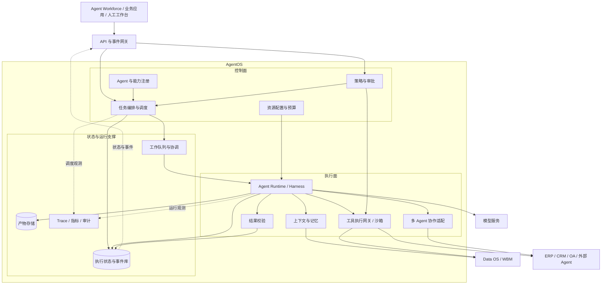
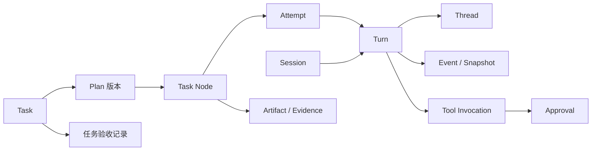
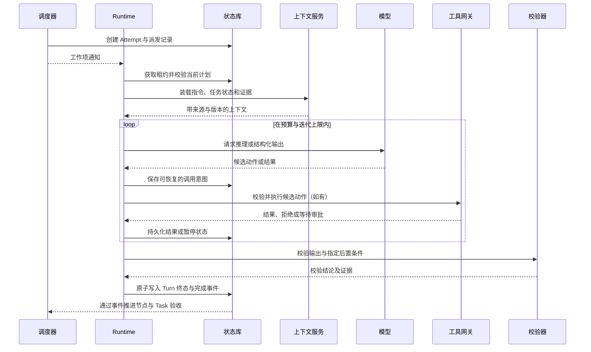
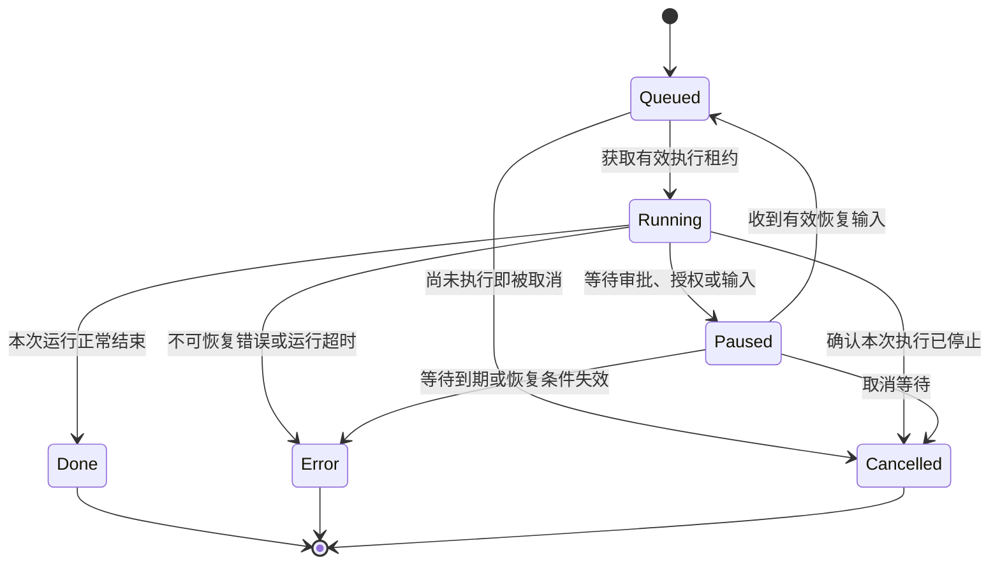
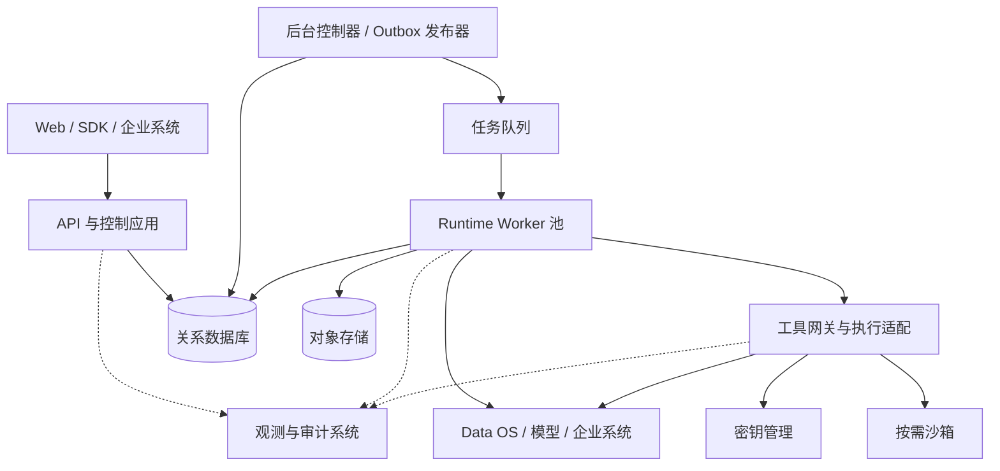
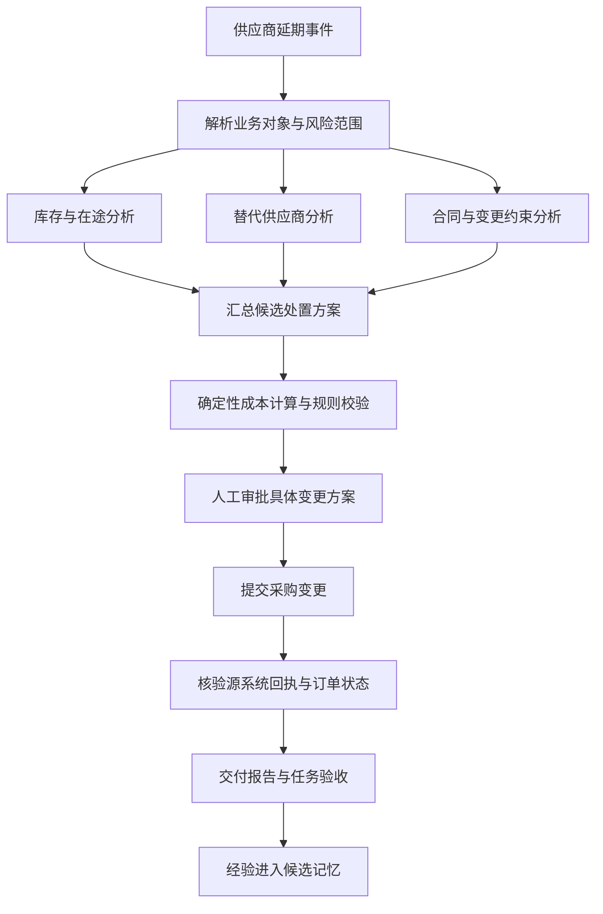

# AgentOS 架构设计：基于 WBM 的企业智能体协作与执行平台

> 文档版本：v0.1 · 设计草案  
> 编写日期：2026-10-21  
> 适用范围：当前仓库中的企业 AI 操作系统设计，重点细化 AgentOS 层。

本文沿用现有的 **Data OS → Agent OS → Agent Workforce** 三层架构，以世界行为模型（World Behavior Model，WBM）统一企业对象、关系、状态、规则、行为和结果。在此基础上，进一步设计 AgentOS 内部的模块、领域对象、执行机制、集成契约和部署方式。

**AgentOS 的核心职责，是把业务目标转化为有权限边界、有持久状态、有执行证据、可恢复且可验收的任务过程。** 模型负责解释和生成候选行动，确定性程序负责授权、规则判断、计算和状态更新，人员负责需要业务判断或额外授权的决策。

## 一、设计依据与系统边界

### 1.1 当前已有设计与本文补充范围

当前工作区是设计内容与架构展示所在的博客项目。已查阅的材料提供了三层架构、Agent 能力清单和 Harness 运行时方案；相关页面代码实现的是架构可视化，不能据此认定其中展示的后台能力已经交付。

| 设计依据 | 已明确的内容 | 本文的使用方式 |
| --- | --- | --- |
| [企业级 AI 操作系统总体设计](enterprise-ai-operating-system-wbm.md) | WBM、Data OS、Agent OS、数字员工及业务反馈闭环 | 作为系统定位和业务边界的依据 |
| [Agent Harness 架构设计](enterprise-agent-harness-architecture.md) | Session、Turn、Thread、事件、快照、审批、沙箱和分布式执行 | 作为 AgentOS 执行内核的基础 |
| [三层架构展示组件](components/EnterpriseAiOSDiagram.tsx) | Runtime、A2A、工具注册、上下文、监控和策略护栏 | 作为能力划分依据 |
| [三层交互模型组件](components/EnterpriseAiOSScene.tsx) | 数字岗位、目标解析、编排、路由、结果校验和故障恢复 | 作为能力与业务角色的映射依据 |

本文将上述已有设计扩展为一个可用于技术评审的逻辑方案。**模块划分、Task/Plan 对象、接口示例、状态细化、存储约束和实施验收条件均属于本次设计补充**，需要在实现阶段落实。接口路径、字段名和服务名称是建议契约，本文不将其表述为已经存在的 API。

架构展示中的负载、节点数、完成比例等数值属于示例内容，不作为容量、性能或运行状态的依据。

### 1.2 三层架构的职责

| 层次 | 负责的问题 | 主要产物 | 边界 |
| --- | --- | --- | --- |
| Agent Workforce | 哪个数字岗位承担什么目标，以什么标准交付 | 岗位定义、业务任务、流程模板、验收标准 | 业务责任、岗位分工与人机协作 |
| Agent OS | 如何将目标组织为受控执行并交付结果 | 任务图、运行记录、工具调用、执行产物 | 通用编排、执行、治理与恢复 |
| Data OS | 企业事实是什么，来自哪里，允许谁使用 | 企业对象、状态、知识、规则和证据 | 业务数据集成、语义与事实管理 |
| WBM | 如何统一表达企业世界中的状态与行为 | 对象语义、关系、状态约束和动作定义 | 跨层共享的语义契约，不单独视为第四层 |

现有总体文章将任务分解与路由归入 Agent OS，二维展示图则将相似能力放在 Workforce。本文采用以下职责划分统一这两个视角：

- **Workforce 提供业务编排内容**：岗位职责、流程模板、专业分工、升级对象和验收条件。
- **AgentOS 提供通用编排机制**：任务图校验、节点调度、运行控制、结果汇总和故障处理。

例如，“供应链协调员负责识别并处置交付风险”属于 Workforce；“将库存分析和供应商分析并行执行，等待结果后进入方案评审”由 AgentOS 的编排引擎承载。

### 1.3 AgentOS 与 Agent Harness 的关系

Agent Harness 是 AgentOS 的执行内核，负责一次输入触发的模型与工具循环，以及该过程的上下文、状态、审批和恢复。

AgentOS 在 Harness 之上增加任务级管理：将业务任务拆成多个可协调的执行单元，管理不同 Agent 的能力与版本，跟踪任务验收，并把运行事实反馈给数字岗位和 Data OS。

因此，一个 Harness Turn 完成，只说明一次执行结束；一个业务 Task 完成，还必须满足任务定义中的交付标准和外部状态校验。

### 1.4 设计目标

本方案优先满足六项要求：执行可恢复、行动可约束、结果可验证、过程可追溯、能力可替换、资源可计量。模型或 Worker 的短时故障不应丢失已确认的业务状态；恢复过程也不能无条件重新执行已经发出的写操作。

AgentOS 不接管 ERP、CRM 等系统的业务事实所有权，不依赖模型自行判断权限，也不承诺任意跨系统操作都能回滚。每种业务动作需要明确其执行、查询确认和补偿方式。

## 二、总体逻辑架构

### 2.1 架构总览



上图表达逻辑依赖，部署时不要求每个框都成为独立服务。初期可以在同一个应用中实现控制模块，通过独立 Worker 运行长任务，先保持契约清晰，再依据实际负载拆分。

### 2.2 模块职责与数据所有权

| 模块 | 主要职责 | 管理的状态 |
| --- | --- | --- |
| API 与事件网关 | 认证、命令接入、查询、事件订阅、限流 | 请求幂等记录；不持有唯一运行状态 |
| Agent 与能力注册 | 定义、版本、能力标签、工具范围和发布状态 | Agent Definition、能力契约、版本引用 |
| 任务编排与调度 | 任务图校验、依赖推进、资源分配、取消传播 | Task、Plan、Node、Attempt |
| 策略与审批 | 授权、风险分级、审批创建与决定校验 | Policy、Approval、授权决定 |
| Agent Runtime | 模型循环、输入消费、暂停恢复、终态处理 | Session、Turn、Thread、Snapshot |
| 多 Agent 协作适配 | 内部委派、外部 Agent 接入、任务状态映射 | 委派关系、远程任务引用 |
| 上下文与记忆 | 检索、组装、压缩、记忆候选与读取 | 上下文清单、摘要版本、记忆引用 |
| 工具执行网关 | 参数检查、最终授权、执行记录、结果确认 | Tool Invocation、动作回执 |
| 结果校验 | 格式、证据、规则与业务状态校验 | Validation Result、验收记录 |
| 观测与审计 | 运行追踪、成本、告警、审计查询 | 观测数据和受控审计索引 |

单个对象应由明确模块负责状态写入。其他模块通过命令或事件推进流程，避免调度器、Runtime 和 API 同时各自维护一套任务状态。

### 2.3 四条核心链路

**控制链路**从业务目标开始，经任务图、节点调度、Agent 执行到业务动作。

**上下文链路**从 Data OS 获取对象、知识、规则和来源信息，形成当前执行可使用的证据集合。

**反馈链路**将工具回执、执行状态、校验结果和业务变化反馈给任务及数字岗位；业务事实经过源系统确认后进入 Data OS。

**治理链路**在上述三个过程中持续检查租户、身份、授权、预算和审批条件。入口处允许创建任务，不代表执行中产生的每个动作都已被授权。

## 三、核心领域模型

### 3.1 从业务任务到执行实例

| 对象 | 含义 | 关键字段示例 |
| --- | --- | --- |
| Agent Definition | 可复用且版本化的智能体定义 | `agent_id`、`version`、`capabilities`、`tool_refs`、`limits` |
| Digital Worker Binding | 数字岗位与 Agent 能力的绑定 | `worker_id`、`role`、`agent_refs`、`authority_scope` |
| Task | 需要验收的业务工作单元 | `task_id`、`goal`、`object_refs`、`constraints`、`acceptance` |
| Plan | 一次任务规划的不可变版本 | `plan_id`、`version`、`nodes`、`edges`、`policy_ref` |
| Task Node | 任务图中的一个步骤 | `node_id`、`kind`、`input_refs`、`output_schema`、`dependencies` |
| Attempt | 节点的一次执行尝试 | `attempt_id`、`node_id`、`lease_epoch`、`status` |
| Session | 与一个 Agent 定义关联的持续交互容器 | `session_id`、`agent_version`、`creator`、`business_ref` |
| Turn | 一次输入触发的持久化执行 | `turn_id`、`session_id`、`attempt_id`、`status` |
| Thread | 某个 Agent 的独立推理上下文 | `thread_id`、`parent_thread_id`、`context_ref` |
| Tool Invocation | 一次可追踪的工具执行意图 | `invocation_id`、`action_key`、`args_digest`、`status` |
| Approval | 对具体动作或有界动作集合的审批 | `approval_id`、`action_digest`、`scope`、`expires_at` |
| Artifact / Evidence | 交付物与支撑它的证据 | `artifact_id`、`source_ref`、`object_version`、`checksum` |
| Event / Snapshot | 已发生事实和可恢复聚合状态 | `event_id`、`aggregate_seq`、`snapshot_version` |

所有对象携带 `tenant_id`。跨对象引用必须验证租户一致性，不能只依靠调用者提交的 ID 建立关联。模型凭证、工具令牌等敏感内容通过受管资源引用装载，不进入 Agent Definition 正文。

### 3.2 对象关系



一个 Task 可以关联多个 Agent Session；一个节点可以因故障产生多个 Attempt；交互补充和业务继续处理可以产生新的 Turn。实现时通过关联表记录 Task、Session 和 Turn 的关系，不把它们压成一个统一的“对话 ID”。

技术重试使用新的 Attempt，但同一个逻辑业务动作应复用稳定的 `action_key`。业务目标或动作语义发生变化时，才创建新的动作标识并重新判断审批。

### 3.3 Task 契约示例

以下是供应链风险任务的建议表达。标识、金额和时限仅用于说明契约。

```json
{
  "task_id": "task_supply_001",
  "tenant_id": "tenant_demo",
  "worker_id": "supply_chain_coordinator",
  "goal": "评估订单交付风险，并形成可执行的处置方案",
  "object_refs": [
    { "type": "PurchaseOrder", "id": "PO-20261021-001", "version": "v17" }
  ],
  "constraints": {
    "deadline": "2026-10-22T10:00:00+08:00",
    "max_incremental_cost_cny": 20000,
    "external_write_requires_approval": true
  },
  "acceptance": [
    "风险判断引用订单、库存和供应商证据",
    "处置方案包含成本、预计交期和适用前提",
    "已批准动作具有源系统回执和状态核验结果"
  ],
  "budget": { "max_model_tokens": 80000, "max_parallel_nodes": 4 },
  "policy_ref": "supply-policy@3",
  "status": "created"
}
```

业务增量成本与模型运行成本分别管理，不能用同一个预算字段混算。授权身份由认证结果生成并由服务端绑定，不能相信模型或客户端自行声明的权限。

### 3.4 版本与可追溯性

每次执行固定引用 Agent 定义、技能、工具契约、流程模板和模型配置的版本，记录使用的业务规则版本。执行中遇到权限撤销、紧急禁用或规则更新时，按当前有效治理策略重新校验，不能以“旧版本已允许”为理由继续动作。

模型配置版本用于说明当时选择了什么配置，不承诺模型输出可以逐字重现。回放应能还原已保存的事实、输入和动作；重新调用模型属于新执行。

## 四、目标解析、任务编排与智能路由

### 4.1 从目标到任务图

目标解析首先提取交付物、业务对象、硬约束和验收条件，再通过 Data OS 将自然语言中的客户、订单、产品等映射到稳定对象标识。如果关键对象有歧义，任务进入等待输入状态，不将猜测结果直接用于业务写入。

规划器优先匹配已有流程模板；对于未覆盖的分析步骤，可以生成候选任务图。候选图需要经过确定性检查，确认依赖无环、输入输出兼容、执行主体可用、预算可行，以及关键写入步骤具备策略检查点。

| 节点类型 | 用途 | 完成条件 |
| --- | --- | --- |
| Agent 节点 | 需要解释、归纳或方案生成的工作 | 输出符合契约并完成指定校验 |
| Tool 节点 | 已明确参数的确定性调用 | 获得可确认的工具结果 |
| Human 节点 | 补充信息、业务判断或审批 | 收到有效且未过期的决定 |
| Validation 节点 | 检查证据、规则和外部状态 | 满足明确的校验规则 |
| Join 节点 | 汇集多个前置节点结果 | 满足全部、部分或阈值依赖策略 |

### 4.2 编排方式

**固定流程**适用于步骤和控制要求明确的任务，由版本化模板定义节点与依赖。

**动态规划**适用于分析路径不确定的任务，由模型提出计划，平台检查后执行。模型只能在授权能力集合内规划，不能通过生成新节点扩大权限。

**混合编排**作为本方案的默认选择：审批、关键写入和最终验收使用固定检查点，检查点之间的分析任务允许动态拆解。

任务图采用有向无环结构表达一个 Plan 版本；需要重新规划时创建新版本，并记录与前一版本的关系。局部模型循环限制在 Turn 内，避免形成无限自调度。

### 4.3 调度与路由

调度分为两步。首先过滤不满足租户、数据权限、能力契约、部署区域和工具条件的候选 Agent；随后在可用集合中依据负载、预算、截止时间和历史评测结果选择执行实例。

能力资格来自受管注册和验证结果，Agent 自述只能作为描述，不能自行取得执行权限。路由策略可以逐步优化，但每次选择应保留候选条件和选择依据。

队列支持租户配额、任务优先级与等待时间提升，避免高优先级任务长期挤占全部资源。子任务共享根任务预算，分配时预留、结束后结算，并限制子 Agent 深度、总节点数及并发量。

### 4.4 计划变更与依赖推进

节点只有在依赖和输入版本满足要求后才进入就绪状态。并行任务输出冲突时，由专门的校验或协调节点处理，不以最后返回的结果覆盖其他结果。

重新规划需要记录原因、受影响节点、已完成动作和新增成本。对尚未派发的旧节点停止调度；对已经派发的节点请求取消并确认其状态。已产生业务副作用的节点保留原记录，新计划必须接续这些事实。无法确认旧动作结果时，先进入核对流程，再决定后续方案。

## 五、Agent Runtime 与持久化执行

### 5.1 标准执行流程

Runtime 接到工作项后，读取持久化任务状态并取得执行租约，确认节点仍属于当前有效计划，再装载固定版本的 Agent 定义和资源。随后恢复上下文、消费有效输入，进入受限的推理与工具循环。



图中的循环在需要审批、授权或补充信息时退出当前执行占用，将状态持久化后等待恢复。Turn 的正常结束还需要通过节点验收；Task 的完成则由整个任务图和最终业务验收决定。

### 5.2 Turn 与 Task 的状态分离

沿用 Harness 的 `Running、Paused、Done、Error、Cancelled` 状态语义，增加排队状态以表达尚未被执行器接管的工作。暂停原因、结束原因和重试信息使用独立字段，避免为每一种业务情况增加顶层状态。



取消请求单独记录为 `cancel_requested_at`。请求已受理但执行器尚未确认停止时，不提前把 Turn 标记为 Cancelled。

Task 建议使用 `created、planning、ready、running、waiting、verifying、succeeded、failed、cancelled`。当部分分支继续运行时，Task 仍为 running；只有没有可推进工作且依赖外部输入时才进入 waiting。Task 只有通过最终验收才能进入 succeeded，不能因为所有模型请求结束就自动成功。

取消后的任务保留 `effects_summary`，说明哪些动作已完成、哪些已补偿、哪些仍待核对。取消运行不表示现实业务状态已经恢复。

### 5.3 事件、快照与事务

影响后续恢复的状态变化使用持久化事件记录。建议事件包含：

```json
{
  "event_id": "evt_demo_001",
  "tenant_id": "tenant_demo",
  "aggregate_type": "turn",
  "aggregate_id": "turn_demo_001",
  "aggregate_seq": 18,
  "task_id": "task_supply_001",
  "type": "tool.invocation_requested",
  "schema_version": 1,
  "occurred_at": "2026-10-21T14:30:00+08:00",
  "causation_id": "evt_demo_000",
  "trace_id": "trace_demo_001",
  "payload_ref": "artifact_tool_intent_001"
}
```

事件 ID 用于唯一标识；聚合内顺序由数据库事务分配的 `aggregate_seq` 保证，并设置唯一约束。跨聚合事件通过因果引用关联，不依赖不同机器的时间戳建立全局严格顺序。这是对现有 Harness 事件排序设计的进一步细化。

快照记录已应用到的事件序号。恢复时加载快照，再重放后续状态事件；重放事件用于还原状态，不自动重新调用外部工具。

状态更新、领域事件和待发布 Outbox 记录在同一数据库事务内提交。发布器将 Outbox 推送到队列，失败可重试，消费者通过事件 ID 去重。模型流式片段可按批次存储，但工具调用意图、审批和终态等控制事实必须持久化后再确认。

### 5.4 输入、审批与恢复

用户补充信息、审批决定、客户端执行结果和外部 Agent 回调先进入持久化 Inbox。接收接口验证身份、目标对象、请求版本和去重标识；Worker 消费时再次确认输入仍适用于当前状态。

审批处理顺序为：保存候选动作及参数摘要，原子记录审批请求与暂停状态，释放可释放的执行资源，等待决定。批准后将 Turn 重新排队；恢复器重新校验当前权限、对象状态、审批有效期与动作参数，再进入工具网关。

拒绝审批属于有效的业务决定，可以让 Agent 在剩余授权范围内提出替代方案。拒绝不意味着运行异常，也不能通过重新包装同一个动作规避审批。

### 5.5 租约、重试与故障接管

Worker 使用带到期时间和递增 `lease_epoch` 的租约持有 Attempt。心跳延长租约，接管者取得新 epoch，所有受保护的状态写入验证 epoch，阻止旧 Worker 在租约失效后提交过期结果。

平台侧工具网关也验证有效执行权。但平台租约不能撤回已经送达外部系统的请求；这类动作需要外部幂等支持、回执查询或人工核对。

| 故障情形 | 恢复方式 |
| --- | --- |
| Worker 在模型调用前退出 | 从最新快照与未消费输入恢复 |
| 模型调用中断且未发出业务动作 | 按预算和重试策略重新请求，记录新尝试 |
| 工具意图已保存但尚未派发 | 校验授权后继续派发同一逻辑动作 |
| 工具已成功但本地结果未落库 | 使用幂等键或源系统业务标识查询确认 |
| 写入超时，外部执行结果未知 | 标记 `outcome_unknown`，进入核对流程 |
| 审批通知丢失 | 从 Inbox 和暂停记录重新发现可恢复执行 |
| 重复消费完成事件 | 根据事件 ID 和节点版本去重 |

恢复策略以可确认的事实为依据。对于没有幂等能力且无法查询执行结果的工具，不能自动重试写入。

## 六、多 Agent 协作与 A2A 接入

### 6.1 角色与协作关系

协调型 Agent 解释目标并汇总方案；专家型 Agent 进行领域分析；执行型 Agent 操作业务系统；监督型 Agent 提供证据复核与质量检查。角色是职责约束，不代表每种角色必须使用不同模型或独立服务。

多 Agent 协作通过任务图组织。可并行的独立分析分别执行，存在依赖的步骤串行推进，对关键方案加入复核节点。监督 Agent 的判断是校验输入之一，权限、金额和状态转换等硬约束仍由确定性规则负责。

### 6.2 委派契约

一次委派至少包含目标、输入证据引用、允许访问的业务对象、输出契约、截止时间、预算和父任务标识。父 Agent 不能把全部会话历史与全部工具权限默认传给子 Agent。

| 契约内容 | 约束 |
| --- | --- |
| 目标和完成条件 | 可独立判断是否完成 |
| 输入与证据 | 有来源、版本及访问范围 |
| 输出 | 结构化结果、证据引用、限制与未解决项 |
| 授权 | 不超出父任务授权与当前策略 |
| 生命周期 | 可查询、取消、超时并汇报进度 |
| 资源 | 最大耗时、模型预算、子委派深度 |

多个 Agent 共享受控任务状态和产物索引，各自保留独立 Thread。共享状态修改必须通过带版本检查的接口，避免多个 Agent 并发覆盖结论。

### 6.3 内部协作与外部 A2A

同一平台内的子 Agent 使用内部任务协议，复用租户、状态库、预算与审计机制。跨平台协作通过 A2A 适配器接入，适配器承担远程能力发现、身份验证、任务创建、状态映射、结果接收和取消协商。

具体 A2A 协议版本、能力发现方式及远程状态枚举在接入时固定，本文不定义或替代外部协议标准。内部领域对象保持稳定，由适配器映射外部差异。

外部 Agent 的能力声明和返回产物需要验证。外部完成状态只表示远程执行结束，仍需满足本地的产物和证据校验；远程取消响应也不等于远程业务副作用已回滚。

### 6.4 汇总与分歧处理

输出按照业务对象标识、数据版本和指标口径合并。若库存 Agent 与采购 Agent 使用了不同时间点的库存信息，协调节点先统一证据版本，再比较方案。无法消除的分歧进入人工判断，产物保留不同结论的来源与适用条件。

## 七、上下文、记忆与 Data OS / WBM 集成

### 7.1 上下文组成

Runtime 将上下文组织为可追踪的清单，而非持续追加的无界聊天记录。

| 内容 | 来源 | 更新方式 |
| --- | --- | --- |
| 平台行为约束 | 受管策略与运行配置 | 每次运行装载，并响应紧急变更 |
| 岗位与 Agent 指令 | Workforce 绑定、Agent Definition | 按固定版本装载 |
| 任务目标与硬约束 | Task 与当前 Plan | 计划变更时更新 |
| 企业事实与规则 | Data OS / WBM | 按对象版本和新鲜度要求检索 |
| 工作状态与工具回执 | 当前 Turn、节点和事件 | 随执行推进 |
| 历史经验 | 经过验证的记忆条目 | 按适用范围检索 |
| 大文件和中间产物 | 产物存储 | 通过引用按需读取 |

每个关键证据记录来源系统、业务对象、版本、观察时间、获取时间和权限范围。模型给出的推测需要标记为假设，不能与检索得到的事实混写。

### 7.2 记忆分层与所有权

工作记忆保存当前计划、待办和已执行动作；会话记忆支持多轮交互；长期记忆保存经过验证的偏好、经验和方法。企业订单状态、合同内容和主数据仍由 Data OS 及其源系统提供。

记忆条目建议包含来源任务、证据引用、适用业务域、验证状态、有效期与访问范围。未经验证的执行总结先进入候选区，不能直接影响高风险动作。

检索记忆时重新检查当前访问权限。历史上有权读取的信息，不因进入摘要或向量索引就永久可见。记忆失效、源数据删除或权限变化应触发相关索引和缓存更新。

### 7.3 上下文预算与压缩

上下文预算分别预留给规则、任务、证据、历史和工具结果。工具目录先检索后装载，完整大结果存入持久化产物存储，模型接收摘要和可读取引用。

历史压缩必须保留业务目标、约束、已执行动作、证据来源、待决事项和审批引用。摘要中的“已批准”不能作为执行授权依据，工具网关仍读取正式审批记录。

重要产物不能只保存在临时沙箱中。沙箱文件可以用于当前计算，但用于恢复和验收的内容需要复制到受管持久存储。

### 7.4 WBM 集成契约

AgentOS 需要 Data OS 提供下列语义能力，具体 API 由 Data OS 实现方案确定。

| 语义能力 | 输入 | 输出 |
| --- | --- | --- |
| 对象解析 | 名称、外部编号、业务域 | 稳定对象标识及歧义候选 |
| 对象查询 | 对象标识、查询时间或版本 | 状态、关系、字段、来源和新鲜度 |
| 规则读取 | 对象类型、动作、业务上下文 | 规则版本、前置条件和限制 |
| 证据检索 | 任务问题、范围、权限上下文 | 文档或数据证据及引用 |
| 变更订阅 | 对象集合、事件类型 | 带源版本的业务变化事件 |
| 动作描述 | 业务动作标识 | 输入约束、前后置条件及系统映射 |

规则检查结果只对其输入和版本有效。执行动作前，如果对象状态或关键规则已变化，应重新校验，必要时重新规划或审批。

### 7.5 事实与执行状态的一致性

AgentOS 保存“尝试了什么、收到什么回执、验证到什么结果”；业务源系统保存实际订单、库存或付款事实。Data OS 汇聚这些事实并给出更新时间和一致性说明。

工具成功回执可先作为动作证据，但业务最终验收仍按契约读取源系统或满足新鲜度要求的数据视图。关键动作不能在陈旧缓存上完成验收。源系统与 Data OS 之间尚未同步时，任务可以进入验证等待，记录已确认动作和待确认事实。

## 八、技能、工具与业务动作执行

### 8.1 四类能力对象

| 对象 | 作用 | 示例 |
| --- | --- | --- |
| Agent | 选择方法、组织推理并协调任务 | 供应链风险分析 Agent |
| Skill | 封装任务方法、步骤和资源使用说明 | 供应商交付风险分析方法 |
| Tool | 提供具体且可调用的接口 | 查询库存、创建变更草稿 |
| Business Action | 表达受规则约束的业务状态变化 | 提交采购变更、批准替代供应商 |

一个业务动作可以调用多个工具，也可以由单一业务 API 完成。Skill 提供的操作建议不能修改平台授权规则，工具接入协议也不直接赋予业务权限。

### 8.2 统一工具执行入口

通过工具执行网关接入企业 API、MCP 工具和沙箱能力。注册时区分工具目录与企业实例：目录描述输入输出和行为属性，实例绑定部署地址、凭证引用、租户及可用范围。

建议工具契约包括 `input_schema`、`output_schema`、读写属性、风险等级、超时、结果大小限制、幂等支持、状态查询方式和补偿能力。契约由平台审核管理，不仅依赖工具自报的“只读”标签。

执行链路如下：

```text
候选工具调用
→ 参数与契约检查
→ 当前租户、身份和对象权限检查
→ 业务前置条件与风险判断
→ 审批核验或进入等待
→ 持久化调用意图与稳定动作标识
→ 在有效执行权下派发
→ 结果持久化、外部状态确认与后置条件检查
```

业务动作涉及并发修改时，优先通过源系统的条件写入或事务接口执行，例如携带预期对象版本。仅在调用前检查版本，不能消除检查与实际写入之间的并发变化。

### 8.3 幂等与结果未知

建议使用 `tenant_id + task_id + logical_action_id` 标识同一个业务动作，具体编码由实现确定。参数摘要另行保存，检测同一动作标识被重复用于不同参数的错误。

技术重试、Worker 接管和重复队列投递不改变该标识。显式计划变更导致动作内容变化时，创建新的动作版本，完成旧动作状态核对后再判断是否允许执行。

平台侧可阻止已知重复请求，但端到端去重依赖源系统能力。如果外部系统没有幂等接口，应使用稳定业务编号查询确认；无法确认时保留 `outcome_unknown`，阻止依赖该结果的后续写入并转交核对。

### 8.4 补偿与部分完成

跨系统业务动作不假设存在统一数据库事务。流程模板声明每一步的前置条件、已完成事实和可用补偿。补偿属于新的受控业务动作，需要独立记录、授权和结果检查。

例如，已经发送的通知不能通过删除本地记录撤回；已提交的采购变更可能需要追加撤销流程。补偿失败时保持“部分完成、待处理”的事实，不把 Task 改写成从未执行。

### 8.5 沙箱执行

需要代码运行、文件解析或复杂计算时，由 Runtime 申请有资源配额和网络限制的沙箱。沙箱通过受控代理访问允许的工具，长期凭证由平台托管。

沙箱输出按不可信产物处理，检查类型、大小和访问范围后进入持久化产物存储。沙箱实例生命周期与 Task 生命周期分离，任务恢复可以重建计算环境，但不能因此重复外部业务动作。

## 九、身份权限、审批与多租户治理

### 9.1 三类身份与授权传递

用户身份表示谁提出请求、谁承担业务授权责任；数字员工身份表示岗位职责和被授予的业务范围；服务身份表示哪个平台组件正在执行技术操作。三类身份共同进入审计上下文，但不能相互替代。

有效动作范围按调用模式取交集：

```text
交互任务：用户当前授权 ∩ 数字岗位范围 ∩ Agent 能力范围
          ∩ 当前任务约束 ∩ 平台策略 ∩ 外部系统权限

后台任务：显式服务委托授权 ∩ 数字岗位范围 ∩ Agent 能力范围
          ∩ 调度任务约束 ∩ 平台策略 ∩ 外部系统权限
```

后台任务需要明确的服务委托和业务责任人，不应冒用一个永久在线的个人会话。父任务委派子任务时只能缩小授权范围；子 Agent 无法通过选择其他工具实例扩权。

### 9.2 数据与动作双重授权

数据访问控制覆盖租户、组织、对象、行和字段。检索服务应在召回及返回阶段实施对应权限检查，避免摘要、向量索引或缓存绕过原始数据权限。

动作授权进一步检查对象当前状态、动作类型、金额、时间窗口和职责分离要求。能够读取订单不代表能够修改订单，拥有工具连接权限也不代表能够调用其中所有动作。

查询类动作仍需授权和数据策略检查；普通写入可按企业策略在限定范围内自动执行；付款、删除等高影响动作应配置明确的审批和执行约束。具体分级由业务所有者制定并版本化。

### 9.3 审批绑定与失效

Approval 绑定租户、业务对象、动作类型、规范化参数摘要、规则版本或适用条件、有效期和审批人。可以支持针对有界动作集合的审批，但需明确数量、金额和范围，不使用“批准该 Agent 后续全部操作”的无界授权。

批准后的动作如果改变供应商、金额、目标订单或其他关键参数，原审批不再覆盖。对象版本变化时，先判断是否影响审批前提；若影响，则重新规划并申请审批。

审批接口使用唯一决定标识防止重复提交，通过数据库版本控制解决并发决定。审批人资格、当前状态和是否满足职责分离在提交与执行前均被校验。

### 9.4 租户隔离与凭证管理

所有状态查询和对象关联显式携带租户边界。缓存键、队列工作项、对象存储路径、检索索引和观测查询同样需要租户隔离。只在数据库表增加 `tenant_id`，不足以覆盖整个执行链路。

工具和模型凭证按实例及租户托管，运行时通过引用获取。日志、上下文和审计索引不保存明文令牌。产物下载与分享接口重新检查访问权限，不依赖可猜测的对象地址提供保护。

### 9.5 外部内容与治理边界

检索文档、工具输出、技能内容和外部 Agent 结果均不得覆盖平台规则。外部内容中的“忽略审批”“读取其他租户数据”等文字只能作为内容处理，不能成为执行授权。

平台通过独立的工具网关和数据访问层实施最终限制，模型提示约束仅作为辅助。网络出口、沙箱权限和凭证管理共同限制执行影响范围。

## 十、结果校验、可观测性与反馈闭环

### 10.1 四层结果校验

| 校验层次 | 检查内容 | 主要执行方式 |
| --- | --- | --- |
| 格式校验 | 必填字段、类型、产物格式、对象引用完整性 | Schema 与程序校验 |
| 证据校验 | 引用是否存在、是否有权访问、是否过期或矛盾 | 来源检查、数据版本对照、必要的语义复核 |
| 规则校验 | 金额、业务约束、流程步骤、角色资格 | 规则引擎或确定性代码 |
| 业务验收 | 源系统状态、实际交付物、任务目标是否满足 | 状态查询、计算、业务确认 |

模型或监督 Agent 可以辅助识别证据与结论不一致的情况，但不能替代授权和确定性校验。不能确定时，结果应标为待确认并说明缺失证据。

“处置方案已执行”与“最终交付风险已消除”可能对应不同时间跨度。任务定义应说明成功是以操作完成、业务状态达成还是长期业务指标为准，避免用立即可见的工具回执冒充长期效果。

### 10.2 验收记录

建议每条验收结果包含 `criterion_id`、`result`、`validator_version`、`evidence_refs`、`checked_at` 和失败原因。结果至少区分通过、未通过和无法确定。

全部必要条件通过后，Task 才进入 succeeded。未通过时可以执行有界修复或重新规划；无法确定时等待新的证据或人工确认。任务负责人与审批人可以不同，需要分别记录责任。

### 10.3 统一执行时间线

以 `task_id` 关联 Plan、Node、Attempt、Session、Turn、Thread、Tool Invocation 和 Artifact。Trace 展示技术调用耗时，领域事件展示可恢复的业务状态变化，两者通过标识关联。

审计保存用户输入、模型返回的可见输出或结构化决定、工具参数摘要、数据来源、策略判断、审批和外部回执。无需依赖模型不可获得的内部推理过程解释系统行为。

审计内容按数据敏感等级脱敏与授权，采用受限追加、保留策略和适当的完整性校验。事件表本身不会自动具备防篡改能力，需要配合存储权限和审计控制。

### 10.4 指标与成本治理

| 指标 | 建议口径 | 用途 |
| --- | --- | --- |
| 任务成功率 | 指定任务类型和时间窗口内，通过验收的终态任务比例 | 衡量实际交付 |
| 人工接管率 | 需要人工承担后续处理的任务占比 | 识别能力或流程瓶颈 |
| 故障恢复成功率 | 可恢复故障中，完成恢复并继续有效推进的比例 | 衡量执行可靠性 |
| 结果未知数量 | 尚未确认外部写入结果的动作数量与等待时长 | 发现需要核对的业务风险 |
| 任务完成时长 | 从创建到终态的耗时，并拆出排队和审批等待 | 区分系统性能与业务等待 |
| 单任务运行成本 | 关联的模型、工具和计算成本汇总 | 预算与资源优化 |
| 验收拒绝原因分布 | 证据缺失、规则冲突、状态未达成等 | 指导流程改进 |

成功率需同时披露失败、取消、未结束和样本量，避免通过隐藏失败任务获得失真的指标。性能与可用性目标在确定负载、场景和部署环境后制定，本文不虚设已经达成的 SLA。

成本控制采用任务预算预留与调用后结算。并行子任务共享预算池，调度前做原子配额分配；达到上限后停止继续扩展或请求业务决策。允许的超额余量应由策略显式定义，以覆盖流式响应计量和在途请求。

### 10.5 反馈与版本发布

执行结束后，将任务验收、工具故障、人工修改和业务效果形成评测样本。经验写入候选记忆，流程和 Agent 改动形成新版本，经过离线评测与限定范围验证后发布。

区分两种回放：事件回放用于还原历史状态，不触发工具；评测重跑用于比较新配置，默认使用模拟工具或隔离测试系统。实际业务重执行需要创建新任务并重新授权。

当新版本在任务成功率、成本或风险指标上退化时，回退后续新任务的版本路由。已执行的外部动作不能通过软件版本回退自动撤销。

## 十一、接口、部署与可靠性设计

### 11.1 对外接口契约

以下路径是本文建议的初版 API，用于表达系统边界，实际实现时可调整命名。

| 操作 | 建议接口 | 关键语义 |
| --- | --- | --- |
| 创建业务任务 | `POST /v1/tasks` | 校验任务约束，支持幂等提交 |
| 查询任务 | `GET /v1/tasks/{task_id}` | 返回状态、当前计划、验收与副作用摘要 |
| 查看任务图 | `GET /v1/tasks/{task_id}/plan` | 返回计划版本与节点进度 |
| 请求取消 | `POST /v1/tasks/{task_id}/cancel` | 持久化取消意图，异步停止与核对 |
| 提交交互输入 | `POST /v1/turns/{turn_id}/inputs` | 写入 Inbox，绑定等待请求与版本 |
| 提交审批决定 | `POST /v1/approvals/{approval_id}/decisions` | 校验审批资格、范围和重复提交 |
| 订阅任务事件 | `GET /v1/tasks/{task_id}/events` | 按游标续传，进行订阅权限检查 |
| 获取执行产物 | `GET /v1/artifacts/{artifact_id}` | 按租户与对象权限读取 |
| 发布 Agent 版本 | `POST /v1/agents/{agent_id}/versions` | 校验引用、能力和发布权限 |

对创建任务和审批决定等命令，幂等键作用域包含租户、主体和操作类型；同一个键配合不同请求内容应返回冲突。长任务接口返回已持久化的受理结果及查询入口，不等待任务结束才响应。

任务内事件订阅使用由状态库分配的任务游标，或由服务端生成的等价不透明游标；不能直接混用不同 Turn 的序号。客户端按事件 ID 去重，断线后补读。游标超出保留窗口时，服务端返回明确状态，客户端获取当前任务快照和新的有效游标。

### 11.2 初期部署形态

建议从“模块化控制应用 + 独立执行 Worker”起步。下面的组件选择是部署建议，不代表仓库已完成技术选型。



关系数据库保存任务、事件、审批、租约、Inbox/Outbox 和执行结果；对象存储保存文件与大产物；队列负责工作分发；可选协调缓存用于活动节点定位和加速查询。队列及缓存不作为任务业务状态的唯一存储。

模型凭证同样通过密钥管理装载。事件流连接可由 API 承载，规模增大后再拆分独立订阅服务。

### 11.3 数据约束

建议在存储层显式建立以下约束，并通过事务或条件更新维护：

- 同一租户、主体和命令作用域内的请求幂等键唯一。
- 同一聚合的事件序号唯一，任务订阅游标具有明确顺序。
- 同一节点有效 Attempt 的状态更新需要匹配当前版本及租约 epoch。
- 同一逻辑动作标识不能对应不同的规范化参数摘要。
- 同一审批请求只能按规则形成一个最终有效决定。
- 一个 Turn 只能成功写入一个终态，迟到回调不能覆盖终态。
- 已结束或已被替代的计划不允许继续派发新节点。

若旧 Worker 返回了真实外部回执，即使其执行租约已经失效，也应通过核对入口保留该证据，而非直接修改过期 Attempt 或静默丢弃业务事实。

### 11.4 扩容与隔离

控制服务按请求量扩容，Runtime Worker 按活跃执行和模型并发扩容，工具 Worker 按连接器的吞吐与隔离要求扩容，沙箱按 CPU、内存和运行时间独立配额。

对于同一业务对象的冲突写入，可使用对象级调度互斥减少冲突，并配合源系统条件写入保证正确性。平台内部锁不能约束其他业务应用对源系统的直接修改。

滚动发布时停止获取新工作，推进可完成的短步骤，将剩余执行状态持久化后释放租约。接管者核对在途工具动作，避免旧 Worker 与新 Worker 重复派发。

### 11.5 主要故障与处理策略

| 故障 | 系统行为 | 保留的信息 |
| --- | --- | --- |
| 队列重复投递 | 通过工作项版本、租约和幂等记录去重 | 原始投递与消费记录 |
| 队列暂不可用 | Outbox 保留待派发工作，恢复后重发 | 已受理任务与发布重试状态 |
| 状态库不可写 | 停止新业务写动作派发；在途动作待恢复后核对 | 外部动作标识及可用回执 |
| 模型服务限流 | 按策略退避、排队或使用获准的替代配置 | 尝试次数、预算与替代配置版本 |
| Data OS 数据过期 | 刷新或暂停相关决策；按场景读取源系统确认 | 数据版本与过期原因 |
| 工具返回结果未知 | 停止依赖该结果的后续写入，启动核对 | 调用参数、动作键与时间范围 |
| 部分任务失败 | 根据节点策略继续独立分支或停止，并评估补偿 | 成功分支、失败原因与影响范围 |
| 事件订阅断线 | 客户端按游标补读，不影响后台任务执行 | 持久化事件与当前快照 |

重试次数、退避、超时和熔断阈值按模型、工具和业务动作分别配置。对于确定性权限拒绝、参数非法或审批拒绝，不进行无意义的技术重试。

### 11.6 验证重点

实现阶段优先验证跨模块故障场景：工具成功后 Worker 崩溃、审批重复提交、租约失效后的迟到写入、同一任务重复派发、取消与外部回执竞态、计划替换时旧节点仍在运行，以及租户隔离在缓存和产物读取上的一致性。

这些验证应检查最终业务状态与审计证据，不能只断言 API 返回成功。模型评测与执行系统测试分别进行：前者评估方案质量，后者验证状态、权限和恢复机制。

## 十二、端到端案例与分阶段落地

### 12.1 场景：供应商延期后的交付风险处置

以下使用一组假设数据说明架构运行过程：采购订单 `PO-20261021-001` 的供应商预计延迟三天交付，企业希望评估对客户订单的影响，并在额外成本不超过约定上限的前提下形成处置方案。

事件来自企业系统，由 Data OS 映射到供应商、采购订单、物料、库存及相关客户订单。Workforce 中的供应链协调员接收业务事件，根据岗位流程创建 Task，并给出允许的操作范围与验收标准。

### 12.2 任务图



若分析表明无需变更，流程可以走“无动作处置”分支，提交有证据支持的风险结论，由该分支的验收标准判定完成。示意图展示需要实际变更的一条路径。

### 12.3 各阶段的输入与产物

| 阶段 | AgentOS 行为 | 产物与检查点 |
| --- | --- | --- |
| 接收事件 | 以源事件标识去重，创建业务 Task | 来源事件、对象版本、岗位责任人 |
| 建立计划 | 匹配流程，生成并校验 Plan | 节点、依赖、预算、输出和验收契约 |
| 并行分析 | 路由到库存、采购和合同 Agent | 独立分析产物与证据引用 |
| 方案汇总 | 对齐时间口径，比较候选方案 | 成本、交期、风险与适用前提 |
| 规则检查 | 调用计算程序与业务规则 | 可执行方案及规则版本 |
| 等待审批 | 固定动作参数和审批范围，暂停运行 | 审批请求与暂停快照 |
| 恢复执行 | 重查权限、审批和订单状态 | 有效执行意图与动作标识 |
| 业务写入 | 通过工具网关提交条件变更 | 外部业务编号、回执与动作结果 |
| 最终验收 | 核验订单状态与方案交付物 | 验收结果、业务影响与后续跟踪项 |
| 反馈沉淀 | 保存实际耗时、人工修改和问题 | 评测样本与候选经验 |

### 12.4 审批后的状态变化

假设审批时订单为 `v17`，恢复时已经被采购人员修改为 `v18`。系统检查变化是否影响原方案：若只改变与动作无关的备注，可按已定义策略继续；若数量、供应商或价格变化，原方案前提失效，需要重新分析并根据策略重新审批。

真正提交变更时携带最新确认的预期版本。若源系统再次检测到版本冲突，动作不继续盲目重试，而是返回状态冲突并重新核对。

### 12.5 写入超时与取消

假设提交采购变更后连接超时。工具网关将调用记录为 `outcome_unknown`，通过稳定动作键或采购系统业务编号查询。确认成功后补写回执并继续验收；确认未执行且具备安全重试条件时重新派发；无法确认时暂停相关后续操作并通知责任人核对。

若此时用户请求取消，系统停止未派发工作并尝试终止在途请求，但仍跟踪该变更是否已经生效。最终报告区分“停止后续执行”和“采购变更已撤销”，不会把二者合并为一个取消状态。

### 12.6 第一阶段：建立可恢复的单 Agent 执行基础

范围包括 Agent 定义与版本、Task 和 Session/Turn 的关联、模型调用、少量工具、事件与快照、产物管理、基本预算和执行时间线。初期使用测试业务系统或受控工具验证闭环。

验收条件：执行进程退出后可恢复任务状态；重复提交不会创建重复业务任务；工具执行结果可追溯；Turn 完成与 Task 验收分离；对于结果未知的写入，不自动重复执行。

### 12.7 第二阶段：接入企业语义与治理

选择供应链或其他明确业务域，接入 Data OS 对象与证据、WBM 动作约束、企业身份、对象权限、审批、正式业务连接器和源系统状态核验。

验收条件：受限数据不会经记忆或产物泄露；审批后参数或关键状态变化能够触发重新校验；关键动作的主体、依据、审批和回执可以关联；任务根据业务状态而非模型文本判断成功。

### 12.8 第三阶段：扩展协作与规模化运行

增加多 Agent 任务图、动态路由、外部 A2A 适配、租户配额、分布式 Worker、计划变更和完整的评测发布流程。

验收条件：并行分支隔离且结果可汇总；租约失效和队列重复投递不会造成无约束重复写入；计划替换保留已产生的业务事实；预算与权限可贯穿子任务；新版本可以按评测结果限定发布或回退。

阶段推进以这些运行能力通过验证为依据。动态规划、复杂协作和长期记忆应建立在可恢复执行与业务验收之上。

## 附录 A：架构决策记录

| 决策 | 本文采用的方案 | 原因与影响 |
| --- | --- | --- |
| Workforce 与 AgentOS 分工 | 业务编排内容与通用编排机制分离 | 统一当前材料中的职责交叉，避免两套调度器 |
| Harness 的位置 | 作为 AgentOS 执行内核 | 复用已有运行时设计，补齐任务级治理 |
| 业务与运行对象 | Task 与 Turn 分开 | 长期业务任务可跨多次交互和多个 Agent |
| 持久化事实 | 数据库状态、事件与 Outbox 原子提交 | 降低状态更新和消息发布不一致的风险 |
| 执行交付语义 | 按可重复投递设计，并对业务动作去重及核对 | 不依赖无法跨外部系统统一保证的全局事务 |
| 业务事实所有权 | 源系统为准，Data OS 提供受控语义视图 | Agent 执行记忆不能覆盖真实业务状态 |
| 工具入口 | 统一网关进行最终执行检查 | 防止不同 Agent 或协议形成权限旁路 |
| 技术部署 | 模块化控制应用与独立 Worker 起步 | 优先验证核心契约，再按负载拆分 |
| 自动改进 | 候选经验、评测、版本发布 | 防止未经验证的反馈直接改变生产行为 |

## 附录 B：实现前需要明确的事项

以下事项影响实现细节，不阻碍当前逻辑方案成立，但需要在首个业务域落地前形成具体决策。

| 待定事项 | 需要确认的信息 | 影响范围 |
| --- | --- | --- |
| 首批任务范围 | 分析、建议还是实际业务写入，谁负责验收 | 工具、审批和状态核验范围 |
| Data OS 接口与新鲜度 | 对象标识、版本、权限、事件和更新延迟 | 上下文可信度与执行前检查 |
| 源系统动作能力 | 幂等接口、条件写入、结果查询和补偿流程 | 写入恢复与部分失败处理 |
| 模型与运行区域 | 可用模型、数据出境约束、容量与成本 | 路由、部署和预算策略 |
| 具体存储与队列 | 企业已有组件、运维能力和备份恢复要求 | 事务、派发、保留和恢复实现 |
| A2A 与 MCP 接入版本 | 合作系统、协议版本、认证和兼容范围 | 适配器与契约验证 |
| 审批与自治规则 | 风险分级、金额阈值、审批人和失效条件 | 策略引擎与任务暂停机制 |
| 保留与性能目标 | 审计保留期限、预计负载、可用性和恢复目标 | 容量规划、归档及故障演练 |

## 附录 C：建议实施交付物

实现团队可围绕本方案继续形成领域对象 Schema、状态迁移表、OpenAPI 契约、工具适配规范、权限与审批规则表、数据库约束、事件 Schema、故障恢复用例和任务评测集。各项交付物应与本文的模块所有权对应，避免仅交付组件清单而缺少执行语义。

首个贯通用例应能回答六个具体问题：任务要达成什么，谁授权了动作，执行到了哪里，业务实际发生了什么，故障后如何继续，以及凭什么认定任务完成。
