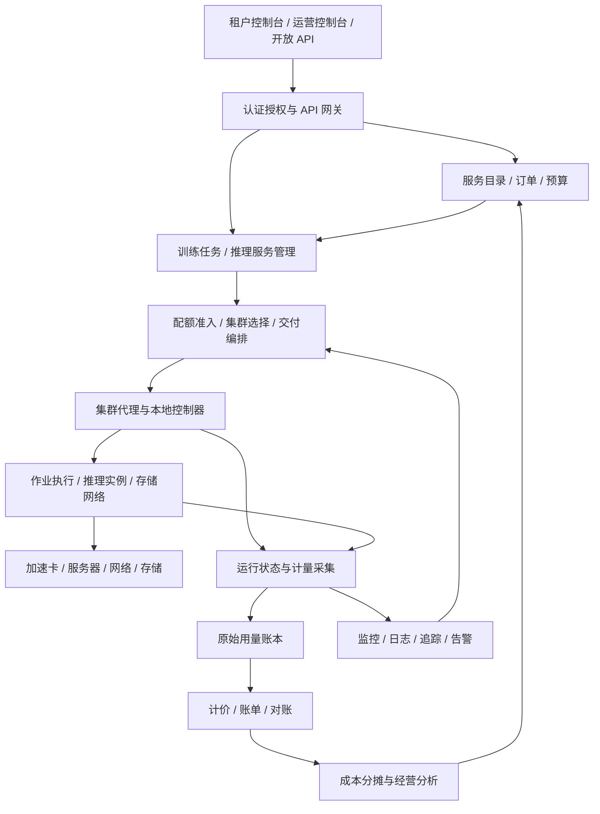
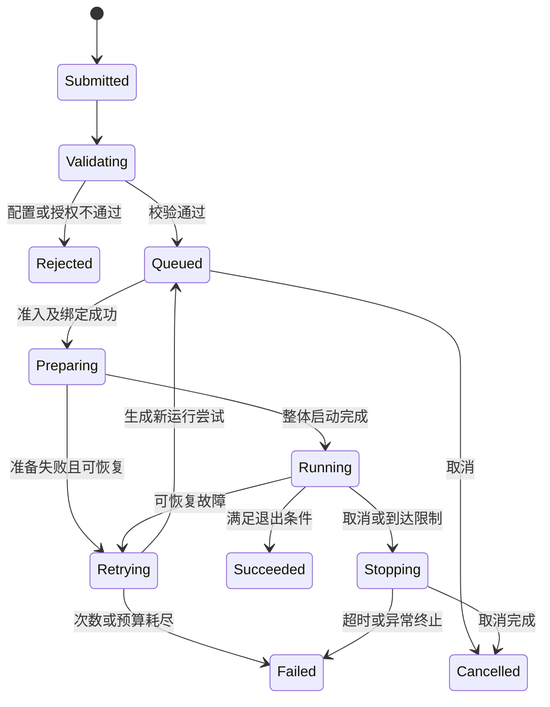
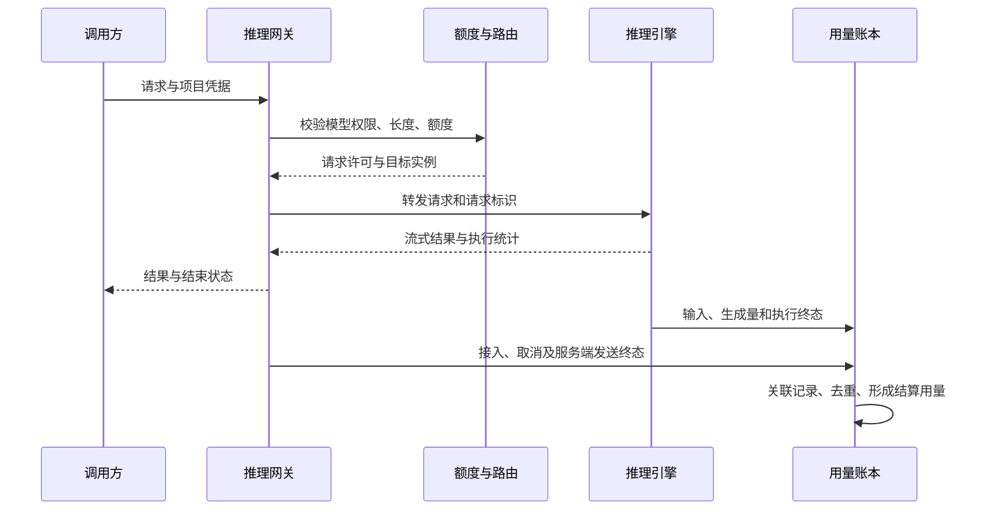
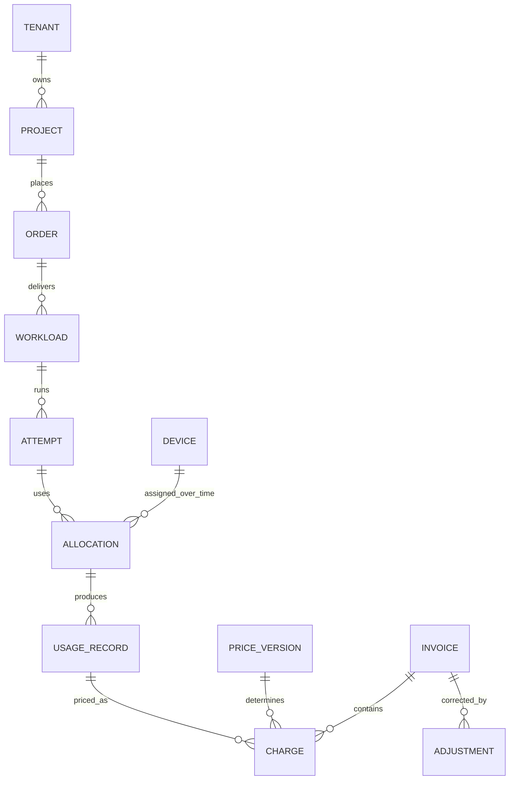

# AI 算力运营平台总体设计方案

> 文档版本：v0.1 · 完整设计草案
>
> 编写日期：2026-10-22
>
> 阅读对象：业务负责人、产品经理、架构师、平台研发、运维与运营团队。
>
> 适用场景：企业或智算中心统一管理多租户、异构加速设备及多个集群，提供训练、推理与算力租赁服务。

AI 算力运营平台需要把物理设备转化为可申请、可交付、可保障、可计量的服务，再通过用量、成本和服务质量数据指导资源采购与经营。平台的核心成果是一条能够核验的业务链路：谁申请了什么服务，平台交付了哪些资源，服务产生了多少有效用量，费用依据是什么，交付过程中承担了哪些成本与风险。

本文给出一套从单集群起步、逐步扩展到异构多集群的参考设计。模块、状态、接口、计量口径和实施阶段均为建议方案，不代表当前仓库已经实现相关能力。示例规模、阈值与价格用于说明设计，不构成性能承诺或商业报价。论文观点以文献编号标注；工程推导及取舍在上下文中明确说明。参考资料访问日期为 2026-10-22。

## 一、建设背景、目标与范围

### 1.1 平台需要解决的业务问题

假设一个智算中心同时服务三个团队：研发团队申请多机训练，业务团队要求在线推理保持稳定延迟，数据团队在夜间运行批量推理。三者竞争相同设备，但对资源连续性、排队时间、任务恢复和费用的要求不同。

如果平台只记录“还有多少张卡”，就无法回答以下问题：某个训练任务能否在承诺时间内启动；在线服务扩容后是否影响已售容量；账单中的资源时长是否包含平台故障；某个模型服务的收入是否覆盖闲置容量与能源成本。因此，设计必须同时描述资源约束、服务承诺和经营规则。

### 1.2 建设目标

| 目标 | 对用户的结果 | 对平台的要求 |
| --- | --- | --- |
| 资源可发现 | 能看到适用规格、区域、价格与交付条件 | 资源目录、兼容性检查、容量状态更新 |
| 交付可预期 | 能查询排队原因、交付进度和预计完成条件 | 准入、预留、调度、执行、补偿闭环 |
| 服务可保障 | 能选择服务等级并查看达成情况 | 隔离、容量保护、恢复策略、服务指标 |
| 费用可解释 | 能从账单追溯到实际使用记录 | 原始计量、价格版本、计价与对账 |
| 经营可改善 | 能定位低效资源、成本来源与盈利产品 | 成本归集、质量评估、容量与产品优化 |

### 1.3 业务边界

平台提供资源池管理、租户与项目管理、训练任务交付、模型推理服务、算力产品管理、订单、计量、费用核算和运营分析。模型算法研发、数据标注和行业应用开发由上层工具或应用承担；平台对接这些系统的任务、数据和模型制品。

企业内部模式采用“服务目录—资源申请—交付—用量展示—成本归集”；对外经营模式在此基础上增加合同、价格、订单、账单、支付状态和供应商结算。两种模式复用资源交付与计量底座，商业规则通过产品和合同配置表达。

一期优先提供独占设备训练作业与专属推理实例，建立完整交付、计量和故障处理流程。共享推理 API、设备切分、跨供应商采购及复杂结算按后续阶段引入。

### 1.4 设计原则

1. 每个运行对象必须归属明确的租户、项目、成本中心和服务规格。
2. 兼容性、隔离、配额及数据位置要求作为硬约束，成本与效率在可行集合内优化。
3. 控制状态、运行事实、计费用量分别记录，通过稳定标识关联。
4. 资源预留和释放可恢复、可核验；重复执行不能造成重复分配或重复收费。
5. 优化策略必须有基线、目标指标、回退路径和适用条件。

## 二、角色、业务流程与交付契约

### 2.1 角色与职责

| 角色 | 主要权限 | 责任边界 |
| --- | --- | --- |
| 租户管理员 | 管理项目、成员、项目配额与预算 | 租户内部授权与费用归属 |
| 算法工程师 | 提交训练、发布获授权模型、查看本项目日志 | 任务配置、模型质量、数据使用 |
| 应用开发者 | 调用推理接口、查看本应用用量 | API 凭据、业务侧限流与重试 |
| 资源运维 | 设备接入、维护、故障隔离、驱动变更 | 基础设施健康与变更质量 |
| 平台运营 | 产品上架、容量计划、服务保障、经营分析 | 交付规则、容量承诺和客户服务 |
| 财务人员 | 账单复核、调整、成本分摊、结算 | 账实一致与核算规则 |
| 算力供应商 | 查看本方资源交付与结算记录 | 约定资源容量和可用性 |

供应商和财务角色不因参与结算而获得租户训练数据、模型权重或请求正文的访问权限。平台管理员的跨租户访问需要具体授权、有效期和审计记录。

### 2.2 贯穿全文的业务示例

项目 A 购买一次 8 卡训练服务，指定可用设备类型、镜像、数据版本、最大运行时间与预算。平台校验权限和兼容性，创建订单与任务，再依次完成配额准入、集群选择、资源绑定、任务启动。运行期间按实际分配区间采集用量，任务完成后释放资源、保留制品并生成账单。

项目 B 购买一个专属推理服务，指定模型版本、最小与最大副本数、请求长度范围及服务目标。平台完成模型加载和预热后开放流量；扩容前确认预算与资源额度；缩容时停止接收新请求并等待在途请求结束。专属实例按约定实例规格时长收费，请求 token 默认只用于成本和性能分析。

### 2.3 交付契约

每个服务实例引用不可变的 `service_spec_version`，至少包含设备规格、隔离等级、地域、服务时间、计量口径、计费起止条件、故障补偿规则和数据保留规则。运行中修改规格必须生成新版本及生效时间，历史账单继续引用当时版本。

“已受理”“准入通过”“资源已绑定”“服务可用”是不同状态。控制台必须展示当前阶段及原因，不将配额准入等同于实际交付。

## 三、需求、容量与指标口径

### 3.1 示例规划基线

以下仅作为架构评审和测试输入，正式建设前需由业务负载替换。

| 维度 | 一期示例 | 扩展方向 |
| --- | --- | --- |
| 资源范围 | 1 个集群，64～256 张加速卡 | 多地域、多供应商、多个独立集群 |
| 设备类型 | 1～2 类已验证设备 | 增加设备型号与运行时组合 |
| 用户组织 | 20～50 个租户或项目组织 | 按授权域和成本中心扩展 |
| 工作负载 | 固定卡数训练、专属推理实例 | 弹性训练、共享 API、批量推理 |
| 经营方式 | 内部核算或单主体直接销售 | 供应商采购、转售与结算 |

控制请求量、运行任务量和模型请求量分别估算。不能根据控制 API 的吞吐量推导推理容量。

### 3.2 资源容量模型

按设备规格与拓扑域分别维护以下互斥容量：健康可供业务容量、系统保留容量、维护容量、故障容量。健康可供业务容量进一步拆分为未绑定预留、已绑定和空闲容量。预留转为绑定时原子地减少前者、增加后者，避免重复扣减。

未来预约采用时间区间容量账本。当前空闲资源仍可能已被未来订单占用；预约到期前可借用的资源必须限定任务结束时间或明确可抢占规则。

容量视图同时展示物理库存、健康容量、可交付容量、合同承诺和实际占用。对一台 8 卡机器上的多卡任务，还需验证设备能否在允许的拓扑范围内组成所需资源组。

### 3.3 指标定义

| 指标 | 建议定义 | 使用限制 |
| --- | --- | --- |
| 容量分配率 | 同规格已绑定设备秒 / 同规格健康可供业务设备秒 | 分型号统计，不把不同型号卡秒当成等价能力 |
| 计算活跃度 | 设备遥测提供的活动指标，注明采样方式 | 与完成任务的有效进展分别展示 |
| 任务交付时延 | 服务申请被接受到任务实际开始执行的时间 | 拆分排队、准备和启动时间 |
| 训练完成时间 | 任务提交到达到指定停止条件的时间 | 比较时保持数据、模型和质量目标一致 |
| 推理服务达标率 | 同时满足约定成功条件和延迟目标的请求数 / 合同口径内请求数 | 平台拒绝的有效请求不能随意从分母移除 |
| 可计费用量完整率 | 经核验已形成计量记录的交付区间或请求 / 应形成记录的交付区间或请求 | 按资源与请求台账核验，不能只自查消息队列 |
| 成本归属覆盖率 | 已归属或按规则分摊的成本 / 纳入范围的总成本 | 保留未归属成本并说明原因 |

示例服务目标可设置为控制 API 月可用性 99.9%、正常情况下用量在 5 分钟内可查询。该数值需要通过故障演练和业务确认才能进入正式服务协议。推理延迟不设全平台统一门槛，按模型、长度档位、硬件和流量等级分别约定。

## 四、总体架构与控制边界

### 4.1 逻辑架构



### 4.2 五类核心组件

| 组件域 | 权威数据与职责 | 主要输出 |
| --- | --- | --- |
| 业务控制 | 租户、服务规格、订单、预算授权 | 已接受的交付意图 |
| 资源控制 | 资源目录、配额、预留、分配与调度决策 | 可核验的资源分配记录 |
| 集群执行 | 将交付意图转成运行对象，采集真实状态 | 实际执行状态与交付事实 |
| 计量结算 | 用量去重、区间归并、计价、账单版本 | 可追溯费用与调整记录 |
| 运营分析 | 汇总质量、利用、成本、收入与容量趋势 | 容量、产品、调度改进建议 |

管理面持有期望状态，集群本地控制器持有观察到的运行状态。两者通过持续核对收敛。财务展示不直接读取易变的实时监控曲线生成正式账单。

### 4.3 状态一致性与并发控制

订单创建、任务记录及待发送事件使用同一本地事务提交，通过事务事件表发布到异步通道。消费者根据业务标识与事件版本幂等处理。控制器执行前比较 `desired_generation`；回报中附带 `observed_generation`，旧命令结果不能覆盖新状态。

配额预留在授权数据库中事务化扣减；设备绑定由集群侧唯一控制器确认。跨边界交付采用有补偿的流程：配额预留失败则终止；设备绑定失败则释放预留；结果未知则先核验实际资源，不能立即重复分配。

每个分配记录携带单调递增的 `fencing_token`。执行入口检查令牌，防止旧控制器继续发出有效操作。令牌无法自动终止已经运行的进程，因此失联集群中的资源必须经过实际隔离或停止确认，才可以重新分配。

### 4.4 管理面失联时的行为

已运行任务按已下发的最大运行时间、预算执行额度和租约继续运行；集群缓存计量记录。失联期间停止接受未经授权的新任务。在线服务只可在预先授予的本地额度内扩容。

当本地日志接近容量上限时，先告警并停止新交付，按产品约定处理存量任务。不能一边丢失计量记录，一边继续承诺准确结算。管理面恢复后根据序列号补传数据，核对租约和实际工作负载，逐步恢复新分配。

### 4.5 初始部署方式

建议一期采用模块化业务服务、独立集群控制器和独立计量消费者。元数据使用支持事务的关系数据库；原始事件与制品使用对象存储；分析查询使用独立分析存储。消息通道、缓存和监控组件按吞吐量及现有运维体系选型。

业务模块边界先在数据所有权、接口和事件上建立，是否拆为多个部署单元根据隔离与扩展需求决定。所有采用的开源组件都要锁定版本，并验证设备、驱动、运行时和工作负载组合。

## 五、资源接入、异构建模与性能档案

### 5.1 接入流程

资源接入按“注册—身份验证—发现—健康检测—兼容性验证—基准测试—试运行—上架”推进。设备变更驱动、固件或运行时后，相关兼容性与性能档案标记为待复核。

资源状态建议为 `DISCOVERED → VALIDATING → AVAILABLE`；运行中可进入 `DRAINING`、`MAINTENANCE` 或 `QUARANTINED`。恢复为可分配状态需要健康检测及必要的验收记录。停服维护先停止新绑定，再排空可迁移工作负载。

### 5.2 资源模型

| 对象 | 关键属性 |
| --- | --- |
| Region / Zone | 地域、机房、供应商、故障域、数据访问边界 |
| Cluster | 控制入口、资源版本、代理心跳、可用产品 |
| Node | CPU、内存、网卡、存储、机架、维护状态 |
| Accelerator | 厂商、型号、设备 UUID、显存、精度能力、健康状态 |
| ResourceSlice | 父设备、切分方式、隔离保证、可组合关系 |
| TopologyDomain | NUMA、设备互联、网络路径、拓扑层级 |
| RuntimeProfile | 驱动、运行时、框架、算子库、镜像摘要 |
| BenchmarkProfile | 模型、输入、配置、指标、测试环境、有效期 |

在传统 Device Plugin 路径中，Kubernetes 可通过扩展资源暴露 GPU，并通过标签与选择器约束设备类型。[R11] 本方案在其上补充业务规格、性能档案、价格与交付承诺；资源名称本身不代表训练或推理性能。

### 5.3 异构设备的比较方法

Gavel 使用有效吞吐量表达任务与设备的性能关系，并将其用于异构调度策略。[R3] 对本平台的启发是建立任务类别与设备组合的实测档案。

例如，比较某任务在设备 A 和 B 上的单位成本时，可先计算：

```text
预计执行成本 = 预计运行时长 × 分配设备数量 × 该规格每设备小时价格
预计端到端时间 = 排队时间 + 数据准备时间 + 环境启动时间 + 执行时间
```

预计值必须附带样本量、负载范围和误差区间。新模型缺乏数据时，采用兼容性优先的保守配置，并允许租户授权小规模预检。探索性运行产生的时间和费用单独展示。

不采用跨所有模型通用的“等效 GPU 数量”作为交付或计费依据。需要汇总采购能力时，使用固定基准集及明确权重，并同时保留原始设备数量。

### 5.4 切分、共享与隔离

独占设备、硬件切分和软件时间共享分别建立产品规格，记录实际隔离能力与性能边界。对时延敏感服务和不互信租户，优先采用经验证的隔离方式。软件共享产品必须经过并发干扰测试，不能将名义显存份额直接解释为等比例算力。

父设备进入故障或维护状态时，其所有子资源同时退出可分配集合。资源模型禁止父设备与其切片被独立重复出售。

## 六、多租户、配额与预算

### 6.1 组织和权限

采用“组织—租户—项目—运行对象”的归属结构。用户可以拥有多个项目角色，访问时同时验证身份、角色、项目归属与资源条件。API 凭据绑定项目和允许的模型服务，支持有效期、额度和撤销。

资源命名空间与业务租户建立映射；控制台过滤不能作为唯一隔离措施。任务创建、日志访问、制品下载和账单导出均需后端验证归属。

### 6.2 三类额度分别建模

| 额度 | 含义 | 主要约束 |
| --- | --- | --- |
| 保证份额 | 资源争用时应享有的准入保障 | 若承诺即时交付，还必须具备对应物理容量与回收时限 |
| 最大资源配额 | 租户或项目最多同时使用的资源 | 按规格、地域和服务种类限定 |
| 费用预算 | 指定周期内允许消耗的金额或内部成本 | 根据估算、已发生用量和在途使用共同控制 |

保证份额是调度政策，预约容量是时间区间承诺，独占资源是交付形态。产品契约分别说明三者，避免将份额配置误当成物理资源已经备妥。

### 6.3 公平共享与借用

DRF 研究多资源公平分配问题，为配额共享提供理论基础。[R1] 本方案建议在可替代资源池内计算主导份额，并结合租户权重、等待时间与借用额度做准入决策；异构设备仍按经验证的规格和性能关系处理。

借用资源明确可回收期限和抢占规则。平台回收训练资源前尝试保存检查点，超过宽限期后按契约停止。没有恢复能力的任务应选择不允许抢占的产品，或显式接受中断风险。

### 6.4 预算的执行边界

任务提交时冻结预算额度，运行时随可核验用量结转，剩余额度不足时阻止扩容、触发检查点或停止新请求。长任务按周期续授执行额度。

异步计量存在延迟，单靠事后扣费无法保证严格不超支。若产品要求硬上限，需在执行入口预扣最坏情况额度、限制最大请求输出或运行时长，并拒绝超出执行许可的工作；未使用额度在结束后归还。预算估计、预扣、实耗与最终费用分别展示。

## 七、资源调度与容量优化

### 7.1 三层调度

| 层级 | 决策 | 不应混淆的职责 |
| --- | --- | --- |
| 全局资源选择 | 选地域、集群、资源规格 | 不直接控制每一步模型计算 |
| 集群作业调度 | 准入、成组启动、设备与节点放置 | 不负责请求内 token 迭代 |
| 推理请求调度 | 请求路由、引擎批处理、请求优先级 | 不越过租户配额擅自增加集群资源 |

训练准入可评估采用 Kueue 的 Workload 抽象。[R12] 具体节点放置、分布式任务启动和运行恢复需与底层调度器及任务控制器配套验证，不能仅凭准入成功认定所有副本已可运行。

### 7.2 调度流程

1. 校验租户授权、产品版本、预算、镜像与数据访问条件。
2. 根据设备兼容性、地域、显存、网络和隔离要求筛选候选资源池。
3. 核对配额与预约，创建带有效期的准入预留。
4. 在候选集合内估算完成时间、成本和数据准备代价。
5. 集群控制器核验实时容量，完成设备绑定并返回分配标识。
6. 按任务整体启动条件创建工作负载，确认就绪后开放运行。
7. 绑定或启动失败时，记录原因并执行释放、重排或终止。

### 7.3 目标函数与可解释决策

一期建议采用可解释的规则策略：先满足硬约束，再按服务优先级、保证份额、等待时间和资源适配度排序。将候选资源、排除原因和最终选择持久化，便于解释“为什么还在排队”。

具备数据后，可在同一服务等级内使用归一化评分：

```text
score = w1 × 预计完成时间分值
      + w2 × 预计成本分值
      + w3 × 数据准备代价分值
      + w4 × 资源碎片惩罚
      + w5 × 失败风险分值
```

这里所有分值按固定口径归一化，越低越优；权重按服务类型版本化。公平份额和等待保护作为约束或独立优先级处理，不能仅靠低权重惩罚项防止饥饿。评分只是本方案的实现建议，不是所引论文的原始算法。

### 7.4 成组启动、碎片与预约

8 卡任务需要完整资源组才能启动时，设置整体预留期限和启动超时。若部分副本长时间未就绪，释放该组全部临时预留，再进入退避重排，避免多个大任务相互占住部分资源。

小任务可回填预约前的空闲窗口，但必须有可靠的完成时间上界或可抢占能力。系统记录连续资源缺口和拓扑碎片，必要时通过调整未来放置改善布局，不默认迁移正在运行的任意任务。

### 7.5 弹性训练与迁移

Gandiva 利用训练迭代特征进行运行分析、时间切分和迁移。[R2] Pollux 进一步联合资源分配与训练配置，以结合吞吐量和统计效率的 goodput 衡量进展。[R4] 本方案将这些能力放入后续优化阶段。

启用弹性前，任务需要声明支持的最小和最大规模、检查点格式、优化器状态恢复方式、随机状态以及批量大小调整策略。扩容后吞吐量增加，不代表达到同一质量目标的时间必然减少。

迁移决策需要覆盖检查点保存、数据搬运、模型加载和重新预热成本。跨地域迁移作为显式恢复或重新交付流程处理，不承诺通用的透明热迁移。

### 7.6 推理与训练争用

在线推理资源池保留容量缓冲，训练仅借用可回收部分。抢占完成时间必须小于推理扩容能够容忍的等待时间；不满足条件的训练资源不能计入即时扩容承诺。

每次优化同时比较任务完成时间、在线延迟、抢占损失和单位服务成本。单独提高设备分配率不足以证明调度改善。

## 八、训练与批处理服务

### 8.1 任务规格

训练任务至少包含租户与项目、代码版本、镜像摘要、数据版本、启动命令、设备规格、节点数量、存储挂载、检查点路径、最大运行时间、重试上限和预算授权。敏感信息通过短期凭据挂载，不放入命令行参数或可公开查看的任务配置。

平台保存提交时的规格快照。结果制品关联该快照、数据标识和实际运行环境，便于复现。模型质量指标由训练代码上报，并注明指标来源；平台成功运行任务不等于模型质量验收通过。

### 8.2 状态与重试



任务与运行尝试分开记录：一个 `job_id` 可以包含多个 `attempt_id`。每次尝试具有独立分配、日志、计量和退出原因。重试前先核验旧尝试已经退出或被隔离，避免两份任务同时写入同一输出路径。

### 8.3 数据与检查点

数据准备阶段验证访问权限、版本和读写模式。优先选择靠近数据的可用资源，缓存采用租户隔离与摘要校验。跨区域移动前确认数据位置约束和传输成本。

检查点先写入临时版本，校验完成后发布完成标记。恢复仅加载完整版本，记录保存时间、对应训练步数和恢复耗时。输出目录按任务和尝试区分，最终结果通过显式提交动作成为正式制品。

平台故障、设备故障、用户配置错误和数据错误使用不同原因码，分别决定重试、费用和服务补偿。平台原因造成的重复运行成本默认不通过隐藏的额外尝试转嫁给用户，具体处理进入服务契约。

### 8.4 运行效率分析

展示数据加载、通信、计算、检查点保存和等待占比。Gandiva 与 Pollux 为运行画像和训练进展优化提供研究依据。[R2][R4] 本方案中的建议操作应先形成解释，例如“数据准备占用设备但未开始训练”，再由租户或策略决定是否调整数据缓存和资源申请方式。

## 九、模型推理服务

### 9.1 服务对象与发布流程

模型服务由模型制品、引擎版本、运行配置、实例池、流量规则和服务目标组成。发布流程为“制品校验—兼容性验证—加载—预热—小流量验证—逐步放量—稳定运行”。模型制品记录摘要、来源、许可声明和所需运行环境。

灰度期间同时观察响应正确性、延迟、错误、显存占用与单位请求成本。回滚恢复模型与运行配置的配套版本，并对新旧版本的用量分别计量。

### 9.2 请求链路



客户端实际收到多少内容在断网场景下未必能够可靠确认。因此合同应明确以“引擎生成量”还是“服务端确认发送量”计费，并为证据不完整、取消和重试规定处理方式。不能在文档中默认把发送成功解释为用户已经收到。

### 9.3 分层优化机制

| 机制 | 研究依据 | 本方案中的位置 | 启用条件 |
| --- | --- | --- | --- |
| 迭代级调度、选择性批处理 | Orca [R5] | 推理引擎内部 | 引擎支持且目标负载验证有效 |
| 分页式 KV Cache 管理 | PagedAttention [R6] | 显存管理与并发容量 | 模型、引擎、设备组合可用 |
| 预填充与解码分离 | DistServe [R7] | 不同阶段的实例池规划 | 阶段干扰明显，传输和运维代价可接受 |
| 实例间请求动态调度 | Llumnix [R8] | 请求迁移与负载均衡 | 状态转移能力及收益经验证 |

这些论文给出不同层次的研究方案，并不意味着任意引擎都能直接组合所有机制。平台先交付标准实例和明确的服务指标，再通过对照实验引入优化。

### 9.4 服务目标与 goodput

分别记录请求排队时间、首 token 延迟（TTFT）、逐 token 间隔（ITL）、请求级平均输出 token 时间（TPOT）、端到端时延和成功率。对于少于两个输出 token 的请求，TPOT 不适用。ITL 分布与请求级 TPOT 分布不能相互替代。

服务目标按模型版本、输入长度档位、输出长度上限、并发与地域定义。面向用户的 TTFT 从网关接受有效请求开始计算，包含平台内排队时间。

推理 goodput 可定义为“单位时间内同时满足成功条件与全部约定延迟目标的请求数”，并注明是否采用请求数或 token 作为统计单位。该定义用于本平台验收，受到 DistServe 对服务目标下有效处理能力的研究启发。[R7] 它与 Pollux 的训练 goodput 含义不同。[R4]

### 9.5 容量与弹性

容量预估同时考虑模型权重、KV Cache、运行时缓冲、并行配置、输入输出分布和性能基线。显存够用只是必要条件之一；满足时延目标的并发量通过压测确定。

扩容信号结合队列长度、队首等待、KV Cache 压力及服务目标违约趋势。设置冷却时间和最大变更幅度，考虑模型加载与预热期间的备用容量。缩容先停止接入，再排空请求，超时按契约处理。

共享服务按租户设置请求速率、输入长度、输出上限和并发额度。拥塞时先执行准入与分级排队，避免无限堆积。平台原因的内部重试复用逻辑请求标识，产生多个执行尝试但默认只形成一次逻辑服务费用；生成过程中是否允许重试还取决于接口语义。

## 十、服务目录、订单与交付

### 10.1 产品设计

| 产品 | 交付对象 | 建议计费单位 | 必须说明的边界 |
| --- | --- | --- | --- |
| 独占算力实例 | 指定规格设备与运行环境 | 设备秒，汇总为设备小时 | 环境准备、暂停、持有资源是否收费 |
| 训练作业 | 按任务分配的资源组 | 实际分配资源时长 | 重试、检查点和平台失败如何处理 |
| 预约算力 | 未来时段的容量承诺 | 预约规格与区间 | 迟到、未使用、取消及违约处理 |
| 专属推理实例 | 租户专用实例池 | 实例秒 | 最小副本、预热、扩缩容计费 |
| 共享推理 API | 约定模型和服务等级 | 输入、输出及可选缓存 token | 分词器、失败、取消、重试与舍入 |
| 可中断算力 | 明确可回收资源 | 资源时长 | 抢占通知、恢复能力和最低保障 |

输入和输出 token 单价可以不同，缓存读取和写入若单独定价也应形成独立计量项。价格变更通过新版本及生效时间发布，已发生的用量不自动套用新价格。

### 10.2 订单状态

订单可采用 `DRAFT → ACCEPTED → PROVISIONING → ACTIVE → TERMINATING → CLOSED`，并为失败、取消和退款建立独立原因及处理记录。一次性训练订单在任务完成后进入关闭流程；长期实例订单持续产生服务周期。

订单、运行状态和支付状态分离。支付完成不等于交付成功；运行结束也不意味着账单已经确认。对外部支付或财务系统的回调使用幂等标识，并核验来源。

### 10.3 变更与补偿

扩容、缩容、续期和规格变更生成订单修订及时间边界。无法原地变更时，采用新实例准备、流量切换、旧实例释放的过程；并行期间的收费方式在变更报价中提前展示。

服务补偿关联实际故障事件和受影响服务区间，通过账单调整或服务额度兑现。客户费用调整和供应商赔付分别记账，避免因供应商尚未结算而阻塞客户账单处理。

## 十一、计量、计费与结算

### 11.1 三层记录

1. **原始用量证据：**分配开始与结束、运行事件、推理尝试统计、网关终态等，保留来源和版本。
2. **规范化计量账本：**去重、核验、区间归并后的资源秒或请求用量，不包含实时价格解释。
3. **费用与账单：**将计量记录匹配服务规格、价格及合同规则后形成费用，并记录折扣、调整和账单版本。

监控数据用于解释运行与补充核验。正式费用应能反向追溯至计量记录和交付记录；缺失证据采用明确的异常处理流程，不能将未知用量自动当成零，也不能按监控插值直接形成不可争议费用。

### 11.2 资源时长的口径

资源分配采用左闭右开的时间区间 `[start, end)`。起点根据产品定义为设备绑定成功、环境可用或预约开始；终点根据产品定义为释放完成、服务停止或预约结束。一个产品只选择清晰的口径，并在购买时展示。

例如，训练产品若从环境就绪后计费，则镜像拉取失败所占资源记为平台成本；如果另行提供按分配时间付费的产品，需明确准备阶段也收费。暂停后继续持有设备与保存检查点后释放设备是不同状态。

资源事件包含分配标识、尝试标识、设备标识、事件序号、墙钟时间与单调计时证据。同一分配的续期不得重置已累计用量；同一设备的重叠分配触发审计。节点重启后跨进程区间由控制状态和持久化记录核验，不能直接相减不相关的单调时钟。

### 11.3 计量事件示例

```json
{
  "event_id": "evt_000123",
  "schema_version": 1,
  "producer_id": "cluster-a-agent-03",
  "producer_epoch": "epoch_07",
  "sequence": 4512,
  "tenant_id": "tenant_a",
  "project_id": "project_train",
  "order_id": "order_1001",
  "allocation_id": "alloc_0098",
  "attempt_id": "attempt_02",
  "resource_id": "device_uuid_01",
  "meter_code": "accelerator_allocated_seconds",
  "interval_start": "2026-10-22T02:00:00Z",
  "interval_end": "2026-10-22T02:01:00Z",
  "quantity": "60",
  "unit": "device_second",
  "service_spec_version": "train-exclusive-v1",
  "evidence_ref": "usage-evidence/cluster-a/evt_000123"
}
```

设备数量通过设备级事件汇总，或采用明确包含数量的聚合事件，两种方式不能同时计入。传输允许至少一次投递，消费者以事件标识以及生产者实例、序列号建立唯一约束，并检查业务区间重叠。

### 11.4 计价规则与计算示例

费用使用十进制定点数或最小货币单位计算，明确币种、汇率来源、税费口径和舍入层级。计价前按价格版本生效时间切分区间。

假设某训练产品报价为每设备小时 12 元，8 张设备连续计费 90 分钟，无其他费用：

```text
计量用量 = 8 × 90 × 60 = 43,200 设备秒
计费数量 = 43,200 / 3,600 = 12 设备小时
费用 = 12 × 12 = 144 元
```

以上是计算示例。正式价格由运营规则确定。如果存在最低计费时长，应对约定的计费对象统一舍入，不能对每个一分钟事件分别向上取整后累加。

专属推理实例与共享 API 为不同产品。专属实例默认不再叠加 token 费用；若商业方案包含两类收费，必须作为两个明确的计费项展示。

### 11.5 请求用量与异常处理

请求计量保存逻辑请求标识、执行尝试、模型版本、分词器版本、输入 token、生成 token、缓存用量、结束原因与计费资格。服务端执行记录与网关记录通过逻辑请求和尝试关联。

| 情况 | 建议处理 |
| --- | --- |
| 鉴权失败、参数拒绝 | 不生成推理服务费用，保留安全与访问记录 |
| 正常完成 | 按约定输入、输出和缓存口径收费 |
| 客户端主动取消 | 按契约结算已发生且证据完整的用量 |
| 平台内部重试 | 记录所有尝试的成本，按逻辑请求规则避免重复收费 |
| 平台故障导致结果不可用 | 按产品规则免除或调整对应费用 |
| 终态丢失、用量有争议 | 进入待核验状态，不自动结成最终费用 |

### 11.6 迟到数据、关账与调整

计量服务分别记录事件发生时间与接收时间，识别迟到和缺口。账单周期结束后保留约定的补报窗口；存在未解决缺口时标记账单为待核验。

正式确认后的账单不覆盖修改。发现补报或错误时生成调整单，引用原账单、计量记录、调整理由、规则版本和审批记录。账单导出支持从总额下钻至项目、服务、时间区间和原始证据。

### 11.7 三方对账与供应商结算

每天核对交付台账、规范化计量账本和费用明细：已运行但无用量、已有用量但无订单、同一用量重复计价都需要异常工单。对账还要核验生产者事件序列和本地未上传积压，避免只比较同一份缺失数据的下游副本。

供应商结算依据采购合同单独计算。采购预约成本、客户按量收入、资源闲置和故障赔付分开记录。付款、发票及会计确认规则与企业财务系统集成，由实际合同和财务制度确定。

## 十二、成本、经营与能耗

### 12.1 成本归集

成本类别建议包括设备折旧或租赁、机房、能源、网络、存储、软件授权、平台服务及运维。先直接归属，再分摊共享成本，剩余成本进入明确的未分摊科目。

FinOps 的 Allocation 能力强调建立成本分摊规则，其 Unit Economics 能力关注技术投入与单位业务结果的关系。[R10] 本方案将这类方法用于算力服务成本核算，具体分摊因子由组织确认。

| 成本项 | 建议归属或分摊因子 | 需要防止的问题 |
| --- | --- | --- |
| 专属设备租赁 | 对应产品或资源池、合同区间 | 按实际使用量分摊时遗漏空闲成本 |
| 自有设备折旧 | 设备、月份、规格和资源池 | 与供应商租赁费用重复记入 |
| 电力与制冷 | 计量边界内实测能源及明确分摊因子 | 设备功率与机房电费重复累计 |
| 存储 | 容量时长、操作量、数据传输 | 缓存、快照和制品保留成本遗漏 |
| 平台共享成本 | 可解释的服务规模或用量因子 | 规则频繁变动导致趋势不可比 |

### 12.2 单位经济性

```text
服务贡献收益 = 同口径服务收入 - 直接归属成本
完全分摊后经营结果 = 服务收入 - 直接成本 - 已分摊共享成本
单位合格请求成本 = 分析范围总成本 / 满足质量与服务目标的请求数
每百万输出 token 成本 = 分析范围总成本 / 输出 token 数 × 1,000,000
```

后两个指标的成本分子必须说明是否包含输入处理、闲置容量和共享平台成本。若分母为零，展示为不可计算，并保留发生的成本。不同长度分布与质量条件下的单位成本分开比较。

### 12.3 能耗评估

ML.ENERGY Benchmark 提供面向推理能耗测量与优化的研究方法。[R9] 本方案建议分别采集设备、节点及机房边界能耗，记录采样时间、缺失率和共享分摊方式。

```text
能耗（kWh）≈ Σ 平均功率（W）× 采样区间（秒）/ 3,600,000
```

设备功率只覆盖设备边界，不能直接作为机房总能耗。只有在 IT 总能耗和 PUE 边界、时段一致时，才使用 `机房总能耗 ≈ IT 总能耗 × PUE` 进行估计，并标注估计来源。

能耗优化与服务目标、作业完成时间联合评估。碳排放若纳入后续分析，必须附地域、时间和排放因子来源，不能将设备耗电直接标记为已核证减排量。

### 12.4 运营看板与动作

| 看板 | 主要问题 | 对应动作 |
| --- | --- | --- |
| 容量 | 哪类资源短缺、闲置或碎片严重 | 调整采购、预约和资源池布局 |
| 交付 | 哪个阶段造成启动慢或交付失败 | 优化镜像、数据、准入及启动链路 |
| 服务质量 | 哪些模型、租户或负载档位持续违约 | 调整配置、容量和服务等级 |
| 收入成本 | 哪些产品的收入不能覆盖成本 | 调整价格、规格、容量承诺 |
| 用量质量 | 哪些集群存在缺口或重复计量 | 修复采集、补报和对账流程 |
| 能效 | 哪些配置的单位合格交付能耗偏高 | 验证批处理、容量和硬件配置改进 |

每项经营优化保留实施前基线、变化内容、观察窗口及副作用。采购决策需结合需求持续时间、交付周期、兼容性与成本，不只根据某一天的排队峰值。

## 十三、可观测性、故障恢复与安全

### 13.1 统一关联标识

日志、指标、事件和追踪至少关联 `tenant_id`、`project_id`、`order_id`、`job_id/service_id`、`attempt_id`、`allocation_id` 与 `request_id` 中适用的字段。请求正文和训练数据不默认进入平台日志；高基数字段进入日志或追踪系统，避免全部作为时序指标标签。

故障排查从业务对象开始：订单交付慢时，先定位准入、资源绑定、镜像准备、模型加载的阶段耗时，再下钻到集群和设备。运营控制台展示可供用户理解的原因，内部调试信息按权限查看。

### 13.2 故障处置矩阵

| 故障 | 即时动作 | 恢复与核验 |
| --- | --- | --- |
| 单设备掉线 | 隔离设备，阻止新分配，标记相关任务 | 恢复检查点或重建实例，记录受影响区间 |
| 节点失联 | 暂停资源再分配，探测运行状态 | 确认节点停止或隔离后再启动替代任务 |
| 集群与管理面断连 | 按本地许可运行，缓存计量 | 补传数据并核对实际分配后解除限制 |
| 管理数据库故障 | 停止无法安全持久化的新交易 | 恢复数据库，重放事件并核对执行端 |
| 推理流量突增 | 按服务等级准入、排队、扩容 | 评估服务目标与容量保护是否有效 |
| 计量通道中断 | 本地持久化，告警并观察积压 | 按序补报、去重，核验缺口后结算 |
| 价格配置错误 | 暂停受影响计价规则 | 发布修订版本，对已出账费用生成调整 |
| 共享存储异常 | 停止高风险写入，保护已完成制品 | 验证数据完整性后恢复任务 |

### 13.3 恢复目标与演练

按数据类别确定 RPO（可接受的数据丢失量）与 RTO（恢复时间目标）。正式计量账本和已确认交易需明确持久化承诺；若宣称确认记录 RPO 为零，必须具备匹配的同步持久化与故障域设计，并通过演练证明。

控制面、在线推理和离线训练分别制定恢复目标。训练通过检查点恢复的容许损失由检查点周期决定；推理实例恢复需考虑模型读取与预热，不能只测容器启动时间。

至少演练数据库恢复、集群失联、节点隔离、用量补报和账单重建。演练报告保留触发时间、检测时间、恢复时间、未恢复数据及实际业务影响。

### 13.4 安全控制

身份接入企业统一认证，敏感操作采用独立权限与短期授权。镜像来源与摘要需校验，凭据集中管理并轮换。集群代理只拥有其管理域所需权限，管理命令携带身份、作用域和有效期。

租户隔离覆盖计算、网络、存储、缓存、日志和制品。共享推理缓存按信任边界规划，防止跨租户访问和信息泄露；跨租户缓存复用若作为产品能力，需单独评估与授权。

记录资源变更、价格变更、账单调整、跨租户访问和权限授予的审计事件。数据保留与删除按类别制定，并协调删除任务、快照、备份和审计保留之间的边界。

## 十四、数据模型、接口与集成

### 14.1 核心实体

| 实体 | 主要字段 | 关键约束 |
| --- | --- | --- |
| Tenant / Project | 归属、状态、成本中心、角色 | 所有业务对象具备有效归属 |
| ResourcePool / Device | 规格、位置、健康、父子关系 | 父设备与切片不能重复分配 |
| Quota / Reservation | 资源类别、额度、区间、到期时间 | 预留原子扣减，可核验释放 |
| Allocation | 任务尝试、资源、租约、令牌、绑定区间 | 同设备有效区间不冲突 |
| Job / Attempt | 规格版本、状态、退出原因、检查点 | 重试保留独立尝试记录 |
| ModelService / Revision | 制品摘要、引擎配置、服务目标 | 发布版本不可变 |
| Product / PriceVersion | 单位、币种、价格、生效区间、规则 | 历史计价引用确定版本 |
| Order / Amendment | 产品、数量、时间、交付与变更 | 修订不覆盖已发生历史 |
| UsageEvent / UsageRecord | 原始证据、数量、区间、质量状态 | 幂等、可追溯、可补报 |
| Charge / Invoice | 用量、价格、舍入、费用、账单版本 | 同计费项不重复入账 |
| Adjustment | 原账单、原因、金额、授权记录 | 通过新增记录修正费用 |
| CostRecord / AllocationRule | 成本来源、范围、因子、版本 | 明确直接归属与共享分摊 |

### 14.2 关键关系



该图展示资源计费的主要关联。共享推理请求用量另关联逻辑请求与执行尝试；多个请求可以共享同一资源分配，不能把每个请求都当成独占设备记录。

### 14.3 API 草案

| 接口 | 用途 | 关键语义 |
| --- | --- | --- |
| `GET /v1/catalog/offerings` | 查询可申请规格 | 返回版本、计量口径与交付条件 |
| `POST /v1/orders` | 创建订单或资源申请 | 幂等键、预算校验、返回异步操作 |
| `POST /v1/training-jobs` | 提交训练 | 固化规格、关联订单或内部授权 |
| `GET /v1/training-jobs/{id}` | 查询训练 | 当前状态、阶段、排队或失败原因 |
| `POST /v1/training-jobs/{id}:cancel` | 取消任务 | 返回停止进度，区分已请求与已完成 |
| `POST /v1/model-services` | 创建推理服务 | 模型、配置、服务目标与容量范围 |
| `POST /v1/model-services/{id}/revisions` | 发布新版本 | 预热、灰度、回滚和版本关联 |
| `GET /v1/operations/{id}` | 查询异步操作 | 进度、错误、结果引用 |
| `GET /v1/usage` | 查询用量 | 区间、单位、证据完整性、暂估状态 |
| `GET /v1/invoices/{id}` | 查询账单 | 明细、规则版本、调整和追溯入口 |

创建接口接受 `Idempotency-Key`，键的作用域包含租户、调用方与操作类型。同键同参数返回原结果，同键不同参数返回冲突。并发更新使用版本号或条件请求；接口超时后先查询操作结果，不能盲目重建订单。

错误码至少区分无权限、预算不足、配额不足、无兼容资源、容量不足、交付超时和状态冲突。返回可操作的原因与重试建议，避免仅显示“创建失败”。

### 14.4 事件与外部系统

事件建议采用统一信封，包含事件标识、类型、模式版本、聚合对象、聚合版本、发生时间和追踪标识。事件名称可包括 `AllocationBound`、`WorkloadStarted`、`UsageRecorded`、`InvoiceIssued`。

消费者仅保证同一业务对象所需的有序处理；全局顺序不是默认前提。无法解析或反复失败的事件进入隔离队列，修复后可重放。

对接系统包括统一身份、镜像仓库、对象存储、模型仓库、监控告警、采购和财务系统。每个集成明确主数据来源、失败重试、幂等键、权限范围与对账方式。

## 十五、验证方案与验收标准

### 15.1 验证原则

验证从业务不变量和故障恢复入手，再评估性能优化。所有测试固定或记录设备、驱动、运行时、模型、精度、输入输出分布、并发和数据位置。比较方案时保留基线，报告样本量与分布，不能仅用平均值证明稳定性。

### 15.2 核心验收矩阵

| 验证项 | 测试方法 | 通过条件 |
| --- | --- | --- |
| 并发分配 | 同时提交竞争同一设备的请求 | 无重复有效绑定，配额和容量账本一致 |
| 成组启动 | 制造部分副本启动失败 | 在规定期限内恢复或释放整组临时资源 |
| 租户隔离 | 使用其他租户标识访问数据、日志和 API | 访问被拒绝且留下必要审计记录 |
| 请求幂等 | 重复提交订单、任务和取消请求 | 同一业务动作不产生重复对象或费用 |
| 预算限制 | 高频并发请求叠加计量延迟 | 行为符合软预算或硬额度的产品承诺 |
| 控制器故障 | 在绑定成功回报前终止控制器 | 恢复后核验实际状态，不重复分配 |
| 集群失联 | 中断管理连接后恢复 | 按本地额度运行，资源与用量最终核对一致 |
| 用量乱序与重复 | 注入迟到、重复、缺失事件 | 记录去重、缺口可见、补报后可重建 |
| 账单确定性 | 对固定用量与规则重复计价 | 结果一致，可追溯至相同规则和证据 |
| 账单调整 | 关账后补入故障修正记录 | 原账单保留，调整单关联完整 |
| 训练恢复 | 中断任务并加载检查点 | 恢复状态正确，质量与完成时间可解释 |
| 推理服务 | 按长度与负载档位进行压测 | 同时达到约定成功率和延迟目标 |
| 发布回滚 | 灰度版本失败并回退 | 旧版本恢复接流，终态和用量正确 |
| 数据恢复 | 从备份恢复并重放事件 | 满足已约定 RPO、RTO 和一致性要求 |

这些是后续平台实现的验收设计，本文编写过程未执行真实集群、模型服务或账单系统测试。

### 15.3 调度与推理优化实验

异构调度实验比较固定优先级基线、性能档案策略和成本感知策略，观察任务完成时间、排队分布、公平性、碎片与费用。训练弹性实验保持相同质量目标，并将重配置和检查点开销计入总时间。

推理实验分别改变批处理、KV Cache 管理、阶段分离与实例路由策略，先做单因素实验，再评估组合。报告达标请求吞吐量、TTFT、ITL、TPOT、错误率、能耗和单位成本。论文中的提升倍数只用于理解其实验结果，不作为本平台的验收承诺。[R3][R4][R6][R7][R8][R9]

## 十六、分期实施与评审决策

### 16.1 第一阶段：可交付、可核算

交付一个集群的资源目录、租户项目、固定规格训练、专属推理实例、基础配额、运行监控、资源时长计量和费用明细。内部使用可先提供成本展示；对外服务同时提供基本订单和合同口径。

阶段出口：从申请到资源释放可完整追踪；重复操作不造成重复交付；用量能与实际分配核对；故障、取消和重试具备明确状态及费用规则。

### 16.2 第二阶段：可共享、可经营

扩展异构资源、多个集群、预约与借用、共享推理 API、价格版本、正式账单、成本分摊和经营看板。形成任务与设备性能档案，对跨集群选择提供可解释依据。

阶段出口：租户争用下的配额与公平性可验证；跨集群失联后可恢复一致状态；请求计量可处理取消、重试与缺失终态；账单调整和供应商结算可追溯。

### 16.3 第三阶段：按收益验证高级优化

按实际瓶颈引入弹性训练、预测容量、预填充与解码分离、实例间动态请求调度以及能耗优化。每项能力先在限定租户或资源池中验证，满足预设收益和质量条件后扩展。

阶段出口：相较基线，在相同服务和质量约束下改善完成时间、单位成本或能耗；收益覆盖迁移、恢复和维护成本；关闭优化后仍能回到稳定基础模式。

### 16.4 主要风险及应对

| 风险 | 可观察信号 | 应对 |
| --- | --- | --- |
| 设备兼容性不足 | 镜像启动失败、算子缺失、性能波动 | 规格上架前验证，维护兼容性矩阵 |
| 资源卖出但不能交付 | 预约冲突、拓扑缺口、过长回收 | 统一容量账本，承诺前核验交付条件 |
| 高利用率伴随低质量 | 排队、抢占、推理延迟恶化 | 联合评估服务目标和有效进展 |
| 计量缺口扩大 | 生产者序列断档、未关闭区间增加 | 本地持久化、限制新交付、独立对账 |
| 模型冷启动过慢 | 扩容完成晚于拥塞恢复窗口 | 预热、制品缓存、最小备用容量 |
| 收入增长但亏损扩大 | 闲置、共享成本或故障成本上升 | 完整成本归集，按产品复核单位经济性 |
| 优化组件复杂度过高 | 多层控制争用、回退困难 | 逐项引入，限定控制边界，保留基础路径 |

### 16.5 实施前需要确认的决策

| 决策 | 本文默认 | 影响 |
| --- | --- | --- |
| 服务对象 | 企业或智算中心的多租户 | 身份、权限、产品与结算范围 |
| 初始资源 | 自有或可稳定控制的单集群 | 代理协议、供应商责任和采购流程 |
| 初始产品 | 训练作业、专属推理实例 | 计量口径、发布和恢复能力 |
| 隔离等级 | 独占设备或经过验证的隔离方式 | 成本、利用率与安全边界 |
| 超预算行为 | 预警加限制扩容，硬额度产品单独定义 | 执行端额度与用户体验 |
| 平台故障计费 | 受影响费用可核验并按契约调整 | 成本归属、账单调整和服务补偿 |
| 跨区域数据移动 | 受数据位置规则约束 | 调度候选集合与数据准备流程 |

## 附录 A：参考论文与官方资料

以下资料为设计依据，不构成对本方案全部工程细节的背书。论文年份与会议信息按出版页面核对；产品文档会持续更新，实施时还应固定软件版本。

| 编号 | 文献或资料 | 出处 | 本文使用范围 |
| --- | --- | --- | --- |
| R1 | *Dominant Resource Fairness: Fair Allocation of Multiple Resource Types* | NSDI 2011 | 多资源公平分配 |
| R2 | *Gandiva: Introspective Cluster Scheduling for Deep Learning* | OSDI 2018 | 训练画像、共享与迁移 |
| R3 | *Heterogeneity-Aware Cluster Scheduling Policies for Deep Learning Workloads* | OSDI 2020 | Gavel、异构性能与调度 |
| R4 | *Pollux: Co-adaptive Cluster Scheduling for Goodput-Optimized Deep Learning* | OSDI 2021 | 训练 goodput 与资源协同调整 |
| R5 | *Orca: A Distributed Serving System for Transformer-Based Generative Models* | OSDI 2022 | 迭代级调度、选择性批处理 |
| R6 | *Efficient Memory Management for Large Language Model Serving with PagedAttention* | SOSP 2023；arXiv:2309.06180 | KV Cache 与推理显存管理 |
| R7 | *DistServe: Disaggregating Prefill and Decoding for Goodput-optimized Large Language Model Serving* | OSDI 2024 | 预填充与解码分离、服务目标 |
| R8 | *Llumnix: Dynamic Scheduling for Large Language Model Serving* | OSDI 2024 | 请求动态调度与迁移 |
| R9 | *The ML.ENERGY Benchmark: Toward Automated Inference Energy Measurement and Optimization* | NeurIPS 2025，Datasets and Benchmarks Track | 推理能耗测量与优化 |
| R10 | *Allocation*；*Unit Economics* | FinOps Foundation 官方框架 | 成本分摊与单位经济性 |
| R11 | *Schedule GPUs* | Kubernetes 官方文档 | GPU 扩展资源与异构节点选择 |
| R12 | *Workload* | Kueue 官方文档 | 工作负载与资源准入 |

来源地址按编号列于下方，便于复查：

```text
R1  https://www.usenix.org/conference/nsdi11/dominant-resource-fairness-fair-allocation-multiple-resource-types
R2  https://www.usenix.org/conference/osdi18/presentation/xiao
R3  https://www.usenix.org/conference/osdi20/presentation/narayanan-deepak
R4  https://www.usenix.org/conference/osdi21/presentation/qiao
R5  https://www.usenix.org/conference/osdi22/presentation/yu
R6  https://arxiv.org/abs/2309.06180
R7  https://www.usenix.org/conference/osdi24/presentation/zhong-yinmin
R8  https://www.usenix.org/conference/osdi24/presentation/sun-biao
R9  https://papers.nips.cc/paper_files/paper/2025/hash/9dc510e3d7b0b3b2a58ffed7a3ad6b0f-Abstract-Datasets_and_Benchmarks_Track.html
R10 https://framework.finops.org/framework/capabilities/allocation/
    https://framework.finops.org/framework/capabilities/unit-economics/
R11 https://kubernetes.io/docs/tasks/manage-gpus/scheduling-gpus/
R12 https://kueue.sigs.k8s.io/docs/concepts/workload/
```

## 附录 B：术语

| 术语 | 本文含义 |
| --- | --- |
| 算力资源 | 可被分配的设备、计算、存储和网络能力 |
| 算力服务 | 带交付条件、质量目标和计量规则的业务产品 |
| 准入 Admission | 确认工作负载满足额度与策略条件，允许进入资源交付 |
| 分配 Allocation | 将具体资源与任务尝试绑定的记录 |
| 预留 Reservation | 为配额或未来交付建立的有期限容量承诺 |
| SLI / SLO / SLA | 服务指标 / 目标 / 对外协议，三者分别定义 |
| Training goodput | 同时考虑训练吞吐量和统计效率的进展指标，参考 Pollux |
| Serving goodput | 在明确成功与延迟约束下的有效请求或 token 处理率 |
| Showback / Chargeback | 展示成本归属 / 依据规则向内部主体分摊或收取成本 |
| Fencing token | 防止过期控制者继续执行有效资源操作的递增令牌 |
| PUE | 机房总能耗与 IT 设备能耗的比值，需明确计量边界和时段 |
