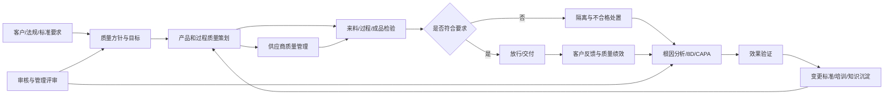

# 《QMS 全业务流程》博客大纲

> 术语说明：需求中的“QWS”暂按“QMS”理解。公开质量管理标准和企业软件领域通用的缩写是 **QMS（Quality Management System，质量管理体系/质量管理系统）**；如果 QWS 是特定企业或产品的内部名称，正式成文前需要补充其全称与业务边界。

## 一、文章定位

### 1. 核心目标

用一篇文章回答四个问题：

1. QMS 到底是什么：管理体系、业务机制，还是一套软件？
2. QMS 在企业中处于什么位置：为什么不能把它简单理解为质量部门的检验工具？
3. QMS 解决什么问题：它怎样把分散的标准、检验、异常、整改和审核连接成闭环？
4. QMS 的全业务流程如何运转：怎样从质量策划贯穿研发、采购、生产、交付、客诉和持续改进？

### 2. 目标读者

- 企业管理者、质量负责人和数字化负责人；
- 产品、研发、采购、生产、售后和供应链负责人；
- QMS 产品经理、解决方案架构师和实施顾问；
- 希望理解 ERP、PLM、MES、SRM、WMS 与 QMS 分工的读者。

### 3. 建议写作口径

- 以通用制造业为基础，以汽车零部件场景作为贯穿案例；
- 先讲管理体系，再讲数字化系统，避免把 QMS 写成软件功能清单；
- 以“计划—执行—检查—改进”的闭环组织全文；
- 重点解释流程、对象、责任、数据和系统边界，而不是只罗列质量术语。

### 4. 全文核心观点

> QMS 不是一套电子检验表，也不是质量部门独占的问题处理工具。它是企业把客户要求、法规标准和内部质量目标转化为可执行规则，并通过检验、监控、异常处理、根因分析、纠正预防、审核和管理评审形成持续改进闭环的经营管理体系；数字化 QMS 则把这套体系落实为跨部门、可追溯、可度量的流程与数据平台。

---

## 二、开篇：企业并不缺质量活动，缺的是质量闭环

用一个制造企业案例引入：

- 客户要求已经写入合同，但没有完整转换为产品和过程质量要求；
- 研发修改图纸后，检验规范仍然使用旧版本；
- 供应商来料多次不合格，但准入、采购份额和绩效评价没有变化；
- 车间发现缺陷后只做返工，没有识别系统性根因；
- 同一问题在不同产线、工厂和客户处重复发生；
- 8D、CAPA 和审核整改散落在邮件、Excel 和即时消息中；
- 管理层只看到合格率，看不到质量成本、风险趋势与改进效果；
- 客诉发生后，无法快速追溯到批次、设备、人员、工艺和原材料。

由此提出中心问题：

```text
企业不是没有做检验、审核和整改，
而是这些活动没有围绕同一套要求、对象和问题形成闭环。
```

---

## 三、QMS 到底是什么

### 1. 先区分三个容易混淆的概念

#### QMS 作为质量管理体系

- 组织为实现质量方针和质量目标而建立的制度、职责、过程、资源和改进机制；
- ISO 9001 是质量管理体系要求标准，但 QMS 不等于一张 ISO 证书；
- 体系存在于企业经营过程之中，而不只存在于质量手册中。

#### QMS 作为业务管理机制

- 把客户要求、法规、产品标准和过程标准转化为日常业务控制；
- 明确谁制定规则、谁执行、谁判定、谁整改、谁批准关闭；
- 以风险、证据、责任和闭环为核心。

#### eQMS/QMS 软件平台

- 用数字化方式承载文档、培训、检验、异常、CAPA、审核、客诉、供应商质量和质量分析；
- 软件不是体系本身，只是体系落地、协同、留痕和度量的载体；
- 如果制度、数据标准和责任机制不清晰，系统只会把线下混乱搬到线上。

### 2. QMS、QA、QC 和检验的区别

| 概念 | 关注重点 | 典型问题 |
|---|---|---|
| QMS | 整个质量管理体系和闭环 | 企业如何持续、稳定地满足要求并改进？ |
| QA（质量保证） | 过程和体系是否有能力稳定地产生合格结果 | 流程、标准、审核和预防机制是否有效？ |
| QC（质量控制） | 产品或过程结果是否符合要求 | 当前批次、工序或产品是否合格？ |
| 检验/测试 | 获取符合性证据 | 测什么、怎么测、结果是多少？ |

强调：检验只是 QMS 的一个执行环节，不能代表完整 QMS。

### 3. QMS 的核心管理对象

- 要求：客户、法规、标准、图纸、规范和控制计划；
- 组织：部门、岗位、职责、资质和授权；
- 产品：物料、零部件、成品、批次和序列号；
- 过程：工序、参数、控制点、特殊特性和放行规则；
- 资源：人员、设备、工装、量具、实验室和供应商；
- 证据：检验记录、审核记录、培训记录和审批记录；
- 事件：偏差、缺陷、不合格、投诉、退货和质量事故；
- 行动：遏制、返工、报废、根因分析、纠正、预防和验证；
- 风险与绩效：风险项、质量目标、指标、成本和趋势。

---

## 四、QMS 在企业中的定位

### 1. 管理定位：企业经营体系中的质量治理主线

QMS 应横跨：

```text
市场与客户要求
  → 产品与过程设计
  → 供应商与采购
  → 来料与仓储
  → 生产与过程控制
  → 成品放行与交付
  → 客诉与售后
  → 经验反馈与持续改进
```

需要强调：质量部门通常负责体系建设、规则治理和专业判定，但产品质量由研发、采购、生产、仓储、售后等共同创造。

### 2. 业务定位：连接“要求—执行—证据—问题—改进”

QMS 的核心链路：

```text
外部要求与质量目标
  → 质量策划与控制标准
  → 现场执行与数据采集
  → 符合性判定与放行
  → 异常、不合格和风险识别
  → 根因分析与纠正预防
  → 效果验证与标准更新
```

### 3. 系统定位：跨 PLM、SRM、ERP、MES、WMS、CRM 的质量中枢

建议用系统边界表讲清楚：

| 系统 | 核心职责 | 与 QMS 的协同 |
|---|---|---|
| PLM | 产品定义、BOM、图纸、规范和工程变更 | 向 QMS 提供产品与质量要求，接收质量问题并驱动设计改进 |
| SRM | 供应商准入、寻源、协同、绩效和关系管理 | 与 QMS 共享供应商审核、来料质量、8D 和质量绩效 |
| ERP | 采购、生产、销售、库存和财务交易 | 触发检验业务，接收质量判定并执行退货、结算和成本处理 |
| MES | 生产执行、工序、设备和过程参数 | 向 QMS 提供过程数据，执行质量控制、隔离、返工和防错 |
| WMS | 库存位置、状态和仓储作业 | 根据 QMS 判定冻结、放行、移库、退货或报废实物 |
| CRM/售后 | 客户、服务、投诉和退换货 | 把客户质量事件送入 QMS，接收分析和整改结果 |
| EAM/计量/LIMS | 设备、量具、校准、维护和实验室检测 | 为质量判定提供可信的资源状态和检测结果 |
| BI/数据平台 | 跨域分析和经营驾驶舱 | 汇总质量、交付、成本和客户数据进行趋势分析 |

### 4. 一句边界总结

> PLM 定义产品应该是什么，ERP 组织企业资源和交易，MES 执行生产，WMS 控制实物库存，SRM 管理供应关系，CRM 承接客户互动；QMS 负责判断过程和结果是否满足质量要求，并推动所有质量问题得到受控处置和闭环改进。

---

## 五、QMS 解决什么问题

按“问题—机制—价值”组织，而不是只列模块。

### 1. 质量要求无法层层传递

- 问题：客户要求、图纸、法规、检验标准和现场作业版本不一致；
- 机制：要求分解、文控、变更控制、培训确认和生效管理；
- 价值：确保正确的人在正确时间使用正确版本的标准。

### 2. 质量控制依赖个人经验

- 问题：抽样、检验、判定和放行规则因人而异；
- 机制：检验计划、抽样方案、规格限、自动判定和授权审批；
- 价值：把经验转化为标准化、可重复的业务规则。

### 3. 问题发现晚、重复发生

- 问题：重终检轻预防，同类缺陷反复出现；
- 机制：风险管理、过程监控、趋势预警、根因分析和 CAPA；
- 价值：从“检出缺陷”转向“预防缺陷”。

### 4. 异常处置不闭环

- 问题：发现、隔离、评审、整改、验证和关闭分散在线下；
- 机制：不合格、偏差、MRB、8D、CAPA 和有效性验证工作流；
- 价值：每个问题都有对象、责任人、期限、证据和最终结论。

### 5. 质量追溯困难

- 问题：客诉后无法快速定位受影响批次、原料、设备和客户；
- 机制：批次/序列号、检验、工艺、物料和处置记录关联；
- 价值：缩小召回范围，加快根因定位，降低风险和损失。

### 6. 供应商质量与采购决策脱节

- 问题：来料不良和供应商整改不影响定点、份额与绩效；
- 机制：供应商审核、来料质量、SCAR/8D、PPM 与绩效联动；
- 价值：把质量结果转化为供应商管理决策。

### 7. 合规证据准备成本高

- 问题：审核前临时找文件、补记录和追签字；
- 机制：受控文档、电子签核、审计追踪、培训和记录留存；
- 价值：让合规成为日常过程的自然结果，而非迎审活动。

### 8. 管理层看不到质量经营结果

- 问题：只有合格率，没有质量成本、风险和改进收益；
- 机制：质量 KPI、COPQ、趋势分析、分层钻取和管理评审；
- 价值：让质量从技术指标进入经营决策。

---

## 六、QMS 全业务流程总览

建议正文先给出一张总图：



### 与三张业务流程图对齐的主叙事

正式文章建议在总览图后，增加“一批物料如何变成一件可交付成品”的三阶段贯穿案例。这样既保留体系视角，也能把图片中的现场执行顺序讲清楚。

#### 阶段一：质量准备与来料控制

```text
客户质量要求
  → PLM技术标准
  → 质量计划/控制计划
  → 检验项目与抽样规则
  → 供应商送货
  → WMS待检与冻结
  → QMS来料检验
  → 合格放行或异常隔离
```

#### 阶段二：生产过程质量控制

```text
ERP生产计划/生产工单
  → MES创建生产批次
  → QMS匹配产品版本和有效质量标准
  → 完成第一件产品
  → 首件检验
  → 首件合格后授权批量生产
  → 自检/巡检/自动采集
  → 趋势监控
  → 异常时停机和批次隔离
  → 原因、措施、复检与授权恢复
```

首件不合格时，不应只修改检验结果，而应回到人、机、料、法、环、测等过程条件，调整后重新制作首件并再次申请放行。过程异常关闭后，也应由 QMS 给出复检或恢复结论，再由 MES 恢复生产，避免系统之间各自改变状态。

#### 阶段三：成品放行与质量改进

```text
MES反馈完工产品、数量、批次和SN
  → QMS生成成品检验任务
  → 外观/尺寸/性能检验
  → 不合格则冻结、处置并重新检验
  → 合格后完成质量放行并生成质量记录/报告
  → WMS允许成品入库
  → ERP下达发货任务
  → WMS拣货、复核和出库
  → 产品批次/SN与客户及发运单建立关联
  → 客户反馈
  → 追溯、遏制、根因分析、CAPA和效果验证
  → 更新标准
```

### 流程图中需要显式讲清的五个“质量闸门”

1. **来料放行闸门**：检验合格不等于库存已可用，必须由 QMS 给出质量结论，WMS 才能把待检库存转为可用；
2. **首件放行闸门**：第一件产品合格并获得授权后，MES 才允许进入批量生产；
3. **异常停机与恢复闸门**：过程数据异常时先停止、隔离，完成处置和复检后再授权恢复；
4. **成品放行闸门**：生产完工不等于产品可入库或发货，必须完成最终质量放行；
5. **发运追溯闸门**：出库时必须建立批次/SN、发运单和客户之间的关系，才能支持客诉后的正反向追溯。

这里还应区分三个概念：

- **检验结果**：测量值、缺陷和试验结果；
- **质量判定**：依据规则判断合格、不合格或需要评审；
- **质量放行**：由具备权限的角色确认产品可以进入下一业务阶段。

### 每个阶段的统一讲解模板

为了避免正文只有流程箭头，三个阶段都应按相同结构展开：

```text
触发事件
  → 参与角色
  → 输入对象与有效版本
  → 现场动作
  → 质量数据与证据
  → 判定规则
  → 正常路径/异常路径
  → MES、WMS、ERP中的状态变化
  → 关键输出与下游影响
```

这样可以明确“谁在什么系统中，依据哪个版本的标准，对什么对象作出什么判断，以及判断如何控制生产、库存和发运”。

总流程分成四层：

1. **策划层**：确定质量方针、目标、风险、标准和控制计划；
2. **执行层**：在供应、制造、交付和服务过程中采集证据并作出判定；
3. **处置层**：控制不合格、分析根因、实施纠正和预防措施；
4. **改进层**：通过审核、绩效、管理评审和经验反馈更新体系。

---

## 七、主流程一：质量战略、目标与体系策划

### 1. 输入

- 企业战略和客户价值主张；
- 客户特殊要求、合同和服务承诺；
- 适用法规、行业标准和认证要求；
- 历史缺陷、客诉、召回、审核和质量成本；
- 组织内外部环境、相关方需求与风险。

### 2. 核心活动

- 制定质量方针和年度质量目标；
- 建立过程地图、职责矩阵和质量治理机制；
- 识别质量风险和改进机会；
- 分解目标到部门、工厂、产线、产品和供应商；
- 定义指标、数据来源、计算规则和评审周期。

### 3. 输出

- 质量方针、质量目标和质量计划；
- 质量体系过程架构；
- 风险清单和改进项目；
- 责任与授权；
- 管理评审输入框架。

---

## 八、主流程二：产品与过程质量策划

### 1. 需求到质量特性的转换

- 识别法规、客户和产品要求；
- 将要求转化为关键质量特性和特殊特性；
- 建立可追溯关系：客户要求 → 设计要求 → 过程参数 → 检验项目。

### 2. 风险与控制设计

- 设计评审和质量门；
- DFMEA/PFMEA 或其他风险分析；
- 控制计划、检验计划和反应计划；
- 测量方法、量具、抽样和能力要求；
- 首件、试制、样件认可和量产放行。

### 3. 工程变更联动

- 图纸、BOM、材料、工艺或供应商变化时触发质量影响分析；
- 同步修改控制计划、检验规范、培训、设备参数和供应商要求；
- 防止“产品已变更、质量标准未变更”。

---

## 九、主流程三：供应商质量管理

### 1. 供应商准入

- 资质、体系和能力评价；
- 风险分级和现场审核；
- 样件、首件、APQP/PPAP 等适用的认可过程；
- 合格供应商批准与受控名录。

### 2. 采购质量策划

- 技术和质量协议；
- 来料检验规则与免检/加严策略；
- 关键特性、证书、批次和追溯要求；
- 供应商变更申报机制。

### 3. 来料异常闭环

```text
来料检验不合格
  → 库存隔离
  → 不合格评审
  → 退货/挑选/返工/让步接收
  → 供应商纠正措施请求
  → 8D 与根因验证
  → 来料检验策略调整
  → 供应商绩效、等级和采购份额反馈
```

### 4. 供应商绩效

- PPM、不良批率、退货率、重大问题数；
- 8D 响应及时率和措施有效率；
- 审核结果、体系风险和变更合规；
- 与交付、成本、技术能力共同形成综合评价。

---

## 十、主流程四：检验与质量控制执行

### 1. 来料检验 IQC

- 采购收货或 ASN 触发检验批；
- 依据物料、供应商、风险和历史表现选择抽样方案；
- 记录测量结果、缺陷代码、附件和证书；
- 合格放行，不合格冻结并进入异常流程。

### 2. 过程检验 IPQC

- 首件检验、巡检、自检、互检和专检；
- 关键工艺参数和特殊特性监控；
- SPC、控制图、过程能力和趋势预警；
- 超限时停机、隔离、加严和反应计划。

### 3. 成品与出货检验 FQC/OQC

- 最终检验、功能测试和外观检查；
- 包装、标签、证书和客户特殊要求确认；
- 批次放行、质量证书和发运授权。

### 4. 检验可信度保障

- 检验员资质和培训有效性；
- 量具校准和状态校验；
- 检验方法、环境和实验室能力；
- 原始数据、防篡改记录和审计追踪。

---

## 十一、主流程五：不合格与偏差管理

### 1. 统一质量事件入口

来源包括：

- 来料、过程、成品和出货检验；
- 设备报警和过程参数越界；
- 仓库、物流和现场发现；
- 客户投诉、退货和售后；
- 内外部审核；
- 供应商、员工或管理层主动报告。

### 2. 标准处置链

```text
发现与登记
  → 风险分级
  → 临时遏制与影响范围识别
  → 隔离、冻结和停止放行
  → 不合格评审/MRB
  → 返工、返修、挑选、退货、报废或让步接收
  → 处置验证
  → 是否升级为 8D/CAPA
```

### 3. 关键控制点

- 质量判定与实物状态必须同步；
- 让步接收必须具备授权、期限、数量和风险依据；
- 返工后必须重新检验；
- 受影响范围要关联批次、序列号、订单、供应商和客户；
- 重大问题应触发停产、召回、升级和管理层通知机制。

---

## 十二、主流程六：根因分析、8D 与 CAPA

### 1. 先区分临时处置和系统改进

- 纠正：处理已经发现的不合格；
- 临时遏制：控制影响继续扩大；
- 根因分析：解释问题为什么发生、为什么没有被及时发现；
- 纠正措施：消除已发生问题的根因；
- 预防/风险措施：降低类似问题在其他场景发生的可能性；
- 有效性验证：确认措施真正降低了复发风险，而不是只完成任务。

### 2. 闭环流程

```text
问题定义
  → 团队与责任人
  → 临时遏制
  → 根因和逃逸点分析
  → 措施制定与风险评估
  → 措施实施
  → 效果验证
  → 标准、FMEA、控制计划与培训更新
  → 经验横向展开
  → 正式关闭
```

### 3. 重点讲清“为什么 CAPA 经常失效”

- 把“操作员不小心”当作根因；
- 只改文件，不改变现场控制；
- 任务完成即关闭，没有观察期和效果指标；
- 只解决发生地点，没有横向排查相似产品和过程；
- 措施没有进入 FMEA、控制计划、培训和审核清单。

---

## 十三、主流程七：客户投诉、退货与外部质量事件

### 1. 从客户语言转化为内部质量问题

- 接收投诉、退货、索赔、现场故障或监管事件；
- 明确客户、产品、批次、序列号、时间和使用条件；
- 判断严重程度、法规报告、停发或召回要求；
- 建立客户问题与内部不合格、生产记录、检验和供应商批次的关联。

### 2. 客诉闭环

```text
客户反馈
  → 登记与分级
  → 快速响应和临时遏制
  → 追溯受影响范围
  → 分析责任过程与根因
  → 8D/CAPA
  → 客户回复与认可
  → 索赔/退换货处理
  → 经验反馈到设计、供应商和制造过程
```

### 3. 质量追溯案例

建议使用“一只故障零件”正向与反向追溯：

- 成品序列号 → 生产工单 → 工序与设备 → 操作人员 → 检验记录；
- 成品序列号 → 原材料批次 → 供应商 → 来料检验 → 同批次受影响产品；
- 原材料批次 → 被哪些工单使用 → 形成哪些成品 → 发给哪些客户。

---

## 十四、支撑流程：让体系能够长期运行

### 1. 文档与变更控制

- 文档起草、评审、批准、发布、生效、分发、作废和归档；
- 版本、适用范围、受影响对象和电子签核；
- 变更影响分析与关联任务自动触发。

### 2. 培训与人员资质

- 岗位能力模型和课程矩阵；
- 文档变更触发培训；
- 考试、实操认证、到期提醒和授权控制；
- 防止未具备资质的人员执行关键作业。

### 3. 设备、量具与校准

- 台账、校准周期、状态标识和到期预警；
- 超差量具的历史测量影响分析；
- 设备维护状态与质量结果关联。

### 4. 审核管理

- 体系审核、过程审核、产品审核和供应商审核；
- 审核计划、检查表、发现项、整改和验证；
- 重复问题、逾期问题和系统性薄弱环节分析。

### 5. 管理评审

输入建议包括：

- 质量目标和过程绩效；
- 客诉、退货、不合格和 CAPA；
- 审核结果与合规变化；
- 供应商绩效；
- 质量成本、资源和能力；
- 风险、机会与改进项目。

输出包括资源决策、目标调整、重大改进和体系变更。

---

## 十五、质量数据、指标与经营分析

### 1. 指标分层

#### 结果指标

- 客户投诉率、退货率、保修成本；
- 一次合格率、报废率、返工率；
- 供应商 PPM、内部 PPM、客户 PPM；
- 重大质量事故和召回。

#### 过程指标

- 检验及时率、漏检率、首件通过率；
- CAPA 按期关闭率和有效率；
- 审核发现项逾期率；
- 培训完成率和量具按期校准率；
- 过程能力、控制图异常和趋势预警。

#### 经营指标

- COPQ（劣质成本）；
- 返工、报废、退货、索赔和停线成本；
- 质量损失占营收比例；
- 重大改进项目收益。

### 2. 指标使用原则

- 指标必须有统一口径、数据来源、责任人和刷新周期；
- 不能只用合格率掩盖低产量、高返工或选择性报检；
- 既看结果，也看过程稳定性和风险趋势；
- 能从集团下钻到工厂、产线、产品、供应商、批次和问题记录。

---

## 十六、QMS 的数据模型与集成架构

### 1. 关键主数据

- 组织、工厂、部门、岗位和人员；
- 客户、供应商和合作关系；
- 物料、BOM、产品、版本和批次；
- 工艺路线、工序、设备和工作中心；
- 检验特性、方法、规格限、缺陷代码和处置代码；
- 文档、标准、FMEA、控制计划和检验计划。

### 2. 关键业务对象

- 检验计划、检验批和检验结果；
- 偏差、不合格、客诉和审核发现项；
- MRB、8D、CAPA、SCAR 和变更任务；
- 质量放行、让步接收和质量证书；
- 培训记录、校准记录和电子签名。

### 3. 推荐集成事件

- PLM 发布新版本或工程变更；
- ERP 创建采购收货、生产完工或销售发运；
- MES 产生工序完工、参数超限或设备报警；
- WMS 执行冻结、移库、放行和退货；
- CRM 创建客诉或退货；
- QMS 返回质量状态、放行结论、异常和整改结果。

### 4. 主数据权威边界

强调“单一事实来源”不等于所有数据都进入 QMS：

- 产品结构和图纸通常以 PLM 为权威；
- 交易单据通常以 ERP 为权威；
- 生产实绩通常以 MES 为权威；
- 库位和库存执行以 WMS 为权威；
- 质量标准、判定、事件和改进记录以 QMS 为权威；
- 通过标识、版本和事件实现一致性，而不是重复维护。

---

## 十七、行业差异：一套主干，多种扩展

### 1. 汽车行业

- IATF 16949、客户特殊要求；
- APQP、PPAP、FMEA、控制计划、SPC、MSA、8D；
- 特殊特性、追溯和供应商质量。

### 2. 医疗器械与生命科学

- ISO 13485、适用法规和风险管理；
- 设计控制、文档记录、电子签名、投诉、CAPA 和可追溯性；
- 监管报告、验证和严格变更控制。

### 3. 航空航天

- AS9100 系列要求；
- 构型管理、首件检验、供应链追溯和不合格控制；
- 高可靠性和防伪件要求。

### 4. 食品与流程行业

- HACCP/食品安全体系、配方、批次和保质期；
- 实验室检测、放行、召回和卫生控制；
- 连续过程、偏差和批记录。

结论：行业要求不同，但“要求—控制—证据—问题—改进”的主干不变。

---

## 十八、QMS 实施路线图

### 阶段 0：明确目标和范围

- 是为认证合规、客户要求、降本、追溯，还是多工厂标准化？
- 先确定业务问题和成功指标，再选择系统模块。

### 阶段 1：梳理体系和流程

- 识别过程、角色、输入输出和关键控制点；
- 统一质量术语、编码、分类和责任矩阵；
- 清理重复、冲突和失效制度。

### 阶段 2：建立主数据和文控基础

- 统一物料、产品、供应商、缺陷、检验特性和版本；
- 建立受控文档、培训与权限机制。

### 阶段 3：优先打通高价值闭环

建议优先级：

1. 不合格与 CAPA；
2. 来料、过程和成品检验；
3. 客诉与追溯；
4. 供应商质量；
5. 审核、培训、校准和管理评审；
6. 高级分析、预测预警与 AI 辅助。

### 阶段 4：集成业务系统

- 先打通影响实物和交易状态的关键链路；
- 避免人工重复录入和多系统质量结论冲突；
- 建立接口失败、补偿、对账和审计机制。

### 阶段 5：多工厂推广与持续优化

- 统一集团模板，允许受控的工厂差异；
- 通过指标和成熟度评估推动持续改进；
- 把优秀措施沉淀为标准、知识库和复用模板。

---

## 十九、常见失败模式

### 1. 把 QMS 做成电子表单平台

只有录入和审批，没有规则联动、风险分级、数据关联和有效性验证。

### 2. 把 QMS 当成质量部门的系统

研发、采购、生产和售后不参与，问题最终仍靠质量人员线下推动。

### 3. 先买系统，后补流程

没有统一流程和数据标准，最终形成大量定制、重复字段和绕行操作。

### 4. 只重视检验，不重视策划和预防

系统帮助企业更快发现缺陷，却没有减少缺陷产生。

### 5. 追求“大而全”，忽视关键闭环

模块很多，但来料不合格仍无法冻结库存，CAPA 仍无法验证效果。

### 6. 系统之间没有明确权威边界

PLM、ERP、MES、WMS 和 QMS 都维护版本或质量状态，导致相互矛盾。

### 7. 用关闭率代替改进效果

为了按期关闭而关闭，问题在其他产品、产线或工厂重复发生。

---

## 二十、评估一个 QMS 是否真正有效

建议给出检查清单：

- 客户与法规要求能否追溯到产品、过程和检验控制？
- 产品或工艺变更能否自动识别受影响的质量文件与人员？
- 不合格判定能否立即控制库存、生产和发运？
- 能否从客诉快速追溯到成品、工单、原材料、供应商和检验记录？
- 每个质量事件是否都有责任、时限、证据和审批？
- CAPA 是否验证效果，并更新 FMEA、控制计划、培训和审核？
- 供应商质量结果是否真正影响准入、绩效和采购决策？
- 量具、设备或人员资质失效时，系统能否阻止错误操作？
- 管理层能否看到质量风险、趋势、成本和改进收益？
- 多工厂是否使用共同标准，同时保留受控差异？

判断标准：

> 一个有效的 QMS，不是“所有质量表单都上线了”，而是质量要求能够传递、执行结果能够证明、异常能够受控、根因能够消除、经验能够反哺标准，最终让问题更少发生、影响更快收敛、决策更有依据。

---

## 二十一、结尾：从“质量部门负责”走向“企业共同创造质量”

收束观点：

- 质量不是终检出来的，而是设计、采购、制造和服务全过程共同形成的；
- QMS 的价值不只是满足审核，而是建立稳定交付、风险控制和持续改进能力；
- 数字化 QMS 的最终目标不是增加记录，而是缩短问题闭环周期、降低劣质成本并提升客户信任；
- 真正成熟的 QMS，应让质量要求进入每一个业务流程，让每次异常都成为改进体系的输入。

建议用一句话结束：

> QMS 管理的不是几张检验单，而是企业从承诺质量、创造质量、证明质量，到改进质量的完整能力。

---

## 二十二、建议配图

1. **QMS 企业定位图**：QMS 位于 PLM、SRM、ERP、MES、WMS、CRM 之间；
2. **QMS 全业务闭环图**：质量策划 → 执行控制 → 不合格 → CAPA → 标准更新；
3. **质量事件状态机**：发现、隔离、评审、处置、验证、关闭；
4. **批次追溯图**：供应商批次 → 生产工单 → 成品序列号 → 客户；
5. **QMS 分层指标图**：战略指标、过程指标、现场指标；
6. **QMS 实施路线图**：流程、数据、系统、集成、推广五阶段。

---

## 二十三、联网调研依据与正式写作时的引用方向

### 标准与原则

- ISO 9001:2026：质量管理体系要求，可用于解释 QMS 的标准框架、过程方法和持续改进；
- ISO 9000:2026：质量管理体系基础和术语，可用于统一概念定义；
- ISO 质量管理原则：客户关注、领导作用、全员参与、过程方法、改进、循证决策和关系管理；
- ISO 19011:2018：管理体系审核指南，可用于审核流程章节；
- ISO 10002:2018：投诉处理指南，可用于客诉闭环章节。

### 监管与行业实践

- FDA Quality Management System Regulation（QMSR）：可作为医疗器械行业中 QMS 与法规融合的示例；QMSR 已于 2026 年 2 月 2 日生效；
- IATF、AIAG Core Tools：用于汽车行业 APQP、PPAP、FMEA、SPC、MSA 和问题解决扩展；
- 其他行业可补充 ISO 13485、AS9100、ISO 22000 等要求。

### 企业软件与数字化实践

- Siemens Teamcenter Quality：可用于说明质量策划、FMEA、控制计划、检验、问题解决和闭环质量；
- SAP Quality Management：可用于说明质量管理如何嵌入采购、生产、库存和销售流程；
- Oracle Fusion Cloud Quality Management：可用于说明企业级质量事件、检验、问题和纠正措施协同；
- IBM 对 QMS 的解释：可辅助说明 QMS 是跨流程的政策、过程和程序集合，而不只是检验软件。

### 正式成文前建议补充核验

- 明确文章采用 ISO 9001:2026 还是兼顾 ISO 9001:2015 的读者迁移口径；
- 核验 IATF/AIAG、医疗器械、航空航天等行业标准的当前版本和版权引用边界；
- 若使用具体厂商功能作例子，应描述通用能力，避免把单一厂商产品边界写成行业统一定义；
- 对“QWS”全称进行最终确认。
