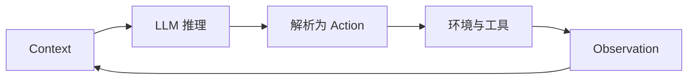
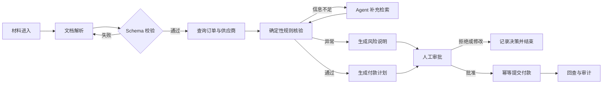

> Agent 架构的核心，不是给模型堆叠更多自由，而是用可验证、可恢复、可审计的工程机制管理不确定性。

本文面向已经接触过 LLM 工具调用、并希望把 Agent 从演示推进到生产环境的工程师。全文围绕一个统一判断展开：所有 Agent 模式都可以还原为同一个“上下文 → 推理 → 动作 → 观察”循环，而具体架构差异来自两个维度：循环内部承担什么认知功能，以及多个循环之间采用什么执行拓扑。

读完本文，应该能够完成三件事：

1. 判断一个需求应该使用确定性程序、Workflow、单 Agent 还是多 Agent；
2. 为长程任务设计上下文、记忆、工具、恢复和治理机制；
3. 使用统一清单评审一个 Agent 是否具备上线所需的可靠性。

很多人第一次设计 Agent，会把注意力集中在模型和提示词上：模型够不够强，Prompt 写得够不够长，工具接得够不够多。

但当 Agent 真正进入生产环境，最棘手的问题往往不是“它会不会回答”，而是：

- 为什么相同输入会走出不同路径？
- 为什么上下文越长，表现反而越不稳定？
- 为什么工具越多，调用准确率越低？
- 为什么 Agent 能发现错误，却未必能修正错误？
- 为什么多 Agent 看起来更聪明，成本却迅速失控？
- 为什么一次错误重试，会造成两次扣款、两封邮件或两条重复订单？

这些问题共同指向一个事实：**Agent 不是一个更聪明的函数，而是一个由概率节点驱动、持续感知环境并产生副作用的运行系统。**

因此，Agent 设计的重点不应只是“怎样让模型更聪明”，而应是：**怎样用确定性的工程外壳，约束一个不确定的模型内核。**

---

## 一、范式觉醒：Agent 不是普通的 OOP 对象

传统软件设计通常默认两件事：

1. 相同输入能够得到稳定输出；
2. 控制流在编码阶段已经确定。

LLM Agent 恰好打破了这两个前提。

模型输出具有概率性；即使采样参数非常保守，也不能把整个推理和执行过程视为严格的确定函数。与此同时，Agent 的下一步动作经常由模型在运行时决定：它可能搜索、读文件、调用 API，也可能修改计划、重试或者终止。

这意味着，经典设计模式依然可以服务于 Agent 外围代码，却不足以单独解释 Agent 的核心运行机制。真正更接近 Agent 的，是分布式系统中的那些老问题：

- 部分失败；
- 超时与重试；
- 重复投递；
- 幂等性；
- 最终一致性；
- Saga 与补偿；
- 熔断、背压和降级；
- 不可逆操作前的提交确认。

例如，一个 Agent 执行“创建订单—扣款—发送通知”的任务。如果第三步失败，系统不能只让模型说一句“抱歉”，而要拥有可执行的补偿路径：撤销扣款、删除订单，并且按照副作用发生的逆序回滚。每一个步骤还需要幂等键，避免重试时再次扣款。

所以，设计 Agent 时最重要的认知转变是：

> 不要把 Agent 当成一个拥有工具的聊天机器人，而要把它当成一个概率性的分布式执行节点。

---

## 二、所有模式，都来自同一个原子循环

再复杂的 Agent，底层都可以还原为同一个循环：



一次 LLM 调用读取 Context，生成 Token；系统把 Token 解析成动作，在外部环境中执行，再把执行结果作为 Observation 写回下一轮 Context。

所谓 Agent 设计模式，本质上都是在约束这个循环：

- 约束模型能看到什么；
- 约束历史怎样保存；
- 约束它花多少算力思考；
- 约束哪些动作可以执行；
- 约束失败后如何纠正；
- 约束多个循环之间怎样协作；
- 约束副作用、权限和成本的边界。

理解了这个原子循环，繁多的模式就不再是一张需要背诵的清单，而可以被放进两根正交的轴中。

### 轴一：认知功能——循环内部在做什么？

它可以继续拆成五个环节：

1. **感知**：如何把外部世界转换成模型可消费的 Context；
2. **记忆**：如何跨轮次、跨窗口、跨任务保存有效信息；
3. **推理**：如何分配思考预算，把目标转成可验证计划；
4. **行动**：如何把模型意图安全地转换成真实副作用；
5. **反思**：如何利用反馈纠错，并把成功经验沉淀下来。

### 轴二：执行拓扑——多个循环怎样连接？

常见形态包括：

- 固定步骤的提示链；
- 分类后分流的路由；
- 单 Agent 的 ReAct 循环；
- 规划与执行分离；
- 扇出—聚合；
- 编排者—工作者；
- 生成者—评审者；
- Agent 之间的交接链。

一根轴描述“做什么”，另一根轴描述“怎么连”。同一套记忆或反思机制，可以嵌入单 Agent，也可以嵌入编排者—工作者系统。因此它们彼此独立，却又共同决定最终架构。

---

## 三、感知：不是看得更多，而是把有限上下文用得更好

Agent 并没有真正意义上的眼睛和耳朵。文件、网页、数据库结果、截图、语音和工具返回值，最终都要被序列化成 Token，进入同一个 Context Window。

这会带来一个常被忽略的问题：**所有感知结果都在竞争同一份注意力预算。**

接入更多数据源不一定让 Agent 更聪明。相反，过长的上下文会引入噪声、位置偏差和 Context Rot：信息虽然还在窗口里，模型却越来越难以稳定地找到并使用它。

因此，优秀的感知系统通常遵循三条原则。

### 1. 上下文分诊

不要把所有内容都塞进提示词。应先区分信息的类型与优先级：

- 稳定规则放在系统指令；
- 当前任务状态放在工作区；
- 大型文档保留索引与引用；
- 历史轨迹只保留必要摘要；
- 低相关内容留在外部存储，按需检索。

### 2. 渐进式披露

Agent 开始工作时只需要知道“有什么”，不需要立刻读取“全部内容”。先暴露文件名、目录、标题、元数据和轻量摘要，再允许它通过搜索、过滤、读取局部内容逐步缩小范围。

这与优秀的人类研究过程相似：先看目录，再看摘要，最后精读关键章节，而不是一开始就把整个资料库背进脑中。

### 3. 及时压实，而不是无限追加

当上下文逼近预算时，应把高熵的对话与执行轨迹压缩为高密度状态，例如：

- 已确认的事实；
- 已完成的步骤；
- 未解决的问题；
- 关键决策及依据；
- 下一步计划；
- 必须保留的引用和工件路径。

压缩并非免费，它会丢失细节。因此，真正重要的状态不能只存在于摘要里，而应外化为文件、数据库记录或其他可恢复工件。

---

## 四、记忆：Context Window 不等于 Memory

上下文窗口只是模型当前能够读取的工作区，不是可靠的长期记忆。它容量有限、每轮重填、压缩有损，而且越长越容易发生召回退化。

一个完整的 Agent 记忆系统，至少应该区分四类信息：

| 记忆类型 | 主要内容 | 典型载体 |
|---|---|---|
| 工作记忆 | 当前步骤、临时变量、短期计划 | Context / Scratchpad |
| 语义记忆 | 文档知识、规则、事实 | RAG / 知识库 |
| 情景记忆 | 过去任务的完整经历 | 轨迹库 / 案例库 |
| 程序记忆 | 已验证的做法和技能 | 工具、脚本、Skill |

这里最关键的不是“存”，而是“取”。错误的检索结果会主动误导 Agent，所以记忆系统必须处理相关性、时效性、可信度和冲突。

### 进度文件比长对话更可靠

对于跨多个会话的长任务，可以把状态固化为一组磁盘工件：

```text
project/
├── progress.md          # 已完成、进行中、阻塞项、下一步
├── feature-list.json    # 功能清单与验收状态
├── decisions.md         # 关键决策与理由
├── failures.md          # 失败、证据、纠正规则、置信度
└── artifacts/           # 报告、补丁、测试结果等产物
```

新的 Agent 会话先读取这些文件，再继续工作。这样即使上下文被压缩、会话被重启，任务状态仍能恢复。

### 失败日记不能变成永久禁令

记录失败经验有助于避免重复犯错，但错误归因也可能被固化。例如，一次偶发的 API 失败被总结成“这个接口永远不可用”，之后 Agent 便再也不尝试正确路径。

因此，失败记忆应携带：

- 证据；
- 置信度；
- 适用条件；
- 最近验证时间；
- 可被新证据推翻的机制。

好的记忆不是永不改变的结论，而是可以持续校准的工作假设。

---

## 五、推理：用 Token 购买准确率，但要计算边际收益

显式推理的本质，是让模型使用额外 Token 完成一次前向传播难以完成的多步计算。无论是思维链、复杂度路由、自洽性、Tree of Thoughts，还是并行探索，本质上都在做同一笔交易：

> 用更多推理时算力和延迟，换取更高的成功率。

工程上的关键不是“推理越多越好”，而是判断边际收益。

### 简单任务不要调用最昂贵的路径

可以先进行复杂度判断：简单请求走低成本模型或固定流程，复杂任务才进入深度推理。需要注意的是，路由器本身也可能误判，所以它必须拥有独立的评测集，而不能只凭直觉编写分类提示。

### 高不确定性任务可以并行探索

当任务存在多条可能路径，单次采样容易产生高方差。此时可以并行生成多个方案，再通过投票、规则验证、测试或评审器聚合结果。

但并行探索只有在结果能够比较时才有意义。数学题可以比答案，代码可以跑测试，检索任务可以核对来源；如果任务没有可靠评价标准，多生成几个答案只会制造更多看似合理的文本。

### 调试要从“试试看”变成“假设—实验”

Agent 调试最危险的模式，是看到错误后随机改 Prompt、换模型、加工具，然后在偶然成功时宣布修复完成。

更可靠的方法是：

1. 记录可复现的失败；
2. 提出单一、可证伪的原因假设；
3. 只修改一个变量；
4. 在固定评测集上执行实验；
5. 比较成功率、成本、延迟和新退化；
6. 保存结论与证据。

这会把 Agent 优化从“抽盲盒”变成真正的工程实验。

---

## 六、行动：计划产生 Token，执行产生副作用

计划和行动之间存在一条非常重要的边界：

- 计划错误，通常还可以重写；
- 动作错误，可能已经发出邮件、修改数据、删除文件或完成付款。

因此，行动层应围绕“副作用发生前后”进行设计。

### 工具接口就是 Agent 的用户界面

人类通过 GUI 使用软件，Agent 通过工具名称、描述、参数和返回值使用软件。这套接口可以称为 ACI（Agent-Computer Interface）。

一个好的工具不应只做到“可以调用”，还应做到“不容易调错”：

- 名称体现动作和对象；
- 参数尽量少且语义明确；
- 枚举优于自由文本；
- 使用结构化返回值；
- 写操作与读操作分开；
- 危险动作不提供模糊的万能入口；
- 能用领域 API，就不要直接暴露 Shell 或裸 SQL。

这是一种 Poka-Yoke（防错）思想：与其在 Prompt 中反复提醒模型“不要传错参数”，不如让错误参数根本无法通过接口校验。

### 能静态编排，就不要动态自治

如果步骤可以预先列出，优先使用提示链或工作流；如果任务能够提前形成 DAG，可以先规划，再并行执行独立节点；只有当步骤无法预知、必须根据环境反馈持续改变计划时，才使用完整 Agent 循环。

每两个步骤之间还应设置确定性的 Gate，例如 Schema 校验、规则校验、测试、权限检查和结果范围检查。**真正兜住概率模型的，往往不是更长的 Prompt，而是步骤之间那段普通代码。**

### 用“守卫三明治”包住危险动作

一项高风险操作至少需要三层保护：

1. **执行前**：参数、权限、风险和策略校验；
2. **执行中**：幂等键、超时、限流、沙箱和最小权限；
3. **执行后**：结果验证、审计记录、补偿或回滚。

付款、删除、发布、外发消息等不可逆或高影响动作，还应在真正提交前暂停，展示明确的 Diff 或 Plan，等待人工批准。

---

## 七、反思：没有外部 Oracle，自我纠错可能只是自我说服

“让模型检查自己的答案”听起来合理，但生成者和批评者如果共享同一知识盲区，批评就可能只是用另一种说法重复原错误。

可靠反思依赖外部 Oracle，也就是模型之外的真实反馈：

- 单元测试；
- 编译器；
- 类型检查；
- 数据库约束；
- API 返回码；
- 规则引擎；
- 人工验收；
- 可以追溯的事实来源。

一个典型的自愈循环是：

```text
生成方案
  → 执行
  → 读取测试或运行时错误
  → 定位根因
  → 生成最小补丁
  → 再次验证
  → 通过或达到停止条件
```

这里必须设置最大重试次数、无进展检测和震荡检测，防止 Agent 在两个错误版本之间来回切换。还要防止“奖励黑客”：为了让测试变绿而删除测试、硬编码答案，或者绕开真正的需求。

一次成功也不应该只停留在当前上下文中。经过验证的过程可以被蒸馏成脚本、工具或 Skill；完整轨迹则可以进入经验库，在未来相似任务中作为 Few-shot 案例。但无论技能还是经验，都必须经过验证和版本治理，否则记忆库会逐渐变成新的污染源。

---

## 八、多 Agent：买到的主要不是“更多智慧”，而是并行和上下文隔离

多 Agent 很容易被包装成“专家团队”，但从工程角度看，它首先是一种高成本执行拓扑。

它真正提供的价值主要有两个：

1. **并行搜索**：让多个独立分支同时探索；
2. **上下文隔离**：每个子 Agent 拥有独立窗口，只把压缩结果交回主线程。

因此，多 Agent 适合这样的任务：

- 子任务可以相对独立地拆分；
- 多条分支之间共享状态较少；
- 单个上下文装不下全部探索过程；
- 并行带来的时间收益大于额外 Token 成本；
- 最终结果存在清晰的聚合方式。

### 编排者—工作者

主 Agent 根据输入动态拆解任务，子 Agent 分别处理，再由主 Agent 汇总。每个子任务说明至少应包含：

- 明确目标；
- 任务边界；
- 可使用的工具与来源；
- 输出格式和验收标准。

子 Agent 不应把完整轨迹全部回传，而应返回高密度摘要，并通过工件引用传递大型结果，避免主线程再次被噪声淹没。

### 扇出—聚合

如果子任务在编码阶段已经确定，就无需让编排者临时决定。直接并行执行，再统一聚合即可。这种模式适合分段处理、批量评估、多个来源查证，以及对同一问题做多样本投票。

### 交接链

当任务需要在不同角色之间动态转移控制权，并且接手者可以直接面向用户时，可以使用 Handoff。它比中心化 Supervisor 更灵活，但也更难追踪全局状态，因此必须明确交接时转移哪些上下文、状态和责任。

多 Agent 的默认决策仍应是：**先证明单 Agent 已经不够，再升级。**

---

## 九、治理：自主性越高，越要限制爆炸半径

Agent 的风险不是简单相加，而可能沿着多个维度相乘：自主决策能力、可访问数据、工具权限、运行时间、并发度和外部副作用，都会扩大一次错误的影响。

治理不是在系统外面补一张“安全提示词”，而要进入运行时本身。

### 1. 审批门：把不可逆动作做成两阶段提交

第一阶段只生成待执行计划，包括对象、参数、影响范围和 Diff；第二阶段在人工或策略引擎批准后，才真正提交。

暂停必须可持久化。系统重启后应能恢复到“等待审批”的状态，而不是重新运行整个节点。恢复时也要避免重复执行审批前的副作用。

### 2. 缩小爆炸半径

需要同时使用两把剪刀：

- **Sandbox 收窄环境**：限制文件系统、网络、进程、凭据和运行时；
- **Least Agency 收窄能力**：不仅限制 Agent 能访问什么，还限制它能表达什么动作。

例如，提供“查询某订单状态”的只读工具，比提供数据库 Shell 更安全；提供“创建不超过指定金额的退款申请”，比提供一个万能付款 API 更容易治理。

### 3. 渐进承诺

不要一开始就赋予完全自治权。更合理的是一条单调阶梯：

```text
Read Only
  → Recommend and Wait
  → Dry Run / Preview
  → Act Within Guardrails
  → Higher Autonomy
```

权限应根据真实运行记录逐级获得，也应在异常率上升、环境变化或策略更新后自动降级。没有降级机制的“渐进授权”，最终会退化成永久授权。

### 4. 可观测、可回放

每次模型调用、工具调用、状态转换、审批和错误都应形成结构化 Trace。日志至少要能够回答：

- 模型看到了什么；
- 为什么选择这个工具；
- 传入了哪些参数；
- 工具返回了什么；
- 哪一道规则放行或阻止了动作；
- 本轮消耗了多少 Token、时间和费用；
- 是否发生重试、补偿、降级或人工接管。

Agent 具有非确定性，所以“能够回放一次运行”比“拥有很多普通日志”更重要。

---

## 十、Harness：把模型托住的工程外壳

一个可生产运行的 Agent，不应只是下面这段循环：

```python
while not done:
    action = model(context)
    observation = tool.execute(action)
    context.append(observation)
```

真实系统需要一个 Harness，把前面的设计模式集成为五个横切面：

1. **Instructions**：目标、边界、策略和完成定义；
2. **Tools**：可发现、可校验、可限权的行动接口；
3. **State & Memory**：上下文、进度、知识、工件与检查点；
4. **Guardrails & Hooks**：输入输出校验、审批、限流、补偿；
5. **Observability**：Trace、评测、成本、回放和审计。

Harness 还必须定义清晰的退出条件，例如：

- 已产出满足 Schema 的最终结果；
- 目标测试全部通过；
- 达到最大轮数或预算；
- 连续多轮没有进展；
- 检测到高风险行为；
- 需要人工输入；
- 出现不可恢复错误。

对于长程任务，Harness 还应强制把状态写入磁盘工件，并以版本控制保存可恢复检查点。**长程 Agent 的可靠性，主要不是来自更大的窗口，而是来自可恢复的外部状态。**

---

## 十一、选型时，默认向简单的一侧倾斜

面对一个新需求，可以按下面的顺序判断：

### 第一步：它真的需要 Agent 吗？

如果确定性代码、搜索、规则引擎或普通工作流足以解决，就不要引入概率循环。

### 第二步：步骤能否预先列举？

能，就优先使用提示链、路由或固定工作流；不能，才考虑动态规划或 Agent 循环。

### 第三步：子任务能否独立并行？

能，就使用并行化或扇出—聚合；不能，就保持串行，避免引入同步成本。

### 第四步：任务是否跨越多个上下文窗口？

是，就引入持久状态、进度文件、检查点和恢复协议，而不是单纯扩大 Context。

### 第五步：单 Agent 是否出现了可观测的容量瓶颈？

只有在上下文污染、工具选择困难、并行探索不足或职责冲突已经被测量出来时，才拆成多 Agent。

### 第六步：动作的最坏后果是什么？

根据可逆性、权限、财务影响、数据敏感度和外部影响，逐层增加沙箱、审批、限额、审计与人工接管。

这套流程背后的纪律是：

> 复杂度不是能力勋章，而是为已观察到的失效付出的成本。

---

## 十二、端到端案例：设计一个供应商付款 Agent

前面的章节分别讨论了认知功能、执行拓扑和治理机制。本节把这些零件装进同一个业务案例：企业希望建设一个 Agent，自动读取供应商发票和合同，完成付款核验，并在满足条件时发起付款。

这是一个很适合检验架构质量的场景。它同时包含非结构化文档理解、跨系统查询、规则判断、异常解释和不可逆的资金操作。如果只把它实现成“给模型几个工具，然后让模型自己决定”，演示可能很流畅，生产风险却不可接受。

### 12.1 先划清自动化边界

把需求拆开后，可以看到并不是每一步都需要 Agent：

| 环节 | 主要任务 | 更合适的实现 |
|---|---|---|
| 材料收集 | 获取发票、合同、验收单 | 确定性工作流 |
| 字段提取 | 提取主体、金额、税号、日期 | 模型 + Schema 校验 |
| 事实查询 | 查询供应商、订单和付款记录 | 只读工具 |
| 一致性核验 | 三单匹配、金额和账户校验 | 规则引擎 |
| 异常解释 | 汇总证据、说明风险原因 | Agent 推理 |
| 付款建议 | 生成建议与证据包 | Agent + 模板 |
| 付款提交 | 调用资金系统 | 审批后的确定性工具 |
| 结果确认 | 回查交易状态、记录凭证 | 工作流 + 补偿机制 |

这里的关键判断是：**模型负责处理模糊性，程序负责执行确定性规则，人工负责批准高影响承诺。**

### 12.2 双轴定位

从认知功能轴看，这个 Agent 需要：

- 感知：解析发票、合同、订单和验收材料；
- 记忆：保存供应商历史、任务进度和异常处理经验；
- 推理：解释不一致项，判断是否需要补充材料；
- 行动：查询业务系统、生成付款建议、提交审批；
- 反思：根据规则校验和系统返回修正提取或判断。

从执行拓扑轴看，它不需要一个全自主 Agent 包办所有步骤。更合理的结构是“固定主流程 + 局部 Agent 循环”：



这套拓扑把 Agent 的自由限制在“信息不足时如何补充证据”和“如何解释异常”两个区域。真正产生资金副作用的路径仍由确定性状态机控制。

### 12.3 用状态机管理生命周期

不要只把当前状态保存在聊天历史中。一次付款任务应拥有明确、可持久化的状态：

```text
RECEIVED
  -> EXTRACTED
  -> VALIDATED
  -> EVIDENCE_READY
  -> REVIEW_REQUIRED
  -> APPROVED
  -> SUBMITTING
  -> PAID

任意阶段还可能进入：
  NEED_MORE_INFO / REJECTED / FAILED / COMPENSATING
```

建议为每个任务持久化以下数据：

```json
{
  "case_id": "pay-2026-00128",
  "business_key": "vendor-42:invoice-8891",
  "state": "REVIEW_REQUIRED",
  "documents": ["invoice.pdf", "contract.pdf", "receipt.pdf"],
  "extracted_fields": {},
  "rule_results": [],
  "evidence_refs": [],
  "risk_level": "medium",
  "proposed_action": {},
  "approval": null,
  "tool_calls": [],
  "version": 7
}
```

`business_key` 用于识别同一笔逻辑付款，`version` 用于并发控制，`state` 决定下一步允许执行的动作。即使模型调用超时或进程崩溃，系统也可以从持久状态恢复，而不是依靠模型回忆之前做过什么。

### 12.4 感知：从原文到证据包

文档解析不应直接产出“可以付款”的结论，而应产出结构化事实和定位信息：

- 字段值；
- 来源文档；
- 页码或段落位置；
- 提取置信度；
- 原文片段的引用标识；
- 是否存在冲突值。

当 Agent 认为“合同金额为 50 万元”时，审批人应该能够直接定位到合同中的对应条款。没有证据位置的结论无法审计，也难以纠错。

对于大文档，先读取目录、标题、元数据和候选页面，再按需展开正文。这样可以把感知成本集中在与付款判断直接相关的条款，而不是把整套材料一次性塞入 Context。

### 12.5 记忆：区分业务事实与经验规则

这个场景至少需要三种外部记忆：

1. **任务状态**：当前材料、核验结果、审批状态和工具执行记录；
2. **业务知识**：采购制度、付款政策、供应商主数据和合同规则；
3. **经验记录**：历史异常、最终处理结果和已验证的纠正规则。

经验不能直接覆盖业务规则。例如，历史上某供应商经常晚交验收单，这可以提高风险分，但不能让 Agent 自动判定当前发票无效。经验只能作为决策证据之一，并且必须保留时间、来源和适用条件。

### 12.6 推理：把开放判断限制在证据之内

Agent 的推理输入应由系统显式组装，包括：

- 当前任务目标；
- 已提取的结构化字段；
- 规则引擎结果；
- 有引用位置的证据；
- 当前允许调用的只读工具；
- 输出 Schema；
- 成本和轮数预算。

输出不应是一段自由文本，而应区分事实、推断和建议：

```json
{
  "facts": [],
  "inconsistencies": [],
  "hypotheses": [],
  "missing_evidence": [],
  "recommendation": "approve | reject | request_more_info",
  "risk_level": "low | medium | high"
}
```

如果缺少关键证据，Agent 应输出 `request_more_info`，而不是用常识补全。系统还可以规定：高风险任务必须使用更高推理预算，低风险且规则全部通过的任务走低成本路径。

### 12.7 行动：预览、审批、提交、回查

付款动作应该拆成四个不同能力，而不是暴露一个模糊的 `pay()` 工具：

1. `prepare_payment`：生成待提交计划，不产生资金副作用；
2. `request_approval`：固化计划并创建审批任务；
3. `submit_payment`：只接受已批准计划的不可变标识；
4. `get_payment_status`：回查资金系统中的最终状态。

审批对象必须是一个不可变计划，至少包含收款方、账户、金额、币种、发票、合同、计划执行时间和风险说明。审批后如果任何关键字段发生变化，原批准立即失效，必须重新审批。

提交付款时，幂等键应绑定业务操作，例如：

```text
idempotency_key = hash(vendor_id, invoice_id, amount, currency)
```

它不能绑定某次模型调用或某次网络请求，否则 Agent 重试仍可能创建第二笔付款。

### 12.8 失败、补偿与人工接管

需要预先定义主要失败场景：

| 失败场景 | 系统行为 |
|---|---|
| 文档字段提取失败 | 使用局部重试或转人工录入，不进入付款阶段 |
| 规则结果冲突 | 固化证据，进入人工复核 |
| 审批期间账户变化 | 使批准失效，重新生成计划 |
| 提交请求超时 | 先用幂等键回查，不直接再次提交 |
| 资金系统返回处理中 | 保持 `SUBMITTING`，异步轮询 |
| 已扣款但内部状态更新失败 | 以资金系统事实为准，修复内部状态 |
| Prompt injection 诱导外发数据 | 工具权限拒绝，记录安全事件并降级 |
| 连续多轮没有新证据 | 停止 Agent 循环并请求人工输入 |

补偿并不总是“撤销”。真实支付可能无法立即回滚，因此系统要区分可重试、可补偿和必须人工处理的动作。对于不可逆动作，最重要的机制是提交前确认，而不是事后寄希望于模型修复。

### 12.9 可观测性与验收指标

一次运行的 Trace 应串起文档解析、规则判断、模型推理、工具调用、审批和付款状态。除了成功率，还应持续观测：

- 字段提取准确率；
- 证据引用正确率；
- 异常召回率与误报率；
- 人工修改 Agent 建议的比例；
- 重复付款拦截次数；
- 平均人工处理时间；
- 每个成功案例的 Token、延迟和费用；
- 失败后自动恢复与人工接管的比例。

只有当这些指标可以测量，团队才知道下一步应该优化模型、Prompt、规则、工具还是流程。

---

## 十三、自测与辨析

自测的目的不是背诵术语，而是判断能否在新场景中识别边界。建议先独立回答，再查看每组问题后的判断要点。

### 13.1 概念层

1. Context 与 Memory 的本质区别是什么？
2. Workflow 与 Agent 的分界点是什么？
3. Compaction 与 RAG 分别解决什么问题？
4. 为什么工具接口属于 Agent 架构的一部分，而不只是外围 API？
5. 重试和重新采样有什么区别？
6. Supervisor、Orchestrator-Worker 与 Handoff 的控制权分别在哪里？

判断要点：Context 是单次推理可见的工作区，Memory 是窗口之外的持久信息；Workflow 预先定义控制流，Agent 在运行时决定下一步；Compaction 压缩已有轨迹，RAG 从外部知识中检索相关信息；工具接口决定模型能采取什么动作以及多容易犯错；重试处理基础设施失败，重新采样处理模型输出不理想；不同多 Agent 拓扑的核心差异是任务分配权和下一跳决定权。

### 13.2 原理层

1. 为什么超长 Context 不能替代长期记忆？
2. 为什么增加一个评审 Agent 不一定提高正确率？
3. 为什么工具越多，Agent 的能力可能反而下降？
4. 为什么高风险动作需要可持久暂停，而不是简单弹出确认框？
5. 为什么长程 Agent 的状态应该外化为磁盘或数据库工件？
6. 为什么温度很低也不能把 Agent 当成确定性程序？

判断要点：超长 Context 仍受容量、注意力衰减和压缩损失影响；评审者可能共享生成者的知识盲区；工具目录扩大后选择空间和描述冲突增加；审批期间系统可能重启，必须保存完整运行状态；外部工件使新会话能够恢复事实而不是依赖摘要猜测；模型、工具和外部环境共同引入非确定性。

### 13.3 应用判别层

**场景一：客服回复。** 公司拥有稳定知识库，输出只用于给人工坐席提供草稿。应该优先使用 RAG 工作流还是全自主 Agent？

优先使用 RAG 工作流。任务步骤稳定、没有真实副作用，模型只需基于检索证据生成草稿。只有在需要跨多个系统主动调查、动态决定查询路径时，才有理由引入 Agent 循环。

**场景二：代码修复。** Agent 可以修改代码并运行测试，但连续三轮在两个补丁之间来回切换。应该增加更多反思轮次吗？

不应该直接增加轮次。应先增加震荡检测、保存每轮差异和测试证据，并在无进展时停止或切换假设。更多相同形式的反思可能只会放大循环。

**场景三：并行研究。** 一个研究任务需要查找十个彼此独立的市场，最后形成对比表。是否适合多 Agent？

适合扇出聚合，因为子任务边界清晰、可并行、结果有统一 Schema。聚合器仍需检查来源质量、口径一致性和重复信息。

**场景四：数据库运维。** Agent 需要根据告警自动执行修复 SQL。最先增加的能力应该是什么？

不是更多 SQL 工具，而是只读诊断、Dry Run、受限操作模板、审批、事务边界、超时和回滚策略。先缩小爆炸半径，再逐步提高自主度。

**场景五：跨周软件项目。** 团队已经使用超长上下文和自动摘要，但 Agent 经常忘记验收标准。应该怎样修复？

把验收标准、任务清单、关键决策和测试结果外化成版本化工件，并要求每次会话启动时读取、结束时更新。摘要只用于导航，不能作为唯一事实来源。

---

## 十四、上线前的架构审查清单

把前面的模式落到真实项目时，可以用下面这组问题做一次设计评审。任何一个问题答不清，都意味着系统里还藏着没有被管理的不确定性。

### Context 与记忆

- 哪些信息必须常驻 Context，哪些信息只保留索引并按需读取？
- Context 接近上限时，系统压缩什么、保留什么，关键状态是否已提前写入外部存储？
- 进度、决策、失败经验和已验证技能分别存在哪里，过期或错误记忆如何修正？

### 推理与执行

- 简单任务是否绕开了昂贵的深度推理，复杂度路由是否经过独立评测？
- 每个模型输出之后，是否有 Schema、规则、测试或权限检查等确定性 Gate？
- 工具是否遵循最小能力原则，读写操作是否分离，危险参数能否在接口层被拒绝？

### 副作用与恢复

- 每个写操作是否拥有绑定到“逻辑操作”的幂等键，而不是绑定到某一次模型调用？
- 多步任务部分失败时，哪些动作可重试，哪些动作必须补偿，补偿是否按逆序执行？
- Agent 崩溃、超时或 Context 被压缩后，能否只依靠持久状态恢复，而不依赖完整对话历史？

### 协作与治理

- 使用多 Agent 的原因，究竟是可并行搜索、上下文隔离还是能力专业化？这些收益是否足以覆盖协调和 Token 成本？
- 高风险动作是否经过 Preview、Dry Run、审批或额度限制，权限能否在异常时自动降级？
- Trace 能否还原模型看到的输入、选择的动作、工具参数、验证结果、重试、补偿和人工介入？

如果这组问题都有明确答案，那么系统通常已经从“能演示的 Agent”迈向“能运营的 Agent”。

---

## 附录 A：核心术语表

| 术语 | 含义 | 设计时要问的问题 |
|---|---|---|
| Agent | 由模型在运行时决定部分控制流的系统 | 哪些决策必须交给模型？ |
| Workflow | 控制流由代码预先定义的模型调用流程 | 步骤是否可以提前列举？ |
| Context | 一次模型推理当前可见的 Token 集合 | 哪些信息必须在这一轮出现？ |
| Memory | Context 之外可持久化、可检索的信息 | 谁写入、何时检索、如何遗忘？ |
| Context Engineering | 每轮选择和维护最有效上下文的工程 | 信息优先级和预算如何分配？ |
| Compaction | 将长轨迹压缩为高密度状态 | 哪些细节可以丢，哪些必须外化？ |
| RAG | 从外部知识源检索证据并注入上下文 | 检索结果如何排序和验证？ |
| ACI | Agent 使用工具和环境的接口 | 接口是否让正确动作更容易？ |
| Harness | 托住模型运行的工具、状态、护栏和观测外壳 | Agent 崩溃后能否恢复？ |
| Guardrail | 在输入、输出或动作边界执行的限制机制 | 它是提示建议还是强制规则？ |
| Checkpoint | 可恢复的持久状态快照 | 从哪个步骤恢复不会重复副作用？ |
| Handoff | 一个 Agent 把任务控制权转交给另一个 Agent | 转交哪些状态，谁决定下一跳？ |
| Supervisor | 由中心 Agent 持有控制权并调用其他 Agent | 中心节点会不会成为瓶颈？ |
| Oracle | 用于判断结果正确性的外部反馈 | 评价依据是否独立于生成模型？ |
| Blast Radius | 一次错误动作能够造成的最大影响范围 | 权限、环境和额度能否进一步收紧？ |
| Idempotency | 同一逻辑操作重复执行仍只产生一次效果 | 幂等键绑定业务操作还是请求？ |
| Saga | 多步骤事务失败后的分步补偿机制 | 每个已完成动作如何逆向补偿？ |

---

## 附录 B：模式选型速查矩阵

| 模式 | 适合的问题 | 优势 | 主要代价 | 常见失败信号 |
|---|---|---|---|---|
| 单次模型调用 | 分类、抽取、改写、简单生成 | 简单、低延迟 | 无动态纠错 | 输出不稳定但没有校验 |
| 提示链 | 步骤固定且中间结果可验证 | 控制清晰、易测试 | 流程缺乏弹性 | 为每个例外不断增加分支 |
| 路由 | 请求可分成有限类别 | 成本和能力按需分配 | 路由误判 | 路由器本身成为主要误差源 |
| 并行化 | 子任务独立或需要多候选 | 降低延迟或采样方差 | Token 和聚合成本 | 子任务互相依赖、结果难比较 |
| ReAct 循环 | 下一步依赖环境反馈 | 灵活、适合探索 | 路径和成本不可预测 | 重复调用工具、无法停止 |
| Plan-Execute | 任务可先形成较稳定计划 | 全局目标更清晰 | 计划可能过期 | 执行环境频繁变化导致反复重规划 |
| Evaluator-Optimizer | 有可靠评价标准的迭代改进 | 能利用反馈收敛 | 增加延迟和调用次数 | 评价器与生成器共享盲区 |
| Orchestrator-Worker | 子任务数量或内容动态变化 | 动态分解、上下文隔离 | 协调和汇总复杂 | 编排者上下文过载 |
| Fan-out/Fan-in | 大量独立研究或处理任务 | 高并行度 | 结果口径容易不一致 | 聚合器无法可靠比较结果 |
| Handoff | 专业角色按阶段接管任务 | 局部上下文清晰 | 控制权和状态传递复杂 | 任务在多个 Agent 间循环转交 |
| 对抗评审 | 高价值结论需要暴露盲点 | 降低单一路径偏差 | 成本高、可能争论不止 | 没有裁决规则或外部证据 |
| 人在回路 | 高风险、不可逆或证据不足的动作 | 明确责任与风险控制 | 降低自动化速度 | 审批疲劳、审批对象不明确 |

矩阵不是替代判断的答案表。真正的选型仍要回到三个约束：步骤是否可预测、结果是否可验证、动作失败的最坏后果是什么。

---

## 附录 C：最小生产 Harness 参考结构

下面的伪代码强调职责边界，而不是某个框架的具体 API：

```python
def run_agent(case_id):
    state = state_store.load(case_id)

    while not exit_policy.should_stop(state):
        context = context_builder.build(
            instructions=policy.instructions_for(state),
            task_state=state.public_view(),
            memories=memory.retrieve(state),
            available_tools=tool_registry.allowed_for(state),
        )

        trace.start_step(state.version, context.metadata())
        proposal = model.generate(context)
        decision = output_gate.validate(proposal, state)

        if decision.requires_human:
            state = checkpoint.pause(state, decision.review_packet)
            state_store.save(state)
            return "WAITING_FOR_APPROVAL"

        if decision.is_final:
            state = verifier.verify_final(state, decision.result)
            state_store.save(state)
            return state.status

        action = tool_gate.authorize(decision.action, state)
        observation = tools.execute(
            action,
            idempotency_key=state.business_operation_key(action),
        )

        state = reducer.apply(state, action, observation)
        state_store.save(state)
        trace.finish_step(action, observation, state.version)

    state = exit_policy.finalize(state)
    state_store.save(state)
    return state.status
```

这个结构包含几个重要约束：模型只提出动作，Gate 决定动作是否合法；每个动作之后立即持久化状态；高风险步骤通过 Checkpoint 暂停；幂等键来自业务操作；退出策略属于 Harness，而不是完全交给模型。

---

## 结语：Agent 架构的美，在于给不确定性建立边界

Agent 系统最迷人的地方，是它不再要求工程师把每一步控制流都提前写死；最危险的地方，也正是它不再要求工程师把每一步控制流都提前写死。

因此，Agent 设计模式的价值，不是教我们堆叠更多 Prompt、工具和角色，而是提供一套管理不确定性的结构：

- 用感知控制进入上下文的信息；
- 用记忆把状态从窗口中解放出来；
- 用推理预算平衡准确率、成本与延迟；
- 用工具接口和确定性 Gate 约束行动；
- 用外部 Oracle 让反思真正收敛；
- 用执行拓扑组织并行、隔离与协作；
- 用治理限制权限和爆炸半径；
- 用 Harness 把整个系统变成可恢复、可审计、可演进的工程产品。

归根结底，优秀的 Agent 架构并不是让模型获得无限自由，而是让它在明确边界内拥有恰到好处的自由。

**模型负责生成可能性，系统负责守住确定性。**

---

## 延伸阅读

本文根据本地目录 `F:\fde\Agent 设计模式之美` 中的课程材料整理与重写。课程内容进一步引用并讨论了 CoALA、ReAct、Reflexion，以及 Anthropic、OpenAI 等团队关于 Agent 构建、上下文工程、多 Agent 协作和长程 Harness 的公开论文与工程实践。
