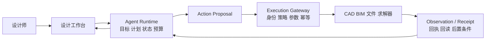
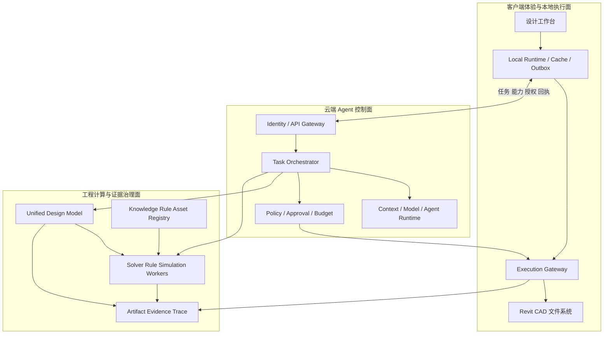

上一篇[《从需求到 BIM：AI 建筑概念设计 POC 的架构与工程闭环》](/posts/ai-conceptual-building-design-poc-architecture/)讨论了怎样把知识检索、条件确认、平面生成、专业计算、CAD/BIM、成本和报告连接起来。它解决的是第一个问题：**怎样证明 AI 建筑概念设计不是一个画图 Demo，而是一条可以继续编辑、计算和交付的工程链路。**

当这条链路在一台开发机上跑通后，更难的问题才会出现。

设计师需要在 Revit 或 CAD 中继续修改方案；多个专业开始同时协作；生成和仿真任务需要更多算力；规则库、模型和工具需要统一升级；企业又不允许原始项目、长期凭据和本地软件权限不受控制地进入 Agent 进程。系统一旦开始修改真实模型、生成正式成本或参与合规判断，“偶尔得到一次好结果”就不再是成功标准。

架构目标因此发生变化：

```text
能力 Demo：证明某个模型或算法能工作
    ↓
工程 POC：证明从需求到 BIM 的闭环能工作
    ↓
可信 Agent：证明每个决策和动作都在边界内发生
    ↓
云边平台：证明这套能力能够被多人、多项目稳定复用
    ↓
持续进化：证明系统升级时不会丢失证据、质量和控制
```

这不是把本地单体原样搬到云端，也不是把每个模块都拆成微服务。真正的演进，是重新分配五类责任：状态由谁持有，控制权交给谁，计算放在哪里，数据允许流向哪里，最终由谁确认和负责。

本文把“如何建立可信 Agent”作为主线。客户端、云端、运行时、规则引擎和 BIM 插件只是落实这条可信链的不同位置与组件。


*图 1：可信不是要求模型永远正确，而是让输入、决策、验证、执行、回读和发布都处在明确边界内。*

---

## 一、先定义可信：不是要求模型永远正确

建筑设计包含模糊目标、经验取舍和不完整信息。要求大模型永远正确并不现实，给模型回答附加一个置信度，也不能自动把系统变得可信。

可信的关键不是消除不确定性，而是让不确定性始终处在**可以识别、可以限制、可以验证、可以拒绝、可以恢复、可以追责**的边界内。

一个可信 Agent 至少应具备六项工程属性：

| 属性 | 系统必须回答的问题 | 建筑设计中的表现 |
| --- | --- | --- |
| 可追溯 | 依据来自哪里 | 面积要求能回到任务书页码、规则条款和确认人 |
| 受约束 | Agent 可以做什么 | 只能调用已授权能力，不能绕过质量门发布 BIM |
| 可验证 | 如何证明结果成立 | 几何、规则、工程量和 IDS 由确定性程序检查 |
| 可恢复 | 中断后如何继续 | 仿真失败、客户端离线或应用崩溃后从检查点恢复 |
| 可观测 | 实际发生了什么 | 能还原模型决策、工具调用、版本、成本与副作用 |
| 可归责 | 谁批准了什么 | 正式发布绑定用户、任务、策略版本与审批意见 |

可以把这六项能力理解成一个乘法关系：

```text
可信 Agent
  = 可信输入
  × 受控决策
  × 受限执行
  × 确定性验证
  × 全程证据
  × 人工责任
```

任何一项为零，系统都不能因为其他方面表现良好而被称为可信。输入来源不清，再精密的求解器也只是在计算错误前提；工具权限没有边界，再聪明的规划也可能扩大损失；执行没有回读，接口返回成功也不能证明 BIM 已经正确修改。

因此，可信不是模型属性，而是一组端到端系统契约：

> 模型负责提出下一步，运行时负责约束下一步，工程引擎负责验证下一步，人对关键条件、例外和正式发布负责。

---

## 二、为什么工程 POC 仍然不是可信 Agent

一个完整的 POC 可能已经具备这样的链路：

```text
任务书
  → 条件抽取与人工确认
  → 平面候选生成
  → 专业计算
  → CAD / BIM
  → 成本与报告
```

这条链路证明了业务闭环，却未必建立了运行边界。只要以下问题还没有明确答案，它仍然主要是一个工程原型：

- Agent 使用的是哪一版任务书、规则集和项目模型？
- 同一字段出现冲突时，谁选择了最终值，为什么？
- 模型给出的方案满足了哪些硬约束，哪些只是偏好？
- Agent 是否能够绕过预览，直接修改正式 Revit 模型？
- BIM 写入请求超时后，构件究竟有没有创建？
- 报告中的面积和成本来自计算对象，还是 LLM 重新抄写的文本？
- 规则或 Prompt 在任务执行中途升级，前后结果是否仍然一致？
- 一次成功经验能否未经验证就影响其他项目？

POC 的典型实现通常把认知路径和执行路径混在一起：Agent 进程读取密钥、选择工具、判断权限、发起重试、解释结果，并直接更新任务状态。功能少时，这种方式最快；一旦动作影响真实资产，它就产生三个结构性问题。

第一，**模型判断被误当成系统事实**。Agent 说“规则检查通过”，并不等于规则引擎执行过指定版本的规则。

第二，**工具返回被误当成业务完成**。API 返回 `200` 只能说明请求被处理，不能证明模型对象、面积和属性符合预期。

第三，**聊天上下文被误当成持久状态**。进程重启、模型重规划或客户端断线后，系统无法确定哪些步骤已完成、哪些写操作可能已经生效。

从 POC 到可信 Agent 的分水岭，是把“模型生成结果”改造成一条受控事务：

```text
模型提出结构化决策
  → 运行时检查状态、权限与风险
  → 工程引擎验证方案
  → 人工确认关键取舍
  → 执行器实施真实动作
  → 回读环境并形成证据
  → 质量门决定是否推进正式状态
```

---

## 三、架构演进中必须保持的五个不变量

系统可以从单机变成云边协同，模型、求解器和 BIM 平台也可以替换，但 POC 中已经建立的五项原则不能在分布式改造中丢失。

### 1. 统一中间模型仍然是工程主线

`DesignBrief`、`SpatialGraph`、`GeometryModel`、`BuildingModel` 和 `EvidenceGraph` 不能在不同服务里各自长出一份相似定义。IFC、DWG、网页预览、成本表和报告都是某个方案快照的派生视图，不是互相独立的事实来源。

### 2. 工程事实由确定性系统产生

LLM 可以理解规范、提出候选、选择插件和解释结果，但面积、碰撞、疏散距离、工程量与成本汇总必须来自几何内核、图算法、规则引擎、求解器或专业软件。

### 3. 正式状态只能由质量门推进

“Agent 认为已经完成”只是一个观察。只有输入完整性、硬约束、专业检查、BIM 回读和报告引用等门禁满足要求，任务才能进入下一正式阶段。

### 4. 每次运行绑定不可变输入快照

任务必须固定设计条件、项目模型、规则、成本库、生成器和工具版本。新版本发布不应静默改变正在执行的任务。

### 5. 对象身份必须跨端连续

客户端中的房间、云端计算中的空间、IFC 中的构件和报告中的数字，需要通过稳定 ID 与版本关系连接。否则所谓全链路只是多个文件的顺序生成。

这些不变量是可信体系的地基。系统演进改变的是能力部署在哪里、由谁控制和怎样扩展，而不是工程事实的定义方式。

---

## 四、可信 Agent 的六道闭环

建立可信 Agent 不应从选一个 Agent 框架开始，而应依次建立六道闭环。

| 闭环 | 核心对象 | 要解决的问题 |
| --- | --- | --- |
| 可信输入 | 来源、条件、规则、版本 | Agent 看见的事实是否可靠 |
| 受控决策 | 计划、状态机、预算、风险 | 模型的自主权到哪里为止 |
| 可信执行 | 能力、授权、幂等、回执 | 动作怎样安全地影响真实资产 |
| 确定性验证 | 求解器、规则、回读、质量门 | 结果如何被工程方法证明 |
| 证据责任 | Trace、证据图、审批 | 为什么这样做，谁对此负责 |
| 评测发布 | 回归、灰度、版本、回退 | 系统如何在不失控的前提下进化 |

这六道闭环并不是六个必须独立部署的微服务，而是六种必须明确的系统责任。早期可以全部实现在一个模块化应用中；当用户、项目和计算量增加后，再根据数据、资源与治理边界逐步拆分。

---

## 五、第一道闭环：建立可信输入

Agent 的推理质量受限于它看到的事实。任务书、规范、历史案例和 BIM 模型如果没有来源、版本和确认状态，系统只是把传统的信息不确定性放大到了自动化链路中。

### 1. 把项目事实、规则事实和设计判断分开

三类信息在系统中应具有不同的权威来源和使用权限：

| 类型 | 示例 | 权威来源 | Agent 的权限 |
| --- | --- | --- | --- |
| 项目事实 | 地块边界、目标面积、层数、朝向 | 原始资料、系统接口、人工确认 | 提取、归一化和解释 |
| 规则事实 | 防火分区上限、疏散距离、最小净宽 | 受控规则库、专业软件 | 检索、选择并编排检查 |
| 设计判断 | 接待区靠近入口、会议区集中 | Agent、案例、设计师 | 提出候选，不能冒充事实 |

例如，任务书写着“建筑面积约 8,000 平方米”。Agent 可以识别数值和单位，却不能把“约”静默删除，也不能让这个候选值直接进入正式求解。更合适的输出是：

```json
{
  "field": "targetGrossFloorArea",
  "value": 8000,
  "unit": "m2",
  "qualifier": "approximately",
  "source": {
    "documentId": "BRIEF-2026-03",
    "version": 4,
    "page": 12,
    "text": "建筑面积约8000平方米"
  },
  "confidence": 0.94,
  "status": "PENDING_CONFIRMATION"
}
```

置信度用于排序和提示，不用于替代确认。一个高置信度但来源过期的值，仍然不是可信输入。

### 2. 从可变表单产生不可变条件快照

可信输入的主线应是：

```text
原始资料
  → 候选条件与来源
  → 单位归一和冲突检测
  → 人工修改与确认
  → DesignBriefSnapshot
  → Agent 与工程引擎使用
```

`DesignBriefSnapshot` 一旦确认就不再原地修改。后续发现问题时产生新版本，并保留旧值、修改原因、确认人和受影响任务。这样才能回答：“候选方案 3 使用的是哪一组条件？”

一次运行还应绑定规则集、知识库、成本库和项目模型快照：

```json
{
  "runId": "RUN-8821",
  "briefSnapshotId": "BRIEF-SNAP-018",
  "buildingSnapshotId": "BLDG-SNAP-1042",
  "ruleSetVersion": "CN-SH-OFFICE-2026.4",
  "costBookVersion": "SH-2026-Q3",
  "knowledgeSnapshotId": "KB-20261101",
  "toolSetVersion": "DESIGN-TOOLS-2.7"
}
```

### 3. 指令、受控事实和外部内容必须分区

任务书、网页、案例、邮件和 BIM 属性都属于外部数据。它们可能错误、过期，甚至包含提示注入文本。Context Builder 不能把检索到的所有内容直接拼进同一段 Prompt，而应显式分区：

```text
System Policy       不允许外部内容覆盖的系统规则
User Goal           用户当前请求
Approved Facts      已确认的项目事实
Controlled Rules    已发布规则及适用条件
Retrieved Evidence  带来源、版本和可信等级的外部内容
Working State       当前任务的临时状态和预算
```

检索结果可以帮助模型提出判断，却不能自行获得系统指令的优先级。规则条文还需要适用地区、建筑类型、生效时间和例外条件，不能只保存一段向量切片。

### 4. 可信输入的质量门

输入进入方案生成前，至少检查：

- 必填条件是否完整；
- 单位、坐标系和面积口径是否一致；
- 同一字段是否存在未裁决冲突；
- 来源是否可访问且版本有效；
- 规则是否适用于当前地区、建筑类型和日期；
- 关键条件是否经过有权限的人员确认；
- 快照是否包含内容哈希和完整版本清单。

这道门不过，Agent 可以继续帮助整理问题，但不能进入正式生成和发布链路。

---

## 六、第二道闭环：把模型决策变成受控提案

大模型擅长在不完整信息下提出下一步，但它不应拥有直接改变正式状态的权限。可信架构需要把“模型想做什么”和“系统允许什么发生”分开。

### 1. 模型输出 `DecisionProposal`，而不是直接调用

以“会议室保持不变，把茶水间移到核心筒附近”为例，模型不直接修改几何，而是产生结构化提案：

```json
{
  "goal": "Relocate pantry near Core A",
  "baseSnapshotId": "BLDG-SNAP-1042",
  "assumptions": [
    "meeting rooms are locked",
    "non-structural partitions around the pantry may change"
  ],
  "proposedActions": [
    {
      "capability": "layout.generate_local_variants",
      "parameters": {
        "targetId": "SPACE-PANTRY-03",
        "near": "CORE-A",
        "maxDistanceM": 8,
        "lockedObjects": ["SPACE-MEETING-01", "SPACE-MEETING-02"]
      }
    }
  ],
  "requiredChecks": [
    "geometry.valid",
    "accessibility.passed",
    "egress.passed",
    "locked_objects.unchanged"
  ],
  "riskLevel": "MEDIUM",
  "approvalRequired": true
}
```

运行时再检查基础快照、假设证据、能力版本、用户权限、预算和所需门禁。模型可以建议风险等级，最终等级由代码和策略确定。

### 2. 用状态机代替隐式对话进度

聊天记录适合交互，不适合恢复。正式任务应有显式状态：

```text
DRAFT
  → INPUT_PENDING_CONFIRMATION
  → INPUT_CONFIRMED
  → PLANNING
  → CANDIDATES_GENERATED
  → VALIDATION_FAILED / VALIDATION_PASSED
  → WAITING_FOR_APPROVAL
  → EXECUTING
  → RESULT_PENDING_VERIFICATION
  → COMPLETED
```

每次迁移由可审计事件触发。Agent 说“规则检查通过”不能进入 `VALIDATION_PASSED`；规则引擎对绑定快照执行指定版本规则并产生结果后才可以。BIM API 返回成功也不能直接进入 `COMPLETED`，还需要回读目标模型。

任务、计划、步骤、执行尝试和逻辑业务操作应分别建模。一个步骤可以因为临时故障执行多次，但同一个“把候选 B 应用到模型”的逻辑操作始终只有一个稳定身份。

### 3. 自主权按三条轴分配

不是所有任务都需要相同的 Agent 自主程度。可以从路径不确定性、结果可验证性和动作风险三条轴判断：

| 任务 | 路径不确定性 | 可验证性 | 风险 | 控制方式 |
| --- | --- | --- | --- | --- |
| 检索相似案例 | 高 | 较高 | 低 | 自动执行并保留来源 |
| 生成布局候选 | 高 | 高 | 低 | Agent 探索，求解器和规则验证 |
| 修改临时方案 | 中 | 高 | 中 | 先预览，执行后回读 |
| 修改正式 BIM | 中 | 高 | 高 | 策略检查和人工批准 |
| 声明最终合规 | 低 | 不完全 | 极高 | 禁止 Agent 独立声明 |

基本原则是：路径越不确定、结果越容易独立验证、动作风险越低，越适合提高 Agent 自主程度。路径固定、结果难验证或失败代价高时，应把控制权收回到工作流、确定性程序和责任人。

### 4. 预算和停止条件也是控制权

Agent 运行时应限制模型调用、工具调用、仿真次数、总时间和成本。连续生成更多候选不一定提升设计质量，反复自我反思也不等于验证。

达到预算、证据不足、重复失败、规则冲突或需要专业裁决时，任务应进入明确的等待或终止状态，而不是让模型自行决定无限继续。

---

## 七、第三道闭环：将认知路径与执行路径分离

可信 Agent 最重要的架构边界，是将 Agent Runtime 与 Execution Gateway 分开：



Agent Runtime 负责理解目标、构造上下文、生成计划、选择能力和根据观察调整路径。Execution Gateway 负责验证调用身份、执行授权策略、获取短期凭据、校验参数、控制超时与并发、记录真实副作用，并返回结构化结果。

即使模型受到错误上下文或提示注入影响，执行网关仍然可以阻止越权动作。反过来，执行网关也不判断“茶水间应该放在哪里”，它只保证已批准的领域动作在限定范围内可靠实施。

### 1. 工具应暴露高层领域能力

建筑设计系统不应默认向 Agent 暴露 `run_shell`、`execute_python`、`click_at` 或任意文件写入，而应优先提供语义稳定的高层能力：

```text
design.extract_brief
layout.generate_candidates
layout.apply_domain_command
rule.check_snapshot
bim.prepare_export_plan
bim.apply_export_plan
bim.read_back_objects
cost.recalculate_affected_items
report.render_approved_facts
```

每项能力都要声明输入输出 Schema、所需权限、风险等级、前置条件、后置条件、幂等规则、超时、失败分类、是否支持 Dry Run，以及可否撤销。

### 2. Agent 不持有长期凭据

Agent 进程只拥有工作负载身份和调用受控能力的接口。执行网关根据最终用户、租户、项目、任务、动作范围和审批状态换取短期凭据。这样可以撤销单个任务的权限，也避免 Prompt、工具代码和第三方依赖接触永久密钥。

### 3. 控制点必须位于真实调用路径上

如果 Agent 可以绕过网关直接连接 Revit 自动化接口、对象存储或项目数据库，策略就只是建议。可信边界需要结合宿主插件、网络出口、目标系统账号和文件权限，保证高风险调用必须经过执行网关。

---

## 八、BIM 写入：用两阶段执行建立真实动作的可信度

生成一个候选和把候选写进正式 BIM 模型，是两种不同性质的操作。后者需要像数据库事务一样处理前置条件、提交、回执和未知结果。

### 1. `prepare` 阶段生成可审查的变更计划

系统先从通过质量门的 `BuildingModelSnapshot` 生成 `ExportPlan`，列出：

- 将新增、修改和删除的对象；
- 稳定对象 ID 与目标 BIM 元素的映射；
- 族、类型、图层、分类和属性；
- 坐标系、单位和容差；
- 对锁定对象及相邻对象的影响；
- 预计工程量和成本变化；
- 不可逆操作与回退方式。

执行器只做 Dry Run 和宿主环境检查，不修改正式模型。工作台基于这份计划生成 Review Packet，让设计师看到具体差异，而不是只显示一句“是否允许 Agent 修改模型”。

### 2. 审批绑定动作摘要，而不是授予永久权限

审批记录应绑定项目、基础模型版本、`ExportPlan` 内容哈希、对象范围、批准人和有效期。任何参数、对象或基础版本变化，旧审批自动失效。

```text
ActionProposal
  → Policy Check
  → Prepare / Dry Run
  → Review Packet
  → User Approval
  → Commit
  → Read-back Validation
  → ExecutionReceipt
```

### 3. `commit` 阶段再次检查前置条件

本地执行器在提交前重新检查：

- 当前打开的是不是目标项目；
- 宿主模型版本是否仍与审批一致；
- 用户会话和短期授权是否有效；
- 目标对象是否仍存在且未被其他人锁定；
- 插件、族库和映射版本是否满足要求。

如果设计师在预览后修改了目标楼层，执行器返回 `PRECONDITION_FAILED`，而不是把旧计划强行应用到新模型。

### 4. 超时不等于失败

Revit 事务可能已经提交，但响应因宿主无响应或网络断开而丢失。可信执行需要区分：

```text
SUCCESS                 已确认完成
FAILED                  已确认未执行
RESULT_UNKNOWN          是否完成尚不明确
PRECONDITION_FAILED     前置条件已经变化
PARTIALLY_COMPLETED     部分动作已经发生
```

写操作使用稳定的 `logicalOperationId`，它绑定业务意图，而不是某次网络请求或模型调用。出现 `RESULT_UNKNOWN` 时，运行时先查询本地操作记录并回读 BIM 对象；只有确认没有执行，才允许重试。

### 5. 回读是完成条件，不是附加检查

执行后重新读取对象数量、稳定 ID、类型、楼层、坐标、面积和关键属性，与 `ExportPlan` 和统一模型比较。只有后置条件满足，任务才能从 `RESULT_PENDING_VERIFICATION` 进入 `COMPLETED`。

---

## 九、第四道闭环：让确定性验证守住工程事实

可信 Agent 不是在所有环节都减少 LLM，而是让 LLM 工作在它擅长的位置，让确定性引擎守住可以复算的事实。

| 能力 | LLM 的职责 | 确定性系统的职责 |
| --- | --- | --- |
| 理解自然语言需求 | 提取候选值、发现缺失和冲突 | Schema、单位和完整性检查 |
| 生成设计方案 | 提出关系、策略和候选参数 | 求解硬约束和几何有效性 |
| 规则检查 | 检索适用规则、解释问题 | 计算并判断规则条件 |
| 专业分析 | 选择插件、组织参数、解释结果 | 计算面积、疏散、能耗等指标 |
| BIM 生成 | 规划对象映射和变更范围 | 事务写入、IDS 与回读检查 |
| 成本估算 | 解释差异与敏感因素 | 工程量、单价和调整系数计算 |
| 报告生成 | 基于事实包组织叙述 | 数字渲染、引用和禁用声明检查 |

### 1. 分层质量门比一次“综合评分”更可靠

建议至少建立四层验证：

**Schema 门**检查字段类型、单位、枚举、对象引用和必填项。它回答“数据是否可以被系统理解”。

**模型一致性门**检查稳定 ID、坐标、拓扑、版本和依赖关系。它回答“这些对象是否构成一份自洽方案”。

**领域规则门**检查面积、邻接、净宽、疏散、碰撞、信息要求和成本规则。它回答“方案是否满足当前可自动检查的工程约束”。

**交付门**检查 BIM 回读、IDS、工程量覆盖、报告引用和版本一致性。它回答“交付物是否忠实表达了通过检查的方案”。

质量门输出不能只有 `PASS` 或 `FAIL`，还需要包含：

- 检查器及版本；
- 输入快照和检查范围；
- 通过、警告和阻断项；
- 问题对应的模型对象；
- 计算过程与证据制品；
- 是否阻止下一状态；
- 可执行的修复建议。

### 2. 自动修复必须回到同一套门禁

Agent 可以根据规则问题提出修复，例如扩大门宽或调整房间边界，但修复结果不能因为来自“自我反思”就获得信任。任何自动修复都产生新的模型快照，重新经过受影响的几何、规则、工程量和 BIM 门禁。

### 3. 报告中的数字只能有一个来源

报告生成应拆成三层：

```text
确定性事实对象
  → 程序渲染表格、数字和图表
  → LLM 基于批准事实撰写说明
  → 引用校验器检查每项关键陈述
```

LLM 不应把面积、成本或规则结论重新抄写成自由文本。报告段落保存它依赖的事实 ID；底层指标变化时，相关段落自动标记过期并重新生成。

### 4. 专业责任不能被自动检查覆盖

规则引擎只能检查已经形式化、数据充分且适用条件明确的规则。无法自动检查的条款、专业判断和例外处理，应显式标记为“需要人工复核”，不能被一个综合合规分数掩盖。

---

## 十、第五道闭环：用证据链和责任链建立可追溯性

普通应用日志主要回答“发生了什么”；可信 Agent 还要回答“为什么这样做、依据是什么、谁允许它发生”。这需要同时维护两张相互关联的图。

### 1. 运行因果树：系统是怎样执行的

```text
Task
  ├── Context Build
  ├── Model Decision
  ├── Candidate Generation
  ├── Solver / Rule Check
  ├── Policy Decision
  ├── Human Approval
  ├── Client Execution
  └── Read-back Validation
```

运行 Trace 记录模型和 Prompt 版本、上下文摘要、检索来源、工具参数、重试、降级、Token、成本、延迟、人工介入和状态变化。敏感内容可以脱敏、加密或只保存内容哈希，但关键因果标识不能丢失。

### 2. 设计证据图：结果为什么成立

```text
SourceChunk --supports--> Requirement
Requirement --normalized_as--> Constraint
Constraint --checked_by--> RuleExecution
RuleExecution --flags--> ModelObject
ModelObject --measured_as--> Quantity
Quantity --priced_by--> CostItem
CalculationResult --cited_by--> ReportClaim
HumanDecision --accepts/rejects--> Candidate
```

两张图通过 `taskId`、`snapshotId`、`decisionId`、`logicalOperationId`、`ruleExecutionId` 和 `artifactId` 连接。只有 Trace，没有证据图，可以看到调用过程却无法证明设计结论；只有证据图，没有 Trace，则难以定位哪个模型、工具或恢复动作产生了错误。

### 3. 人在回路不是一个确认按钮

人工确认应集中在真正需要责任判断的位置：

- 条件冲突和重要假设；
- 规则例外和不可自动检查项；
- 多目标方案取舍；
- 高风险 BIM 修改；
- 方案冻结和正式发布；
- 最终合规声明。

一份有效的 Review Packet 应展示：Agent 想做什么、为什么这样做、使用哪些证据、影响哪些对象、哪些约束已经验证、哪些判断仍不确定、预计有什么副作用、是否可撤销，以及拒绝或修改后如何继续。

用户应能批准、拒绝、修改参数、缩小范围或转交，而不是只有“确定”和“取消”。批准记录绑定具体动作摘要，不能被另一项任务复用。

### 4. 可信度来自责任分层，而不是责任消失

系统需要清楚区分：

- Agent 对候选和解释负责；
- 规则与计算引擎对可复算结果负责；
- 平台对权限、状态、版本和证据完整性负责；
- 设计师和专业工程师对取舍、例外和正式交付负责。

引入 Agent 的目的不是把专业责任转移给模型，而是让每一个责任判断拥有更完整的上下文、证据和执行记录。

---

## 十一、从客户端到云端：按信任边界放置能力

完成本地可信执行后，系统才适合演进到云边协同。建筑设计天然不适合简单的“全部上云”或“全部留在客户端”。

客户端靠近设计师、项目文件和专业软件，适合保存未发布模型、捕获选择集、执行低延迟编辑、使用本地许可证和完成在场确认。云端拥有弹性算力、共享知识、组织身份和统一运营，适合复杂推理、批量生成、规则发布、跨项目检索与集中评测。

| 能力或数据 | 默认位置 | 原因 |
| --- | --- | --- |
| Revit/CAD 当前编辑会话 | 客户端 | 依赖宿主进程、用户界面和许可证 |
| 原始 RVT/DWG 与未发布草图 | 客户端或项目私有存储 | 敏感、体量大、频繁变化 |
| 对象选择和局部几何预览 | 客户端 | 低延迟，靠近用户上下文 |
| Agent 长任务状态 | 云端为主，客户端有检查点 | 需要跨设备恢复和统一调度 |
| 组织规则与知识索引 | 云端或私有云 | 统一审核、发布、权限和版本 |
| 大模型和生成模型 | 云端模型服务 | 算力利用率、路由和统一升级 |
| 约束求解和批量仿真 | 云端任务节点 | 可并行、可弹性、运行时间长 |
| BIM/CAD 最终写入 | 客户端执行器 | 真实副作用和项目权限靠近资产 |
| Trace 与评测指标 | 云端治理面 | 跨项目运营，内容按分类脱敏 |

这只是默认放置方式。涉密项目可以把模型、知识和任务状态全部放在本地或私有云；使用云工作站的团队也可以把传统客户端放进受管云环境。重要的是每项放置决定都能说明数据、权限、延迟、许可证和故障责任。

### 1. 客户端体验与本地执行面

客户端不只是显示云端结果的网页壳。它负责当前项目和宿主应用上下文、局部编辑、敏感数据裁剪、本地能力声明、离线 Outbox、高风险动作在场确认，以及对 BIM/CAD 操作的真实回读。

### 2. 云端 Agent 控制面

云端负责身份、租户、项目、任务状态机、模型路由、上下文构建、预算、策略、审批、异步调度和跨设备恢复。它可以请求“将批准的 ExportPlan 应用于当前项目”，但不能向客户端下发任意 Shell、Python 或鼠标操作。

### 3. 工程计算与证据治理面

统一设计模型、求解器、规则、仿真、知识、案例、构件、成本、制品和证据属于工程数据面。它既服务 Agent，也服务确定性工作流。即使暂时关闭 LLM，规则检查、版本比较、BIM 导出和成本复算仍然应当可用。



---

## 十二、跨端协议：云端发送能力请求，客户端返回可核实回执

云边协同最容易被低估的不是网络连接，而是跨端语义。云端说“修改完成”和客户端真的在正确项目中修改正确对象，中间至少需要五类消息：

| 消息 | 作用 | 关键字段 |
| --- | --- | --- |
| `TaskEnvelope` | 固定任务和版本边界 | tenant、project、snapshot、deadline、budget |
| `CapabilityManifest` | 声明客户端能执行什么 | capability、schema、host、version、risk |
| `ActionProposal` | 描述 Agent 想做什么 | operation、parameters、evidence、preconditions |
| `ExecutionGrant` | 表示策略和审批已放行 | scope、policyVersion、approver、expiry、digest |
| `ExecutionReceipt` | 记录实际结果和副作用 | status、resourceIds、postconditions、artifactHashes |

一个简化的执行请求可以表达为：

```json
{
  "taskId": "TASK-8821",
  "logicalOperationId": "OP-RELOCATE-PANTRY-03",
  "capability": "bim.apply_export_plan",
  "projectId": "PRJ-021",
  "baseSnapshotId": "BLDG-SNAP-1042",
  "inputArtifact": {
    "id": "EXPORT-PLAN-778",
    "sha256": "..."
  },
  "preconditions": [
    "host.application == 'Revit'",
    "host.documentId == 'PRJ-021-MODEL-A'",
    "host.modelVersion == 'RVT-V311'"
  ],
  "grant": {
    "scope": ["space:SPACE-PANTRY-03", "wall:affected-neighborhood"],
    "policyVersion": "POLICY-BIM-17",
    "expiresAt": "2026-11-02T11:30:00+08:00"
  }
}
```

`ExecutionGrant` 绑定动作摘要、对象范围、基础版本和有效期，不能拿去执行另一项动作。客户端执行前再次检查宿主、项目、用户和模型版本；云端通过策略不代表本地环境仍满足条件。客户端返回的 `ExecutionReceipt` 必须包含后置条件和回读结果，不能只有一段“执行成功”的文字。

---

## 十三、分布式之后，谁才是事实来源

云边协同并不意味着把所有状态同步成一份万能数据库。不同状态有不同权威来源：

| 状态类型 | 权威来源 | 一致性要求 |
| --- | --- | --- |
| 任务与步骤状态 | 云端 Orchestrator | 显式状态迁移、乐观并发控制 |
| 已确认设计条件 | `DesignBriefSnapshot` | 不可变，修改产生新版本 |
| 统一方案模型 | Design Model Service 或项目模型仓 | 通过领域命令产生新快照 |
| Revit/CAD 当前编辑状态 | 对应宿主文档 | 执行前检查，执行后回读 |
| 规则与成本版本 | 受控资产注册表 | 发布版本不可变 |
| 生成物 | 对象存储与内容哈希 | 内容寻址，保存来源清单 |
| 人工审批 | 审批或签核记录 | 绑定动作摘要，不可复用 |
| Trace 与审计 | 遥测和审计存储 | 追加写、保留策略、关联标识 |

BIM 文件不是所有事实的唯一来源，云端数据库也不是。BIM 宿主拥有当前编辑事实，统一模型拥有跨专业计算语义，任务系统拥有流程事实，证据图拥有“为什么”的关系。它们通过稳定 ID、版本和回执形成一致，而不是争夺一个万能主库。

### 1. 用快照隔离长任务和持续编辑

长任务读取 `BLDG-SNAP-1042` 后，设计师可以继续编辑并产生 `BLDG-SNAP-1043`。计算仍基于原快照完成，结果返回时再判断：

- 基础版本未变化，可以进入待确认；
- 变化不涉及结果依赖对象，可以通过影响分析重基；
- 修改发生在影响范围内，结果标记为 `STALE` 并局部重算；
- 无法自动判断时，进入 `REBASE_REQUIRED` 等待人工比较。

系统不应使用“最后写入者获胜”覆盖设计师的修改。

### 2. 用 Outbox 和幂等处理重复消息

客户端离线时，把待发送的回执和已经执行的逻辑操作写入本地 Outbox；重连后按 `logicalOperationId` 重发。云端消费端去重，客户端执行端也去重。两边都不能假设网络只会投递一次。

### 3. 用内容哈希识别制品

`candidate-final-v7-really-final.ifc` 不是可靠身份。制品清单应记录内容哈希、源快照、生成器、参数、规则版本、创建任务和签名。这样才能判断缓存能否复用，也能证明报告引用的是哪一份模型。

---

## 十四、可信运行必须覆盖六个故障窗口

生产系统不能只测试正常路径。至少要主动验证以下故障窗口。

### 1. 云端计划已生成，客户端尚未收到

任务保持 `WAITING_FOR_CLIENT`，计划拥有过期时间。客户端重连后拉取仍有效的待办，不为同一业务意图重新生成另一项操作。

### 2. 客户端已执行，回执上传失败

本地保存操作记录和回读制品，重连后重发同一个 `logicalOperationId`。云端先核实结果，不能要求客户端盲目再次写入。

### 3. 工程任务超时，工作节点仍在运行

超时只改变当前执行尝试的状态，不直接认定业务失败。调度器通过租约、心跳和任务查询判断旧节点是否仍在计算，避免两个节点同时提交同一结果。

### 4. 规则集在任务中途发布新版本

运行中的任务继续使用已经绑定的版本。新规则只影响新任务，或者通过显式“重新评估”产生一组新结果，不能在同一次运行中静默混用。

### 5. 用户在云端计算期间修改模型

结果进入 `STALE` 或 `REBASE_REQUIRED`，由依赖图决定能否局部重算。旧的 `ExecutionGrant` 因基础版本不匹配而失效。

### 6. 报告发布前底层指标发生变化

报告段落和表格保存事实依赖。指标版本变化后，受影响内容自动过期，发布门阻止包含混合版本的报告流出。

这些故障需要明确状态，而不是统一“重试三次”。读取、生成计算、外部写入和人工审批具有不同恢复语义，必须分别设计。

---

## 十五、第六道闭环：评测、发布与持续进化

可信 Agent 不只要证明当前版本可以工作，还要控制系统如何变化。模型、Prompt、规则、Skill、求解器、工具 Schema 或 BIM 映射任意一项更新，都可能改变最终结果。

### 1. 评测不能只看生成图是否好看

一套完整评测至少覆盖六组指标：

| 维度 | 建议指标 |
| --- | --- |
| 输入可信度 | 条件抽取准确率、来源定位准确率、冲突召回率、未确认事实误用率 |
| 决策质量 | 计划完整率、无依据假设比例、错误能力选择率、无效步骤与成本 |
| 工程结果 | 硬约束满足率、几何有效率、工程量与成本复算误差 |
| 执行可靠性 | BIM 回读一致率、重复副作用、未知结果比例、恢复成功率 |
| 安全治理 | 越权拦截率、提示注入攻击成功率、违规数据外发率 |
| 责任证据 | 关键结论证据覆盖率、审批覆盖率、Trace 完整率、版本混用数 |

评价时按建筑类型、规模、数据质量和任务难度分组。具有随机性的生成任务需要重复运行并报告分布，不能用一次最好结果代表版本质量。

### 2. 能力升级进入统一发布管线

```text
候选版本
  → 影响分析
  → 离线回放
  → 工程回归
  → 安全测试
  → 专家审核
  → 小范围灰度
  → 生产指标比较
  → 全量发布或回退
```

任务快照记录所用资产版本，发布系统能够判断规则变化影响哪些评测、项目和运行。灰度期间，新旧版本使用相同验收口径比较，发现退化时回到上一稳定版本。

### 3. 项目经验不能直接变成生产规则

系统会积累大量有价值的轨迹：哪些邻接条件经常冲突，哪些修复路径有效，哪些族映射经常失败，哪些报告结论总被设计师修改。但单个项目的例外不能未经验证就进入全局记忆。

可信的进化链路是：

```text
生产轨迹与人工反馈
  → 脱敏和质量筛选
  → 候选经验 / 规则 / Skill / 评测案例
  → 独立验证与专家审核
  → 版本化发布
  → 灰度使用
  → 指标对比与回退
```

当前任务中的反思可以帮助当前任务换一条路径，但不能直接改写组织级 Prompt、规则库或长期记忆。在线执行只使用已批准资产，后台进化负责提出和验证新资产。这两个运行节奏必须分开。

---

## 十六、贯穿案例：一次“移动茶水间”如何建立信任

下面用一个局部修改任务，把六道闭环连接起来。

### 第一步：客户端捕获在场上下文

设计师选择茶水间和两个需要锁定的会议室，输入：“会议室保持不变，把茶水间移到核心筒附近，尽量不要增加走廊面积。”

客户端读取项目、楼层、稳定对象 ID、宿主模型版本和选择集，只上传完成任务所需的空间语义、局部几何和指标，不默认上传整个 RVT 文件。

### 第二步：建立可信输入快照

运行时绑定已确认 `DesignBrief`、当前 `BuildingModel`、规则集和成本库版本。Context Builder 将用户目标、受控事实和外部案例分区。会议室锁定状态来自项目模型，不依赖模型猜测。

### 第三步：Agent 提出领域计划

Agent 将目标拆为：锁定指定对象、搜索候选位置、求解硬约束、比较走廊面积和机电影响、生成变更预览。模型输出 `DecisionProposal`，不直接移动 BIM 构件。

### 第四步：确定性引擎生成并验证候选

求解器在允许区域产生三个候选，规则引擎检查面积、净宽、连通和疏散，成本插件计算受影响工程量。候选 C 因破坏无障碍通道被质量门淘汰，而不是由 Agent 主观删除。

### 第五步：设计师完成专业取舍

工作台展示候选 A、B 的差异、证据和未解决问题。设计师选择 B，系统生成 `ExportPlan`，列出将修改的空间边界、墙、门、标注及成本项。审批绑定计划哈希和当前模型版本。

### 第六步：本地执行器受控提交

云端签发范围有限、短期有效的 `ExecutionGrant`。本地网关核对项目、用户、宿主版本和对象范围，调用 BIM 插件完成事务。如果用户已修改目标楼层，执行器拒绝旧授权并返回 `PRECONDITION_FAILED`。

### 第七步：回读、重算和交付

插件重新读取对象 ID、数量、坐标、面积和属性，生成 `ExecutionReceipt`。统一模型产生新快照，增量重算受影响指标，旧成本表和报告段落自动失效。最终报告中的变化数字引用新快照和计算结果。

这条链路中，LLM 的价值是理解目标、组织计划、选择能力和解释差异；系统可信度则来自来源、快照、状态机、约束求解、策略授权、BIM 事务、回读证据和人工责任。

---

## 十七、从 POC 到可信 Agent 的实施顺序

可信体系应按风险与依赖逐步建立，不需要第一天就建设完整云平台。

### 第一步：可信输入

建立来源、版本、确认状态和不可变 `DesignBriefSnapshot`。在输入没有可信之前，不要用更复杂的 Agent 放大错误。

**退出标准**：任一关键条件能回到原文、规则或人工裁决；冲突和未确认项不会进入正式生成。

### 第二步：可信结果

引入统一模型、确定性计算、分层质量门和 BIM 回读。先证明同一输入可复算，交付来自同一快照。

**退出标准**：硬约束由程序验证；局部修改保持锁定对象；报告数字可回到计算结果。

### 第三步：可信执行

分离 Agent Runtime 和 Execution Gateway，引入动作提案、Dry Run、短期授权、幂等和结构化回执。

**退出标准**：越界动作被阻断；响应丢失不会产生重复构件；高风险动作均有具体审批。

### 第四步：可信恢复

建立持久任务状态、检查点、`RESULT_UNKNOWN`、补偿、Outbox 和版本冲突处理，并主动注入断网、崩溃和超时故障。

**退出标准**：中断后能够从检查点继续；部分失败不会被错误标记为整体成功。

### 第五步：可信协作

再将长任务控制、共享知识和弹性计算放入云端，同时保留客户端的数据裁剪、本地权限和最终执行边界。

**退出标准**：云端不能请求未声明能力；客户端离线后任务可恢复；旧授权不能应用到新模型版本。

### 第六步：可信进化

建立 Trace、评测集、回放、灰度、版本回退和经验蒸馏。模型、规则、工具和工作流采用同一发布纪律。

**退出标准**：平台能够说明一次升级改善和退化了哪些场景、影响哪些项目，并能回退到上一稳定版本。

可以用六级成熟度观察进展：

```text
L0 会生成      能产生文本、图像或模型
L1 能验证      关键结果有确定性检查
L2 可追溯      输入、决策和交付能够关联
L3 受约束执行  真实动作经过身份、策略和审批
L4 可恢复运营  中断、重复和版本冲突有明确语义
L5 可治理进化  所有能力变化经过评测、灰度和回退
```

达到 L3，系统才开始具备可信 Agent 的核心条件；达到 L4，才适合承担持续生产任务；达到 L5，才形成可规模复制的平台。

---

## 十八、最容易走偏的八种做法

### 1. 用更强模型代替可信架构

模型能力提升可以降低部分错误率，却不能替代权限、幂等、版本、回读和责任边界。

### 2. 用模型置信度代替来源和确认

高置信度只说明模型内部倾向，不证明输入来源正确、规则适用或事实经过确认。

### 3. 把工具返回 `200` 当作任务完成

工具调用成功不等于业务效果完成。BIM 写入必须回读，报告发布必须验证引用和版本。

### 4. 用聊天记录代替任务状态

正式状态应保存计划、步骤、快照、逻辑操作、审批和制品。聊天只能作为交互和辅助证据。

### 5. 先把所有项目文件上传云端

数据最小化应从架构初期实现。客户端先提取必要语义和局部几何，云端明确用途、区域和保留周期。

### 6. 认为云端计划天然可信

云端也可能使用错误上下文、过期版本或受到污染的外部内容。本地执行器必须独立校验范围、版本和授权。

### 7. 过早引入多 Agent 和全面微服务

多个领域能力不等于需要多个自由对话的 Agent。统一对象、状态和质量门尚未稳定时，增加分布式边界只会放大不一致。

### 8. 把单次用户反馈直接写入长期记忆

项目例外不等于组织规律。经验必须带来源、适用范围、验证结果和版本，经过发布后才能跨项目复用。

---

## 结语：可信来自边界，而不是来自自信

AI 建筑概念设计从 POC 走向生产，表面上会增加客户端插件、云端服务、任务队列、规则引擎和评测平台。但这些组件本身不是目标。

真正的目标，是让一项设计决策始终拥有清楚的责任链：原始条件由谁提供，冲突由谁确认，Agent 基于什么提出方案，哪个引擎验证了约束，哪版规则产生了结论，谁批准了 BIM 修改，客户端实际改变了哪些对象，最终成本与报告引用哪一个快照。

POC 证明“这条链能够跑通”；可信 Agent 证明“它只能在边界内运行，结果能够验证，失败可以恢复”；云边平台证明“它可以被多人、多项目稳定复用”；持续进化机制则证明“系统变得更好时，不会丢失原有的证据、版本和控制”。

因此，建立可信 Agent 不是消除模型的不确定性，而是把不确定性限制在可以验证、可以拒绝、可以恢复、可以追责的系统边界内。模型负责扩大探索空间，工程系统负责守住事实，人类设计师保留取舍、例外和发布的最终责任。

---

## 延伸阅读

1. [从需求到 BIM：AI 建筑概念设计 POC 的架构与工程闭环](/posts/ai-conceptual-building-design-poc-architecture/)：本文的统一模型、质量门与工程闭环基础。
2. [生产级 AI Agent 架构：从决策循环到可控运行时](/posts/production-ai-agent-architecture/)：控制面、执行面、状态、工具与治理的通用参考架构。
3. [AI Agent 部署架构：云端、客户端与云端协同](/posts/cloud-client-agent-deployment/)：数据、控制权和执行位置的部署判断方法。
4. [运行框架：让智能体任务稳定、可控、可追溯地执行](/posts/unified-agent-runtime-reliability/)：质量门、长程幂等、恢复与执行证据。
5. [Agent Sidecar：把智能体的执行治理移到进程之外](/posts/agent-sidecar-runtime-governance/)：身份、策略执行和工具治理边界。
6. [Agent 可观测性实战：从 Trace 因果树到生产落地](/posts/agent-observability-trace-production/)：端到端 Trace、回放、成本和生产告警。
7. [持续进化：让智能体越用越好，让执行经验成为平台能力](/posts/unified-agent-continuous-evolution/)：从轨迹、经验到 Skill 和发布闭环。
