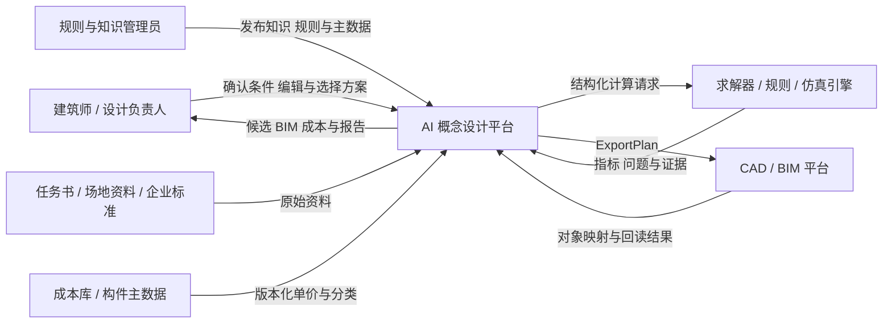
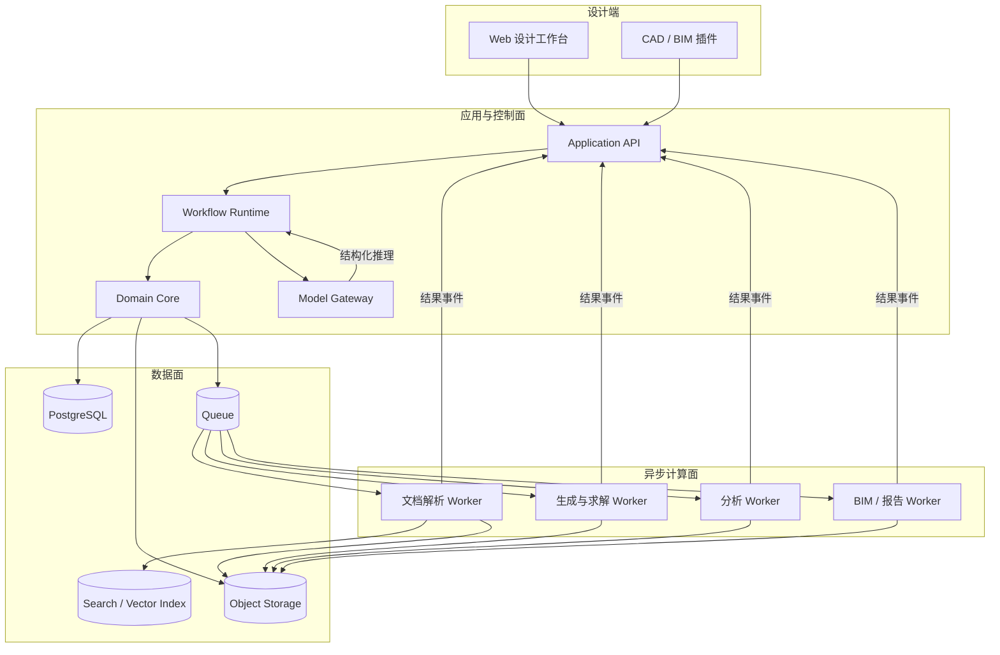
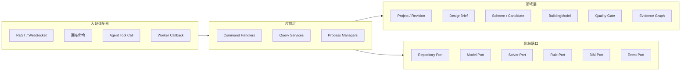
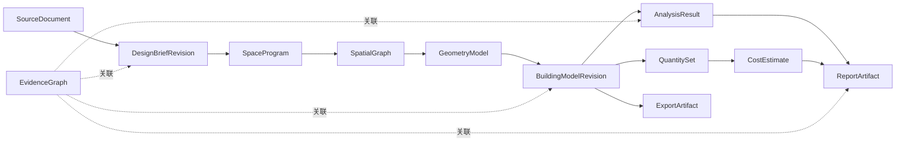
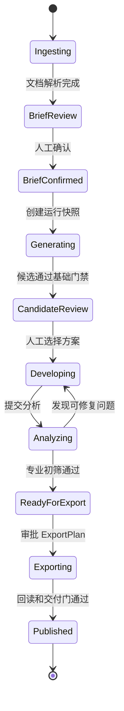
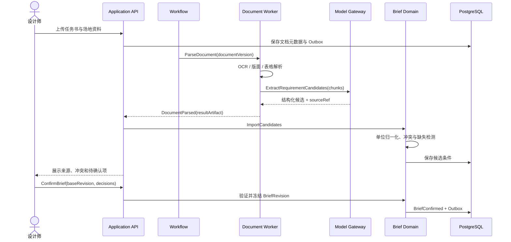
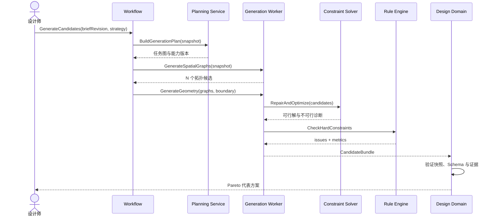
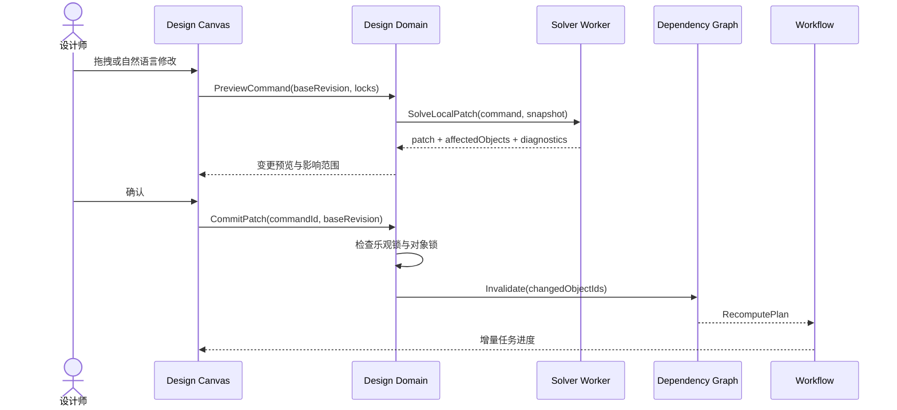
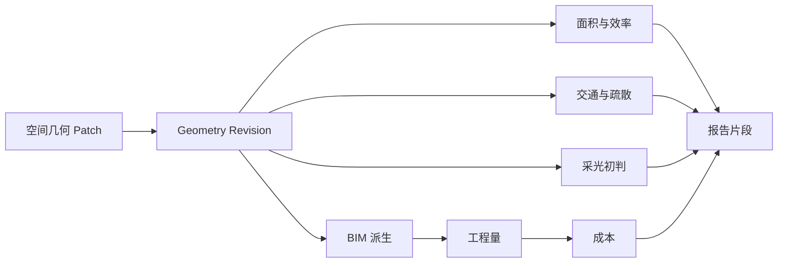
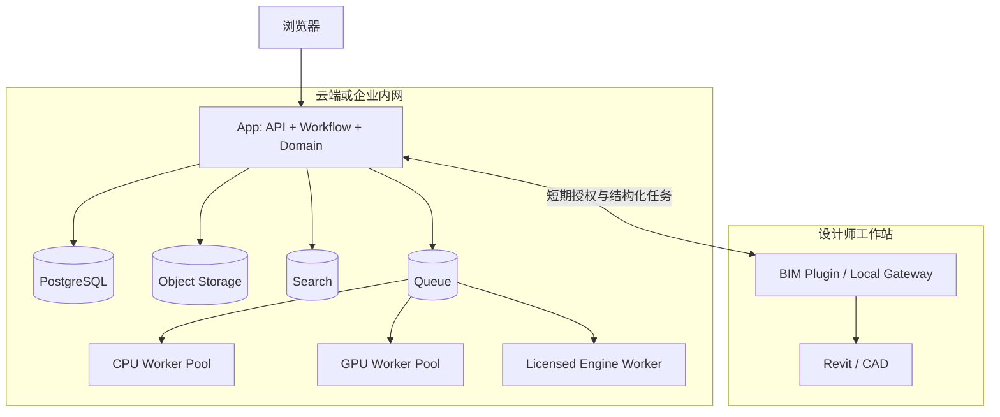

“输入一段需求，AI 自动生成平面，再导出 BIM 和造价报告。”

这句话描述了产品结果，却没有回答系统怎样成立。一个真正能用于建筑概念设计的 POC，至少要解释以下架构问题：

- 任务书、人工确认、空间关系、几何、BIM 构件和成本之间，谁是事实来源；
- LLM、生成模型、约束求解器、规则引擎和 BIM 软件分别拥有什么权限；
- 跨越数分钟甚至数小时的生成与分析任务，怎样保存状态、处理重试和恢复；
- 设计师修改一个空间后，怎样只重算受影响结果，又不漏掉全局约束；
- CAD、BIM、工程量和报告怎样保证来自同一个方案版本；
- 当前是一个 POC 时，哪些组件应该合并部署，哪些边界必须从第一天保留。

如果这些问题没有答案，所谓“全链路”很可能只是多个 Demo 的串联：LLM 输出一份 JSON，算法生成一张图，脚本再猜测图层语义，最后由报告模型重新抄写数字。它能演示，却不能继续编辑、复算和交付。

本文不按“知识库、平面生成、BIM、造价”的功能清单展开，而是从架构设计出发，依次给出系统上下文、容器、组件、领域模型、运行时、数据、部署和关键时序视图。核心结论是：

> POC 的架构主线不是 Prompt，也不是某个生成模型，而是一个版本化的统一领域模型，以及围绕它运行的长事务工作流。

LLM 负责理解、检索、提出计划和解释差异；确定性工程引擎负责几何、约束、规则和工程量；工作流负责状态与恢复；人负责确认输入、选择方案和批准交付。

---

## 一、先定义架构问题，而不是先选模型

AI 建筑概念设计同时具有四种系统特征。

第一，它是**人机协同系统**。任务书中的模糊条件需要设计师确认，候选方案需要专业取舍，发布 BIM 和正式报告也需要责任人批准。

第二，它是**概率系统与确定性系统的组合**。LLM 和生成模型擅长理解意图与探索方案，但面积、几何有效性、疏散距离和工程量必须由可复算程序产生。

第三，它是**长事务系统**。条件确认可能跨越数小时，生成、仿真和 BIM 导出可能异步运行，不能依赖一次 HTTP 请求或一段聊天上下文维持状态。

第四，它是**多模型一致性系统**。空间图、几何、建筑对象、分析结果、工程量和报告会同时存在；任何局部修改都可能使下游结果失效。

因此，架构优先级不应是“生成得多快”，而应按以下顺序排列：

| 优先级 | 质量属性 | 架构含义 |
| --- | --- | --- |
| P0 | 正确性 | 工程事实来自确定性引擎，硬约束失败不能进入交付 |
| P0 | 一致性 | CAD、BIM、成本和报告绑定同一模型快照 |
| P0 | 可追溯 | 条件、对象、计算与结论能回到来源和版本 |
| P1 | 可编辑 | 方案是领域对象，不是一次性图片或不可解释网格 |
| P1 | 可恢复 | 超时、崩溃和人工暂停后能从检查点继续 |
| P1 | 可替换 | 模型、求解器和 BIM 平台通过端口接入 |
| P2 | 性能 | 交互操作快速响应，重计算进入异步 Worker |
| P2 | 扩展性 | 先支持单一场景，再沿清晰边界扩展专业能力 |

这组排序决定了后面的技术选择。POC 可以牺牲部分并发和覆盖范围，但不能牺牲对象身份、版本、状态和验证，否则后续无法平滑演进。

---

## 二、先收窄场景，才能形成可验证架构

概念设计横跨建筑、结构、机电、消防、节能和造价。第一版如果同时覆盖所有建筑类型与全部专业，系统边界会持续变化，任何架构都无法稳定。

一个可落地的 POC 可以限定为：

- 单一建筑类型，例如中小型办公建筑；
- 单栋或单个标准层，采用 2.5D 几何；
- 输入为任务书、场地边界、空间计划和少量规则；
- 输出三至五个可编辑候选，而不是一个“最优答案”；
- 分析只覆盖面积、邻接、交通、疏散初筛、采光初判和概算；
- BIM 只生成空间、墙、门窗、楼板和必要属性；
- 交付为模型快照、IFC 或目标 BIM、指标表和带引用的报告。

明确不做的内容同样重要：不承诺施工图深度，不替代法定审查，不自动完成全部机电系统，不让 Agent 无审批覆盖正式 BIM，也不把近似分析包装成最终合规结论。

这个范围使系统可以围绕一个核心业务闭环设计：

```text
资料入库
  → 条件提取与人工确认
  → 生成可编辑候选
  → 确定性校核与方案选择
  → 局部修改与增量重算
  → BIM / 工程量 / 成本 / 报告发布
```

架构验收不是“每个模块都能运行”，而是同一个设计对象能否沿这条链路保持身份、版本和证据连续。

---

## 三、六个关键架构决策

在画组件图之前，应先固定影响最大的架构决策。它们相当于 POC 的 ADR（Architecture Decision Record）。

| 决策 | 选择 | 不选择 | 主要原因 |
| --- | --- | --- | --- |
| ADR-01 | 统一领域模型作为系统事实源 | 文件和 JSON 在模块间层层传递 | 保持对象身份、依赖和版本连续 |
| ADR-02 | 模块化单体加异步 Worker | POC 初期全面微服务化 | 降低分布式一致性和调试成本 |
| ADR-03 | 显式工作流保存任务状态 | 用 Agent 对话记录充当状态 | 支持人工暂停、重试、恢复和审计 |
| ADR-04 | 概率生成与确定性验证分离 | 让 LLM 直接产生工程结论 | 保证面积、规则和工程量可复算 |
| ADR-05 | 快照加派生结果 | 所有模块始终读取“最新数据” | 保证一次运行内部一致和历史可重现 |
| ADR-06 | CAD/BIM 使用防腐层适配 | 内部对象直接等同于 IFC/Revit 对象 | 隔离平台差异、事务和版本变化 |

### ADR-01：统一领域模型，而不是文件接力

任务书、空间图、几何、BIM 和成本不是五套互不相关的数据。它们是同一设计意图在不同阶段的表达。系统应使用稳定 ID 建立连续关系：

```text
Requirement R-018
  → Constraint C-042
  → SpaceProgram SP-011
  → Space S-203
  → Wall W-882 / Door D-119
  → Quantity Q-771
  → CostItem CI-310
  → ReportFinding RF-027
```

IFC、DWG、Excel 和 PDF 都是输入输出格式，不是内部事实源。内部模型必须能独立表达编辑、计算和依赖关系。

### ADR-02：模块化单体承载事务，Worker 隔离重计算

POC 阶段的核心复杂度来自领域一致性，而不是高并发。项目、条件、方案、版本和审批适合先放在同一个应用和数据库事务中；OCR、候选生成、求解、仿真和 BIM 导出则放到独立 Worker，通过任务契约调用。

这样既避免过早引入大量服务，又保留了按计算类型独立扩缩容和隔离故障的能力。

### ADR-03：工作流是正式状态，Agent 只是参与者

聊天消息可以解释用户意图，但不能证明任务处于哪个阶段。正式状态必须记录当前快照、已完成步骤、等待中的人工任务、重试次数、运行版本和产物引用。

“Agent 认为已经完成”不能推动业务状态；只有质量门产生的事件才能推进工作流。

### ADR-04：生成路径和验证路径必须分开

LLM 或生成模型可以产生 `SpatialGraphProposal`、布局候选和修改建议，但候选必须经过 Schema、几何和规则校验。概率系统扩大搜索空间，确定性系统决定某个候选是否具备工程意义。

### ADR-05：一次运行只读取绑定快照

每次生成或计算都绑定 `DesignBriefRevision`、`BuildingModelRevision`、规则集、模型、插件和参数版本。运行中规则升级不会悄悄改变结果；新版本通过新任务触发重算。

### ADR-06：BIM 平台位于适配器之后

内部模型不直接暴露 Revit ElementId 或 IFC 实体作为业务主键。适配器维护内部稳定 ID 与外部对象 ID 的版本化映射，并负责事务、单位、坐标、族类型和回读校验。

---

## 四、系统上下文：先画清边界和责任

从系统上下文看，AI 概念设计平台不是“一个 Agent”，而是设计师、企业知识、工程计算和外部 CAD/BIM 平台之间的协调者。



平台内部持有的是项目语义、设计状态和证据关系。外部引擎拥有各自的计算权威，CAD/BIM 平台拥有其文件或宿主模型事务，用户拥有关键条件、方案取舍与正式发布的决定权。

这个边界能避免两个常见错误：一是让 LLM 承担专业计算责任，二是让外部 BIM 文件反过来成为所有业务状态的唯一来源。

---

## 五、容器架构：一个事务核心，三类可替换边缘

POC 的推荐容器架构如下：



图中最重要的不是组件数量，而是三条边界：

1. `Domain Core` 是事务与业务不变量的所有者，Worker 不能绕过它直接推进项目状态。
2. Worker 通过版本化任务契约读取快照、写入制品，再返回结果引用，不共享进程内状态。
3. 模型网关只提供结构化推理能力，不直接连接数据库、对象存储或 BIM 平台。

### 各容器的责任

| 容器 | 核心职责 | 明确不负责 |
| --- | --- | --- |
| 设计工作台 | 条件确认、方案画布、差异比较、审批 | 生成工程事实 |
| Application API | 身份、命令入口、查询聚合、实时进度 | 承担长时间计算 |
| Workflow Runtime | 长事务、人工任务、重试、超时、补偿 | 保存领域对象细节 |
| Domain Core | 聚合、版本、不变量、质量门、失效传播 | OCR、LLM 或几何计算 |
| Model Gateway | 模型路由、Prompt 版本、Schema 校验、成本 | 直接执行高风险工具 |
| Compute Workers | 文档、生成、求解、分析、导出 | 决定正式业务状态 |
| PostgreSQL | 项目、版本、关系、任务、审计元数据 | 保存大型模型文件 |
| Object Storage | 原始资料、快照、几何、导出物、报告 | 处理事务关系查询 |
| Search / Vector | 文档块、案例与语义检索 | 充当规则事实源 |

容器边界是逻辑责任，不要求第一天部署九套服务。POC 可以把 API、Workflow 和 Domain Core 编译为一个应用，把 Worker 按资源与许可证需求拆成两到四个进程。

---

## 六、组件架构：领域核心不能依赖模型和厂商 SDK

应用内部适合采用端口与适配器结构。领域核心只认识命令、领域对象、策略和事件；LLM、数据库、求解器、Revit、IFC 和成本库都通过端口接入。



依赖方向始终从外向内。比如“移动茶水间”可以来自画布拖拽，也可以来自自然语言，但两者最终都转换为同一个 `MoveSpaceCommand`。领域层校验基础版本、锁定对象和状态，再调用求解端口；不会为聊天入口复制一套业务逻辑。

### 领域模块与数据所有权

| 模块 | 拥有的聚合或记录 | 发布的主要事件 |
| --- | --- | --- |
| Project | 项目、成员、坐标、单位、当前修订 | `ProjectConfigured` |
| Brief | 条件候选、冲突组、确认快照 | `BriefConfirmed` |
| Knowledge | 文档版本、规则版本、案例元数据 | `KnowledgeSnapshotPublished` |
| Design | 空间计划、空间图、候选、设计 Patch | `CandidateCreated`、`DesignPatched` |
| Analysis | 分析任务、指标、规则问题 | `AnalysisCompleted` |
| Delivery | ExportPlan、对象映射、工程量、成本、报告 | `ArtifactPublished` |
| Evidence | 来源、计算、决策和制品之间的关系 | `EvidenceLinked` |

模块可以在同一数据库中，但不能随意更新彼此的表。跨模块变化通过应用命令和领域事件发生。这个约束比是否拆成微服务更重要，因为它决定未来能否安全拆分。

---

## 七、统一领域模型：架构真正的中轴

统一模型不是一个巨大的 JSON，也不是把 IFC 原样存进数据库。它是一组有明确职责、生命周期和依赖关系的领域对象。



### `DesignBriefRevision`：经过确认的输入契约

它不是文档摘要，而是带单位、来源、适用范围和确认状态的条件集合。原始资料可以不断增加，但一次生成只能绑定某个不可变修订。

```json
{
  "briefRevisionId": "BRIEF-004",
  "status": "CONFIRMED",
  "requirements": [
    {
      "id": "REQ-018",
      "path": "targets.grossFloorAreaM2",
      "value": 8000,
      "qualifier": "APPROXIMATE",
      "sourceRef": "DOC-01#p3:bbox-17",
      "confirmedBy": "USER-1042"
    }
  ]
}
```

“约 8,000 平方米”的容差若不是原文内容，应保存为企业策略或人工决定，不能伪装成提取事实。

### `SpatialGraph`：把拓扑与几何解耦

节点表示空间、分区或出入口，边表示邻接、连通、远离、包含和可视关系。空间图先回答“谁应该靠近谁”，几何模型再回答“具体放在哪里”。

```text
Node reception: area = 60..80 m2
Edge entrance -> reception: DIRECT_ACCESS, HARD
Edge meeting_zone -> open_office: NEAR, maxDistance = 20 m
```

这种分离让案例检索、LLM 规划、图生成和几何求解可以围绕稳定契约协作，而不需要共享某个模型的私有张量或 Prompt 格式。

### `GeometryModel`：精确空间计算的边界

它保存坐标系、楼层、边界、多边形、中心线、标高、容差和布尔关系。POC 可以采用 2.5D：每层使用二维精确几何，再结合层高生成体量。

所有适配器进入领域核心前都要完成单位和坐标归一化。内部统一使用米和项目坐标，显示层再格式化；否则毫米、米和英尺会在 BIM、几何库和前端之间形成隐蔽错误。

### `BuildingModelRevision`：可编辑的建筑对象快照

它组合项目、场地、建筑、楼层、空间、墙、门窗、楼板、楼梯、柱网和设备占位。对象拥有稳定 `logicalId`，每次修改形成新修订；几何或属性变了，身份不必改变。

内部模型服务于编辑与计算，IFC 服务于交换。两者之间使用显式映射，而不是把 IFC GUID 或 Revit ElementId 直接作为内部对象的生命周期。

### `AnalysisResult` 与 `Artifact`：派生数据不是事实副本

分析、工程量、成本、BIM 和报告都是某个输入快照的派生物。每项结果至少记录：

```text
resultId
inputSnapshotHash
producerId / producerVersion
ruleSetVersion
parameterSet
status
metrics or artifactUri
evidenceRefs
createdAt
```

当输入发生变化，旧结果不会被覆盖，而是变为 `STALE`。这既保留历史，也防止系统误用过期结果。

### `EvidenceGraph`：连接事实，而不是复制事实

证据图保存来源、条件、规则、对象、计算、人工决定与报告陈述之间的边：

```text
SourceChunk --supports--> Requirement
Requirement --normalized_as--> Constraint
Constraint --checked_by--> RuleExecution
RuleExecution --flags--> ModelObject
ModelObject --measured_as--> Quantity
Quantity --priced_by--> CostItem
CalculationResult --cited_by--> ReportParagraph
HumanDecision --accepts/rejects--> Candidate
```

它不替代关系数据库中的业务对象，而是提供跨阶段的影响分析与追溯查询。

---

## 八、一致性模型：修订、快照和派生关系

建筑设计不是对一条记录做 CRUD，而是在不断创建新修订。建议显式区分三个概念：

- **工作修订**：设计师可以持续 Patch 的可变草稿；
- **运行快照**：任务启动时冻结的不可变输入集合；
- **发布版本**：通过质量门并由责任人签发的正式版本。

```text
Working Revision 17
  ├─ Patch A
  ├─ Patch B
  └─ freeze → Snapshot S-17-03
                 ├─ Candidate Generation Run
                 ├─ Analysis Run
                 └─ Export Run
                         ↓ gates + approval
                    Published Revision 18
```

快照不一定复制所有数据。它可以由各聚合修订号、规则版本、制品内容哈希和参数集合组成，只要之后能解析出完全相同的输入。

### 乐观并发控制

画布编辑命令必须带 `baseRevision`。如果用户 A 基于修订 17 移动空间，而用户 B 已经把模型推进到 18，系统应返回版本冲突和差异，不允许最后写入者静默覆盖。

### 内容寻址和重复使用

大型几何、仿真输入和导出物存入对象存储，并按内容哈希寻址。相同快照、插件和参数产生的计算可以复用，但必须重新检查复用策略和有效期。

### 派生结果状态

```text
VALID     输入与当前快照一致，可以使用
STALE     上游已变化，不得进入正式交付
RUNNING   正在重新计算
FAILED    计算失败，保留错误分类与诊断
BLOCKED   缺少输入、权限或人工决定
```

状态应由依赖图和任务结果计算，不由 LLM 在文本中判断。

---

## 九、运行时架构：用状态机管理长事务

从资料到报告不是一次接口调用，而是一条包含人工等待和异步计算的长事务。工作流负责流程状态，领域模块负责业务不变量，两者不能混为一层。



每个状态转换采用同一种事务结构：

```text
接收 Command
  → 验证身份、当前状态和基础修订
  → 执行领域规则
  → 更新聚合
  → 写入 Outbox Event
  → 提交数据库事务
  → 异步派发后续任务
```

领域更新和 Outbox 必须在同一数据库事务中提交。这样即使进程在提交后、发送消息前崩溃，后台派发器仍能补发事件，不会出现“状态已经更新但任务永远没有启动”。

### 质量门拥有状态推进权

| 质量门 | 机器检查 | 人工责任 |
| --- | --- | --- |
| Brief Gate | 必填项、单位、冲突、来源完整 | 确认模糊条件与例外 |
| Candidate Gate | Schema、几何有效、硬约束可满足 | 选择设计取舍 |
| Analysis Gate | 必需插件完成、阻断问题为零 | 接受风险或要求修改 |
| BIM Gate | 映射完整、事务成功、回读一致、IDS | 批准发布范围 |
| Cost Gate | 工程量覆盖、单价版本、估算等级 | 确认成本口径 |
| Report Gate | 数字引用、版本一致、禁用声明 | 签发正式报告 |

Agent 可以建议下一步，但不能直接把任务状态从 `Analyzing` 改成 `Published`。

---

## 十、同步与异步边界：按延迟和失败语义划分

不是所有能力都需要队列。同步调用适用于低延迟、无外部副作用且用户必须立即得到结果的操作，例如读取方案、轻量几何检查、保存 Patch 和查询任务进度。

以下任务应异步执行：

- OCR、版面解析和文档索引；
- 批量候选生成与约束求解；
- 能耗、采光或疏散分析；
- 大型 IFC/BIM 导出与回读；
- 工程量、成本和报告重建。

统一任务信封可以是：

```json
{
  "jobId": "JOB-2048",
  "jobType": "GENERATE_CANDIDATES",
  "projectId": "PRJ-21",
  "snapshotId": "SNAP-17-03",
  "inputArtifactRefs": ["sha256:..."],
  "capabilityVersion": "layout-pipeline@2.4.1",
  "parameters": { "candidateCount": 12 },
  "idempotencyKey": "PRJ-21/SNAP-17-03/layout-v2.4.1",
  "deadline": "2026-11-01T10:30:00Z",
  "traceId": "TRACE-7788"
}
```

Worker 不能收到“帮我完成这个项目”这样的开放指令，而应收到范围明确、输入冻结、输出 Schema 已知的任务。

### 重试语义

读取、纯计算和内容寻址写入可以自动重试；会修改外部 BIM 的任务必须使用稳定逻辑操作 ID，并在重试前查询执行状态。超时表示“结果未知”，不等同于“没有执行”。

### 取消语义

取消只阻止尚未开始的步骤，并向运行中的 Worker 发送协作取消信号。若外部事务已经提交，系统应进入回读或补偿流程，而不是简单标记为 `CANCELLED`。

---

## 十一、关键时序一：从任务书到确认条件

条件提取不是一次文档摘要，而是“解析、候选化、标准化、冲突检测、人工确认”的架构链路。



这里有三类数据必须分开：原始资料不可修改；模型输出只是候选；人工确认后的 `DesignBriefRevision` 才能进入正式生成。搜索索引可以重建，但条件确认记录不能只存在于向量库。

当任务书写 8,000 平方米、邮件写 8,500、表格写 8,200 时，模型不能按置信度静默选一个值。领域模块应形成冲突组，按来源、日期和权威等级展示，由用户裁决。

---

## 十二、关键时序二：从空间意图到布局候选

布局生成不应是一条“Prompt → 图片”路径，而是一条由多个可替换阶段组成的候选管线。



这条管线包含四个明确职责：

1. 案例检索或 LLM 提出空间关系候选；
2. 生成模型、模板或案例变形产生初始几何；
3. CP-SAT、MILP 或专用几何求解器满足硬约束；
4. 规则和分析插件产生指标，由 Pareto 排序选择差异明显的代表方案。

硬约束包括边界内、不重叠、面积上下限、最小净宽、强制邻接、出口与核心筒位置等。软目标可以是交通面积、采光面、关键动线、结构规则性和成本。

```text
minimize
    w1 * area_deviation
  + w2 * adjacency_penalty
  + w3 * circulation_ratio
  + w4 * daylight_penalty
  + w5 * structural_misalignment
  + w6 * estimated_cost
```

权重属于版本化的 `DesignStrategy`，不能藏在 Prompt 中。系统也不应只返回一个综合总分，因为不同指标之间不存在普遍正确的权重。更合理的结果是 Pareto 前沿和每个候选的取舍说明。

生成模型可以从 Graph2Plan、House-GAN++、扩散模型或案例模板中选择。架构只要求它实现 `CandidateGeneratorPort`，输出统一空间图与几何契约。数据不足时先用模板和求解器，并不会破坏后续接入学习模型的边界。

---

## 十三、关键时序三：局部修改与增量重算

真实设计不是每次重新生成整层。设计师更常提出“保留核心筒和会议室，只把茶水间移近竖井”。无论操作来自画布、表单还是自然语言，最终都转换成领域命令：

```json
{
  "commandId": "CMD-8891",
  "type": "MOVE_SPACE",
  "targetId": "SPACE-PANTRY-01",
  "parameters": {
    "anchor": "CORE-EAST",
    "relation": "NEAR",
    "maxDistanceM": 8
  },
  "locks": ["CORE-01", "SPACE-MEETING-01", "EXIT-02"],
  "baseRevision": 17,
  "requestedBy": "USER-1042"
}
```

执行过程如下：



锁定不只是“坐标不动”。对象可以有几何锁、拓扑锁、属性锁、接口锁和审批锁。若约束无解，求解器返回最小冲突集或可解释诊断，不能自行解除锁定。

### 依赖图驱动失效传播



`DesignPatched` 事件携带变化对象、变化字段和新旧修订。依赖图根据插件声明的读取集和写入集，把受影响结果标记为 `STALE` 并生成重算计划。

增量重算后仍需执行一组廉价的全局不变量检查，例如总面积、边界、连通性和出口数量；正式发布前再执行完整质量门。局部计算节省时间，不能以破坏全局正确性为代价。

---

## 十四、关键时序四：BIM 两阶段发布与回读

CAD/BIM 集成的难点不是生成文件，而是外部平台拥有自己的对象模型、事务、单位、坐标和失败语义。内部系统需要一层防腐适配器。

```text
BuildingModel Snapshot
  → prepare ExportPlan
  → Schema / Mapping / IDS Validation
  → Preview and Approval
  → commit through BIM Adapter
  → External Transaction
  → Read-back
  → Round-trip Validation
  → Publish Artifact
```

### `prepare`：生成可审查的变更计划

`ExportPlan` 明确目标平台、基础模型版本、将创建/更新/删除的对象、族或类型映射、图层、属性和预期数量。此阶段没有外部副作用，可以反复校验和预览。

```json
{
  "exportPlanId": "EXP-2026-071",
  "sourceSnapshot": "MODEL-SNAPSHOT-018",
  "target": "REVIT-PROJECT-09",
  "baseTargetVersion": "RVT-SYNC-443",
  "operations": [
    {
      "logicalOperationId": "EXP-071/CREATE/WALL-882",
      "type": "CREATE",
      "objectId": "WALL-882",
      "targetType": "Basic Wall: 200mm"
    }
  ],
  "expectedCounts": { "spaces": 42, "walls": 126, "doors": 38 }
}
```

审批绑定 `ExportPlan` 的哈希和目标模型版本。计划或目标版本变化后，旧审批自动失效。

### `commit`：在外部事务中执行

BIM 适配器再次核对基础版本、权限、单位、坐标和映射，再以稳定的 `logicalOperationId` 执行。若请求超时，系统先查询该逻辑操作是否已经提交，不能盲目重复创建构件。

### 回读：验证真实结果

适配器重新读取对象 ID、数量、坐标、面积和属性，更新内部 ID 与外部 ID 的映射，并执行往返校验。只有回读结果符合 `ExportPlan`，工作流才能发布 BIM 制品。

IFC、IDS、bSDD 和 BCF 可以分别承担开放交换、信息要求、术语属性和问题协作，但它们都位于适配边界，不能替代内部领域模型。

---

## 十五、LLM 在架构中的位置：认知组件，不是系统内核

LLM 适合完成四类工作：从资料中提取候选条件，把自然语言翻译成领域命令，基于工具能力生成任务计划，以及基于结构化事实解释方案差异。

它不负责计算面积、判断几何相交、执行规则阈值、生成工程量或直接修改 BIM。架构上应将 LLM 包在模型网关之后：


模型网关统一负责模型与 Prompt 版本、结构化输出、敏感数据处理、Token 预算、超时、缓存、Trace、离线评测和灰度路由。领域层接收的是 `RequirementCandidate`、`DomainCommandProposal` 或 `GenerationPlan`，而不是一段可以任意解释的文本。

### 上下文也必须分层

```text
System Policy        不可被项目文档覆盖
Capability Contract  工具名称、Schema、限制和成本
Confirmed Facts      已确认 Brief 与当前模型快照
Retrieved Evidence   带来源和适用范围的检索内容
User Intent          本轮目标与选中对象
```

知识库文档属于不可信输入，其中的文字不能改变系统策略或工具权限。检索结果必须携带文档版本、页码、条文号、适用地区、生效时间和权威等级。

### Agent 与工作流的关系

Agent 可以在允许的能力集合内提出步骤，工作流负责持久化、调度和恢复，领域核心负责判断步骤是否合法。三者关系是：

```text
Agent:       下一步做什么
Workflow:    这一步何时运行、失败后怎样恢复
Domain Core: 这一步在当前状态和版本下是否允许
Engine:      这一步的工程结果是什么
```

这能保留 AI 的灵活性，同时避免把状态、权限和工程事实都压进同一个 Agent 循环。

---

## 十六、工程计算架构：插件契约隔离专业能力

概念阶段的计算可能来自自研公式、开源库、商业软件 API、参数化脚本和人工判断。平台不应把这些能力写进一个应用服务，而应定义统一插件契约。

```text
PluginManifest
  id / version / owner
  supportedObjectTypes
  inputSchema / outputSchema
  requiredModelLOD
  unitProfile / toleranceProfile
  deterministic flag
  timeout / resourceLimit
  provenanceRequirements
  readSet / writeSet
  invalidationRules
```

插件输入只能来自已冻结快照，输出为不可变 `CalculationResult`。例如疏散初筛结果包括插件版本、模型修订、规则集、指标、问题对象和证据，而不是一句“疏散符合要求”。

```json
{
  "plugin": "egress-precheck",
  "version": "1.3.2",
  "inputRevision": "MODEL-017",
  "ruleSet": "LOCAL-OFFICE-2026.1",
  "status": "WARNING",
  "metrics": { "maxTravelDistanceM": 31.8 },
  "issues": [
    {
      "ruleId": "EGRESS-TRAVEL-07",
      "objectIds": ["SPACE-2F-031", "DOOR-2F-014"],
      "measured": 31.8,
      "limit": 30.0
    }
  ]
}
```

POC 可以接入的插件包括面积与效率、交通图、疏散初筛、采光初判、结构规则性、简化能耗和概念工程量。每项结果都要标注它是精确计算、规则初筛、经验估算还是模型预测，避免在界面上显示成同一种“通过”。

插件进程应按风险隔离文件系统、网络、执行时间、内存和许可证。商业软件崩溃不能带垮领域事务；插件升级也必须保留旧版本，以便复现历史结果。

---

## 十七、数据架构：四种存储，各自只有一种职责

POC 不需要复杂的数据湖，但需要避免把同一事实复制到多个存储后失去所有权。

| 存储 | 保存内容 | 一致性要求 | 是否为事实源 |
| --- | --- | --- | --- |
| PostgreSQL | 项目、聚合修订、任务、关系、审批、审计元数据 | 强事务 | 是 |
| Object Storage | 原始文件、模型快照、几何包、分析制品、导出物 | 内容不可变 | 是，针对二进制制品 |
| Search / Vector | 文档块、案例索引、语义向量 | 最终一致，可重建 | 否 |
| Queue / Event Bus | 任务与事件传输 | 至少一次投递 | 否 |

### 关系库保存引用，不保存所有大型内容

例如 `ModelRevision` 保存对象关系、快照哈希和对象存储 URI；大型网格、IFC 和分析中间文件进入对象存储。查询界面可使用投影表，但投影损坏时必须能够从领域事件或正式记录重建。

### 搜索索引不是规则库

向量检索只能说明“语义相关”，不能证明规则适用。规则事实应有版本、发布机构、生效时间、适用地区和建筑类型，并由规则引擎执行。LLM 可以把条文转换成候选 DSL，但发布前需要专业审核和回归测试。

### 队列按至少一次投递设计

消息可能重复，因此消费者必须用 `jobId` 或 `idempotencyKey` 去重。生产者不能假设“消息发送成功”等于“业务执行成功”；任务结果要通过明确事件回到应用层。

### 数字只保留一个计算来源

报告中的面积、工程量和成本不应再复制成自由文本。确定性程序生成事实对象、表格和图表，LLM 只引用这些对象撰写说明。重算后，依赖旧事实的报告段落被标记为过期。

---

## 十八、知识架构：检索层与规则层分开

知识库并不是“所有文件切块后放进向量数据库”。建筑知识至少分为四类：

| 知识类型 | 主要存储 | 查询方式 | 用途 |
| --- | --- | --- | --- |
| 项目资料 | 对象存储、文档索引 | 项目过滤、版面定位、表格查询 | 条件抽取 |
| 规范条文 | 文档库、规则仓库 | 编号、元数据、全文与规则执行 | 引用和校核 |
| 历史案例 | 案例库、空间图与几何特征 | 类型、规模、图与几何相似度 | 生成先验 |
| 主数据 | 关系库、分类和属性字典 | 编码与属性查询 | BIM、工程量、成本 |

知识摄取管线应保留文档版本、页码、边界框和阅读顺序。检索结果返回的是 `EvidenceChunk`，包含内容、来源位置、适用条件、权威等级和分数，而不只是几段文本。

规则管线则单独管理：

```text
条文原文
  → 候选结构化规则
  → 专业审核
  → 测试样例与边界条件
  → 版本发布
  → RuleSet Snapshot
```

这样可以同时做到“回答时引用原文”和“计算时执行确定性规则”，而不是让 LLM 在每次运行时重新解释同一条规范。

---

## 十九、部署架构：POC 先简单，但保留计算隔离

第一阶段推荐部署为“模块化单体 + Worker 池 + 本地 BIM 插件”。



### 为什么 BIM 插件保留在客户端

Revit、CAD 和部分商业分析软件依赖桌面会话、本地许可证、项目文件和用户身份。让云端服务直接拥有这些权限会扩大风险。更合理的方式是云端生成 `ExportPlan`，本地插件在当前宿主模型和用户上下文中验证后执行，再返回结构化回执。

### 扩展轴按资源类型划分

- 文档 Worker 按页数和 OCR 吞吐扩容；
- GPU Worker 按模型和显存调度；
- 求解 Worker 按 CPU、内存与超时隔离；
- 商业软件 Worker 按许可证并发数限流；
- BIM 插件按在线工作站和宿主版本管理能力。

不要因为未来可能上云，就把领域核心提前拆成几十个服务。只有当团队、发布节奏、负载或数据隔离出现明确压力时，才沿现有模块边界拆分。

### 从 POC 到生产的拆分顺序

```text
阶段 1  App + 通用 Worker
阶段 2  文档、生成、分析 Worker 独立扩缩容
阶段 3  模型网关与知识发布独立治理
阶段 4  多租户项目服务与区域化数据部署
阶段 5  受控 Agent Runtime 和 Execution Gateway
```

架构演进的详细信任边界、执行授权和云边协同，可继续阅读[《从 POC 到可信 Agent：AI 建筑概念设计的架构演进》](/posts/ai-building-design-agent-architecture-evolution/)。

---

## 二十、安全架构：围绕项目和执行边界设计

建筑资料可能包含未公开地块、业主要求、人员信息与成本。安全不能只依赖一个登录页面。

### 身份与项目隔离

所有命令绑定组织、项目、用户和角色。查询默认带项目范围，下载和分享单独授权。对象存储使用短期签名 URL，避免把长期凭据暴露给浏览器或 Worker。

### 工具权限

模型只能看到本次任务允许的高层领域能力，例如 `generate_candidates`、`run_egress_check` 和 `prepare_bim_export`。它不能获得任意 SQL、Shell、Python 或完整文件系统访问。

### 数据最小化

调用外部模型前，由 Context Builder 选择必要字段并执行脱敏。完整项目文件不默认发送给模型；能在本地解析成结构化条件时，只上传任务需要的最小上下文。

### 高风险动作

以下动作必须经过显式审批：覆盖已发布 BIM、删除或批量修改外部对象、使用未确认条件发布、冻结成本、签发正式报告以及向项目外发送文件。

### 供应链与沙箱

第三方插件、上传脚本和商业软件适配器运行在隔离 Worker 中。镜像、模型、Prompt、规则和插件都有版本与签名；生产任务只能引用已发布版本。

---

## 二十一、可靠性设计：先定义失败语义

分布式任务的可靠性不来自“多重试几次”，而来自每一步对成功、失败和未知状态有明确语义。

| 故障 | 错误处理 | 业务状态 |
| --- | --- | --- |
| LLM 输出不符合 Schema | 有限次数修复或切换模型 | 当前步骤失败，不生成领域对象 |
| 求解器无可行解 | 返回冲突集与诊断 | 候选被拒绝，可调整约束 |
| Worker 超时 | 查询任务状态，必要时重新调度 | `RUNNING` 或 `RESULT_UNKNOWN` |
| 重复消息 | 按幂等键返回已有结果 | 不重复产生副作用 |
| 用户基于旧版本提交 | 返回版本差异 | `PRECONDITION_FAILED` |
| BIM 响应丢失 | 按逻辑操作 ID 查询并回读 | `RESULT_UNKNOWN`，禁止盲重试 |
| 部分分析失败 | 保留已完成结果并标记缺口 | `PARTIAL`，不得通过完整门禁 |
| 规则或模型升级 | 当前任务继续使用绑定版本 | 新任务使用新版本 |

### 检查点与恢复

工作流在每个外部调用和人工等待前后保存检查点。恢复时读取正式状态、输入快照和已完成制品，而不是把整段聊天重新交给模型猜测进度。

### 超时预算

顶层任务的截止时间向下分配给各步骤。Worker 收到绝对 `deadline`，而不是每层重新获得完整超时时间，避免任务在多次重试后无限延长。

### 降级策略

模型不可用时，已确认条件和手工编辑仍可工作；生成模型不可用时，可退回案例模板与求解器；高级仿真不可用时，显示未计算状态，而不是伪造结论；BIM 插件离线时，保留已批准的 `ExportPlan` 等待客户端恢复。

---

## 二十二、可观测性：围绕一次设计事务建立 Trace

普通接口日志无法解释“为什么这个方案最终被发布”。系统需要让一次设计事务跨越模型、工作流、Worker、规则和 BIM 插件仍保持同一个 `traceId`。

```text
Design Transaction Trace
  ├─ BriefExtraction span
  │    model / prompt / source chunks / token cost
  ├─ CandidateGeneration span
  │    generator / seed / solver config / candidate count
  ├─ RuleCheck span
  │    rule set / issues / duration
  ├─ HumanDecision span
  │    selected candidate / reason / approver
  ├─ BIMExport span
  │    export plan / external transaction / receipt
  └─ ReportPublish span
       fact bundle / citation validation / artifact hash
```

### 日志、指标和 Trace 的分工

- 日志记录结构化事件和错误诊断，不记录完整敏感 Prompt；
- 指标监控队列等待、任务耗时、失败率、求解可行率、Token 和许可证占用；
- Trace 还原单次事务的因果关系和版本；
- 审计记录谁查看、修改、批准和发布了什么，保留周期独立于运行日志。

建议重点监控：条件冲突率、候选硬约束通过率、局部修改失败率、过期结果误用次数、BIM 回读差异、任务重试次数和每个候选的综合计算成本。

---

## 二十三、技术选型：由边界决定工具

下面是一组适合 POC 的参考组合，重点是契约，不是具体厂商。

| 能力 | 可选技术 | 架构关注点 |
| --- | --- | --- |
| Web 工作台 | React / Next.js + Canvas 或 WebGL | 稳定选择、约束编辑、版本比较 |
| 应用核心 | Java/Kotlin、.NET、Node.js 或 Python Web | 模块边界、事务和领域模型 |
| 工作流 | Temporal、Camunda 或持久化状态机 | 人工任务、重试、计时器、补偿 |
| 任务队列 | RabbitMQ、Kafka、SQS 或 Redis Queue | 至少一次投递、幂等和背压 |
| 事务数据 | PostgreSQL | 修订、关系、Outbox、审计 |
| 制品存储 | S3 兼容对象存储 | 不可变、版本、内容哈希 |
| 检索 | OpenSearch / Elasticsearch + 向量索引 | 混合检索与元数据过滤 |
| 约束求解 | OR-Tools CP-SAT、MILP、几何优化器 | 不可行诊断、稳定性、许可 |
| 几何 | GEOS、CGAL、Open Cascade 或商业内核 | 精度、容差、布尔运算和许可 |
| BIM | IfcOpenShell、目标 BIM API、参数化脚本 | 对象映射、事务和回读 |
| 规则 | 决策表、自定义 DSL 或规则引擎 | 版本、测试和适用条件 |
| 可观测性 | OpenTelemetry + 日志、指标、Trace | 跨模型、任务和插件串联 |

第一版最重要的技术选择通常不是 LLM SDK，而是领域对象如何版本化、工作流如何持久化、几何与 BIM 如何映射、任务怎样幂等。只要这些边界稳定，模型和算法都可以替换。

---

## 二十四、POC 实施路线：按纵向架构切片

不要先分别建设知识库、算法平台、BIM 平台，最后才尝试集成。更可靠的方式是按纵向切片逐步打通架构。

### 切片一：条件与证据

实现文档上传、解析 Worker、条件候选、来源定位、冲突检测、人工确认和 `DesignBriefRevision`。同时建立 API、工作流、Outbox、对象存储和基础 Trace。

**退出标准**：任一条件能回到页码或表格位置；冲突不会静默进入确认快照；任务重试不产生重复条件。

### 切片二：候选与质量门

实现 `SpatialGraph`、`GeometryModel`、模板或案例生成、约束求解、硬约束门和候选比较。先以模块化管线跑通，不急于训练专用生成模型。

**退出标准**：相同快照与随机种子可复现；无效几何不能进入候选库；每个淘汰结果有结构化原因。

### 切片三：编辑与分析

实现稳定对象 ID、领域命令、对象锁、乐观并发、依赖图、插件契约和增量重算。

**退出标准**：局部修改不影响锁定对象；过期结果自动失效；失败插件不破坏当前模型修订。

### 切片四：BIM 与交付

实现 `ExportPlan`、适配器、两阶段发布、回读、工程量、成本事实包和报告引用校验。

**退出标准**：BIM 对象能回到内部 ID；重复导出不创建重复构件；报告数字全部引用同一发布快照。

每个切片都贯穿 UI、应用、领域、Worker、数据和可观测性，因此能尽早验证架构，而不是最后才发现模块之间无法对接。

---

## 二十五、架构验收：验证系统性质，而不只是功能

POC 的测试应覆盖领域、契约、工作流和故障，而不只是端到端演示。

### 领域与契约测试

- 单位、坐标、容差和几何不变量；
- 条件冲突、状态转换和版本不可变性；
- Worker 输入输出 Schema 的消费者驱动契约；
- 内部对象与 IFC/Revit 映射的黄金样例；
- 规则集和插件升级的回归样例。

### 工作流与故障测试

- Worker 响应前崩溃、提交后响应丢失；
- 消息重复、乱序和长时间延迟；
- 人工任务暂停数小时后恢复；
- 用户基于旧版本提交 Patch；
- 规则升级时旧任务继续运行；
- BIM 客户端离线、事务部分失败和回读差异。

### 架构级验收指标

| 维度 | 示例指标 |
| --- | --- |
| 一致性 | 跨制品快照一致率 100%，过期结果进入发布为 0 |
| 可追溯 | 关键条件来源可达率、报告数字引用覆盖率 |
| 可恢复 | 故障注入后任务恢复率、重复副作用数量 |
| 可编辑 | 局部修改成功率、锁定对象保持率 |
| 可替换 | 更换模型或求解器时领域 API 变更量 |
| 性能 | 交互命令 P95、队列等待、候选生成耗时 |

最后可以用三个问题判断架构是否真正闭环：

1. 一个条件能否追溯到原始资料、人工裁决和使用它的所有方案？
2. 一次局部修改能否准确传播到分析、BIM、成本和报告，同时保持锁定对象？
3. 任一交付数字能否回到模型对象、计算插件、规则版本和输入快照？

只要其中一个答案是否定的，系统仍然是若干功能 Demo，而不是一套成立的 POC 架构。

---

## 二十六、常见架构误区

### 1. 先做多 Agent，再补领域模型

多个 Agent 之间交换自然语言，不会自动形成稳定的系统契约。应先明确领域对象、状态和能力端口，再决定某一步是否需要 Agent。

### 2. 把 IFC 当作内部数据库

IFC 适合交换，但直接用它承担高频编辑、任务状态和证据关系会增加复杂度。内部模型应针对业务设计，再通过适配器映射 IFC。

### 3. 每个模块保存一份自己的“项目 JSON”

这会迅速产生身份、单位和版本分叉。模块应共享稳定领域契约，通过修订和派生关系协作。

### 4. 所有调用都做成同步 API

生成、仿真和 BIM 导出具有长延迟与复杂失败语义。把它们塞进 HTTP 请求会导致超时、重复执行和无法恢复。

### 5. POC 一开始就全面微服务化

服务数量不会带来领域边界。模块化单体可以先验证边界，异步 Worker 解决资源隔离；确认存在独立扩展或团队需求后再拆服务。

### 6. 把工具返回成功当作业务完成

求解器成功不代表候选通过质量门，文件写出不代表 BIM 正确，报告生成不代表引用完整。每个外部动作都需要领域验收和必要的回读。

### 7. 让所有任务读取最新规则和最新模型

这会导致同一次运行前后不一致，也无法重现历史结果。任务必须绑定快照，新版本通过显式重算进入系统。

---

## 结语：POC 要验证的是架构闭环

AI 建筑概念设计 POC 的核心，不是证明某个模型能生成平面，而是证明一套系统能够承接建筑设计中的不确定性与工程责任。

这套架构以版本化统一领域模型为中轴：`DesignBrief` 管理确认后的输入，`SpatialGraph` 与 `GeometryModel` 分离拓扑和几何，`BuildingModelRevision` 保持对象身份，分析与交付作为快照的派生结果，`EvidenceGraph` 连接来源、计算、决策和结论。

围绕这条模型主线，模块化单体提供事务一致性，异步 Worker 隔离重计算和外部工具，工作流管理长事务，质量门控制状态推进，BIM 防腐层隔离平台差异，Outbox、幂等和回读处理分布式失败。

最终的责任边界也很清楚：LLM 负责理解与编排，生成模型负责探索，求解器和工程引擎负责可复算事实，领域核心负责版本与不变量，工作流负责恢复，人类设计师负责条件、取舍和发布。

当这套 POC 能回答“状态在哪里、事实归谁、版本如何绑定、失败怎样恢复、修改如何传播、结果如何证明”时，它才具备继续演进为可信 Agent 和云边设计平台的基础。

---

## 参考文献与标准

1. Hu et al., [Graph2Plan: Learning Floorplan Generation From Layout Graphs](https://openaccess.thecvf.com/content_CVPR_2020/html/Hu_Graph2Plan_Learning_Floorplan_Generation_From_Layout_Graphs_CVPR_2020_paper.html), CVPR 2020。空间关系图到几何候选的代表性路线。
2. Nauata et al., [House-GAN++: Generative Adversarial Layout Refinement Network towards Intelligent Computational Agent for Professional Architects](https://openaccess.thecvf.com/content/CVPR2021/html/Nauata_House-GAN_Generative_Adversarial_Layout_Refinement_Network_Towards_Intelligent_Computational_Agent_CVPR_2021_paper.html), CVPR 2021。基于关系约束的布局细化方法。
3. Du et al., [Text2BIM: Generating Building Models Using a Large Language Model-based Multi-Agent Framework](https://arxiv.org/abs/2408.08054), 2024。LLM、Agent 与参数化 BIM 工具协作的研究路径。
4. Eastman et al., [Automatic rule-based checking of building designs](https://doi.org/10.1016/j.autcon.2009.07.002), Automation in Construction, 2009。自动规则检查的经典工程框架。
5. Solihin and Eastman, [Classification of rules for automated BIM rule checking development](https://doi.org/10.1016/j.autcon.2015.03.003), Automation in Construction, 2015。规则机器可检查程度的分类。
6. buildingSMART International, [Industry Foundation Classes（IFC）](https://www.buildingsmart.org/standards/bsi-standards/industry-foundation-classes/)。开放 BIM 数据交换标准。
7. buildingSMART International, [Information Delivery Specification（IDS）](https://www.buildingsmart.org/standards/bsi-standards/information-delivery-specification-ids/)。模型信息要求与自动验证标准。
8. buildingSMART International, [buildingSMART Data Dictionary（bSDD）](https://www.buildingsmart.org/users/services/buildingsmart-data-dictionary/)。分类、术语和属性语义服务。
9. buildingSMART International, [BIM Collaboration Format（BCF）](https://www.buildingsmart.org/standards/bsi-standards/bim-collaboration-format-bcf/)。跨 BIM 工具的问题与协作格式。
10. [IfcOpenShell Documentation](https://docs.ifcopenshell.org/)。IFC 读写、验证、几何处理和自动化工具链。
