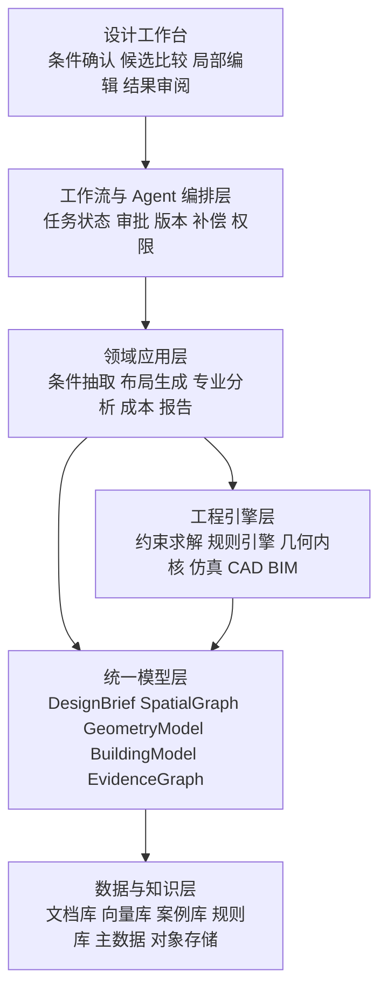
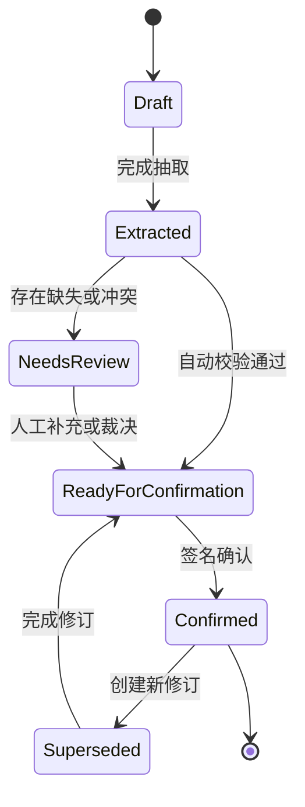
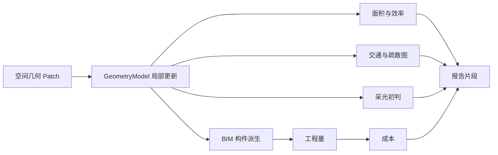

“输入一段需求，AI 自动画出平面图，再导出 BIM 和造价报告。”

这句话适合描述演示视频，却不足以定义一个可用的建筑概念设计系统。真正的概念设计是一连串彼此依赖的工程决策：项目条件来自哪里，哪些要求是硬约束，谁确认了冲突，房间为什么这样连接，修改一个楼梯后哪些指标失效，面积和疏散计算采用了哪个规则版本，BIM 构件如何追溯到方案对象，造价数字又如何回到工程量与单价依据。

如果这些问题没有答案，系统即使能生成漂亮的平面图，也只是一个图像 Demo，并没有形成可继续设计、校核和交付的数字资产。

本文设计一套面向建筑概念阶段的 AI POC，覆盖以下闭环：

```text
知识库
  → 设计条件提取、人工修改与确认
  → 平面布局候选生成与局部修改
  → 建筑及有限专业计算
  → CAD / BIM 生成
  → 工程量、成本与报告生成
```

核心判断只有一句：

> 大模型负责理解、检索、解释和编排；约束求解器、规则引擎与专业软件负责产生可复算的工程事实；人对关键条件、例外和最终方案负责。

这不是削弱 AI，而是为 AI 找到合适的责任边界。

---

## 一、目标不是“AI 画平面图”

平面布局生成研究发展很快。Graph2Plan 从布局图和边界条件生成平面，House-GAN++ 以图约束逐步细化房间布局，后续研究又把自然语言引导和局部编辑带入扩散式生成。这些工作证明了神经模型能够学习房间邻接、形状与空间分布的统计规律。

但论文中的“生成成功”与项目中的“方案可用”不是同一个命题。一张生成图可能视觉合理，却仍然存在以下问题：

- 房间面积之和与建筑面积口径不一致；
- 邻接关系满足，但交通路径、开门方向或疏散距离不满足；
- 柱网、核心筒、设备竖井与房间边界互相冲突；
- 修改局部房间后，面积表、门窗、能耗输入和成本没有同步更新；
- 输出只有像素或不可解释的多边形，不能继续编辑为工程对象；
- 无法说明某个约束来自任务书、规则条文还是设计师确认；
- 报告中的数字是语言模型“总结”出来的，不是计算引擎的结果。

因此，POC 的主交付不应是图片，而应是一个**带语义、约束、版本和证据的可编辑方案模型**。平面图只是模型的一种视图，CAD、BIM、工程量和报告则是其他派生视图。

| 类型 | 例子 | 产生方式 | LLM 的权限 |
| --- | --- | --- | --- |
| 项目事实 | 地块边界、建筑类型、目标面积、朝向 | 原始资料、人工录入、系统接口 | 只能提取和解释 |
| 规则事实 | 防火分区上限、疏散距离、最小净宽 | 受控规则库、专业软件 | 只能检索和编排执行 |
| 方案判断 | 接待区靠近主入口、会议区集中布置 | 检索、生成、优化、人工选择 | 可以提出候选 |

LLM 可以从任务书中识别“目标建筑面积约 8,000 平方米”，但不能擅自把“约”改成精确的 8,000，更不能在资料冲突时静默选择一个值。它应输出候选值、单位、置信度、来源位置和待确认原因。

一次完整设计事务至少要回答：输入资料和规则采用哪些版本；提取了哪些条件；哪些经过人工修改和确认；哪个条件集合用于生成；候选因何淘汰或入选；局部修改影响哪些对象与计算；CAD、BIM、成本和报告是否来自同一方案快照。这些问题决定了系统必须保存状态和证据，而不能只保存聊天记录。

---

## 二、先收窄 POC：证明闭环，而不是证明“万能”

概念设计横跨建筑、结构、暖通、给排水、电气、消防、节能、造价和审图。第一版若同时覆盖所有建筑类型与全部专业，结果通常是每条链路都能演示，却没有一条能验收。

建议选择规则相对清晰、平面重复度较高、历史案例可获得的场景，例如小型办公建筑、标准层办公空间、社区服务中心或标准化宿舍。本文以“单体小型办公建筑概念方案”为例。

| 维度 | POC 建议边界 |
| --- | --- |
| 建筑类型 | 单一类型，如多层办公建筑 |
| 地区 | 单一行政地区和一套确认过的规则版本 |
| 规模 | 单体、规则地块、3 至 6 层 |
| 模型深度 | LOD 100 至 LOD 200，空间和主要构件级 |
| 平面对象 | 房间、空间分区、交通核、墙、门窗、柱网占位 |
| 专业计算 | 面积、交通、采光初判、疏散初判、结构柱网可行性、概算 |
| BIM 输出 | IFC 或目标 BIM 平台中的概念模型 |
| 造价 | 基于概念工程量与指标单价的区间估算 |
| 人工节点 | 条件确认、候选选择、重大例外、发布确认 |

第一版明确不承诺施工图深度的规范合规、精细机电路由、施工级碰撞检查、施工图预算和自动报审。概念 POC 可以给出风险提示，但不能把“初筛”写成“合规结论”。

POC 的成功标准也不应是“生成过一张不错的图”，而应是：

- 从指定资料中抽取结构化条件，并定位原文证据；
- 人工修改后形成不可变的确认版本；
- 在硬约束下生成至少三个具有差异性的可编辑候选；
- 锁定未修改区域，只重算受影响对象和指标；
- 从同一方案快照生成 CAD、BIM、面积表、概算与报告；
- 任一报告数字可追溯到计算结果、输入参数和模型对象；
- 同一输入快照可重复得到一致的确定性计算结果。

---

## 三、总体架构：六层能力与一条模型主线

整个系统可以拆成六层。它们不是六个必须独立部署的微服务，而是六种必须保持边界清楚的责任。



工作台至少提供四种视图：条件表逐项查看提取值、来源、冲突、状态和修改记录；方案画布编辑空间、边界、邻接、尺寸与锁定对象；分析面板查看规则问题、指标和专业结果；版本视图比较条件、方案、指标与人工决策。

自然语言可以作为快捷入口，例如“会议室保持不变，把茶水间移到核心筒附近”。但系统必须把这句话解析成可预览的领域命令，用户确认后才执行。

条件确认可能跨越数小时，专业计算也可能异步运行，因此不能依赖一次 HTTP 请求或一段 Agent 对话维持状态。每个动作都应具备输入输出 Schema、幂等键、执行超时、错误分类、工具版本、运行日志与人工审批记录。

“生成办公室平面候选”是领域能力；“求解一组矩形不重叠且满足面积上下限”是工程引擎能力。前者理解业务语义，后者执行确定性计算。分开后，模型、求解器或 BIM 平台可以替换，而不必改写整个流程。

如果条件抽取输出一份 JSON，平面生成另建一套对象，专业计算读取 Excel，BIM 脚本再从图层猜语义，造价最后从报告复制数字，那么所谓全链路只是多个 Demo 的串联。统一模型要让所有产物共享稳定 ID 和版本关系：

```text
Requirement R-018 → Constraint C-042 → SpaceProgram SP-011
  → Space S-203 → Wall W-882 / Door D-119
  → Quantity Q-771 → CostItem CI-310 → ReportFinding RF-027
```

这条链路使“为什么有这间房”“修改它会影响什么”“这个成本从哪里来”都可以被查询。

---

## 四、统一中间模型：五类对象贯穿全链路

`DesignBrief` 不是原始需求摘要，而是带状态的条件集合。每个字段都应有值、单位、来源、适用范围、置信度和确认状态；确认后形成不可变版本。

`SpatialGraph` 先表达空间关系：节点是空间或分区，边是邻接、连通、可见、远离和包含。把拓扑与几何分开，生成模型可以先提出功能关系，约束求解器再寻找满足边界、面积和尺寸的几何解。

```text
Node: reception
  type = public_space
  area = 60..80 m2

Edge: main_entrance -> reception
  relation = DIRECT_ACCESS
  priority = HARD

Edge: meeting_zone -> open_office
  relation = NEAR
  maxWalkingDistance = 20 m
```

`GeometryModel` 保存坐标系、楼层、边界、多边形、中心线、尺寸和布尔关系，显式处理单位、容差和坐标参考。概念阶段可使用 2.5D 表示：每层采用二维精确几何，配合标高与层高生成三维体量。

`BuildingModel` 将空间和几何组合成项目、场地、建筑、楼层、空间、墙、门窗、楼板、楼梯、柱网和设备占位。内部模型服务于编辑和计算，IFC 是交换格式。建立版本化映射，比让前端和求解器直接操作 IFC 更容易控制复杂度。

`EvidenceGraph` 则保存条件、规则、对象、计算、人工决策和最终陈述之间的关系：

```text
SourceChunk --supports--> Requirement
Requirement --normalized_as--> Constraint
Constraint --checked_by--> RuleExecution
RuleExecution --flags--> ModelObject
ModelObject --measured_as--> Quantity
Quantity --priced_by--> RateItem
CalculationResult --cited_by--> ReportParagraph
HumanDecision --accepts/rejects--> Candidate
```

每次生成与计算还要绑定不可变快照：`DesignBrief` 版本、规则集版本、知识库快照、生成器版本、求解器配置、插件版本、单位和容差配置。“始终读取最新规则和最新单价”会使历史结果无法复现；新版本可以触发重算，但不能悄悄改变旧结果。

---

## 五、知识库：不只是规范切块加向量搜索

概念设计知识包含规则条文、项目任务书、场地资料、企业标准、历史案例、构件目录、材料价格和专家经验。它们的结构、时效和权威性不同，检索策略也不应相同。

| 知识类型 | 主要存储 | 主要检索方式 | 典型用途 |
| --- | --- | --- | --- |
| 规范与标准 | 文档库、条文库、规则库 | 关键词、向量、元数据过滤、规则执行 | 条件解释、合规初筛 |
| 项目资料 | 对象存储、文档索引 | 项目过滤、版面定位、表格提取 | 条件抽取 |
| 历史案例 | 案例库、空间图与几何特征库 | 类型、规模、图相似度 | 候选检索和生成先验 |
| 构件与材料 | 主数据、bSDD 映射、产品库 | 分类编码和属性查询 | BIM 属性、工程量和成本 |
| 经验规则 | 决策表、规则 DSL、知识图谱 | 条件匹配、图查询 | 方案排序、风险提示 |

向量检索负责“语义上可能相关”，关键词检索负责编号与专有名词，元数据过滤保证地区、建筑类型和生效日期正确，图查询处理对象关系，规则引擎执行已经结构化的强约束。

一条规则不只有阈值，还要保存发布机构、版本和生效时间，适用地区和建筑类型，原文条款与例外，结构化变量和单位，以及自动化等级。LLM 可以辅助把条文转成候选规则，但必须经过专业人员审核和回归测试后才能发布。

检索结果也不是几段纯文本，而要携带 `documentId`、修订版本、页码、条文号、版面坐标、适用条件、权威等级和检索分数。这些字段进入证据链，回答中的脚注只是它们的一种展示方式。

---

## 六、设计条件提取：从候选事实到确认版本

条件抽取应设计成“提取、标准化、冲突检测、确认”四步，而不是一次文档摘要。


例如原文写“总建筑面积控制在 8,000 平方米左右，地上不超过五层”。系统应得到结构化条件，而不是一段改写后的自然语言：

```json
{
  "path": "targets.grossFloorAreaM2",
  "value": 8000,
  "qualifier": "APPROXIMATE",
  "proposedTolerance": 0.05,
  "status": "NEEDS_CONFIRMATION",
  "sourceRef": "DOC-01#p3:bbox-17"
}
```

“左右”的 5% 容差不是原文事实，只能作为企业配置给出的建议值。任务书写 8,000 平方米、邮件写 8,500、表格写 8,200 时，系统也不应选择置信度最高的一项，而应形成冲突组，展示来源、日期、权威等级和影响，要求用户裁决。

人工确认是正式状态机，不是一个复选框：



确认动作保存确认人、时间、角色、范围、修改前后值和备注。确认后生成不可变 `DesignBrief`；后续修改创建新版本，并把依赖旧版本的方案标记为“输入已过期”，而不是覆盖历史。

---

## 七、平面布局生成：生成模型与约束求解的混合路线

单一路线很难同时获得创意、稳定性和工程可控性。POC 更适合采用四段式管线：先获得拓扑候选，再生成几何，随后确定性修复，最后多目标排序。

### 先检索案例或生成 SpatialGraph

系统根据建筑类型、面积规模、楼层、核心筒类型和空间计划检索相似案例，把案例空间图作为先验。没有合适案例时，可以由图生成模型或 LLM 提出空间关系候选。

LLM 适合把“接待靠近入口、会议区可独立使用、管理区相对安静”翻译为 `DIRECT_ACCESS`、`NEAR`、`FAR_FROM` 和时间共享等关系，但输出必须经过 Schema 校验和冲突检查。

### 由生成模型提出几何候选

Graph2Plan、House-GAN++ 和扩散模型代表了不同的候选生成思路。工程系统可以选择其中一种，也可以先从案例变形与规则模板起步。POC 不必为了“AI 含量”训练大模型；在数据不足时，可解释的模板加求解器通常更快形成闭环。

生成结果应转换成统一几何对象，并记录模型版本、随机种子和输入快照。模型给出的几何只是候选，不直接进入 BIM 发布。

### 用求解器满足硬约束

可使用 CP-SAT、MILP、非线性优化或专用几何求解器处理：

- 房间面积上下限；
- 最小边长、长宽比和可用净宽；
- 房间不重叠且位于可建边界内；
- 强制邻接、禁止邻接和交通连通；
- 核心筒、柱网、竖井和不可变区域；
- 外墙接触、采光面长度和入口关系；
- 总面积、分区面积与效率目标。

硬约束违反时，候选不可进入下一阶段。软约束进入目标函数，例如最小化交通面积、最大化采光面、缩短特定动线和接近目标面积。

```text
minimize
    w1 * area_deviation
  + w2 * adjacency_penalty
  + w3 * circulation_ratio
  + w4 * daylight_penalty
  + w5 * structural_misalignment
  + w6 * estimated_cost
```

权重不能藏在 Prompt 中。它们应成为可版本化的方案策略，并在候选比较时显示给用户。

### 用 Pareto 前沿呈现取舍

每个候选经过规则引擎和有限专业计算，形成指标向量。系统不宜只给一个“总分最高”的答案，因为成本、采光、效率和灵活性之间通常不存在唯一最优解。

更合理的输出是 Pareto 前沿：先淘汰被其他方案全面支配的候选，再按空间拓扑和指标聚类，选出三至五个差异明显的代表方案。设计师看到的是可解释的取舍，而不是十张几乎一样的图。

“方案 A 动线更高效”的说明必须由计算支持，例如交通面积占比 14.2%，关键路径中位数 18.5 米；“方案 B 成本较低”则应引用外墙面积、结构规则性和概算差异。LLM 可以组织这些指标，但不得自己创造数字。

---

## 八、局部修改：对象锁定、领域命令和增量重算

设计师很少接受一个方案后完全重来。更常见的操作是“保留核心筒”“这三间办公室不要动”“只调整会议区”“把走廊缩短但保持出口位置”。如果每次修改都重新生成整层，系统就无法进入真实设计迭代。

无论修改来自画布拖拽、表单还是自然语言，最终都要转换成领域命令：

```json
{
  "command": "MOVE_SPACE",
  "targetId": "SPACE-MEETING-03",
  "parameters": {
    "anchor": "CORE-EAST",
    "relation": "NEAR",
    "maxDistanceM": 8
  },
  "locks": ["CORE-01", "SPACE-OFFICE-ZONE-A", "EXIT-02"],
  "baseRevision": 17,
  "requestedBy": "USER-1042"
}
```

系统先预览受影响对象和预计重算项，再以乐观锁检查 `baseRevision`，最后执行 Patch。这样可以避免两个用户基于不同版本覆盖彼此修改。

锁定也不只是“坐标不动”。对象可以有几何锁、拓扑锁、属性锁、接口锁和审批锁。如果锁定条件使问题无解，求解器应返回最小冲突集或可解释的冲突原因，而不是悄悄解除锁定。

每个计算插件声明读取和写入的对象类型、属性与版本。Patch 发生后，变更传播器沿依赖图标记结果为 `STALE`，只重算受影响的节点：



未受影响的结果可以复用，但必须继续绑定原始计算证据。局部修改还可能破坏全局约束，因此增量计算完成后仍要执行一组廉价的全局不变量检查，发布前再执行完整质量门。

---

## 九、专业计算：用插件契约隔离领域引擎

概念阶段的专业计算通常来自不同来源：自研公式、开源库、商业软件 API、参数化脚本和人工判断。平台不应把这些逻辑塞进一个“万能 Agent”，而应定义统一插件契约。

```text
PluginManifest
  id / version / owner
  supportedObjectTypes
  inputSchema / outputSchema
  requiredModelLOD
  unitProfile / toleranceProfile
  deterministic flag
  timeout / resourceLimit
  provenance requirements
  invalidation rules
```

一次运行输出带证据的 `CalculationResult`：

```json
{
  "plugin": "egress-precheck",
  "version": "1.3.2",
  "inputRevision": "MODEL-017",
  "ruleSet": "LOCAL-OFFICE-2026.1",
  "status": "WARNING",
  "metrics": { "maxTravelDistanceM": 31.8 },
  "findings": [{
    "ruleId": "EGRESS-TRAVEL-04",
    "objectIds": ["SPACE-203", "DOOR-119"],
    "measured": 31.8,
    "limit": 30.0,
    "evidenceRef": "CALC-RUN-882#finding-1"
  }]
}
```

POC 建议只接入六类计算：

| 计算 | 输入 | 输出 | POC 定位 |
| --- | --- | --- | --- |
| 面积与效率 | 空间、边界、面积口径 | 建筑面积、使用面积、交通比 | 精确计算 |
| 交通与疏散初判 | 空间图、门、出口、规则 | 路径、距离、风险项 | 概念筛查 |
| 采光初判 | 朝向、外墙、开窗占位、遮挡简模 | 采光面、进深风险 | 快速近似 |
| 结构规则性 | 柱网、跨度、核心筒、体量 | 不规则性、跨度风险 | 可行性提示 |
| 简化能耗 | 体形系数、朝向、窗墙比、气候参数 | 能耗区间和相对比较 | 方案比较 |
| 概念工程量 | 墙、板、门窗、空间、体量 | 分类工程量 | 概算输入 |

每项结果都要标注“精确计算、规则初筛、经验估算或模型预测”。用户界面不应把不同确定性的结果显示成同一种绿色通过标记。

LLM 可以根据对象变化选择需要重跑的插件，解释警告，生成修复建议，或把多个结果组织成设计评审摘要。它不负责计算疏散距离、面积、传热系数或工程量。

---

## 十、CAD 与 BIM：从统一模型确定性派生

CAD/BIM 生成的关键不是“导出文件”，而是保持对象身份、语义和版本连续。建议采用两阶段模式：

```text
BuildingModel Snapshot
  → Export Plan
  → Schema / Rule Validation
  → Preview and Approval
  → CAD/BIM Adapter
  → File or Platform Transaction
  → Round-trip Validation
```

`Export Plan` 明确将创建、更新或删除哪些对象，目标图层、族、类型、分类和属性是什么。验证通过后，适配器才调用 CAD/BIM API。这样可以在写入外部系统前发现映射缺失、对象冲突和权限问题。

CAD 输出不应只包含爆炸后的线段。至少应约定图层、块、文字与尺寸样式，房间、门窗、轴网和墙体的对象分组，内部对象 ID 到 CAD 实体句柄的映射，单位与坐标，以及人工修改后的回读策略。

BIM 侧可以用 openBIM 标准分工：[Industry Foundation Classes（IFC）](https://www.buildingsmart.org/standards/bsi-standards/industry-foundation-classes/)负责跨软件交换；[Information Delivery Specification（IDS）](https://www.buildingsmart.org/standards/bsi-standards/information-delivery-specification-ids/)表达交付对象必须具备的属性；[buildingSMART Data Dictionary（bSDD）](https://www.buildingsmart.org/users/services/buildingsmart-data-dictionary/)对齐分类、术语和属性；[BIM Collaboration Format（BCF）](https://www.buildingsmart.org/standards/bsi-standards/bim-collaboration-format-bcf/)传递问题、视点和协作状态。

导出成功只说明文件被写出，不说明模型正确。系统至少要重新读取导出结果，核对对象数量与稳定 ID，检查空间面积、楼层和坐标误差，以 IDS 验证必填属性，并发现自交、负体积或孤立对象。Text2BIM 展示了自然语言、多 Agent 与参数化 BIM 工具协作的可行方向，但工程落地仍需要这些确定性验证与平台事务边界。

---

## 十一、工程量、成本和报告：数字只有一个来源

成本链路必须保持清晰：

```text
设计对象 → 计量规则 → 工程量 → 分类编码
  → 单价或指标 → 地区/时间/规模调整 → 成本项
  → 汇总与不确定性区间
```

POC 可以从指标估算起步，但要显式区分工程量来源和估算层级。例如外墙由模型表面积测得，室内装修按空间类型和净面积估算，机电按建筑面积指标估算。每项成本记录对应对象、工程量与单位、计量规则、分类编码、单价库版本、基准地区与日期、调整系数和估算等级。

概念阶段不应伪造精度。与其给出“43,218,750 元”这样的虚假精确数字，不如给出 P50、P80 区间和主要敏感项。当幕墙成本过高时，用户还应能反查具体立面对象、幕墙类型、面积和单价，这样成本反馈才能成为下一轮优化的输入。

报告生成分为三层：确定性程序生成表格、图表和计算摘要；LLM 基于结构化事实包撰写方案说明、差异分析和风险归纳；引用校验器检查每个数字、规则结论和关键陈述是否有证据。

```json
{
  "approvedFacts": ["METRIC-101", "COST-209", "FINDING-033"],
  "allowedClaims": ["comparison", "risk_summary", "design_rationale"],
  "forbiddenClaims": ["final_compliance", "construction_ready"],
  "citationRequiredForNumbers": true
}
```

最终文档中的数字应从事实对象渲染，而不是让 LLM 再抄一遍。重算后可自动更新表格和相关段落，并检测过期内容。

---

## 十二、工作流：用质量门串起从条件到交付的状态


每个阶段都有机器可检查条件和必要的人工签核：Brief 门检查必填项、单位、冲突和来源；候选门检查硬约束、几何有效性和指标；专业门检查插件运行与阻断问题；BIM 门检查映射、IDS 与回读一致性；成本门检查工程量覆盖与单价版本；报告门检查数字引用、版本一致和禁用声明。

“Agent 认为完成”不能改变阶段状态。只有满足质量门的事件才能推进流程。

---

## 十三、技术选型：围绕模型和契约选，而不是围绕厂商选

下面是一组适合 POC 的参考组合，不是唯一答案：

| 能力 | 可选技术 | 选择重点 |
| --- | --- | --- |
| Web 工作台 | React / Next.js + Canvas 或 WebGL 编辑器 | 稳定对象选择、约束编辑、版本比较 |
| 工作流 | Temporal、Camunda 或轻量状态机 | 长事务、人工任务、重试和审计 |
| LLM 编排 | 自研工具层或主流 Agent SDK | 强 Schema、权限、Trace、可替换模型 |
| 文档解析 | OCR、版面模型、表格解析器 | 页码、边界框和阅读顺序可追溯 |
| 检索 | OpenSearch / Elasticsearch + 向量索引 | 混合检索和严格元数据过滤 |
| 事务数据 | PostgreSQL | 版本、状态、关系与审计主存储 |
| 文件与快照 | S3 兼容对象存储 | 原始资料、模型、导出物和快照 |
| 约束求解 | OR-Tools CP-SAT、MILP、几何优化器 | 可解释不可行原因、稳定运行和许可 |
| 几何 | CGAL、GEOS、Open Cascade 或商业内核 | 精度、布尔运算、格式和许可 |
| BIM | IfcOpenShell、目标 BIM API、参数化脚本 | 对象身份、事务、IFC 映射和回读 |
| 规则 | 决策表、自定义 DSL 或规则引擎 | 版本、测试、适用条件和证据 |
| 可观测性 | OpenTelemetry + 日志、指标、Trace | 串联一次设计事务中的模型、工具和引擎 |

第一版可以采用模块化单体加异步任务队列，只要内部契约、版本和证据边界清楚。过早拆成大量微服务只会增加一致性和调试成本。

模型网关应统一管理模型与 Prompt 版本、结构化输出校验、敏感数据脱敏、Token 与成本、工具权限、离线评测和灰度发布。外部 CAD/BIM 脚本、上传文件和第三方插件则应在资源受限的 Worker 中运行，限制网络、文件系统、执行时间和许可证访问。

---

## 十四、安全、治理与审计

建筑项目资料可能包含未公开地块信息、业主要求和商业成本。系统至少需要项目级访问控制、租户隔离、加密、下载水印和完整审计。

知识库文档必须被视为不可信数据，其中的文字不能改变系统指令、工具权限或审批策略。工具调用必须由白名单、参数 Schema 和用户身份共同授权。

以下动作不应由 Agent 自主提交：覆盖已发布 BIM 模型；删除或批量修改外部平台对象；将未确认条件用于正式发布；用未经审核的规则集给出合规结论；冻结成本或签发正式报告；向项目外部发送文件。

审计也不能只记录“谁调用了哪个接口”，还要记录使用了哪个输入和规则快照，模型提出什么候选，哪个校验器拒绝或接受，人工改了什么及其理由，哪些对象因修改失效或重算，以及最终发布物对应哪个模型版本。

---

## 十五、POC 实施路线：四阶段形成四个可验收闭环

### 阶段一：条件与证据闭环

从任务书、场地资料和空间计划形成可确认的 `DesignBrief`。交付文档解析、混合检索、条件 Schema、证据定位、冲突检测、人工确认界面和版本状态机。即使暂不做平面生成，也能验收抽取准确率、引用可达率与冲突召回率。

### 阶段二：空间图与布局闭环

在已确认条件下生成并编辑多个候选。先实现空间计划、`SpatialGraph`、规则模板和 CP-SAT 求解，再视数据情况接入 Graph2Plan、House-GAN++ 或扩散模型。交付候选比较、硬约束校核、对象锁定、Patch 和版本比较。

### 阶段三：专业计算与 BIM 闭环

接入面积、交通疏散初判、采光初判、结构规则性和简化能耗插件，建立依赖图与增量重算；随后生成 IFC 或目标 BIM 平台模型，并用 IDS 和回读程序验证。

### 阶段四：成本与报告闭环

建立分类映射、计量规则、单价版本、成本区间和报告事实包，完成从对象到工程量、从工程量到成本、从计算结果到带引用报告的追溯链。

四阶段应使用同一组项目样本和回归基线。不能每个阶段换一套最容易演示的数据，否则无法证明端到端一致性。

---

## 十六、如何验收：把“智能”拆成可测量指标

### 条件抽取

- 字段精确率、召回率和单位标准化正确率；
- 原文引用页码与边界框准确率；
- 冲突和缺失项召回率；
- 人工修改量和平均确认时间；
- 不确定信息被错误自动确认的次数，目标为零。

### 布局与局部编辑

- 硬约束一次通过率和修复后通过率；
- 房间面积误差、邻接满足率与几何有效率；
- 候选之间的拓扑和指标多样性；
- 专家盲评中的“可继续设计率”，而不只是视觉评分；
- 锁定对象保持率，目标为 100%；
- 增量重算与全量重算的一致性。

### 专业计算与 BIM

- 计算结果与基准工具的误差；
- 相同快照重复运行的一致性；
- IFC 或目标平台对象映射完整率；
- IDS 验证通过率和回读几何误差；
- 外部写入失败后的事务回滚成功率。

### 成本、报告与系统

- 工程量覆盖率和分类编码正确率；
- 成本项可追溯到模型对象的比例；
- 与人工概算基线的偏差区间；
- 报告数字引用覆盖率，目标为 100%；
- 无依据数字和过度合规声明数量，目标为零；
- `pass@1`、多次运行一致性、P95 延迟、单方案成本和版本可复现率。

对于工程系统，“十次有九次很好”仍可能不足以发布。概率指标衡量 AI 能力，确定性质量门负责守住交付底线。

---

## 十七、主要风险与替代方案

### 历史平面数据不足

深度生成模型可能无法覆盖目标建筑类型，训练数据的房间标签和几何质量也常不一致。可先用参数化模板、案例变形和约束求解器建立可验收基线，让生成模型只负责提出拓扑候选或排序；随着确认数据积累，再逐步训练专用模型。

### 规则自动化被高估

条文常包含例外、交叉引用和专业判断。应对规则按自动化等级分类，第一版只自动检查结构化程度高且输入可获得的条文，其余输出“需要人工复核”并附原文证据。

### CAD/BIM 集成不稳定

桌面软件版本、插件 API、族库和许可证会造成环境差异。内部模型应保持平台中立，以 IFC 作为交换基线；商业平台适配器独立版本化，并建立固定测试环境和回读测试。

### 局部修改破坏全局质量

局部 Patch 可能满足用户意图，却破坏整体交通、面积或结构规则性。依赖图负责增量重算，发布前执行全局不变量和完整回归，并把变化前后的指标差异展示给确认人。

### 成本数据口径不一致

不同来源的单价、地区系数和工程量口径混用，会得到不可解释的总价。量与价必须分离，所有单价库和调整系数都要版本化；没有可靠价格时输出工程量和数据缺口，不能让 LLM 补数。

### 多 Agent 增加复杂度

为每个专业创建一个角色化 Agent，可能造成上下文丢失、结论冲突和成本失控。应按工具契约和工作流责任拆分能力；只有确实需要独立上下文、权限或并行任务时才使用多个 Agent，专业事实仍由插件和规则引擎产生。

---

## 十八、论文与标准如何映射到架构

相关研究为不同子问题提供方法，但不能直接等价为完整产品：

| 研究或标准 | 主要启发 | 在 POC 中的位置 | 工程上仍需补足 |
| --- | --- | --- | --- |
| Graph2Plan | 从布局图和边界生成平面 | 拓扑条件下的候选生成 | 规则、可编辑对象、版本与专业验证 |
| House-GAN++ | 基于图约束逐步细化布局 | 多样化平面候选 | 硬约束保证、无解解释和局部事务 |
| Text2BIM | LLM 多 Agent 从文本生成 BIM | 工具编排、参数化模型生成 | 平台事务、信息交付校验和回读 |
| BIM 自动规则检查 | 规则形式化与模型检查 | 规则库、检查插件、证据输出 | 地区规则治理、适用条件和人工裁决 |
| 建筑设计优化 | 参数、约束与多目标搜索 | 指标向量、Pareto 排序 | 计算成本、近似误差和质量门 |
| buildingSMART 标准 | 开放交换、数据要求和协作 | IFC、IDS、bSDD、BCF | 内部模型映射和主数据治理 |

最值得借鉴的不是某个模型结构，而是问题分解方式：图表示空间关系，生成模型探索候选，求解器处理约束，性能计算形成反馈，开放标准连接交付。工程架构要把这些方法放入同一条可恢复、可审计的事务链。

---

## 结语：真正的 POC 要证明“可继续设计”

AI 建筑概念设计的价值不在于把一分钟画图缩短到十秒，而在于把过去散落在任务书、经验、草图、计算表、BIM 模型和概算文件中的决策，连接成一条机器可读、工程师可控的数字链路。

这条链路的分工是：知识库提供有版本、有适用条件的依据；LLM 提取意图、发现缺口、解释结果并编排工具；人工确认把模糊需求转成正式输入；生成模型和案例库负责探索可能性；求解器、规则引擎与专业软件守住工程事实；统一模型保持空间、几何、构件、工程量与成本的身份连续；CAD/BIM 适配器确定性地产生可编辑资产；报告只叙述已经有证据支持的数字和结论。

判断这个 POC 是否成功，可以只问三个问题：

1. 一个设计条件能否追溯到原始资料、人工裁决和使用它的所有方案？
2. 一次局部修改能否准确传播到受影响的计算、BIM、成本和报告，而不破坏锁定区域？
3. 任一交付数字和判断能否回到模型对象、规则版本、计算参数与责任人？

如果答案是否定的，它仍然只是一个生成平面图的演示。如果答案是肯定的，它才开始成为真正的概念设计平台：AI 负责扩大探索空间和降低信息摩擦，确定性工程系统负责保证事实一致，人类设计师保留取舍、例外和发布的最终决定权。

---

## 参考文献与标准

1. Hu et al., [Graph2Plan: Learning Floorplan Generation From Layout Graphs](https://openaccess.thecvf.com/content_CVPR_2020/html/Hu_Graph2Plan_Learning_Floorplan_Generation_From_Layout_Graphs_CVPR_2020_paper.html), CVPR 2020。用于理解“空间关系图到几何候选”的生成路线。
2. Nauata et al., [House-GAN++: Generative Adversarial Layout Refinement Network towards Intelligent Computational Agent for Professional Architects](https://openaccess.thecvf.com/content/CVPR2021/html/Nauata_House-GAN_Generative_Adversarial_Layout_Refinement_Network_Towards_Intelligent_Computational_Agent_CVPR_2021_paper.html), CVPR 2021。研究基于关系图约束的迭代布局细化。
3. Du, Esser, Nousias, Borrmann, [Text2BIM: Generating Building Models Using a Large Language Model-based Multi-Agent Framework](https://arxiv.org/abs/2408.08054), 2024，后发表于 Journal of Computing in Civil Engineering。展示 LLM、多 Agent 与参数化 BIM 工具协作的路径。
4. Eastman et al., [Automatic rule-based checking of building designs](https://doi.org/10.1016/j.autcon.2009.07.002), Automation in Construction, 2009。自动规则检查的经典工程框架，涉及规则解释、模型准备、执行和报告。
5. Solihin and Eastman, [Classification of rules for automated BIM rule checking development](https://doi.org/10.1016/j.autcon.2015.03.003), Automation in Construction, 2015。讨论不同规则的机器可检查程度，为规则自动化分级提供依据。
6. Wortmann and Nannicini, [Introduction to Architectural Design Optimization](https://doi.org/10.1007/978-3-319-24208-8_12), 2016。介绍建筑设计优化中的参数、目标、约束和算法。
7. buildingSMART International, [Industry Foundation Classes（IFC）](https://www.buildingsmart.org/standards/bsi-standards/industry-foundation-classes/)。开放 BIM 数据交换标准官方入口。
8. buildingSMART International, [Information Delivery Specification（IDS）](https://www.buildingsmart.org/standards/bsi-standards/information-delivery-specification-ids/)。用于表达和机器检查模型信息需求。
9. buildingSMART International, [buildingSMART Data Dictionary（bSDD）](https://www.buildingsmart.org/users/services/buildingsmart-data-dictionary/)。用于标准化术语、分类和属性语义。
10. buildingSMART International, [BIM Collaboration Format（BCF）](https://www.buildingsmart.org/standards/bsi-standards/bim-collaboration-format-bcf/)。用于跨 BIM 工具传递问题、视点与协作信息。
11. [IfcOpenShell Documentation](https://docs.ifcopenshell.org/)。开源 IFC 工具链，可用于 IFC 读写、校验、几何处理与自动化集成。
