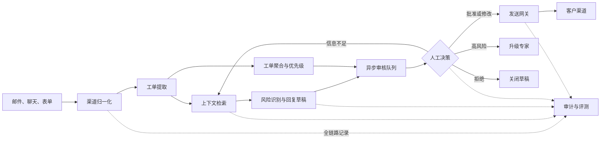

> AI 可以准备回复，但真正代表企业作出承诺的那一步，必须有清晰的责任主体。

客服常被认为是 AI Agent 最容易落地的场景之一。

原因并不难理解：客服每天要处理大量重复问题，历史工单、产品文档和标准话术又能提供相对充足的知识来源。只要接入大模型，再加一套知识库，一个能够回答问题的演示系统很快就能搭起来。

但“能够回答”不等于“能够上线”。

一旦回复真正发送给客户，它就不再是一段供参考的文本，而可能成为退款、赔偿、服务时限、数据处理方式甚至合同义务的一部分。模型幻觉、知识过期、上下文缺失或者语气失当，都会转化为真实的经营风险。`Moffatt v. Air Canada` 案例已经给出过明确警示：企业不能因为错误信息来自聊天机器人，就把责任推给机器人。[1]

本文拆解一套已经实际运行近一年的 AI 客服方案。它没有追求“无人客服”，而是采用了一条更保守、也更容易长期运行的路径：

> **AI 负责识别、提取、检索和起草，人类负责审核、修改与最终发送。**

这套机制可以概括为“先审后发”。它并不是在聊天机器人后面加一个确认按钮，而是把人工审核做成完整的工作流状态，并围绕它建设异步队列、工单聚合、优先级排序、发送网关和审计链。

---

## 一、为什么 AI 客服容易演示，却难以上线

演示环境通常会隐藏三个生产问题。

### 1. 对话流畅不等于事实正确

大模型擅长生成连贯、礼貌并且看起来合理的文本，但客服系统真正需要回答的是：

- 这个客户买了什么产品；
- 当前订单、账户或服务是什么状态；
- 哪一版政策适用于这次请求；
- 企业能够承诺什么，不能承诺什么；
- 还缺少哪些信息才能继续处理。

其中任何一个事实取错，后面再流畅的回复也没有意义。知识库检索可以降低错误概率，却不能保证模型一定选择了正确证据，更不能保证业务数据本身没有延迟或冲突。

### 2. 客服回复本身就是业务动作

“预计今天恢复”“可以全额退款”“我们已经删除了数据”都不是普通文本，而是对外承诺。它们可能触发客户预期、合规义务或后续操作。

因此，生产系统不能只问“模型答得像不像客服”，还要问：

- 谁批准了这次承诺；
- 批准时看到了哪些证据；
- 发出的内容是否就是被批准的版本；
- 如果发生争议，能否还原完整决策过程。

### 3. 错误不是平均分布的

大量咨询可能只是产品用法、状态查询和常见故障，但少量请求会涉及支付、隐私、安全、账户封禁、法律争议或大面积服务中断。

如果只看总体正确率，高风险长尾很容易被平均数掩盖。一个系统即使在绝大多数普通问题上表现良好，也可能因为一次错误承诺而无法上线。

所以，客服 Agent 的第一目标不应该是“尽可能自动回复”，而应该是：

> **在风险可控、过程可追溯的前提下，把人从重复的信息整理和文字起草中释放出来。**

---

## 二、核心设计：AI 做准备，人类作承诺

这套系统把一次客服处理拆成两类责任。

| 参与者 | 主要职责 | 不应该承担的职责 |
| --- | --- | --- |
| AI | 提取事实、识别意图、检索资料、发现风险、生成草稿 | 在无人确认时代表企业作出高风险承诺 |
| 审核人员 | 核对事实与政策、修改表达、批准或驳回、决定升级 | 从零重复整理所有上下文 |
| 确定性系统 | 管理状态、权限、版本、幂等发送和审计记录 | 用隐式规则替代需要业务判断的决策 |

这里的重点不是简单地“让人兜底”，而是让每个参与者只做自己最擅长的部分：

- AI 擅长从非结构化对话中提取信息，并快速生成初稿；
- 人擅长理解例外、权衡风险，并对外承担责任；
- 软件擅长执行确定的权限、状态和一致性规则。

完整流程如下：



从客户视角看，它仍然是一套客服系统；从工程视角看，它更接近一个**带人工检查点的异步任务系统**。

---

## 三、七个模块组成生产链路

### 1. 渠道归一化：先把输入变成同一种事件

客服请求可能来自邮件、站内聊天、工单表单、社交媒体或内部转交。不同渠道的线程结构、附件格式、身份信息和时间语义都不一样。

接入层的任务不是调用模型，而是先生成统一事件：

```json
{
  "source": "email",
  "external_thread_id": "thread_8f2...",
  "sender": "customer_123",
  "received_at": "2026-11-07T09:30:00+08:00",
  "text": "升级后无法导出数据，之前的文件也找不到了。",
  "attachments": [],
  "idempotency_key": "email:message_456"
}
```

归一化之后，后续模块不需要分别理解邮件和聊天协议。`idempotency_key` 则用于防止 Webhook 重试产生重复工单。

### 2. 工单提取：让模型输出结构，而不是只写摘要

原始消息往往同时包含抱怨、事实、猜测和多个诉求。模型首先要把它转换成结构化工单对象：

```json
{
  "ticket_id": "T-20261107-1842",
  "intent": "data_export_failure",
  "customer_id": "customer_123",
  "product": "analytics_pro",
  "facts": [
    "客户在升级后无法导出数据",
    "客户表示历史文件不可见"
  ],
  "missing_information": [
    "升级时间",
    "导出任务编号"
  ],
  "risk_flags": ["possible_data_loss"],
  "related_ticket_ids": [],
  "evidence_refs": ["message:message_456"],
  "draft_reply": null
}
```

这个对象必须通过 Schema 校验。模型没有提供的事实应保持为空或进入 `missing_information`，不能用“合理猜测”补齐。

### 3. 上下文与检索：证据要能被审核人员看见

系统根据工单结构查询：

- 客户、订单、账户和产品版本；
- 当前服务状态与历史操作记录；
- 最新政策、知识库和标准处理流程；
- 同一客户或同一问题的历史工单；
- 正在进行的事故与已知问题。

检索结果不能只塞进模型上下文，还应保存来源标识、版本和查询时间。审核界面需要把草稿中的关键结论与证据关联起来，让审核人员能够快速核对，而不是只能相信模型的总结。

### 4. 风险识别与起草：先决定能不能答，再决定怎么答

生成草稿前，系统先运行确定性规则和模型分类：

- 是否涉及退款、价格、合同或赔偿；
- 是否包含隐私、安全、支付或健康信息；
- 是否可能发生数据丢失或大面积故障；
- 是否需要特定团队或资质人员处理；
- 证据是否冲突，关键字段是否缺失。

草稿应明确区分已确认事实、待确认事项和下一步动作。对无法从证据支持的内容，模型应主动使用澄清问题，而不是给出确定答案。

### 5. 异步审核队列：把人的注意力放到最需要的位置

草稿生成后进入 `PENDING_REVIEW`，而不是停在一次同步 HTTP 请求里等待。队列根据风险、影响、时限和不确定性排序，并把工单分配给有权限的审核人员。

异步设计使 AI 可以持续处理新消息，人类则按照业务优先级批量审核。高峰期不会因为没有审核人员在线而丢失状态，也可以通过积压量和等待时间提前发现容量问题。

### 6. 发送网关：批准不等于已经发送

审核人员的批准动作只生成一个“允许发送此版本”的决定。真正发送仍由独立网关完成，它负责：

- 再次检查权限和工单状态；
- 验证批准对应的草稿版本；
- 做渠道格式转换和敏感信息检查；
- 使用幂等键防止重复发送；
- 保存供应商返回的消息编号；
- 在失败时重试、告警或转人工处理。

把批准与发送分开，可以避免浏览器刷新、队列重试或第三方接口超时造成重复回复。

### 7. 审计与反馈：不仅记录最终答案

完整记录至少包括：

- 原始消息及附件哈希；
- 结构化提取结果；
- 检索查询、证据来源与版本；
- 模型、Prompt、参数和输出；
- 风险规则命中结果；
- 原始草稿与每次修改；
- 审核人、审核时间与决策理由；
- 实际发送内容和渠道回执；
- 客户后续反馈与工单结果。

NIST AI RMF 强调，应定义、评估并记录人工监督流程，同时通过系统化文档提高透明度与问责能力。[2] 对客服系统来说，审计不是上线后的附加功能，而是“先审后发”能够成立的基础设施。

---

## 四、审核必须是状态机，而不是一个按钮

如果审核只表现为界面上的“发送”按钮，系统很快会遇到并发修改、重复发送和责任不清的问题。更可靠的方式是显式维护状态机：

```text
RECEIVED
  → PARSED
  → CONTEXT_READY
  → DRAFTED
  → PENDING_REVIEW
      ├→ APPROVED → SENDING → SENT
      ├→ EDITED → APPROVED → SENDING → SENT
      ├→ NEEDS_INFORMATION → CONTEXT_READY
      ├→ ESCALATED → SPECIALIST_REVIEW
      └→ REJECTED
```

每次状态变化都是一条带时间戳和操作者的事件，而不是覆盖数据库里的一个字段。

### 批准必须绑定具体版本

假设审核人员看到的是 `draft_version = 3`，批准记录就必须绑定：

```json
{
  "ticket_id": "T-20261107-1842",
  "ticket_version": 7,
  "draft_version": 3,
  "decision": "approved",
  "reviewer_id": "agent_42",
  "decided_at": "2026-11-07T10:04:23+08:00"
}
```

如果批准后客户又发来新消息，工单版本变为 8，原批准应自动失效。发送网关必须拒绝发送已经过期的版本。

### 修改不能抹掉模型原稿

审核人员修改草稿时，应同时保留：

- AI 原始草稿；
- 人工修改后的版本；
- 字段级或文本级差异；
- 修改原因标签。

这些数据既用于追责，也是一套高价值反馈集。它能告诉团队模型究竟错在事实、政策、语气、完整性还是风险判断，而不是只得到一个模糊的“通过率”。

---

## 五、异步审核：真正的效率来自队列，而不是回复更快

“先审后发”最容易被质疑的一点是：既然最后还要人看，为什么不让客服人员直接回复？

答案取决于审核工作台是否真正降低了人的认知负担。如果审核人员仍然需要打开多个后台、重读完整对话、搜索文档并从零写回复，那么 AI 只是多制造了一层流程。

一个有效的审核工作台应该把以下内容放在同一视图中：

| 区域 | 应展示的信息 |
| --- | --- |
| 工单摘要 | 客户诉求、产品、时间线、关键事实与缺失信息 |
| 风险提示 | 命中的规则、风险等级、必须升级的原因 |
| 证据面板 | 订单状态、日志、政策原文、知识库段落及版本 |
| 回复草稿 | 可编辑文本，以及每个关键结论对应的证据 |
| 历史关联 | 客户历史工单、相似工单与关联事故 |
| 决策区 | 批准、修改后批准、补充信息、升级、拒绝及原因 |

审核动作要支持键盘操作、批量处理和明确的权限范围，但不能为了速度隐藏关键证据。对于低风险、证据完整的工单，可以提供紧凑视图；对于高风险工单，则强制展开来源、修改记录和升级规则。

### 队列需要处理的不只是先进先出

普通 FIFO 队列无法满足客服运营需求。实际队列至少还要考虑：

- SLA 剩余时间；
- 客户影响范围和业务等级；
- 安全、隐私、支付等风险标签；
- 是否关联正在扩大的事故；
- 审核人员的产品、语言和权限；
- 同一会话是否已有其他人接手；
- 草稿是否因为新消息而失效。

系统还需要租约或锁定机制，避免两名审核人员同时处理同一工单。租约超时后工单可以重新入队，但任何旧页面上的批准都必须经过版本检查。

### 审核队列本身也有 SLA

AI 很快生成草稿，并不代表客户很快得到回复。真正的端到端耗时还包括排队和人工处理。因此应分别监控：

```text
首次响应时间 = 接入等待 + AI 处理 + 审核排队 + 人工审核 + 渠道发送
```

如果审核队列持续积压，系统应自动提高告警等级、调整分配或进入降级模式，而不是继续无上限地产生草稿。

---

## 六、工单聚合：相似问题不等于同一张工单

当某个版本出现故障时，短时间内可能涌入大量类似消息。逐张审核会重复检索、判断和写作，效率很低；但简单地把相似文本合并，又可能丢失每个客户的账户状态、影响程度和承诺历史。

更合理的做法是区分两种关系：

### 1. 重复工单

同一客户通过多个渠道重复提交同一个问题，或者 Webhook 重试产生重复事件。此时可以合并到一个主工单，但必须保留所有原始消息及渠道标识。

可用信号包括：

- 相同客户、订单或账户；
- 相近时间窗口；
- 相同产品和错误码；
- 高语义相似度；
- 相同附件或日志哈希。

### 2. 关联事故的独立工单

不同客户遇到同一个服务事故。这些工单不能合并成一张，因为客户身份、损失和回复状态各不相同。正确模型是：

```text
Incident INC-20261107-03
├── Ticket T-1842：企业客户，导出失败，待审核
├── Ticket T-1851：个人客户，历史文件不可见，已回复
└── Ticket T-1890：企业客户，疑似数据丢失，已升级
```

事故层保存公共事实、影响范围、当前进展和统一话术；工单层保留客户上下文、个性化处理和完整审计。Atlassian 的事故响应实践同样强调，事故处理需要明确角色、沟通渠道和持续更新，而不是只把若干独立请求标记为“相似”。[4]

### 聚合之后怎样减少重复劳动

当公共事实更新时，系统可以重新生成关联工单的草稿，但不能静默覆盖已审核内容。新草稿应创建新版本，并标记“由于事故状态更新而变更”。

审核人员可以先批准事故级事实模板，再逐张检查客户级变量。这样既共享了公共判断，又没有牺牲单个工单的可追溯性。

---

## 七、优先级排序：先用硬规则兜住风险，再用分数排序

优先级并不是让模型凭感觉输出 P0、P1、P2。它应由业务规则和可解释特征共同决定。

一个可作为起点的示意公式是：

```text
priority_score =
    impact_score * 0.30
  + severity_score * 0.25
  + urgency_score * 0.20
  + sla_pressure * 0.15
  + uncertainty_score * 0.10
```

其中：

- `impact_score`：受影响的客户数、业务价值和功能范围；
- `severity_score`：数据损失、服务不可用或资金损失的严重程度；
- `urgency_score`：问题是否正在扩大，是否存在不可逆时间窗口；
- `sla_pressure`：距离承诺响应时间还有多久；
- `uncertainty_score`：证据是否不足、模型是否低置信或来源是否冲突。

权重只是示意，必须根据实际业务校准。Atlassian 的服务管理方法也将影响范围和紧迫性作为计算优先级的重要维度。[5]

### 分数不能覆盖硬性升级规则

以下情况不应仅依赖加权分数，而应直接进入高优先级或专业队列：

- 可能泄露个人信息或凭证；
- 支付异常、重复扣款或疑似欺诈；
- 安全事件或账户被接管；
- 可能导致人身安全风险；
- 大面积服务中断或数据丢失；
- 法律威胁、监管请求或媒体事件。

原因很简单：加权模型可能让一个“低影响但极高严重度”的事件被其他维度稀释。硬规则负责守住不可妥协的边界，评分负责在同一风险层内排序。

### 不确定性本身就是优先级信号

很多团队只把模型置信度用于决定是否自动化，却忽略了它对人工队列的价值。信息缺失、检索冲突或意图不明的工单，通常更需要资深人员尽早介入。

不过，模型自报的“置信度 0.93”并不可靠。更有效的不确定性信号包括：

- 必填事实缺失；
- 多个权威来源相互冲突；
- 检索结果低相关或没有结果；
- 多次生成结论不一致；
- 当前输入明显偏离历史分布；
- 分类器和规则引擎给出不同风险判断。

---

## 八、可追责不是保存日志，而是保存完整决策链

“有日志”经常被误认为“可追责”。但一条 `reply sent successfully` 的日志无法解释为什么会发送这段内容。

真正可追责的链路应能回答六个问题：

1. **输入是什么**：客户原始消息、附件和身份如何被接收？
2. **系统知道什么**：当时查询了哪些业务数据和文档版本？
3. **AI 建议什么**：哪个模型基于哪个 Prompt 生成了什么草稿？
4. **风险怎样判断**：哪些规则命中，哪些信息被标为不确定？
5. **人作出什么决定**：谁在什么时候批准、修改、拒绝或升级？
6. **最终发生什么**：实际发送的版本、渠道回执和后续业务结果是什么？

这条链路最好使用不可变事件记录，而不是不断覆盖当前状态。敏感数据则需要分级存储、访问控制和保留期限，避免为了审计无限期保存所有个人信息。

责任也不能被模糊地归给“人工审核”。组织需要明确：

- 产品团队负责工作流和控制边界；
- 知识负责人负责政策内容和更新时效；
- 客服团队负责审核标准和人员培训；
- 模型团队负责评测、回归和版本变更；
- 具体审核人员对单次批准负责；
- 企业仍然对最终发出的信息承担外部责任。

---

## 九、人工在环也会失败：警惕自动化偏见

“有人审核”并不自动等于“风险受控”。当 AI 草稿长期看起来都不错时，审核人员容易从核对事实退化为扫一眼就批准，这就是自动化偏见或橡皮图章式审核。

英国 ICO 关于 AI 与个人权利的指南特别提醒：如果人工干预只是象征性的，决策者无法真正改变结果，那么所谓 human-in-the-loop 并不构成有意义的人类参与。[6]

要让审核保持有效，可以从四方面设计。

### 1. 让证据比模型措辞更显眼

界面首先呈现关键事实和来源，再呈现语言流畅的草稿。对金额、日期、承诺时限和政策结论等高风险内容，明确高亮并要求逐项核对。

### 2. 让审核人员拥有真实选择

除了“批准”，还应支持修改、要求补充信息、升级专家和完全拒绝。审核人员需要知道拒绝 AI 建议不会被当作效率低下。

### 3. 定期插入质量校准

对部分工单进行双人复核或盲审，比较不同审核人员的判断；定期复盘已批准但后来投诉、升级或返工的案例，防止错误标准被全员接受。

### 4. 不用通过率单独考核审核人员

如果 KPI 只奖励处理速度和批准数量，最理性的行为就是快速点击批准。审核指标必须同时包含事实错误拦截、升级准确性、客户后续结果和抽检质量。

---

## 十、怎样衡量这套系统是否真的有效

AI 客服最危险的指标是“自动化率”。它会鼓励团队把更多回复交给模型，却无法说明客户是否得到了正确帮助，也无法说明风险是否下降。

更完整的指标体系应覆盖四个维度。

### 1. 效率指标

- 从消息进入到草稿生成的时间；
- 审核排队时间和人工处理时间；
- 单位审核人员每小时完成的工单数；
- 从首次消息到最终解决的总时长；
- 因草稿失效或信息不足造成的返工率。

### 2. 质量指标

- 草稿原样通过率；
- 人工修改率和平均修改幅度；
- 事实、政策、语气、遗漏等修改原因分布；
- 首次联系解决率；
- 工单重新打开率和客户满意度。

原样通过率只能说明“审核人员没有修改”，不能单独证明草稿正确。必须结合抽检结果和客户后续行为解读。

### 3. 风险指标

- 高风险工单的漏检率和误报率；
- 审核阶段拦截的重大错误数；
- 无证据支持的事实或承诺比例；
- 发送版本与批准版本不一致的次数；
- 隐私、安全、支付类事件的错误路由率。

### 4. 系统健康指标

- 各状态的队列深度和停留时间；
- 检索、模型和渠道接口的失败率；
- 重试、重复事件和幂等冲突次数；
- 单张工单的模型调用成本；
- 模型或 Prompt 版本变更后的回归差异。

评测集应从真实历史工单中分层采样，覆盖常见问题、高风险长尾、信息缺失、多轮补充、政策冲突和恶意输入。每次更换模型、Prompt、知识库切分方式或风险规则，都要跑同一组回归评测。OpenAI 和 Anthropic 的 Agent 工程指南都建议，从简单、可评估的流程开始，再根据证据增加自主性和复杂度。[3][8]

---

## 十一、什么场景适合“先审后发”

这套架构特别适合以下场景：

- 请求量足够大，人工存在明显的信息整理和重复写作成本；
- 大部分回复可以由业务数据、政策或知识库提供证据；
- 错误回复会产生真实损失，但允许等待人工异步审核；
- 企业需要保存完整的审批和沟通记录；
- 客服人员具备明确的专业分工和升级路径；
- 问题中存在大量相似模式，但又需要客户级个性化。

它不适合直接照搬到所有客服渠道。

| 场景 | 主要问题 | 更合适的处理方式 |
| --- | --- | --- |
| 极强实时性的语音对话 | 人工异步审核会破坏交互节奏 | 实时转人工，AI 提供坐席辅助 |
| 人身安全或紧急医疗 | 错误和延迟代价都过高 | 强制专业人员接管，限制模型角色 |
| 证据长期缺失或严重冲突 | 草稿看似完整但没有可靠依据 | 先治理数据和知识流程 |
| 请求量很低且高度定制 | 建设审核平台的成本可能高于收益 | 使用简单模板和人工处理 |
| 无法配置明确责任人 | 审核可能成为形式流程 | 先明确组织责任与升级机制 |

在很多同步聊天场景中，可以采用混合模式：低风险的导航、状态查询由确定性流程即时完成；需要业务承诺的内容转为工单，由 AI 起草并异步审核；紧急问题则直接转接人工。

---

## 十二、真实的取舍：它不是免费的安全层

“先审后发”降低了一部分模型风险，但同时引入新的成本。

### 1. 响应速度与控制力

人工检查点会增加等待时间。团队需要通过优先级、排班和队列容量管理来控制延迟，而不能把模型生成速度当作客户响应速度。

### 2. 人力节省与审核负担

如果 AI 草稿质量不稳定，客服人员可能花更多时间纠错。只有当上下文整理、证据展示和草稿质量共同达到可用水平时，审核才会比从零处理更快。

### 3. 统一话术与具体判断

事故模板可以提高一致性，但过度模板化会忽略客户差异。公共事实可以复用，账户状态、补偿方案和具体承诺仍需逐单判断。

### 4. 可追溯性与数据最小化

完整审计需要保存更多中间数据，但隐私原则要求只保留必要信息。系统必须定义数据分类、脱敏、访问控制和删除期限，而不是默认永久保存全部 Prompt。

### 5. 低风险自动化与边界漂移

随着通过率提高，团队容易不断扩大自动发送范围。每次扩大都应被视为一次新的风险决策，并通过分层评测、灰度发布和快速回退验证，而不是把“过去没出事”当作安全证明。

因此，这套方案的价值不在于消灭成本，而在于把原本不可见、不可控的风险转化为可度量、可运营的流程。

---

## 十三、分阶段上线：先证明建议有用，再增加自主权

一个稳妥的上线过程可以分为四个阶段。

### 阶段一：影子模式

系统读取真实工单并生成结构与草稿，但不展示给客服，更不会发送。团队把 AI 输出与实际人工处理结果比较，建立基线：

- 意图和风险分类是否准确；
- 检索证据是否充分；
- 草稿包含哪些高频错误；
- 哪些类型的问题根本不适合模型处理。

这一阶段最适合完善 Schema、评测集和风险规则。

### 阶段二：建议模式

AI 草稿进入客服工作台，由人工修改和发送。此时重点不只是看采用率，还要收集结构化修改原因，验证审核是否真的节省时间。

Zendesk 等成熟客服产品的 Agent Copilot 也采用面向坐席提供建议、推荐动作和生成回复的思路，说明“增强人工坐席”本身就是一条独立而现实的产品路线。[7]

### 阶段三：按风险分层

根据历史数据把请求分为不同控制级别：

| 层级 | 示例 | 控制方式 |
| --- | --- | --- |
| L0 | 页面导航、公开文档链接 | 可自动回复，保留日志 |
| L1 | 有确定数据源的状态查询 | 规则校验后自动或抽检 |
| L2 | 普通故障处理与个性化解释 | 强制人工审核 |
| L3 | 退款、隐私、安全、法律问题 | 专业人员审核或直接接管 |

风险层级由业务后果决定，而不是由模型自报置信度决定。

### 阶段四：受控自动化

只有那些数据源可靠、答案可验证、失败可恢复并且长期评测稳定的低风险类别，才考虑自动发送。同时必须保留：

- 明确的自动化白名单；
- 发送前确定性校验；
- 持续抽样复核；
- 异常率阈值和自动熔断；
- 模型版本变更后的重新准入；
- 一键退回“全部人工审核”的能力。

自动化不是系统最终必然达到的状态。有些高风险类别长期保留人工批准，可能正是最合理的架构结果。

---

## 十四、运行近一年后，最值得保留的工程经验

回看这套系统长期运行的逻辑，有几条经验比“选哪个模型”更重要。

### 1. 先把工单变成可靠状态，再让模型参与

统一事件、结构化字段、版本号和状态机看起来不如对话演示直观，却决定了系统能否重试、恢复和审计。模型能力变化很快，这些确定性基础设施反而更加稳定。

### 2. 人工审核是产品能力，不是临时兜底

审核界面的信息密度、证据组织、快捷操作和队列分配，直接决定系统有没有效率收益。把人放进流程图不代表完成了人机协作设计。

### 3. 聚合公共事实，但保留单客责任链

事故级信息适合共享，客户级状态不能被吞掉。既要减少重复劳动，也要保证每位客户收到的内容都能追溯到自己的工单和批准记录。

### 4. 优先级首先是风险策略，其次才是排序算法

涉及隐私、安全、支付和大面积故障的问题，必须先由硬规则升级。评分模型适合优化队列，不适合定义不可逾越的边界。

### 5. 把人工修改当作数据，而不是噪声

修改差异和原因标签能持续揭示知识缺口、Prompt 问题、错误政策和界面缺陷。比起只看“模型准确率”，这些运营数据更接近真实质量。

### 6. 不追求一次性做到无人化

Agent 的价值不只来自替人执行完整任务。只要它稳定地减少检索、整理和起草成本，同时不模糊最终责任，就已经产生了可持续价值。

---

## 十五、结语

AI 客服真正的难点，从来不是让模型生成一段礼貌的回复，而是把这段回复放进一个能够承担业务后果的系统里。

“先审后发”提供了一条务实路径：AI 处理速度快但容易出错的准备工作，人类保留对外承诺和例外判断，确定性软件守住状态、权限、版本与发送边界。异步审核、工单聚合和优先级排序，则让这套控制机制不会因为规模扩大而失效。

这不是从人工客服到全自动客服之间的过渡方案，而是一种可以长期存在的人机协作架构。

可信赖的 Agent 并不意味着模型永远不会错。更现实的标准是：**系统知道哪些地方可能错，能在错误产生外部影响前拦住它，并且在事后清楚解释每一个决定是怎样形成的。**

---

## 参考资料

1. American Bar Association, [B.C. Tribunal Confirms Companies Remain Liable for Information Provided by AI Chatbot](https://www.americanbar.org/groups/business_law/resources/business-law-today/2024-february/bc-tribunal-confirms-companies-remain-liable-information-provided-ai-chatbot/)
2. NIST, [Artificial Intelligence Risk Management Framework: Generative Artificial Intelligence Profile](https://www.nist.gov/publications/artificial-intelligence-risk-management-framework-generative-artificial-intelligence)
3. OpenAI, [A Practical Guide to Building AI Agents](https://openai.com/business/guides-and-resources/a-practical-guide-to-building-ai-agents/)
4. Atlassian, [Incident Response](https://www.atlassian.com/incident-management/handbook/incident-response)
5. Atlassian Support, [How Impact and Urgency Are Used to Calculate Priority](https://support.atlassian.com/jira-service-management-cloud/docs/how-impact-and-urgency-are-used-to-calculate-priority/)
6. UK Information Commissioner's Office, [How Do We Ensure Individual Rights in Our AI Systems?](https://ico.org.uk/for-organisations/uk-gdpr-guidance-and-resources/artificial-intelligence/guidance-on-ai-and-data-protection/how-do-we-ensure-individual-rights-in-our-ai-systems/)
7. Zendesk, [About Agent Copilot](https://support.zendesk.com/hc/en-us/articles/7908817636378-About-agent-copilot)
8. Anthropic, [Building Effective Agents](https://www.anthropic.com/engineering/building-effective-agents)


