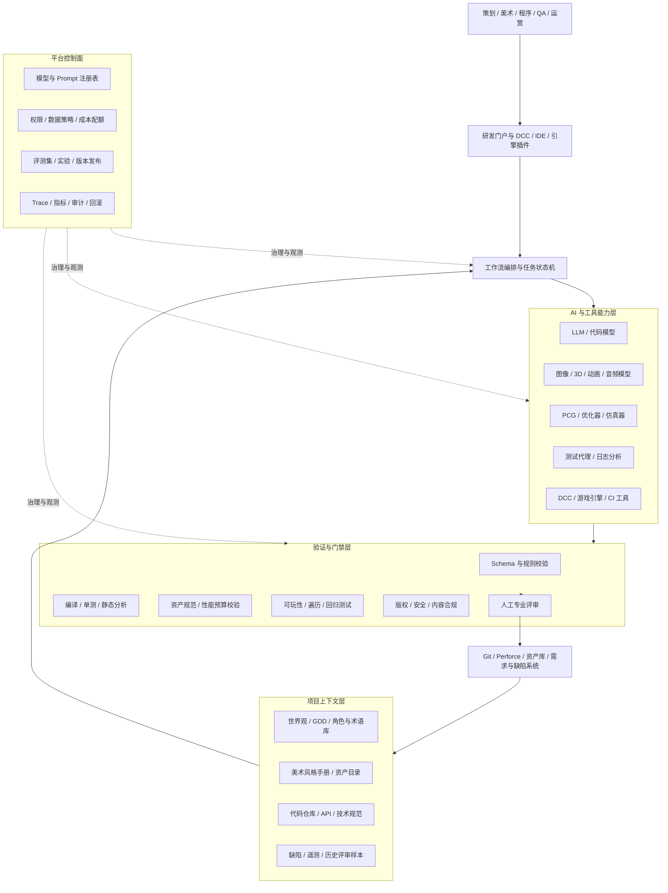

> AI 对游戏研发的真正价值，不是一次生成多少图片、代码或关卡，而是能否在明确的项目上下文、质量标准和责任边界下，把生成、校验、评审、返工和资产沉淀连接成稳定的生产闭环。

## 摘要

生成式 AI、程序化内容生成、代码模型和强化学习测试代理，正在进入游戏策划、美术、程序、关卡、叙事、质量保障及运营等环节。现有研究已经能够说明，AI 可以加快构思、低保真原型、资产变体、结构化内容生成和自动试玩；但对于“完整商业项目究竟节省了多少人力和周期”，公开研究仍缺少跨版本、跨团队的长期数据。[1-4] 因此，游戏公司不能把模型演示直接等同于研发提效，也不能只用生成速度衡量价值。

本文从游戏生产管线出发，给出一套 AI 研发提效体系：以项目知识和资产规范为上下文，以工作流编排连接模型与 DCC、游戏引擎、代码仓库和测试平台，以确定性校验和人工门禁控制质量，以统一评测与可观测体系衡量真实收益。全文重点回答三个问题：管线怎么搭、提效怎么评、能力怎么从试点进入生产。

## 一、问题定义：游戏研发需要的不是模型入口，而是生产闭环

游戏研发具有强创意、强协作、强资产依赖和强版本约束等特点。一张概念图可以在几十秒内生成，但它是否符合世界观、角色设定、平台性能、后续建模需求和版权要求，仍需要多个岗位判断。一段代码能够编译，也不代表符合引擎生命周期、线程模型、性能预算和项目架构。一张关卡看起来完整，也可能无法通关、导航网格破损、资源超预算或破坏难度曲线。

因此，AI 进入游戏研发后，瓶颈通常会从“产出速度”转移到以下环节：

1. **上下文准备**：模型是否理解世界观、玩法目标、风格规范、技术约束和已有资产；
2. **结果选择**：大量候选结果由谁筛选，筛选成本是否超过节省的制作成本；
3. **生产转换**：概念结果能否转换为引擎可用、可编辑、可维护的正式资产；
4. **质量验证**：如何验证可玩性、性能、兼容性、风格一致性和行为正确性；
5. **协作衔接**：结果如何进入版本控制、资产管理、需求管理和评审流程；
6. **责任治理**：训练数据、生成内容、第三方模型和最终资产的权利边界是否清楚；
7. **收益核算**：节省的生成时间是否被提示词试错、返工、审核和集成成本抵消。

一套面向生产的 AI 管线，应当覆盖从任务创建到产物入库的完整路径：

```text
需求与约束 -> 上下文组装 -> AI 生成/建议 -> 自动校验 -> 人工评审
          -> 修改与再生成 -> 引擎/仓库集成 -> 回归验证 -> 数据回流
```

如果系统只提供一个聊天框或模型调用接口，它解决的是局部生成问题；只有当生成结果能在项目规则下被验证、追踪、复用和持续改进时，才形成研发能力。

### 1. 本文讨论的 AI 边界

本文主要讨论“用于开发游戏的 AI”，包括：

- 需求分析、玩法构思、GDD 辅助和原型生成；
- 2D/3D 美术、材质、动画、音频等资产的辅助制作；
- 关卡布局、任务、数值、规则和其他程序化内容生成；
- 游戏代码、工具脚本、Shader 和数据配置辅助；
- 剧情、对白、本地化和角色设定辅助；
- 自动构建、自动试玩、缺陷发现、性能分析和平衡性测试；
- 版本运营中的活动内容、配置和数据分析辅助。

战斗决策、导航、NPC 行为等传统运行时 Game AI，只有在它们参与研发测试或内容生产时才纳入本文。面向玩家的生成式 NPC 则属于产品能力，需要另行评估实时成本、安全、剧情一致性和玩家体验，不能与研发提效混为一谈。

### 2. 三类证据必须分开

目前关于 AI 游戏研发的公开材料大致分为三类：

| 证据类型 | 能说明什么 | 不能直接说明什么 |
|---|---|---|
| 技术论文与原型 | 某种内容能够生成，某项任务可以自动化 | 商业项目能够稳定使用、整体成本必然下降 |
| 开发者访谈与用户研究 | 从业者如何使用、接受或拒绝 AI，主要痛点是什么 | 大规模组织的长期 ROI 和质量变化 |
| 生产数据与对照实验 | 任务周期、验收率、返工、缺陷和成本是否改善 | 结果能否直接迁移到另一品类、团队或技术栈 |

Panchanadikar 和 Freeman 对 3091 条独立游戏开发者社区内容的分析显示，生成式 AI 同时被视为能力放大器和“不够可靠的同事”；Vimpari 等人对 14 名游戏行业从业者的访谈也显示，图像生成会改变角色分工与创作流程，并引发版权和职业身份问题。[2][3] 这些研究适合指导工具设计和治理，但不能替代公司自己的对照试验。

## 二、价值地图：先选择适合 AI 的任务，而不是覆盖所有岗位

AI 场景应根据任务特征选择。优先级高的任务通常具备以下条件：输入和输出相对清楚、重复频率高、已有历史样本、结果容易检查、错误可回退、人工仍保留最终决定权。反之，涉及核心美术风格、关键剧情、底层架构、商业承诺或难以验证的高风险任务，不适合作为首批自动化对象。

### 1. 游戏研发全流程机会地图

| 研发阶段 | 适合优先试点的任务 | 主要收益 | 主要风险 | 建议优先级 |
|---|---|---|---|---|
| 立项与预研 | 市场资料整理、竞品机制拆解、玩法假设、原型脚本 | 扩大探索空间，缩短预研周期 | 信息失真、创意趋同 | P1 |
| 系统与数值策划 | 配置草案、规则检查、模拟脚本、异常组合生成 | 降低重复配置和人工枚举成本 | 数值目标错误、隐藏耦合 | P1 |
| 概念美术 | 情绪板、构图、色彩和服装变体 | 快速探索方向 | 风格漂移、权利不清 | P0 |
| 正式美术资产 | 贴图辅助、材质变体、LOD/标签/命名检查 | 加快机械步骤 | 资产不可编辑、不满足性能规范 | P1 |
| 关卡设计 | 布局草案、自然语言编辑、可达性检查 | 提升迭代速度和覆盖度 | 不可玩、节奏失控 | P1 |
| 程序开发 | 样板代码、工具脚本、测试、文档和代码解释 | 缩短低风险编码任务 | 安全、性能和架构退化 | P0 |
| 剧情与对白 | 分支草案、角色语气检查、占位对白 | 扩展候选方案 | 设定冲突、内容合规 | P1 |
| QA 与平衡 | 用例生成、自动遍历、回归测试、日志聚类 | 增加测试覆盖，缩短回归周期 | 测试代理与真实玩家偏差 | P0 |
| 本地化 | 术语约束翻译、上下文检查、长度检查 | 降低首轮翻译和检查成本 | 文化语境错误、占位符损坏 | P0 |
| 版本运营 | 活动方案草案、配置检查、玩家反馈聚类 | 加快版本响应 | 错误配置直接影响线上经济 | P1 |

P0 不意味着自动发布，而是表示“数据较充分、结果容易验证、适合尽快做对照试验”。例如，代码补全和本地化首轮翻译虽然容易使用 AI，但正式合入仍必须经过编译、测试、代码评审或语言审校。

### 2. 用四个问题筛选试点

对每个候选场景，可以先回答四个问题：

1. **基线是否可测**：当前人工耗时、通过率、返工率和单位成本是否已有记录；
2. **结果是否可验**：能否通过 Schema、规则、引擎、测试或专业评审判断合格；
3. **失败是否可退**：失败后能否回到人工流程，是否会污染正式资产或线上版本；
4. **规模是否足够**：任务频次和人力占用是否足以覆盖平台接入、治理和维护成本。

四项都不明确的场景，应先补齐数据和流程，不应直接采购模型或建设平台。

## 三、总体架构：生成能力之外还需要控制面、验证面和数据面

游戏研发 AI 平台不宜按“一个岗位一个机器人”简单拆分。更稳定的方式是把项目上下文、生成能力、专业工具、验证器和发布门禁做成可组合能力，再由工作流针对不同任务编排。



### 1. 交互层：AI 应进入原有工作台

策划需要在表格、关卡编辑器和需求系统中工作，美术需要 Maya、Blender、Photoshop、Substance 等 DCC，程序需要 IDE、Git/Perforce 和 CI，QA 需要测试管理与缺陷系统。生产工具应尽量以插件、侧栏、命令或批处理任务进入这些环境，而不是要求团队把所有材料复制到独立聊天页面。

交互层至少要支持：

- 自动带入当前选中的资产、代码、关卡或需求上下文；
- 展示使用了哪些模型、参考资料和项目规则；
- 对 AI 修改提供差异对比，而不是直接覆盖原文件；
- 允许局部接受、拒绝、重试和恢复历史版本；
- 把评审结果、修改原因和最终采用情况回流到任务记录。

### 2. 编排层：把一次调用变成有状态任务

每个 AI 任务都应有明确的状态，例如：`待处理 -> 上下文就绪 -> 已生成 -> 自动校验 -> 待人工评审 -> 已接受/已驳回 -> 已入库 -> 已回归`。编排器负责调用模型和工具，流程引擎负责检查当前状态是否允许下一步操作。

多智能体并不是默认答案。大部分固定任务可以使用确定性工作流加单模型完成。只有当任务确实需要多种专业上下文、并行处理或互相检查，而且收益能够覆盖延迟、成本和调试复杂度时，才拆分策划、美术、代码或测试角色。逻辑角色也不必对应独立模型实例。

### 3. 能力层：模型与专业工具共同完成任务

模型擅长理解模糊意图、生成候选方案和处理非结构化信息；游戏引擎、编译器、约束求解器、DCC 和测试框架擅长确定性执行。两者应协同，而不是让模型模拟已有工具。

例如，LLM 可以把“做一段逐步抬升难度、允许两条路线的潜行关卡”转成结构化约束，PCG 或关卡工具据此生成布局，导航和可达性由引擎验证，测试代理执行多轮遍历，设计师最后调整节奏。Tanagra、LLMaker 等研究都体现了这种混合主动式设计思路。[6][8]

### 4. 验证层：把专业标准机器化

AI 产物需要先通过机器可执行的检查，再进入人工评审。验证器应尽可能复用现有研发规则：

| 产物 | 自动检查示例 | 人工判断重点 |
|---|---|---|
| 策划文档与配置 | Schema、字段范围、引用完整性、配置依赖 | 玩法目标、体验与商业合理性 |
| 2D/3D 资产 | 分辨率、命名、格式、面数、骨骼、材质槽、LOD | 风格、辨识度、审美和叙事表达 |
| 关卡 | 可达性、出生点、导航网格、资源预算、碰撞 | 节奏、引导、策略空间和乐趣 |
| 代码 | 编译、单测、静态分析、漏洞扫描、性能基准 | 架构一致性、维护性和隐性行为 |
| 文本与本地化 | 术语、占位符、长度、敏感内容、分支完整性 | 角色语气、文化语境和文学质量 |
| 测试结果 | 重现率、覆盖状态、日志证据、版本一致性 | 缺陷优先级、玩家影响和修复策略 |

### 5. 控制面：统一管理模型、版本、成本和审计

如果不同团队自行接入模型，最容易出现上下文泄露、版本不可追溯、成本失控和评价口径不一。平台控制面至少应提供：

- 模型、版本、服务商和允许数据范围的注册；
- Prompt、工作流、验证规则和评测集的版本管理；
- 用户、项目、资产和工具的最小权限控制；
- 请求级 Trace，包括输入来源、模型参数、工具调用和人工决定；
- 按项目、场景和模型统计调用量、延迟、失败率和成本；
- 灰度发布、版本回退和供应商切换能力。

## 四、数据与上下文底座：先让 AI 理解这个项目

通用模型知道“游戏”，但不知道当前项目的事实。生产效果很大程度取决于上下文质量，而不是模型参数规模。上下文底座需要把散落在文档、资产库、代码仓库、引擎工程和沟通记录中的信息整理成可检索、可引用、可授权的数据产品。

### 1. 项目上下文的六类核心资产

| 上下文资产 | 主要内容 | 典型使用场景 |
|---|---|---|
| 产品与玩法 | 产品定位、核心循环、系统规则、平台和受众 | 立项、策划、代码、测试 |
| 世界观与叙事 | 时间线、地理、阵营、角色关系、禁用设定 | 概念美术、剧情、对白、本地化 |
| 风格与品牌 | 色板、构图、材质、比例、UI、音频和参考案例 | 图像、3D、动画、营销素材 |
| 技术规范 | 引擎版本、目录、命名、性能预算、API、编码规范 | 程序、资产转换、构建与部署 |
| 生产资产 | 已批准资产、Prefab、组件、模板、术语与复用关系 | 生成、检索、相似性检查 |
| 质量数据 | 缺陷、评审意见、测试结果、性能数据、玩家反馈 | 校验、测试、评估与持续改进 |

### 2. 文档不是越多越好

未经治理地把所有资料放进向量库，会把过期设定、临时讨论和正式规范混在一起。每份上下文应至少具有项目、版本、负责人、有效期、保密级别、适用范围和权威等级等元数据。检索时优先使用当前版本的正式资料，并在结果中保留引用位置。

建议区分：

- **事实**：已经批准的玩法规则、角色设定、技术接口和正式资产；
- **约束**：性能预算、平台限制、内容禁区和法律要求；
- **范例**：被批准的优质案例和被拒绝的反例；
- **候选**：尚未评审的创意、模型输出和实验结果。

模型输出默认属于候选，不应因写入知识库而自动变成项目事实。

### 3. 建立资产血缘

每个 AI 辅助产物应能回答：由谁发起、使用了哪些输入、调用了哪个模型和版本、经过哪些转换、谁进行了修改和批准、最后进入了哪个版本。对于图像、音频和 3D 资产，还要记录服务商条款、模型来源、参考素材授权和必要的相似性检查结果。

资产血缘不只用于版权审计，也用于技术复现。当模型或供应商变化后，团队可以定位受影响资产，决定是否需要重新生成、复核或替换。

## 五、场景管线一：策划、原型与系统设计

策划环节的价值不在于让 AI 替代设计决策，而在于提高方案探索和验证速度。AI 可以帮助整理需求、拆解竞品、枚举机制、生成配置草案和搭建低保真原型，但核心循环、目标体验和取舍仍由设计团队负责。

### 1. 推荐流程

```text
设计目标与约束
  -> 检索 GDD、世界观、历史方案和目标玩家资料
  -> 生成多组机制假设或系统草案
  -> 转换为统一的策划 Schema
  -> 规则、依赖、数值范围自动检查
  -> 策划评审与选择
  -> 生成原型任务、占位资产和测试假设
  -> 原型试玩与数据回流
```

策划 Schema 可以规定系统目的、玩家输入、状态、反馈、资源循环、失败条件、依赖系统、待验证假设和风险。结构化输出便于比较方案，也能避免模型只写一段听起来完整但无法执行的描述。

### 2. 原型阶段要验证假设，而不是追求完整度

DreamGarden 展示了从高层提示逐步生成游戏原型的方向，但这类系统的合理定位是缩短“想法到可操作对象”的距离，而不是一键生产正式游戏。[10] 每个原型都应绑定一个可证伪假设，例如：

- 两种移动机制组合是否容易理解；
- 一局十分钟内是否能出现三次有意义的资源取舍；
- 双路线关卡是否真的形成潜行与正面战斗的差异；
- 新手能否在无文字教程下完成核心操作。

如果原型只展示视觉效果而没有验证问题，它产生的是演示成本，不是研发证据。

### 3. 策划管线指标

- 从需求到首个可试玩原型的时间；
- 每轮评审产生的有效备选方案数；
- 配置规则检查发现的问题数；
- 原型假设被验证或否定的周期；
- AI 草案进入正式设计的比例；
- 策划用于筛选和重写的时间。

## 六、场景管线二：2D、3D 与动画资产

美术是生成式 AI 最直观的应用领域，也是最容易高估收益的领域。概念图生成快，不代表正式资产生产快。正式资产还涉及可编辑图层、视图一致性、拓扑、UV、骨骼、材质、碰撞、LOD、引擎导入、性能和风格统一。

Fukaya 等人的系统综述将游戏图形资产的智能生成按资产对象、生成方法和控制方式进行了归纳；其评价框架进一步指出，游戏资产不能只用通用视觉指标衡量，还应评价功能、可控性、多样性和生产适配度。[11][12]

### 1. 概念美术管线

```text
美术 Brief + 世界观 + 风格规范 + 已批准参考
  -> 生成低分辨率构图/轮廓/色彩候选
  -> 敏感内容、相似性和来源检查
  -> 美术选择并局部重绘
  -> 角色/场景设定一致性检查
  -> 三视图、材质和细节设计
  -> 美术总监批准后进入正式制作
```

建议先让 AI 参与“发散”，再由美术负责“收敛”。评审界面应记录候选被接受、拒绝或修改的原因，例如轮廓不清、材质不符合时代、与已有角色过于相似。长期看，这些原因比提示词本身更有价值，它们可以形成项目专属的风格评测集。

### 2. 生产资产管线

对于贴图、材质、模型或动画，应将生成与技术处理分开：

1. 模型生成几何、纹理、动作或辅助信息；
2. DCC 脚本执行命名、格式、坐标、缩放和目录转换；
3. 自动检查面数、非流形几何、UV、骨骼、材质槽、贴图尺寸和压缩格式；
4. 导入引擎后构建 Prefab、碰撞体、LOD 和资源依赖；
5. 在目标平台执行渲染、内存和加载性能检查；
6. 美术与技术美术联合评审后才进入正式资产库。

### 3. 评价不能停留在“看起来不错”

美术试点至少需要记录：

- 首轮候选生成时间和人工准备时间；
- 候选采用率与正式生产验收率；
- 从候选到可入库资产的人工修订时长；
- 风格一致性、角色一致性和多视图一致性评分；
- 引擎导入成功率、性能预算通过率和返工次数；
- 单个最终验收资产的模型与人工综合成本；
- 版权、来源或相似性检查的异常率。

真正有意义的分母是“最终验收资产”，不是“生成图片数量”。

## 七、场景管线三：关卡与程序化内容生成

游戏内容生成具有较长研究历史。PCGML 对机器学习驱动的程序化内容生成进行了系统定义，Tanagra、Sentient Sketchbook 等工作则强调设计师与生成器共同创作。[5-7] LLM 出现后，MarioGPT、LLMaker 和 ChatPCG 分别探索了文本到关卡、自然语言编辑和奖励设计。[8][9][14]

这些研究带来的核心启示不是“LLM 可以直接做关卡”，而是关卡生成必须连接结构化表示、游戏规则和可玩性验证。

### 1. 分层生成，而不是直接生成最终地图

推荐将关卡分成四层：

1. **意图层**：目标体验、节奏、难度、路线数量、关键事件和叙事要求；
2. **结构层**：房间、路径、区域、任务节点、资源点和敌人槽位；
3. **几何层**：地形、模块拼接、遮挡、距离、碰撞和导航；
4. **装饰层**：美术资产、灯光、音频、特效和氛围细节。

LLM 适合把自然语言转换为意图与结构约束；PCG、约束求解器或引擎工具负责几何生成；资产布置应受资源预算和风格规则控制。任何一层的变更都要能追溯和局部重算，避免每次修改都重新生成整个关卡。

### 2. 关卡自动验证

自动验证可以包括：

- 起点到目标是否可达，必经节点是否满足顺序；
- 导航网格、跳跃距离、坡度和碰撞是否有效；
- 玩家、敌人、资源和任务触发器是否处于合法位置；
- 关键路线长度、分支数量和回环是否符合设计目标；
- 同屏对象、Draw Call、灯光、贴图和内存是否超过预算；
- 测试代理在不同策略下的通关率、用时、死亡点和路径分布；
- 多次生成是否出现重复布局、无意义死路或可利用漏洞。

通过自动验证并不代表关卡有趣。节奏、引导、情绪和策略空间仍需要设计师和真实玩家测试。

### 3. 关卡管线指标

- 从设计 Brief 到首个可玩关卡的时间；
- 自动生成后无需结构返工的比例；
- 可达性、碰撞、导航和性能检查通过率；
- 设计师修改操作数与修改时间；
- 测试代理路径覆盖率和真实玩家路径差异；
- 生成关卡的重复度、难度分布和玩家体验评分。

## 八、场景管线四：代码、工具与技术内容

代码模型适合处理局部、可验证、上下文明确的任务，例如样板代码、编辑器工具、数据转换脚本、单元测试、接口封装、文档和错误解释。对于核心架构、网络同步、存档、支付、反作弊和高性能模块，AI 可以辅助分析，但不应绕过资深程序员设计与评审。

### 1. 代码生成工作流

```text
需求/缺陷 + 相关代码 + 架构规范 + 引擎 API 版本
  -> 生成修改计划和影响文件清单
  -> 人工确认边界
  -> 在隔离分支或沙箱生成代码与测试
  -> 编译、单测、静态分析、安全与性能检查
  -> 代码差异评审
  -> CI 回归和目标平台验证
  -> 合入或回退
```

模型必须获取准确的引擎版本、项目封装、组件生命周期和已有测试。直接依赖模型记忆中的 Unity、Unreal 或自研引擎 API，容易生成已废弃接口或违反项目封装的代码。

### 2. 代码场景的边界

允许自动执行的范围应根据风险分级：

| 风险等级 | 示例 | 建议门禁 |
|---|---|---|
| 低 | 编辑器脚本、数据转换、测试夹具、文档 | 自动检查后普通评审 |
| 中 | 玩法组件、UI 逻辑、资源加载调用 | 模块负责人评审并运行回归 |
| 高 | 网络、存档、账号、交易、反作弊、底层性能模块 | 只生成建议或草案，强制专家评审与专项测试 |

禁止模型自行获取生产密钥、上传未授权源码、直接修改主分支或跳过 CI。第三方代码建议还要进行许可证和依赖安全检查。

### 3. 代码提效指标

- 需求开始到首个可评审变更的时间；
- AI 建议接受率，而非补全字符数；
- 代码评审时长和修改轮次；
- 编译失败率、测试失败率和回滚率；
- 合入后缺陷密度、线上缺陷和性能退化；
- 开发者在阅读、纠错和重写 AI 代码上的时间；
- 每个最终合入变更的模型成本。

## 九、场景管线五：剧情、对白与本地化

叙事内容具有长程一致性、角色声音和文化语境要求。模型适合生成分支草案、占位对白、改写候选和术语约束翻译，但如果缺少结构化叙事状态，长文本很容易出现设定冲突、角色知道不该知道的信息或分支无法闭合。

### 1. 叙事状态应显式建模

至少需要维护：角色身份与语气、关系、已知事实、时间线、地点、任务状态、玩家选择、禁用信息和叙事目标。生成某段对白时，只注入当前场景允许使用的状态，并要求模型输出引用的设定和状态变更候选。

推荐流程为：

```text
剧情节点与角色状态
  -> 检索当前有效设定、术语和前置分支
  -> 生成对白或分支候选
  -> 人物知识、时间线、分支闭合和敏感内容检查
  -> 编剧编辑与批准
  -> 写入叙事系统并执行全分支遍历
  -> 配音、本地化和字幕长度检查
```

### 2. 本地化需要场景上下文

同一句文本在 UI、战斗喊话、任务说明和剧情对白中有不同约束。翻译任务应携带说话人、对象、场景、性别与数量、字符限制、富文本标签和术语版本。自动检查应覆盖占位符、标签、换行、文本溢出和敏感词，语言专家负责文化语境与角色语气。

### 3. 评价指标

- 角色设定、世界观和时间线冲突率；
- 分支不可达、未闭合和状态错误数量；
- 编剧或译者首轮采用率与编辑距离；
- 每千字人工审校时长；
- 术语一致率、占位符正确率和 UI 溢出率；
- 玩家对角色一致性、可理解性和自然度的评价。

## 十、场景管线六：自动化测试、试玩与平衡

游戏测试比传统应用测试多了一层难点：结果不仅取决于输入和状态，还取决于时间、物理、随机性、玩家策略和长路径交互。传统脚本适合稳定的确定性回归，强化学习或探索型代理适合发现未知路径，两者应互补。

Bergdahl 等人研究了用深度强化学习增强自动化游戏测试；Mastain 和 Petrillo 则尝试把行为驱动开发描述与强化学习结合。[15][16] 这些工作说明测试代理可以扩大探索范围，但生产落地仍依赖引擎插桩、状态观测、奖励设计和缺陷复现。

### 1. 分层测试体系

| 测试层 | 主要方法 | AI 的作用 |
|---|---|---|
| 数据与规则测试 | Schema、约束、属性测试 | 生成边界组合和异常配置 |
| 单元与组件测试 | 传统测试框架 | 生成用例、Mock 和断言草案 |
| 场景回归 | 固定脚本、录制回放 | 从需求和缺陷生成场景脚本 |
| 探索型试玩 | 搜索、RL、多智能体 | 探索未知状态、路径和组合 |
| 性能与稳定性 | Profiling、长稳、压力测试 | 聚类异常、定位相关资源和操作序列 |
| 体验与平衡 | 仿真代理、玩家测试 | 扩大参数搜索，不替代真实玩家判断 |

### 2. 测试代理必须可观察和可复现

为代理提供像素画面但不给游戏状态，虽然接近真实玩家，却会增加训练和诊断成本。研发测试可以在权限允许时暴露位置、速度、生命、任务状态、碰撞、导航、随机种子和帧时间等结构化观测。代理发现异常后必须保存：

- 构建版本、平台和配置；
- 随机种子、初始状态和动作序列；
- 视频、截图、日志、性能 Trace 和关键状态快照；
- 触发异常的最短复现路径；
- 与已有缺陷的相似度和聚类结果。

没有复现证据的“AI 发现问题”只会增加 QA 噪声。

### 3. 测试与平衡指标

- 单位机器小时覆盖的新状态、路径和交互组合；
- 已知缺陷检出率、未知有效缺陷数和误报率；
- 缺陷复现成功率和最短复现时间；
- 每次构建的回归周期及计算成本；
- 测试代理与真实玩家在路径、策略、通关率上的分布差异；
- 平衡参数建议上线后的真实玩家指标变化。

## 十一、统一评估：从模型效果走向研发收益

AI 提效评估必须覆盖模型、任务和项目三个层级。只测模型质量，会忽略人工返工和集成；只看团队主观满意度，难以证明收益；只看总人力，又容易受版本规模和人员变化干扰。

### 1. 三层指标体系

| 层级 | 关键问题 | 指标示例 |
|---|---|---|
| 模型层 | 输出本身是否可用 | 约束满足率、稳定性、时延、单次成本、多样性 |
| 任务层 | 一个具体任务是否更快更好 | 端到端耗时、一次通过率、返工时间、采用率、缺陷率 |
| 项目层 | 是否改善版本交付 | 版本周期、吞吐、缺陷逃逸率、资产复用率、综合成本 |

项目层指标变化慢，容易受到需求规模和人员构成影响。早期应以任务层对照实验为主，积累多个版本后再观察项目层趋势。

### 2. 核心公式

AI 场景的端到端周期应包含所有人工和机器环节：

```text
端到端周期 = 上下文准备时间
           + 生成等待时间
           + 候选筛选时间
           + 人工修改时间
           + 自动验证时间
           + 评审与返工时间
           + 集成与回归时间
```

单个验收产物的综合成本为：

```text
单位验收成本 =（人工工时成本 + 模型调用成本 + 算力成本
                + 工具摊销成本 + 失败与返工成本）/ 最终验收产物数
```

净收益需要扣除平台建设和持续运营：

```text
净收益 = 基线成本 - AI 流程成本 - 平台建设摊销 - 治理与运维成本
投资回报率 ROI = 净收益 / AI 总投入
```

不能把“人工制作 8 小时、模型生成 1 分钟”直接写成提升 480 倍。如果生成结果还需要 6 小时重绘、检查和转换，真实收益远低于表面生成速度。

### 3. 生产验收率是核心中间指标

定义：

```text
生产验收率 = 通过项目质量门槛并进入正式版本的 AI 辅助产物数
             / 提交评审的 AI 辅助产物总数
```

采用率只表示开发者选择了某个建议，生产验收率则要求结果真正进入版本。两者之间的差距，通常揭示了技术规范、可编辑性、风格或集成问题。

### 4. 对照实验设计

建议采用同任务、同人员层级、同质量标准的 A/B 或交叉实验：

1. 从历史任务中建立难度分层样本，避免 AI 组只处理简单任务；
2. 记录纯人工基线，包括等待、沟通、评审和返工时间；
3. 将参与者随机或交叉分配到人工流程和 AI 辅助流程；
4. 由不知道产物来源的专业评审者进行盲评；
5. 同时记录速度、质量、成本、认知负担和错误类型；
6. 对已验收产物继续观察后续缺陷、维护和版本兼容问题；
7. 报告均值之外的分布，特别是尾部失败和高难任务表现。

如果无法严格随机化，至少使用同一团队在相邻迭代中的前后对照，并校正任务规模、人员经验和版本阶段差异。

### 5. 场景计分卡

每个试点可以使用统一计分卡：

| 维度 | 权重示例 | 通过标准示例 |
|---|---:|---|
| 质量与生产验收 | 30% | 不低于人工基线，验收率达到目标 |
| 端到端周期 | 20% | 中位周期下降 20% 以上 |
| 人工返工 | 15% | 修改时间不超过总周期的一定比例 |
| 缺陷与风险 | 15% | 缺陷逃逸率不升高，无严重合规事件 |
| 成本 | 10% | 单位验收成本下降 |
| 使用体验 | 5% | 目标用户持续使用且认知负担可接受 |
| 可复用与可运维 | 5% | 工作流可版本化、可观测、可回退 |

权重应随场景调整。核心代码和线上配置应提高质量与风险权重，概念探索可以提高速度和多样性权重。

## 十二、落地路线：从任务试点到平台化能力

AI 游戏研发不适合一开始就建设覆盖所有岗位的大平台。更稳妥的路径是先建立基线和门禁，用少量高频场景验证价值，再抽取共性能力。

### 阶段 0：准备与基线，2 至 4 周

- 选定 2 至 3 个任务边界清楚的场景；
- 记录当前端到端周期、返工、验收、缺陷和成本；
- 盘点数据、资产、代码和外部服务的权限；
- 明确哪些内容允许进入外部模型，哪些必须私有部署；
- 建立最小评测集和严重错误清单；
- 确定业务负责人、专业评审人和平台责任人。

这一阶段的交付物不是模型 Demo，而是场景卡、基线报告、数据清单、风险清单和验收规则。

### 阶段 1：影子模式，4 至 6 周

AI 在真实任务旁路运行，生成结果不直接进入生产。团队比较 AI 输出与人工结果，收集失败样本和人工修改原因。影子模式适合验证上下文、质量门槛和成本，不影响当前版本。

建议首批组合：

- 程序：单元测试和编辑器工具脚本；
- 美术：概念探索和贴图变体，不直接作为最终资产；
- QA：历史缺陷复现和固定构建自动遍历；
- 本地化：术语约束下的初译和机械检查。

### 阶段 2：人审辅助生产，6 至 12 周

通过影子评测的工作流进入正式任务，但必须经过专业人员批准。平台记录候选、修改、驳回、验收和后续缺陷，并计算单位验收成本。此阶段的目标是证明任务级收益，而不是追求模型调用规模。

### 阶段 3：受控自动化

对于低风险、规则明确且长期稳定的步骤，可以允许自动执行，例如资产命名与格式检查、测试用例生成后的沙箱执行、构建日志分类和本地化占位符检查。自动化范围由工作流版本和权限策略控制，遇到低置信度、规则冲突或工具失败时回退人工。

### 阶段 4：平台化与规模化

当多个场景反复需要上下文检索、模型路由、资产验证、人工审批和评测时，再将共性能力沉淀为平台。平台团队提供能力和治理，项目团队保留专业标准与最终责任。规模化验收应看跨项目复用率、接入周期、稳定性和长期单位成本，而不是接入了多少模型。

## 十三、组织与职责：平台团队不能替代专业负责人

建议建立跨职能小组，但避免新建一个脱离生产团队的“AI 实验室”独自定义需求。

| 角色 | 主要责任 |
|---|---|
| 制作人与项目负责人 | 确定业务目标、优先级、预算与版本风险 |
| 场景负责人 | 定义任务边界、基线、验收标准和推广条件 |
| 专业负责人 | 对美术、关卡、代码、叙事或 QA 质量最终负责 |
| AI/平台工程师 | 模型接入、工作流、可观测、评测和稳定性 |
| 工具与引擎工程师 | DCC、引擎、CI、资产库和测试系统集成 |
| 数据与安全负责人 | 数据分级、权限、隐私、供应商与审计 |
| 法务与知识产权 | 训练数据、服务条款、生成资产和开源许可证审核 |
| 财务或效能负责人 | 成本口径、收益核算和规模化投资判断 |

专业负责人必须拥有停止发布的权力。平台指标良好但质量门禁未通过时，不能以“AI 战略项目”为由强行上线。

## 十四、治理：版权、数据、安全与供应商风险

### 1. 数据分级和模型路由

输入模型前，按照公开、内部、机密和严格受限进行分级。未公开角色、源代码、商业计划、玩家隐私、密钥和反作弊逻辑应受到更严格控制。模型路由根据数据级别决定使用公共服务、企业隔离服务还是私有部署，禁止用户自行绕过策略。

### 2. 知识产权与内容来源

每个外部模型需要审核训练数据声明、输入输出使用条款、数据保留、二次训练、赔偿条款和地域合规。生成结果还要结合资产类型执行相似性和来源检查。对于核心角色、品牌标识、音乐和营销素材，应采用更严格的人工与法务审核。

### 3. 代码与依赖安全

AI 生成代码必须通过密钥扫描、漏洞扫描、许可证检查和依赖治理。模型不能自动引入未经批准的 SDK 或包。涉及账号、交易、网络、存档和反作弊的代码，应将模型视为不受信任的代码贡献者。

### 4. 玩家数据和线上运营

玩家聊天、语音、行为和付费数据进入 AI 分析前，需要满足授权、最小化、脱敏和留存要求。AI 生成的运营配置不得直接修改线上经济、概率、奖励或商业化参数，必须经过仿真、审批和灰度。

### 5. 供应商可替换

工作流的输入输出应使用内部 Schema，模型调用通过统一网关，Prompt、评测集和业务规则由公司保存。这样可以在价格、质量、条款或服务稳定性变化时替换供应商，避免项目资产与某个模型私有格式深度绑定。

## 十五、常见失败模式

### 1. 把生成量当成生产力

一天生成一万张图，不代表获得一万张可用资产。生成量上升可能增加筛选和存储负担。应以最终验收产物、端到端周期和综合成本为核心指标。

### 2. 先建统一平台，后找场景

没有高频任务和稳定验收标准的平台，最终往往只剩聊天入口。应由场景试点抽取共性能力，而不是用平台能力反推需求。

### 3. 只给模型成功案例

成功示例不能暴露边界。评测集必须包含过期设定、冲突约束、复杂资产、长分支、性能压力、工具失败和恶意输入等难例。

### 4. 忽略人工筛选和返工

提示词试错、候选比较、重绘、修复拓扑、代码调试和重新测试都属于 AI 流程成本。若不记录这些时间，ROI 必然被高估。

### 5. 让生成模型承担确定性工作

格式转换、字段检查、编译、碰撞检测和资源预算应交给脚本、规则和引擎。让模型“判断文件是否符合规范”通常不如直接运行验证器可靠。

### 6. 过早使用多智能体

多智能体会增加调用成本、延迟、状态同步和故障定位难度。如果固定工作流和单模型已经足够，不应为了架构概念增加角色。

### 7. 只在理想样本上测质量

模型在常规任务上表现良好，不代表能处理版本末期的复杂集成。上线门槛应包含高难任务、尾部延迟、供应商故障、上下文缺失和回滚演练。

### 8. 没有持续评测

模型版本、Prompt、项目规范和资产风格都会变化。一次验收无法保证长期稳定，必须在每次工作流变更后运行回归评测，并监控生产验收率和缺陷变化。

## 十六、一个可执行的 12 周试点方案

为了同时验证创意生产和工程质量，可以选择“概念美术辅助”和“自动化试玩”两个互补场景。

### 第 1 至 2 周：建立基线

- 抽取各 30 至 50 个历史任务，按难度分层；
- 统计人工周期、评审轮次、验收率、缺陷和成本；
- 固化风格规范、资产要求、测试环境和评审量表；
- 完成数据、模型服务和输出资产的法务安全审查。

### 第 3 至 5 周：搭建最小管线

- 美术侧接入项目风格检索、候选生成、相似性检查和评审记录；
- QA 侧完成引擎状态观测、动作接口、构建启动、录像与日志采集；
- 建立任务 ID、模型版本、输入输出、人工修改和成本 Trace；
- 所有结果运行在影子模式，不进入正式版本。

### 第 6 至 8 周：对照实验

- 同难度任务在纯人工和 AI 辅助流程中交叉执行；
- 美术由不知来源的评审者按风格、创意、可生产性盲评；
- 测试代理在包含已知缺陷的构建上评估检出与复现能力；
- 每周分析失败类型，不在实验中途随意更换成功口径。

### 第 9 至 10 周：进入受控生产

- 只开放达到质量门槛的子步骤；
- 概念候选必须由美术批准，测试缺陷必须附带可复现证据；
- 对严重错误设置一票否决，例如版权高风险、敏感内容和不可复现误报；
- 观察正式任务中的返工和后续缺陷。

### 第 11 至 12 周：复盘与决策

- 比较任务周期、生产验收率、返工、缺陷和单位验收成本；
- 计算平台建设与持续运行成本；
- 判断继续优化、扩大范围、保持辅助模式或终止场景；
- 将有效的上下文模板、验证器和评测集沉淀为平台能力。

试点成功标准应在第一周确定。例如：质量不低于人工基线，端到端中位周期下降至少 20%，严重风险为零，单位验收成本下降，且专业人员愿意在后续版本继续使用。具体阈值需要根据项目基线调整。

## 十七、结论

AI 可以提升游戏研发效率，但最有价值的对象不是某一个模型，而是围绕模型建立的生产系统。这个系统必须理解项目上下文，把模糊创意转换为结构化任务，让生成能力与 DCC、引擎、代码和测试工具协同，并在结果进入正式版本前完成自动验证和人工审批。

现有研究对关卡共创、资产探索、原型生成和自动试玩提供了较强的技术可行性证据，对开发者采用、创意控制和版权风险也有初步实证；但对完整商业项目的长期成本、质量和组织影响，证据仍然有限。[1] 因此，企业的合理路径不是先宣布全面提效，而是建立基线、选择可验证任务、运行对照实验，并以生产验收率、返工、缺陷和单位验收成本决定是否扩展。

最终目标不是让 AI 生成更多内容，而是让团队以更低的试错成本验证更多有效方案，同时不牺牲游戏质量、创作者控制、技术可维护性和知识产权安全。

## 附录 A：场景立项卡模板

| 字段 | 内容 |
|---|---|
| 场景名称 | 明确到具体任务，不使用“AI 美术”“AI 编程”等宽泛名称 |
| 当前流程 | 输入、步骤、岗位、系统、平均周期和主要瓶颈 |
| AI 介入点 | AI 生成、分析或决策建议发生在哪一步 |
| 输入与权限 | 使用哪些数据，保密级别和允许的模型环境 |
| 输出 Schema | 产物格式、必填字段、约束和版本 |
| 自动验证 | 规则、脚本、引擎、编译或测试门禁 |
| 人工责任人 | 谁评审、谁批准、谁有权停止发布 |
| 基线指标 | 周期、成本、质量、返工和缺陷 |
| 成功标准 | 目标改善、质量下限和一票否决项 |
| 降级与回退 | 模型失败、超时或风险触发后的处理方式 |
| 观测与审计 | 需要记录的 Trace、指标和资产血缘 |

## 附录 B：上线检查清单

- [ ] 场景边界和禁止自动执行的动作已经明确；
- [ ] 人工基线和试点成功标准已经确认；
- [ ] 输入数据完成分级、授权和脱敏检查；
- [ ] 模型、Prompt、工作流和验证规则均已版本化；
- [ ] 输出使用结构化 Schema，能被下游工具校验；
- [ ] 自动验证覆盖格式、技术规范、质量和安全要求；
- [ ] 人工评审责任人和升级路径已经确定；
- [ ] 产物能够追溯输入、模型、修改、批准和版本；
- [ ] 失败、超时、供应商中断和回退流程已经演练；
- [ ] 成本、延迟、验收率、返工和缺陷已接入监控；
- [ ] 评测集包含常规样本、难例、反例和历史事故；
- [ ] 上线后有固定复盘周期和停止条件。

## 参考文献

[1] Xing, Y., Shell, J., Harwood, T., et al. The Impact of AI on Game Development: A Scoping Review of Transformations, Career Implications, and Emerging Challenges. *Computers*, 2026, 15(10), 693. <https://doi.org/10.3390/computers15100693>

[2] Panchanadikar, R., Freeman, G. "I'm a Solo Developer but AI is My New Ill-Informed Co-Worker": Envisioning and Designing Generative AI to Support Indie Game Development. *Proceedings of the ACM on Human-Computer Interaction*, CHI PLAY, 2024, 8: 1-26. <https://doi.org/10.1145/3677082>

[3] Vimpari, V., Kultima, A., Hämäläinen, P., Guckelsberger, C. "An Adapt-or-Die Type of Situation": Perception, Adoption, and Use of Text-to-Image-Generation AI by Game Industry Professionals. *Proceedings of the ACM on Human-Computer Interaction*, 2023. <https://doi.org/10.1145/3611025>

[4] Alharthi, S. A. Generative AI in Game Design: Enhancing Creativity or Constraining Innovation? *Journal of Intelligence*, 2025, 13(6), 60. <https://doi.org/10.3390/jintelligence13060060>

[5] Summerville, A., Snodgrass, S., Guzdial, M., et al. Procedural Content Generation via Machine Learning (PCGML). *IEEE Transactions on Games*, 2018, 10(3): 257-270. <https://doi.org/10.1109/TG.2018.2846639>

[6] Smith, G., Whitehead, J., Mateas, M. Tanagra: Reactive Planning and Constraint Solving for Mixed-Initiative Level Design. *IEEE Transactions on Computational Intelligence and AI in Games*, 2011. <https://doi.org/10.1109/TCIAIG.2011.2159716>

[7] Liapis, A., Yannakakis, G. N., Togelius, J. Designer Modeling for Sentient Sketchbook. *2014 IEEE Conference on Computational Intelligence and Games*, 2014. <https://doi.org/10.1109/CIG.2014.6932873>

[8] Gallotta, R., Liapis, A., Yannakakis, G. N. LLMaker: A Game Level Design Interface Using (Only) Natural Language. *2024 IEEE Conference on Games*, 2024. <https://doi.org/10.1109/COG60054.2024.10645626>

[9] Sudhakaran, S., González-Duque, M., Freiberger, M., et al. MarioGPT: Open-Ended Text2Level Generation through Large Language Models. *Advances in Neural Information Processing Systems 36*, 2023. <https://doi.org/10.52202/075280-2361>

[10] Earle, S., Parajuli, S., Banburski-Fahey, A. DreamGarden: A Designer Assistant for Growing Games from a Single Prompt. *Proceedings of the 2025 CHI Conference on Human Factors in Computing Systems*, 2025. <https://doi.org/10.1145/3706598.3714233>

[11] Fukaya, K., Daylamani-Zad, D., Agius, H. Intelligent Generation of Graphical Game Assets: A Conceptual Framework and Systematic Review of the State of the Art. *ACM Computing Surveys*, 2025. <https://doi.org/10.1145/3708499>

[12] Fukaya, K., Daylamani-Zad, D., Agius, H. Evaluation Metrics for Intelligent Generation of Graphical Game Assets: A Systematic Survey-Based Framework. *IEEE Transactions on Pattern Analysis and Machine Intelligence*, 2024. <https://doi.org/10.1109/TPAMI.2024.3398998>

[13] Elton-Pym, A. Principles for AI Co-Creative Game Design Assistants. *Proceedings of the AAAI Conference on Artificial Intelligence and Interactive Digital Entertainment*, 2020, 16(1). <https://doi.org/10.1609/AIIDE.V16I1.7453>

[14] Baek, I.-C., Park, T.-H., Noh, J.-H., Bae, C.-M., Kim, K.-J. ChatPCG: Large Language Model-Driven Reward Design for Procedural Content Generation. *2024 IEEE Conference on Games*, 2024. <https://doi.org/10.1109/COG60054.2024.10645619>

[15] Bergdahl, J., Gordillo, C., Tollmar, K., Gisslén, L. Augmenting Automated Game Testing with Deep Reinforcement Learning. *2020 IEEE Conference on Games*, 2020. <https://doi.org/10.1109/COG47356.2020.9231552>

[16] Mastain, V., Petrillo, F. A Behavior-Driven Development and Reinforcement Learning Approach for Videogame Automated Testing. *Proceedings of the ACM/IEEE 8th International Workshop on Games and Software Engineering*, 2024. <https://doi.org/10.1145/3643658.3643919>

[17] Margarido, S., Machado, P., Roque, L., Martins, P. Let's Make Games Together: Explainability in Mixed-Initiative Co-Creative Game Design. *2022 IEEE Conference on Games*, 2022. <https://doi.org/10.1109/COG51982.2022.9893636>
