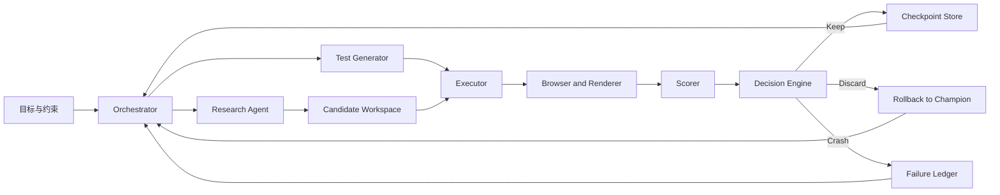
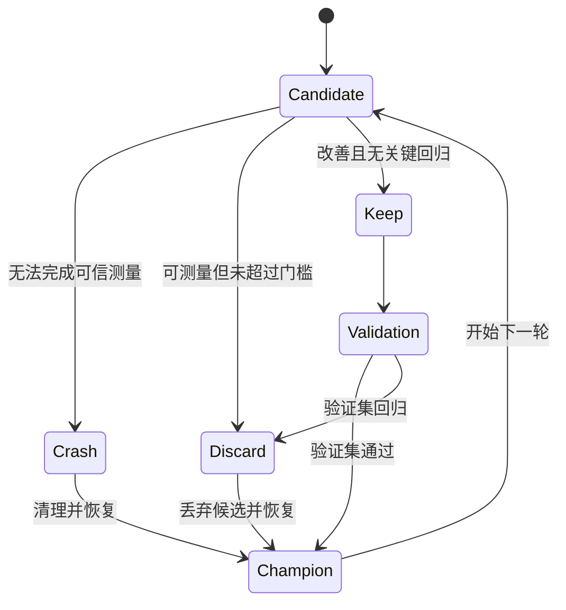

# Auto Research 实战：让 Agent 持续迭代 nano-grafana

> Auto Research 的关键不是让 Agent 无限运行，而是建立一个由外部评分器、隔离执行环境、Checkpoint、自动回滚和终止条件控制的可审计实验闭环。

“给 Agent 一个长期目标，让它自己工作一整晚”听起来很诱人。

我们可以想象这样的场景：晚上给 Agent 留下一句话：“从零实现一个尽可能接近 Grafana 的轻量版面板系统。”第二天早上回来，代码已经改了几十轮，测试用例也增加了不少，页面看起来似乎更像了。

但这里有一个经常被忽略的问题：**它真的变好了吗？**

如果没有固定测试集、明确的评分器和可回滚的版本状态，Agent 可能只是把代码改得越来越复杂；如果没有 Crash 隔离和资源上限，一次错误的依赖升级就可能让整个实验停摆；如果评分器只看截图像素，它可能通过改变背景色或隐藏细节“刷分”，却没有真正复刻 Grafana 的交互和语义。

因此，长期自主研究的核心不是“让模型多思考几轮”，而是把一次次修改变成可比较的实验：

```text
提出假设
  -> 修改代码
  -> 生成或选择测试
  -> 执行渲染
  -> 评分
  -> Keep / Discard / Crash
  -> 晋升 Checkpoint 或自动回滚
  -> 记录实验经验
  -> 进入下一轮
```

本文以 `nano-grafana` 这个案例为主线，讨论如何搭建这套闭环。

需要先说明的是：公开资料中没有找到一个与本文描述完全对应、且公开了完整实验日志的 `nano-grafana` 项目。因此，文中的架构、数据结构和示例轮次是工程设计与演示写法；涉及具体实验次数、得分、截图和最终效果的地方，应替换为项目真实日志，而不应凭空填入“几十轮后提升了多少分”。

## 一、Auto Research 到底是什么

普通 Coding Agent 的基本模式是：人提出需求，Agent 修改代码，人运行测试，再决定是否继续。

Auto Research 把其中的“人”从每一轮循环中暂时拿掉，但没有拿掉评价和控制。它要求系统具备四个条件：

1. **目标可操作**：目标必须能转化为输入、输出和约束，而不是一句无法判定的口号。
2. **结果可评分**：每一轮都能得到结构化分数、失败原因和证据。
3. **状态可恢复**：任意候选修改都不能破坏当前最佳版本。
4. **运行可终止**：系统能够在达到目标、收益停滞、预算耗尽或出现安全风险时停止。

所以，Auto Research 更像一个实验平台，而不是一个“永不停止的聊天机器人”。Agent 负责提出假设和执行实验；评分器负责判断结果；编排器负责管理状态；仓库和 Checkpoint 负责保存可复现的证据。

可以把它抽象成一个带外部评价函数的搜索过程：

```text
candidate(t+1) = Agent(candidate(t), history(t), feedback(t))
score(t) = Evaluator(candidate(t), test_set)
state(t+1) = Transition(state(t), score(t), runtime_result)
```

这里最重要的是，`Evaluator` 和 `Transition` 不应该由 Agent 自己决定。否则，Agent 既是参赛者，又是裁判，还可以修改记分规则，实验就失去了意义。

Karpathy 公开的 `autoresearch` 实验也体现了类似思路：人负责准备可运行的实验环境和固定评价指标，Agent 在受限文件和时间预算内修改程序，每轮根据结果决定保留还是丢弃。[1] 真正使循环成立的，不是“模型能不停生成代码”，而是实验协议足够清晰。

## 二、为什么用 nano-grafana 做案例

Grafana 的“像不像”并不只是画一个折线图。一个面板系统至少涉及以下几层：

- 查询结果如何组织成数据帧；
- 时间序列、分类序列、表格和单值数据如何映射到可视化；
- 字段类型、单位、精度、阈值、颜色和显示名称如何影响结果；
- Transform 如何改变输入数据；
- 面板布局、图例、坐标轴、Tooltip、阈值线和空数据状态如何渲染；
- 用户修改配置后，数据、图形和交互是否同步更新。

Grafana 官方文档把面板视为查询、数据转换、可视化和交互配置的组合，而不是一个孤立的图表组件。[2] DataFrame 也不是简单的二维数组，它包含字段、类型、配置和数据的语义。[3] 这意味着 `nano-grafana` 不能只追求“截图看起来差不多”，而要复刻一组可验证的行为。

另一方面，ECharts 很适合承担渲染层：它提供成熟的折线图、柱状图、饼图、散点图、仪表盘和 Tooltip 能力，并支持 Canvas 与 SVG 两种渲染方式。[4] 但 ECharts 只负责按照配置绘图，不会自动理解 Grafana 的数据语义。因此两者之间需要一个明确的适配层：

```text
Grafana-like Query Result
          |
          v
DataFrame / Field Model
          |
          v
Transform Pipeline
          |
          v
Panel Specification
          |
          v
ECharts Option
          |
          v
Canvas or SVG Rendering
```

这个案例的价值正在于：目标足够具体，可以生成页面和截图；问题又足够复杂，能够暴露 Agent 长期迭代时的真实困难。

## 三、先定义“完成”：目标不能只写成像 Grafana

“尽可能复刻 Grafana”是一句方向性描述，不是一条可执行任务。第一步应该把它拆成能力矩阵，并为每一项能力定义输入、期望行为和评价方式。

### 1. 最小能力矩阵

| 能力域 | 第一阶段目标 | 典型测试输入 | 结果证据 |
| --- | --- | --- | --- |
| 数据帧 | 支持时间字段、数值字段、字符串字段 | 两条时间序列和一张表 | 归一化后的 DataFrame |
| 面板 | 折线、柱状、饼图、表格、Stat | 面板类型与配置 JSON | 面板 DOM、截图、结构化配置 |
| 视觉配置 | 标题、图例、单位、精度、颜色、阈值 | 不同 field config | ECharts option 与截图 |
| Transform | 过滤、聚合、排序、字段计算 | 多种 transform 链 | transform 前后数据快照 |
| 状态 | 空数据、加载中、错误、超时 | 空响应或异常响应 | 状态页截图和状态码 |
| 交互 | Tooltip、图例开关、时间范围 | 鼠标移动和点击 | Playwright 事件断言 |
| 布局 | 多面板排列和尺寸变化 | 不同 viewport | 多视口截图 |

每个能力都应该有稳定的测试 ID，例如 `timeseries.threshold.color.001`。这样一轮实验失败时，系统能够回答“阈值线颜色错了”，而不是只告诉 Agent“截图不一样”。

### 2. 开发集、验证集和隐藏集

如果所有测试都公开给 Agent，它可能只对着固定样例做局部优化。更稳妥的方式是分成三层：

- **开发集**：允许 Agent 读取详细失败原因，用于快速迭代；
- **验证集**：每若干轮运行一次，用来判断候选版本是否真的泛化；
- **隐藏集**：不向 Agent 暴露具体输入，用于最终验收，避免针对测试样例硬编码。

例如，开发集可以包含明确的 `cpu_usage` 时间序列；验证集则使用不同字段名、不同采样间隔和不同空值分布；隐藏集再加入混合单位、负数、重复时间戳和部分缺失字段。

这和机器学习里的训练集、验证集、测试集相似，但工程上还要关注浏览器、字体、时区和设备像素比等渲染环境。对视觉复刻来说，环境本身就是测试输入的一部分。

### 3. 测试生成不能只靠随机

Agent 可以自动生成测试，但测试生成器需要受 Schema 和覆盖模型约束。一个实用方法是把测试用例拆成若干维度，再做组合采样：

```yaml
panel: [timeseries, bar, pie, stat, table]
data_shape: [single_series, multi_series, sparse, empty, malformed]
field_config: [unit, decimals, color, threshold, display_name]
viewport: [desktop, narrow, mobile]
interaction: [hover, legend_toggle, time_range_change]
```

新测试进入正式回归集之前，还要先回答三个问题：

1. 它是否覆盖了现有测试没有覆盖的行为？
2. 它的期望结果能否由规范或参考实现确定？
3. 它是否会因为动画、字体或随机数据而产生不稳定结果？

否则，Agent 可能生成大量看似丰富、实际重复或不可判定的测试，把时间耗在测试噪声上。

## 四、实验室架构：把 Agent 放在控制环里

一个最小可用的 Auto Research 系统可以拆成以下组件：



### 1. Orchestrator

编排器管理每一轮实验的生命周期。它不负责写业务代码，而负责：

- 为候选版本创建隔离工作区；
- 注入本轮允许使用的上下文和预算；
- 启动测试、浏览器和评分器；
- 收集日志、截图、Trace、依赖版本和 Git diff；
- 根据决策结果更新 Checkpoint；
- 在超时、资源异常或连续失败时停止任务。

编排器应该是确定性的。给定相同的 `baseline_commit`、测试集版本和评分器版本，它应尽量产生相同的状态转移结果。模型的自然语言输出可以不同，但“是否 Keep”不应依赖一段模糊的总结。

### 2. Research Agent

Agent 的任务不是自由重写整个项目，而是围绕一个有限假设做修改。每轮开始前，要求它提交一个实验计划：

```json
{
  "hypothesis": "在生成 ECharts option 前执行字段级单位格式化，可以改善图例和 Tooltip。",
  "scope": ["src/data/field-config.ts", "src/render/timeseries.ts"],
  "expected_effect": ["timeseries.unit.001", "timeseries.legend.002"],
  "risk": "Stat 面板的 display value 可能受到影响。",
  "rollback_hint": "验证失败时只丢弃当前 candidate workspace。"
}
```

这份计划不是为了让模型写漂亮的说明，而是为了让实验记录具备可审计性。实验结束后可以比较“假设是什么”和“实际改善了什么”。

### 3. Executor 和浏览器环境

候选代码必须在隔离环境执行。至少应固定：

- Node.js 和包管理器版本；
- 浏览器版本、字体和语言环境；
- 时区、屏幕尺寸和设备像素比；
- 网络访问范围；
- 单轮 CPU、内存、磁盘和执行时长；
- 测试数据和参考图像版本。

视觉测试可以采用 Playwright 的截图比较能力。[5] 但截图比较只能作为证据的一部分，不能单独决定所有结果。每个测试还应保留 DOM、ECharts option、控制台错误、网络请求和交互断言。

## 五、评分器：把“像不像”拆成几把尺子

评分器是整个系统最重要、也最容易被低估的部分。一个有问题的评分器会把 Agent 引向错误方向；一个过于宽松的评分器则会让系统在几十轮后仍然停留在“能跑”的状态。

### 1. 先设置硬门槛

硬门槛定义的是“候选版本是否仍然可用”。一旦触发，候选版本不能 Keep，即使视觉分数很高也不例外：

- 项目无法启动；
- 测试进程崩溃或超时；
- 关键面板没有渲染；
- 浏览器控制台出现未处理异常；
- 预期交互没有响应；
- 破坏了既有 API 或数据结构契约；
- 候选版本访问了禁止的网络或文件路径；
- 生成了不可追溯的二进制文件或超出范围的依赖。

硬门槛的作用是防止“平均分掩盖致命回归”。在决策上，硬门槛优先于加权平均：

```text
if hard_gate_failed:
    status = Crash or Discard
else:
    status = compare(score(candidate), score(champion))
```

### 2. 结构化评分

结构化评分检查结果是否符合系统契约。例如：

- 面板类型是否正确；
- 时间轴字段是否被识别为时间；
- 数值字段是否保持数值类型；
- 单位是否进入格式化配置；
- 阈值是否生成正确的 `markLine` 或视觉映射；
- 空数据时是否进入 Empty 状态，而不是渲染一个误导性的零值图。

这部分通常可以用确定性断言实现，成本低、解释性强，应该优先于视觉判断。

### 3. 行为评分

行为评分关注用户操作后的结果，而不是初始截图：

- 悬停数据点是否出现正确 Tooltip；
- 点击图例是否隐藏对应系列；
- 时间范围变化后数据是否重新计算；
- 面板配置修改后是否触发重渲染；
- 网络请求失败后是否显示错误状态并提供重试入口。

行为评分可以由 Playwright 断言、事件监听和 DOM 状态共同完成。它让 Agent 不能只通过调整 CSS 获得高分。

### 4. 视觉评分

视觉评分可以组合多种指标：

- 像素差或感知图像差异；
- 图表主体区域的边界偏差；
- 标题、图例、坐标轴、阈值线的几何位置；
- 文本可见性和溢出情况；
- 颜色、线宽、点形状和填充区域；
- 多视口下的布局稳定性。

建议按区域评分，而不是整张页面只得到一个分数。可以把参考图拆成 `title`、`plot`、`legend`、`axis`、`tooltip`、`empty-state` 等区域，并给出每个区域的差异。

一个简化的评分函数可以写成：

```text
hard_gate = all(required_checks)

S = 0.30 * schema
  + 0.25 * behavior
  + 0.25 * visual
  + 0.10 * accessibility
  + 0.10 * engineering

accept = hard_gate
      and S >= champion_score + min_delta
      and no_regression_in_critical_cases
```

这里的权重只是起点，不能未经校准就当成事实。真正项目应该根据产品目标调整。例如，仪表盘的读数正确性可能比像素级颜色差异重要；而对截图复刻任务，布局和字体的权重又会更高。

### 5. 工程评分

长期运行还要把工程成本纳入评价：

- 构建时间是否显著增长；
- 浏览器运行时内存是否超标；
- 包体积和依赖数量是否失控；
- 是否增加了大量不可维护的条件分支；
- 是否缺少对应测试；
- 是否改变了已稳定的公共接口。

如果只优化视觉分数，Agent 很可能把大量逻辑硬编码到某几个 fixture 上。工程评分就是为了把“短期看起来更像”和“长期仍然能维护”放在同一张成绩单上。

### 6. 评分器也需要测试

评分器不是天然正确的。正式运行前，应准备一组人工构造的“已知更好”和“已知更差”候选版本，检查评分器能否给出正确排序。例如：

- 故意把图例向右移动 20 像素，视觉分是否下降；
- 故意把百分比单位改成字节，语义分是否下降；
- 保持截图不变但破坏图例点击，行为分是否下降；
- 让页面保留旧截图但运行时抛错，硬门槛是否拦截；
- 只优化一个固定 fixture，隐藏集是否识别过拟合。

这相当于为评分器建立一组单元测试和校准集。没有这一步，Agent 的分数即使持续上升，也不能证明产品质量真的在提升。

## 六、Checkpoint：让每一轮失败都变得便宜

Checkpoint 不等于每次 `git commit`。它是一个可以恢复、比较和解释的实验状态，至少应包含：

```json
{
  "experiment_id": "exp-2026-11-07-0017",
  "parent_checkpoint": "champion-0012",
  "candidate_commit": "abc1234",
  "test_manifest": "tests-v3",
  "scorer_version": "scorer-0.4.1",
  "runtime": {
    "browser": "chromium-xxx",
    "viewport": "1280x800",
    "timezone": "Asia/Shanghai"
  },
  "score": {
    "total": 0.78,
    "schema": 0.91,
    "behavior": 0.72,
    "visual": 0.75,
    "engineering": 0.83
  },
  "status": "candidate",
  "artifacts": ["report.json", "trace.zip", "screenshots/", "diff.patch"]
}
```

可以使用四种版本角色：

- **Baseline**：实验开始时的人类确认版本；
- **Candidate**：当前轮次产生、尚未晋升的候选版本；
- **Champion**：当前综合表现最好的稳定版本；
- **Milestone**：经过一组验证集或隐藏集确认的重要版本。

`Champion` 和 `Milestone` 的区别很重要。某个版本可能在开发集上超过当前 Champion，但还没有通过验证集，不应该直接成为长期基线。否则，Agent 会围绕开发集过拟合，后续所有比较都会建立在一个不稳定的版本上。

### Checkpoint 保存什么，不保存什么

需要保存的是重新解释和复现实验所需的最小完整状态，包括代码版本、测试集版本、评分器版本、环境指纹和关键产物。浏览器缓存、临时构建目录等可再生文件不必永久保留，但要记录生成它们的版本。

对于截图和 Trace，可以采用分层保留策略：

- Keep 和 Milestone 永久保留完整证据；
- Discard 保留差异摘要及代表性截图；
- Crash 在诊断完成前保留全部日志，之后按规则归档；
- 重复失败只保留首个样本、最新样本和聚合统计。

这样既能追溯决策，又不会让长期运行迅速耗尽磁盘。

## 七、Keep / Discard / Crash：三种结果必须分开

很多自动化实验只记录成功和失败，导致最有价值的失败信息被混在一起。至少应该区分三种结果。

### Keep：结果改善且没有关键回归

Keep 需要满足：

1. 候选版本通过硬门槛；
2. 总分超过 Champion 的最小提升阈值；
3. 关键测试没有回归；
4. 资源消耗没有超过预算；
5. 修改范围和产物可追溯。

Keep 之后，候选版本可以晋升为新的 Champion，或者先标记为待验证 Candidate，等待验证集运行。

### Discard：代码能运行，但没有带来足够改善

Discard 不是 Crash。它说明候选版本可以启动，实验也执行完了，但结果没有超过当前稳定版本，或者出现了不可接受的局部回归。

Discard 的经验应该保留，例如：

```text
本轮假设：统一调整坐标轴字体大小能够改善整体相似度。
结果：标题区域略有改善，但小尺寸面板的轴标签溢出；
      总分提升低于最小阈值。
结论：不要继续扩大字体调整范围，优先处理面板尺寸与文本换行。
```

如果把 Discard 直接删除，Agent 下一轮很可能再次提出相同思路。长期研究真正需要积累的不是“成功代码”，而是哪些方向已经被验证过、为什么没有收益。

### Crash：实验本身没有完成

Crash 表示候选代码、测试环境或 Agent 操作触发了异常，无法得到可信评分，例如：

- 编译失败；
- 服务器没有在时限内启动；
- 浏览器崩溃；
- 测试进程被 OOM 杀掉；
- 依赖安装失败；
- Agent 修改了超出权限范围的文件；
- 评分器无法解析候选产物。

Crash 不应该被简单当成低分。低分意味着“系统完成了实验，但结果差”；Crash 意味着“结果没有被可靠测量”。两者对应不同的修复策略，也应该使用不同的重试预算。

### 决策状态机



实际实现中还可以增加 `InfrastructureError`，将候选代码导致的 Crash 与浏览器集群、存储服务等外部故障分开。基础设施错误不应消耗 Agent 的代码实验预算，也不应让模型尝试修改业务代码来“修复”环境。

## 八、自动回滚：永远从 Champion 创建候选版本

最稳妥的工作方式是：每一轮都从 Champion 创建新的隔离工作区，Agent 只在 Candidate 上修改。

```text
Champion
   |
   +--> Candidate A --> Keep    --> Champion'
   |
   +--> Candidate B --> Discard --> remove candidate
   |
   +--> Candidate C --> Crash   --> preserve logs, remove candidate
```

不要让 Agent 在一个不断累积脏状态的目录里连续修改。否则，第二十轮的成功可能依赖前面某个未记录的临时文件，回滚时却找不到依赖；一次失败也可能污染后续所有实验。

自动回滚至少要完成以下动作：

1. 停止候选进程和浏览器；
2. 收集 stdout、stderr、截图、Trace、网络记录和资源使用情况；
3. 保存当前候选的 commit、diff 和依赖锁文件；
4. 将状态写入实验账本；
5. 删除或冻结候选工作区；
6. 恢复到 Champion 的干净快照；
7. 根据失败类型决定下一轮是修复环境、换一个假设，还是停止。

回滚本身也需要幂等。如果编排器在回滚过程中崩溃，重启后应该能通过实验状态判断“哪些资源已经释放，哪些仍需清理”，而不是再次执行一套可能破坏状态的命令。

### 防止候选版本修改裁判

测试集、评分器、隐藏集和编排器必须位于 Agent 无写权限的控制平面。候选代码只允许写入自己的工作区和产物目录。

更严格的实现会把评分器放在独立容器甚至独立账户中：候选版本只能提交标准化产物，不能读取评分器源码、隐藏阈值和隐藏测试输入。这不是不信任模型，而是任何优化系统都应遵守的基本实验隔离。

## 九、几十轮实验应该如何组织

“Agent 跑了几十轮”并不自动等于研究成功。更适合的方式是把轮次分成阶段，观察每个阶段的假设空间和失败模式。

### 第 0 轮：建立 Baseline

先不用追求复杂功能，只建立最小可运行版本：

- 能启动页面；
- 能渲染一个固定时间序列；
- 能生成一张可比较的截图；
- 能输出结构化的 ECharts option；
- 评分器能正确识别“页面挂了”和“图表有差异”。

如果 Baseline 都没有稳定的评分结果，后面所有优化都是噪声。

### 早期轮次：解决可运行性和数据契约

前几轮通常不会有明显的视觉提升，重点是补齐：

- DataFrame 规范；
- 字段类型推断；
- 面板注册机制；
- 空数据和错误状态；
- 浏览器测试入口；
- 参考图像和测试 manifest。

这类改动看起来不像“复刻 Grafana”，但它们让后续实验变得可测量。

### 中期轮次：集中攻克单一误差来源

当系统稳定后，Agent 才适合一次只研究一个变量：

- 先优化单位和数值格式；
- 再优化时间轴和时区；
- 再处理图例和 Tooltip；
- 最后处理复杂 Transform 和响应式布局。

每轮只改一个主要维度，有助于建立因果关系。一次同时改动字体、颜色、数据转换和坐标轴，最终即使分数上涨，也很难知道哪项修改起了作用。

### 后期轮次：处理回归和泛化

达到某个分数后，新增功能的收益会下降，回归风险会提高。此时重点不再是“继续加功能”，而是：

- 在更多面板类型上验证；
- 在不同 viewport 和字体环境下验证；
- 处理边界数据；
- 缩小包体和运行资源；
- 检查隐藏集是否仍然提升。

真实报告可以用如下表格呈现，但其中的数值必须来自实验日志：

| 阶段 | 轮次范围 | 主要假设 | Keep | Discard | Crash | Champion 分数 |
| --- | --- | --- | ---: | ---: | ---: | ---: |
| Baseline | 0 | 建立最小运行闭环 | 1 | 0 | 0 | `[填写]` |
| 可运行性 | 1-`N1` | 修复数据契约和面板骨架 | `[填写]` | `[填写]` | `[填写]` | `[填写]` |
| 视觉细化 | `N1`-`N2` | 优化轴、图例、Tooltip | `[填写]` | `[填写]` | `[填写]` | `[填写]` |
| 泛化验证 | `N2`-`N3` | 扩大测试集并处理回归 | `[填写]` | `[填写]` | `[填写]` | `[填写]` |

这比直接写“经过 30 轮迭代，效果提升 40%”更可信，因为读者能看到实验过程，而不是只看到结果宣传。

### 让 Agent 从历史中学习

实验历史不能只是按时间排列的日志。每轮结束后，应把结果压缩成结构化经验：

```json
{
  "hypothesis_family": "axis-label-layout",
  "change": "increase global axis label font size",
  "outcome": "discard",
  "improved_cases": ["desktop.timeseries.basic"],
  "regressed_cases": ["mobile.timeseries.long-label"],
  "lesson": "font size must depend on panel density; avoid a global constant"
}
```

开始下一轮前，检索与当前失败用例和修改模块最相关的经验，而不是把几十轮完整日志全部塞进上下文。这样既降低 Token 成本，也能减少模型重复尝试已经失败的方案。

## 十、LLM Judge 应该做什么，不应该做什么

像素差和确定性断言仍然无法覆盖所有视觉问题。比如，两个截图可能像素差不大，但其中一个 Tooltip 遮住了关键读数；也可能由于字体渲染差异，像素差很大，但人眼认为两者功能等价。这时可以引入 LLM Judge 做补充。

### 1. 用成对比较，而不是只问“打几分”

与其让 Judge 给单张图片打一个绝对分数，不如提供参考图、Champion 图和 Candidate 图，让它回答：

```text
Candidate 相比 Champion 是否改善了参考图复刻？
改善主要发生在哪些区域？
是否引入了功能或可读性回归？
证据是什么？
置信度是多少？
```

成对比较更容易校准，也更贴合 Keep/Discard 的决策。

### 2. 固定 Rubric

Judge 不应该只收到一句“哪个更像 Grafana”。应当提供固定维度：

| 维度 | Judge 要检查的内容 |
| --- | --- |
| 布局 | 面板边界、间距、标题和图例位置 |
| 视觉层次 | 主图、辅助线、阈值线和背景的层次 |
| 文本 | 字体大小、截断、对齐、可读性 |
| 数据表达 | 系列、坐标轴、单位和异常状态是否正确 |
| 交互证据 | Tooltip、图例切换等操作结果是否符合预期 |
| 回归 | Candidate 是否修好一处却破坏另一处 |

Judge 输出也应结构化，并保留原始输入和模型版本：

```json
{
  "preference": "candidate",
  "dimensions": {
    "layout": 4,
    "visual_hierarchy": 3,
    "text": 4,
    "data_expression": 5,
    "regression": 4
  },
  "evidence": [
    "Candidate 将图例与图表标题对齐。",
    "阈值线已经可见，但 y 轴标签仍有裁切。"
  ],
  "confidence": 0.74
}
```

### 3. Judge 不能替代硬断言

LLM Judge 存在位置偏差、冗长偏差、模型自偏好和提示词敏感性等问题。[6][7] 它适合处理“是否更符合设计意图”这类软判断，不适合决定：

- JavaScript 是否抛出异常；
- API 返回字段是否缺失；
- 时间戳是否被正确转换；
- 点击图例后系列是否确实隐藏；
- 是否访问了禁止的文件路径。

更合理的组合是：

```text
硬断言 / 结构化检查：决定能否通过底线
像素与几何指标：测量可重复的视觉差异
LLM Judge：解释软性视觉差异并辅助排序
人工抽检：校准 Judge 和最终验收
```

对于重要版本，最好让多个 Judge 或不同提示模板交叉评估，并定期与人工标注结果比较。如果 Judge 与人工判断的一致性下降，应该暂停它的自动门禁作用，而不是继续相信一把已经漂移的尺子。

### 4. 防止 Judge 看到不该看的信息

在比较 Champion 和 Candidate 时，应随机交换左右位置，并隐藏版本名称、实验假设和 Agent 自己的结论。否则，“candidate”“新版本”或一段自我解释都可能暗示 Judge 偏向某一方。

同一组图片可以正反顺序各评一次。如果交换顺序后结论反转，说明 Judge 对该样本缺乏稳定判断，应交给确定性指标或人工复核，而不应直接触发 Keep。

## 十一、终止条件：7×24 小时不等于永不停止

一个没有终止条件的 Auto Research 系统，最终通常会遇到两类问题：要么在局部最优附近反复修改，要么为了“继续产生进展”不断扩大改动范围。

至少需要设置以下停止条件。

### 1. 目标达成

当隐藏集通过率、关键视觉指标和行为指标同时达到预设阈值，并且在连续若干轮中没有回归，可以进入候选发布状态。

### 2. 收益停滞

如果连续 `K` 轮没有超过 Champion 的最小提升阈值，就应触发停滞策略：

- 降低实验频率；
- 请求 Agent 总结已验证和未验证假设；
- 切换到新的能力域；
- 等待人工重新定义目标；
- 直接停止本次运行。

### 3. 预算耗尽

预算不仅包括 Token，还包括：

- 运行时长；
- 浏览器分钟数；
- CPU、内存和磁盘；
- 第三方 API 调用；
- 候选工作区数量；
- LLM Judge 调用次数。

### 4. 风险触发

出现以下情况应立即触发 Kill Switch：

- Agent 尝试修改评分器或测试集；
- 连续 Crash 超过阈值；
- 工作区出现越权文件操作；
- 依赖供应链校验失败；
- 候选版本删除或覆盖 Champion；
- 评分器输出异常或版本不一致。

终止也应该产生一份总结报告：当前 Champion 是什么、最后一次有效改进是什么、哪些假设已被验证、哪些问题仍然开放、下次运行应该从哪个 Checkpoint 继续。

## 十二、如何让实验真正可审计

Auto Research 最容易被忽略的一层是实验账本。每一轮至少记录：

```text
experiment_id
parent_checkpoint
agent_model_and_prompt_version
hypothesis
changed_files
test_manifest_version
scorer_version
runtime_environment
candidate_score
champion_score
decision
failure_reason
artifacts
timestamp
```

建议把“代码状态”和“实验状态”分开管理：Git 记录源代码差异，实验账本记录评分器、测试集、运行环境和决策。只有代码 commit，没有测试集版本和评分器版本，未来无法解释“为什么当时判定这个版本更好”。

实验报告还应该保留三类证据：

1. **输入证据**：测试数据、面板配置、viewport 和环境信息；
2. **过程证据**：Agent 计划、工具调用、日志和资源使用；
3. **结果证据**：截图、Diff、ECharts option、测试报告和 Judge 输出。

这套证据链的价值在于，任何一个“提升”都可以被重新运行或人工复核。

## 十三、一个可落地的最小版本

如果要从零搭建，不需要第一天就实现一个庞大的多 Agent 平台。可以按四个阶段推进。

### 阶段一：先跑通单一面板

- 固定一个 Grafana 时间序列面板作为参考；
- 固定输入 DataFrame；
- 用 ECharts 渲染候选结果；
- 用 Playwright 截图并输出像素差；
- 每轮从同一 Baseline 创建候选分支；
- 只允许 Keep 或 Discard，暂不自动扩展测试。

### 阶段二：加入可靠性控制

- 增加编译、控制台错误和交互硬门槛；
- 增加 Crash 与基础设施错误分类；
- 保存日志、截图、diff 和资源用量；
- 加入超时、重试和 Kill Switch；
- 固定浏览器、字体、时区和 viewport。

### 阶段三：扩展研究能力

- 引入能力矩阵和组合测试生成；
- 增加开发集、验证集和隐藏集；
- 将实验历史整理为可检索经验；
- 引入 LLM Judge 处理软性视觉差异；
- 对 Keep 版本执行更大范围回归。

### 阶段四：进入长期无人值守

- 将评分器和候选工作区彻底隔离；
- 对预算、Crash 率和收益停滞设置自动停止；
- 定期生成人类可读的实验日报；
- 对 Milestone 做人工抽检；
- 定期重新校准视觉指标和 Judge。

顺序很重要。没有稳定评分器和回滚机制时，越早追求“无人值守”，越容易得到大量无法解释的代码变化。

## 十四、从这个案例得到的工程原则

### 原则一：先设计评分器，再设计 Agent

如果不知道什么叫“更好”，就无法知道 Agent 应该往哪里探索。评分器不是项目结束后补上的报表，而是决定研究方向的控制面。

### 原则二：一次实验只验证一个主要假设

修改越多，因果关系越弱。把大任务拆成小假设，才能让实验记录变成可复用的知识，而不只是大量 diff。

### 原则三：失败要分类，回滚要自动化

Discard、Crash、环境故障和硬门槛失败不是一回事。分类越清晰，下一轮决策越有效；回滚越自动，长期运行越不依赖人工值守。

### 原则四：Champion 不是最终真理

Champion 只是当前已知最好的版本。它必须持续接受验证集和隐藏集检查，也必须保留人工认可的 Milestone，防止局部优化把系统带偏。

### 原则五：视觉任务必须同时测语义和行为

截图相似不等于面板正确。要同时检查数据帧、配置、交互、响应式布局和错误状态，才能避免“看起来像，但用不起来”。

### 原则六：停止能力和继续能力同样重要

一个可靠的 Agent 不只是会提出下一个实验，还知道什么时候没有足够证据继续修改，什么时候应该把控制权交还给人。

## 结语：真正被自动化的是研究组织

在 `nano-grafana` 这个案例里，Agent 可以负责写代码、生成测试、提出假设和分析失败。但它之所以能够连续运行几十轮，不是因为模型突然获得了无限的工程能力，而是因为周围有一套明确的组织机制：

```text
目标被拆成测试
测试被接入评分器
候选被放进隔离环境
结果被归类为 Keep / Discard / Crash
稳定版本由 Checkpoint 保护
失败版本自动回滚
软判断由 LLM Judge 辅助
最终运行由终止条件约束
```

这也是 Auto Research 与普通自动编码的根本区别。普通自动编码关注“这一轮能不能改出代码”；Auto Research 关注“经过很多轮可审计的实验后，系统是否持续变好，而且随时能够恢复到一个可信版本”。

所以，真正需要编程的并不是一句“请持续研究”，而是一套研究组织：如何定义问题、如何记录证据、如何判断进步、如何处理失败，以及何时停止。

当这些机制被做扎实之后，Agent 才有可能从一个一次性写代码的工具，变成一个可以在明确边界内长期运行的工程研究员。

## 参考资料

1. Andrej Karpathy, [autoresearch: program.md](https://github.com/karpathy/autoresearch/blob/master/program.md)
2. Grafana, [Panel overview](https://grafana.com/docs/grafana/latest/visualizations/panels-visualizations/panel-overview/)
3. Grafana, [Data frames](https://grafana.com/developers/dataplane/dataframes)
4. Apache ECharts, [Canvas or SVG](https://echarts.apache.org/handbook/en/best-practices/canvas-vs-svg/)
5. Playwright, [Visual comparisons](https://playwright.dev/docs/test-snapshots)
6. [A Survey on LLM-as-a-Judge](https://arxiv.org/abs/2411.15594)
7. AWS, [Experimenting with quality for generative AI](https://docs.aws.amazon.com/prescriptive-guidance/latest/gen-ai-lifecycle-operational-excellence/dev-experimenting-quality.html)


