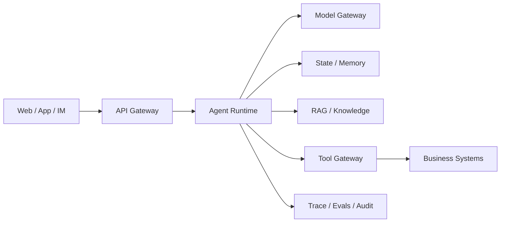
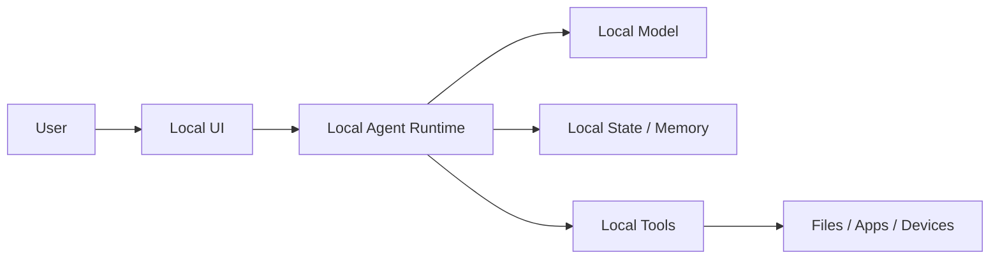
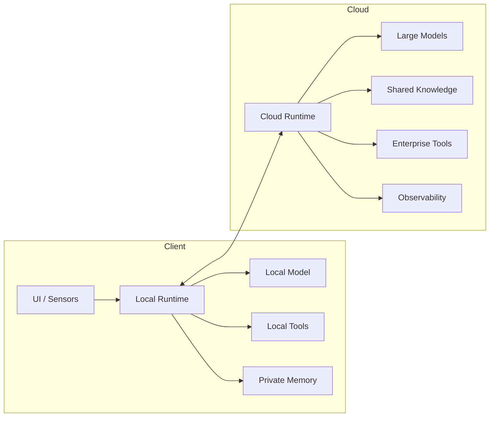

> Agent 部署不是决定“大模型放在哪里”，而是决定推理、状态、数据、工具和控制权分别放在哪里。

一个聊天应用的部署通常很直观：客户端收集输入，服务端调用模型，再把结果返回给用户。但 Agent 不只是生成一段文字。它需要维护任务状态、选择工具、读取环境反馈、更新计划，并可能对文件、应用和业务系统产生真实影响。

于是，部署问题不再只是“使用云端 API，还是在本地运行模型”。真正需要回答的是：

- Agent 的决策循环运行在哪里？
- 用户数据和长期记忆保存在哪里？
- 本地文件、桌面应用和企业系统由谁操作？
- 哪些任务交给客户端小模型，哪些任务升级到云端大模型？
- 网络中断、设备离线或云端不可用时，任务如何继续？
- 云端规划和本地执行之间，怎样传递身份、权限和状态？

云端部署、客户端部署和云端协同并不是三个彼此割裂的产品形态，而是同一套 Agent System 在不同位置上的组件组合。

本文从部署单元出发，比较三种架构的能力边界，并给出一套可以直接用于项目选型的判断方法。

---

## 一、先拆开 Agent：我们到底在部署什么

讨论部署方式之前，必须先区分模型、Agent 和 Agent System。

大模型只负责根据输入上下文生成下一段 Token，或者输出一项结构化工具调用。Agent 则在模型外部增加了目标、状态和循环：它根据当前观察选择动作，执行动作，再根据结果决定下一步。Agent System 还要继续补上权限、存储、沙箱、监控、发布和故障恢复。

一套完整系统通常包含以下部署单元：

```text
交互层        桌面、手机、浏览器、语音或设备界面
Agent Runtime 任务循环、状态机、规划、路由与终止控制
Model Runtime 云端 LLM、本地 SLM、多模态模型或模型网关
Context       Prompt、会话上下文、用户画像和临时工作集
Memory        短期状态、长期记忆、检查点与任务历史
Knowledge     文档索引、向量数据库、知识图谱与检索服务
Tools         文件、浏览器、数据库、业务 API 与设备控制
Sandbox       代码、Shell、浏览器和高风险操作的隔离环境
Control Plane 配置、版本、租户、权限、配额与发布
Observability Trace、日志、评测、成本和安全审计
```

AIOS 将调度、上下文、记忆、存储、工具和访问控制抽象为 Agent 运行时的系统能力；AgentScope 则展示了 Agent 如何从单进程执行扩展到基于消息的分布式运行。[1][2] 这两项工作共同说明了一件事：**Agent 的部署对象从来不只是模型，而是一套有状态的执行系统。**

因此，一个桌面 Agent 即使调用云端模型，也不一定属于“云端 Agent”。如果它的状态、权限和工具执行都在本地，更准确的定义是“本地 Runtime 加云端推理”。反过来，一个网页中的 Agent 即使使用浏览器界面，也可能是纯云端系统，因为客户端只负责显示结果。

---

## 二、部署的三个核心问题：数据、控制权和执行位置

部署架构可以先不看具体技术栈，只回答三个问题。

### 1. 数据在哪里

Agent 使用的数据比普通聊天应用更复杂，可能包括：

- 用户输入和上传文件；
- 屏幕截图、摄像头、麦克风和传感器数据；
- 企业文档、数据库记录和业务事件；
- 对话历史、任务轨迹和长期记忆；
- 工具返回结果、临时文件和生成物。

数据位置决定了隐私边界，也影响传输成本和响应时间。即使最终调用的是云端模型，也可以先在本地完成数据筛选、脱敏、裁剪和摘要，避免把原始数据全部上传。

### 2. 控制权在哪里

Agent Runtime 决定接下来做什么，包括：

- 是否继续任务；
- 选择哪个模型；
- 调用哪个工具；
- 是否需要用户确认；
- 失败后重试、回退还是终止；
- 将任务留在本地还是升级到云端。

把 Runtime 放在云端，意味着系统容易统一升级和治理；把 Runtime 放在客户端，则更容易感知本地环境、维持离线状态并保护个人上下文。

### 3. 动作在哪里执行

模型输出的工具调用只是动作提案，真正产生副作用的是执行器。

```text
模型：建议执行 delete_file("report.docx")
执行器：校验路径、权限、用户确认和审计策略
操作系统：真正删除文件
```

如果 Agent 要控制桌面软件、读取本地文件或操作手机界面，最终执行器通常必须位于客户端。如果 Agent 操作的是 CRM、ERP 或云数据库，执行器则更适合靠近企业服务部署。

由此可以得到一个基本原则：

> **数据尽量靠近它的产生位置，工具尽量靠近被操作的资源，复杂推理放在能力最充足的位置。**

---

## 三、云端部署：把 Agent 作为集中式在线服务

云端部署是当前最直接的方式。客户端负责收集输入和展示结果，Agent Runtime、模型、记忆、知识库和工具服务主要运行在数据中心。



### 1. 云端部署解决了什么

首先是资源问题。复杂规划、多模态理解和长上下文推理通常需要更大的模型、更高的显存和更稳定的推理服务。云端可以集中建设 GPU 集群、模型网关和缓存，而不要求每个用户拥有高性能设备。

其次是治理问题。Prompt、模型、工具 Schema、权限策略和评测集都可以在服务端统一发布。出现模型退化、工具故障或安全事件时，团队可以快速回滚，而不必等待大量客户端完成升级。

第三是协作问题。企业 Agent 往往需要访问共享知识库、业务数据库、任务队列和其他 Agent。将 Runtime 部署在云端，更容易实现跨用户状态共享、并行任务和多 Agent 协作。AgentScope 所研究的分布式执行方式，就适合把多个 Agent 实例和工具服务扩展到不同计算节点。[2]

### 2. 云端部署的典型形态

规模较小时，可以将 Agent Runtime、模型调用和状态管理放在一个服务中：

```text
Client → Agent API → LLM API / Tools / Database
```

随着任务变长、用户增多，系统通常会拆成：

- API Gateway：认证、限流和租户路由；
- Agent Service：运行任务循环；
- Model Gateway：统一管理多个模型供应商；
- Tool Service：隔离数据库、浏览器和外部 API；
- State Store：保存任务状态和检查点；
- Queue：承载异步任务和重试；
- Observability：记录端到端轨迹和费用。

这里最容易出现的错误，是把一次 Agent 请求绑定到一个 HTTP 连接。生产任务可能持续数分钟甚至数小时，应该使用任务 ID、持久化状态、事件流和检查点，使客户端断开后任务仍可继续。

### 3. 云端部署的代价

云端首先意味着网络依赖。一次 Agent 任务可能经历多轮模型调用和工具调用，单次网络延迟会在循环中不断累积。用户感受到的不是模型首 Token 延迟，而是完整任务从接收目标到产生可验证结果的总时间。

其次是数据边界。屏幕、文件、语音和业务数据被上传后，系统必须明确保存期限、使用范围、租户隔离和删除机制。仅仅声明“传输已加密”，并不能回答云端是否保存了原始内容、是否用于评测，以及运维人员能否访问。

第三是持续成本。Agent 会反复构造上下文、调用模型、检索资料并重试工具。一次复杂任务的 Token、存储和计算成本，可能远高于一次普通问答。如果没有步骤预算、缓存、模型路由和终止条件，系统很容易用更多推理掩盖架构问题。

### 4. 云端部署适合什么场景

- 企业知识助手和客服 Agent；
- 需要共享业务状态的流程 Agent；
- 复杂研究、数据分析和编程任务；
- 多用户、多租户和高并发服务；
- 需要集中审计、统一评测和频繁迭代的产品。

云端的价值不只是“大模型更强”，而是能够把 Agent 当成持续运营的在线系统。

---

## 四、客户端部署：让 Agent 靠近用户和设备

客户端部署把 Agent Runtime、模型、状态或工具执行器放在 PC、手机、浏览器、机器人和其他边缘设备上。

纯客户端架构如下：



### 1. 客户端部署的核心价值

第一个价值是数据本地性。Agent 可以读取本地文件、日历、邮件缓存和设备状态，而不必把原始内容上传到服务器。对于个人助理、医疗记录、企业机密和工业现场数据，这种边界尤其重要。

第二个价值是低延迟和离线能力。意图识别、固定工具选择、内容分类和简单摘要并不总需要大型模型。只要任务边界明确，本地小模型可以避免网络往返，并在弱网或断网环境中继续工作。

第三个价值是环境控制。云端模型无法直接点击用户桌面、读取特定目录或访问串口设备，必须借助本地执行器。将 Runtime 一并放在本地，可以让计划、权限提示和实际操作共享同一个环境状态。

TinyAgent 展示了小模型在端侧执行函数调用的可行性，并将本地模型用于文本和语音驱动的设备操作。[3] Mobile-Agent 则从视觉感知和操作规划出发，研究了多模态 Agent 在移动设备界面上的自主操作。[7] 这些研究表明，客户端 Agent 的价值并不要求本地模型在所有能力上追平云端大模型；它首先需要在有限工具和明确任务中稳定地做出正确动作。

### 2. 客户端部署不等于“下载一个模型”

一个可用的本地 Agent 至少还需要处理：

- 模型量化、加载和硬件加速；
- 上下文长度和内存占用；
- 工具注册、参数校验和权限弹窗；
- 本地状态持久化和任务恢复；
- 模型、Prompt 和工具版本更新；
- 日志脱敏和用户可控的数据清理；
- 不同操作系统与硬件的兼容性。

小语言模型虽然降低了部署门槛，但并没有消除上下文、KV Cache、内存带宽和设备差异等问题。针对端侧 SLM 的系统研究也把运行效率、上下文学习能力以及模型与硬件协同列为关键限制。[5]

### 3. 客户端的资源约束会改变 Agent 设计

云端 Agent 可以把大量工具说明、历史消息和文档片段放进上下文，本地 Agent 通常不能照搬这种方式。它需要主动减少每轮推理负担：

- 先用确定性规则筛选工具，再把少量候选交给模型；
- 将长期历史存入结构化状态，而不是每轮完整回放；
- 对屏幕和文档先裁剪、OCR 或摘要；
- 使用小模型完成路由，大模型只处理困难步骤；
- 对常见操作使用模板化 Workflow；
- 限制最大步骤、上下文和并发任务数。

PowerInfer-2、MLC-LLM 等工作从模型执行和编译层面研究了消费设备上的大模型推理优化。[8][9] 但对 Agent 而言，最有效的优化往往不是单纯提高每秒 Token 数，而是**减少不必要的 Token、模型调用和循环次数**。

### 4. 客户端部署的风险

本地不天然等于安全。客户端模型、Prompt、凭证和工具代码更容易被用户或恶意程序读取、篡改和逆向。设备也可能丢失，日志和长期记忆可能被其他账户访问。

同时，直接操作设备意味着更高的副作用风险。一个误判可能删除文件、发送消息或修改系统配置。因此，本地 Agent 仍然需要：

- 文件和网络访问白名单；
- 读写权限分离；
- 高风险操作预览和确认；
- 沙箱和受限子进程；
- 可撤销操作与本地审计记录；
- 对外部内容和系统指令进行隔离。

### 5. 客户端部署适合什么场景

- 本地文件搜索、整理与摘要；
- 桌面软件和手机 GUI 自动化；
- 个人隐私数据处理；
- 工业现场、车载和离线设备；
- 实时语音、视觉与传感器交互；
- 工具范围有限、步骤可验证的专用 Agent。

---

## 五、云端协同：生产系统更常见的答案

纯云端和纯客户端都很容易解释，却不一定是最合适的生产方案。

复杂推理需要云端资源，本地操作又必须靠近设备；敏感原始数据不宜上传，但脱敏后的结构化信息可以用于云端规划；简单请求适合本地处理，少数困难请求才值得消耗大型模型。

因此，更现实的架构是将 Agent 拆开部署。



### 1. 本地 Runtime，云端模型

Agent 循环、权限和工具执行位于客户端，云端只提供复杂推理。

这种方式适合桌面助手。客户端可以先构造经过裁剪的上下文，调用云端模型获取计划，再由本地执行器检查权限并操作文件或应用。长期个人记忆可以保留在本地，云端不必保存完整任务状态。

它的难点是云端模型缺少完整环境视图。客户端必须把必要状态结构化地传递给模型，同时避免上传不相关的敏感信息。

### 2. 云端 Runtime，本地执行器

规划、模型和任务状态位于云端，客户端运行一个受限代理，负责执行本地动作并返回结果。

这种方式适合企业集中管理的办公 Agent。管理员能够统一控制模型、策略和任务轨迹，客户端只开放经过注册的工具，例如“读取指定工作目录”“获取当前窗口信息”或“执行经过签名的自动化脚本”。

它的关键不是让云端获得客户端的全部控制权，而是建立一个窄接口：

```text
Cloud Plan
   ↓
Signed Action Request
   ↓
Local Policy Check
   ↓
User Confirmation when required
   ↓
Local Execution
   ↓
Structured Observation
```

### 3. 本地小模型，云端大模型兜底

本地模型负责高频、简单和隐私敏感的步骤，例如意图分类、工具初选、数据脱敏和固定格式抽取。遇到以下情况时，再升级到云端：

- 本地模型置信度不足；
- 任务需要长上下文或复杂规划；
- 连续多轮没有取得进展；
- 工具执行失败，需要重新制定计划；
- 用户明确要求更高质量结果。

这不是简单地比较两个模型的分数，而是一个路由问题。路由器需要同时考虑任务难度、数据敏感度、网络状态、设备负载、云端价格和剩余预算。

### 4. 步骤级动态路由

更进一步，系统可以对 Agent 的每个步骤决定执行位置：

```text
本地读取文件
  → 本地提取敏感字段
  → 云端制定分析计划
  → 本地运行脚本
  → 云端解释异常结果
  → 本地生成并保存最终文件
```

HERA 研究的正是这种更细粒度的混合方式：根据子任务特征，在本地小模型和云端大模型之间分配 Agent 工作。[4] 云边协同相关综述则将现有方法归纳为任务分配、任务拆分和混合协作，并讨论动态卸载、模型路由和资源感知决策。[6]

步骤级路由能够提高资源利用率，但也显著增加系统复杂度。系统必须处理跨端状态同步、模型输出差异、网络中断、重复执行和端到端追踪。如果业务规模还不足以证明这些收益，应先从固定路由开始，而不是一开始就构建复杂调度器。

---

## 六、三种部署方式的系统比较

| 维度 | 云端部署 | 客户端部署 | 云端协同 |
| --- | --- | --- | --- |
| 模型能力 | 容易使用大型模型和 GPU 集群 | 受算力、内存和电量限制 | 按任务选择模型 |
| 数据隐私 | 原始数据可能离开设备 | 数据可主要保留在本地 | 可先本地处理再选择性上传 |
| 网络依赖 | 高 | 低，可支持离线 | 可降级，但需要同步设计 |
| 本地工具访问 | 需要客户端代理 | 直接访问 | 由本地执行器负责 |
| 扩展能力 | 容易集中扩容 | 依赖单设备资源 | 云端扩容加端侧分流 |
| 发布升级 | 服务端统一升级 | 存在设备和版本碎片 | 需要维护两套发布链路 |
| 可观测性 | 容易集中收集 | 受隐私和离线限制 | 需要跨端 Trace |
| 持续成本 | 模型和基础设施成本明显 | 消耗用户设备资源 | 可以路由和削峰 |
| 安全重点 | 租户隔离、数据治理、工具权限 | 本地凭证、进程隔离、设备安全 | 身份传递、协议安全、最小暴露 |
| 工程复杂度 | 中 | 中到高 | 最高 |

没有一列在所有维度上都占优。部署选型本质上是在模型能力、隐私、延迟、成本和运维复杂度之间做权衡。

---

## 七、不要只看“模型延迟”，要看完整任务时间

Agent 的用户体验由端到端任务决定，可以近似拆成：

```text
总时间 =
数据采集与预处理
+ 网络传输
+ 模型排队与推理
+ 工具执行
+ 环境等待
+ 重试与恢复
+ 多轮 Agent 循环
```

一个本地模型可能每秒生成的 Token 更少，但如果它能够省去上传、排队和多轮确认，简单任务反而更快。一个云端模型可能单轮推理更强，但如果上下文过大、工具链过长，完整任务仍然很慢。

因此，性能指标至少应该包括：

- 任务完成时间，而不只是首 Token 时间；
- 平均和高分位的 Agent 步骤数；
- 模型调用次数和工具调用次数；
- 本地到云端的数据传输量；
- 任务成功率、重试率和人工接管率；
- 每个成功任务的成本和能耗；
- 离线、弱网和云端故障下的降级表现。

真正有效的优化顺序通常是：先减少无意义步骤，再减少上下文和调用次数，最后才是优化单次推理速度。

---

## 八、安全边界必须跟着执行位置移动

部署位置变化后，安全边界也会变化。

### 1. 云端不能直接继承客户端全部权限

用户已经登录桌面，并不意味着云端 Agent 可以自动获得本地文件、浏览器 Cookie 和系统命令权限。跨端请求应包含明确的用户身份、任务 ID、动作类型、参数摘要、过期时间和授权范围。

### 2. 客户端不能盲目信任云端计划

即使请求来自受信任服务器，本地执行器仍需校验：

- 动作是否属于允许的工具；
- 参数是否位于允许范围；
- 当前用户是否仍有权限；
- 操作是否需要再次确认；
- 请求是否过期或被重复提交；
- 执行结果是否符合预期状态。

### 3. 数据上传需要按字段决策

“是否允许上云”不应只是整个任务的开关。更合理的方法是给数据标注敏感级别，并决定：

- 原始内容能否上传；
- 是否只能上传摘要；
- 是否需要删除身份字段；
- 是否允许进入长期日志；
- 是否允许用于评测或模型改进。

### 4. 高风险动作采用两阶段执行

对于发送消息、修改业务数据、付款和删除文件，可以拆成：

```text
Prepare：生成预览，校验权限，展示影响范围
Commit：获得确认后执行，记录结果和审计证据
```

无论 Agent 位于云端还是本地，模型都不应该绕过执行器直接产生副作用。

---

## 九、三类场景如何选择部署方式

### 场景一：企业知识与流程 Agent

企业知识库、CRM、ERP 和审批服务原本就在云端或数据中心。此时适合采用云端 Runtime：

- 服务端统一完成身份认证、知识检索和模型调用；
- 业务工具通过内部 API 或 Tool Gateway 暴露；
- 长任务使用队列、检查点和事件通知；
- 敏感写操作进入审批节点；
- 客户端只负责交互，必要时增加受限的本地文件上传能力。

如果企业明确要求数据不进入公有云，可以使用私有部署模型，但其架构仍然属于云端或数据中心部署，而不是客户端部署。

### 场景二：个人桌面 Agent

桌面 Agent 需要理解当前窗口、文件目录和用户习惯，适合采用“本地 Runtime + 本地工具 + 云端模型”的方式：

- 本地维护任务状态和个人记忆；
- 本地完成文件搜索、权限检查和最终操作；
- 上传前裁剪或摘要上下文；
- 简单任务由本地小模型处理；
- 复杂规划经用户授权后调用云端模型。

这种结构把个人数据边界留在设备上，同时保留大型模型的推理能力。

### 场景三：手机 GUI Agent

手机 Agent 对延迟、电量和权限更敏感。推荐分层处理：

- 端侧获取屏幕、控件树和设备状态；
- 端侧先过滤密码、验证码和支付信息；
- 本地模型处理常见意图和短路径操作；
- 云端模型处理复杂页面理解与长程规划；
- 实际点击、输入和提交始终由端侧执行器完成；
- 支付、发送、删除等动作强制确认。

这里的核心不是追求完全自动化，而是在设备权限边界内实现可暂停、可确认和可恢复的自动化。

---

## 十、一套可执行的选型方法

项目初期可以依次回答下面五组问题。

### 1. 数据

- 原始数据是否允许离开设备或内网？
- 是否可以通过脱敏、裁剪或摘要后上传？
- 长期记忆由个人、企业还是平台拥有？
- 日志和轨迹需要保存多久？

如果原始数据不能离开设备，应优先考虑本地 Runtime 或至少部署本地预处理层。

### 2. 工具

- 工具操作的是本地资源还是云端资源？
- 是否存在不可逆副作用？
- 执行器能否提供幂等、预览和回滚？
- 用户是否必须在设备上确认？

执行器通常应靠近目标资源部署，避免把宽泛权限跨网络暴露出去。

### 3. 模型

- 任务是否需要长上下文、复杂推理或多模态能力？
- 本地模型能否覆盖大多数高频请求？
- 模型失败是否可以被规则或验证器发现？
- 云端调用的质量收益是否足以覆盖成本和延迟？

不要用同一个模型处理所有步骤。模型选择应该服从任务，而不是反过来让任务适配模型。

### 4. 运行环境

- 是否必须支持离线或弱网？
- 设备算力、内存、电量和存储是否稳定？
- 客户端更新是否可控？
- 企业是否能够管理终端版本和证书？

客户端环境越碎片化，本地部署的测试矩阵和运维成本越高。

### 5. 治理

- 谁能查看完整 Agent 轨迹？
- 如何统一撤销凭证和工具权限？
- 模型或 Prompt 更新后如何回归测试？
- 跨端失败时，哪一侧拥有最终状态？
- 发生争议时，能否证明实际执行了什么？

如果这些问题主要依赖组织级统一控制，应提高云端控制面的比例；如果核心诉求是个人数据和设备自主权，则应提高客户端 Runtime 的比例。

---

## 十一、推荐的渐进式落地路线

### 阶段一：固定部署边界

先选择一种简单拓扑，例如“云端 Runtime + 本地执行器”，明确数据、状态和工具的所有权。不要在第一版就引入动态路由。

### 阶段二：补齐状态与审计

为任务建立唯一 ID、检查点、幂等工具和端到端 Trace，确保跨端断线后能够恢复，而不是重复执行。

### 阶段三：引入本地预处理

将敏感字段识别、数据裁剪、缓存和高频规则逐步下沉到客户端，减少上传数据和云端上下文。

### 阶段四：引入本地小模型

选择范围明确、可验证的任务下沉，例如意图分类、工具路由、字段抽取和固定工作流，不急于替代复杂云端规划。

### 阶段五：基于真实指标动态路由

只有在积累了任务难度、成功率、延迟和成本数据之后，再训练或配置路由策略。路由决策需要可解释，并保留强制本地、强制云端和人工接管能力。

这条路线的关键是先建立可靠边界，再提高调度智能。否则，动态路由只会把原本可定位的问题分散到更多设备和服务中。

---

## 结语：Agent 的未来不是云端或客户端，而是连续计算环境

云端部署擅长集中计算、共享状态和统一治理；客户端部署擅长保护本地数据、感知设备环境和执行低延迟操作；云端协同则试图把两者组合起来，让每一步任务运行在更合适的位置。

但混合部署不是自动得到两边的优点。它同时引入了状态同步、身份传递、版本兼容、离线恢复和跨端观测等新问题。只有当隐私、延迟、模型能力或成本确实需要时，这些复杂性才值得承担。

因此，Agent 部署不应从“我们想用云模型还是本地模型”开始，而应该从四个问题开始：

1. 数据在哪里产生，允许流向哪里？
2. 工具操作什么资源，副作用由谁承担？
3. 哪些步骤真正需要大型模型？
4. 任务失败后，哪一侧能够恢复并证明发生过什么？

最终合理的架构通常不是一个固定地点，而是一条清晰的责任链：

> **客户端守住用户数据和设备权限，云端提供复杂推理和集中治理，运行时根据任务、风险和资源决定两者如何协作。**

---

## 参考资料

1. [AIOS: LLM Agent Operating System](https://arxiv.org/abs/2403.16971), arXiv:2403.16971, 2024.
2. [AgentScope: A Flexible yet Robust Multi-Agent Platform](https://arxiv.org/abs/2402.14034), arXiv:2402.14034, 2024.
3. [TinyAgent: Function Calling at the Edge](https://aclanthology.org/2024.emnlp-demo.9/), EMNLP System Demonstrations, 2024.
4. [HERA: Hybrid Edge-cloud Resource Allocation for Cost-Efficient AI Agents](https://arxiv.org/abs/2504.00434), arXiv:2504.00434, 2025.
5. [Demystifying Small Language Models for Edge Deployment](https://aclanthology.org/2025.acl-long.718/), ACL, 2025.
6. [Collaborative Inference and Learning between Edge SLMs and Cloud LLMs: A Survey of Techniques, Architectures, and Applications](https://arxiv.org/abs/2507.16731), arXiv:2507.16731, 2025.
7. [Mobile-Agent: Autonomous Multi-Modal Mobile Device Agent with Visual Perception](https://arxiv.org/abs/2401.16158), arXiv:2401.16158, 2024.
8. [PowerInfer-2: Fast Large Language Model Inference on a Smartphone](https://arxiv.org/abs/2406.06282), arXiv:2406.06282, 2024.
9. [MLC LLM: Universal LLM Deployment Engine with ML Compilation](https://arxiv.org/abs/2306.05685), arXiv:2306.05685, 2023.
