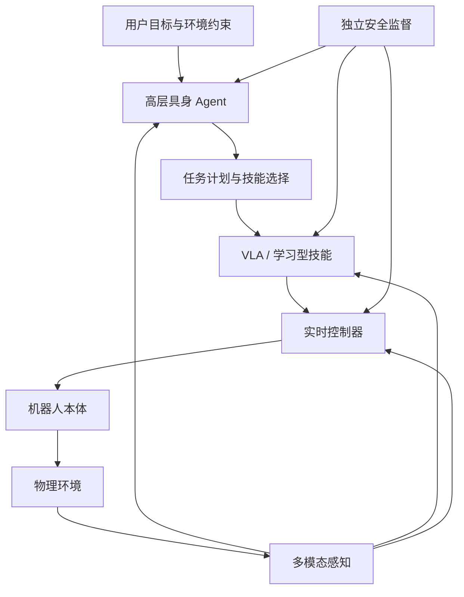

# 从会说到会做：具身机器人与具身 Agent 如何进入物理世界

> 大语言模型让机器学会了描述世界，具身智能要解决的，是机器如何在这个世界中行动，并为行动结果负责。

假设你对一台家庭机器人说：“把客厅收拾一下。”

这句话对人来说很自然，对机器却不是一条可以直接执行的指令。机器人首先要理解什么叫“收拾”：地上的玩具需要放回收纳箱，杯子应该送到厨房，书可以摆回书架，而正在充电的电脑、主人临时放在桌上的文件和宠物正在玩的物品，也许不应该移动。

理解目标之后，问题才刚刚开始。机器人还要建立房间的空间表示，识别物体及其状态，判断哪些物体能够抓取，规划移动路线和抓取顺序，并把“拿起杯子”转换成机械臂、夹爪和底盘可以执行的连续动作。如果杯子被遮挡、第一次抓取失败，或者有人突然走进运动区域，它还必须重新观察、调整计划，必要时停止动作并向人询问。

一个聊天模型可以在几秒内写出收拾房间的步骤，但把这些步骤变成真实世界中的可靠行动，需要解决感知、推理、记忆、规划、控制、反馈和安全等一整条链路。

这正是具身智能真正困难、也真正有价值的地方：**智能不再只通过文字证明自己，而要通过对物理世界产生的结果接受检验。**

本文将围绕一条主线展开：

```text
人的目标
   ↓
具身 Agent 理解、规划与决策
   ↓
机器人身体执行动作
   ↓
物理环境发生变化
   ↓
重新感知、验证、纠错与学习
```

> 资料口径：本文基于截至 **2026 年 10 月 16 日**可访问的论文、研究机构和开源项目资料整理。具身智能仍处于快速演进阶段，实验室演示、标准化基准成绩与生产环境中的长期可靠运行不能直接画等号。

---

## 一、先把三个概念分清楚

“具身智能”“具身机器人”和“具身 Agent”经常出现在同一段讨论中，却指向不同层次。如果不先厘清边界，后续很容易把人形外观、大模型能力和机器人系统能力混为一谈。

### 1. 具身智能：在行动与反馈中形成的智能

具身智能强调，智能体并不是隔着屏幕被动处理信息，而是拥有某种身体，能够观察环境、采取行动，并根据行动结果继续调整行为。这里的“身体”可以是真实的机械臂、移动机器人或人形机器人，也可以是三维仿真环境中的虚拟载体。

[Habitat](https://aihabitat.org/) 对 Embodied AI 的描述抓住了这个边界：智能体具有物理或虚拟载体，通过传感器观察环境，并使用动作改变环境。于是，具身智能的核心不再只是输入到输出的一次映射，而是一个持续运行的闭环：

```text
观察 Observation
      ↓
更新状态 State
      ↓
推理与规划 Reasoning & Planning
      ↓
采取动作 Action
      ↓
环境变化 Environment Transition
      └──────────> 新的观察
```

智能体的判断是否正确，最终要通过环境反馈验证。它说“已经把杯子放进柜子”没有意义，摄像头、触觉或柜内状态必须证明杯子确实被安全放好。

### 2. 具身机器人：提供身体、传感器和执行能力

具身机器人是具身智能在物理世界中的载体。一个完整机器人通常包括：

- **机械结构**：机械臂、夹爪、灵巧手、轮式底盘、双足或轮足结构；
- **感知系统**：RGB 摄像头、深度相机、激光雷达、麦克风、触觉和力矩传感器；
- **执行系统**：电机、驱动器、关节、末端执行器和制动装置；
- **控制系统**：定位、导航、轨迹规划、平衡控制和碰撞保护；
- **计算平台**：运行感知模型、策略模型、实时控制与安全监控；
- **能源系统**：电池、充电、功耗和热管理。

因此，具身机器人不等于人形机器人。仓库中的移动机械臂、医院中的配送机器人、工厂中的双臂机器人，都可能成为具身智能的载体。人形形态的优势在于能够复用为人设计的楼梯、门把手、工具和工作空间，但它也带来了平衡、续航、成本和全身控制方面的额外难题。

### 3. 具身 Agent：负责理解目标并组织行动

具身 Agent 更接近机器人系统中的认知与决策层。它通常负责：

- 理解人的语言、手势和任务目标；
- 把开放目标分解为可执行子任务；
- 维护环境状态、任务进度和历史记忆；
- 调用导航、抓取、搜索、视觉检测和控制技能；
- 根据新观测判断动作是否成功；
- 在失败、冲突和环境变化后重新规划；
- 在超出能力边界时停止并请求人工介入。

具身 Agent 不一定运行在真实机器人上。它也可以先在 Habitat、Isaac Sim 或其他仿真环境中学习导航、协作和操作。相反，一台拥有机械身体的机器人也不一定具备 Agent 能力：如果它只能按照固定程序重复焊接或搬运，它更接近自动化设备，而不是能够自主规划的具身 Agent。

可以用下面这张表理解三者的关系：

| 概念 | 回答的问题 | 主要组成 | 是否必须有真实硬件 |
|---|---|---|---|
| 具身智能 | 智能怎样在身体与环境交互中形成 | 感知、认知、行动、反馈与学习闭环 | 否，可以先存在于仿真中 |
| 具身机器人 | 用什么身体感知和改变物理世界 | 机械结构、传感器、执行器、控制器与计算平台 | 是 |
| 具身 Agent | 如何理解目标、制定计划并组织技能 | 模型、记忆、规划器、工具、技能和安全策略 | 否，但真实部署时需要载体 |

因此，更准确的关系不是“具身机器人等于具身 Agent”，而是：

```text
具身机器人提供身体和物理能力
            +
具身 Agent 提供认知和任务决策
            +
环境持续提供反馈和约束
            =
可运行的具身智能系统
```

---

## 二、为什么是现在：四条技术曲线开始汇合

机器人研究并不是今天才出现。真正发生变化的是，多模态基础模型、机器人数据、仿真平台和硬件工程在同一时期加速成熟，使机器人第一次有机会从“每个任务单独编程”走向“使用统一模型理解多种任务”。

### 1. 多模态模型提供了开放世界语义

传统机器人感知系统往往围绕固定标签训练：识别箱子、托盘、工件 A 和工件 B。它可以在明确边界内保持稳定，却很难理解开放表达，例如：

- “把容易碎的东西先收起来”；
- “找一个能临时垫住桌脚的物体”；
- “不要碰桌上正在充电的设备”；
- “按照刚才整理卧室的方式整理书房”。

视觉语言模型把图像区域、语言概念和大量文本知识放进同一个表示空间，使机器人有机会理解物体类别之外的属性、用途、关系和任务语义。它不只是看见一个红色区域，而是判断那可能是一个杯子、杯口朝上、里面可能有液体，因此抓取和移动时需要保持姿态。

但“看懂”并不等于“会做”。视觉语言模型可以回答杯子在哪里，却不能天然输出机器人关节应该怎样运动。连接这两者的关键技术，是 Vision-Language-Action，也就是 VLA 模型。

### 2. VLA 把语言和视觉连接到机器人动作

VLA 模型通常接收视觉观测、语言指令和机器人自身状态，输出能够驱动机器人的动作。动作可能是离散技能，也可能是末端执行器的位置、旋转、夹爪状态或一段连续控制序列。

2023 年发布的 [RT-2](https://arxiv.org/abs/2307.15818) 展示了一条具有代表性的路线：把机器人动作表示成模型可以生成的 Token，并在互联网视觉语言数据与机器人轨迹数据上联合训练。这样一来，模型从视觉语言数据中获得的语义知识，就有机会迁移到机器人控制任务中。

例如，训练数据未必直接教过机器人“把垃圾扔进垃圾桶”，但模型可能已经从互联网数据中学到垃圾、垃圾桶及其关系，再通过少量机器人示范把这种语义映射到抓取和放置动作。

这并不意味着语言模型已经掌握物理规律。它说明的是另一件事：**通用知识与机器人技能之间，不再必须完全隔离。**

### 3. 跨平台机器人数据开始汇聚

大模型的能力来自规模，但机器人数据长期被困在单一实验室、单一设备和单一任务中。不同机器人的相机位置、关节数量、动作频率和控制接口并不相同，一台机器人采集的数据很难直接交给另一台机器人使用。

[Open X-Embodiment](https://robotics-transformer-x.github.io/) 等项目开始尝试把不同机构、不同机器人和不同任务的数据汇集起来。随后，[Octo](https://octo-models.github.io/)、[OpenVLA](https://openvla.github.io/) 等开源通用策略继续探索多机器人数据训练：

- Octo 使用约 80 万段机器人轨迹训练可适配不同观测和动作空间的通用策略；
- OpenVLA 使用约 97 万段机器人任务轨迹训练 70 亿参数的开源 VLA；
- 数据中的多样性开始覆盖不同机器人形态、相机视角、场景和语言任务。

这里真正重要的不是某个数据规模数字，而是训练范式的变化：机器人模型开始像语言模型一样，先通过多任务、多平台数据获得通用先验，再面向具体硬件和场景进行微调。

### 4. 仿真、合成数据与真实数据形成组合

真实机器人数据昂贵、缓慢，而且可能损坏设备或伤害人员。如果每一种跌倒、碰撞、遮挡和光照变化都只能在真实环境中采集，数据规模很难持续扩大。

仿真平台可以并行运行大量环境，自动生成标注，反复复现危险情况，并在真实部署前完成初步训练和回归测试。与此同时，真实遥操作数据提供可信的接触和动作轨迹，互联网数据提供语义知识，视频生成和世界模型则尝试补充长尾场景。

未来机器人数据不会只有一种来源，而更像一个分层组合：

```text
互联网图文与视频：学习开放世界语义和常识
                ↓
仿真与合成数据：覆盖场景变化、失败和危险边界
                ↓
人类示范与遥操作：提供高质量动作轨迹
                ↓
真实机器人运行：验证物理可行性和长期稳定性
                ↓
人工接管与失败日志：形成下一轮训练数据
```

具身智能的竞争因此不只是模型竞争，也是数据采集、仿真生成、真实部署和反馈回流效率的竞争。

---

## 三、一个具身 Agent 到底怎样完成任务

把大模型接入机器人，并不能自动得到一个可靠的具身 Agent。真实系统通常需要多层协作，每一层处理不同时间尺度、不同确定性和不同安全要求的问题。

### 1. 感知层：把连续世界转换成可计算状态

具身 Agent 首先要回答“现在发生了什么”。输入可能包括：

- RGB、深度和红外图像；
- 激光雷达、地图与定位结果；
- 语音、文字和手势；
- 关节角度、速度、电流和温度；
- 触觉、力觉、碰撞和滑动信号；
- 电量、负载和设备健康状态。

感知层的难点不是识别一张静态图片，而是把多个来源、不同频率和不确定程度的信号对齐成动态状态。摄像头判断“已经抓住”，夹爪力觉却显示物体正在滑落时，系统不能只相信视觉结论。

### 2. 世界模型与记忆：维护环境如何变化

如果 Agent 每次决策都只看当前一帧图像，它就无法完成长任务。它需要记住：

- 杯子最初在什么位置；
- 柜门是否已经打开；
- 哪些物品已经处理；
- 哪一条通道暂时被人占用；
- 上一次抓取为什么失败；
- 当前计划执行到了哪一步。

这种记忆并不只是对话历史，而是任务状态、空间关系、对象状态和执行证据的组合。它还需要区分“已经确认的事实”“模型推测”和“等待验证的状态”。否则，一次错误识别就可能在后续几十步中不断传播。

### 3. 高层规划：把开放目标变成可验证子任务

“整理厨房”不能直接发送给机械臂控制器。高层 Agent 需要将其拆分成具有前置条件、结束条件和失败处理的子任务：

```text
目标：整理厨房台面

1. 扫描台面并建立待处理物品清单
2. 判断物品类别、状态和目标位置
3. 优先处理易碎、易洒或阻挡其他物品的对象
4. 导航到可操作位置
5. 抓取目标物体
6. 验证抓取是否稳定
7. 移动到目标容器或区域
8. 放置并验证结果
9. 更新任务清单
10. 直到台面满足完成条件
```

高层规划的价值不只是列步骤，而是显式管理依赖关系和风险。例如，柜门没有打开时不能执行放置；杯中存在液体时不能采用快速倾斜轨迹；目标位置不明确时应先询问，而不是自行猜测。

### 4. 技能与 VLA：把任务意图转换成动作

高层 Agent 决定“拿起杯子”，底层技能或 VLA 模型负责把意图变成动作序列。它需要结合当前图像、机器人姿态和语言目标，输出：

- 末端执行器移动方向和距离；
- 机械臂关节的目标状态；
- 夹爪或灵巧手的开合方式；
- 底盘移动和身体姿态；
- 双臂、双足或全身的协同动作。

不同任务需要不同控制频率。高层 Agent 可以每几秒重新规划一次，但平衡、力控和碰撞保护往往需要毫秒级响应。这决定了生产系统不能把所有控制都交给一个运行缓慢的大模型。

### 5. 反馈验证：不能把“已调用”当成“已完成”

软件 Agent 调用一个 API 后，可以通过返回码判断执行结果；物理世界没有这样统一的成功信号。夹爪已经闭合，不代表抓到了物体；机械臂运动到目标位置，不代表物体已经稳定放置；导航模块报告到达，也不代表机器人处于可操作姿态。

因此，每个关键动作都应包含结果验证：

```text
发出抓取动作
   ↓
检查夹爪位置、受力和视觉状态
   ↓
成功：进入搬运动作
失败：分析原因并选择重试、换抓取点或请求帮助
```

具身 Agent 与普通 Workflow 的关键区别就在这里：**动作会改变环境，而变化后的环境是下一次决策的输入。**

### 6. 安全监督：拥有比任务规划更高的控制权

安全模块不应该只是 Agent 提示词中的一句“请注意安全”，而应拥有独立的停止权。它需要在多个层次实施约束：

- 任务层：拒绝危险、违法或超出授权的目标；
- 计划层：阻止缺少前置条件或风险不可接受的步骤；
- 技能层：限制速度、力量、工作空间和工具使用；
- 控制层：执行碰撞检测、力矩限制和急停；
- 系统层：记录审计日志，支持人工接管和故障恢复。

这形成了一种更接近工业控制系统的架构：高层模型可以提出动作意图，但确定性的安全规则决定这个意图能否真正进入执行器。

---

## 四、端到端模型与分层 Agent，不是一道单选题

具身智能系统经常被描述为两条对立路线：一条是端到端 VLA，另一条是模块化 Agent。实际工程更可能把两者组合起来。

### 1. 端到端路线：让模型直接学习动作映射

端到端 VLA 希望从视觉、语言和机器人状态直接生成动作。这种方式的优势包括：

- 减少人工定义中间标签和规则；
- 能从大规模示范中学习难以显式编程的动作；
- 感知与控制可以联合优化；
- 对柔性操作和开放语言指令更有潜力。

但它也面临解释困难、长任务状态管理不足、错误难以定位和安全边界不清晰等问题。模型一次输出错误动作，工程团队需要判断问题来自视觉理解、语言理解、训练分布、动作解码还是控制接口，这并不容易。

### 2. 分层路线：不同时间尺度由不同模块负责

分层系统通常让高层模型负责语义理解、任务分解和重新规划，让 VLA 或技能策略负责数秒级动作，让传统控制器负责毫秒级稳定控制。



这类架构允许每一层使用适合自己的技术：

| 层级 | 典型周期 | 主要问题 | 适合的方法 |
|---|---:|---|---|
| 目标与任务层 | 秒到分钟 | 要完成什么，先做什么 | LLM/VLM、规划器、记忆与工具调用 |
| 技能层 | 数十毫秒到秒 | 怎样抓取、放置、开门和行走 | VLA、模仿学习、强化学习、运动规划 |
| 实时控制层 | 毫秒级 | 怎样稳定、精确、安全地驱动执行器 | MPC、PID、力控、阻抗控制、安全控制器 |

2026 年发布的 [Gemini Robotics 2](https://deepmind.google/blog/gemini-robotics-2-brings-whole-body-intelligence-to-robots/) 就体现了这种分层方向：具身推理模型负责空间理解、任务规划和进度跟踪，VLA 模型负责把计划转化为机器人动作。它不是让单个大模型取代整个机器人技术栈，而是在不同层次组织不同模型和控制能力。

### 3. 判断架构的标准不是“是否端到端”，而是责任是否清楚

真正需要回答的是：

- 哪一层负责理解任务？
- 哪一层维护世界状态和完成条件？
- 哪一层把意图转换成连续动作？
- 哪一层验证动作是否成功？
- 哪一层拥有停止权？
- 出现事故时，能否还原模型看见了什么、决定了什么、执行了什么？

如果这些问题没有明确答案，系统即使在演示视频中完成了任务，也很难进入长期运行的真实环境。

---

## 五、训练具身 Agent：真正稀缺的是可验证经验

语言模型可以从网页和书籍中获得海量文本，而机器人需要的是“在某种状态下采取某个动作后发生了什么”。这种数据必须包含行动与结果，采集成本远高于静态文本。

### 1. 机器人数据至少包含四个部分

一条可用于训练的轨迹通常需要记录：

1. **任务目标**：自然语言指令、目标状态或奖励条件；
2. **环境观测**：图像、深度、对象状态和空间信息；
3. **机器人状态与动作**：关节、末端位姿、夹爪、底盘和控制频率；
4. **执行结果**：成功、失败、人工接管、碰撞、耗时和完成质量。

缺少结果标签的动作日志只能说明机器人“做过什么”，不能说明它“做得是否正确”。而只保存成功轨迹，又会让模型不知道怎样识别和恢复失败。

### 2. 人类示范解决“应该怎么做”

示范数据可以通过遥操作、动作捕捉、手柄、VR 设备或人工牵引采集。人类示范提供了高质量动作，但也有三个限制：

- 采集速度受人力约束；
- 操作者风格和熟练度不同；
- 人类容易完成的动作，未必符合机器人结构和动力学限制。

因此，示范数据需要经过质量评价、动作对齐和失败清洗，不能简单地把数量当成质量。

### 3. 仿真解决“怎样覆盖更多情况”

仿真可以随机改变物体位置、材质、光照、摩擦系数、相机参数和干扰事件，在短时间内生成大量不同轨迹。它特别适合覆盖真实环境中代价过高的失败和危险场景。

但仿真无法完全复制接触、柔性物体、传感器噪声和硬件磨损。模型在仿真中学会的策略，仍然要面对 Sim-to-Real 差距。常见方法包括域随机化、真实数据微调、系统辨识和在线校准。

### 4. 真实部署形成数据飞轮

最有价值的数据往往来自机器人实际运行中的困难样本：

- 哪些任务频繁触发人工接管；
- 哪种物体或姿态导致抓取失败；
- 哪些语言表达容易被误解；
- 哪些场景造成规划超时；
- 哪些恢复策略会重复失败；
- 哪些动作虽然完成，却不符合人的偏好。

生产系统需要把这些事件自动沉淀为可回放、可标注、可训练的数据。于是，机器人部署不只是交付设备，也是在建设一个持续更新的学习系统：

```text
部署任务
  ↓
发现失败与人工接管
  ↓
轨迹清洗、标注和分类
  ↓
训练或微调策略
  ↓
仿真与回放评测
  ↓
灰度部署
  ↓
继续收集真实结果
```

没有这条闭环，模型迭代只能依赖实验室预设任务；有了这条闭环，每一次失败才可能变成系统能力的一部分。

---

## 六、从专用自动化到通用物理 Agent

具身智能的发展不是突然从工业机械臂跳到“通用机器人”，而是经历了能力边界不断扩大的过程。

### 1. 固定程序：在确定环境中重复动作

传统自动化擅长高速度、高精度和高重复性的任务。工件位置、生产节拍、安全围栏和动作流程都经过精确设计。只要环境保持稳定，这类系统通常比通用 Agent 更可靠、更便宜。

它的局限不是“不够先进”，而是适应变化的成本高。换一种零件、调整工位或出现异常后，往往需要重新编程、示教和联调。

### 2. 学习型策略：通过示范掌握单项技能

模仿学习和强化学习让机器人不必完全依赖人工编程，而是从数据中学习导航、抓取、放置、插接和工具操作。但许多策略仍然围绕特定硬件、特定场景或特定任务训练。

### 3. 通用机器人策略：一个模型处理多任务

RT-2、Octo、OpenVLA、π0 系列、GR00T 和 Gemini Robotics 等工作，正在探索用统一模型覆盖更多任务、场景和机器人形态。

例如，Physical Intelligence 的 [π0.5](https://www.physicalintelligence.company/download/pi05.pdf) 研究展示了模型在未参与训练的新家庭环境中执行持续 10 至 15 分钟的多阶段整理任务。NVIDIA 的 [GR00T N1.6](https://research.nvidia.com/labs/gear/gr00t-n1_6/) 则面向双臂和人形机器人，联合使用多种真实与仿真机器人数据，探索跨任务和跨形态策略。

这些进展说明，机器人模型正在从“执行一项技能”转向“根据语言目标组合多种技能”。但它们仍不等于已经解决开放世界中的通用机器人问题。研究演示通常有明确的设备条件、任务范围和评测分布，真实商业部署还要考虑长期故障率、维护成本、安全认证和人工接管比例。

### 4. Agent 化：从动作生成走向任务治理

当任务持续时间变长、环境更加开放时，单纯生成动作已经不够。系统还需要：

- 维护长期目标和中间状态；
- 调用地图、搜索、数据库和业务系统；
- 在多台机器人之间分配任务；
- 处理权限、资源和时间约束；
- 记录计划、证据、执行和回滚过程；
- 知道何时暂停并交给人类。

这时，机器人基础模型与 Agent 架构开始汇合。前者提供感知和动作能力，后者负责把能力组织成一个可持续运行、可恢复、可审计的系统。

---

## 七、哪些场景会更早落地

判断具身智能是否适合一个场景，不能只看任务是否“需要人做”，还要看环境变化、错误代价、任务频率和经济收益。

### 1. 制造业：从固定工位走向柔性任务

制造业拥有相对明确的安全边界、质量标准和流程数据，是具身机器人重要的落地方向。潜在任务包括：

- 小批量、多品种装配；
- 物料搬运和上下料；
- 设备巡检和仪表读取；
- 缺陷复检和异常处置；
- 危险、高温或有毒环境操作。

但工厂不会因为模型更“通用”就放弃确定性自动化。合理的组合是：稳定高频流程继续由专机和传统机器人承担，具身 Agent 处理变化更多、编程成本更高、过去依赖人工判断的部分。

### 2. 仓储物流：任务规则清楚，动作种类丰富

仓储环境包含导航、搬运、拣选、码垛、盘点和异常包裹处理。它比家庭更结构化，又比传统流水线变化更多，适合验证多技能组合和多机器人协同。

真正影响商业价值的指标不是单次抓取演示，而是每小时有效处理量、异常恢复时间、人工接管率、设备利用率和单位任务成本。

### 3. 商业服务：需要理解人，也需要限制行为边界

酒店、零售、餐饮后场和园区服务包含配送、补货、清洁、引导和简单操作。这里的挑战不仅是动作，还包括与人的交互：如何理解模糊请求，如何避让，如何处理插队、遮挡和临时变化。

服务场景中的机器人必须表现得可预测。一个动作成功率很高但偶尔突然改变路径的系统，可能比能力有限但行为稳定的系统更难被人接受。

### 4. 家庭：想象空间最大，环境也最难

家庭不是一个标准化工厂。物体会随时移动，空间狭窄，儿童和宠物会进入工作区域，同类物品的外观与材质差异巨大，用户指令还常常依赖家庭习惯。

家庭机器人除了完成任务，还要理解边界：哪些柜子可以打开，哪些物品不能查看，哪些数据不能上传，什么情况下必须征得同意。于是，家庭场景同时放大了泛化、隐私、安全和社会交互问题。

### 5. 危险与极端环境：容错价值可能高于设备成本

消防、核设施、矿山、化工、深海和太空任务中，人类进入现场的代价很高。机器人即使速度较慢，只要能够降低人员暴露风险，就可能产生明确价值。

这类场景也要求更强的通信中断处理、远程接管、故障降级和自主返回能力。Agent 不能假设云端服务始终可用。

---

## 八、为什么“完成一次演示”距离“真正可用”还很远

具身智能最容易制造误判的地方，是一次成功视频会掩盖系统在长时间、开放环境中的失败概率。

### 1. 单步成功率会在长任务中快速衰减

假设一个机器人动作的平均成功率达到 98%，一个任务需要连续完成 50 个关键动作，并且任何一步失败都会导致任务失败，那么在简单独立假设下，完整成功率约为：

```text
0.98^50 ≈ 36.4%
```

现实中的失败并不独立，系统可以恢复，一些步骤也并非关键步骤，但这个计算说明了长任务的本质：局部能力看起来不错，不代表端到端任务可靠。

因此，具身 Agent 必须拥有验证、重试、替代方案和人工接管机制，而不能只追求单步策略准确率。

### 2. 开放世界泛化仍然不足

机器人可能会抓训练过的杯子，却无法处理透明、反光、柔软或被遮挡的容器；可能在实验室光照下运行稳定，却在阳光直射或摄像头沾污后失效。

NVIDIA 在 [GR00T N1.6](https://research.nvidia.com/labs/gear/gr00t-n1_6/) 的公开说明中仍把多任务语言遵循和分布外任务泛化列为 VLA 面临的持续挑战。这意味着“通用模型”更准确的理解是：它覆盖了更宽的训练分布，而不是已经能在任意环境中可靠工作。

### 3. 语言上合理，不等于物理上可行

LLM 很容易生成“抓住桌布边缘，把它拉平”这样的步骤，却未必准确理解摩擦力、物体重心、机械臂可达空间和拉动桌布对其他物体的影响。

物理世界会用最直接的方式检验幻觉：物体会掉落，机械臂会撞击，机器人会失去平衡。具身系统必须把运动学、动力学、接触约束和安全规则纳入决策，而不能只依赖语言层面的合理性。

### 4. 多人协作和任务跟踪比单项技能更难

Habitat 的 [PARTNR](https://aihabitat.org/partnr/) 基准包含大量自然语言家庭任务，用于评测人和机器人之间的规划与协作。其公开结果显示，人类完成了 93% 的任务，而基于 LLM 的规划器完成率约为 30%。主要差距并不只来自物体识别，还包括协作、任务跟踪和错误恢复。

这说明，当具身 Agent 进入真实社会空间时，它不仅要控制身体，还要理解人的意图、进度、职责和变化。

### 5. 实时性、算力和续航互相制约

更大的模型通常需要更多计算资源，但机器人又受电池、散热、尺寸和响应时间限制。全部依赖云端会带来网络延迟、隐私和断网风险；全部放在本地则受功耗和算力预算限制。

生产系统通常需要分层部署：安全和实时控制留在本地，高层推理根据任务风险选择本地或云端，关键能力还要提供断网降级路径。

### 6. 机械可靠性不会因为模型进步而消失

具身系统仍然受制于传统工程问题：电机寿命、减速器磨损、电池衰减、传感器漂移、线缆故障、夹爪污染和维护周期。一个软件模型升级，不能修复结构松动和传感器失准。

因此，真正的产品能力来自 AI 与机械、电气、控制、安全和运维工程的共同成熟。

---

## 九、安全不是附加功能，而是系统架构

软件 Agent 的错误可能生成一段错误文字，具身 Agent 的错误可能造成物理伤害、财产损失和隐私泄露。两者需要完全不同的风险观。

### 1. 具身安全至少包含五层

| 层次 | 需要控制的风险 | 典型机制 |
|---|---|---|
| 意图安全 | 用户要求本身危险或越权 | 权限、目标审核、拒绝策略 |
| 计划安全 | 步骤缺少前置条件或存在隐性风险 | 约束规划、风险检查、仿真预演 |
| 动作安全 | 速度、力量、轨迹或工作空间不合规 | 限速、限力、碰撞检测、安全区域 |
| 运行安全 | 传感器、网络、模型或硬件发生故障 | 看门狗、冗余、急停、降级和人工接管 |
| 数据安全 | 图像、语音、地图和家庭数据被滥用 | 最小采集、本地处理、加密、访问控制和审计 |

### 2. 模型必须拥有“不行动”的能力

一个成熟的具身 Agent 不应把“总能完成任务”当作目标。它需要识别三类边界：

- **不知道**：无法确认物体、目标位置或用户意图；
- **做不到**：负载、可达空间、工具或电量不足；
- **不应该做**：任务危险、越权或可能伤害人员。

在这些情况下，正确动作可能是暂停、询问、切换工具、通知人员或完全拒绝，而不是继续生成看似积极的下一步。

### 3. 安全评测要覆盖 Agent 调用链

[ASIMOV-Agentic](https://deepmind.google/research/evals/) 等评测开始关注高层 Agent 是否会调用危险技能、是否能识别不可行任务，以及在不确定时会不会请求人类介入。这比只测试底层机械臂是否碰撞更接近真实 Agent 风险。

因为事故可能来自任何一层：高层误解任务、规划器遗漏约束、VLA 选择错误抓取、控制器跟踪异常，或者感知系统没有发现人员进入。

### 4. 所有物理副作用都需要证据链

一个可治理系统至少应该记录：

- Agent 当时接收到的目标；
- 关键环境观测和状态估计；
- 生成的计划与风险判断；
- 调用了哪个技能和模型版本；
- 发送给控制系统的动作；
- 执行结果、异常和人工接管；
- 最终由谁确认任务完成。

没有这条证据链，事故发生后只能观看一段视频猜测原因，也无法判断下一次模型升级是否真正修复了问题。

---

## 十、怎样评价一台机器人是否真的更智能

具身智能需要从“展示能力”转向“测量能力”。单一成功率无法描述完整系统，至少需要同时观察以下指标。

### 1. 任务能力

- 端到端任务成功率；
- 子任务和关键动作成功率；
- 可处理任务种类；
- 未见物体、场景和指令上的泛化能力；
- 长任务持续时间和最大步骤数。

### 2. 恢复能力

- 失败检测率；
- 无人工介入恢复率；
- 平均重试次数；
- 从异常到恢复的时间；
- 重复失败和死循环比例。

### 3. 安全能力

- 碰撞、跌倒和超限事件；
- 危险任务识别率；
- 不确定场景下的主动询问率；
- 人工接管及时性；
- 紧急停止后的安全状态保持能力。

### 4. 运行能力

- 单次任务耗时；
- 端到端决策延迟；
- 连续无故障运行时间；
- 网络中断下的可用能力；
- 能耗、维护周期和设备利用率。

### 5. 经济能力

- 单位任务成本；
- 每小时有效产出；
- 人工监督和接管成本；
- 部署、改造和维护成本；
- 与专机、传统机器人和人工方案相比的总拥有成本。

最终，企业购买的不是某个模型基准分数，而是稳定完成任务的结果。能够在实验室里拿起 100 种物体很重要，但生产系统更关心它能否连续运行八小时、异常时是否安全停止、维护是否方便，以及成本能否被业务收益覆盖。

---

## 十一、具身 Agent 会怎样改变机器人产业

### 1. 竞争从硬件性能扩展为完整学习闭环

过去评价机器人，常看负载、臂展、重复定位精度、速度和自由度。进入具身智能阶段后，还要增加另一组能力：

- 是否拥有高质量、多样化的任务数据；
- 是否能快速采集示范和人工接管轨迹；
- 是否有仿真、回放与回归测试平台；
- 是否能把失败自动转化为训练样本；
- 是否能跨设备迁移技能；
- 是否支持模型版本、权限和安全审计。

硬件决定机器人能做什么，模型决定机器人怎样适应变化，数据闭环决定这种适应能否持续进步。

### 2. 身体与智能会逐渐解耦，但不会完全解耦

未来，同一个高层 Agent 可能调度轮式机器人、机械臂和人形机器人；同一台机器人也可能加载仓储、巡检或家庭服务的不同技能包。

但机器人不像通用服务器。自由度、负载、相机位置、控制频率和动力学结构都会影响策略。所谓跨本体泛化，不是忽略身体差异，而是让模型理解并适配这些差异。

更合理的结构可能是：通用语义和规划能力被广泛共享，身体相关的动作表示、技能策略和控制参数则针对本体进行适配。

### 3. 产品价值会从“卖设备”转向“交付任务结果”

当机器人能够处理更多变化，商业合同中的核心指标也会变化。客户最终关心的是：

- 每小时搬运多少货物；
- 每天完成多少次巡检；
- 能处理多少种异常；
- 有多少任务需要人工接管；
- 完整任务的安全率和成功率是多少；
- 相比人工或固定自动化节省了多少成本。

这会推动机器人厂商从一次性交付硬件，转向持续提供模型、技能、运维和任务服务。

### 4. Agent 平台会成为机器人系统的新软件层

具身 Agent 平台需要统一管理：

- 任务队列和多机器人调度；
- 地图、对象与世界状态；
- 模型、技能和工具注册；
- 权限、安全和人工审批；
- 记忆、日志和评测数据；
- 云端训练与边缘部署；
- 灰度发布、回滚和设备版本兼容。

它既不像传统机器人控制器，也不只是大模型应用框架，而更接近连接业务目标、AI 模型和物理设备的运行平台。

---

## 十二、真正的分水岭，是长期可靠地完成任务

具身智能常被描述为“大模型拥有了身体”，这句话适合帮助人快速理解，却容易低估问题的复杂度。

身体不是一个外设。它带来了重力、摩擦、碰撞、能耗、磨损和不可逆副作用。Agent 也不是一个安装在机器人上的聊天窗口。它需要维护真实世界状态，把开放目标变成可执行计划，协调不同时间尺度的模型和控制器，在每次动作后验证结果，并在能力边界之外选择停止。

因此，具身机器人的未来并不只取决于谁拥有参数更多的模型、自由度更多的身体或更吸引人的演示，而取决于谁能建立完整闭环：

```text
通用语义理解
   +
可迁移的机器人技能
   +
可靠的实时控制
   +
持续的数据回流
   +
可验证的安全机制
   +
成立的单位经济模型
```

具身智能也不等于所有机器人最终都要长成人的样子。轮式底盘、机械臂、无人车辆、专用移动平台和人形机器人，会根据环境和任务长期共存。真正重要的不是外形是否像人，而是系统能否理解人的目标，在不确定的环境中持续行动，发现自己的错误，并知道什么时候应该停下来向人求助。

大语言模型让机器开始理解人类如何描述世界。具身 Agent 要完成的下一步，是把描述变成行动，把行动变成可验证的结果，再从结果中形成新的经验。

这不是让 AI 多一个输入输出接口，而是让智能第一次真正进入一个有重量、有阻力、有风险，也有责任的世界。

---

## 参考资料

1. Habitat, [Embodied AI Platform](https://aihabitat.org/)
2. Anthony Brohan et al., [RT-2: Vision-Language-Action Models Transfer Web Knowledge to Robotic Control](https://arxiv.org/abs/2307.15818), 2023
3. Open X-Embodiment Collaboration, [Open X-Embodiment: Robotic Learning Datasets and RT-X Models](https://robotics-transformer-x.github.io/)
4. Octo Model Team, [Octo: An Open-Source Generalist Robot Policy](https://octo-models.github.io/), 2024
5. Moo Jin Kim et al., [OpenVLA: An Open-Source Vision-Language-Action Model](https://openvla.github.io/), 2024
6. Physical Intelligence, [π0.5: A Vision-Language-Action Model with Open-World Generalization](https://www.physicalintelligence.company/download/pi05.pdf), 2025
7. Google DeepMind, [Gemini Robotics 2 Brings Whole-Body Intelligence to Robots](https://deepmind.google/blog/gemini-robotics-2-brings-whole-body-intelligence-to-robots/), 2026
8. NVIDIA Research, [GR00T N1.6](https://research.nvidia.com/labs/gear/gr00t-n1_6/), 2025
9. Habitat, [PARTNR: A Benchmark for Planning and Reasoning in Embodied Multi-agent Tasks](https://aihabitat.org/partnr/)
10. Google DeepMind, [Responsibility and Safety Evals: ASIMOV-Agentic](https://deepmind.google/research/evals/)
