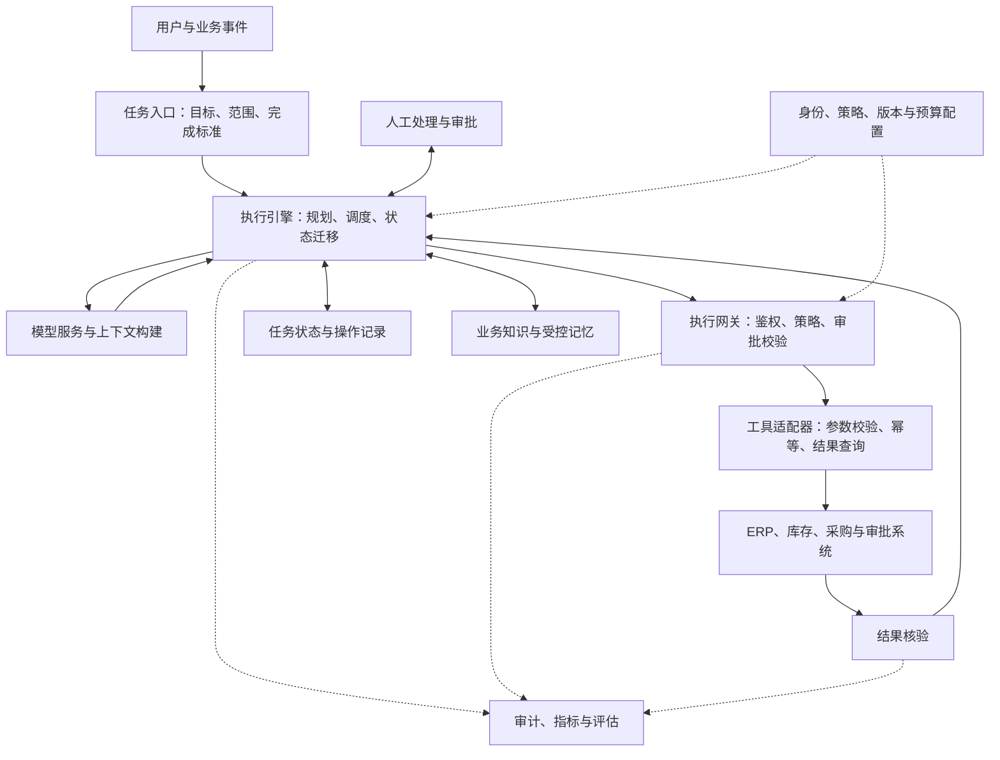
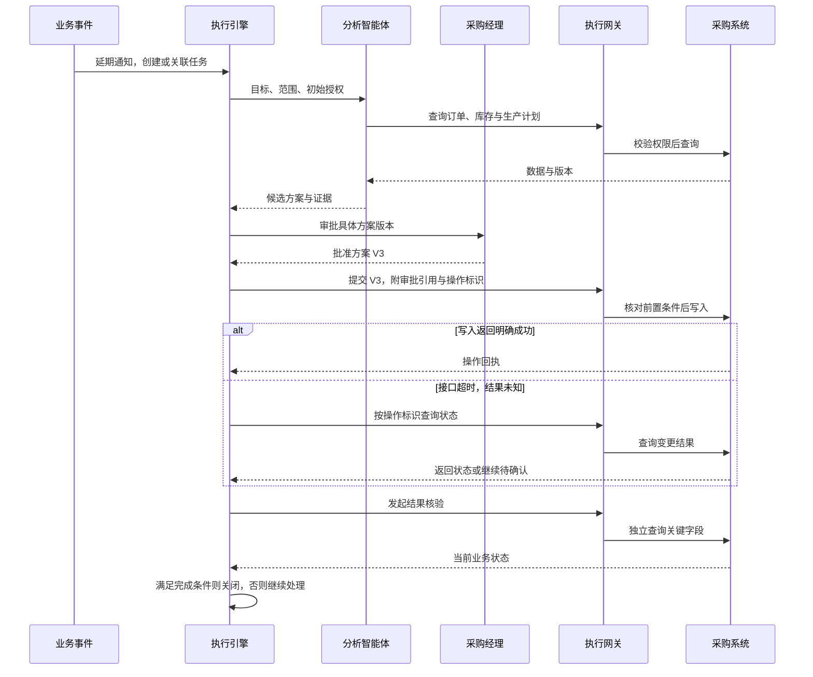

一个采购智能体发现供应商延期，查到了库存，也找到了替代方案。它生成了一份完整的报告，甚至准备好了采购单修改请求。演示到这里，似乎已经成功。

但真正的业务才刚开始：它能否修改这张订单？采购经理批准的是哪个版本的方案？接口超时后，订单究竟有没有改成功？如果第二天服务重启，任务应该从哪里继续？最终由谁确认交期风险已经解除？

这些问题共同决定了智能体能否进入生产环境。企业需要把模型的分析与行动能力放进一个有状态、有权限、有恢复机制、有验收标准的运行体系。

本文将这个体系称为 **Agent 运行底座**，也讨论它与 Agent OS 的关系。围绕一个采购异常处理案例，逐步建立任务模型、参考架构、权限边界和实施路径。案例中的公司、订单、金额与验收条件均为设计示例；架构及实施建议是本文提出的工程方案，引用资料用于支撑相关技术机制。

## 一、先定义业务完成，再讨论智能体能力

设想一家制造企业收到供应商通知：一批关键零件将延期三天。企业希望智能体判断生产是否受影响，并推动必要的采购调整。

这个任务至少包含五个环节：识别延期事实，核对库存和生产计划，比较替代供应方案，提交调整审批，执行变更并核验结果。

各环节的完成条件不同。识别延期要求找到可信通知；比较方案要求使用有效报价与合格供应商名单；执行变更则要求目标系统接受修改，并且修改结果符合批准内容。报告写得完整，只能证明其中一部分工作完成。

因此，任务创建时应形成一份明确的执行约定：

| 要素 | 本案例的约定 |
| --- | --- |
| 目标 | 为受影响订单形成可执行的供货调整方案，并完成获批变更 |
| 范围 | 指定法人主体、工厂、订单与零件 |
| 输入依据 | 供应商通知、库存快照、生产计划、有效报价 |
| 初始授权 | 查询信息、生成方案、创建审批申请 |
| 执行约束 | 修改订单须获得对应授权；本任务不包含付款操作 |
| 完成标准 | 获批方案已写入业务系统，关键字段经独立查询核验 |
| 退出条件 | 审批拒绝、证据不足、预算耗尽或异常移交人工 |

这份约定同时约束模型、执行引擎与验收过程。模型可以探索如何完成目标，但不能自行改变授权范围或降低完成标准。

Anthropic 在《Building effective agents》中区分了两类组织方式：工作流按预定义路径编排，智能体由模型动态决定过程和工具使用。[1] 采购场景可以组合两者：资料分析与方案比较保留探索空间，审批、写入和核验则沿明确流程执行。

## 二、Agent OS 的位置与职责

本文使用 Agent OS 一词时，指的是面向企业智能体的公共运行与治理体系。这个工作定义用于划分架构职责，不预设它必须由某一个产品实现。

可以借用传统操作系统的一些概念帮助理解：任务需要生命周期管理，资源访问需要授权，运行中断需要恢复，多个执行者需要协调。不过，这种类比有明确边界。模型的一次规划不等同于操作系统进程，企业工具调用也不具备本地系统调用的原子性。

更适合工程实施的划分如下：

| 组成 | 在本方案中的主要职责 |
| --- | --- |
| 模型服务 | 分析信息、生成计划、提出工具调用与候选答案 |
| 智能体开发框架 | 组织模型交互、工具接口和推理循环 |
| 任务执行引擎 | 管理状态迁移、等待、恢复、重试与超时 |
| 企业集成层 | 连接业务系统，处理协议差异与数据转换 |
| 公共治理能力 | 管理身份、策略、审批、审计、版本与预算 |
| 业务应用 | 定义目标、业务规则、交付标准和人工责任 |

这些职责可以分布在已有系统中。建设初期可以复用现有工作流、身份平台、消息系统和监控体系，再补齐智能体执行需要的能力。

是否值得抽取公共底座，取决于重复需求是否已经出现：多个业务场景是否反复建设相同的审批接口、恢复逻辑、工具连接和审计能力？如果答案是肯定的，统一这些能力就有具体收益。

## 三、围绕任务生命周期组织架构

下面给出一套参考架构。设计重点是让任务状态、业务动作和治理判断能够相互关联。

### 1. 用结构化状态表达任务进展

本方案为每个业务任务分配稳定的任务标识，并分别记录执行尝试、业务操作和审批实例。服务重启会产生新的执行尝试，但不应让同一笔业务操作获得新的语义身份。

任务状态可以包括待执行、执行中、等待审批、等待外部结果、结果待确认、已完成、已拒绝和已移交。状态迁移应记录触发事件与证据，避免仅凭聊天记录推断当前进度。

LangGraph 的持久化文档将线程内状态快照与跨线程存储区分开来，分别服务于执行连续性和长期信息共享。[3] 本方案进一步将外部操作记录独立保存，以便查询一笔写入是否已经发出、是否收到回执、是否经过核验。

### 2. 给每个工具定义业务契约

工具描述需要说明参数与返回值，还应说明操作是否写入数据、如何查询执行状态、是否支持幂等、哪些错误允许重试，以及失败后需要谁处理。

采购工具可以按业务动作暴露“查询订单”“提交指定版本的订单变更”“查询变更结果”等接口。这样，授权规则与验收条件能够直接对应业务动作。

MCP 提供了工具发现与调用等协议能力。[2] 接入协议解决系统如何交换信息的问题；在本文架构中，法人范围、金额限制、订单版本和审批资格仍由运行环境与业务服务共同校验。

### 3. 根据任务结构选择执行方式

本案例首先采用一个负责分析的智能体，加一条明确的业务执行流程。只有当资料检索、供应商分析等子任务可以独立完成，并有清晰结果契约时，才考虑引入多个执行者。

采用多智能体后，还需要定义谁拥有最终决策权、谁能修改共享状态、如何合并相互冲突的结论。是否增加协作复杂度，应由评估结果证明收益。这样的实施顺序也符合 Anthropic 从简单、可组合模式开始的建议。[1]

## 四、把权限落实到具体动作

采购经理发起任务，不意味着智能体自动继承采购经理的全部权限。本方案同时记录委托人、执行身份、所属组织与任务授权，凭证由受控组件管理。

针对每次工具调用，建议按以下条件共同判断：

> 允许执行 = 执行身份有效 ∧ 委托关系有效 ∧ 资源范围匹配 ∧ 动作与参数获准 ∧ 必要审批有效 ∧ 当前业务状态满足前置条件。

以修改采购单为例，允许调用工具只是第一步。系统还要检查该订单是否属于授权工厂，新增金额是否符合规则，目标供应商是否合格，以及订单是否仍处于可修改状态。

AWS AgentCore Policy 提供了一个可参考的机制：对经过关联 Gateway 的请求，使用 Cedar 策略在工具访问前进行判断。[4] 其作用范围需要明确到对应网关链路。本文方案同时要求限制直连业务系统的凭证与网络路径，避免请求绕过策略执行点。

### 审批必须绑定具体操作

假设采购经理批准的方案是：订单 P-1042，切换至供应商 B，新增费用 2,000 元，交期提前两天。

建议审批记录至少绑定任务标识、订单标识、订单版本、方案版本、操作类型、关键参数摘要、批准人和有效期。若后来新增费用变成 8,000 元，原审批不能覆盖新方案。

即使方案内容未变，执行前也应重新读取关键业务状态。审批期间，采购人员可能已经手工修改了订单。此时应检测版本冲突，重新评估方案，必要时重新审批。

本方案将这一步安排在尽可能靠近实际写入的位置，并优先使用业务系统提供的条件更新或版本检查。只在审批页面打开时检查一次，无法覆盖随后发生的变化。

### 审计保留可验证的行动依据

审计记录应回答：谁发起任务，使用了哪些数据版本，提交了什么操作，哪条策略允许执行，谁批准，以及业务系统最终返回了什么结果。

记录重点是外显决策、授权依据和执行证据。敏感字段应按需要脱敏，凭证不得进入普通日志；不同类型的记录可以采用不同保留周期和访问权限。

## 五、恢复执行进度，也恢复对业务事实的判断

持久化检查点能帮助执行引擎恢复进度，但本方案不会把检查点直接视为外部操作成功的证明。外部写入有自己的提交时刻，可能与本地记录保存之间存在时间差。

因此，建议将任务状态、工具操作记录和业务结果核验共同纳入恢复流程。[3][5]

### 1. 先处理“结果未知”，再决定是否重试

智能体提交订单变更后发生网络超时，存在至少两种可能：请求没有到达业务系统，或请求已经完成但响应丢失。AWS Builders’ Library 对幂等 API 的讨论，正是从这类重试歧义出发。[5]

本方案将该操作记为“结果未知”，随后按操作标识或业务请求号查询目标系统。确认已成功则进入核验；确认未执行且满足重试条件才重试；无法确认时进入对账或人工处理。

这要求工具返回结构能够表达成功、明确失败和结果未知，而不是把所有异常压缩成一个失败标志。

### 2. 为同一业务意图使用稳定的幂等标识

假设方案 V3 需要对订单 P-1042 执行一次变更，可以将任务、操作和方案版本共同映射为一个稳定标识。重试继续使用原标识；方案发生实质变化则创建新的操作，并重新判断授权。

AWS 的相关实践强调使用调用方提供的请求标识表达重试意图。[5] 在本方案中，还需要约束同一标识下的参数一致性，并保存它与审批记录、目标系统回执的映射。

如果下游系统不支持幂等或唯一业务请求号，仅在本地保存标识仍不足以保证不重复写入。适配层应结合状态查询、对账和冲突检查控制风险；无法确认的写入继续保留为待处理事项。

### 3. 将补偿设计成明确的业务动作

取消尚未生效的申请、撤回未发布的变更，可以预先定义补偿路径。已经对外发送的通知或已经确认的订单，则可能需要发起更正、取消协商或人工处置。

本方案为补偿动作单独记录权限、执行结果和失败状态。任务取消时，也要继续跟踪已经提交但尚未确认的外部操作，直到完成核验或移交。

### 4. 为长任务保留可接续的工作记录

Anthropic 关于长时间运行智能体的实践强调分步推进，并为后续会话留下清晰的进度与工作产物。[6]

采购任务可以据此保存：当前目标、已验证事实、已完成操作、待解决问题、下一步动作以及相关证据引用。恢复时重新读取结构化状态与关键外部事实，再构建模型上下文。

同时设置运行时间、调用次数和费用预算。预算耗尽时保留明确的未完成原因与移交内容，使任务能够被人或后续执行者接手。

## 六、把运行记录变成可维护的知识

任务运行会留下大量信息。本方案将它们按用途分开管理：

| 信息类型 | 示例 | 建议维护方式 |
| --- | --- | --- |
| 业务知识 | 合格供应商规则、采购制度 | 指定负责人、版本与生效范围 |
| 任务状态 | 当前等待审批、订单变更结果未知 | 随执行更新，作为恢复依据 |
| 用户偏好 | 希望方案按成本排序 | 明确归属，允许查看、修改与删除 |
| 历史经验 | 某类超时适合先按请求号查询 | 保留证据，验证后限定适用范围 |

这种区分与持久化文档中线程内状态、跨线程信息的分工相呼应，但具体分类与维护流程由业务场景决定。[3]

建议长期信息至少携带来源、所属组织、适用范围、有效时间与版本。涉及实时价格、库存和交期的结论，使用前仍需核对业务系统。

经验进入共享知识库时，可以采用“候选提取—证据校验—负责人审核—场景回归—限定发布”的流程。一次成功执行可以成为候选样本，但是否具有普遍适用性，需要进一步验证。

例如，某次任务发现接口超时后等待十秒即可查到结果。这可以形成排查线索；只有确认接口处理机制和适用条件后，才适合固化为恢复策略。

模型、提示词、工具、策略与知识规则也应分别记录版本。评估失败时能够定位变化来源，回滚时则恢复相应配置。已经发生的业务写入需要独立处理，不能随配置回滚一起消失。

## 七、让采购异常处理形成完整闭环

现在将前述能力放回同一个任务中。

收到延期通知后，任务入口创建异常处理任务，并检查是否已有针对同一业务事件的有效任务。智能体查询订单、库存与生产计划，保存关键数据的版本和时间，形成两个候选方案及其证据。

采购经理选择其中一个方案并批准。执行引擎随后重新检查身份、策略、方案摘要和订单版本。全部满足条件后，带稳定操作标识提交变更；写入完成后，通过独立查询核对供应商、数量、金额和交期。

这里的“任务完成”限定为获批变更已执行并核验。实际货物是否按时到达，需要继续由到货跟踪任务或既有业务流程负责，不能提前宣称交期风险已经彻底解除。

异常分支同样需要有明确终点：

| 异常 | 任务处理 | 继续或关闭条件 |
| --- | --- | --- |
| 接口超时 | 标记结果未知，查询与对账 | 已确认原操作结果；满足条件后才重试 |
| 审批拒绝 | 保存拒绝原因，关闭该方案的执行路径 | 修改方案后重新发起，或以拒绝状态结束 |
| 订单版本变化 | 暂停写入，重新评估方案影响 | 新状态满足条件，必要审批重新完成 |
| 写入后核验失败 | 记录差异，检查状态传播延迟或部分执行 | 在规定时限内核验成功，或完成补偿、人工移交 |
| 服务中断 | 恢复任务，检查未确认操作 | 业务事实核对完成后接续执行 |

每条分支都应产生可以解释的业务状态。“移交人工”可以是合规的处理结果，但在统计自主完成率时应单独计算。

## 八、从单场景闭环建设到共享平台

建议按可验证的交付目标逐步建设。

第一阶段选择一个业务边界清晰、结果可核验的任务，记录人工处理时长、错误类型与成本。先完成资料分析和方案生成，验证模型是否确实改善业务处理。

第二阶段接入受控写入，补齐身份、审批、幂等、结果查询、审计和人工接管。阶段验收应包含中断、超时、重复事件和授权变化等情况。

第三阶段接入相邻场景，识别真正重复出现的连接器、策略与恢复机制，再抽取公共接口。业务规则仍由对应业务负责人维护。

第四阶段建立持续运营机制，包括版本发布、回归评估、容量管理、成本分析、异常复盘和组件退出方案。

实施过程中，可以按实际条件选择自建、采购或组合建设：

| 方式 | 适用条件 | 重点验证事项 |
| --- | --- | --- |
| 自建 | 核心流程特殊，现有平台能力可复用，有持续维护团队 | 开发周期、运行责任、协议与版本维护投入 |
| 采购 | 场景与产品能力匹配，希望缩短部署周期 | 数据部署、审计导出、权限边界、恢复机制和迁移能力 |
| 组合建设 | 已有业务基础设施，需要补齐部分智能体能力 | 身份传递、状态归属、跨组件故障定位和责任分工 |

决策时应使用自己的业务任务完成验证。工具能否连接、审批能否准确绑定、异常能否恢复、运行记录能否导出，都可以转化为具体的采购或建设验收项。

## 九、用业务结果验收运行底座

Anthropic 关于智能体评估的文章区分了任务、执行尝试、评分器、执行轨迹与最终结果，并强调根据评价对象组合程序检查、模型评分和人工判断。[7]

本文据此建议将业务状态检查放在验收中心：订单字段是否符合获批方案，可以通过程序核验；方案是否解释充分，可以结合人工与模型评价；最终接受标准由业务负责人确定。

| 维度 | 指标 | 建议明确的统计口径 |
| --- | --- | --- |
| 业务效果 | 端到端任务成功率 | 达到预设业务完成标准的任务数 ÷ 纳入统计的任务数 |
| 业务效果 | 自主完成率 | 无人工接管且达到完成标准的任务数 ÷ 纳入统计的任务数；正常审批单独标记 |
| 运行可靠性 | 中断恢复成功率 | 指定故障注入后，在规定条件内恢复的任务数 ÷ 对应测试任务数 |
| 运行可靠性 | 重复业务写入率 | 发生重复副作用的逻辑操作数 ÷ 纳入统计的写入操作数 |
| 权限治理 | 未授权操作拦截率 | 被拦截的未授权测试操作数 ÷ 未授权测试操作总数 |
| 权限治理 | 审计完整率 | 具备规定证据的关键操作数 ÷ 抽查关键操作数 |
| 经济性 | 单位成功任务成本 | 统计范围内全部任务消耗的资源与人工费用 ÷ 成功任务数 |

各项指标应预先说明任务范围、时间窗口、重试规则和排除条件。失败任务成本应计入相应总成本；单位成功任务成本的分母为零时，报告总投入与零成功任务，不能给出失真的单价。

权限测试也需要覆盖合法操作，记录误拦截率。某个测试集中的拦截率只能描述该测试集表现，应同时披露场景覆盖范围。

建议准备三组验收任务：正常任务验证完整交付；异常任务注入超时、宕机、重复事件和部分执行；边界任务覆盖跨组织访问、审批过期、参数篡改及外部内容诱导越权等情况。

对具有随机性的模型执行，使用多次运行观察稳定性，并把模型、提示词、工具与知识版本同评估结果绑定。[7] 上线后持续收集人工介入和实际业务差错，补充回归样本。

验收的最后一步，是明确运营责任：业务负责人维护完成标准与风险边界，平台负责人维护执行和恢复机制，系统负责人保证接口与业务状态可核验。

## 结语

企业智能体建设可以从一个具体任务开始：它获得了什么授权，做出了哪些动作，遇到中断如何继续，最终凭什么确认完成。

当这些问题都有明确答案，模型能力才能被稳定接入业务流程。随着场景扩展，共享的执行、权限、状态与评估能力逐步形成运行底座。Agent OS 的价值，也由它实际承载的业务任务、交付质量和维护成本来检验。

## 参考资料

以下资料支撑本文涉及的工作流、工具协议、持久化、策略执行、幂等与评估机制。采购案例、参考架构、实施阶段和指标口径为本文提出的设计方案。

[1] Anthropic. *Building effective agents*.
https://www.anthropic.com/engineering/building-effective-agents

[2] Model Context Protocol. *Architecture overview*.
https://modelcontextprotocol.io/docs/learn/architecture

[3] LangChain. *Persistence — LangGraph documentation*.
https://docs.langchain.com/oss/python/langgraph/persistence

[4] AWS. *Policy in Amazon Bedrock AgentCore: Control Agent Interactions*.
https://docs.aws.amazon.com/bedrock-agentcore/latest/devguide/policy.html

[5] AWS Builders’ Library. *Making retries safe with idempotent APIs*.
https://aws.amazon.com/builders-library/making-retries-safe-with-idempotent-APIs/

[6] Anthropic. *Effective harnesses for long-running agents*.
https://www.anthropic.com/engineering/effective-harnesses-for-long-running-agents

[7] Anthropic. *Demystifying evals for AI agents*.
https://www.anthropic.com/engineering/demystifying-evals-for-ai-agents
