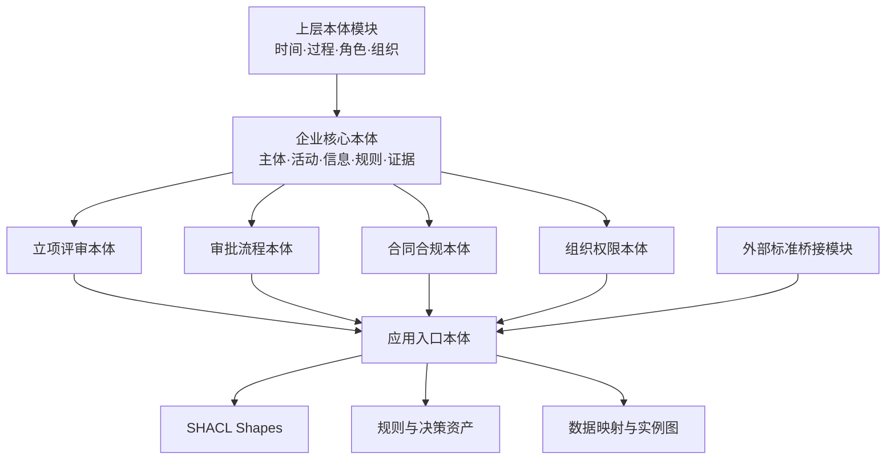
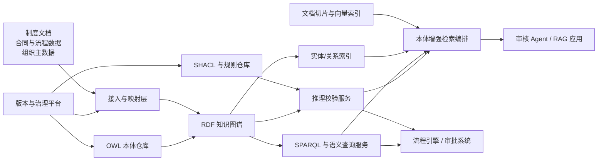
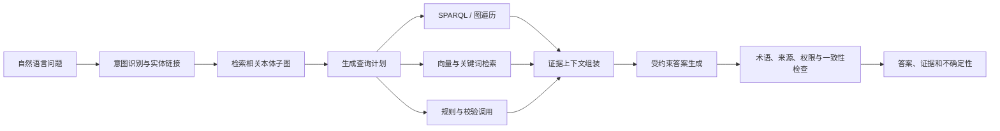

企业建设本体，真正困难的部分通常不是写出几个 `owl:Class`，而是让业务术语、数据事实、规则约束和应用接口长期保持同一种含义。

在立项评审、审批流、合同合规和组织权限等场景中，系统需要回答的并不只是“有哪些对象”，还包括：谁在什么组织中以什么角色执行了什么活动；某项审批为什么有效；某份合同受哪些制度约束；一个审核结论依据了哪些事实、规则和证据；当组织、制度或本体发生变化时，哪些查询和应用会受到影响。

这些问题横跨概念建模、逻辑推理、数据集成、规则执行、知识检索和软件工程。只建设分类树，无法支持业务运行；只建设知识图谱，无法保证语义一致；只把文档放进向量库，也无法稳定完成跨对象、跨时间和跨规则的审核判断。

本文提出一套企业级领域本体工程方法：以能力问题确定范围，以模块化 OWL 本体建立共享语义，以 RDF 知识图谱承载事实，以 OWL 推理和 SHACL 校验执行约束，以本体增强 RAG 和 Text-to-SPARQL 为大模型提供受控知识访问，并通过 API、版本包和治理流程将本体变成可运行、可验证、可演进的组织知识资产。

## 一、本体工程要解决的不是“名词整理”，而是语义失控

企业中的同一个词，经常在不同系统中指向不同对象。例如“项目负责人”可能是项目主数据上的一个字段，也可能是组织任命形成的角色，还可能是某次审批中临时承担责任的人。如果系统只比较字段名，就会把三种不同事实混在一起。

相反，不同系统中的不同词也可能指向同一概念。例如“申请部门”“发起单位”和“项目申报组织”可能都表示在某次立项活动中承担申请角色的组织。没有统一语义时，每个报表、接口、规则和智能体都要重新解释一次。

这会形成四类持续成本。

| 问题 | 典型表现 | 本体工程的目标 |
| --- | --- | --- |
| 概念不一致 | 同名异义、异名同义、角色与实体混淆 | 建立可复用的概念定义和关系语义 |
| 规则散落 | 审批条件写在代码、流程配置和人工经验中 | 将可形式化的规则变成可验证资产 |
| 数据难组合 | 主数据、流程数据、合同文本和制度条款无法直接关联 | 用稳定标识和语义映射连接多源事实 |
| 智能应用不可靠 | RAG 找到相关文本，却不能证明结论是否适用 | 用本体、约束和来源限制检索与生成 |

Gruber 将本体工程的核心概括为对概念化的显式规范[1]。Uschold 和 Gruninger 进一步强调，本体的价值在于支持共享理解、复用和互操作，而不是追求脱离用途的概念完备性[2]。因此，企业本体建设首先要回答两个问题：哪些语义需要被多个系统共同依赖，以及这些语义必须支持哪些可验收的业务判断。

## 二、先定义能力问题，再决定建哪些概念

本体项目最容易走偏的方式，是从数据库表、接口字段或制度名词开始枚举概念。这样得到的模型往往规模很大，却无法证明它能解决哪个业务问题。

更可靠的起点是能力问题，即 Competency Questions。能力问题用自然语言规定本体及知识图谱必须回答什么，再由这些问题反推对象、关系、时间、规则和数据范围[2][3]。

### 1. 用业务问题划定首期范围

以立项评审和合同合规为例，首期可以定义以下能力问题：

| 编号 | 能力问题 | 依赖的核心语义 | 验收方式 |
| --- | --- | --- | --- |
| CQ-01 | 某项目当前处于哪个评审阶段？ | 项目、流程实例、阶段、状态、时间 | SPARQL 返回唯一当前阶段及生效时间 |
| CQ-02 | 当前审批人是否具有有效授权？ | 人员、组织、角色授予、权限、有效期 | 推理结果和授权证据可追溯 |
| CQ-03 | 申请人与审批人是否违反职责分离要求？ | 角色承担、审批活动、申请活动 | SHACL 产生明确违规信息 |
| CQ-04 | 某合同适用哪些制度和合规条款？ | 合同类型、条款、制度、适用范围 | 返回适用规则及版本 |
| CQ-05 | 某审核结论由哪些事实和规则支持？ | 结论、证据、规则执行、来源 | 输出完整解释链 |
| CQ-06 | 某制度变更会影响哪些合同和审批规则？ | 版本、依赖、映射、规则引用 | 生成影响清单和回归测试范围 |

能力问题不能只写成愿景。每个问题都应同时定义：输入参数、预期结果、数据时效、授权范围、可接受的不确定性，以及结果错误时如何定位原因。

### 2. 把能力问题转成可执行测试

每个能力问题至少应对应四类资产：

1. 一条或多条 SPARQL 查询，用来检查模型是否支持目标问题。
2. 一组正例和反例数据，用来验证推理与校验结果。
3. 一份预期答案或预期违规清单，用于自动回归。
4. 一组来源和权限条件，用来验证结果能否被当前调用者使用。

这样，能力问题就不再只是访谈记录，而成为连接业务需求、本体设计、数据映射和应用验收的测试契约。

## 三、用分层和模块化控制本体复杂度

企业本体不应被维护成一个不断膨胀的 OWL 文件。更适合的方式是将稳定程度、责任主体和发布周期不同的内容拆成模块，并通过明确的导入关系组合。



建议至少区分以下资产层次。

| 层次 | 主要内容 | 变化频率 | 责任主体 |
| --- | --- | --- | --- |
| 上层本体 | 对象、过程、事件、角色、时间、组织等基础范畴 | 很低 | 本体架构组 |
| 企业核心本体 | 主体、业务活动、信息对象、规则、证据、授权 | 低 | 企业语义治理组 |
| 领域本体 | 项目、审批、合同、合规、组织权限 | 中 | 领域专家与本体工程师 |
| 应用本体 | 针对某项服务或产品组合所需模块 | 中到高 | 应用团队 |
| 数据形状 | 必填、基数、值域、跨字段约束 | 高 | 数据与规则负责人 |
| 映射与实例 | 来源字段、IRI 生成、实例事实、来源信息 | 高 | 数据工程团队 |
| 桥接本体 | 与外部标准或其他领域本体的映射公理 | 中 | 集成与治理团队 |

模块化的价值不是让文件变多，而是把变化限制在明确边界内。一个合同条款分类的调整，不应迫使组织本体重新发布；一个外部标准升级，也不应直接修改企业核心本体中的稳定 IRI。

内容本体设计模式可以进一步复用角色、参与、时间和信息对象等常见表达结构，减少不同领域重复发明相似模型[5]。模式复用仍然需要结合企业术语和能力问题进行适配，不能把示例命名和局部假设原样复制到生产本体。

## 四、上层本体对齐：先选择本体承诺，再复用类名

BFO、DOLCE/DUL 和 UFO 都提供了对象、事件、角色和关系等基础概念，但它们背后的建模承诺并不相同。上层本体对齐不能被简化为把 `Process`、`Event`、`Role` 等同名类声明为 `owl:equivalentClass`。

### 1. 三类上层本体的侧重点

| 上层本体 | 侧重点 | 企业场景中的优势 | 使用时需要注意 |
| --- | --- | --- | --- |
| BFO | 现实主义、持续存在物与过程、严格类别体系 | 适合需要与生命科学、工业资产等 BFO 生态互操作的场景 | 对社会对象、制度描述和业务角色需要增加领域模式 |
| DOLCE/DUL | 描述、情境、社会对象、角色和信息对象 | 适合知识图谱、文档、规则、组织和业务情境建模 | DUL 是轻量应用本体，不应与完整 DOLCE 的全部公理混为一谈 |
| UFO | 类型、角色、阶段、关系体、事件及社会关系 | 适合概念建模审查，尤其是岗位、角色、授权和责任关系 | 概念模型需要经过工程化裁剪后再进入运行本体 |

UFO 的系统性介绍强调了 Kind、Role、Phase、Relator 和 Event 等范畴在概念建模中的作用[6]。关于上层本体匹配的研究也表明，不同上层本体之间的映射经常不是简单等价关系，而是受到形式化语言和本体承诺差异的限制[7]。

### 2. 企业项目中的推荐策略

第一，不同时把多个上层本体完整导入生产本体。多个体系可能对抽象对象、时间、性质和实例化关系作出不同约定，完整混用会扩大不可满足类和意外推理的风险。

第二，选择一个主要上层本体作为运行时语义骨架。选择依据应包括：外部互操作对象、团队经验、所需表达能力、推理成本和已有标准依赖。

第三，可以把另一个上层本体作为概念审查工具。例如使用 UFO 检查“岗位”“角色”“授权关系”和“职责承担”的概念错误，但运行时只发布经过裁剪的企业核心模式。

第四，跨生态集成通过独立桥接模块完成。桥接公理应带有来源版本、映射类型、判断依据、审核人和置信级别；未确认的映射作为候选记录保存，不能直接发布为逻辑等价。

### 3. 角色不能被建模成永久身份

组织权限是最能暴露概念错误的领域。人员是持续存在的主体，岗位是组织结构中的位置，角色是主体在特定情境中承担的能力或责任，授权则是把某种权限授予主体或角色的社会行为及其结果。

因此，“审批人”通常不应成为 `Person` 的永久子类。更合理的表达是：某个人通过一次具有有效时间的角色承担记录，在某个组织范围或流程实例中承担审批角色。

```text
Person ──参与──> RoleAssignment ──实现──> ApproverRole
                         │
                         ├──适用于──> Organization / ProcessInstance
                         ├──开始时间──> validFrom
                         └──结束时间──> validUntil
```

这个模式能够表达同一个人在不同项目中承担不同角色，也能够在授权撤销后保留历史事实。

## 五、领域本体建模：从业务对象走向形式化公理

OWL 本体至少要回答三类问题：什么对象属于什么类型，对象之间可以建立什么关系，以及哪些条件足以或必须使对象属于某个类型。

### 1. 建立跨领域公共语义

立项、审批、合同和合规不应各自重复定义人员、组织、活动和证据。建议在企业核心本体中先定义以下稳定概念：

| 类别 | 核心概念示例 |
| --- | --- |
| 主体 | `Person`、`Organization`、`OrganizationalUnit` |
| 角色与授权 | `Role`、`RoleAssignment`、`PermissionGrant` |
| 过程与活动 | `BusinessProcess`、`BusinessActivity`、`DecisionActivity` |
| 信息对象 | `Document`、`ContractDocument`、`PolicyDocument` |
| 规则与结论 | `Rule`、`RuleExecution`、`Decision`、`Finding` |
| 证据与来源 | `Evidence`、`DataSource`、`ProvenanceRecord` |
| 时间 | `TimeInstant`、`TimeInterval`、`ValidityPeriod` |

领域模块再增加 `ProjectProposal`、`ApprovalActivity`、`Contract`、`ContractClause`、`ComplianceRequirement` 等业务概念。

### 2. 一个简化的 OWL 示例

下面的 Turtle 片段表达审批活动必须至少有一名执行者，并且执行者必须是人员。它还声明审批活动是业务活动的一种。

```turtle
@prefix ent: <https://example.com/ontology/enterprise#> .
@prefix owl: <http://www.w3.org/2002/07/owl#> .
@prefix rdf: <http://www.w3.org/1999/02/22-rdf-syntax-ns#> .
@prefix rdfs: <http://www.w3.org/2000/01/rdf-schema#> .

ent:ApprovalActivity
    a owl:Class ;
    rdfs:subClassOf ent:BusinessActivity ;
    rdfs:subClassOf [
        a owl:Restriction ;
        owl:onProperty ent:hasPerformer ;
        owl:someValuesFrom ent:Person
    ] .

ent:hasPerformer
    a owl:ObjectProperty ;
    rdfs:domain ent:BusinessActivity ;
    rdfs:range ent:Person .

ent:ApprovedProject
    a owl:Class ;
    owl:equivalentClass [
        a owl:Class ;
        owl:intersectionOf (
            ent:Project
            [
                a owl:Restriction ;
                owl:onProperty ent:hasApprovalDecision ;
                owl:someValuesFrom ent:EffectiveApprovalDecision
            ]
        )
    ] .
```

这里要注意两个语义细节。

第一，`rdfs:domain` 和 `rdfs:range` 会触发类型推断，不是表单校验。若某个主体通过 `hasPerformer` 参与活动，推理器可能据此把它推断为 `Person`；它不会像数据库约束一样直接拒绝错误数据。

第二，OWL 采用开放世界假设。没有记录审批决定，不代表系统可以断言该项目“未审批”；它只表示当前知识不足以证明项目已经审批。业务上的必填和完整性要求应交给 SHACL 等校验机制。

### 3. 用 OntoClean 思想审查类层次

OntoClean 通过刚性、身份和依赖等元属性检查分类关系[4]。企业建模中尤其应警惕以下错误：

- 把“审批人”“申请人”作为人员的永久本质类型；
- 把“草拟合同”“生效合同”都当成互不相关的对象，而不是合同在生命周期中的阶段；
- 把合同文档与合同所表达的法律关系视为同一个对象；
- 把制度条款、条款文本和条款适用事件混为一类；
- 把流程定义和某次真实运行的流程实例混为一类。

这些错误在小规模查询中可能不明显，但会在时间建模、历史追踪、版本迁移和规则解释中持续放大。

## 六、推理、规则和校验必须明确分工

OWL、SWRL 和 SHACL 都可以表达某种“约束”，但它们回答的问题不同。把三者混为一个规则系统，会造成结果难解释、性能不可控和业务语义错误。

### 1. OWL Profile 的选型

OWL 2 提供多个 Profile，用不同表达能力换取可预测的计算特性[9]。

| Profile | 适合场景 | 典型能力 | 不适合的情况 |
| --- | --- | --- | --- |
| OWL 2 EL | 大规模类层次、产品分类、医学或工业术语体系 | 高效分类、存在限制、属性层次 | 需要复杂否定、析取和基数约束 |
| OWL 2 QL | 关系数据库上的本体驱动访问 | 查询重写、面向大规模实例数据 | 复杂类表达式和深层推理 |
| OWL 2 RL | 企业规则化推理和三元组存储 | 可由规则引擎实现、适合在线推理 | 需要完整 DL 表达能力 |
| OWL 2 DL | 本体设计期的一致性和复杂概念推理 | 表达能力强且保持可判定性 | 对大规模在线实例进行无边界推理 |

一个常见的工程组合是：设计和发布前使用 HermiT 或 Openllet 执行 OWL 2 DL 一致性检查；大规模分类本体使用 ELK；生产查询使用数据库支持的 RDFS/OWL RL 子集；数据完整性和业务违规使用 SHACL。

### 2. OWL 负责语义推断

OWL 适合表达稳定、单调的领域知识，例如：

- 审批活动是一种决策活动；
- 有效审批决定是一种业务决定；
- 合同条款是信息对象的一部分；
- 如果某类合同受到某类制度约束，则其实例继承相应分类；
- 某些类型彼此不相交；
- 某个复杂类由一组必要且充分条件定义。

OWL 推理的结果是新增可推出的事实或发现逻辑不一致，而不是输出“第 12 个字段未填写”。

### 3. SHACL 负责数据与业务约束

SHACL 适合表达必填、基数、类型、模式、值域和跨属性约束。下面的 Shape 检查审批活动必须有且只有一个执行者，并检查申请人与审批人不能是同一人。

```turtle
@prefix ent: <https://example.com/ontology/enterprise#> .
@prefix sh: <http://www.w3.org/ns/shacl#> .

ent:ApprovalActivityShape
    a sh:NodeShape ;
    sh:targetClass ent:ApprovalActivity ;
    sh:property [
        sh:path ent:hasPerformer ;
        sh:minCount 1 ;
        sh:maxCount 1 ;
        sh:class ent:Person ;
        sh:message "审批活动必须配置一名有效审批人"@zh
    ] ;
    sh:sparql [
        sh:message "项目申请人与审批人不能是同一主体"@zh ;
        sh:select """
            SELECT $this
            WHERE {
                $this ent:approvesProject ?project ;
                      ent:hasPerformer ?reviewer .
                ?project ent:hasApplicant ?reviewer .
            }
        """
    ] .
```

SHACL 研究不仅覆盖数据校验，还涉及约束可满足性、包含关系、递归和与推理规则的交互[11]。在企业系统中，Shape 应像代码一样接受版本管理、单元测试和性能测试。

### 4. SWRL 只用于受控的派生规则

SWRL 可以把 OWL 类和属性与 Horn 风格规则结合，例如“某人承担审批角色且角色授予在当前时间有效，则该人是当前有效审批主体”。但 OWL 与一般规则结合可能带来不可判定或高成本推理问题[10]。

生产中应限制 SWRL 的使用范围：

- 规则必须满足可执行引擎支持的安全子集；
- 不用 SWRL 模拟复杂流程状态机；
- 不用 SWRL 实现带优先级、撤销、例外和非单调逻辑的政策体系；
- 每条规则必须有业务编号、责任人、有效期和测试用例；
- 复杂决策优先交给 DMN、决策表或专用规则引擎，再把结论和证据写回知识图谱。

### 5. 解释是推理服务的一等输出

审核系统不能只返回 `true` 或 `false`。一个可用的解释至少应包含：

1. 结论是什么；
2. 使用了哪些显式事实；
3. 推导出了哪些中间事实；
4. 命中了哪一版本的规则或 Shape；
5. 哪些来源提供了这些事实；
6. 是否存在缺失数据或冲突；
7. 当前调用者是否有权查看完整证据。

SHACL 非验证解释研究表明，可以进一步计算导致违规的原因和可能的修复集合[12]。这为审核 Agent 输出“为什么不通过”和“需要补充什么”提供了形式化基础。

## 七、知识图谱架构：把语义资产和运行数据分开治理

一个生产级本体平台通常需要同时处理设计、发布、映射、实例数据、推理、校验、查询、检索和审计。把这些职责全部交给单一数据库，会使平台边界模糊。



### 1. 平台选型维度

Stardog、GraphDB、Virtuoso、RDF4J 和 Neo4j 不应只按“是否支持图”比较，而应按实际语义需求评分。

| 维度 | 需要回答的问题 |
| --- | --- |
| RDF/SPARQL | 是否原生支持 RDF 1.1、SPARQL 1.1、Named Graph 和联邦查询 |
| 推理 | 支持哪些 RDFS/OWL Profile，采用物化还是查询重写，能否解释结果 |
| SHACL | 支持哪些 SHACL 特性，能否增量校验和输出标准报告 |
| 数据虚拟化 | 是否能把关系库等来源映射为语义视图，是否需要全量复制 |
| 版本隔离 | 是否支持仓库、图或数据集级隔离，如何执行灰度和回滚 |
| 安全 | 是否支持图级、实例级或查询级授权，能否与企业身份体系集成 |
| 运维 | 集群、高可用、备份恢复、监控、容量管理和商业支持能力 |
| 开发体验 | Java/RDF4J/OWLAPI 集成、事务、批量导入和测试工具是否成熟 |

### 2. 推荐的技术定位

- **Stardog 或 GraphDB**：适合把 RDF、SPARQL、推理、SHACL 和语义查询作为平台核心能力的场景。
- **Virtuoso**：适合强调大规模 RDF/SPARQL、数据发布和联邦访问的场景，但本体生命周期和规则治理通常需要额外建设。
- **RDF4J**：适合作为 Java 体系中的嵌入式框架、统一 API 或定制语义服务基础，不等同于开箱即用的完整治理平台。
- **Neo4j**：适合属性图遍历、图算法和面向应用的图投影。当 OWL 语义推理是核心要求时，不宜把属性图模式直接作为唯一权威本体层。

一个稳健的组合是：RDF/OWL 三元组存储作为权威语义与事实层，Neo4j 或分析引擎作为按需生成的计算投影，向量数据库作为文档与语义片段的召回索引。投影和索引都可以重建，权威语义、来源和版本不能只存在于投影中。

知识图谱综述对 RDF、属性图、知识表示、查询、推理和质量管理进行了系统梳理[8]。真正的选型依据应是能力问题和非功能目标，而不是产品是否带有“图数据库”标签。

## 八、RDF 化和多源对齐：保持事实、解释和来源之间的连接

把关系表转成三元组只是 RDF 化的表面工作。企业级 RDF 化还要解决对象身份、语义映射、时间、来源、删除传播和权限继承。

### 1. IRI 是长期契约

稳定 IRI 应表示业务对象和概念，而不是暴露当前数据库结构。建议遵循以下原则：

- 本体术语 IRI 与业务实例 IRI 使用不同命名空间；
- IRI 不依赖可变名称、组织简称或展示标签；
- 同一业务对象在多个来源中保持一个受治理的主标识；
- 无法证明同一性的记录使用映射关系或候选匹配，不滥用 `owl:sameAs`；
- 被废弃的 IRI 不重新分配给其他概念；
- IRI 解析页面返回定义、版本、状态和替代项。

### 2. 映射必须可追溯

每条映射至少需要记录：来源系统、来源对象、字段或表达式、目标类或属性、转换逻辑、标识策略、空值处理、更新时间、负责人和适用版本。

映射不应只保存在 ETL 代码中。否则本体属性变更后，团队无法定位哪些任务、索引、报表和 API 仍依赖旧语义。

### 3. 事实需要上下文

“张三是审批人”通常是不完整的事实。系统还需要知道：

- 在哪个组织或项目范围内；
- 对哪类审批活动有效；
- 授权从何时开始、何时结束；
- 依据哪份授权文件或组织规则；
- 该事实来自哪个系统和哪个数据版本；
- 当前状态是确认、推导、待审核还是已撤销。

需要携带多个限定条件的关系，可以通过事件、角色承担记录或关系实体重述，而不是不断为二元属性增加命名变体。

### 4. 物化、虚拟化和混合模式

| 模式 | 优点 | 代价 | 适用场景 |
| --- | --- | --- | --- |
| 全量物化 | 查询稳定、易于推理和建立索引 | 数据复制、同步和删除传播成本高 | 变化可控、查询频繁、需要快照推理 |
| 虚拟图/OBDA | 保留源端权威数据，减少复制 | 受源系统性能和映射表达能力限制 | 大量关系数据、实时性要求高、以查询为主 |
| 混合模式 | 高频事实物化，低频或敏感数据按需回源 | 架构和一致性管理更复杂 | 多源企业知识平台 |

不论采用哪种模式，查询结果都应携带数据观察时间和来源版本，避免把来自不同时间截面的数据组合成看似确定的当前状态。

## 九、本体增强 RAG：让模型在受控语义空间中检索和回答

传统 RAG 主要根据文本相似度召回片段。它能找到“谈到审批”的内容，却不一定知道当前问题中的审批是活动、角色、权限还是决定，也不一定识别制度版本和适用范围。

本体增强 RAG 的目标不是把整个知识图谱塞进提示词，而是利用本体完成四项控制：

1. **查询理解**：把用户词汇映射到受控概念、实例和关系。
2. **检索规划**：根据类层次、属性路径和能力问题决定需要查图、查文档还是执行规则。
3. **上下文组织**：按对象、时间、规则和证据关系组织最小充分上下文。
4. **输出验证**：检查答案是否使用了合法术语、是否有来源、是否越过权限和证据边界。

OG-RAG 等研究显示，领域本体可以用于组织事实及其关系，并改善专业场景中的检索和依据归因[18]。但企业落地时仍需区分研究指标与自身业务效果，使用内部能力问题、数据和风险条件重新评测。

### 1. 推荐的检索链路



### 2. Text-to-SPARQL 不能直接执行模型输出

Text-to-SPARQL 应被设计成受控编译链，而不是让大模型生成字符串后直接访问生产图谱。

建议流程如下：

1. 根据问题识别允许访问的业务域和数据集。
2. 只检索相关本体模块、类、属性、标签和少量示例查询。
3. 让模型输出结构化查询意图或 SPARQL AST，而不是自由文本。
4. 校验 IRI 是否来自允许词汇表，变量和属性路径是否符合 Domain/Range。
5. 禁止更新语句、服务端文件访问、无边界路径和未授权 Named Graph。
6. 执行 `EXPLAIN` 或代价估算，限制超时、结果规模和联邦端点。
7. 在沙箱或只读账户执行查询。
8. 对结果执行类型、基数、来源和权限复核。
9. 将查询、结果摘要、本体版本和提示版本写入审计记录。

Text-to-SPARQL 研究表明，示例选择、多候选生成和实体关系链接会显著影响查询效果[19]。复杂问题仍容易出现关系方向、错误 IRI、聚合和多跳连接错误，因此评价必须使用执行结果，而不能只检查字符串相似度。

### 3. LLM 在本体工程中的合理角色

LLM 可以显著降低以下工作的初稿成本：

- 从制度、合同模板和流程材料中提取候选术语；
- 根据能力问题生成候选类、属性和 Shape；
- 为既有术语补充定义、示例和多语言标签；
- 生成候选映射及其理由；
- 将能力问题转换为候选 SPARQL；
- 从本体差异中生成变更说明和测试建议。

已有研究也将 LLM 的潜在作用扩展到本体建模、修改、填充、对齐和实体消歧等环节[16]。但 LLM 不应自行完成生产发布。NeurIPS 2024 的 OLLM 研究探索了端到端生成本体分类骨架[17]；2026 年系统综述则指出，当前研究在任务定义、数据集、评价指标和复现实验方面仍不统一，且维护阶段研究明显不足[20]。更稳妥的定位是：LLM 生成候选资产，形式化工具执行语法、Profile、一致性和回归检查，领域专家负责语义承诺和发布决策。

## 十、把本体能力封装成稳定服务

应用团队不应被要求理解全部 OWL、公理和三元组细节。本体平台需要把语义能力封装成稳定 API，使流程引擎、审批系统和审核 Agent 能够调用。

### 1. 推荐的服务边界

| 服务 | 典型接口 | 主要输出 |
| --- | --- | --- |
| 术语服务 | `GET /v1/terms/{iri}` | 定义、标签、上位类、状态、版本 |
| 查询服务 | `POST /v1/queries/sparql` | 结构化结果、来源、数据时间 |
| 自然语言查询 | `POST /v1/queries/natural-language` | 查询计划、SPARQL、答案与证据 |
| 推理服务 | `POST /v1/reasoning/materialize` | 推导事实、推理依据、版本 |
| 校验服务 | `POST /v1/validations` | 违规项、严重级别、修复提示 |
| 解释服务 | `GET /v1/explanations/{decisionId}` | 事实、规则、推导和来源链 |
| 影响分析 | `POST /v1/changes/impact-analysis` | 受影响术语、规则、查询和应用 |

本体到 API 的鸿沟是语义技术落地中的长期问题。相关综述指出，自动 API 生成、基于本体的 API 版本管理、验证和测试仍是重要工程与研究方向[15]。

### 2. 业务调用必须绑定版本上下文

审核调用至少应传入或由服务解析以下上下文：

```json
{
  "subject": "project:2026-00128",
  "action": "submit-for-final-approval",
  "effectiveAt": "2026-10-27T10:00:00+08:00",
  "ontologyVersion": "2026.10",
  "policySet": "project-review-cn-v4",
  "caller": "agent:contract-reviewer",
  "requestedExplanationLevel": "evidence"
}
```

服务响应不能只有是否通过，还应包含决定状态、违规项、缺失事实、所用版本和证据引用。若数据不足，应返回 `unknown` 或 `insufficient-evidence`，而不是把无法证明误写成不通过或通过。

### 3. 可观测性要覆盖语义链路

传统 API 指标只能说明接口是否成功，不能解释语义结果为什么变化。本体服务还应记录：

- 本体、Shape、规则、映射和数据快照版本；
- 查询重写、推理命中和校验命中数量；
- 显式事实与推导事实的比例；
- 查询规划、推理、校验和结果组装耗时；
- 未识别术语、候选映射和低置信实体链接；
- 本体变更前后的答案差异；
- 调用者、授权范围和被过滤的证据数量。

这些信息既用于性能分析，也用于语义回归和审计。

## 十一、本体治理：发布的不是一个 OWL 文件，而是一组兼容资产

本体演进与数据库模式演进并不相同。类定义、等价关系或 Domain/Range 的变化，即使没有修改实例数据，也可能改变推理结果和查询答案[13]。本体演进研究通常把过程划分为变更发现、表示、语义分析、实施、验证和传播等阶段[14]。

### 1. 定义完整的发布包

一次生产发布建议包含：

```text
ontology-release-2026.10/
├── ontology/        # OWL 模块与桥接本体
├── shapes/          # SHACL Core 与 SHACL-SPARQL
├── rules/           # SWRL、决策表或规则定义
├── mappings/        # R2RML、ETL 或虚拟图映射
├── queries/         # 能力问题与回归 SPARQL
├── fixtures/        # 正例、反例和边界测试数据
├── migrations/      # 实例和映射迁移脚本
├── reports/         # 一致性、Profile、SHACL 和差异报告
└── release-notes.md # 变更、兼容性、影响和回滚说明
```

只有这些资产保持同一版本上下文，系统才能复现当时的审核结论。

### 2. 对变更进行语义分级

| 变更 | 可能影响 | 默认处理 |
| --- | --- | --- |
| 增加标签或定义 | 展示、检索和提示词 | 补丁版本 |
| 增加新类或属性 | 新查询和映射 | 通常向后兼容，但需检查 Profile |
| 增加上位类或 Domain/Range | 可能产生新的类型推断 | 执行推理差异和权限影响分析 |
| 收紧 SHACL 基数或值域 | 既有数据可能从通过变为违规 | 需要数据回放和迁移计划 |
| 增加等价或同一性公理 | 可能合并大量事实和权限边界 | 高风险评审 |
| 删除或重命名 IRI | 查询、映射和应用契约失效 | 主版本或长期废弃过渡 |
| 修改规则优先级或适用范围 | 业务决定变化 | 与政策版本共同发布 |

“新增内容一定兼容”并不成立。新增 Domain、Range、Disjointness 或等价公理，都可能改变既有实例的推理分类，甚至制造不一致。

### 3. 建立六步影响分析

一次本体变更应依次执行：

1. **语法差异**：新增、删除和修改了哪些实体、公理及注释。
2. **逻辑差异**：哪些蕴含关系新增或消失，是否出现不可满足类。
3. **数据差异**：哪些实例分类、关系或 SHACL 结果发生变化。
4. **查询差异**：能力问题和生产查询的结果集是否改变。
5. **接口差异**：API 字段、枚举、错误码和解释结构是否受影响。
6. **业务差异**：哪些流程、合同、审核规则和智能体需要重新验收。

### 4. 治理角色必须明确

| 角色 | 主要责任 |
| --- | --- |
| 领域专家 | 确认定义、边界、业务规则和例外 |
| 本体工程师 | 设计类、公理、模块和对齐关系 |
| 数据工程师 | 维护来源映射、实例质量和同步链路 |
| 规则负责人 | 管理 SHACL、决策表、有效期和测试 |
| 平台工程师 | 提供存储、推理、API、性能和可观测性 |
| 安全与合规人员 | 审核访问、证据披露、日志和敏感语义 |
| 变更委员会 | 评审高风险变更、兼容策略和发布窗口 |

治理不是上线后的文档补充，而是本体成为共享资产的前提。

## 十二、实施路线：先跑通一个审核闭环，再扩展语义范围

本体项目的最大风险通常不是工具不会安装，而是模型长期无法进入实际业务。实施顺序应围绕一条可验收链路展开。

### 阶段 0：基线与范围确认

- 选择一个高价值、规则相对清晰的场景，例如立项终审或合同用印前审核；
- 收集制度、流程、数据结构、接口和历史案例；
- 建立 20 至 40 个能力问题；
- 记录当前人工耗时、误判、查询和规则维护成本；
- 明确哪些判断暂不自动化。

### 阶段 1：核心本体 MVP

- 选定上层本体策略；
- 建立企业核心、组织权限和目标领域模块；
- 形成稳定 IRI、术语表和建模规范；
- 为能力问题编写 SPARQL 和测试数据；
- 使用 DL 推理器完成一致性检查；
- 交付第一版 OWL、文档和评审记录。

### 阶段 2：知识图谱与规则闭环

- 接入组织、项目、审批和合同数据；
- 建立映射、来源和有效时间；
- 编写 SHACL 和受控规则；
- 实现校验、查询和解释 API；
- 让流程引擎在提交或审批节点调用；
- 使用历史案例回放并计算准确率和误报率。

### 阶段 3：本体增强 RAG

- 对制度、合同和案例进行语义标注与实体链接；
- 建设本体子图检索、混合召回和证据组装；
- 实现受控 Text-to-SPARQL；
- 增加答案来源、规则依据和不确定性表达；
- 与纯向量 RAG 建立对照评测。

### 阶段 4：平台化与组织推广

- 建设本体目录、版本包和影响分析流水线；
- 提供多租户、权限、配额和运行监控；
- 将通用概念沉淀到企业核心本体；
- 支持更多领域通过桥接模块接入；
- 建立季度演进和年度架构复审机制。

## 十三、验收指标：同时衡量语义质量和业务结果

本体建设不能只用类和三元组数量验收。建议使用以下指标。

| 维度 | 示例指标 |
| --- | --- |
| 模型质量 | 不可满足类数量、Profile 违规数、定义覆盖率、重复概念率 |
| 能力覆盖 | CQ 通过率、SPARQL 回归通过率、术语映射覆盖率 |
| 规则质量 | SHACL 检出率、误报率、漏报率、解释完整率 |
| 运行性能 | 查询与校验 P95、增量推理耗时、发布和回滚时间 |
| AI 效果 | Text-to-SPARQL 执行准确率、证据召回率、答案忠实度、无依据断言率 |
| 治理效果 | 变更影响识别率、兼容变更比例、评审周期、废弃 IRI 使用量 |
| 业务结果 | 审核时间、重复核验次数、规则复用率、人工升级比例 |

其中，Text-to-SPARQL 应至少分别统计语法正确率、执行成功率、结果准确率和授权合规率。一个可以执行但返回错误业务对象的查询，不能算成功。

## 十四、需要提前控制的工程风险

### 1. 过度建模

为了追求哲学上的完整性建立大量暂时无用途的抽象类，会推高评审和维护成本。控制方法是要求每个首期概念至少关联一个能力问题、数据来源或外部互操作需求。

### 2. 把数据质量问题误认为推理问题

来源缺字段、对象标识不统一和时间戳错误，不能靠增加公理自动修复。推理前必须建立数据质量和来源可信度管理。

### 3. 把开放世界当成业务完整性

OWL 不会因为某项信息缺失就自动判定记录非法。必填、唯一、完整和职责分离需要显式 Shape 或业务规则。

### 4. 规则重复实现

同一条合规要求同时存在于 SHACL、流程脚本、Java 代码和提示词中，会产生版本分裂。规则必须指定权威实现，其他层只调用或引用结果。

### 5. LLM 直接修改生产本体

LLM 可以生成候选公理，但可能产生不存在的 IRI、错误等价关系和过强约束。所有修改必须经过解析、Profile 检查、推理、回归数据和人工评审。

### 6. 忽视推导后的权限

即使单条事实可见，多个事实组合或推理后的结论也可能暴露敏感信息。授权需要进入查询规划、推理结果过滤、缓存键和答案生成全过程。

## 结语

企业本体的价值，不在于拥有一份复杂的概念文件，而在于形成一条稳定的语义执行链：业务问题能够被形式化，概念能够被多个系统共同理解，事实能够关联来源和时间，规则能够被机器校验，结论能够解释依据，变更能够分析影响，大模型能够在受控知识边界内检索和回答。

这条链路最终形成七项相互依赖的能力：领域本体建模提供语义核心，上层本体对齐保证跨域一致，知识图谱承载事实与来源，推理和 SHACL 执行业务约束，本体增强 RAG 连接自然语言与结构化知识，API 让能力进入业务系统，版本治理保证组织知识可以持续演进。

真正成熟的本体平台，不是一个只能由本体专家使用的知识库，而是一套所有应用都可以依赖、所有结论都可以核验、所有变化都可以追踪的企业语义基础设施。

## 参考文献

[1] Gruber, T. R. *A Translation Approach to Portable Ontology Specifications*. Knowledge Acquisition, 5(2), 199-220, 1993. DOI: `10.1006/knac.1993.1008`.

[2] Uschold, M., Gruninger, M. *Ontologies: Principles, Methods and Applications*. The Knowledge Engineering Review, 11(2), 93-136, 1996.

[3] Fernández-López, M., Gómez-Pérez, A., Juristo, N. *METHONTOLOGY: From Ontological Art Towards Ontological Engineering*. AAAI Spring Symposium Series, 1997.

[4] Welty, C., Guarino, N. *Supporting Ontological Analysis of Taxonomic Relationships*. Data & Knowledge Engineering, 39(1), 51-74, 2001. DOI: `10.1016/S0169-023X(01)00030-1`.

[5] Gangemi, A., Presutti, V. *Ontology Design Patterns*. In Handbook on Ontologies, 221-243, 2009. DOI: `10.1007/978-3-540-92673-3_10`.

[6] Guizzardi, G., et al. *UFO: Unified Foundational Ontology*. Applied Ontology, 17(1), 167-210, 2022. DOI: `10.3233/AO-210256`.

[7] Trojahn, C., Vieira, R., Schmidt, D., Pease, A., Guizzardi, G. *Foundational Ontologies Meet Ontology Matching: A Survey*. Semantic Web, 13(4), 685-704, 2022. DOI: `10.3233/SW-210447`.

[8] Hogan, A., Blomqvist, E., Cochez, M., et al. *Knowledge Graphs*. ACM Computing Surveys, 54(4), Article 71, 2021. DOI: `10.1145/3447772`.

[9] Krötzsch, M. *OWL 2 Profiles: An Introduction to Lightweight Ontology Languages*. Reasoning Web, 112-183, 2012. DOI: `10.1007/978-3-642-33158-9_4`.

[10] Horrocks, I., Patel-Schneider, P. F., Bechhofer, S., Tsarkov, D. *OWL Rules: A Proposal and Prototype Implementation*. Journal of Web Semantics, 3(1), 23-40, 2005. DOI: `10.1016/j.websem.2005.05.003`.

[11] Pareti, P., Konstantinidis, G. *A Review of SHACL: From Data Validation to Schema Reasoning for RDF Graphs*. Reasoning Web, 115-144, 2021. DOI: `10.1007/978-3-030-95481-9_6`.

[12] Ahmetaj, S., Merkl, T., Pichler, R., Skritek, S. *Reasoning about Explanations for Non-validation in SHACL*. KR 2021, 12-21. DOI: `10.24963/kr.2021/2`.

[13] Noy, N. F., Klein, M. *Ontology Evolution: Not the Same as Schema Evolution*. Knowledge and Information Systems, 6(4), 428-440, 2004. DOI: `10.1007/s10115-003-0137-2`.

[14] Zablith, F., Antoniou, G., d'Aquin, M., et al. *Ontology Evolution: A Process-Centric Survey*. The Knowledge Engineering Review, 30(1), 45-75, 2015. DOI: `10.1017/S0269888913000349`.

[15] Espinoza-Arias, P., Garijo, D., Corcho, O. *Crossing the Chasm Between Ontology Engineering and Application Development: A Survey*. Journal of Web Semantics, 70, 100655, 2021. DOI: `10.1016/j.websem.2021.100655`.

[16] Shimizu, C., Hitzler, P. *Accelerating Knowledge Graph and Ontology Engineering with Large Language Models*. Journal of Web Semantics, 85, 100862, 2025. DOI: `10.1016/j.websem.2025.100862`.

[17] Lo, A., Jiang, A. Q., Li, W., Jamnik, M. *End-to-End Ontology Learning with Large Language Models*. Advances in Neural Information Processing Systems 37, 2024. DOI: `10.52202/079017-2767`.

[18] Sharma, K., Kumar, P., Li, Y. *OG-RAG: Ontology-Grounded Retrieval-Augmented Generation for Large Language Models*. EMNLP 2025, 32962-32981. DOI: `10.18653/v1/2025.emnlp-main.1674`.

[19] D'Abramo, J., Zugarini, A., Torroni, P. *Investigating Large Language Models for Text-to-SPARQL Generation*. KnowledgeNLP 2025, 66-80, 2025. DOI: `10.18653/v1/2025.knowledgenlp-1.5`.

[20] Li, J., Garijo, D., Poveda-Villalón, M. *Large Language Models for Ontology Engineering: A Systematic Literature Review*. Semantic Web, 17(4), 1-45, 2026. DOI: `10.1177/22104968261465514`.

## 标准与规范

[S1] W3C. *OWL 2 Web Ontology Language Profiles (Second Edition)*, 2012.

[S2] W3C. *Shapes Constraint Language (SHACL)*, 2017.

[S3] W3C. *SPARQL 1.1 Query Language*, 2013.

[S4] W3C. *SWRL: A Semantic Web Rule Language Combining OWL and RuleML*. W3C Member Submission, 2004.

[S5] ISO/IEC 21838-2:2021. *Top-level Ontologies (TLO) - Part 2: Basic Formal Ontology (BFO)*.

[S6] ISO/IEC 21838-3:2023. *Top-level Ontologies (TLO) - Part 3: Descriptive Ontology for Linguistic and Cognitive Engineering (DOLCE)*.
