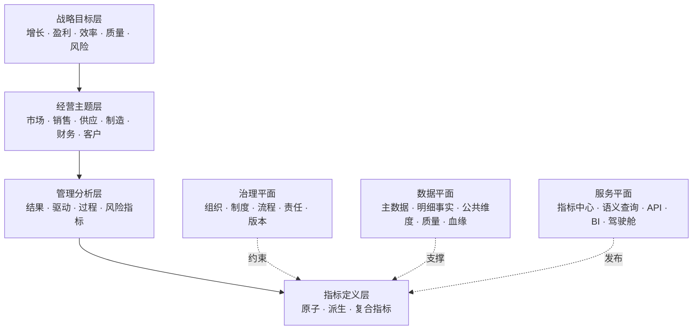
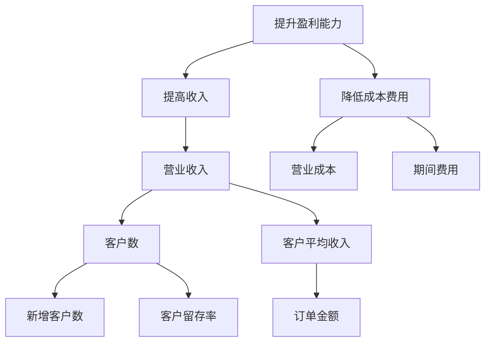
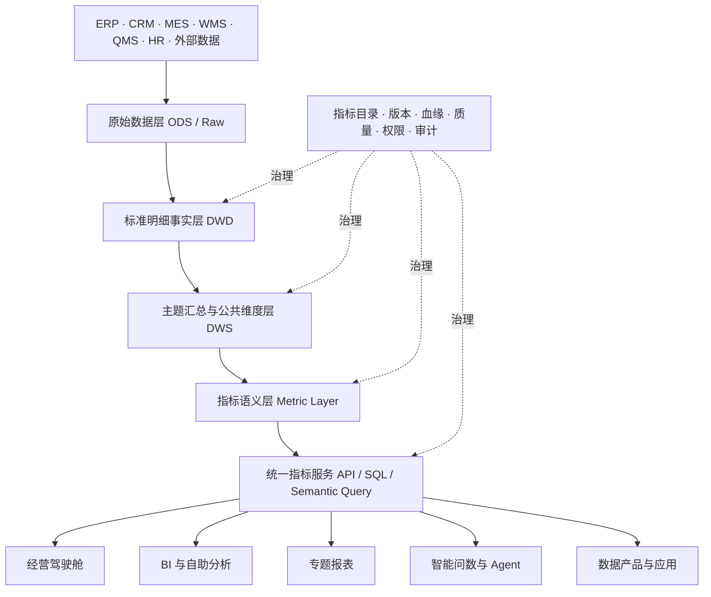

企业经营分析中最常见、也最难根治的问题之一，是同一个指标在不同部门、不同报表和不同会议中出现不同结果。

财务部门按照会计期间统计收入，销售部门按照订单签订时间统计销售额，运营部门按照支付时间统计成交额；集团驾驶舱按管理组织汇总，区域报表按客户归属区域汇总；两个页面都写着“客户数”，一个统计签约客户，另一个统计发生过交易的客户。每个数字单独看都有来源，但放到一起就无法形成可信的经营判断。

解决这个问题，不能只靠整理一份 Excel，也不能只靠建设一个 BI 平台。企业必须把指标当作一种正式的数据产品，同时治理它的业务含义、计算规则、数据来源、责任主体、技术实现、发布版本和使用方式。

本文给出一套可执行的建设方法：以战略和业务过程为起点建立指标体系，以指标口径手册固化业务语义，以指标中心实现计算逻辑的一处定义，以治理流程控制新增和变更，最终让经营分析、管理驾驶舱、专题报表和数据 API 使用同一套可信指标。

核心目标可以概括为：

> 一个指标编码、一个业务定义、一个责任主体、一套计算逻辑、一个权威来源、一个发布出口。

---

## 一、问题本质：指标不一致不只是公式不同

企业发现指标对不上时，第一反应通常是检查 SQL。实际项目中，SQL 只是最后一环。指标差异常常来自六个层面。

| 差异层面 | 典型问题 | 示例 |
| --- | --- | --- |
| 业务对象 | 统计的到底是什么对象 | 客户、客户账户、客户集团还是联系人 |
| 业务状态 | 什么状态才进入统计 | 已创建、已提交、已支付、已发货还是已完成订单 |
| 时间规则 | 事实归属哪个统计期间 | 下单日、支付日、发货日、收入确认日或财务期间 |
| 组织规则 | 事实归属于哪个组织 | 签约、销售、交付、核算还是管理组织 |
| 计算规则 | 怎样汇总、去重和派生 | 求和、期末值、日均值或按业务主键去重 |
| 数据实现 | 从哪里取数、怎样加工 | 来源系统、字段、映射表、补录表和修正规则 |

因此，“统一指标”不是把多个字段改成相同名称，而是对一个经营概念建立从业务语义到物理数据的完整契约。

这个契约至少要回答：

1. 指标为什么存在，支持什么管理问题；
2. 统计对象是什么，对象如何识别；
3. 哪些业务事实应该计入，哪些必须排除；
4. 使用什么时间、组织、产品和客户口径；
5. 公式、单位、精度、汇总和去重规则是什么；
6. 数据来自哪里，经过哪些加工节点；
7. 谁定义、谁审批、谁实现、谁处理质量问题；
8. 当前使用哪个版本，变更后哪些应用会受到影响。

只要其中一项没有明确，指标就可能在下一个系统、报表或组织中产生新的解释。

---

## 二、建设目标：一个口径、一处定义、多处复用

### 1. 一个口径

“一个口径”是指同一指标编码在同一版本下只有一份有效定义。定义不仅包括公式，还包括统计对象、业务状态、时间、组织、维度、单位、数据来源和例外规则。

这并不意味着整个企业只能有一个“收入”数字。财务营业收入、管理口径收入、含税销售额和销售回款本来就是不同概念，应该建立不同指标编码，并显式描述它们的关系，而不是让它们共用一个模糊的“收入”名称。

```text
FIN-REV-001  财务营业收入
MGT-REV-001  管理口径收入
SAL-AMT-001  含税销售额
FIN-CASH-001 销售回款金额
```

一个口径解决的是“相同概念不被重复解释”，而不是“不同概念被强行合并”。

### 2. 一处定义

“一处定义”是指指标元数据和可执行计算逻辑由统一指标中心管理。驾驶舱、BI 报表、自助分析和数据接口通过指标编码引用，不在各自应用中重新编写核心计算逻辑。

一处定义包含两个权威来源：

- **业务定义权威源**：指标目录和指标口径手册；
- **技术执行权威源**：指标语义层、指标模型或统一指标服务。

文档与代码必须建立关联。只有文档而没有统一执行层，业务定义会在 SQL 中再次分叉；只有统一 SQL 而没有业务定义，使用者无法判断这个数字是否适合当前场景。

### 3. 多处复用

经过发布的指标可以被集团驾驶舱、事业部经营分析、专题报表、绩效管理、数据 API、智能问数和预测模型共同使用。

复用的对象不是一张固定报表，而是：

```text
指标定义 + 公共维度 + 时间参数 + 数据权限 + 版本策略
```

---

## 三、总体框架：四层指标体系与三个横向平面

企业指标体系可以采用四层结构：



| 层级 | 核心问题 | 主要产物 |
| --- | --- | --- |
| 战略目标层 | 企业要实现什么目标 | 战略地图、年度经营目标 |
| 经营主题层 | 从哪些业务领域观察目标 | 经营主题域、分析主题树 |
| 管理分析层 | 用哪些结果和驱动因素判断经营状态 | 指标树、驱动关系、预警规则 |
| 指标定义层 | 每个数字具体如何定义和计算 | 指标目录、口径手册、计算模型 |

三个横向平面保证指标体系能够长期运行：治理平面明确责任、审批、变更和争议裁决；数据平面提供可信事实、公共维度、血缘和质量控制；服务平面将统一指标发布到各类分析和应用场景。

指标建设不能直接从底层字段开始，也不能只停留在战略口号。上层目标必须逐级落到可计算指标，底层指标也必须说明自己支持哪个管理问题。

---

## 四、指标对象模型：什么才算一个完整指标

一个完整指标可以表示为：

```text
指标 = 度量对象
     + 度量行为
     + 统计范围
     + 时间口径
     + 聚合规则
     + 分析维度
     + 单位与精度
     + 数据来源
     + 责任与版本
```

例如，“月度有效客户数”不能只定义成 `COUNT(DISTINCT customer_id)`。它至少还需要明确：客户是法人主体、客户集团还是交易账户；“有效”是发生过下单、支付、发货还是收入确认；使用自然月还是财务月；退款是否影响有效状态；客户跨组织交易时如何汇总；客户合并后历史数据是否重算。

### 1. 原子指标

原子指标直接基于一个业务事实和一种度量形成，是最小可复用计算单元。

```text
支付订单金额 = SUM(订单支付金额)
发货数量 = SUM(发货明细数量)
活跃客户数 = COUNT(DISTINCT 有效交易客户)
```

### 2. 派生指标

派生指标是在原子指标上增加时间、范围、状态或维度限定。

```text
本月直营渠道支付订单金额
华东区域季度活跃客户数
在保产品年度维修次数
```

派生指标不应复制底层计算逻辑，而应引用原子指标并声明限定条件。

### 3. 复合指标

复合指标由两个或多个指标计算得到，用于表达效率、结构、达成或风险。

```text
毛利额 = 营业收入 - 营业成本
毛利率 = 毛利额 / 营业收入
订单交付及时率 = 按时交付订单数 / 应交付订单数
目标完成率 = 实际值 / 目标值
```

复合指标必须保存指标依赖关系。上游指标发生变更时，系统才能识别受影响的复合指标、报表和驾驶舱。

### 4. 指标与维度分离

不要为每一种切片组合创建新指标。“华东区营业收入”和“华南区营业收入”通常不是两个指标，而是同一个“营业收入”指标在区域维度上的两个取值。

```text
营业收入 × 区域维度 = 各区域营业收入
营业收入 × 产品维度 = 各产品营业收入
营业收入 × 区域 × 产品 = 区域产品收入矩阵
```

只有当业务含义、统计规则或责任归属发生实质变化时，才建立新的指标编码。

### 5. 指标与 KPI 分离

指标是对业务事实的度量，KPI 是被赋予目标、责任和考核周期的关键指标。

```text
指标：营业收入
KPI：2027 年华东事业部营业收入达到 20 亿元
```

KPI 还包含目标值、责任组织、考核周期、阈值和评价规则。不要把每个指标都称为 KPI，也不要把目标值写入指标基础定义。

---

## 五、从战略到指标：建立可解释的指标树

指标体系不应按照现有报表目录拼接，而应沿着“战略目标—经营结果—业务驱动—过程活动—基础事实”逐层拆解。



这棵树中包含五种指标角色：

- **结果指标**描述最终经营结果，如利润、收入和现金流；
- **驱动指标**解释结果为何变化，如客户数、客单价和产能利用率；
- **过程指标**反映业务执行，如商机转化率和按时交付率；
- **风险指标**反映未来损失或异常概率，如逾期率和库存呆滞率；
- **诊断指标**支持定位问题，如区域、产品和客户结构。

一张管理驾驶舱不能只堆放结果指标。管理者看到收入下降以后，还需要沿着指标树定位是客户数量下降、转化率下降、订单延迟，还是产品结构变化。

指标拆解遵循五条规则：

1. 每个公司级战略目标至少对应一个结果指标；
2. 每个结果指标都有能够解释变化的驱动指标；
3. 驱动指标继续落到可管理的业务过程；
4. 每个过程指标有明确责任组织和改善动作；
5. 父子关系标明是公式关系、影响关系还是分析关系。

不能把相关性直接写成因果关系。“客户满意度影响续约率”一类关系应记录为业务假设，并通过分析或实验持续验证。

---

## 六、指标分类、编码与命名规范

一个指标可以同时拥有多组分类属性，而不是被迫放入唯一目录。

| 分类维度 | 可选类别 |
| --- | --- |
| 管理层级 | 集团级、事业部级、部门级、岗位级 |
| 业务主题 | 财务、市场、销售、供应、制造、质量、研发、人力 |
| 指标角色 | 结果、驱动、过程、风险、诊断 |
| 计算类型 | 原子、派生、复合 |
| 时间特征 | 时点、期间、累计、移动窗口 |
| 数据频率 | 实时、小时、日、周、月、季、年 |
| 重要程度 | 核心、重要、一般、临时 |
| 数据密级 | 公开、内部、敏感、严格受限 |

建议采用“业务域 + 主题 + 顺序号”的稳定编码：

```text
FIN-REV-001  营业收入
FIN-PRF-001  毛利额
SAL-CUS-001  有效客户数
SCM-DLV-001  订单交付及时率
MFG-OEE-001  设备综合效率
QMS-DEF-001  产品缺陷率
```

编码一旦发布，不因指标改名、组织调整或系统迁移而变化。编码中不要包含年份、组织名称和系统名称等易变信息；废弃编码不得重新使用。

指标名称建议采用：

```text
[必要限定词] + [统计对象] + [度量词]
```

例如“月度新增签约客户数”“期末在库产成品金额”“按时交付订单数”“应收账款逾期率”。名称应避免使用“规模”“情况”“水平”等无法单独判断含义的模糊词。

---

## 七、指标口径手册：每个指标必须定义哪些内容

指标口径手册不是面向数据团队的字段说明书，而是业务、财务、数据和管理人员共同确认的指标契约。建议将字段分为八组。

### 1. 基本信息

| 字段 | 说明 |
| --- | --- |
| 指标编码 | 全局唯一、永久稳定的标识 |
| 指标名称 | 当前正式中文名称 |
| 英文名称 | 用于系统字段、API 和跨语言场景 |
| 指标别名 | 历史名称、业务俗称和搜索同义词 |
| 指标描述 | 一句话说明指标衡量什么 |
| 所属主题 | 财务、销售、供应链等主题域 |
| 指标类型 | 原子、派生或复合 |
| 指标角色 | 结果、驱动、过程、风险或诊断 |
| 管理层级 | 集团、事业部、部门或岗位 |

### 2. 业务定义

| 字段 | 说明 |
| --- | --- |
| 管理目的 | 为什么需要这个指标，支持什么决策 |
| 统计对象 | 被计数、求和或评价的业务对象 |
| 业务定义 | 对指标业务含义的完整说明 |
| 包含范围 | 哪些业务事实必须计入 |
| 排除范围 | 哪些业务事实必须排除 |
| 适用场景 | 可用于哪些分析、会议和考核 |
| 禁用场景 | 哪些场景不能直接使用 |

“禁用场景”非常重要。例如，财务营业收入可以用于财务分析，但不一定适合实时销售激励；订单销售额可以用于销售过程观察，但不能替代财务收入进行利润分析。

### 3. 计算口径

| 字段 | 说明 |
| --- | --- |
| 计算公式 | 使用业务术语表达的计算关系 |
| 聚合方式 | 求和、计数、去重计数、平均、最大、最小、期末值等 |
| 去重规则 | 使用哪个业务主键去重 |
| 状态规则 | 哪些状态进入统计，状态回退如何处理 |
| 空值规则 | 空值、未知值和不适用值如何处理 |
| 异常规则 | 冲销、退款、撤销、补录和修正如何处理 |
| 精度规则 | 保留小数位和舍入方式 |
| 单位规则 | 金额、数量、比例、时长及单位换算 |

业务公式应优先引用其他指标编码或标准业务事实，不要把物理表名直接写成唯一口径。

### 4. 时间口径

| 字段 | 说明 |
| --- | --- |
| 业务日期 | 下单、支付、发货、确认收入等事实日期 |
| 统计周期 | 日、周、月、季、年或自定义期间 |
| 日历类型 | 自然日历、财务日历、生产日历或工作日历 |
| 时区 | 跨区域业务使用的标准时区 |
| 截止时间 | 日结、月结和数据冻结时间 |
| 迟到数据 | 跨期到达的数据如何归属和回补 |
| 历史重算 | 变更后是否重新计算历史期间 |

### 5. 维度口径

| 字段 | 说明 |
| --- | --- |
| 可分析维度 | 组织、客户、产品、区域、渠道等 |
| 默认维度 | 页面首次加载使用的维度层级 |
| 组织归属 | 按签约、交付、管理还是核算组织 |
| 维度粒度 | 客户集团、法人客户或账户等 |
| 层级汇总 | 上卷规则和不可加性限制 |
| 历史映射 | 组织和主数据变化后使用当期还是当前结构 |

### 6. 数据与技术信息

| 字段 | 说明 |
| --- | --- |
| 权威来源系统 | 该事实的记录系统 |
| 来源实体与字段 | 表、主题、事件、字段或 API |
| 数据加工模型 | 明细层、汇总层和指标模型 |
| 技术表达式 | SQL、DSL 或语义层表达式 |
| 更新频率 | 实时、小时、日、月等 |
| 数据可用时间 | 例如 T+1 08:00 |
| 指标血缘 | 上游字段、模型和下游应用 |
| 服务接口 | 指标查询服务或 API 标识 |

### 7. 质量与安全信息

| 字段 | 说明 |
| --- | --- |
| 完整性规则 | 必填字段、数据到达和覆盖范围 |
| 一致性规则 | 与总账、业务台账等权威结果的差异要求 |
| 合理性规则 | 上下限、波动、分布和业务逻辑约束 |
| 质量责任人 | 异常确认和处理责任人 |
| 数据密级 | 公开、内部、敏感或严格受限 |
| 权限范围 | 可访问角色、组织和数据行范围 |
| 脱敏规则 | 金额、个人信息等敏感内容的处理方式 |

### 8. 治理与版本信息

| 字段 | 说明 |
| --- | --- |
| 业务负责人 | 对定义和使用范围负责 |
| 数据负责人 | 对来源和数据质量负责 |
| 技术负责人 | 对计算实现和服务稳定性负责 |
| 指标状态 | 草稿、评审中、已发布、已废弃 |
| 当前版本 | 语义版本或企业版本号 |
| 生效日期 | 新版本正式使用日期 |
| 失效日期 | 版本停止使用日期 |
| 变更原因 | 业务、制度、系统或质量变化 |
| 审批记录 | 评审人、结论和时间 |

---

## 八、完整口径示例：营业收入

下面给出一个可以直接进入评审的示例。实际企业应根据会计政策、组织结构和系统实现进一步细化。

```yaml
指标编码: FIN-REV-001
指标名称: 营业收入
英文名称: operating_revenue
指标类型: 原子指标
指标角色: 结果指标
所属主题: 财务经营
管理层级: 集团级

管理目的: 衡量企业在报告期间通过主营及其他经营活动形成的收入规模
统计对象: 已完成收入确认的业务履约事实
业务定义: 企业在报告期间确认的营业收入，不包含销项税额及集团内部交易抵销金额

包含范围:
  - 主营业务收入
  - 符合确认条件的服务收入
  - 纳入营业收入核算的其他业务收入

排除范围:
  - 销项税额
  - 尚未满足确认条件的预收款
  - 集团合并范围内已抵销的内部交易
  - 非经营性收入

计算公式: SUM(收入确认本位币金额) - SUM(集团内部交易抵销金额)
聚合方式: 期间求和
去重规则: 按收入确认明细唯一标识去重
精度规则: 保留两位小数，采用四舍五入
单位规则: 集团本位币，默认万元展示

业务日期: 收入确认日期
统计周期: 日、月、季、年
日历类型: 财务日历
截止时间: 月结完成后形成月度正式值
迟到数据: 按财务调整期间回补，并保留调整记录

组织归属: 核算组织
可分析维度:
  - 核算组织
  - 管理组织
  - 客户
  - 产品
  - 区域
  - 渠道
历史组织规则: 正式财务报表按业务发生时组织结构，管理分析可切换当前组织结构

权威来源系统: 财务核算系统
更新频率: 每日增量，月结后冻结正式版本
数据可用时间: 日数据 T+1 08:00，月度正式数据以关账时间为准

业务负责人: 集团财务管理部
数据负责人: 财务共享与数据管理团队
技术负责人: 企业数据平台团队
指标状态: 已发布
当前版本: 2.0.0
```

该定义还有两个需要企业明确的关键点：日常经营分析使用未关账的估算值还是仅使用已入账数据；组织调整后，历史收入按发生时组织展示还是按当前管理结构重述。

这些问题不存在脱离业务场景的唯一答案，但必须形成显式规则，不能交给不同报表各自决定。

---

## 九、先统一公共维度，再统一指标

大量指标差异并不来自公式，而是来自组织、客户、产品、区域和时间等公共维度。

### 1. 组织维度

企业常同时存在法人组织、核算组织、管理组织、销售组织、交付组织和生产组织。指标必须声明使用哪一种组织关系。

组织维度至少管理组织唯一编码、组织类型、上下级关系、生效与失效日期、管理层级、组织合并拆分关系，以及多种组织树之间的映射。

### 2. 客户维度

“客户数”最容易因粒度不同产生差异。客户维度需要区分客户集团、法人客户、交易账户、门店或使用单位、联系人，以及潜在客户和正式客户。统计客户数时必须声明使用哪个层级、什么状态和什么去重主键。

### 3. 产品维度

产品可能同时存在设计产品、销售产品、库存物料、生产物料和财务核算产品。企业应建立跨系统映射和稳定的产品层级，明确不同指标适用哪种产品视图。

### 4. 时间维度

时间维度至少支持自然日历、财务期间、生产日历、工作日、周月季年、滚动窗口，以及当期、同期、上期和累计口径。“同比增长率”也需要明确比较自然同期、财务同期还是调整后的可比同期。

### 5. 快照与历史结构

组织、客户归属和产品分类都会变化。指标系统必须区分两种分析方式：

- **按历史事实分析**：使用业务发生时有效的维度关系；
- **按当前结构重述**：将历史事实映射到当前管理结构。

两种结果都可能合理，但必须使用不同查询参数或指标说明，不能无提示地混用。

---

## 十、治理组织：谁有权定义和修改指标

统一指标首先是治理问题，其次才是技术问题。建议建立四级治理组织。

| 治理层级 | 角色 | 主要职责 |
| --- | --- | --- |
| 决策层 | 数据治理委员会或经营管理委员会 | 审批公司级核心指标，裁决跨部门争议 |
| 统筹层 | 指标管理办公室 | 制定制度、管理目录、组织评审、发布版本 |
| 责任层 | 指标业务负责人、数据负责人 | 定义业务口径，对数据和使用结果负责 |
| 执行层 | 数据架构、数据开发、BI 和平台团队 | 实现计算、质量、血缘、权限和服务 |

### RACI 示例

| 活动 | 治理委员会 | 指标办公室 | 业务负责人 | 数据负责人 | 技术团队 | 驾驶舱团队 |
| --- | --- | --- | --- | --- | --- | --- |
| 核心指标立项 | A | R | R | C | C | C |
| 业务口径定义 | C | C | A/R | C | C | I |
| 数据来源确认 | I | C | C | A/R | R | I |
| 技术实现 | I | C | C | C | A/R | I |
| 质量验收 | I | C | A | A/R | R | C |
| 指标发布 | I | A/R | C | C | R | I |
| 驾驶舱引用 | I | C | C | I | C | A/R |
| 口径争议裁决 | A/R | R | C | C | I | I |
| 指标废弃 | A | R | R | C | C | I |

`R` 表示实际执行者，`A` 表示最终负责者，`C` 表示需要协商，`I` 表示需要知会。一个活动可以有多个执行者，但原则上只能有一个最终负责角色。

治理遵循三项权责原则：业务部门拥有指标业务定义权；数据团队承担技术实现和数据质量执行责任；治理委员会拥有跨部门争议的最终裁决权。

如果指标只由 IT 定义，往往会得到技术上可计算、管理上不可解释的结果；如果只由业务定义，又容易缺少数据可行性、血缘和质量约束。因此，指标必须经过业务与数据双重会签。

---

## 十一、指标全生命周期

### 1. 生命周期状态

```text
草稿 → 评审中 → 待实现 → 待验证 → 已发布 → 变更中 → 已废弃
```

不同状态具有明确权限：

- 草稿指标不能进入正式驾驶舱；
- 评审中指标可以用于验证，但必须展示试算标识；
- 已发布指标是正式场景的唯一可用版本；
- 变更中的旧版本继续有效，直到新版本正式生效；
- 已废弃指标只保留历史查询和血缘，不允许新增引用。

### 2. 新增指标流程


新建指标必须满足以下准入条件：

- 有明确的管理或分析场景；
- 现有指标无法直接复用；
- 有唯一业务负责人；
- 统计对象、范围和公式清晰；
- 有稳定、可授权的数据来源；
- 有可执行的数据质量规则；
- 不与现有指标同义重复；
- 明确预期使用的驾驶舱、报表或服务。

临时分析不一定需要立即创建正式指标。可以设置“临时指标”状态和有效期，经过多次复用后再转为正式指标，避免指标目录被一次性需求淹没。

### 3. 变更流程

| 变更类型 | 示例 | 处理方式 |
| --- | --- | --- |
| 展示变更 | 描述优化、标签调整 | 小版本更新 |
| 技术修复 | 不改变口径的数据错误修复 | 补丁版本，评估历史重算 |
| 规则变更 | 状态范围、公式、去重规则变化 | 主版本更新，重新审批 |
| 来源变更 | 源系统或模型迁移 | 回归验证和并行对账 |
| 组织制度变更 | 财务政策、组织口径变化 | 主版本更新，明确生效日期 |

任何影响指标数值的变更都必须完成：

1. 新旧口径差异说明；
2. 历史数据影响评估；
3. 上下游血缘影响分析；
4. 新旧版本并行对账；
5. 生效日期和切换方案；
6. 驾驶舱、报表和 API 使用方通知；
7. 是否重算历史数据的决策。

指标变更不应直接覆盖旧定义。新旧版本应分别记录生效与失效日期，使历史会议材料、审计结果和接口调用仍然能够解释。

### 4. 废弃流程

指标废弃前应确认：

- 已无有效消费方，或消费方已迁移；
- 存在替代指标时已建立替代关系；
- 历史报表仍可解释；
- API 和数据合同完成兼容处理；
- 指标编码不再重新分配。

---

## 十二、技术架构：把指标从文档变成可执行能力

建议采用“事实层—公共汇总层—指标语义层—统一服务层”的实现方式。



### 1. 标准明细事实层

明细层保存稳定、可追溯的业务事实，例如订单、支付、发货、收入确认、库存移动、生产执行和检验结果。

每类事实需要明确事实唯一标识、业务发生时间、参与的业务对象、状态变化、数量金额与单位、来源系统原始标识，以及数据到达和修正时间。

### 2. 公共维度与主题汇总层

该层统一组织、客户、产品、区域、渠道、币种和日历，并沉淀可复用的主题汇总。它不应为每一张驾驶舱单独建设宽表，而应围绕稳定业务过程形成共享数据产品。

### 3. 指标语义层

指标语义层将指标编码转换为可执行定义，至少支持：

- 度量表达式和允许的聚合方式；
- 默认过滤条件和可用分析维度；
- 时间粒度和业务时间字段；
- 指标依赖关系；
- 权限和行级过滤；
- 版本与生效区间；
- 缓存和预计算策略。

一个复合指标应引用其他指标，而不是复制表达式：

```yaml
metric_code: FIN-PRF-002
name: 毛利率
type: composite
expression: ${FIN-PRF-001} / NULLIF(${FIN-REV-001}, 0)
format: percentage
precision: 2
allowed_dimensions:
  - organization
  - product
  - customer
  - region
```

### 4. 统一指标服务

指标服务对外暴露稳定的查询合同。例如：

```json
{
  "metricCodes": ["FIN-REV-001", "FIN-PRF-002"],
  "period": {
    "type": "month",
    "from": "2026-01",
    "to": "2026-09"
  },
  "dimensions": ["organization", "product_category"],
  "filters": {
    "organization": ["ORG-1001"]
  },
  "versionPolicy": "effective-at-period"
}
```

服务返回结果时还应携带指标编码与版本、统计周期、更新时间、单位与精度、正式值或试算值、质量状态、权限裁剪信息，以及可追溯的查询标识。

### 5. 禁止驾驶舱重复计算核心指标

驾驶舱应只负责查询、组合和展示，不应在页面、BI 数据集或图表表达式中重新实现核心指标。驾驶舱配置应尽量收敛为：

```text
指标编码 + 版本策略 + 查询周期 + 分析维度 + 过滤条件 + 展示形式
```

确需在页面中计算时，应区分展示转换和业务计算。元转万元、百分比格式化可以位于展示层；收入、利润率、转化率等业务计算必须进入指标中心。

---

## 十三、经营驾驶舱如何使用统一指标

### 1. 驾驶舱分层

| 驾驶舱 | 主要对象 | 内容重点 |
| --- | --- | --- |
| 战略驾驶舱 | 董事会和高管 | 战略目标、核心结果、重大风险 |
| 经营驾驶舱 | 经营管理层 | 收入、利润、现金、客户、供应和交付驱动 |
| 专题驾驶舱 | 业务负责人 | 销售漏斗、库存、质量、设备、项目等过程诊断 |

不同驾驶舱可以采用不同视图，但相同指标编码在相同参数下必须返回一致结果。

### 2. 从结果到行动

每个核心结果指标建议配置四层分析路径：

```text
结果状态 → 结构拆解 → 驱动定位 → 责任与行动
```

例如营业收入下降时，系统应支持查看目标差距、同比和环比；按组织、产品、客户和区域拆解；继续分析客户数、客单价、转化率和交付情况；最终定位异常组织、责任人和改善任务。

驾驶舱不是指标陈列墙。每个红色预警都应能够进入明细、责任和行动，或者明确说明其仅用于观察。

### 3. 驾驶舱必须展示的口径状态

- 数据更新时间；
- 数据统计期间；
- 当前单位；
- 正式值、估算值或预测值；
- 指标口径入口；
- 异常或质量告警；
- 权限过滤后的数据范围。

对于名称相近的指标，不能只依赖图表标题区分，应允许用户查看口径摘要和完整定义。

---

## 十四、指标质量管理

核心指标至少需要覆盖五类质量规则。

| 质量维度 | 要回答的问题 | 示例规则 |
| --- | --- | --- |
| 完整性 | 数据是否完整到达 | 每日订单分区必须在 07:00 前到达 |
| 唯一性 | 事实是否重复 | 订单明细唯一标识重复数必须为 0 |
| 一致性 | 不同层级是否能够对账 | 指标汇总与财务总账差异率小于 0.1% |
| 合理性 | 数值是否符合业务规律 | 日环比波动超过 30% 触发预警 |
| 及时性 | 是否在承诺时间可用 | T+1 指标必须在 08:00 前发布 |

指标服务可以统一返回质量状态：

```text
PASS       已通过全部阻断性规则
WARNING    存在非阻断性异常，可谨慎使用
FAILED     未通过关键规则，不应进入正式决策
UNKNOWN    尚未完成质量检查
```

质量告警必须关联失败规则、影响指标、影响期间、受影响应用、当前责任人、预计恢复时间，以及是否需要重新发布历史结果。仅展示“数据异常”而没有影响范围和处理责任，不能形成有效治理。

技术规则无法替代业务对账。核心指标上线前应至少完成：

1. 与权威业务台账对账；
2. 与原有正式报表对账；
3. 按组织和月份抽样核对；
4. 从汇总值下钻到业务单据；
5. 验证冲销、退款、跨期和组织调整等边界场景。

---

## 十五、核心指标识别与建设优先级

企业不应在第一阶段治理全部指标。可以通过评分选择首批核心指标：

```text
核心度评分 =
  管理层关注度 × 30%
+ 跨部门使用范围 × 20%
+ 使用频率 × 15%
+ 决策影响程度 × 20%
+ 当前争议程度 × 15%
```

第一批通常优先选择：

- 经营例会固定使用的指标；
- 高管驾驶舱指标；
- 财务与业务长期对不上的指标；
- 多个部门重复加工的指标；
- 与绩效、奖金和经营责任相关的指标；
- 对外披露、审计或监管报送指标；
- 作为大量复合指标上游的基础指标。

第一期可以将范围控制在 `30～50` 个集团核心指标，同时治理支撑它们的组织、客户、产品和时间维度。核心指标稳定后，再扩展到领域指标和部门指标。

---

## 十六、分阶段实施路线

### 阶段一：现状盘点与试点选择，2～3 周

主要任务：收集驾驶舱、经营例会材料和部门报表；盘点指标名称、公式、来源、频率和责任人；识别同名不同义、一义多名和重复加工；选择一个跨部门且管理价值高的试点主题。

阶段产物：

- 指标现状清单；
- 指标问题台账；
- 首批核心指标范围；
- 试点项目章程。

### 阶段二：标准与治理设计，3～4 周

主要任务：制定指标管理办法；建立指标分类、编码和命名规范；确定口径手册模板；建立治理组织和 RACI；明确新增、变更、发布和废弃流程；统一试点涉及的公共维度。

阶段产物：

- 《指标管理办法》；
- 《指标分类、命名与编码规范》；
- 《核心指标口径手册》；
- 公共维度标准；
- 指标评审与变更流程。

### 阶段三：数据与平台落地，4～8 周

主要任务：建设标准事实模型和公共维度；在指标中心登记业务与技术定义；建立指标依赖、血缘、质量和权限；提供统一指标查询服务；改造试点驾驶舱，取消重复计算。

阶段产物：

- 指标元数据目录；
- 指标计算模型；
- 统一指标 API 或语义查询层；
- 指标质量监控；
- 试点驾驶舱。

### 阶段四：试运行与推广，4 周及持续运营

主要任务：新旧指标并行运行与对账；处理边界场景和历史数据；培训指标负责人和驾驶舱团队；将指标准入纳入数据项目验收；分批迁移存量报表和数据接口；定期清理低使用率和重复指标。

阶段产物：

- 指标上线验收报告；
- 对账差异与问题关闭记录；
- 存量应用迁移计划；
- 月度指标运营报告。

---

## 十七、验收标准

项目验收不能只看“录入了多少指标”，而应检查统一定义是否真正进入生产使用。

### 治理验收

- 核心指标业务负责人明确率达到 `100%`；
- 核心指标业务与数据双重会签率达到 `100%`；
- 新增、变更和废弃流程能够实际执行；
- 所有口径争议都有记录、结论和裁决责任人。

### 标准验收

- 核心指标编码唯一率达到 `100%`；
- 同名不同义指标全部拆分或更名；
- 一义多名指标建立别名并完成归并；
- 关键公共维度具备统一编码、层级和历史关系。

### 技术验收

- 核心指标技术定义覆盖率达到 `100%`；
- 核心指标端到端血缘覆盖率达到 `100%`；
- 核心指标质量规则覆盖率达到 `100%`；
- 统一指标服务满足约定的性能和可用性；
- 指标版本能够按照生效日期正确查询。

### 应用验收

- 试点驾驶舱统一指标引用率达到 `95%` 以上；
- 核心指标不再在驾驶舱中重复编写业务计算 SQL；
- 经营会议中的核心数据差异有明确解释或已消除；
- 用户能够从驾驶舱查看口径、更新时间和质量状态；
- 指标变更能够识别全部受影响应用。

### 价值验收

- 跨部门对账和解释时间明显下降；
- 新建驾驶舱和报表的指标开发周期缩短；
- 指标复用率持续提升；
- 数据质量问题能够定位到来源和责任人；
- 经营分析从“争论数字”转向“分析原因和制定行动”。

---

## 十八、常见失败模式

### 1. 把指标手册做成一次性 Excel

Excel 可以作为导入模板，但不能成为长期唯一载体。它难以管理依赖、血缘、版本、权限和下游引用，也无法确保文档定义与生产逻辑一致。

### 2. 只统一名称，不统一语义

把不同报表中的字段都改成“营业收入”，不会自动消除时间、组织和数据来源差异，反而会让问题更隐蔽。

### 3. 指标数量越多越好

大量指标通常意味着维度组合被重复建模、一次性需求被永久保留，或者缺少原子指标复用。指标治理应关注使用价值和复用关系，而不是目录规模。

### 4. 全部交给数据或 IT 部门

技术团队可以实现计算，但不能替代业务部门决定什么叫有效客户、收入何时确认、交付是否及时。缺少业务责任人的指标不能作为核心指标发布。

### 5. 每张驾驶舱建设自己的数据集

这种方式短期上线快，长期会形成多个事实副本和计算逻辑。驾驶舱越多，口径分裂越严重。

### 6. 只有口径，没有公共维度

公式完全一致，也可能因为组织树、客户粒度和产品分类不同得到不同结果。指标治理必须与主数据和公共维度治理同步进行。

### 7. 修改定义后直接覆盖历史版本

覆盖会导致历史会议材料、报表和审计结果无法解释。任何影响数值的变化都要保留版本和生效区间。

### 8. 驾驶舱只展示结果，不连接责任和行动

如果异常无法下钻到驱动因素、业务对象和责任组织，驾驶舱只能提供视觉展示，不能形成管理闭环。

---

## 十九、可直接使用的指标定义模板

```yaml
基本信息:
  指标编码:
  指标名称:
  英文名称:
  指标别名: []
  指标描述:
  所属主题:
  指标类型: 原子 | 派生 | 复合
  指标角色: 结果 | 驱动 | 过程 | 风险 | 诊断
  管理层级: 集团 | 事业部 | 部门 | 岗位

业务定义:
  管理目的:
  统计对象:
  完整定义:
  包含范围: []
  排除范围: []
  适用场景: []
  禁用场景: []

计算口径:
  业务公式:
  依赖指标: []
  聚合方式:
  去重主键:
  状态规则:
  空值规则:
  异常与冲销规则:
  单位:
  精度:

时间口径:
  业务日期:
  统计周期: []
  日历类型:
  标准时区:
  截止时间:
  迟到数据规则:
  历史重算规则:

维度口径:
  可分析维度: []
  默认维度:
  组织归属规则:
  维度粒度:
  历史映射规则:
  不可加维度: []

数据实现:
  权威来源系统:
  来源实体与字段: []
  数据加工模型: []
  技术表达式:
  更新频率:
  数据可用时间:
  服务接口:

质量与安全:
  质量规则: []
  对账基准:
  数据密级:
  权限规则:
  脱敏规则:

治理信息:
  业务负责人:
  数据负责人:
  技术负责人:
  指标状态:
  当前版本:
  生效日期:
  失效日期:
  变更原因:
  审批记录: []
```

---

## 二十、指标评审检查表

### 业务完整性

- 指标是否对应明确的管理问题；
- 统计对象是否唯一、清晰；
- 包含和排除范围是否覆盖主要边界；
- 指标名称是否会与其他指标混淆；
- 适用与禁用场景是否明确。

### 计算完整性

- 公式中的每个组成项是否有定义；
- 聚合、去重、空值、冲销和异常规则是否明确；
- 时间、组织和维度口径是否完整；
- 比例指标的分子分母是否处于相同统计范围；
- 不可加指标是否限制了错误汇总。

### 数据可行性

- 是否存在稳定权威的数据来源；
- 源数据粒度能否支撑指标和下钻；
- 关键主数据是否已经统一；
- 更新时效是否满足使用场景；
- 历史数据是否可获得和可重算。

### 治理可执行性

- 是否存在唯一业务负责人；
- 数据和技术责任是否明确；
- 是否完成查重和影响分析；
- 是否定义质量规则和对账基准；
- 是否明确版本、生效时间和消费方。

### 应用一致性

- 驾驶舱是否通过指标编码引用；
- 是否允许查看口径摘要和质量状态；
- 是否能够下钻到支撑事实；
- 是否存在页面内重复业务计算；
- 变更后是否能够通知全部使用方。

---

## 二十一、最终交付物

| 交付物 | 解决的问题 |
| --- | --- |
| 《企业指标管理办法》 | 谁负责、如何审批、如何变更和裁决 |
| 《指标分类、命名与编码规范》 | 指标如何组织、命名和唯一识别 |
| 《核心指标口径手册》 | 每个核心指标具体代表什么、如何计算 |
| 《公共维度与主数据标准》 | 组织、客户、产品、时间等如何统一 |
| 指标目录与元数据中心 | 在哪里检索、评审、发布和管理版本 |
| 指标语义层与统一服务 | 如何实现一处计算和多处复用 |
| 指标质量与血缘体系 | 如何发现问题和分析影响 |
| 驾驶舱接入规范 | 分析应用如何引用统一指标 |
| 指标运营机制 | 如何持续清理、评审、监控和改进 |

这些成果不能彼此割裂。管理办法没有平台支撑，会变成难以执行的制度；平台没有口径手册，会变成技术人员维护的计算黑盒；驾驶舱没有统一指标服务，仍会回到每个页面各自取数的状态。

---

## 结语

企业指标体系的本质，是把经营管理语言转化为稳定、可执行、可追溯的数据契约。

“一个口径”依靠业务定义和公共维度，“一处定义”依靠指标中心和语义层，“多处复用”依靠统一服务和应用接入规范。治理组织确保有人负责，生命周期确保变化可控，质量和血缘确保结果可信，驾驶舱则把这些能力转化为日常经营决策。

真正完成建设的标志，不是指标手册已经发布，也不是驾驶舱已经上线，而是企业在经营会议中不再反复争论数字从哪里来，能够把时间用于判断原因、明确责任和推动行动。

## 参考标准与延伸阅读

1. [GB/T 36073-2025《数据管理能力成熟度评估模型》](https://std.samr.gov.cn/)
2. [DAMA International：数据管理知识体系](https://www.dama.org/)
3. [Cloud Native Computing Foundation：OpenMetrics Specification](https://openmetrics.io/)
