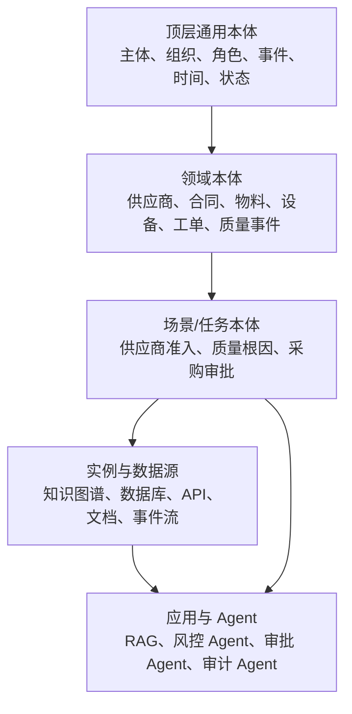
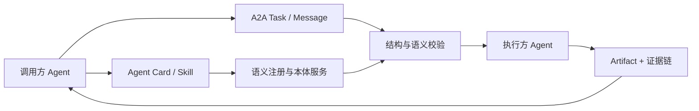

一家制造企业希望让采购 Agent 自动完成供应商风险排查。它需要读取供应商主数据、资质证书、历史质量事件、合同和外部风险信息，再判断当前是否允许下单。

从大模型的视角看，这似乎只是一次工具调用：查数据、总结风险、返回结论。但真正进入生产系统以后，一连串问题会立即出现：

- ERP 中的“供应商”和供应商管理系统中的“合作方”是否指同一类主体？
- 证书缺少到期时间，是“没有到期”，还是“数据不完整”？
- A2A 消息中的 `riskLevel: high`，在发送方和接收方是否采用同一套分级标准？
- 供应商处于“资质过期”状态时，Agent 是否有权直接冻结采购？
- 结论出错后，能否追溯使用了哪条数据、哪个规则版本和哪个 Agent 的输出？

这些问题不能仅靠更长的 Prompt 解决。它们需要一套独立于模型上下文、能够被人和机器共同检查的业务语义与约束。本体的价值就在这里：它把概念、关系、状态、动作和规则组织成共享契约，使不同系统和 Agent 不只能够交换数据，还能对数据表达的业务含义形成可验证的共识。

但是，本体项目也很容易失败。最常见的结果不是模型能力不足，而是建设范围失控、源系统映射被低估、形式化模型无人维护，或者本体从未进入任何真实应用。**本体的终点不是一个 OWL 文件，而是一条从业务词汇、数据映射、运行校验到 Agent 执行和审计的工程链路。**

本文从这一现实出发，讨论四个问题：

1. 企业本体项目为什么容易做死；
2. 怎样从场景本体逐步走向领域本体；
3. 本体、知识图谱、RAG、规则引擎和 Agent 应该如何分工；
4. 本体怎样嵌入 A2A 的发现、协作、校验与审计过程。

文献和协议状态核验日期为 **2026 年 10 月 28 日**。本文把同行评审论文、正式标准和预印本分开使用：前两者用于建立方法与技术边界，A2A 相关预印本只用于说明新近工程趋势，不作为已经充分验证的行业结论。

## 一、先建立边界：本体不是什么

讨论落地路线之前，需要先把几个经常混用的概念分开。

| 对象 | 主要回答的问题 | 典型产物 |
| --- | --- | --- |
| 业务词汇表 | 一个术语是什么意思，谁负责解释 | 术语、定义、同义词、责任人 |
| 本体 | 领域中存在哪些事物，它们如何关联并受什么语义约束 | 类、属性、关系、公理、受控词表 |
| 知识图谱 | 目前已知哪些具体事实 | 实体、关系、事件、来源和时间 |
| 数据模型 | 数据怎样在某个系统中存储和访问 | 表、字段、索引、接口 Schema |
| 规则模型 | 在给定条件下允许、禁止或推导什么 | 决策表、约束、策略、规则集 |
| 工作流 | 任务按照什么顺序执行，失败后如何处理 | 状态机、审批流、重试和补偿 |
| Agent 能力模型 | 哪个 Agent 能做什么，需要什么输入 | Skill、工具定义、输入输出契约 |

本体与知识图谱尤其容易被等同。可以把本体理解为 Schema 和语义承诺，把知识图谱理解为按照这些承诺组织起来的实例事实。但现实中的知识图谱不一定使用 OWL：它可以只采用属性图标签、项目内部的类型系统，甚至只有隐式 Schema。知识图谱综述也将 Schema、身份、上下文和推理视为需要分别处理的组成部分。[3] 因此更准确的表述是：

> 知识图谱可以没有正式本体，但只要进入稳定应用，通常就会形成显式或隐式的类型、关系和约束约定。

在语义网术语中，TBox 主要描述类、属性及其公理，ABox 主要描述具体个体和事实。不过，企业系统仅有 TBox 和 ABox 仍然不够。还必须增加第三部分：**本体与物理系统之间的映射和运行契约**。

```text
业务语义层：Supplier、Qualification、PurchaseOrder、RiskEvent
                         ↓ 映射
物理数据层：ERP 表、SRM API、合同文档、质量事件流
                         ↓ 执行
运行能力层：查询供应商、检查资质、冻结采购、提交审批
```

本体并不要求把所有数据复制进图数据库。基于本体的数据访问和虚拟知识图谱研究已经给出另一条成熟路线：数据仍留在关系数据库或源系统中，由本体和映射提供统一查询视图，查询在运行时被改写到实际数据源。[4][5][6]

## 二、为什么很多企业本体项目容易做死

### 2.1 把企业全局本体当作项目起点

企业中几乎每个术语都会牵出新的术语。“客户”会涉及法人、联系人、渠道、合同和结算主体；“设备”会涉及资产、型号、部件、测点、工艺位置和维修责任。若项目一开始就要求统一全公司的概念，边界会持续扩张，模型迟迟无法进入应用。

经典本体方法强调先确定领域范围和本体需要回答的能力问题，LOT 等工业本体工程框架也将需求、实施、发布和维护组织为迭代过程，而不是一次完成的全局建模。[1][2]

更可靠的起点是一个有明确输入、输出和责任人的业务场景。例如：

- 供应商准入与资质检查；
- 质量异常根因追溯；
- 合同条款合规审查；
- 设备故障诊断与维修记录；
- 采购订单的风险拦截。

场景跑通后，再把稳定、可复用的概念上收为领域本体。顶层本体应该最后收敛，而不是最先膨胀。

### 2.2 把本体建设当成一次性交付

业务会新增品类、修改审批流程、调整风险分级，也会替换底层系统。每一次变化都可能影响概念定义、约束、字段映射、Agent 输入输出和历史实例。本体演化研究将变更发现、表示、实施、验证与传播视为完整过程，而不是简单修改几个类。[20]

如果没有业务 owner、版本策略、兼容窗口和实例迁移方案，本体会逐渐与真实业务脱节。最终，系统使用的是代码里的私有定义，而本体只存在于文档和建模工具中。

### 2.3 低估本体与源系统之间的映射鸿沟

本体使用业务概念，ERP、MES、CRM 和数据仓库使用物理字段。两者之间不是简单的一一映射：

- 同一个 `status` 在不同系统中可能分别表示主数据状态、审批状态和交易状态；
- 一个供应商可能在三个系统中拥有三个编号；
- 历史系统把“证书不存在”和“未录入证书”都存为 `NULL`；
- 文档中的企业名称可能是简称，数据库中保存的是注册全称；
- 同一质量事件可能被 MES、QMS 和工单系统重复记录。

映射不是项目末尾的 ETL 工作，而是语义模型的一部分。映射需要记录来源、转换规则、主键策略、时效、质量等级和责任人，并接受与本体相同的版本治理。

### 2.4 让形式化语言阻断业务参与

OWL、SHACL 和 SPARQL 适合机器处理，但不适合作为业务评审的唯一界面。业务专家真正需要检查的是：术语定义是否准确、对象边界是否合理、状态迁移是否符合流程、规则例外是否被遗漏。

工程上可以维护三种同步视图：

1. 自然语言词汇表和业务示例；
2. 面向评审的关系图、状态机和决策表；
3. 面向运行的 OWL、SHACL、JSON Schema 或规则实现。

业务人员负责确认语义，技术团队负责把确认后的语义翻译成形式化资产。不能反过来让本体工程师替业务做定义决策。

### 2.5 追求完备推理，忽略响应时间和可运维性

OWL 2 提供较强的分类和逻辑表达能力，但表达能力越强，推理成本和问题定位成本通常越高。[7] 高并发 Agent 场景没有必要在每次工具调用前运行完整描述逻辑推理。

常见的工程分工是：

- 稳定分类和可缓存关系在发布时预推理；
- 数据完整性、类型和值域使用 SHACL 或应用校验；
- 业务决策使用决策表、规则引擎或策略引擎；
- 复杂关联分析放入异步风控和审计任务；
- 在线请求只读取已经物化或能够低成本计算的结论。

### 2.6 建了模型，却没有真实消费方

类和关系数量不是价值指标。本体的每次迭代至少应该服务于一种运行用例：改进一次检索、完成一种跨系统查询、拦截一种非法操作，或者给出一条可审计的决策链路。

如果一个概念既没有查询用例、校验规则、映射来源，也没有 Agent 或应用消费，就应质疑它是否需要进入当前版本。

## 三、企业本体的四层架构

企业落地可以采用“顶层最小、领域稳定、场景先行、实例按需”的四层结构。



### 3.1 顶层通用本体：少而稳定

顶层只保留跨领域真正稳定的概念，例如主体、组织、角色、资源、事件、时间、地点和状态。它的作用是让不同领域能够连接，而不是承载具体业务字段。

如果“供应商准入状态”“设备维修等级”出现在顶层，说明分层边界已经失控。

### 3.2 领域本体：形成领域共同语言

领域层定义相对稳定的业务对象、关系和生命周期。例如制造领域可以包含物料、BOM、工序、设备、工单、缺陷和检验标准；供应链领域可以包含供应商、采购订单、交付、资质和风险事件。

这一层应该由领域业务负责人和数据/架构团队共同维护。

### 3.3 场景本体：围绕任务裁剪

场景本体从领域模型中选择当前任务需要的部分，并增加任务专属概念，例如检查项、动作、输入、输出、前置条件和证据要求。

同一个供应商领域本体可以支持准入、风险排查、质量追溯和合同审查等多个场景。Agent 不需要在每次规划时加载整个企业本体，只需要获得与当前任务相关的语义切片。

### 3.4 实例与数据源：物化和虚拟并存

稳定主数据、跨系统实体标识和高频关系适合物化到图谱；实时库存、账户余额、设备遥测和交易状态通常应留在源系统中。对需要审计的决策，可以保存当时使用的数据快照和来源，而不必复制源系统全部历史。

## 四、把本体变成可执行语义契约

仅描述“供应商具有什么属性”还不足以支撑 Agent 执行。面向运行的语义模型至少需要覆盖五类内容。

| 模型 | 需要回答的问题 | 典型实现 |
| --- | --- | --- |
| 对象模型 | 业务中有什么，如何唯一标识 | RDF/OWL、属性图 Schema |
| 状态模型 | 对象当前处于什么状态，如何迁移 | 状态机、事件模型、工作流 |
| 动作模型 | 可以执行什么，输入输出是什么 | Action Ontology、工具 Schema |
| 约束模型 | 什么条件下允许、禁止或必须审批 | SHACL、规则引擎、策略引擎 |
| 映射模型 | 从哪里读取，向哪里写入 | R2RML、OBDA 映射、API Adapter |

早期语义 Web 服务研究已经用能力、输入、输出、前置条件和效果描述可组合服务，这与今天的 Agent 工具和 Skill 具有直接的思想连续性。[10] 但在企业系统中，语义描述不能替代实际执行控制：

- 本体可以声明“资质有效是下单前置条件”；
- 规则引擎可以计算当前是否满足条件；
- IAM 和策略引擎决定当前主体是否有权限；
- ERP 执行事务并保证幂等性；
- 工作流引擎处理审批、超时、重试和补偿。

### 4.1 JSON Schema、SHACL、OWL 和规则引擎的分工

这四类工具经常被放在一起讨论，但它们解决的问题不同。

| 技术 | 适合解决的问题 | 不应承担的职责 |
| --- | --- | --- |
| JSON Schema | JSON 消息结构、字段类型、枚举和必填项 | RDF 图关系推理、跨对象业务决策 |
| SHACL | 针对给定 RDF 数据图检查属性、类型、基数和路径约束 | 长事务、审批流、复杂补偿 |
| OWL | 类层次、等价、互斥、属性语义和逻辑分类 | 把“没有记录”直接判断为“事实为假” |
| 规则/策略引擎 | 决策表、例外、时序条件和授权策略 | 定义全部领域概念和数据来源 |

例如，Agent 的输入消息可以先由 JSON Schema 检查结构；消息中的实体标识被解析到 RDF 图后，再由 SHACL 检查供应商是否具备所需关系；规则引擎结合当前时间和资质状态计算是否允许下单。SHACL 是 W3C 的 RDF 图校验标准，JSON Schema 则面向 JSON 实例，两者可以组成流水线，但不能互相替代。[8][9]

### 4.2 解释链必须成为一等数据

一个可执行结论至少需要记录：

- 输入事实及其来源；
- 事实的有效时间和采集时间；
- 命中的规则及版本；
- 中间推导结果；
- 作出判断的 Agent、模型和工具版本；
- 最终动作、审批人和执行回执。

来源模型研究为表示“实体、活动、参与者以及它们如何产生结果”提供了成熟基础。[12] 在高风险场景中，解释链不应只是大模型生成的一段理由，而应由这些结构化记录生成面向人的说明。

## 五、A2A 解决协作，本体解决协作中的业务含义

A2A 规范定义了 Agent 发现、能力声明、消息交换、任务生命周期、流式更新和产物传递等机制。[15] 因此，把 A2A 简化为“消息格式”并不准确。它解决的是 Agent 之间如何建立并维持一次可互操作的协作。

但是，A2A 不会替企业定义：

- `supplier` 在本企业中的精确定义；
- `highRisk` 使用哪套风险分级；
- 资质过期是否必然禁止采购；
- 哪个系统是供应商状态的权威来源；
- 一个风险结论需要哪些证据才能生效。

这就是协议互操作与语义互操作的边界。A2A 相关研究仍在快速发展，现有协议综述与实现研究主要讨论协议架构、可靠性、安全和生产就绪度；直接把企业本体与 A2A 结合的同行评审证据仍然有限。[16][17]

### 5.1 A2A 与本体的五个绑定点



#### 绑定点一：Agent Card 中的 Skill 与本体能力标识

Agent Card 可以声明 Agent 提供的 Skill。企业内部应为业务能力分配稳定标识，例如：

```text
urn:corp:capability:supplier-risk-assessment:v2
urn:corp:action:purchase-order:create:v1
```

Skill 描述用于发现，本体能力定义则补充适用对象、输入输出语义、前置条件、风险等级和责任域。调用方选择的不只是一个名称相似的 Skill，而是一个双方都能解析的能力标识。

#### 绑定点二：结构化 Part/Artifact 与语义载荷

A2A 负责承载消息和任务产物，业务载荷仍需定义自己的 Schema。下面是一个说明性结构，不是 A2A 规范强制字段：

```json
{
  "schema": "urn:corp:schema:supplier-risk-result:2.1",
  "ontology": "urn:corp:ontology:supplier-risk:3.0",
  "subject": {
    "id": "urn:corp:supplier:100238",
    "type": "Supplier"
  },
  "decision": {
    "riskLevel": "HIGH",
    "permittedActions": ["SUBMIT_MANUAL_REVIEW"],
    "prohibitedActions": ["CREATE_PURCHASE_ORDER"]
  },
  "evidence": [
    {
      "fact": "QUALIFICATION_EXPIRED",
      "source": "srm://qualification/Q-8821",
      "observedAt": "2026-10-28T09:20:00+08:00"
    }
  ],
  "policy": {
    "id": "urn:corp:policy:supplier-purchase-control",
    "version": "4.2"
  }
}
```

JSON Schema 可以验证字段结构，枚举值则应绑定受控词表或本体标识。否则，`HIGH` 仍可能在两个 Agent 中代表不同阈值。

#### 绑定点三：A2A Task 状态与业务状态分离

A2A Task 状态描述协作任务是否已提交、正在处理、等待输入、完成或失败。供应商的“待准入、审核中、合格、资质过期、拉黑”则是业务对象生命周期。

二者必须分开：一次“风险检查任务已完成”，不代表“供应商已经被拉黑”。任务产物只能提出结论或动作建议，业务状态变化必须通过受控动作执行，并保存执行回执。

#### 绑定点四：调用前后的语义校验

调用前检查：

- 输入实体是否存在并可唯一解析；
- 调用双方是否支持相容的 Schema 和本体版本；
- 当前业务状态是否满足动作前置条件；
- 调用主体是否拥有所需权限；
- 高风险动作是否需要人工批准。

调用后检查：

- Artifact 是否符合结构和语义约束；
- 引用的事实是否存在并在有效期内；
- 输出结论与规则版本是否匹配；
- 动作结果是否导致合法的业务状态迁移；
- 失败、超时和部分成功是否触发补偿。

#### 绑定点五：语义版本协商

Agent 协作中最危险的情况不是显式报错，而是两个版本都能解析消息，却对字段含义作出不同解释。语义注册中心应维护：

- 本体和 Schema 的版本及兼容关系；
- 枚举值的新增、废弃和映射；
- 能力标识与 Agent Skill 的绑定；
- 转换器及其适用版本；
- 不兼容时的拒绝、降级或转人工策略。

不同领域本体之间的自动匹配可以提供候选映射，但不能仅凭名称或向量相似度发布逻辑等价关系。Ontology Matching 研究已经表明，对齐本身就是需要评估精确率、召回率和语义后果的独立问题。[11]

## 六、本体与 RAG：约束检索，而不是替代检索

本体擅长表达稳定概念、关系和规则，RAG 擅长从标准、合同、手册和制度等非结构化材料中找到相关内容。二者的组合流程可以是：


具体分工如下：

- 本体识别问题中的供应商、证书、风险事件和采购动作；
- 实体链接将简称映射到企业统一实体 ID；
- 本体关系限定需要检索的证书类型、关联主体和有效时间；
- 知识图谱或源系统返回结构化事实；
- 向量检索召回合同条款、制度和外部风险报告；
- 约束层剔除过期、无权限或语义冲突的材料；
- 大模型组织答案，引用结构化事实、规则和原文证据。

KG²RAG 研究使用知识图谱扩展和组织检索结果，OG-RAG 则进一步研究了本体对 RAG 的语义约束作用。[13][14] 这些工作支持“图和本体可以改善检索组织”的判断，但不能推导出所有 RAG 都需要建设完整企业本体。对于简单文档问答，元数据过滤和高质量分块往往已经足够。

## 七、从轻量试点到企业底座的实施路径

### Phase 0：选择场景并建立基线

优先选择同时具备以下特征的场景：

- 决策错误有明确成本或风险；
- 业务规则相对稳定且可以审查；
- 需要跨两个以上系统获得事实；
- 结论必须解释或接受审计；
- 存在可衡量的人工处理基线。

产出物不是 OWL 文件，而是：场景边界、能力问题、术语初稿、系统清单、风险清单和基线指标。

不适合作为首个场景的包括纯文案生成、简单搜索、没有明确规则的开放分析，以及业务口径仍在频繁争论的流程。

### Phase 1：轻量场景语义模型

第一阶段可以不引入完整 OWL 推理。建议完成：

- 20 到 50 个核心业务术语及稳定标识；
- Agent 输入输出的 JSON Schema；
- 核心实体关系和状态机；
- 5 到 15 条高价值业务规则；
- 与一到两个源系统的映射；
- 一个 Agent 或 RAG 应用的端到端闭环；
- 一组正常、异常和边界测试数据。

若数据使用 RDF，再为其设计 SHACL 形状。若系统仍以 JSON/API 为主，不必为了使用 SHACL 强行把所有运行数据转换成 RDF。

这一阶段的目标是证明：语义约束能否减少实体识别错误、非法调用和无依据结论，而不是证明团队能够使用多少本体技术。

### Phase 2：沉淀领域本体和治理机制

试点稳定后，将多个场景共用的概念上收为领域本体，建立：

- 模块边界和命名空间；
- 版本和兼容策略；
- 映射仓库与血缘；
- 自动解析、推理、SHACL 和查询测试；
- 业务与技术联合评审；
- 发布、回滚和废弃流程。

这时才需要评估是否引入 OWL Profile、RDF 四元组库、虚拟知识图谱平台或专用推理服务。

### Phase 3：跨领域复用与多 Agent 协作

多个领域模型稳定后，再建设最小顶层本体和企业语义注册中心，将能力标识、Schema、本体版本和 Agent Card 关联起来。跨域协作应先从少数明确链路开始，例如“供应商风险 → 合同限制 → 采购审批”，而不是立即允许任意 Agent 自由组合全部企业能力。

## 八、三条技术路线如何选择

| 路线 | 主要技术 | 适合场景 | 主要代价 |
| --- | --- | --- | --- |
| 轻量语义契约 | 词汇表、JSON Schema、关系声明、规则引擎 | API 为主、快速试点、规则清晰 | 跨域语义复用和推理能力有限 |
| RDF/SHACL/虚拟图谱 | RDF、SKOS、SHACL、SPARQL、OBDA | 多源数据整合、质量校验、跨系统查询 | 需要映射、图查询和语义工程能力 |
| OWL 推理路线 | OWL 2、推理机、模块化本体 | 科研、医药、强分类和复杂语义一致性 | 建模、推理、维护和调优成本更高 |

企业通常不是三选一，而是组合使用：JSON Schema 管接口，RDF/SHACL 管共享语义数据，规则引擎管业务策略，少量 OWL 公理管稳定分类，虚拟图谱连接保留在源系统中的数据。

LLM 可以参与术语抽取、候选关系生成、字段映射和本体对齐。LLMs4OL 及后续系统综述表明，这一方向已经形成明确研究分支，但可靠性、评估数据和人工审核仍是主要约束。[18][19] 高风险规则不能由 LLM 自主修改并直接发布。

## 九、治理决定本体能否长期存活

### 9.1 明确四类 owner

| 角色 | 主要责任 |
| --- | --- |
| 业务 owner | 定义术语、状态、规则和例外 |
| 本体 owner | 维护模型结构、标识、版本和一致性 |
| 数据 owner | 负责来源质量、映射和刷新时效 |
| 应用/Agent owner | 负责消费契约、兼容升级和运行效果 |

安全、合规和平台团队参与高风险动作与跨域共享评审，但不能代替业务 owner 决定术语含义。

### 9.2 每次变更都做影响分析

变更评审至少回答：

- 哪些查询、Shape、规则、映射和 Skill 使用了该元素？
- 是兼容性新增、语义收窄，还是破坏性变更？
- 历史实例是否需要迁移？
- 老版本 Agent 可以运行到什么时候？
- 是否改变了权限、风险等级或自动执行范围？

### 9.3 建立可自动执行的发布门禁

本体流水线可以包含：语法解析、IRI 和命名检查、逻辑一致性检查、SHACL 测试、能力问题查询、映射测试、样例任务回放和兼容性检查。生产发布不依赖“专家看起来没问题”。

## 十、怎样证明项目产生了价值

建议同时衡量语义质量、Agent 效果和业务结果。

| 层次 | 指标示例 |
| --- | --- |
| 语义与数据 | 实体链接准确率、映射覆盖率、约束失败率、过期数据率 |
| Agent 运行 | 任务成功率、非法调用拦截率、转人工率、证据完整率 |
| 工程效率 | 新 Agent 接入时间、Schema 复用率、变更影响分析时间 |
| 业务结果 | 审核时长、异常漏检率、错误下单率、审计准备时间 |

评估必须设置对照基线。例如比较“纯 Prompt Agent”“增加 JSON Schema 的 Agent”和“增加实体链接、规则及语义校验的 Agent”，才能判断收益来自本体、检索优化还是流程重构。

## 十一、供应商风险场景的最小闭环

一个可落地的首期版本可以只包含五类对象：`Supplier`、`Qualification`、`PurchaseOrder`、`QualityIncident` 和 `RiskEvent`；只支持三类动作：检查资质、提交人工复核、申请创建采购订单。

端到端流程如下：

1. 编排 Agent 根据 Agent Card 发现供应商信息和风险评估 Skill；
2. 语义注册中心确认双方支持同一能力标识及相容版本；
3. 信息 Agent 从 SRM 和质量系统读取数据，并将记录解析为统一实体 ID；
4. 校验层检查资质记录是否完整、是否在有效期内；
5. 风险 Agent 结合质量事件和外部报告形成结构化 Artifact；
6. 规则引擎根据当前政策输出允许、禁止或转人工；
7. 采购 Agent 只能调用与结论相符的动作；
8. ERP 执行真实事务，返回订单或拒绝原因；
9. 审计记录保存事实、来源、规则版本、Agent 输出和执行回执。

若供应商资质过期，系统给出的解释不应只是“模型认为风险较高”，而应是：

```text
结论：不允许自动创建采购订单
对象：供应商 100238
事实：资质 Q-8821 于 2026-10-20 到期
来源：SRM 资质管理接口，读取时间 2026-10-28 09:20
规则：supplier-purchase-control 4.2
命中条件：当前时间晚于资质有效期，且不存在已批准的临时豁免
可执行动作：提交人工复核
```

这条链路中的事实和规则是结构化记录，最后一段自然语言只是它们的展示形式。

## 十二、常见误区与止损条件

以下信号说明项目需要收缩或暂停扩张：

1. 类和属性持续增加，但没有新增查询、校验或执行用例；
2. 业务专家只在项目启动会上出现，后续定义由技术团队自行决定；
3. 映射没有 owner，错误只能靠 Agent Prompt 绕过；
4. A2A Skill 只写自然语言名称，没有稳定能力标识和版本；
5. A2A Task 完成后直接修改业务状态，没有受控动作和执行回执；
6. 把所有业务规则放进 OWL，线上请求必须实时运行复杂推理；
7. 把全部本体放进 System Prompt，并把上下文理解等同于约束执行；
8. 让 LLM 根据新文档自动修改正式本体和高风险规则；
9. 为了“统一”把所有源数据复制到图数据库，造成新的数据孤岛；
10. 项目只验收模型文件，不验收任务成功率、解释链和业务指标。

也有很多场景不需要正式本体。单系统低歧义查询可能只需 SQL；简单 JSON 接口只需 Schema；纯文档问答可能只需可靠的 RAG；关系展示可能只需属性图。只有当场景需要跨系统统一语义、持续复用约束、自动规划或执行、并对结果进行解释和审计时，本体投入才更容易产生回报。

## 结语

企业本体落地的核心矛盾，不是 OWL 应该写得多复杂，而是语义能否进入真实运行链路。

可持续的路线通常从一个高价值场景开始：先统一少量术语和实体标识，建立数据映射和关键规则，再让一个 RAG 或 Agent 工作流使用这些约束。场景跑通以后，才将稳定概念沉淀为领域本体，建立版本与治理，最后支持跨域和多 Agent 协作。

A2A 让 Agent 能够发现彼此、交换消息、跟踪任务和交付产物；本体则让这些 Agent 知道消息中的对象是什么、动作在什么条件下合法、结论依据哪些事实。二者结合的价值不是给协议增加更多字段，而是把智能体协作从“能够通信”推进到“能够在共享业务语义下受控执行”。

最终衡量标准也不应该是本体中有多少类和关系，而应该是：数据歧义是否减少，Agent 是否少做了错误动作，业务是否更容易解释、审计和演进。

## 参考文献

[1] Noy, N. F.; McGuinness, D. L. *Ontology Development 101: A Guide to Creating Your First Ontology*. Stanford Knowledge Systems Laboratory, 2001. [PDF](https://protege.stanford.edu/publications/ontology_development/ontology101.pdf)

[2] Poveda-Villalón, M. et al. *LOT: An industrial oriented ontology engineering framework*. Engineering Applications of Artificial Intelligence, 2022. [DOI: 10.1016/j.engappai.2022.104755](https://doi.org/10.1016/j.engappai.2022.104755)

[3] Hogan, A. et al. *Knowledge Graphs*. ACM Computing Surveys, 2021. [DOI: 10.1145/3447772](https://doi.org/10.1145/3447772)

[4] Xiao, G. et al. *Ontology-Based Data Access: A Survey*. IJCAI, 2018. [arXiv:1806.00526](https://arxiv.org/abs/1806.00526)

[5] Xiao, G. et al. *Virtual Knowledge Graphs: An Overview of Systems and Use Cases*. Data Intelligence, 2020. [DOI: 10.1162/dint_a_00011](https://doi.org/10.1162/dint_a_00011)

[6] Calvanese, D. et al. *Ontop: Answering SPARQL queries over relational databases*. Semantic Web, 2017. [DOI: 10.3233/SW-160217](https://doi.org/10.3233/SW-160217)

[7] W3C. *OWL 2 Web Ontology Language Primer (Second Edition)*, 2012. [Specification](https://www.w3.org/TR/owl2-primer/)

[8] W3C. *Shapes Constraint Language (SHACL)*, 2017. [Recommendation](https://www.w3.org/TR/shacl/)

[9] JSON Schema. *JSON Schema Specification*. [Official site](https://json-schema.org/specification)

[10] McIlraith, S. A.; Son, T. C.; Zeng, H. *Semantic Web Services*. IEEE Intelligent Systems, 2001. [DOI: 10.1109/5254.920599](https://doi.org/10.1109/5254.920599)

[11] Shvaiko, P.; Euzenat, J. *Ontology Matching: State of the Art and Future Challenges*. IEEE Transactions on Knowledge and Data Engineering, 2013. [DOI: 10.1109/TKDE.2011.253](https://doi.org/10.1109/TKDE.2011.253)

[12] Moreau, L. et al. *The Open Provenance Model core specification (v1.1)*. Future Generation Computer Systems, 2011. [DOI: 10.1016/j.future.2010.07.005](https://doi.org/10.1016/j.future.2010.07.005)

[13] Zhu, X. et al. *Knowledge Graph-Guided Retrieval Augmented Generation (KG²RAG)*. NAACL, 2025. [ACL Anthology](https://aclanthology.org/2025.naacl-long.449/)

[14] *OG-RAG: Ontology-Grounded Retrieval-Augmented Generation for Large Language Models*. EMNLP, 2025. [ACL Anthology](https://aclanthology.org/2025.emnlp-main.1674/)

[15] A2A Project. *A2A Protocol Specification*. [Official specification](https://a2a-protocol.org/latest/specification/)

[16] Ehtesham, A. et al. *A Survey of Agent Interoperability Protocols: MCP, ACP, A2A, and ANP*. arXiv preprint, 2025. [arXiv:2505.02279](https://arxiv.org/abs/2505.02279)

[17] *A2A Protocol Implementation: An Empirical Study on Architecture, Reliability, and Production Readiness*. arXiv preprint, 2025. [arXiv:2507.02755](https://arxiv.org/abs/2507.02755)

[18] Babaei Giglou, H. et al. *LLMs4OL: Large Language Models for Ontology Learning*. 2023. [arXiv:2307.16648](https://arxiv.org/abs/2307.16648)

[19] *Large Language Models for Ontology Engineering: A Systematic Literature Review*. ACM Computing Surveys, 2026. [DOI: 10.1145/3773585](https://doi.org/10.1145/3773585)

[20] Zablith, F. et al. *Ontology evolution: a process-centric survey*. The Knowledge Engineering Review, 2015. [DOI: 10.1017/S0269888913000349](https://doi.org/10.1017/S0269888913000349)
