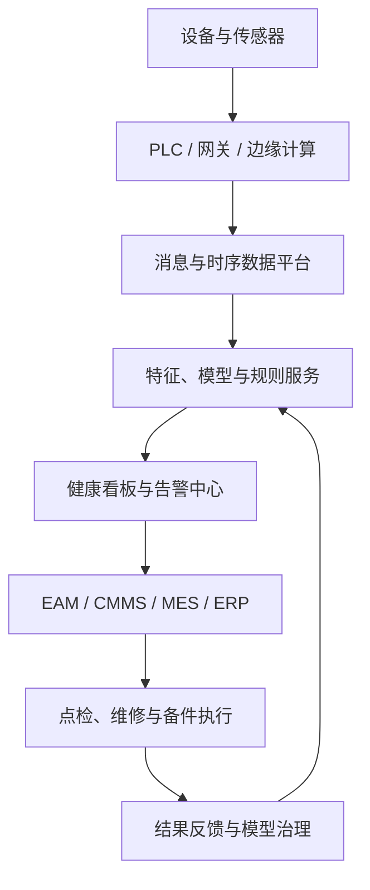

# 设备预测性维护：从状态监测、故障诊断到维护决策闭环

一家连续生产工厂的关键风机已经运行了三年。振动值偶尔升高，但还没有超过报警阈值；轴承温度比过去高了几摄氏度，但在设备手册允许范围内；电机电流出现了轻微波动，现场人员却无法判断这是负载变化、传感器噪声，还是故障正在形成。

如果立即停机检查，企业可能损失数小时产能，拆检后也可能发现设备完全正常。如果继续运行，轴承一旦抱死，又可能引起转子损伤、产品报废甚至安全事故。

传统维护通常给出两种答案：坏了再修，或者到期就换。预测性维护希望给出第三种答案：**设备现在是否正在退化，可能是什么问题，大约还能可靠运行多久，以及在哪个时间窗口维修最合适。**

这听起来像一个机器学习预测问题，但真正落地以后会发现，模型只是其中一环。传感器是否装在正确位置，采样频率是否覆盖故障特征，设备台账能否与时序数据关联，维修记录是否可信，预测是否包含不确定性，告警能否生成工单，维修结果能否反馈给模型，这些因素共同决定系统是否有价值。

因此，设备预测性维护不应被理解为“训练一个故障分类模型”，而应被理解为一条完整的工业闭环：

```text
感知设备状态
  ↓
识别异常与退化
  ↓
诊断故障模式
  ↓
预测风险与剩余寿命
  ↓
结合生产和资源制定维护计划
  ↓
执行维修并验证结果
  ↓
用新证据更新规则、数据和模型
```

> 资料口径：本文基于截至 **2026 年 10 月 19 日**可检索的预测性维护、状态维修和 PHM 相关论文与公开资料整理。文章讨论的是通用工业设备方法，具体阈值、采样方案和维护策略仍需结合设备机理、安全等级与现场验证确定。

---

## 一、预测性维护解决的不是“会不会坏”，而是“怎样行动”

工业设备维护通常可以分为四种模式。

### 1. 事后维护：故障发生后恢复

事后维护，也称纠正性维护，逻辑最简单：设备失效后再维修或更换。

这种方式适合故障后果低、替换成本低、存在冗余且维修方便的非关键设备。它不需要复杂监测系统，但代价是故障时间不可控。对于瓶颈设备、安全关键设备或连续生产设备，突发停机会把维修成本放大为产能损失、质量损失和连锁停机。

### 2. 预防性维护：按时间或使用量提前处理

预防性维护根据日历时间、运行小时数、循环次数或里程执行保养。例如每运行 3000 小时更换轴承，每半年进行一次润滑和校准。

它把随机故障转化为计划任务，却隐含了一个强假设：同类设备以相近速度退化。现实中，负载、环境、操作方式、材料批次和安装质量都会影响寿命。统一周期可能使部分部件被过早更换，也可能让高负荷设备在维护周期到来前就发生故障。

### 3. 状态维修：根据当前健康状态决定是否干预

状态维修利用振动、温度、电流、油液、压力等信号判断设备当前是否健康。只要状态正常，就不因固定周期而拆检；当状态指标达到规则阈值时，再安排维护。

它比固定周期更贴近设备实际状况，但多数状态维修只回答“现在是否异常”，未必能回答异常会怎样发展，以及维护还能推迟多久。

### 4. 预测性维护：面向未来风险安排维护

预测性维护在状态监测基础上进一步估计：

- 故障发生的概率是否正在上升；
- 可能发生哪一类故障；
- 退化速度是否加快；
- 剩余使用寿命还有多长；
- 何时维修能在风险、成本和生产之间取得更好平衡。

所以，预测性维护的目标不是把维修做得越早越好，而是把维护安排在**既不过早浪费寿命，也不过晚暴露于不可接受风险**的位置。

经典的状态维修研究把系统概括为数据采集、数据处理和维护决策三个步骤[1]。二十年后，传感器、工业互联网和深度学习改变了每一步的技术实现，但这个结构仍然成立：没有最后的维护决策，前面的检测和预测只能算设备分析，不能算完整的预测性维护。

---

## 二、先分清五个任务，才能选择正确模型

很多项目一开始就讨论用随机森林、LSTM 还是 Transformer，却没有先定义模型要回答什么问题。预测性维护至少包含五类不同任务，它们的标签、评价指标和业务动作都不一样。

### 1. 状态监测：设备现在发生了什么

状态监测持续采集并展示设备信号，例如：

- 轴承振动均方根是否升高；
- 电机绕组温度是否接近上限；
- 液压系统压力是否持续波动；
- 润滑油颗粒数量是否增加；
- 泵的流量与功率关系是否偏离正常区间。

状态监测主要负责让设备状态可见。它可以包含阈值告警，但不一定使用预测模型。

### 2. 异常检测：设备是否偏离正常模式

异常检测回答的是二元或评分问题：当前行为是否不同于正常状态？

当故障样本非常少时，可以只用正常数据建立基线。模型学习正常工况下多变量之间的关系，再用距离、密度、预测残差或重构误差衡量异常程度。

异常并不等于故障。负载切换、启停过程、工艺调整和传感器松动都可能造成异常信号。因此，异常检测适合作为早期筛查层，而不是直接生成“更换轴承”的结论。

### 3. 故障诊断：为什么异常

故障诊断需要识别故障模式、位置和严重程度。例如区分轴承内圈、外圈或滚动体损伤，转子不平衡、轴系不对中或机械松动，以及电机转子断条、定子绕组故障或供电异常。

诊断模型通常需要故障标签、专家规则或机理特征。它比异常检测更接近维修动作，因为不同故障对应不同检查项、备件和停机要求。

### 4. 状态预测与 RUL：未来怎样发展

状态预测估计健康指标、温度、振动或故障概率未来的变化。剩余使用寿命，简称 RUL，则估计设备从当前时刻到达到失效阈值还能运行多久：

```text
RUL(t) = T_failure - t
```

这里真正困难的不是公式，而是 `T_failure` 如何定义。完全停转、性能低于要求、安全风险超过阈值、质量能力下降到不可接受水平，都可能构成不同业务语境下的“失效”。

### 5. 维护优化：什么时候修、怎样修

即使模型给出“预计还能运行 12 天”，维护部门仍需回答预测区间有多宽、未来是否有计划停机窗口、备件能否及时到货、同一产线有哪些设备可合并检修，以及应该检查、润滑、调整、修复还是直接更换。

这已经不是单纯的预测任务，而是带约束的风险与成本优化问题。

五类任务之间的关系可以表示为：


成熟系统不要求每台设备都具备全部能力。某些低价值设备使用阈值监测就足够，关键设备才值得建设故障诊断、RUL 和维护优化。技术复杂度应由业务风险决定，而不是由算法潮流决定。

---

## 三、预测性维护的第一步不是建模，而是定义设备边界

设备预测项目常见的失败方式，是拿到一张时序数据表就开始寻找相关性，却不知道每一列对应哪个测点、部件和运行阶段。

### 1. 建立资产层级

预测对象需要落在明确的资产结构中：

```text
工厂
  └─ 产线
      └─ 设备
          ├─ 子系统
          │   └─ 部件
          └─ 测点
```

以离心泵为例，设备可以拆为电机、联轴器、轴承、泵轴、叶轮、机械密封和润滑系统。一个“泵异常”告警如果不能定位到部件或故障模式，很难转化为可执行检查。

### 2. 定义功能、失效与后果

预测性维护应从可靠性问题出发，而不是从数据出发。对每类关键设备，需要明确设备承担什么功能、哪些状态意味着功能失效、可能出现哪些故障模式、会产生怎样的后果，以及哪些信号能够在故障前提供可观测证据。

FMEA、FMECA、故障树和可靠性中心维护等方法可以帮助完成这一步。例如，轴承外圈剥落会产生与外圈故障特征频率相关的冲击；不对中可能表现为轴频及其倍频成分变化；润滑不足可能同时引起高频振动和温度上升。只有建立“故障机理—可观测信号—维护动作”的映射，传感器选择才有依据。

### 3. 评估 P-F 间隔

设备从出现可检测的潜在故障 `P`，到发生功能失效 `F`，中间存在一段可干预窗口，即 P-F 间隔。

```text
健康 ───── 潜在故障 P ───── 功能失效 F
                  <--- 可干预窗口 --->
```

检测频率必须明显短于 P-F 间隔。如果某类故障从出现征兆到失效只需几分钟，每天离线采集一次数据没有意义；如果退化需要几个月，毫秒级数据全量上云又可能造成不必要成本。

### 4. 选择值得预测的对象

并非所有设备都适合建设复杂预测模型。优先级通常取决于故障是否造成安全或环保风险、是否位于产线瓶颈、单次停机损失是否高、是否存在可观测的退化过程，以及是否能够提前采取经济有效的维护动作。

如果故障随机发生、没有可测先兆，或者即使预测出来也无法提前干预，那么预测性维护未必是合适方案。增加冗余、改进设计、加强保护或优化备件，可能更有效。

---

## 四、数据链路决定了模型能力的上限

预测性维护的数据不只来自传感器。一个可用模型至少需要把设备状态、运行工况、故障事件和维护结果连接起来。

### 1. 状态信号

| 数据类型 | 常见对象 | 可观察问题 |
| --- | --- | --- |
| 振动 | 轴承、齿轮、风机、泵 | 不平衡、不对中、松动、冲击、磨损 |
| 温度 | 轴承、电机、变压器、炉体 | 摩擦、过载、绝缘或冷却异常 |
| 电流与电压 | 电机、驱动器、电气设备 | 负载变化、转子与绕组故障、供电异常 |
| 声音与超声 | 阀门、管道、旋转设备 | 泄漏、摩擦、放电和早期冲击 |
| 压力与流量 | 泵、压缩机、液压系统 | 堵塞、泄漏、汽蚀、效率下降 |
| 油液与颗粒 | 齿轮箱、发动机、液压系统 | 磨损颗粒、污染、润滑退化 |
| 控制与报警日志 | PLC、CNC、机器人 | 状态切换、联锁触发、错误序列 |

振动数据尤其需要重视采样设计。低频趋势值适合监控整体能量变化，却可能丢失早期冲击的频谱结构；原始高频波形信息丰富，但存储和传输成本高。工程上常采用分层采集：边缘侧持续计算统计量与频谱特征，异常时再保存前后时段的高频原始波形。

### 2. 工况和生产上下文

设备信号总是在工况中产生。转速、负载、产品型号、加工阶段、环境温湿度、原料性质和操作模式都会改变数据分布。

如果模型没有这些上下文，就很容易把正常的工况切换误判为故障。例如，同一台泵在低流量和高流量下的振动基线不同；机床加工不同材料时主轴电流不同；压缩机启停阶段的温度变化不能与稳态运行直接比较。

因此，每段状态数据至少应能关联：

```text
设备身份 + 测点身份 + 时间 + 运行模式 + 负载 + 产品/工单 + 环境条件
```

### 3. 故障和维修记录

预测模型需要知道异常最后对应了什么结果：是否真实发生故障、故障发生在哪个部件、维修人员观察到了什么、采取了什么动作、更换了哪些备件，以及维修后信号是否恢复。

现实中的维修记录经常只写“设备异常，已处理”“更换配件，恢复生产”。这种文本无法形成高质量标签。企业需要把故障部位、故障模式、原因、措施和验证结果结构化，同时保留现场文本、照片和检测报告作为证据。

### 4. 时间对齐与事件语义

设备数据可能来自多个系统：PLC 使用控制器时间，传感器网关使用本地时间，MES 使用服务器时间，维修系统由人工录入。几分钟的时间偏差就可能把故障前信号错误地关联到故障后。

除了统一时钟，还要定义告警发生、实际停机、故障确认、维修开始、维修结束和恢复服役等事件语义。预测窗口和标签窗口必须基于这些事件一致构造，否则模型可能无意中看到未来信息。

### 5. 数据质量不是清洗一次，而是持续治理

设备数据常见问题包括传感器漂移或松动、缺失与乱序、单位和量程不一致、测点改名后语义丢失、设备检修后基线变化，以及标签来自推测而非拆检证据。

因此，数据平台需要对每个测点记录单位、采样率、量程、安装位置、方向、校准记录、数据质量状态和版本。模型输入不仅包含数值，还应包含这段数据是否可信。

---

## 五、从原始信号到健康证据：特征工程仍然重要

深度学习可以自动提取特征，但这不意味着工业信号知识已经过时。相反，机理特征通常能降低数据需求、提高可解释性，并帮助发现模型是否学习了错误捷径。

### 1. 时域、频域与时频特征

时域常用特征包括均值、标准差、均方根、峰值、峰峰值、偏度、峭度、波形因子、峰值因子、趋势斜率和变化率。均方根反映整体振动能量，峭度对冲击性信号较敏感，但没有任何单一特征能够稳定覆盖全部故障。

频域分析关注转频及其倍频、齿轮啮合频率和边带、轴承故障特征频率、频带能量与频谱熵。在变转速场景下，直接比较固定频率可能失效，需要使用阶次分析或转速同步重采样。

短时傅里叶变换、小波变换和小波包等时频方法可以观察频率成分随时间的变化，适合分析启停、冲击、转速变化和短时异常。

### 2. 多变量关系特征

很多异常不是某个传感器绝对值过高，而是变量关系被破坏。例如相同流量下泵功率逐渐升高，相同负载下轴承温度高于历史基线，或者阀门开度变化后的压力响应延迟变长。

这类残差特征往往比单变量阈值更早暴露问题。可以先建立“工况到正常响应”的基线模型，再监测真实值与期望值的偏差。

### 3. 健康指标

健康指标 HI 试图把多个观测压缩为一个能够表示退化程度的变量。理想的 HI 应具备趋势性、单调性、鲁棒性、可比较性和可解释性。

健康指标可以由专家加权、主成分分析、自编码器隐变量、监督回归或对比学习得到。但把高维状态压成一个分数也会丢失信息。实际系统通常同时保留总健康分、故障模式分数和关键证据特征。

---

## 六、异常检测：故障样本稀缺时，先学习什么是正常

真实工业环境最大的建模矛盾是：企业希望少发生故障，而监督学习又需要大量故障样本。异常检测因此成为许多项目的起点。

### 1. 规则与统计基线

最简单的方法是固定阈值、变化率阈值、控制图和多级报警。它们易解释、易部署，适合机理明确和边界稳定的指标。

但固定阈值无法适应多工况。例如，设备满载时温度 75 摄氏度可能正常，空载时同样温度却值得关注。改进方式是按运行模式建立不同基线，或者根据负载动态计算期望区间。

### 2. 距离、密度和隔离方法

K 近邻距离、局部离群因子、单类支持向量机和孤立森林，可以在人工特征空间中识别少见样本。它们对中小规模数据有效，也比深度模型更容易解释。

这类方法的关键不是算法名称，而是正常数据是否覆盖了全部合法工况。如果训练集只包含冬季低负载数据，夏季高负载运行就可能被整体判为异常。

### 3. 预测残差

模型根据历史和工况预测下一时刻信号：

```text
residual(t) = observed(t) - predicted(t)
```

当设备关系发生变化，预测残差会持续增大。ARIMA、状态空间模型、回归模型、LSTM 和 Transformer 都可以用于正常行为预测。

残差方法的优势是可以把工况影响纳入基线；风险是预测模型本身失准也会产生异常，需要区分模型不确定性、数据质量问题和真实设备异常。

### 4. 重构误差

自编码器先把正常数据压缩到低维表示，再重构原始输入：

```text
anomaly_score = distance(x, decoder(encoder(x)))
```

如果模型主要见过正常模式，异常样本通常更难重构。卷积自编码器适合局部波形，序列自编码器适合时间依赖，变分自编码器能够提供概率表示。

但重构能力过强时，模型也可能把异常重构得很好。阈值若只在离线数据上调优，也容易在现场产生大量误报。

### 5. 告警必须经过持续性和上下文过滤

生产系统不能把每个异常点都变成工单。通常需要增加：

- 连续多个窗口超过阈值才触发；
- 多个相关测点共同异常才升级；
- 启停、换型和维护后的抑制规则；
- 数据质量异常优先于设备异常；
- 告警合并、去重和冷却时间；
- 基于风险的分级与升级。

一个实用告警至少应给出设备、时间、异常趋势、相关测点、当前工况、相似历史案例和建议检查项，而不是只显示一个 0.87 的异常分数。

---

## 七、故障诊断：把异常转化为可检查的原因

故障诊断的价值，在于缩小维修人员的搜索范围。

### 1. 基于规则和机理的诊断

规则系统可以把多种证据组合为故障假设。例如：

```text
如果：轴向振动升高
并且：一倍频与二倍频显著
并且：联轴器两侧相位关系异常
那么：优先检查轴系不对中
```

规则的优点是透明、可审查，并能直接对应检查步骤。缺点是维护成本高，规则之间可能冲突，也难以覆盖复杂工况。

### 2. 传统监督学习

当已有结构化故障标签时，可以使用逻辑回归、支持向量机、决策树、随机森林、梯度提升树和概率图模型进行分类。

传统模型适合样本量有限、特征工程成熟的场景。树模型还能通过特征重要性或局部解释帮助工程师理解结果。2019 年的系统综述已经显示，机器学习被广泛用于预测性维护，但模型选择必须与任务、数据和评价方式匹配[2]。

### 3. 深度学习

CNN 可以从一维波形、频谱或时频图中学习局部模式；LSTM、GRU 和时序卷积网络适合序列依赖；Transformer 擅长建模长序列和多变量交互；图神经网络则可以表达部件、测点和设备之间的拓扑关系。

深度模型的优势是减少人工特征依赖，并能处理高维多传感器输入。代价包括：

- 需要更多数据与计算资源；
- 容易学习设备编号、采集批次等伪相关；
- 跨工况和跨设备性能可能明显下降；
- 解释结果不一定等同于真实故障机理；
- 模型版本和预处理链路更难维护。

2026 年的深度学习综述仍把标签不足、分布漂移、噪声与缺失、可解释性和复现性列为主要问题[10]。这说明模型架构进步并没有自动消除工业部署约束。

### 4. 多标签与层级诊断

设备可能同时存在多个问题，例如不对中导致轴承额外受力，最终引起轴承损伤。强制把每个样本分成唯一类别，会掩盖故障共存和因果链。

更合理的输出可以是层级结构：

```text
系统：旋转机械异常
部位：驱动端
部件：轴承 / 联轴器
候选故障：不对中 0.62，外圈损伤 0.31
严重度：中等
证据：轴向 2X 增长，高频包络能量上升
建议：先检查对中与地脚，再复核轴承
```

这比简单输出“类别 3”更接近维修决策。

---

## 八、剩余使用寿命预测：最需要诚实表达不确定性的任务

RUL 是预测性维护中最受关注、也最容易被误解的指标。

### 1. RUL 不是设备固有常数

同一部件的剩余寿命取决于未来怎样使用。负载、转速、环境、润滑和操作策略变化，都会改变退化速度。因此，RUL 更准确的含义是：

> 在给定当前状态、未来工况假设和失效定义的条件下，对剩余可用时间的估计。

如果未来工况未知，模型应给出情景化结果或概率分布，而不是伪精确的单点数字。

### 2. 失效阈值与起始点

构造 RUL 标签时通常需要确定什么时候开始出现退化、哪个状态被定义为寿命终点、维修和停机截尾数据如何处理，以及早期健康阶段是否设置 RUL 上限。

公开数据集常提供从健康到失效的完整轨迹，现实设备却经常在失效前被维修，因此只能观察到截尾寿命。忽略截尾会使训练数据偏向少数严重故障设备。

### 3. 三类主要方法

**基于机理的方法**根据裂纹扩展、磨损、疲劳、腐蚀、热老化或电化学过程建立退化方程。它可解释、适合外推，但需要准确参数和边界条件。

**基于统计的方法**使用随机过程、状态空间模型、隐马尔可夫模型、粒子滤波、生存分析和贝叶斯更新描述退化与寿命分布。它能够自然表达不确定性，适合样本有限但退化结构相对明确的场景。

**数据驱动方法**直接学习传感器序列到健康状态或 RUL 的映射，包括回归模型、集成学习、CNN、LSTM、Transformer 和混合网络。LSTM 等序列模型已被广泛用于 C-MAPSS 等基准数据的 RUL 估计[6]。

工程上越来越常见的是混合方法：用物理模型约束趋势和边界，用数据模型补偿未知关系，再通过贝叶斯或集成方法给出不确定性。

### 4. 直接预测与间接预测

直接方法把历史窗口映射为 RUL：

```text
sensor history + operating condition -> RUL
```

间接方法先预测健康指标未来轨迹，再计算其达到失效阈值的时间：

```text
sensor history -> health trajectory -> threshold crossing -> RUL
```

直接方法实现简单，但中间推理过程较黑盒；间接方法更容易展示退化趋势和阈值依据，却依赖健康指标质量。

### 5. 输出分布，而不是只输出均值

假设模型给出 RUL 为 20 天，但 90% 预测区间是 6 到 45 天，这与“稳定剩余 20 天”的决策含义完全不同。

可通过贝叶斯模型、深度集成、分位数回归、概率分布预测或保形预测等方式输出区间。维护决策还可以使用保守分位数，例如用 RUL 分布的第 10 百分位安排安全关键设备，而不是使用均值。

一个面向行动的 RUL 输出应至少包含点估计或中位数、预测区间、未来工况假设、失效阈值定义、与上次预测相比的变化、主要证据，以及模型是否遇到训练分布之外的输入。

---

## 九、模型评估：避免在实验室里制造一个虚假的高分

预测性维护模型很容易因为数据泄漏获得漂亮结果。尤其当连续信号被切成大量重叠窗口时，随机划分会让同一设备、同一时段的相邻片段同时出现在训练集和测试集。

### 1. 按设备和时间划分

可靠验证至少应考虑：

- **按时间划分**：只用过去训练，预测未来；
- **按设备划分**：测试设备不出现在训练集；
- **按工况划分**：测试未见负载、转速或环境；
- **按地点划分**：在另一条产线或工厂验证；
- **按维护周期划分**：同一生命周期的数据不能跨集合泄漏。

预处理也必须在训练集上拟合。先用全部数据计算标准化参数、特征选择或降维，再切分数据，同样会泄漏测试信息。

### 2. 异常与诊断指标

类别不平衡时，Accuracy 通常没有意义。更重要的指标包括 Precision、Recall、F1、PR-AUC、每台设备每月误报次数、从首次有效告警到故障的提前量，以及告警持续性和重复率。

对于高后果故障，漏报成本可能远高于误报；对于停机检查昂贵的设备，误报同样不能忽视。指标权重必须由业务成本确定。

### 3. RUL 指标

常见指标包括 MAE、RMSE、分位数损失和带非对称惩罚的评分函数。RUL 高估通常比低估更危险，因此可以对“预测还能运行很久，但实际很快失效”的情况施加更大惩罚。

概率预测还应评估预测区间覆盖率是否接近标称水平、区间是否过宽而失去行动价值、不同设备和寿命阶段是否都经过校准，以及越接近失效时预测是否稳定收敛。

### 4. 最终评价应落到业务结果

一个 F1 提高两个百分点的模型，未必比简单规则更有价值。企业最终应观察非计划停机是否下降、计划维护占比是否提高、关键故障平均提前发现时间是否增加、误报导致的无效检查是否可控，以及备件和人员是否更早准备。

模型指标是进入现场的必要证据，不是项目成功的最终定义。

---

## 十、从预测到决策：把算法输出变成维护计划

预测结果必须与设备关键度、生产计划、备件、人员和风险规则结合。

### 1. 建立风险，而不只看故障概率

维护优先级不能只按故障概率排序。一个概率较低但后果严重的故障，可能比高概率的小故障更需要处理。可以用简化关系表达：

```text
Risk = Probability of Failure × Consequence of Failure
```

后果可以综合安全、环保、质量、产量、维修时间和连锁影响。更完整的系统还需考虑不确定性和风险随时间的变化。

### 2. 计算维护总成本

候选维护时刻 `τ` 的预期成本可以概念化为：

```text
Expected Cost(τ)
  = planned maintenance cost
  + expected failure cost before τ
  + production loss at τ
  + spare-part and labor cost
  + quality, safety and environmental risk
```

过早维护会浪费剩余寿命，过晚维护会提高故障概率。最优点还受到停机窗口、备件交期和人员班次约束。

### 3. 输出可执行建议

一个完整的维护建议不应只有“风险高”，而应包含：

```text
对象：2 号线循环水泵 P-204 驱动端轴承
风险：未来 7 天进入高风险区间的概率为 68%
候选故障：外圈损伤，置信度中等
证据：包络谱特征频率增强，峭度连续 5 天上升
不确定性：高负载样本较少，RUL 80% 区间为 4-13 天
建议动作：48 小时内复测振动；下一个停机窗口更换轴承
资源：备件库存 1 件，预计作业 3 小时，需要机械维修 2 人
升级条件：振动增幅超过 20% 或温度超过规则阈值时立即停机评估
```

这样的输出把模型结论、证据、风险、资源和升级规则放在一起，维修人员才能判断是否采纳。

### 4. 人在回路不是妥协，而是控制机制

在高风险场景中，模型不应直接控制设备停机或更换部件。更合理的自动化等级是逐步提高：

1. **影子模式**：模型运行但不触发业务动作，只与实际事件对比。
2. **辅助判断**：向专家展示告警、证据和建议。
3. **自动建单**：满足规则时自动创建待审核工单。
4. **受限决策**：对低风险、标准化场景自动安排检查。
5. **闭环控制**：仅在充分验证且有安全保护的特定场景自动执行。

维修人员的确认、驳回和补充说明应成为模型反馈，而不是留在聊天或纸质记录中。

---

## 十一、系统架构：边缘、平台、模型和业务系统必须连成一条链

预测性维护的工程架构可以分为六层。



### 1. 感知层

负责采集振动、温度、电流、压力、流量、声音、油液和控制日志。设计重点是测点位置、方向、采样率、同步和校准，而不只是购买更多传感器。

### 2. 边缘层

负责协议接入、数据缓存、信号预处理、特征计算和低延迟告警。高频波形可以在边缘计算频谱与统计量，只在触发条件满足时上传原始片段。

### 3. 数据平台层

时序数据库保存连续测点，数据湖保存原始波形、文件与历史快照，资产模型保存设备层级和测点语义，事件平台连接告警、停机、工单和维修记录。

### 4. 分析与模型层

这一层不仅包含训练和推理，还应管理：

- 特征定义与版本；
- 训练数据快照；
- 模型、阈值和规则版本；
- 设备适用范围；
- 在线性能和漂移；
- 回滚与降级策略；
- 推理证据和审计日志。

### 5. 应用层

健康看板应支持从工厂、产线、设备下钻到部件和测点；告警中心需要聚合、确认、转派、抑制和关闭；诊断页面需要同时展示趋势、频谱、工况、历史维修和相似案例。

### 6. 业务执行层

预测结果应进入 EAM 或 CMMS 形成点检和维修工单，与 MES 协调停机窗口，与 ERP 或库存系统确认备件，与人员排班系统确认技能和工时。维修结束后，拆检结论和更换部件必须回流。

这套结构与 ISO 13374 等状态监测数据处理架构的思想一致：采集、处理、检测、评估、预测和建议是不同职责，应通过明确接口连接，而不是塞进一个不可解释的模型服务。

---

## 十二、贯穿案例：如何为一套旋转设备建立预测性维护闭环

以关键风机的驱动端轴承为例，可以把项目拆成十步。

### 第一步：定义业务目标

目标不是笼统的“预测轴承故障”，而是：

> 对驱动端轴承剥落、润滑异常和不对中导致的退化提供至少 72 小时有效预警，把突发停机转化为计划检修，并把每台设备每月无效告警控制在可接受范围。

### 第二步：分析故障模式

整理历史工单、拆检照片和专家经验，建立故障模式与信号映射。明确哪些故障能够通过振动、温度和电流观察，哪些只能通过油液或人工检查确认。

### 第三步：设计测点

在驱动端和非驱动端布置径向与轴向振动测点，接入轴承温度、电机电流、转速和风机负载。统一时间同步，记录传感器安装方向和量程。

### 第四步：建立运行模式

区分停机、启动、升速、稳态低负载、稳态高负载和降速。只在可比较模式内建立基线，启停阶段使用独立规则。

### 第五步：建立第一版规则

先用现有标准、设备手册和专家经验建立振动总值、温升、变化率和频带能量规则。这一步提供可解释基线，也能尽早暴露数据质量问题。

### 第六步：训练正常行为模型

用健康期间数据学习转速、负载、环境到振动和温度的正常关系。模型输出动态期望值，持续监测残差，而不是使用单一固定阈值。

### 第七步：融合故障诊断证据

当异常持续存在时，计算包络谱、阶次和多测点关系，结合规则与分类模型输出候选故障。若证据不足，则明确标记为“未知异常”，避免强行归类。

### 第八步：建立退化与 RUL 模型

选择与轴承退化相关的健康指标，使用历史退化轨迹、相似设备和机理约束预测趋势。输出多个分位数，并在工况变化时重新计算。

### 第九步：进入维护流程

中风险告警先生成复测任务，高风险且证据一致时生成待审核维修工单。系统检查停机窗口、备件和人员，并给出最晚建议处理日期。

### 第十步：用拆检结果验证

维修人员记录真实故障位置、严重度和处理结果。若拆检未发现故障，要判断是模型误报、规则过敏、传感器异常，还是维护及时阻止了进一步恶化。不同结论对应不同训练标签。

这个案例说明，模型训练只占项目的一部分。前面的故障定义和数据设计决定模型是否学得到，后面的工单与反馈决定模型是否产生业务价值。

---

## 十三、最常见的失败方式

### 1. 从算法出发，而不是从故障后果出发

团队先决定使用某种深度网络，再去寻找适配问题，最后得到一个离线分数不错但无人使用的模型。

### 2. 把异常当故障

任何偏离正常的数据都生成维修告警，工况切换和传感器问题造成大量误报，现场很快失去信任。

### 3. 忽略设备身份和工况

把不同型号、不同负载、不同维修状态的数据混在一起训练，模型学到的是设备差异而不是退化规律。

### 4. 标签只依赖告警码

PLC 告警通常表示保护条件被触发，不等于根因。使用告警码直接作为故障标签，会把结果与原因混为一谈。

### 5. 随机切分重叠窗口

相邻窗口高度相似，随机划分使测试集几乎成为训练数据副本，离线准确率被严重高估。

### 6. 只输出单点 RUL

模型显示“剩余 15 天”，却不说明区间、未来工况、失效定义和适用边界，导致决策者把不确定估计误当成确定倒计时。

### 7. 上线后不监测漂移

设备检修、传感器更换、生产换型和季节变化都会改变数据分布。模型上线后长期不校准，性能必然衰减。持续学习研究正是针对这种非平稳环境，但更新模型本身也需要防止灾难性遗忘和错误标签累积[9]。

### 8. 告警没有业务出口

系统检测到问题，却没有责任人、响应时限、检查清单、工单接口和升级机制。告警最终停留在看板上。

### 9. 只计算节省的维修费

预测性维护的收益还包括减少停机、降低质量损失、优化备件、延长资产寿命和降低安全风险。反过来，传感器、平台、模型维护和误报检查也都是成本。ROI 必须计算完整。

---

## 十四、实施路线：从一个高价值闭环开始，而不是建设“大而全平台”

### 阶段一：选择场景并建立基线

选择少量高价值、故障机理相对清楚、存在可观测退化过程的设备。梳理过去 12 到 24 个月的停机、维修、备件和损失，建立当前维护绩效基线。

输出物包括关键设备清单、故障模式、风险排序、测点现状、数据缺口和业务目标。

### 阶段二：打通数据与事件

统一资产编码，关联测点、运行工况、报警、停机和工单。建立时间同步、数据质量规则和结构化维修记录。

这个阶段不急于追求复杂模型。先保证工程师能够在一个界面看到完整证据链。

### 阶段三：规则与简单模型先行

部署动态阈值、趋势规则、正常行为模型和基础异常检测。通过影子模式积累告警与真实结果，建立误报、漏报和提前量基线。

### 阶段四：增加诊断和概率预测

在数据与标签足够后，增加故障分类、健康指标和 RUL。所有输出包含不确定性、证据和适用范围，并按设备或工况做独立验证。

### 阶段五：连接维护决策

把风险分级映射到复测、点检、润滑、停机检查和更换动作，接入工单、备件和排程。定义响应责任、超时升级和关闭标准。

### 阶段六：复制与持续治理

形成可复用模板，但不假设模型可以无条件复制。新设备上线时要验证传感器、工况、故障模式和数据分布。持续监测模型性能、告警负担、业务收益和安全事件。

一个可执行的最小闭环应至少做到：

```text
一个明确设备族
+ 三到五个高价值故障模式
+ 可比较的运行工况
+ 可信的事件与维修标签
+ 可解释的告警证据
+ 明确的响应动作和责任人
+ 维修结果回流
```

只有这条链真正运行起来，扩大设备范围和算法复杂度才有意义。

---

## 十五、未来方向：模型会更强，但重点将转向可信决策

### 1. 自监督学习减少标签依赖

工业现场拥有大量无标签正常数据。掩码重建、对比学习和序列预训练可以先学习通用表示，再用少量故障样本微调，降低对人工标签的依赖。

### 2. 迁移学习与跨设备泛化

未来系统需要把一个设备族学到的知识迁移到新设备，同时识别哪些差异不能迁移。领域自适应、元学习和设备条件化模型会持续发展，但跨设备验证仍是必要证据。

### 3. 物理信息与数据模型融合

纯数据模型在未见工况下容易失效。把能量守恒、退化单调性、结构拓扑、失效阈值和仿真结果写入模型或损失函数，可以缩小不合理解空间。混合模型也更容易向工程师解释。

### 4. 数字孪生支持情景预测

RUL 依赖未来工况。数字孪生可以模拟“继续满负荷运行”“降载运行”“提前润滑”等不同策略下的状态变化，使寿命预测从单一路径变成可比较的情景决策。

### 5. 联邦学习与隐私协作

同型号设备可能分布在不同工厂和企业，单个现场故障样本不足。联邦学习试图在不直接汇总原始数据的情况下共享模型更新，但设备异构、标签标准和安全治理仍是实际难点。

### 6. 从可解释模型走向可验证证据

未来系统不能只生成一张特征重要性图，而应提供可以被复核的证据：原始波形片段、频谱特征、工况对比、相似历史案例、规则命中和模型不确定性。解释的目标不是让黑盒看起来合理，而是帮助人员做出正确行动。

### 7. 从预测准确率走向决策收益

研究重点正在从“谁的 RMSE 更低”转向预测和维护联合优化。一个略不精确但校准良好、能稳定减少停机的模型，可能优于一个基准数据上高分、现场不可用的复杂模型。

---

## 结语：预测性维护的终点是维护闭环，不是模型排行榜

设备预测性维护连接了机械机理、传感器、信号处理、机器学习、可靠性工程和生产运营。任何单一专业都只能解决其中一部分。

一套成熟系统应当做到：

- 从设备功能、故障模式和业务后果定义问题；
- 在正确位置以正确频率采集状态信号；
- 把信号与资产、工况、故障和维修事件对齐；
- 区分状态监测、异常检测、故障诊断、RUL 和维护优化；
- 用机理特征、规则和数据模型形成互相验证的证据；
- 通过按设备、时间和工况划分避免虚假高分；
- 同时输出预测、不确定性、适用范围和建议动作；
- 将结果连接到工单、备件、人员和生产窗口；
- 用拆检和维修结果持续校正数据、规则与模型。

预测性维护真正建立的是一种新的设备管理方式：企业不再只根据固定周期或突发故障行动，而是持续观察现实、估计风险、选择干预时机，并用每次维护结果改进下一次判断。

最终有价值的不是某个模型声称“准确率达到多少”，而是下面这条闭环能够长期、稳定、可审计地运行：

```text
设备产生状态证据
系统识别异常和退化
模型评估故障与寿命风险
业务约束形成维护计划
人员执行并记录真实结果
结果反过来更新设备认知
```

当这条闭环建立起来，预测性维护才不再是一个展示算法能力的试验项目，而会成为企业控制设备风险、保障生产连续性和积累可靠性知识的长期能力。

---

## 参考论文与资料

以下出版信息检索截止于 2026 年 10 月 19 日。

1. Andrew K. S. Jardine, Daming Lin, Dragan Banjevic. [A review on machinery diagnostics and prognostics implementing condition-based maintenance](https://doi.org/10.1016/j.ymssp.2005.09.012). *Mechanical Systems and Signal Processing*, 20(7), 1483-1510, 2006.
2. Thyago P. Carvalho, Fabrízzio A. A. M. N. Soares, Roberto Vita, Roberto da P. Francisco, João P. Basto, Symone G. S. Alcalá. [A systematic literature review of machine learning methods applied to predictive maintenance](https://doi.org/10.1016/j.cie.2019.106024). *Computers & Industrial Engineering*, 137, 106024, 2019.
3. Tiago Zonta, Cristiano André da Costa, Rodrigo da Rosa Righi, Miromar José de Lima, Eduardo Silveira da Trindade, Guann Pyng Li. [Predictive maintenance in the Industry 4.0: A systematic literature review](https://doi.org/10.1016/j.cie.2020.106889). *Computers & Industrial Engineering*, 150, 106889, 2020.
4. Jay Lee, Fangji Wu, Wenyu Zhao, Masoud Ghaffari, Linxia Liao, David Siegel. [Prognostics and health management design for rotary machinery systems: Reviews, methodology and applications](https://doi.org/10.1016/j.ymssp.2013.06.004). *Mechanical Systems and Signal Processing*, 42(1-2), 314-334, 2014.
5. Abhinav Saxena, Kai Goebel, Don Simon, Neil Eklund. [Damage propagation modeling for aircraft engine run-to-failure simulation](https://doi.org/10.1109/PHM.2008.4711414). *2008 International Conference on Prognostics and Health Management*, 2008.
6. Shuai Zheng, Kosta Ristovski, Ahmed Farahat, Chetan Gupta. [Long Short-Term Memory Network for Remaining Useful Life Estimation](https://doi.org/10.1109/ICPHM.2017.7998311). *2017 IEEE International Conference on Prognostics and Health Management*, 88-95, 2017.
7. Oscar Serradilla, Ekhi Zugasti, Jon Rodriguez, Urko Zurutuza. [Deep learning models for predictive maintenance: A survey, comparison, challenges and prospects](https://doi.org/10.1007/s10489-021-03004-y). *Applied Intelligence*, 52, 10934-10964, 2022.
8. NASA Ames Prognostics Center of Excellence. [Prognostics Data Repository](https://www.nasa.gov/intelligent-systems-division/discovery-and-systems-health/pcoe/pcoe-data-set-repository/). 包含 C-MAPSS 涡扇发动机退化等公开数据集。
9. Julio Hurtado, Dario Salvati, Rudy Semola, Mattia Bosio, Vincenzo Lomonaco. [Continual learning for predictive maintenance: Overview and challenges](https://doi.org/10.1016/j.iswa.2023.200251). *Intelligent Systems with Applications*, 19, 200251, 2023.
10. Hailin Xi, Dawei Zhang, Xiaoqun Liu, Juan Hao, Zishuo Li, et al. [Deep Learning Techniques and Attention Mechanisms in Fault Diagnosis and Predictive Maintenance: A Review](https://doi.org/10.1007/s44196-026-01449-y). *International Journal of Computational Intelligence Systems*, 19, 336, 2026.
