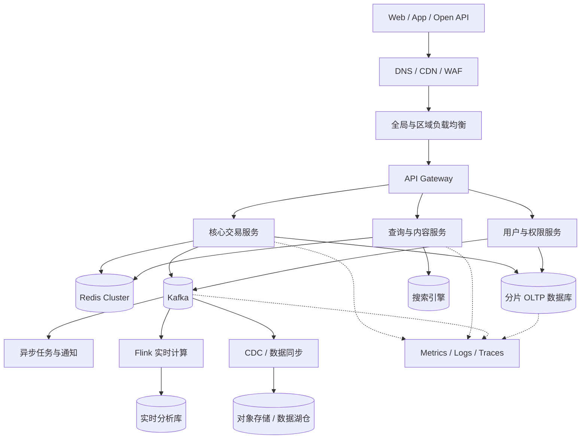
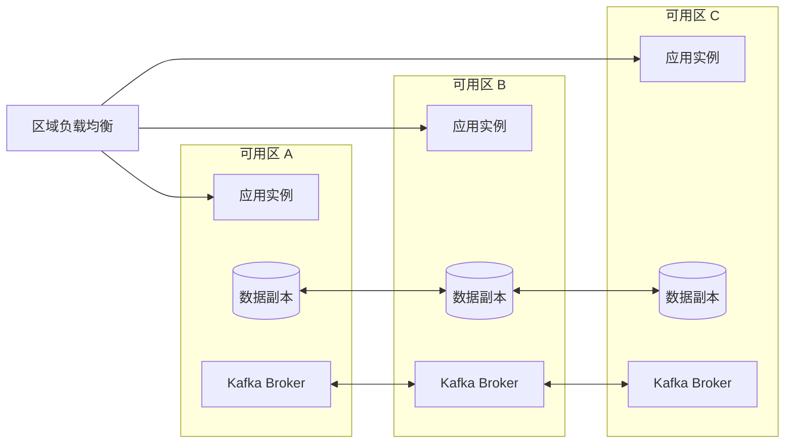

# 高并发与海量数据系统设计：从容量模型到高可用落地

“设计一个高并发、高可用、可扩展的分布式系统”听起来像一道技术选型题：网关用什么，缓存用什么，数据库怎么分片，消息队列选 Kafka 还是其他产品。但真正开始设计时，最先要回答的不是中间件名称，而是三个更基础的问题：

1. 系统究竟要承受多大的流量和数据量？
2. 哪些业务结果必须正确，哪些能力可以在过载时降级？
3. 当机器、网络、依赖和机房发生故障时，系统应该以什么方式继续工作？

高并发解决的是单位时间内如何完成更多有效工作，海量数据解决的是状态如何持续增长而不突破单机边界，高可用解决的是部分组件失效时如何控制影响范围。三者不能独立设计：缓存提升了吞吐，却可能在集中过期时放大数据库压力；重试提高了单次请求的成功概率，却可能在下游过载时制造重试风暴；多副本提高了容错能力，却增加了一致性、切换和运维成本。

因此，可靠的架构不是组件列表，而是一组能够被解释和验证的工程决策：**先建立容量模型和故障模型，再决定如何拆分流量、状态与故障域，最后通过压测和演练证明设计真的成立。**

本文以一个虚构的交易与内容混合平台为例，给出一套从指标到落地的完整设计。文中的规模数据用于说明推导方法，不代表某个真实项目。

---

## 一、先定义问题：把“高并发”翻译成可计算指标

假设平台需要支撑如下目标：

| 指标 | 设计目标 |
|---|---:|
| 日活用户 | 1,000 万 |
| 日请求量 | 20 亿次 |
| 峰值读请求 | 120,000 QPS |
| 峰值写请求 | 20,000 TPS |
| 日新增业务与行为数据 | 3 TB |
| 核心接口 P99 延迟 | 300 ms 以内 |
| 核心交易可用性 | 99.99% |
| 普通查询可用性 | 99.9% |
| 同城故障恢复时间 RTO | 5 分钟以内 |
| 核心数据恢复点 RPO | 接近 0 |
| 分析数据恢复点 RPO | 5 分钟以内 |

这些指标不是文档装饰，而是架构决策的输入。如果只说“流量很大”，就无法判断需要多少实例、多少分片和多少冗余；如果只说“高可用”，就无法判断应该建设同可用区主从、跨可用区部署，还是成本更高的跨地域容灾。

### 1. 从平均流量推导峰值流量

20 亿日请求对应的平均 QPS 为：

```text
平均 QPS = 2,000,000,000 / 86,400 ≈ 23,148
```

真实流量不会均匀分布。假设日常峰值系数为 4，营销活动再引入 1.3 倍突发系数，则容量规划基线约为：

```text
规划峰值 QPS = 23,148 × 4 × 1.3 ≈ 120,370
```

这里还不能直接用 `120,370 / 单实例极限 QPS` 计算实例数。单实例实验室极限通常不适合作为生产水位，因为生产环境还会受到请求结构变化、垃圾回收、网络抖动、依赖变慢和实例故障的影响。更合理的计算方式是：

```text
实例数 = 规划峰值 QPS / 单实例安全吞吐 × 故障冗余系数
```

如果单实例在 P99 延迟不超过 300 ms 时可稳定处理 1,500 QPS，生产安全水位取 60%，则单实例安全吞吐约为 900 QPS。系统需要的不是按实验室极限计算出的 80 个实例，而是至少 134 个实例，再结合可用区分布、发布冗余和扩容时延确定最终基线。

### 2. 数据容量不能只算业务表

日新增 3 TB 原始数据时，还需要计算：

- 数据副本带来的放大；
- 数据库索引和行元数据；
- Kafka 等消息系统的保留副本；
- 搜索索引、实时明细和聚合结果；
- 日志、指标与链路数据；
- 备份、快照和跨地域复制；
- 压缩率及冷热分层后的变化。

例如 3 TB 原始数据采用三副本保存，主存储就需要约 9 TB/日；如果搜索索引、消息保留和观测数据再产生相当于原始数据 1.5 倍的附加数据，则全链路新增存储可能达到 13.5 TB/日。架构评审只估算业务表，最终往往不是数据库先满，而是日志、消息保留或备份空间先突破容量。

### 3. 可用性必须换算成故障预算

99.99% 月度可用性并不等于“几乎不会失败”。按 30 天计算，它只允许大约 4.32 分钟不可用时间：

```text
30 × 24 × 60 × (1 - 99.99%) = 4.32 分钟
```

这意味着依赖人工登录机器、手工修改配置再恢复服务的流程通常无法满足目标。核心链路必须具备自动检测、自动摘除、自动切换和经过演练的恢复路径。

Google SRE 使用 SLI、SLO 和错误预算把可靠性目标转化为工程约束。错误预算本质上是允许失败的额度；当预算快速消耗时，团队应降低变更速度，把精力转向稳定性，而不是继续用“高可用”作为无法验证的口号。可参考 [Google SRE 的生产服务最佳实践](https://sre.google/sre-book/service-best-practices/)。

---

## 二、总体思路：同时拆分流量、状态和故障域

系统扩展通常经历三个层次：

1. **拆流量。** 将请求分散到更多无状态计算实例。
2. **拆状态。** 将数据按业务边界和分片键分布到多个存储单元。
3. **拆故障域。** 让单个实例、节点、可用区或地域故障不会拖垮整个系统。

只完成第一层，数据库仍然会成为瓶颈；只完成第二层，故障仍可能通过同步调用和重试传播；只堆副本而不设计流量切换、数据一致性和恢复流程，高可用仍停留在部署图上。

AWS Well-Architected 的可靠性设计原则包括自动从故障中恢复、测试恢复流程、水平扩展、停止猜测容量以及通过自动化管理变更。这些原则背后的共同点是：可靠性必须成为系统行为，而不能依赖临时人工操作。参见 [AWS Reliability Pillar](https://docs.aws.amazon.com/wellarchitected/latest/framework/rel-dp.html)。

### 1. 逻辑架构



### 2. 架构边界

这套架构刻意区分四条路径：

- **核心写路径：** 只保留完成交易所需的最短同步链路；
- **高频读路径：** 尽量由 CDN、缓存和搜索系统承接；
- **异步事件路径：** 将通知、索引、积分和统计等操作从主交易中移出；
- **分析路径：** 通过 CDC 或事件流进入实时与离线分析系统，避免分析查询直接冲击 OLTP。

同步链路每增加一个远程依赖，都会增加整体延迟和失败概率。假设五个下游依赖各自成功率都是 99.9%，并且一次请求必须全部成功，那么仅从概率上看，串行组合成功率约为：

```text
0.999 ^ 5 ≈ 99.50%
```

因此，业务拆分不能等同于“把一次本地调用变成更多远程调用”。只有确实需要实时结果的步骤才进入同步链路，其余动作通过事件驱动异步执行，并为异步失败设计重试、补偿和对账。

### 3. 设计原则

- 无状态计算节点可以随时创建、替换和销毁；
- 每个有状态组件都要明确分片、副本、选主和恢复方式；
- 所有远程调用都有超时、并发上限和失败策略；
- 重试必须满足幂等，并受到次数和总时限约束；
- 核心链路优先保证正确性，非核心链路优先保证整体可用；
- 任何自动切换机制都必须通过演练验证；
- 过载时优先拒绝低价值请求，保护系统继续完成高价值工作；
- 扩容、迁移、发布和回滚都应有可观察的状态机。

---

## 三、计算层：无状态化、弹性扩展与流量治理

### 1. 无状态化不是没有状态，而是转移状态

应用实例如果把 Session、任务进度、上传文件或业务草稿保存在本机，请求就无法被任意实例处理。实例重启会丢失状态，扩容后新实例也无法立即接管流量。

因此，计算层应尽量无状态：

- Session 使用签名 Token，或存入共享缓存；
- 文件写入对象存储，不依赖容器本地磁盘；
- 长任务进度写入数据库、缓存或事件日志；
- 定时任务通过分布式调度和租约避免重复执行；
- 实例只保留可丢弃、可重建的本地缓存。

状态被外置后，应用实例才能通过增加副本水平扩展。但这也意味着缓存、数据库和消息系统成为更关键的共享依赖，必须分别设计容量与容错，不能把状态移出去后就认为问题已经解决。

### 2. 弹性扩容不能只看 CPU

Kubernetes HPA 可以根据 CPU、内存以及自定义或外部指标调整工作负载副本数，官方文档见 [Horizontal Pod Autoscaling](https://kubernetes.io/docs/concepts/workloads/autoscaling/horizontal-pod-autoscale/)。在业务系统中，仅以 CPU 作为扩容指标往往不够：I/O 密集型服务可能在 CPU 很低时已经被连接池、线程池或下游延迟限制。

更有效的弹性指标包括：

- 网关请求速率和并发请求数；
- 服务 P95、P99 延迟；
- 工作队列长度和最老任务等待时间；
- 线程池活跃度与拒绝次数；
- 数据库连接池使用率；
- Kafka 消费 Lag；
- 业务待处理订单数。

扩容策略还要处理三个时间差：监控发现负载需要时间，调度并启动实例需要时间，实例完成缓存预热和连接建立也需要时间。如果流量在 30 秒内翻倍，而实例需要 3 分钟才能稳定服务，自动扩容只能事后追赶。此时需要同时采用定时预扩容、最小冗余容量、快速启动和负载保护。

### 3. 限流、排队和负载卸载

一个没有入口限制的系统，会把“请求太多”转化为“所有请求都变慢”。延迟上升后，在途请求数量增加，线程、连接、内存和文件描述符继续被占用，最终触发超时、重试和级联故障。

Google SRE 将过载视为级联故障最常见的原因，并建议在服务接近过载时主动拒绝部分流量或返回降级结果，避免实例耗尽资源后整体崩溃。参见 [Addressing Cascading Failures](https://sre.google/sre-book/addressing-cascading-failures/)。

流量治理应分层实施：

| 层次 | 保护对象 | 常见策略 |
|---|---|---|
| CDN/WAF | 源站与安全边界 | 静态缓存、DDoS 防护、恶意流量拦截 |
| API 网关 | 平台总入口 | 用户、租户、接口和区域维度限流 |
| 业务服务 | 实例与线程池 | 并发上限、队列长度、快速失败 |
| 下游客户端 | 数据库和外部依赖 | 连接池、超时、熔断、重试预算 |
| 消息消费端 | 下游写入能力 | 拉取批次、消费并发、反压 |

限流不是简单返回错误。系统需要先给流量分级：

- L0：支付、扣库存、鉴权等核心请求；
- L1：订单查询、用户主页等重要请求；
- L2：推荐、排行榜、统计等可降级请求；
- L3：预取、刷新和离线补充等后台请求。

当系统进入过载状态时，先停止 L3，再降低 L2 的精度或新鲜度，最后才限制 L1。L0 应获得独立资源池和预留容量，避免被低价值流量挤占。

### 4. 超时和重试要有统一预算

假设入口请求总时限为 800 ms，服务 A 调用服务 B，B 再调用数据库。如果每一层都配置 1 秒超时，并各自重试 3 次，上层早已返回失败，底层却仍在执行无价值工作。

更合理的方式是传播统一的截止时间：

```text
入口总预算：800 ms
网关与排队：100 ms
服务 A：150 ms
服务 B：200 ms
数据库：200 ms
安全余量：150 ms
```

重试还应遵循以下规则：

- 只对瞬时错误和幂等操作重试；
- 使用指数退避与随机抖动；
- 设置最大次数和总重试时长；
- 避免调用链的每一层都独立重试；
- 服务端明确返回“可重试”和“不可重试”错误；
- 将原始请求和重试请求分别计量。

重试的目标不是让失败不可见，而是在不放大故障的前提下吸收短暂抖动。

---

## 四、缓存层：把缓存当成容量系统，而不是装饰

多级缓存可以显著降低数据库压力，但缓存也是系统容量的一部分。如果数据库无法承受缓存失效后的回源流量，那么缓存已经从性能优化变成硬依赖。

### 1. 多级缓存路径

```text
客户端缓存
    ↓
CDN / 边缘缓存
    ↓
网关缓存
    ↓
进程内缓存
    ↓
Redis 分布式缓存
    ↓
数据库或对象存储
```

不同缓存层应承担不同职责：

- CDN 保存公共、可复用、更新频率较低的内容；
- 进程内缓存承接极热点且体积小的数据；
- Redis 保存跨实例共享的业务查询结果和短期状态；
- 数据库始终是核心业务事实的最终来源。

### 2. Cache Aside 与一致性窗口

常见的 Cache Aside 流程是：

1. 读取缓存；
2. 未命中时读取数据库；
3. 将结果写入缓存；
4. 更新数据库后删除缓存。

这里选择“删除缓存”而不是“直接更新缓存”，是因为同一数据可能存在多种缓存形态，写路径很难可靠维护全部派生结果。但删除缓存仍然存在短暂并发窗口，例如旧请求在数据库更新后把旧值重新写回缓存。

可根据业务要求组合以下策略：

- 较短 TTL，限制不一致持续时间；
- 延迟二次删除；
- 通过 CDC 订阅数据变更并失效缓存；
- 在缓存值中携带版本号，拒绝旧版本覆盖；
- 对强一致读绕过缓存或读取主库；
- 对可容忍旧数据的查询明确一致性窗口。

不要笼统宣称“缓存和数据库强一致”。应该明确哪些接口允许旧数据存在 1 秒、30 秒或 5 分钟，哪些交易校验必须以数据库为准。

### 3. 穿透、击穿和雪崩

**缓存穿透**是查询不存在的数据，导致请求持续访问数据库。处理方式包括参数校验、空值短缓存和布隆过滤器。

**缓存击穿**是单个热点 Key 到期，大量请求同时回源。可以采用互斥重建、逻辑过期、请求合并和热点永不过期加异步刷新。

**缓存雪崩**是大量 Key 同时过期或缓存集群整体不可用。可以为 TTL 添加随机抖动、分批预热、限制回源并发，并在缓存故障时返回降级数据。

三类问题的共同目标不是“保证缓存永远命中”，而是控制同一时刻进入数据库的回源并发。

### 4. 热 Key 与大 Key

热 Key 会让某个缓存节点、网络队列或单核达到瓶颈，即使集群总容量仍然充足。治理流程应包括：

1. 通过访问采样、代理统计或服务指标发现热点；
2. 对只读热点增加进程内缓存；
3. 将一个逻辑 Key 拆成多个物理副本随机读取；
4. 对重建操作做单飞合并；
5. 对极端热点在 CDN 或网关层直接承接；
6. 将热点识别与活动预案结合，而不是故障后临时处理。

大 Key 会增加网络传输、删除阻塞、主从复制和故障恢复成本。应避免在一个 Key 中存储无界集合，采用分页、分桶或独立对象存储，并在删除时使用非阻塞方式。

Redis Cluster 使用固定哈希槽将键空间分布到多个节点，并通过主从复制和故障转移提供扩展与容错能力；其复制模型和故障窗口也意味着业务仍需明确允许的数据丢失边界。参见 [Redis Cluster specification](https://redis.io/docs/latest/operate/oss_and_stack/reference/cluster-spec/)。

---

## 五、数据层：分片解决容量，副本解决可用

复制和分片经常被混在一起讨论，但它们解决的是不同问题：

- **副本**把同一份数据复制到多个节点，主要解决读取扩展和故障恢复；
- **分片**把不同数据放到不同节点，主要解决存储容量和写入吞吐上限。

一个三副本数据库仍然要求每个副本保存全量数据，主节点通常仍承担全部写入。只有分片才能让容量和写吞吐随节点数量增长。

### 1. 分片键决定系统上限

好的分片键需要同时满足：

- 基数足够大，能够把数据分散开；
- 写入尽量均匀，避免单个分片过热；
- 主要查询能够携带分片键；
- 业务关系尽量在同一分片内完成；
- 未来可以在线扩容和迁移。

常见策略包括：

| 策略 | 优点 | 风险 | 适用场景 |
|---|---|---|---|
| 用户 ID 哈希 | 分布通常均匀 | 跨用户查询需要聚合 | 用户、账户、订单 |
| 租户 ID | 隔离清晰 | 大租户形成热点 | SaaS 多租户 |
| 时间范围 | 范围查询方便 | 最新分区写入集中 | 日志、时序数据 |
| 地域 | 数据本地性好 | 地域流量不均 | 本地化服务 |
| 复合分片 | 可平衡局部性与均匀性 | 路由更复杂 | 大规模交易或事件 |

单调递增 ID 按范围分片，容易让全部新写入集中到最后一个分片；纯随机哈希虽然均匀，却会让范围查询和批量聚合变得昂贵。工程上常采用“业务主体哈希 + 分片内按时间排序”的组合方式。

### 2. 跨分片能力必须受到约束

分片后最昂贵的操作通常是：

- 跨分片事务；
- 无分片键查询；
- 全局唯一约束；
- 跨分片排序和分页；
- 大范围聚合；
- 分片扩容与数据迁移。

不能指望中间件透明地消除这些成本。更可靠的做法是通过领域边界减少跨分片操作，把全局检索交给搜索系统，把聚合分析交给 OLAP，把少量必须跨分片的交易改造成 Saga、事务消息或对账流程。

全局 ID 可以采用带时间和节点信息的趋势递增 ID，但要考虑时钟回拨、节点号冲突和信息暴露。全局唯一业务约束则可以通过独立唯一索引服务、路由表或预占记录实现，而不是在所有分片上逐个查询。

### 3. 在线扩容不是复制完数据就结束

分片扩容的完整状态机通常包括：

```text
创建新分片
  → 建立存量快照
  → 复制增量变更
  → 校验数据
  → 开启双读或影子读
  → 灰度切换路由
  → 观察并扩大流量
  → 停止旧分片写入
  → 保留回滚窗口
  → 清理旧数据
```

迁移期间需要控制复制速率，避免把线上磁盘、网络和数据库连接耗尽。校验不能只比较总行数，还应比较分区范围、主键集合、关键字段校验和以及业务聚合结果。切流后要保留明确的回滚条件，而不是发现问题时才讨论如何退回。

### 4. OLTP、搜索与分析分离

一个存储系统很难同时做到高频小事务、复杂全文检索和海量聚合都最优。更合理的职责划分是：

- OLTP 数据库保存交易事实和强约束；
- Redis 承担高频、短生命周期访问；
- 搜索引擎提供全文检索和多条件筛选；
- 实时分析库提供秒级聚合；
- 数据湖仓保存长期明细和离线结果；
- 对象存储保存文件、快照和低频数据。

这些系统之间通过事件或 CDC 同步，因此必然存在延迟。查询接口要明确数据来源和新鲜度，不能把搜索索引当成交易事实，也不能让报表查询直接扫描主交易库。

### 5. 数据生命周期

海量数据系统的成本通常不是由“今天写入多少”决定，而是由“保留多久、保存几份、如何查询”决定。建议将数据分为：

- 热数据：近期、高频访问，保存在高性能存储；
- 温数据：访问下降，但仍需要在线查询；
- 冷数据：低频访问，压缩后进入对象存储；
- 归档数据：仅用于审计或合规，采用更低成本介质。

每类数据都要有 TTL、归档、删除、恢复和合规策略。否则系统只会持续增加节点，却无法控制长期成本。

---

## 六、消息与事件：削峰、解耦，但不隐藏失败

消息系统把生产速度和消费速度解耦，使主链路可以快速提交，把通知、索引、积分、风控分析等操作交给异步消费者处理。但异步化并不会消除工作，它只是把即时延迟转化为队列积压，并引入重复、乱序、重放和一致性问题。

### 1. 分区数决定并行度，也决定运维成本

Kafka 通过分区提供并行读写。同一个消费组内，一个分区在同一时刻由一个消费者处理，因此有效消费并行度不会超过分区数。分区太少会限制吞吐；分区过多则增加元数据、文件、选主、再均衡和恢复成本。

Kafka 官方设计文档说明了分区、批处理、消费位点和副本机制之间的关系，参见 [Apache Kafka Design](https://kafka.apache.org/43/design/design/)。分区规划应结合：

- 目标生产吞吐和消费吞吐；
- 单分区安全处理能力；
- 消费者最大并行度；
- 消息键与顺序要求；
- Broker 数量和副本因子；
- 未来 6 至 12 个月增长空间。

### 2. 顺序只能在明确边界内保证

需要同一订单、账户或设备事件有序时，应使用对应业务 ID 作为分区键，让相关事件进入同一分区。不能同时要求任意扩展消费并行度和全局严格顺序，因为全局顺序本质上会把处理收敛到单一串行序列。

即使分区内有序，消费者重试也可能改变业务观察到的顺序。例如事件 2 失败后进入重试队列，事件 3 已经成功处理。对此可以采用：

- 按业务键暂停后续处理；
- 在状态表中检查事件版本；
- 允许乱序到达，但按版本合并；
- 将强顺序业务放在单独 Topic；
- 对无强顺序要求的业务优先保证吞吐。

### 3. 至少一次投递要求消费端幂等

消费者可能在完成数据库写入后、提交消费位点前崩溃。重启后消息会再次被处理。因此，比追求“消息永不重复”更现实的目标是：允许重复投递，但让重复处理不会产生额外业务效果。

常见幂等方案包括：

- 数据库唯一键；
- 业务状态机只允许合法状态迁移；
- 消息 ID 去重表；
- 版本号与乐观锁；
- 账户流水使用唯一业务流水号；
- 外部接口携带幂等键。

去重记录需要设置合理生命周期。如果消息可能在 7 天内重放，去重记录只保留 1 天，就无法形成完整保护。

### 4. 业务事务与消息发送的一致性

最典型的问题是：订单已经写入数据库，但消息发送失败；或者消息已发送，数据库事务最终回滚。

一种通用方案是 Transactional Outbox：

1. 在同一个本地事务中写业务表和事件表；
2. 独立发布器扫描事件表并发送消息；
3. 发送成功后更新事件状态；
4. 发布失败持续重试；
5. 消费端按事件 ID 幂等处理。

如果使用 CDC，可以直接订阅事件表变更，减少轮询成本。这个方案保证的是最终一致，而不是跨数据库和消息系统的瞬时原子提交。系统仍需要监控未发布事件的数量和最长滞留时间。

### 5. 消息积压是容量信号

仅监控“当前积压条数”不够。10 万条小消息可能几秒处理完，10 万个复杂任务可能需要数小时。更有意义的指标包括：

- 最老未消费消息年龄；
- 生产速率与消费速率差值；
- 按分区统计的 Lag；
- 单条处理耗时分布；
- 重试率与死信量；
- 下游写入成功率。

积压处置顺序通常是：先确认下游是否健康，再隔离毒消息和慢逻辑，然后增加消费并发或批量能力。盲目增加消费者可能把压力转移到数据库，导致原本局部的积压升级为全链路故障。

---

## 七、一致性设计：从业务不变量出发

分布式事务的核心不是选择 TCC、Saga 还是事务消息，而是先找出业务不变量：哪些条件无论发生什么都不能被破坏。

以订单为例，可能存在以下不变量：

- 同一个支付流水不能重复入账；
- 库存不能因为重复请求被多次扣减；
- 已退款订单不能再次发货；
- 权益发放可以延迟，但最终必须与支付结果一致；
- 查询页允许短暂看到旧状态，但结算校验必须读取权威状态。

### 1. 按一致性要求选择方案

| 业务类型 | 建议策略 | 原因 |
|---|---|---|
| 单服务单库交易 | 本地事务 | 成本最低、语义清晰 |
| 支付与记账 | 本地强一致 + 幂等流水 + 对账 | 不能依赖缓存或异步猜测结果 |
| 订单与库存 | 预占/确认/释放状态机 | 适合处理超时与补偿 |
| 积分与通知 | 事务消息或 Outbox | 允许最终一致 |
| 长流程编排 | Saga | 每一步定义补偿动作 |
| 跨系统数据同步 | CDC + 幂等消费 + 对账 | 适合派生数据 |

### 2. 状态机比布尔字段可靠

不要只用 `paid=true`、`cancelled=true` 这类互相独立的布尔字段表达复杂生命周期。订单应使用明确状态机：

```text
CREATED
  → INVENTORY_RESERVED
  → PAYMENT_PENDING
  → PAID
  → FULFILLING
  → COMPLETED

异常分支：
PAYMENT_PENDING → CANCELLED
PAID → REFUNDING → REFUNDED
```

每次状态迁移都应校验当前状态和版本号。例如只有 `PAYMENT_PENDING` 才能进入 `PAID`，重复支付回调只返回已有结果，不再次执行记账和发货。

### 3. 补偿不是简单反向执行

Saga 中的补偿动作往往不是原操作的数学逆运算。库存释放前要判断是否已经发货，优惠券退回要考虑是否过期，退款还可能产生手续费和审计记录。

因此每个步骤都需要定义：

- 正向操作的幂等键；
- 可重试错误和不可重试错误；
- 超时后的查询接口；
- 补偿触发条件；
- 补偿失败后的再次补偿和人工入口；
- 最终对账规则。

分布式系统无法让所有失败消失，但可以让失败进入明确、可追踪、可修复的状态。

---

## 八、高可用：围绕故障域设计，而不是围绕节点数量设计

部署了三个实例不等于高可用。如果三个实例位于同一物理节点、依赖同一个数据库、读取同一个错误配置，它们仍然可能同时失败。

### 1. 识别故障域

系统至少应分析以下故障：

- 进程崩溃或 Full GC；
- 宿主机宕机；
- 磁盘损坏或磁盘写满；
- 网络延迟、丢包、断连和半开连接；
- 单个可用区不可用；
- 配置中心或注册中心故障；
- 数据库主节点故障；
- 缓存集群大面积失效；
- 消息 Broker 故障或 ISR 收缩；
- 错误发布和错误配置扩散；
- 第三方接口不可用；
- 地域级灾难。

每种故障都要回答：如何检测、如何隔离、如何恢复、是否丢数据、恢复需要多久、谁负责决策。

### 2. 多可用区部署

一个典型的同地域高可用部署可以把应用和数据副本分散到三个可用区：



部署时需要检查反亲和策略，避免多个副本被调度到同一节点；还需要确保任意一个可用区失效后，剩余区域仍有足够计算、数据库连接、缓存容量和消息处理能力。

如果三个区域平时各承担 33% 流量，一个区域故障后，另外两个区域会各自承担约 50%，相当于负载瞬间增加约 50%。因此正常状态不能长期运行在 80% 资源水位，否则故障切换本身就会触发过载。

### 3. 数据副本与写入确认

数据系统的高可用不是简单设置副本数。还应明确：

- 写入成功需要多少副本确认；
- 哪些副本有资格成为新主；
- 副本延迟多大时停止提供读取；
- 网络分区时优先可用还是优先一致；
- 故障转移是否可能丢失最近写入；
- 旧主恢复后如何防止双主写入。

Kafka 使用分区副本与 ISR 管理已同步副本。对于关键 Topic，通常需要结合副本因子、`acks=all` 和最小同步副本数约束写入安全，不能只依赖默认参数。具体语义应以当前版本的 [Kafka 设计文档](https://kafka.apache.org/43/design/design/) 和配置文档为准。

### 4. 跨地域容灾

跨地域方案应由业务 RTO、RPO 和一致性要求驱动：

| 模式 | RTO | RPO | 复杂度 | 适用场景 |
|---|---|---|---|---|
| 备份恢复 | 小时级 | 分钟到小时 | 低 | 非核心系统 |
| 异地主备 | 分钟级 | 秒到分钟 | 中 | 大多数核心系统 |
| 双地域热备 | 分钟以内 | 接近 0 | 较高 | 高价值核心链路 |
| 多地域双活 | 秒级到分钟级 | 取决于一致性模型 | 很高 | 全球化、地域隔离业务 |

多地域双活不是把两套系统都启动起来就完成了。还要解决全局流量调度、数据归属、冲突合并、跨地域延迟、脑裂、防止重复消费和回切等问题。对多数系统，先实现可验证的异地主备，往往比直接建设复杂双活更稳妥。

Kafka 官方建议跨数据中心部署独立集群，让应用访问本地集群，再通过跨集群复制同步数据，避免单一集群跨高延迟链路运行。参见 [Kafka Datacenters](https://kafka.apache.org/43/operations/datacenters/)。

### 5. 发布也是高可用问题

很多生产事故不是硬件故障，而是错误代码、配置或数据变更快速扩散。因此发布系统需要：

- 小流量灰度和分批发布；
- 健康指标自动判断；
- 新旧版本兼容的数据结构；
- 数据库变更采用 expand-and-contract；
- 配置变更具备版本、审计和回滚；
- 一键停止发布和快速回滚；
- 禁止同一时间叠加多个高风险变更。

高可用系统不仅要从机器故障中恢复，也要能从自己的变更中恢复。

---

## 九、实时数据链路：状态、反压与端到端语义

实时计算链路通常如下：

```text
业务事件 / CDC
      ↓
    Kafka
      ↓
    Flink
      ↓
实时分析库 / Redis / 搜索索引 / 对象存储
```

### 1. 反压说明下游处理能力不足

当 Sink 写入速度低于上游输入速度时，压力会沿数据流向上游传播。短暂反压可以吸收抖动，持续反压则意味着系统处于不稳定状态。

需要同时观察：

- 各算子的输入、输出和忙碌时间；
- 反压比例；
- Checkpoint 时长和失败次数；
- Kafka Lag；
- Sink 写入延迟和错误率；
- 状态大小与恢复时间。

处理反压不能只增加并行度。如果瓶颈是单个热点 Key、外部数据库写入上限或串行 Sink，增加上游并行度只会积累更多在途数据。

### 2. Checkpoint 保护的是状态和消费位置

Flink 通过 Checkpoint 保存算子状态和输入位置，使任务失败后能够从一致状态恢复。生产环境应将 Checkpoint 存入高可用持久化存储，而不是只保存在 JobManager 内存中。参见 [Flink Checkpointing](https://nightlies.apache.org/flink/flink-docs-stable/docs/dev/datastream/fault-tolerance/checkpointing/)。

Checkpoint 参数需要在吞吐、恢复点和存储开销之间平衡：

- 间隔太短会增加持久化压力；
- 间隔太长会扩大恢复时的重放范围；
- 超时时间太短会在反压时频繁失败；
- 并发 Checkpoint 太多会抢占网络和存储带宽；
- 大状态任务需要增量快照和合理的状态后端。

### 3. Exactly-once 有边界

流处理内部状态的 exactly-once，并不自动代表外部数据库或接口也只产生一次结果。端到端 exactly-once 通常要求输入可重放，并且 Sink 支持事务提交或幂等写入。

因此，更准确的设计说明应该是：

- Kafka 输入可按 Offset 重放；
- Flink 状态通过 Checkpoint 一致恢复；
- 数据库 Sink 使用业务唯一键幂等写入；
- 外部接口不具备事务能力时，通过幂等键和对账补偿；
- 无法幂等的副作用明确降级为 at-least-once，并评估重复影响。

---

## 十、可观测性：从“机器是否健康”走向“用户是否成功”

监控 CPU 和内存只能说明机器状态，不能说明用户是否完成了下单、支付或查询。可观测体系应覆盖基础设施、服务、依赖和业务结果四个层次。

### 1. 指标体系

**入口指标：**

- 请求量、并发数和流量来源；
- 成功率、错误码分布；
- P50、P95、P99 和最大延迟；
- 被限流、熔断和降级的请求数。

**服务指标：**

- 线程池、连接池和队列使用率；
- 垃圾回收暂停时间；
- 超时、重试和依赖调用结果；
- 实例启动时间和健康检查状态。

**数据指标：**

- 缓存命中率、热 Key、大 Key；
- 数据库连接数、慢查询、复制延迟；
- Kafka 生产速率、消费 Lag、ISR 变化；
- Flink Checkpoint、反压和状态大小。

**业务指标：**

- 下单成功率；
- 支付成功率；
- 库存预占成功率；
- 各状态订单数量和最长停留时间；
- 消息最终处理完成率；
- 数据对账差异数。

### 2. 日志、指标和链路关联

每个入口请求应生成 Trace ID，并贯穿同步调用、消息 Header 和关键业务日志。结构化日志至少包含：

```text
timestamp
level
service
environment
trace_id
span_id
request_id
business_id
error_code
duration_ms
```

OpenTelemetry 将 traces、metrics 和 logs 作为可关联的遥测信号，并提供统一的上下文传播与采集机制。参见 [OpenTelemetry Signals](https://opentelemetry.io/docs/concepts/signals/)。统一标准的价值不只是更换后端工具方便，更重要的是让一次业务失败能够从告警指标下钻到调用链，再定位到具体日志和业务记录。

### 3. 告警要围绕症状和行动

有效告警应该回答“用户正在受到什么影响”和“值班人员下一步做什么”。例如：

- 支付成功率 5 分钟低于 SLO；
- 核心接口 P99 连续 10 分钟超过阈值；
- 最老未处理订单事件超过 3 分钟；
- 数据库复制延迟超过允许的读一致性窗口；
- 单个可用区健康实例不足以承载切换流量。

仅仅告警“CPU 80%”通常不够，因为它既可能是正常高利用率，也可能尚未影响业务。每个高优先级告警都应绑定 Runbook，说明确认方式、止损动作、升级路径和恢复验证。

---

## 十一、关键技术难题：用闭环而不是单点技巧解决

技术难题的价值不在于列出“用了 Redis、Kafka、Flink”，而在于说明问题如何被发现、根因如何被验证、方案如何取舍，以及上线后指标发生了什么变化。

### 难题一：热点活动导致缓存节点和数据库同时过载

**现象：** 活动开始后，总体缓存命中率仍在 90% 以上，但某个 Redis 节点网络带宽和 CPU 达到上限，接口 P99 快速上升；热点 Key 过期后，大量请求进入数据库。

**根因：** 总体平均指标掩盖了单 Key 和单分片倾斜；热点数据使用统一 TTL；服务没有请求合并，单个 Key 失效会触发大量并发重建。

**方案：**

- 活动前根据业务清单主动预热；
- 使用热点探测识别异常 Key；
- 进程内保存短 TTL 副本；
- 一个逻辑热点 Key 拆为多个只读副本；
- 使用单飞机制合并重建请求；
- 逻辑过期后返回旧值，由后台异步刷新；
- 对数据库回源设置独立并发上限。

**验证：** 不只观察命中率，还应比较热点节点带宽、数据库回源 QPS、P99 延迟和缓存故障时的成功吞吐。

### 难题二：下游变慢触发线程池耗尽和重试风暴

**现象：** 某个下游接口延迟从 50 ms 上升到 2 秒，上游实例线程池被占满，健康检查失败，负载均衡把流量转移到其他实例，最终整个集群不可用。

**根因：** 超时设置过长；调用链多层重试；核心与非核心请求共享线程池；实例被动崩溃前没有主动拒绝流量。

**方案：**

- 按入口截止时间分配下游超时预算；
- 重试集中在一层，并设置指数退避和抖动；
- 按依赖和业务等级隔离线程池；
- 设置最大在途请求和队列长度；
- 下游错误率达到阈值后熔断；
- 对非核心结果返回缓存或简化结果；
- 恢复时逐步放量，先预热缓存和连接。

**验证：** 压测必须持续加压到系统超过设计容量，确认系统能够稳定拒绝部分请求，而不是成功吞吐突然下降并进入崩溃循环。

### 难题三：消息重复导致业务多次执行

**现象：** 消费者完成扣减或发券后，在提交 Offset 前发生重启，消息再次投递，产生重复业务结果。

**根因：** 将消息中间件的投递语义误认为业务副作用的 exactly-once；消费逻辑缺少业务唯一键。

**方案：**

- 为每个业务动作定义稳定幂等键；
- 数据库唯一约束作为最后防线；
- 状态机拒绝非法重复迁移；
- 业务提交成功后再提交 Offset；
- 对外部接口携带幂等 Token；
- 定期对账并修复历史异常。

**验证：** 主动在“业务提交后、Offset 提交前”注入进程终止，检查重复投递是否产生额外业务效果。

### 难题四：分片扩容期间数据不一致

**现象：** 存量迁移完成后切换路由，发现迁移过程中发生的更新没有完整同步，部分查询仍读取旧分片。

**根因：** 只搬迁静态快照，没有闭合增量变更；路由配置缺少版本；校验只比较数量，没有校验内容。

**方案：**

- 快照迁移与 CDC 增量同步结合；
- 路由表携带版本并支持灰度；
- 迁移期间采用受控双写或新旧读比对；
- 按主键范围和字段校验和验证数据；
- 追平增量后设置短暂写屏障完成切换；
- 保留旧分片和反向同步作为回滚窗口。

**验证：** 在持续写入和节点故障条件下演练迁移，不接受只在静态测试数据上成功。

### 难题五：一个可用区故障后剩余集群继续崩溃

**现象：** 故障区域的流量切换成功，但剩余区域容量不足，缓存命中率下降、连接重建和实例冷启动叠加，最终发生二次故障。

**根因：** 容量规划只覆盖正常峰值，没有覆盖故障后负载；备用区域长期没有真实流量，缓存和连接都是冷的；切流速度过快。

**方案：**

- 以 N-1 可用区容量作为生产基线；
- 所有区域持续承载小比例真实流量；
- 定期执行区域级切流演练；
- 故障切换采用分阶段放量；
- 预留关键依赖的连接和配额；
- 切换时主动降级低优先级能力。

**验证：** 区域演练必须覆盖入口、计算、缓存、数据库、消息和第三方依赖，不能只验证负载均衡规则发生了变化。

---

## 十二、验证体系：没有压测和演练的架构只是猜测

### 1. 建立性能基线

性能测试至少分为四层：

1. 单组件基准：确认数据库、缓存、消息和单实例上限；
2. 单链路压测：确认核心接口瓶颈；
3. 全链路压测：验证真实依赖和资源竞争；
4. 故障压测：在节点、可用区或依赖故障时继续加压。

压测结果应记录：

- 成功吞吐，而不只是发送吞吐；
- P50、P95、P99 和最大延迟；
- 错误类型和重试放大倍数；
- 各资源的首个饱和点；
- 饱和后系统是稳定拒绝还是吞吐崩塌；
- 停止加压后需要多久恢复。

Google SRE 建议把组件压到失败点并继续观察，目的是了解系统过载后的失败模式。好的系统在超过容量后应拒绝一部分请求并保持有效吞吐，而不是进入崩溃循环。参见 [Addressing Cascading Failures](https://sre.google/sre-book/addressing-cascading-failures/)。

### 2. 故障演练矩阵

| 故障场景 | 预期行为 | 验证指标 |
|---|---|---|
| 杀死单个应用实例 | 自动摘除并替换 | 错误率、恢复时间 |
| 数据库主节点故障 | 自动选主，写入短暂受控失败 | RTO、数据丢失量 |
| Redis 主节点故障 | 副本提升，应用限流回源 | 命中率、数据库 QPS |
| Kafka Broker 故障 | 副本继续服务，分区恢复 | ISR、生产失败率 |
| 下游延迟增加 | 超时、熔断、降级 | 线程池、P99、成功吞吐 |
| 网络分区 | 避免双主和错误写入 | 一致性、选主行为 |
| 单可用区故障 | 流量切换，剩余容量稳定 | RTO、资源水位 |
| 磁盘写满 | 告警、隔离、停止非核心写入 | 数据安全、恢复流程 |
| 错误配置下发 | 灰度阻断或快速回滚 | 影响范围、回滚时间 |

### 3. 上线验收条件

架构上线前至少应满足：

- 峰值目标下 P99 延迟和成功率符合 SLO；
- 任一应用实例故障不影响整体服务；
- 任一可用区故障后剩余容量仍能稳定运行；
- 核心写入具备幂等、补偿和对账；
- 缓存大面积失效时数据库不会被瞬间击穿；
- 消息可以重放，消费者不会重复产生业务结果；
- 数据分片和迁移有经过演练的回滚路径；
- 高优先级告警都有明确 Runbook；
- 备份已经完成恢复验证，而不是只确认“备份任务成功”。

---

## 十三、分阶段落地：先获得确定性，再增加复杂度

高可用架构不适合一次性堆满所有组件。更稳妥的实施顺序如下。

### 第一阶段：建立基线

- 梳理核心链路和业务不变量；
- 建立 SLI、SLO 和容量模型；
- 服务无状态化并实现多实例部署；
- 补齐超时、幂等、结构化日志和基础监控；
- 找出当前第一个容量瓶颈。

### 第二阶段：拆分流量与保护依赖

- 建设网关限流和业务分级；
- 引入多级缓存与热点治理；
- 将非核心动作异步化；
- 建设熔断、隔离和降级能力；
- 完成全链路压测。

### 第三阶段：拆分数据与构建容错

- 按领域和分片键拆分数据；
- 建设数据副本和自动故障转移；
- 分离 OLTP、搜索和分析负载；
- 建立 CDC、数据校验和对账；
- 完成在线迁移演练。

### 第四阶段：容灾与稳定性运营

- 跨可用区部署和 N-1 容量建设；
- 建设异地备份或灾备集群；
- 建立错误预算、值班和复盘机制；
- 定期进行故障注入与容灾演练；
- 根据真实指标持续优化成本与容量。

每一阶段都应有量化退出标准。否则“架构升级”容易变成中间件增加了很多，系统行为却仍然不可预测。

---

## 十四、结语：高可用的本质是控制不确定性

高并发、海量数据和高可用不是三个独立的技术标签，而是同一个系统问题的不同侧面：

- 流量增长要求计算节点能够水平扩展；
- 数据增长要求状态能够分片、复制和迁移；
- 节点与网络必然失败，要求系统具备隔离、降级和恢复能力；
- 异步化和缓存提升吞吐，也引入一致性、积压和回源风险；
- 自动扩缩容和自动故障转移提升效率，也必须通过观测和演练证明可靠。

一套成熟的分布式架构，应能清楚回答以下问题：

1. 峰值从哪里来，容量是怎样计算出来的？
2. 第一个瓶颈在哪里，超过容量后系统如何表现？
3. 核心业务不变量是什么，失败后如何补偿和对账？
4. 单实例、单节点、单可用区和单地域故障分别如何恢复？
5. 缓存、消息和副本失效后，底层系统是否仍能承受压力？
6. 扩容、迁移、发布和回滚是否都有可验证的状态机？
7. 用户受到影响时，能否从业务指标快速定位到具体依赖？

真正的“攻克关键技术难题”，不是让系统在正常情况下跑得更快，而是让它在流量突增、依赖变慢、节点故障和数据持续增长时，仍然能够完成最重要的工作，并以可预测的方式退化和恢复。

---

## 参考资料

- [AWS Well-Architected Framework: Reliability design principles](https://docs.aws.amazon.com/wellarchitected/latest/framework/rel-dp.html)
- [Google SRE: Addressing Cascading Failures](https://sre.google/sre-book/addressing-cascading-failures/)
- [Google SRE: Production Services Best Practices](https://sre.google/sre-book/service-best-practices/)
- [Kubernetes: Horizontal Pod Autoscaling](https://kubernetes.io/docs/concepts/workloads/autoscaling/horizontal-pod-autoscale/)
- [Apache Kafka: Design](https://kafka.apache.org/43/design/design/)
- [Apache Kafka: Datacenters](https://kafka.apache.org/43/operations/datacenters/)
- [Redis Cluster specification](https://redis.io/docs/latest/operate/oss_and_stack/reference/cluster-spec/)
- [Apache Flink: Checkpointing](https://nightlies.apache.org/flink/flink-docs-stable/docs/dev/datastream/fault-tolerance/checkpointing/)
- [OpenTelemetry: Signals](https://opentelemetry.io/docs/concepts/signals/)
