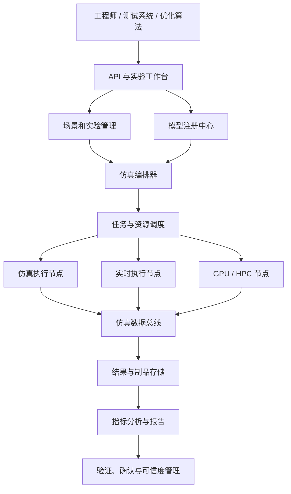

# 工业级仿真如何实现：从可信模型、联合求解到规模化运行

一家装备制造企业已经积累了不少仿真能力：机械团队使用有限元软件分析结构强度，控制团队在模型环境里调试算法，工艺团队用离散事件模型评估产线节拍，测试部门还有一套硬件在环台架。

每套工具单独看都能工作，但企业准备把它们用于整机验证和批量虚拟试验时，问题很快出现：

- 同一个温度变量在两个模型中使用不同单位；
- 控制模型每 1 毫秒推进一次，热模型每 1 秒才需要计算一次；
- 某个商业模型只能以黑盒运行，另一个模型却要求访问内部状态；
- 单机实验可以复现，放到集群后结果开始出现细微漂移；
- 一次参数扫描生成数 TB 数据，却无法回答结果由哪个模型版本产生；
- 模型通过了开发人员自测，却没有证据说明它适用于当前工况；
- 仿真跑得很快，但没有人敢让它参与设计签署或控制决策。

这些问题说明，从“有仿真软件”到“具备工业级仿真能力”，中间隔着一整套工程体系。

工业级仿真不是把模型做得尽可能复杂，也不是给三维场景接入实时数据。它真正要解决的是：**如何让异构模型在明确的时间、语义和数值约束下协同运行，并持续产出可复现、可解释、可验证、可追溯的结果。**

```text
业务问题
  ↓
预期用途与验收指标
  ↓
模型、参数、接口与有效域
  ↓
求解、同步与实验编排
  ↓
分布式执行与数据管理
  ↓
验证、确认与不确定性量化
  ↓
发布、运行、监控与持续校准
```

本文不再重复介绍“工业仿真有哪些类型”，而是从系统实现角度回答一个更具体的问题：**一套能够进入研发和生产流程的工业级仿真系统，究竟应该怎样设计和建设。**

> 资料口径：本文基于截至 **2026 年 10 月 20 日**可访问的 FMI、IEEE HLA、ASAM XIL、NASA-STD-7009、ISO 23247、OMG DDS 与 OpenTelemetry 等公开标准和资料整理。具体行业还需要遵循相应的功能安全、质量和认证要求。

---

## 一、先定义“工业级”：它是一组质量属性，而不是一种软件

一个模型能运行，只能证明程序没有立即失败；一个结果看起来合理，也不能证明它足以支持工程决策。

工业级仿真至少需要同时满足八类质量属性。

| 质量属性 | 核心问题 | 可测量指标示例 |
|---|---|---|
| 正确性 | 模型和算法是否按定义实现 | 单元测试通过率、守恒误差、基准算例偏差 |
| 有效性 | 模型是否能代表目标现实 | 试验误差、覆盖工况、置信区间 |
| 数值稳定性 | 长时间或极端输入下是否可靠 | 收敛率、步长敏感性、发散次数 |
| 可复现性 | 相同条件能否得到相同结果 | 结果哈希、随机种子、环境锁定情况 |
| 实时性 | 是否在截止时间内完成计算 | 实时因子、周期违约率、P99 抖动 |
| 可扩展性 | 能否支撑批量实验和大模型 | 并发任务数、吞吐量、扩容效率 |
| 可追溯性 | 结果能否追溯到完整输入 | 模型、参数、代码、场景和运行环境版本 |
| 可治理性 | 谁能使用、发布和修改模型 | 权限、审批、审计、签名和回滚能力 |

这些属性存在明显冲突。更高保真度通常意味着更多计算量；更小通信步长可能提高耦合精度，却降低整体速度；为了实时运行进行模型降阶，又可能缩小模型有效域。

因此，工业级不等于“所有指标都达到最高”，而是：

> **围绕明确的预期用途，对精度、速度、风险和成本作出可解释的取舍，并用证据证明系统达到约定要求。**

同一个电机模型，用于早期方案筛选时允许 10% 的温升误差，用于保护策略验证时可能要求关键区间误差低于 2%。离线设计优化可以运行数小时，硬件在环测试却必须在每个固定周期内完成。脱离预期用途谈模型精度，没有工程意义。

---

## 二、实现的第一步不是选软件，而是签订“仿真契约”

很多仿真项目从采购工具或导入模型开始，随后才讨论输入输出、误差和验收。这种顺序容易形成一个昂贵但无法签署的演示系统。

更稳妥的做法，是先为每类仿真定义一份可执行的仿真契约。

### 1. 定义预期用途

预期用途需要明确四件事：

1. 仿真支持什么决策，例如控制器参数选择、结构设计签署或产能配置；
2. 谁使用结果，使用者是研发工程师、测试人员还是在线控制系统；
3. 错误结果的后果，包括返工、设备损坏、质量事故和安全风险；
4. 模型不得用于哪些场景，例如超出温度、载荷或转速范围的外推。

只有这一步完成以后，精度和可信度才有定义。

### 2. 定义输入、输出、状态和参数

模型接口不能只有变量名，还需要包含语义：

```yaml
model: motor_thermal_v3
purpose: inverter_parameter_validation
inputs:
  - name: phase_current_rms
    quantity: electric_current
    unit: A
    shape: [3]
    sample_period: 1ms
  - name: coolant_inlet_temperature
    quantity: thermodynamic_temperature
    unit: degC
    sample_period: 100ms
outputs:
  - name: winding_hotspot_temperature
    quantity: thermodynamic_temperature
    unit: degC
    tolerance: 2.0
parameters:
  - thermal_resistance_winding_housing
validity_domain:
  speed_rpm: [0, 12000]
  ambient_temperature_degC: [-20, 55]
```

至少要规定物理量与单位、数据类型与维度、坐标系与正方向、采样周期与时间戳语义、初始值与缺失值处理、参数是否允许动态修改，以及模型的有效域和已知限制。

工业仿真中大量错误并非来自高深算法，而是来自摄氏度与开尔文、角度与弧度、表压与绝压、本地坐标与世界坐标之间的隐式差异。

### 3. 定义验收指标

结果质量可以包括峰值误差、均方根误差、相位误差、守恒误差、事件发生时刻偏差和关键结论一致性；运行质量则包括单次实验耗时、实时因子、固定周期违约率、恢复时间、集群并发能力和追溯完整率。

### 4. 建立需求到证据的追踪链

```text
系统需求
  → 模型需求
  → 模型版本
  → 验证用例
  → 实验运行
  → 指标结果
  → 审核结论
```

当模型、参数或求解器发生变化时，系统应能判断哪些验证证据失效、哪些实验需要重新运行。这是仿真进入质量体系的基础。

---

## 三、总体架构：把模型、执行和治理分开

工业仿真平台不宜做成一个包含所有功能的巨型程序。更可维护的结构，是把领域模型、仿真执行、平台控制和可信度治理分层。



领域模型层保存 ODE、DAE、有限元、流体、多体动力学、状态机、控制器、PLC、代理模型以及传感器和故障模型。平台不应强迫所有模型使用同一种语言，而应要求它们遵守一致的接口、时间和生命周期契约。

仿真执行层负责加载、初始化、求解、时间推进、事件检测、数据交换、状态保存和资源释放。它属于数据面，对延迟、吞吐和确定性要求高。

平台控制层负责模型注册、场景配置、实验 DAG、资源与许可证调度、权限、配额和结果索引。可信度治理层则贯穿模型评审、Verification、Validation、不确定性量化、发布准入和漂移监控。

将这些职责拆开后，企业可以替换求解器、扩展计算集群或引入新模型工具，而不必重写整个平台。

---

## 四、模型工程：模型必须成为可管理的工业资产

模型文件只是模型资产的一部分。一份真正可交付的模型包还应包含接口定义、参数、依赖、验证证据、运行环境和使用限制。

### 1. 选择合适的模型形态

| 模型类型 | 优点 | 局限 | 适用场景 |
|---|---|---|---|
| 机理模型 | 可解释、可外推到相邻工况 | 建模和计算成本高 | 设计分析、关键机理验证 |
| 数据驱动模型 | 开发快、擅长拟合复杂关系 | 依赖数据分布，外推风险高 | 预测、补偿、软测量 |
| 降阶/代理模型 | 计算快，适合批量和实时运行 | 精度和有效域受样本限制 | 优化、HIL、在线预测 |
| 混合模型 | 结合机理约束与现场数据 | 架构和验证更复杂 | 数字孪生、状态估计 |

模型选择应由预期用途决定。高保真 CFD 模型适合分析局部流场，但不适合直接以毫秒周期参与 HIL；此时往往需要用高保真模型生成样本，再构造降阶模型。

### 2. 明确模型生命周期和版本

```text
草稿 → 开发中 → 已验证 → 候选发布 → 已发布 → 已弃用 → 已归档
```

“已验证”至少应具备接口测试、基准算例和有效域说明；“已发布”还需要评审签署、制品签名和依赖清单。参数集与模型本体应分开版本化，不能把产品配置或现场标定值写死在共享模型中。

### 3. 建立模型包

```text
model-package/
  manifest.yaml
  interface.json
  model.fmu
  parameters/
  validation/
  docs/
  sbom.json
  signature.sig
```

`manifest.yaml` 记录模型标识、版本、运行时、依赖、支持平台、资源需求、许可证和内容哈希。平台运行时引用不可变版本，而不是一个会被覆盖的共享目录。

### 4. 通过标准接口实现工具解耦

FMI 3 支持三类典型形态：

- **Model Exchange**：模型提供方程和状态，外部环境负责积分；
- **Co-Simulation**：模型单元带有自己的求解能力，主控协调通信；
- **Scheduled Execution**：模型暴露可调度分区，适合嵌入式和实时执行。

标准接口的价值不只是“能够调用”，还在于把变量、生命周期、状态保存、事件和时间推进方式显式化。但封装为 FMU 不会自动解决单位不一致、耦合误差和模型可信度问题，这些仍属于系统工程责任。

---

## 五、求解内核：真正困难的是稳定地推进状态

模型最终要转化为计算问题。典型连续系统可以写成：

```text
dx/dt = f(x, u, p, t)
y     = g(x, u, p, t)
```

其中 `x` 是状态，`u` 是输入，`p` 是参数，`y` 是输出。含代数约束的系统还会出现：

```text
F(dx/dt, x, u, p, t) = 0
```

实际工业模型还可能同时包含离散状态、条件事件、随机过程和空间离散后的大规模方程组。求解内核需要处理的远不止“调用一个积分函数”。

### 1. 先识别问题类型

求解器选择至少依赖以下特征：

- ODE、DAE、PDE 离散系统还是离散事件系统；
- 系统是否刚性；
- 是否包含强非线性；
- 状态规模和矩阵稀疏度；
- 是否要求固定步长；
- 是否需要梯度；
- 是否需要严格实时。

例如，电气开关、化学反应和热系统混合后常出现刚性，显式算法为了稳定可能被迫采用极小步长；隐式算法单步成本更高，却可能在总体上更高效。

### 2. 步长同时决定精度、稳定性和成本

固定步长便于实时调度和结果对齐，但可能在剧烈变化阶段精度不足，在平稳阶段又浪费计算。自适应步长根据局部误差调整推进距离，更适合离线高精度分析，却会增加联合仿真和确定性复现的复杂度。

不能只通过“结果曲线看起来平滑”判断步长是否合理。至少要开展时间步收敛、网格收敛、容差敏感性、不同求解器交叉比较和长时间能量漂移检查。

### 3. 正确处理事件

工业模型中大量行为由事件触发，例如阀门开闭、接触发生、保护动作、工位故障和控制模式切换。事件处理通常包含：

1. 检测事件函数是否跨过零点；
2. 定位更精确的事件时刻；
3. 更新离散状态或连续状态；
4. 重新计算约束和导数；
5. 处理同一时刻的级联事件；
6. 从事件后状态继续推进。

如果只在固定采样点检查条件，可能把事件延迟一个完整步长，进而改变控制序列。对碰撞、保护和安全逻辑而言，这种误差不能忽略。

### 4. 把失败视为正常分支

工业求解器必须显式处理迭代不收敛、雅可比矩阵奇异、状态出现 NaN、输入越过有效域、守恒关系被破坏以及单步超时。

处理策略可以是缩小步长、切换算法、回滚到检查点、降级模型、隔离故障模型或终止实验。最危险的行为不是失败，而是生成一个没有明显报错的错误结果。

---

## 六、联合仿真：统一的不是工具，而是时间和因果关系

真实工业系统往往横跨机械、电气、热、流体、控制、通信和生产物流。把所有模型重写到同一工具中成本过高，也会破坏专业团队已有资产，因此需要联合仿真。

### 1. 区分内部步长与通信步长

每个子模型可以使用自己的内部步长，但只在通信点与其他模型交换数据。

假设控制器每 `1 ms` 运行一次，电机模型每 `0.1 ms` 积分一次，热模型每 `100 ms` 更新一次，联合仿真主控需要建立统一时间轴，并决定：

- 哪个模型先计算；
- 输入在两个通信点之间如何插值；
- 输出是否允许外推；
- 事件如何向其他模型传播；
- 子模型失败后是否能够回滚。

通信步长过大，会引入耦合误差甚至破坏稳定性；过小，则会显著增加通信和调度开销。

### 2. 处理直接馈通和代数环

如果模型 A 的当前输出依赖模型 B 的当前输入，同时 B 的当前输出又依赖 A 的当前输入，就形成代数环。

常见处理方式包括引入一个时间步延迟、重新划分模型边界、在通信点进行固定点或牛顿迭代、将强耦合模型合并到同一求解器，或者使用能够交换导数和残差的耦合算法。

直接加延迟最容易实现，却可能改变系统动力学。是否允许这样做，需要由误差分析而不是开发便利性决定。

### 3. 设计主控算法

一个简化的保守型主控循环可以表示为：

```text
initialize all models at t0
t = t0

while t < t_end:
    h = negotiate_step_size(models, t)
    checkpoint = save_states(models)

    publish_outputs(models, t)
    route_and_convert_signals()

    for model in dependency_order:
        result = model.do_step(t, h)
        if result requests smaller step:
            restore_states(models, checkpoint)
            h = reduce(h)
            retry

    detect_and_propagate_events()
    persist_selected_observations()
    t = t + h
```

生产实现还要增加超时、取消、并行执行、回滚范围、收敛迭代、状态哈希和失败隔离。

### 4. 分布式仿真的时间管理

当模型分布在多个进程、主机或组织中时，网络延迟和节点失败会进入仿真语义。IEEE 1516 HLA 使用联邦、联邦成员和运行时基础设施组织分布式仿真，并提供对象交换和时间管理等机制。

时间同步通常分为两类：

- **保守同步**：只有确认不会再收到更早事件时才推进，结果安全但等待较多；
- **乐观同步**：允许先推进，收到迟到事件后回滚，并行度高但实现复杂。

大部分工业平台应先选择可预测、易审计的保守策略，只有在确有性能收益且模型支持高效状态恢复时，才考虑乐观执行。

### 5. 数据总线不能代替仿真主控

Kafka、MQTT、DDS 或其他消息系统可以传输数据，却不会自动提供正确的仿真时间推进。事件时间、消息到达时间和物理时间并不是同一概念。

实时分布式模型需要低延迟发布订阅时，DDS 的服务质量策略具有优势；大规模结果流转和异步处理可以使用消息队列；单机强耦合模型则更适合共享内存或进程内调用。通信技术应服务于仿真语义，而不能反过来决定架构。

---

## 七、场景与实验：让每次运行都成为不可变记录

一个仿真结果只有在输入条件完整时才有意义。工业平台需要把“点几下界面运行一次”升级为“实验即代码”。

### 1. 场景描述什么

场景通常包含参与对象和拓扑、初始状态、环境和边界条件、输入曲线、时序事件、故障注入、起止时间、采样策略以及成功和失败条件。

```yaml
experiment: inverter_overtemperature_protection
models:
  controller: controller@4.2.1
  motor: motor-electro-thermal@3.0.4
  cooling: cooling-loop@2.3.0
parameters:
  ambient_temperature_degC: 45
  coolant_flow_lpm: 6.5
timeline:
  - at: 5s
    set: { torque_command_nm: 220 }
  - at: 20s
    inject_fault: coolant_pump_degradation
    severity: 0.6
assertions:
  - winding_hotspot_temperature < 160
  - protection_trigger_time <= 200ms
runtime:
  end_time: 60s
  master_step: 1ms
  seed: 20261020
```

这份定义进入版本控制后，评审、自动化运行和结果复现才有共同基础。

### 2. 为实验生成唯一身份

一次运行的身份可以由以下内容的哈希生成：

```text
模型版本 + 参数版本 + 场景版本 + 求解器配置
+ 平台版本 + 运行环境 + 随机种子
```

结果目录不应只以日期命名，而应关联 `experiment_id`、`run_id` 和内容哈希。这样才能区分“同一实验的重试”和“输入已经变化的新实验”。

### 3. 设计批量实验和数据保留策略

常见批量实验包括参数扫描、正交试验、拉丁超立方采样、蒙特卡洛分析、敏感性分析、最坏工况搜索、多目标优化和参数校准。

平台不应把数万个任务一次性平铺到队列中。更合理的方式是用 DAG 表达“样本生成—仿真运行—指标提取—聚合分析—报告生成”，再按资源和优先级逐步展开任务。

仿真可以产生极高频率、多变量数据。保存所有内部变量通常既昂贵，也不利于分析。必须区分永久保存的关键证据、降采样时序、仅保留统计量的中间变量、失败时保留的调试数据和到期清理的缓存数据。

---

## 八、分布式执行：调度的不只是 CPU，还有许可证和时间预算

当仿真进入参数优化、回归测试和蒙特卡洛分析阶段，平台很快从单机工具变成计算基础设施。

### 1. 将执行封装为不可变任务

每个任务需要声明模型和场景制品、CPU、GPU、内存、本地磁盘、预计时长、商业许可证、操作系统、特殊硬件、输入输出位置以及重试和超时策略。

任务启动后不再修改输入，输出写入新的运行目录。这样可以避免多个任务共享可变参数文件造成污染。

### 2. 资源调度需要理解仿真特点

普通批处理调度只关注 CPU 和内存，仿真平台还要处理浮动许可证、GPU 型号、大模型本地缓存、高速网络、实时节点独占、台架预约、项目配额和优先级。

许可证常常比计算资源更稀缺。若调度器先启动容器再等待许可证，会浪费大量节点时间；更合理的方式是在排队阶段同时预留计算资源和许可证令牌。

### 3. 保证幂等与可恢复

执行器应保证同一 `run_id` 的重复提交不会产生冲突；检查点包含模型状态、仿真时间和随机数状态；恢复后不会重复写入已确认的数据分片；部分结果带有“不完整”标记；失败原因能够被机器分类。

不是所有模型都支持状态保存。平台需要在注册时标记模型是否可检查点、是否可回滚，以及恢复的兼容版本范围。

### 4. 区分横向扩展与单任务加速

参数扫描天然适合横向扩展：不同样本彼此独立，可以在多个节点并行。单个大规模 CFD 或有限元任务则需要 MPI、GPU 或共享内存并行。

这两类负载的调度和网络需求不同，不能仅靠增加容器副本解决。平台应允许任务声明并行形态，并为大任务提供拓扑感知调度。

### 5. 控制成本

```text
预计成本 = 样本数量 × 单次资源量 × 预计时长 × 资源单价
```

平台应支持预算上限、无效任务早停、重复结果缓存和多保真筛选。例如先用低成本模型淘汰明显不可行方案，再让高保真模型计算少量候选点。

---

## 九、实时仿真与 X-in-the-Loop：正确结果必须按时到达

离线仿真只关心最终是否算对；实时仿真还要求每一步在截止时间前完成。一个晚到 5 毫秒的正确结果，对 1 毫秒控制周期而言就是错误结果。

### 1. 从 MiL 逐步走向 HIL

| 阶段 | 控制对象 | 被控对象 | 主要目的 |
|---|---|---|---|
| MiL | 控制算法模型 | 被控对象模型 | 快速验证算法和逻辑 |
| SiL | 编译后的控制软件 | 被控对象模型 | 验证软件实现 |
| PiL | 目标处理器上的软件 | 被控对象模型 | 验证处理器和数值差异 |
| HiL | 真实控制器 | 实时被控对象模型 | 验证接口、时序和故障响应 |

ASAM XIL 的目标之一，是通过标准化测试台架接口，使测试用例能够跨 MiL、SiL 和 HiL 环境复用。真正的复用前提，是信号语义、测试动作和结果判据保持一致，而不是只统一 API 名称。

### 2. 建立实时预算

假设一个仿真周期为 `1 ms`，预算不能全部给模型求解：

```text
采集输入       80 μs
信号转换       40 μs
模型计算      650 μs
输出与 I/O    100 μs
调度余量      130 μs
-------------------
总计         1000 μs
```

工程上应关注最坏执行时间和高分位抖动，而不是平均值。平均只需 `400 μs`，但每分钟出现一次 `2 ms` 峰值，同样可能导致控制器异常。

### 3. 为实时性简化模型

常用方法包括固定步长、模型降阶、查表与响应面、慢变量低频分区、预计算矩阵、避免运行期内存分配，以及将非关键计算移出实时线程。

简化后必须重新验证。离线高保真模型和实时模型应建立差异基线，明确哪些动态特征被保留、哪些被牺牲。

### 4. 安全地连接真实硬件

HIL 平台需要处理 I/O 缩放和隔离、信号限幅、看门狗、紧急停止、开路短路等故障注入、控制器复位以及台架安全联锁。

故障注入必须受到权限和状态机约束，不能让任意测试脚本在任意时刻驱动危险输出。

---

## 十、VVUQ：让“看起来合理”变成可审查证据

模型可信度通常由 Verification、Validation 和 Uncertainty Quantification 共同构成。

### 1. Verification：模型是否被正确实现

Verification 关注“方程和算法有没有被正确求解”。常用方法包括：

- 代码单元测试；
- 解析解或基准算例对比；
- 制造解法；
- 网格和时间步收敛；
- 守恒关系检查；
- 求解器交叉验证；
- 编译器和硬件差异测试。

它不能证明模型代表现实，只能证明实现没有明显偏离模型定义。

### 2. Validation：模型是否足以代表现实

Validation 将仿真结果与物理试验或现场数据比较。关键不是得到一个总体误差，而是回答：哪些输出被验证，使用了哪些独立数据，覆盖了哪些工况，测量本身有多大不确定性，误差是否满足预期用途，以及哪些区域仍然缺乏证据。

校准数据和验证数据必须分开。用同一批数据拟合参数并宣称验证通过，只能说明模型能重现训练样本。

### 3. Calibration：估计参数而不是掩盖结构错误

参数校准需要先分析可辨识性。多个参数可能对输出产生相似影响，此时即使拟合误差很小，也未必找到了真实参数。

校准过程应保存参数先验和边界、目标函数、数据集、优化算法、随机种子、参数相关性和后验不确定性。不能无限增加自由参数来弥补错误的模型结构，否则模型会在校准工况上表现很好，在新工况中迅速失效。

### 4. Uncertainty Quantification：结果应该带范围

不确定性来源至少包括输入与边界条件、材料参数、测量误差、数值离散误差、模型形式误差、随机事件以及环境变化。

若模型输出一个精确到小数点后两位的温度，却没有说明输入波动和模型误差，这种精确通常是视觉上的，不是认知上的。对于决策问题，更有价值的表达是：

```text
在当前假设下，绕组温度超过 160°C 的概率为 3.2%，
95% 预测区间为 151°C 至 163°C。
```

### 5. 形成可信度证据包

NASA-STD-7009 强调根据模型和仿真的预期用途管理可信度。实践中，一份可审查的证据包至少应包含：

- 预期用途和风险等级；
- 模型假设与有效域；
- 数据来源和质量；
- Verification 结果；
- Validation 结果；
- 不确定性分析；
- 已知限制；
- 版本和审批记录；
- 允许支持的决策范围。

可信度不是模型的永久属性。模型用于新的产品、环境或决策时，需要重新评估证据是否仍然充分。

---

## 十一、可观测性：既观察计算系统，也观察仿真系统

传统应用可观测性关注请求延迟、错误率和资源利用率。仿真平台还需要一套领域指标。

可以使用 OpenTelemetry 等体系统一采集日志、指标和分布式追踪，同时补充仿真上下文：

- **日志**：模型加载、事件、收敛失败、有效域越界；
- **指标**：步长、迭代次数、实时因子、守恒误差；
- **Trace**：一次实验从编排到多个模型步进的因果链；
- **制品**：输入、检查点、结果分片、报告和证据。

所有信号都应携带 `experiment_id`、`run_id`、`model_id`、模型版本和仿真时间。

### 1. 区分三种时间

平台至少同时存在：

- 墙上时间：计算实际发生的时间；
- 仿真时间：模型内部被推进到的时间；
- 事件时间：被模拟事件在业务世界中的时间。

只记录服务器时间，会导致多模型事件无法正确排序，也无法判断某个告警发生在仿真推进的哪个阶段。

### 2. 建立仿真领域 SLI

推荐监控仿真成功率、求解器收敛率、P99 单步耗时、实时周期违约率、回滚次数、代数环迭代次数、有效域越界次数、守恒误差、模型输出漂移和结果可追溯完整率。

这些指标可以区分“平台基础设施故障”和“模型数值问题”，避免运维人员只看到一个笼统的任务失败。

---

## 十二、安全、隔离与知识产权保护

模型可能包含供应商算法、产品参数和核心工艺，也可能携带本地代码，因此不能把它当成普通数据文件执行。

### 1. 模型运行沙箱

对外部模型应限制文件系统、网络、系统调用、CPU、内存、运行时长、动态库加载、子进程创建和设备访问。

模型签名可以证明制品未被修改，但不能证明代码安全。来源不明的模型仍需隔离运行和安全扫描。

### 2. 权限模型

平台至少要区分谁能查看元数据、下载模型、运行模型、查看参数和结果、发布新版本，以及连接真实台架或现场设备。

对于黑盒商业模型，可以允许用户运行而不允许下载；敏感参数则通过运行时注入，并避免写入普通日志。

### 3. 供应链治理

模型包需要记录依赖和软件物料清单，执行镜像需要固定摘要并进行漏洞扫描。发布流水线应验证内容哈希、数字签名、依赖许可证、已知漏洞、测试状态和目标环境兼容性。

仿真结果用于认证或设计签署时，平台自身的版本也必须进入追溯链。

---

## 十三、一个完整案例：机器人工作站虚拟调试平台

下面用机器人装配工作站说明上述能力如何组合。

### 1. 业务目标

项目希望在真实设备进场前完成机器人轨迹和碰撞验证、PLC 顺序控制测试、传感器与执行器异常测试、节拍评估，以及控制程序从 SiL 到 HiL 的迁移。

关键验收指标包括：正常场景节拍误差不超过 3%，安全联锁场景全部触发，PLC 扫描周期内完成 I/O 交互，关键实验能够完整复现。

### 2. 模型划分

系统被拆为机器人运动学和动力学模型、夹具与工件几何模型、传感器和执行器模型、PLC 程序、输送线离散事件模型、网络延迟模型、故障注入模型和三维可视化模型。

三维可视化只订阅状态，不参与关键闭环，避免渲染卡顿影响控制时间。

### 3. 时间架构

不同模型使用多速率调度：

```text
机器人动力学：0.5 ms
PLC 与 I/O：   2 ms
传感器模型：   2 ms
输送线逻辑：  10 ms
三维渲染：    16.7 ms
统计聚合：   100 ms
```

主控以 `0.5 ms` 为基础时钟，在对应倍数上触发低频分区。PLC 输出先更新执行器模型，机器人状态再生成传感器反馈，从而保持明确的因果顺序。

### 4. 场景库

场景按风险分层：

- 正常生产：不同产品和节拍；
- 边界工况：最大负载、最低气压、传感器临界值；
- 单点故障：传感器卡死、通信延迟、夹具不到位；
- 组合故障：工件偏移叠加网络抖动；
- 恢复场景：急停、复位、断点续产；
- 随机场景：到料波动、故障时间和维修时间采样。

每次 PLC 程序或机器人轨迹修改后，CI 流水线自动运行核心场景。通过后生成证据报告，失败时保留事件前后的高频数据和模型检查点。

### 5. 从离线到 HIL

第一阶段全部使用软件模型，快速调试逻辑；第二阶段将 PLC 代码部署到目标运行时；第三阶段连接真实 PLC 和现场总线，由实时仿真机模拟机器人、传感器和执行器。

迁移过程中保持同一套场景语义和断言，只替换被测对象与台架适配器。这样才能比较 MiL、SiL 和 HiL 的差异，而不是在每个阶段重新编写测试。

### 6. 可信度闭环

真实工作站投产后，平台将现场节拍、机器人轨迹和故障记录与仿真结果比较。若误差持续越过阈值，就触发模型重新校准和回归验证。

这时数字孪生不是另建一个大屏，而是让已经经过验证的模型继续接收物理对象证据，并在受控范围内用于预测和优化。

---

## 十四、实施路线：不要一开始就建设“万能仿真云”

工业仿真平台范围很大，最容易失败的方式是先建设通用平台，再寻找业务场景。更可行的路径是由一个高价值闭环向外扩展。

### 第一阶段：建立可信的单场景闭环

选择一个边界清晰、数据可获得、结果能验收的场景，例如电机热保护验证或机器人工作站虚拟调试。完成预期用途、模型契约、一键运行、基准实验、初步 V&V 和结果追溯。

这一阶段的目标不是平台功能完整，而是证明仿真能支持真实决策。

### 第二阶段：抽取共性平台能力

当第二、第三个场景出现后，再抽取模型注册中心、场景描述、执行器插件、统一结果格式、自动回归、权限和审计。

抽象应来自已经出现的重复问题，而不是预先猜测所有行业需求。

### 第三阶段：规模化与生产治理

随着任务量增长，建设集群调度、许可证协调、检查点、失败恢复、多租户、成本统计、可观测性、发布准入和可信度证据包。

### 第四阶段：实时和在线闭环

只有离线模型已经稳定、可验证、可运维后，才逐步进入 HIL、现场数据同步、在线状态估计、漂移检测、预测优化和受安全约束的闭环控制。

越接近真实控制，错误后果越高，准入和降级机制也必须越严格。

---

## 十五、常见失败模式

### 1. 把可视化当成仿真

三维画面逼真不代表背后存在可信的动力学、控制和故障模型。可视化负责解释状态，不能替代行为计算和验证证据。

### 2. 盲目追求最高保真度

模型越复杂，参数、计算和验证成本越高。对目标决策没有影响的细节不会自动增加价值，反而可能掩盖关键假设。

### 3. 只有文件版本，没有运行版本

保存 `model_v3.fmu` 还不够。求解器、参数、场景、随机种子、运行镜像和平台版本都会影响结果。

### 4. 用消息队列拼接模型，却没有时间管理

模型能互相收发数据，不等于联合仿真正确。若事件顺序、通信步长和迟到消息没有定义，结果可能不具备因果一致性。

### 5. 校准代替验证

调整参数拟合历史曲线，只能证明模型能解释这一批数据。必须用独立工况验证，并报告不确定性和失效区域。

### 6. 平台只监控 CPU，不监控数值行为

服务器完全健康时，模型仍可能发散、越界或违反守恒。基础设施指标和仿真领域指标缺一不可。

### 7. 数字孪生上线后不再验证

设备磨损、工艺调整、软件升级和环境变化都会造成模型漂移。数字孪生不是一次性交付的软件，而是持续校准和重新确认的模型系统。

---

## 十六、工业级仿真的验收清单

在系统进入正式研发或生产流程前，可以用以下问题进行检查。

### 业务与需求

- 是否定义了明确的预期用途和禁用范围？
- 是否量化了关键结果、运行性能和风险指标？
- 是否能从需求追踪到模型、实验和验证证据？

### 模型与接口

- 是否定义输入、输出、状态、参数、单位和坐标系？
- 是否记录假设、有效域和已知限制？
- 是否对模型、参数和依赖分别版本化？
- 是否支持制品签名和完整性校验？

### 求解与联合仿真

- 是否进行步长、网格和容差敏感性分析？
- 是否正确处理事件、代数环和多速率模型？
- 是否定义回滚、超时和失败策略？
- 分布式运行是否具有清晰的时间语义？

### 实验与平台

- 场景能否以不可变配置复现？
- 是否记录模型、参数、求解器、环境和随机种子？
- 批量任务是否支持配额、预算、优先级和早停？
- 是否支持幂等执行、检查点和断点恢复？

### 可信度与运行治理

- 是否完成 Verification、Validation 和不确定性分析？
- 校准集与验证集是否隔离？
- 是否监控收敛、实时性、守恒误差和有效域越界？
- 是否具备权限、审计、沙箱和供应链治理？
- 是否能将任意结果追溯到完整运行上下文？
- 是否定义模型漂移、降级、回滚和停用机制？

如果这些问题只能靠某位资深工程师口头回答，系统仍然依赖个人经验；当答案能够由平台配置、自动测试和证据记录给出时，仿真才真正成为组织能力。

---

## 结语：工业级仿真的产物不是曲线，而是可信决策

工业级仿真的技术栈很宽：底层有数学模型、求解器和实时系统，中间有联合仿真、数据交换和任务调度，上层还有实验设计、可信度评估和质量治理。

但这些技术最终服务于同一个目标：在真实试验之前、之间或之后，用更低的成本获得足以支持决策的证据。

一套成熟的工业仿真体系，应当能够回答五个问题：

1. **算的是什么**：对象、边界、变量和假设清楚；
2. **怎样算出来**：模型、求解器、时间推进和环境可追溯；
3. **为什么可信**：有 Verification、Validation 和不确定性证据；
4. **在哪里有效**：有效域、误差和限制明确；
5. **怎样持续使用**：能够发布、复现、监控、校准、回滚和演进。

因此，工业级仿真的核心不只是“建立数字世界”，而是建立一条从现实问题到模型、从模型到实验、从实验到证据、再从证据回到工程决策的闭环。

只有这条闭环能够稳定运行，仿真才不再是少数专家手中的分析工具，而会成为企业可以复用、审计和持续演进的研发基础设施。

---

## 参考资料

1. [FMI 3.0.2 Specification](https://fmi-standard.org/docs/3.0.2/)
2. [IEEE 1516-2025: High Level Architecture for Modeling and Simulation](https://standards.ieee.org/ieee/1516/6687/)
3. [ASAM XIL](https://www.asam.net/standards/detail/xil/)
4. [NASA-STD-7009: Standard for Models and Simulations](https://standards.nasa.gov/standard/NASA/NASA-STD-7009)
5. [ISO 23247-1: Digital Twin Framework for Manufacturing](https://www.iso.org/standard/75066.html)
6. [OMG Data Distribution Service](https://www.omg.org/spec/DDS/)
7. [OpenTelemetry Documentation](https://opentelemetry.io/docs/)
