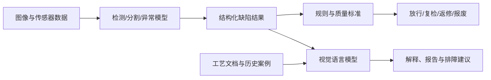
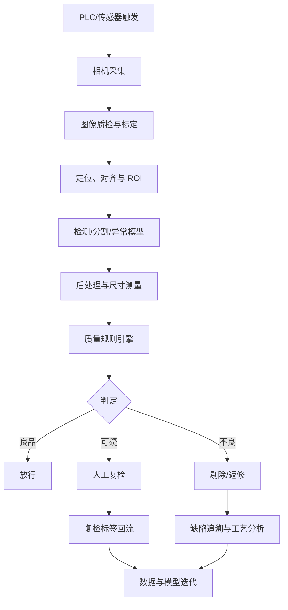

> 文中的论文与公开数据集以 **2026 年 10 月**为检索基线。

在工业生产线上，“看见缺陷”从来不只是训练一个分类模型。

一条真正可用的视觉检测链路，至少要回答五个问题：能不能稳定拍清楚，什么才算缺陷，模型能不能找到它，系统能不能在节拍内作出判断，以及模型上线后如何持续适应产品、设备与工艺变化。

这五个问题分别对应成像、标准、算法、工程和治理。任何一环失效，实验室里的高准确率都可能在产线上迅速失去意义。例如，同一个金属划痕在环形光下可能几乎不可见，在低角度暗场光下却十分明显；一个模型在公开数据集上获得很高的图像级 AUROC，也不代表它能满足“直径 0.1 毫米以上缺陷不得漏检”的业务要求；训练集看似只有良品，但只要混入少量未发现的异常，单类学习得到的“正常边界”就可能被污染。

因此，理解工业视觉检测，需要先建立一个统一认识：

> **工业视觉检测不是孤立的识图算法，而是一套把物理差异转化为稳定图像信号，再把图像信号转化为质量决策的闭环系统。**

本文从这条闭环出发，梳理传统机器视觉、监督式深度学习、工业异常检测和视觉基础模型的发展脉络，并讨论如何把论文方法转化为可维护、可验证、可持续运行的生产系统。

---

## 一、视觉检测究竟在检测什么

“视觉检测”是一个很宽泛的概念。根据输出粒度不同，它至少包含四类任务。

第一类是**图像分类**。模型只需要回答整张图是良品还是不良品，或者属于哪一种缺陷。它适合缺陷占据较大区域、产品姿态稳定、业务只关心最终判定的场景，但无法直接说明缺陷在哪里。

第二类是**目标检测**。模型输出缺陷的类别和边界框，例如标出焊点缺失、螺钉漏装或瓶盖破损的位置。目标检测的标注成本适中，也便于按照缺陷数量、位置和尺寸制定规则。

第三类是**像素级分割**。模型给出每个缺陷区域的精确轮廓，适用于划痕、裂纹、涂层脱落和污染等形状不规则的缺陷。分割结果可以进一步计算长度、面积、宽度和与关键结构之间的距离，但像素级标注成本通常最高。

第四类是**异常检测**。模型不一定预先知道缺陷类别，而是学习“正常产品应该是什么样”，再把偏离正常分布的区域判为异常。这种设定特别适合缺陷稀少、缺陷类型开放、量产初期几乎没有不良样本的场景。

这四类任务并不是互相替代的关系。工程上更常见的组合是：

```text
规则算法负责定位和对齐
    ↓
监督模型识别已知且高频的缺陷
    ↓
异常检测模型兜底未知缺陷
    ↓
尺寸、区域和业务规则完成最终判定
```

例如，在 PCB 检测中，可以先用模板匹配完成板卡对齐，再用目标检测识别缺件、错件，用分割模型识别焊锡桥连，最后用异常检测发现训练集中从未出现过的外观变化。最终结果还要结合元件清单和电路位置关系判断，因为“元件本身正常但装错位置”属于逻辑异常，而不是简单的局部纹理异常。

### 结构异常与逻辑异常

工业异常通常还可以分成两种。

**结构异常**表现为局部外观发生变化，例如裂纹、划痕、凹坑、污渍和材料缺损。它们往往能通过局部纹理或特征差异发现。

**逻辑异常**则意味着组成元素本身可能都正常，但数量、位置、方向或组合关系不符合规则。例如，药盒中少了一粒药，连接器中的零件顺序错误，包装中的物体数量不对。这类异常需要理解更大的空间范围和对象关系。MVTec LOCO AD 数据集正是为了推动结构异常与逻辑异常的联合研究而提出的[2]。

两者的区别很重要：如果模型只比较局部图像块，那么一个“外观正常但放错位置”的零件很可能不会产生足够高的异常分数。反过来，只依赖全局重建又容易忽略极细小的表面划痕。有效系统通常需要同时保留局部细节与全局关系。

---

## 二、先把缺陷拍出来，再谈算法

工业视觉项目中最常见的误区，是把现场问题过早地定义成模型问题。

假设一条浅划痕与背景之间只有极弱的灰度差。如果光源方向、曝光和偏振方式不能让划痕形成稳定对比，那么后续模型面对的就不是一个困难的分类问题，而是一个信息已经在采集阶段丢失的问题。神经网络可以压缩和重组信号，却不能可靠恢复传感器从未记录的信息。

一个完整的成像链路可以表示为：


### 1. 照明决定缺陷是否可分

照明不是“让图像更亮”，而是主动设计缺陷与正常区域之间的可观测差异。

- **明场照明**适合观察颜色、印刷和大面积表面信息；
- **暗场照明**让划痕、边缘和凸起产生明显散射，常用于金属表面；
- **背光照明**适合轮廓、孔洞、缺口和尺寸检测；
- **同轴光**能够减弱阴影，适合平整且高反射的表面；
- **偏振成像**可抑制镜面反射，帮助观察透明膜、塑料和涂层；
- **多角度或光度立体**通过不同入射方向恢复表面形状，对细微凹凸尤其有效。

当单张 RGB 图像无法稳定表达缺陷时，应该优先考虑改变成像条件，而不是无限增加模型复杂度。2025 年发布的 Real-IAD D³ 数据集同时提供高分辨率 RGB、光度立体产生的伪 3D 信息和微米级 3D 点云，反映出工业异常检测正从单一二维外观向多模态表面几何感知发展[14]。

### 2. 分辨率必须从最小缺陷反推

相机选型不能只看总像素。假设视场宽度为 `W`，图像横向像素数为 `P`，那么近似空间分辨率为：

```text
r = W / P
```

如果最小待检缺陷宽度为 `d`，希望它至少覆盖 `n` 个像素，则应满足：

```text
r <= d / n
```

理论上一个像素即可产生变化，实践中为了抵抗模糊、噪声、插值和姿态偏差，关键缺陷通常需要覆盖多个像素。这里没有脱离场景的固定数字，应该通过实际样件和测量系统分析确定。

图像分辨率越高，细节越丰富，但推理成本也会快速上升。若直接把 8K 图像缩放到 640×640，微小缺陷可能在缩放时消失。常见方案是先定位产品或关键区域，再进行分块推理，并为相邻图块保留重叠区域，避免缺陷落在切片边缘。

### 3. 稳定性比单张“拍得漂亮”更重要

工业成像需要评估的不是一张样例，而是跨时间、跨设备和跨批次的一致性：

- 产品位置是否发生平移、旋转和尺度变化；
- 曝光、焦距和白平衡是否固定；
- 光源是否随温度和寿命衰减；
- 运动速度是否造成方向性模糊；
- 不同相机之间是否存在颜色与畸变差异；
- 产品材料、供应商和批次是否改变正常外观。

成像方案的目标，是让“正常变化”尽量小，让“缺陷变化”尽量大。做到这一点之后，简单模型往往比复杂模型更加可靠。

---

## 三、从质量标准到机器学习任务

产线上的“缺陷”不是天然存在的数学标签，而是由质量标准定义的业务概念。

同一条划痕可能因为长度、深度、所在区域或产品等级不同，被分别判为可接受、返修或报废。因此，建模之前必须把自然语言标准转化为可执行规则。

可以把最终质量决策写成：

```text
y = g(s, c, a, l, q)
```

其中：

- `s` 是模型输出的异常或缺陷置信度；
- `c` 是缺陷类别；
- `a` 是面积、长度、宽度等几何属性；
- `l` 是缺陷所在区域；
- `q` 是产品型号、等级、工序等上下文；
- `g` 是最终质量判定规则。

这意味着模型不一定需要直接学习所有业务规则。更可维护的做法通常是让模型负责感知，让规则引擎负责把感知结果映射到质量结论。例如，分割模型输出划痕区域，系统再根据标定比例换算实际长度，并判断它是否进入关键密封区。

### 标签体系要能服务决策

缺陷标签不宜简单照搬现场俗称。一个可用的标签体系至少需要满足三点：

1. **可观察**：不同类别在当前成像条件下确实可以区分；
2. **可一致标注**：不同质检员对同一样本能给出相近结论；
3. **可触发动作**：分类结果能够决定放行、返修、报废或复检。

如果两个缺陷类别在图像上没有稳定差异，却对应不同工艺原因，强迫视觉模型区分它们只会引入标签噪声。这时应该增加工艺、设备或传感器信息，或者先把它们合并成同一种外观缺陷，再由其他系统追溯原因。

### 数据划分不能随机得过于理想

工业数据往往带有明显的批次和时间相关性。如果把同一产品、同一拍摄序列中的近邻图像随机分配到训练集和测试集，模型可能只是记住背景、治具或批次纹理，得到虚高的指标。

更合理的划分方式是按以下边界隔离：

- 生产批次；
- 采集日期；
- 设备或产线；
- 产品序列号；
- 原材料供应商；
- 产品型号。

测试集应该尽可能模拟真正上线后将遇到的数据，而不是训练集的随机缩影。

---

## 四、传统机器视觉仍然不可替代

在深度学习成为主流之前，工业视觉主要依赖图像处理和手工特征。这些方法没有消失，反而仍是许多稳定系统的重要组成部分。

一条传统处理流水线可能包括：

```text
畸变校正 → 模板对齐 → ROI 截取 → 滤波增强
→ 阈值分割 → 形态学处理 → 连通域分析 → 尺寸判定
```

例如，在背光条件下检查零件轮廓时，灰度阈值和边缘检测就能获得非常稳定的结果；在产品姿态固定、背景单一的情况下，模板差分能够直接暴露漏装和错位；对于圆孔直径、边缘间距和装配位置，经过标定的几何测量通常比端到端神经网络更准确，也更容易解释。

传统方法的优势包括：

- 不需要大量标注数据；
- 计算成本低，容易部署到 CPU；
- 规则透明，便于验证和审计；
- 在成像稳定、缺陷定义明确时重复性很好。

它的主要问题则是对变化敏感。光照、姿态、产品纹理和背景只要稍有变化，固定阈值和模板就可能失效。复杂表面还会迫使工程师不断增加特例，最终形成难以维护的规则网络。

因此，传统机器视觉最适合解决“几何明确、信号稳定、规则可表达”的问题。深度学习更适合处理“外观变化复杂、规则难以穷举”的部分。成熟系统往往把两者组合起来，而不是把所有步骤都交给单一模型。

---

## 五、监督式深度学习：把已知缺陷学得更准

当企业已经积累了足够多的缺陷图像，并且缺陷类别相对稳定时，监督式学习通常是最直接的方案。训练数据由图像 `x_i` 和标签 `y_i` 组成，模型通过最小化预测与人工标注之间的差异学习决策边界：

```text
theta* = arg min_theta sum_i L(f_theta(x_i), y_i)
```

这里的标签可以是图像类别、边界框或像素掩码。标签越精细，模型能够提供的定位信息通常越丰富，但数据建设成本也越高。

### 1. 分类：成本最低，但信息最少

图像分类只需为整张图提供一个标签。对于产品姿态统一、一个视野只包含一个部件的场景，它是建立基线最快的方式。

然而，分类模型有两个明显局限。第一，它可能利用背景、治具和拍摄批次等“捷径特征”，而不是缺陷本身。第二，当缺陷只占图像极小区域时，全局缩放和池化会稀释异常信号。

因此，分类任务也应该检查模型关注区域，例如通过 Grad-CAM 等方法观察热力图是否落在真实缺陷上。可解释图不能证明模型一定正确，但能够暴露模型依赖背景水印、边缘阴影或其他伪相关特征的问题。

### 2. 目标检测：在位置与标注成本之间折中

目标检测使用矩形框表示缺陷，典型模型包括 Faster R-CNN、RetinaNet 和 YOLO 系列。它适用于形状相对集中的缺件、异物、破损和装配错误。

工业小目标检测的难点通常不在于“换一个更大的检测器”，而在于输入表示：

- 高分辨率图像缩小后，小缺陷可能不足一个特征单元；
- 特征金字塔的下采样会损失细纹理；
- 大量无缺陷背景会造成正负样本极度不平衡；
- 相邻切片中的重复框需要正确合并；
- 缺陷边界模糊时，边界框标注本身存在较大不确定性。

常用改进包括 ROI 裁剪、滑窗切片、多尺度特征融合、难例采样和 Focal Loss。工程上还应确保切片策略、重叠率和合框算法在训练与推理阶段保持一致。

### 3. 语义分割：从“有没有”走向“有多大”

U-Net、DeepLab、Mask R-CNN 和基于 Transformer 的分割网络能够输出精确到像素的缺陷区域。它们特别适合细长裂纹、不规则污渍和大面积涂层缺损。

分割结果不仅能回答缺陷位置，还能支持后续测量：

```text
A_real = A_pixel * r_x * r_y
```

其中 `A_pixel` 是缺陷像素面积，`r_x` 和 `r_y` 是经过标定后的横纵方向物理分辨率。对于裂纹，还可以进行骨架化并计算长度、分支数与最大宽度。

但像素级标签昂贵，而且边缘模糊的缺陷很难获得完全一致的“真值”。实际项目中可以采用多边形粗标、涂鸦标注、弱监督分割或先由模型预标再人工修正，以降低成本。评价时也不应把一两个像素的边界偏差与漏掉整个缺陷等量看待。

### 4. 类别不均衡是默认状态

量产系统中，良品数量通常远大于不良品；在不良品内部，高频缺陷又会压过罕见缺陷。若直接优化总体准确率，一个“全部预测为良品”的模型也可能得到看似漂亮的结果。

处理不均衡问题的常见方法包括：

- 对少数类过采样，对多数类适度欠采样；
- 使用类别权重、Focal Loss 或 Dice Loss；
- 通过旋转、裁剪、颜色扰动和 Copy-Paste 增强少数类；
- 按缺陷实例而不是按图像统计采样；
- 单独报告每类召回率和混淆矩阵；
- 维护真实业务分布的独立测试集。

数据增强必须服从物理合理性。垂直翻转一个具有明确上下方向的部件、任意改变金属氧化色、把划痕复制到不可能出现的区域，可能让模型学到不存在于产线中的分布。

监督式方法的核心优势是：**只要已知缺陷数据充足且标签稳定，它往往能获得最直接、最可控的识别能力。** 它的边界也同样明确：未在训练集中出现的新缺陷，可能被模型当作背景或某个已知类别。

---

## 六、工业异常检测：只看良品，也要发现不良

现实中，新产线刚上线时往往拥有大量良品，却没有足够多的缺陷样本；即使已经量产，也无法保证穷举所有未来异常。工业异常检测正是为这种开放世界问题设计的。

训练阶段只提供正常样本：

```text
D_train = {x_i | y_i = normal}
```

模型学习正常数据分布 `p_normal(x)` 或正常特征集合。测试时计算异常分数：

```text
s(x) = D(phi(x), M_normal)
```

其中 `phi(x)` 是图像特征，`M_normal` 是正常分布、正常记忆库或由正常样本训练出的预测器，`D` 表示偏离程度。当 `s(x)` 超过阈值时，系统将样本判为异常。

MVTec AD 在 2019 年发布后成为这一领域最常用的基准之一。它包含 15 个物体与纹理类别、5,354 张高分辨率图像和 70 多种缺陷，并提供像素级标注[1]。后续的 VisA、MVTec LOCO AD 和 Real-IAD 分别扩展了对象复杂度、逻辑异常、多视角和更真实的数据污染问题[2][9][13]。

### 1. 基于重建的方法：异常应该“重建不好”

自编码器类方法使用正常图像训练编码器和解码器：

```text
x_hat = g_theta(f_theta(x))
```

由于模型只见过正常模式，理论上正常区域能被良好重建，异常区域则产生较大误差：

```text
s_pixel(x) = |x - x_hat|
```

这种思路直观且容易可视化，但普通自编码器可能拥有过强的泛化能力，把异常也完整重建出来；像素差还会对轻微位置偏差、纹理变化和光照变化非常敏感。

DRAEM 不再只依赖原图与重建图之间的差值。它先在正常图像上合成异常，再联合训练重建网络和判别式分割网络，让模型学会从重建结果与原图的差异中定位异常[5]。这种“合成异常 + 判别学习”的思路提高了定位能力，但效果取决于合成异常是否能覆盖真实缺陷的关键性质。

### 2. 基于特征分布的方法：异常偏离正常表征

深度网络在大规模自然图像上预训练后，中间层特征已经能够表达边缘、纹理、形状和语义结构。与从少量工业数据中重新训练编码器相比，直接利用这些预训练特征通常更稳定。

SPADE 是这一路线中的早期代表方法之一。它通过检索与测试图像最相似的正常图像，并比较不同尺度的局部特征完成异常定位[4]。这种方法验证了预训练特征与局部最近邻匹配的有效性，也为后续更紧凑的分布建模和记忆库方法提供了基础。

PaDiM 为图像不同空间位置的局部特征建立多元高斯分布，并使用马氏距离判断测试特征是否偏离正常分布[3]：

```text
d(z) = sqrt((z - mu)^T * Sigma^-1 * (z - mu))
```

这里的均值 `mu` 和协方差矩阵 `Sigma` 由正常样本估计。马氏距离不仅考虑特征差异，还考虑不同特征维度的尺度和相关性。

这类方法的优点是训练简单、异常图清晰；问题是它通常假设同一空间位置具有稳定含义。若产品姿态变化很大，位置对应关系被破坏，模型可能把正常位移当成异常。因此，图像对齐和 ROI 标准化仍然非常重要。

### 3. 基于记忆库的方法：寻找最相似的正常局部

PatchCore 将正常图像在预训练网络中的局部特征保存为记忆库。测试时，每个图像块都在记忆库中寻找最近邻，其距离作为局部异常分数[6]：

```text
s(p) = min(m in M) ||p - m||_2
```

其中 `p` 是测试图像块特征，`M` 是正常特征集合。图像中最高或经过加权的局部分数可以形成图像级异常分数。

如果保存所有正常图块，记忆库会非常庞大。PatchCore 使用 coreset 采样保留具有代表性的特征子集，在减少存储与检索开销的同时尽量覆盖正常特征空间。该方法在 MVTec AD 上报告了最高 99.6% 的图像级 AUROC，推动了基于预训练局部特征的非参数方法成为强基线[6]。

记忆库方法的优势是无需复杂训练、容易增量加入正常样本；代价是检索延迟和内存会随样本规模增加，而且记忆库可能把训练集中的污染样本也视为正常原型。

### 4. 教师—学生与反向蒸馏：正常知识应该可预测

知识蒸馏类方法使用一个预训练教师网络提取特征，再训练学生网络只在正常数据上模仿教师。对于正常区域，学生能够准确预测教师表征；遇到训练中未见过的异常时，两者特征差异增大。Reverse Distillation 使用单类嵌入和反向特征重建建立了这条路线的代表性框架[12]。

后续研究重新审视了反向蒸馏中的特征选择和异常定位机制，并进一步改善了检测效果[7]。这类方法无需保存大规模特征库，推理路径固定，适合对延迟敏感的场景。

不过，教师网络来自自然图像预训练，它关注的特征不一定与工业微缺陷完全一致。如果教师对某类细微纹理变化本身不敏感，学生与教师也不会产生足够明显的差异。

### 5. 概率流方法：直接估计正常特征密度

Normalizing Flow 通过一系列可逆变换把复杂特征分布映射到简单分布，并能够计算精确似然。FastFlow 将二维流模型用于视觉异常检测，在多尺度特征上学习正常数据的概率密度[8]。

直观上，若一个局部特征在正常分布中的概率很低，就更可能是异常。概率流方法具有明确的密度估计解释，但训练和数值稳定性通常比最近邻方法更复杂，而且“低似然”并不总是与业务上的异常完全一致。

### 6. 高效模型：指标之外还有延迟和内存

公开基准曾长期强调检测精度，但生产系统还受到节拍、显存、功耗和硬件成本约束。EfficientAD 将轻量级教师—学生模型与自编码器结合，重点优化毫秒级推理，并讨论了吞吐率与异常检测精度之间的关系[11]。

这类工作提醒我们：方法选择不能只看排行榜。一个略低几个千分点、但能在目标设备上稳定运行并覆盖全部视野的模型，可能比必须依赖高端 GPU 的复杂模型更有价值。

---

## 七、从单类别模型走向视觉基础模型

传统工业异常检测通常为每一种产品单独训练一个模型。工厂一旦有数百个 SKU，就会面临模型数量膨胀、训练流程重复和版本管理复杂的问题。

视觉基础模型提供了另一条路径：利用大规模预训练得到更通用的视觉或视觉—语言表征，再通过零样本、少样本或参数高效适配迁移到工业场景。

### 1. CLIP 把异常概念引入开放词汇空间

CLIP 通过图像—文本对比学习，把图像和文本映射到同一个特征空间。于是，系统可以比较图像区域与“正常的金属表面”“有划痕的金属表面”等文本描述之间的相似度，而不必为每一个类别从头训练分类器。

WinCLIP 使用多尺度滑动窗口和组合提示词，把 CLIP 扩展到零样本与少样本异常分类和分割[10]。在零样本设定下，它依赖正常与异常文本提示；在少样本设定下，还可以利用少量正常图像建立视觉参考。

这种方法的价值不只是少训练一个模型，更在于改变了任务接口：过去模型输出固定类别，现在文本可以成为动态查询。但它也面临明显限制。工业缺陷往往细小、专业且难以用日常语言准确描述，CLIP 的训练图像分辨率和自然图像语义偏好也可能忽视细微表面变化。

### 2. 提示学习与工业领域适配

直接使用“normal”和“defective”之类简单词汇，通常无法充分表达不同产品的异常特征。研究开始采用可学习提示、类别感知提示和异常语义模板，使文本空间更贴合工业任务。

提示设计需要警惕两个问题：

- 提示词在测试集上反复调节，会形成隐性的测试集过拟合；
- 文本描述可以改善语义判断，却不能自动弥补图像分辨率不足。

更可靠的做法是把提示模板、模型版本和阈值都视为可版本化配置，在独立验证集上选择，再冻结到测试和生产环境。

### 3. 训练自由与统一多类别检测

2025 年的研究继续探索基于视觉—语言基础模型的 training-free 异常检测，希望在目标工业数据上不做额外训练，也能通过正常与异常概念完成定位[15]。到 2026 年，SubspaceAD 等方法进一步研究如何从视觉—语言模型中提取适合异常检测的子空间，在保持效率的同时改善跨类别泛化[16]。

“训练自由”不等于“部署自由”。即使模型权重无需训练，系统仍然需要完成成像验证、ROI 对齐、提示选择、阈值标定、误检分析和现场验收。基础模型减少的是部分建模成本，而不是质量工程本身。

### 4. 多模态模型从检测走向解释

视觉语言模型能够生成自然语言解释，例如“右上角存在细长划痕，靠近密封边缘”。这种能力有望把异常热力图转化为更易理解的质检报告，并连接维修知识、工艺文档和历史案例。

但生成式输出不能直接承担最终质量责任。模型可能描述不存在的缺陷，也可能给出听起来合理但无法追溯的原因。可靠架构应该把确定性的检测和测量结果作为事实层，把语言模型作为解释、检索和交互层：



在这个结构中，语言模型可以帮助人理解“发生了什么”和“可能查什么”，但放行与报废仍由可验证的检测结果和业务规则决定。

---

## 八、数据集与指标：别让一个数字掩盖真实问题

工业异常检测论文常用的数据集包括：

| 数据集 | 主要特点 | 适合研究的问题 |
|---|---|---|
| MVTec AD | 15 类物体与纹理，像素级异常标注 | 单类工业异常检测与定位 |
| MVTec LOCO AD | 同时包含结构与逻辑异常 | 全局关系、数量和位置错误 |
| VisA | 12 类复杂对象，图像数量更大 | 复杂对象的异常分割与泛化 |
| Real-IAD | 30 类对象、5 个视角，约 15 万张图像 | 多视角、训练污染与真实场景鲁棒性 |
| Real-IAD D³ | RGB、伪 3D 与微米级点云 | 2D/3D 多模态表面异常检测 |

公开数据集提供了可重复比较的基础，但不能替代企业自己的验收集。公开基准通常拥有相对干净的背景、明确的数据划分和有限的产品变化，真实产线则会出现相机振动、光源衰减、治具磨损、批次差异和正常但罕见的外观。

### 1. 图像级指标

图像级 AUROC 衡量模型在不同阈值下区分正常与异常图像的能力。它对类别比例相对不敏感，但在异常极少的场景中，较高 AUROC 仍可能对应不可接受的误报数量。

PR-AUC 更关注正类预测质量。当异常样本非常稀少时，它通常比 AUROC 更能反映实际表现。工程验收还应报告特定误检率下的召回率，例如：

```text
在每 10,000 个良品最多误报 5 个的条件下，缺陷召回率是多少？
```

这比单独给出一个跨所有阈值平均的面积指标更接近生产决策。

### 2. 像素级指标

像素级 AUROC、像素 AP、IoU 和 Dice 用于评价异常定位。对于大小差异悬殊的缺陷，仅统计所有像素会让大面积缺陷占据主导，因此还可以使用 PRO 或 AUPRO 衡量每个真实缺陷区域被覆盖的比例。

Dice 系数定义为：

```text
Dice = 2 * |P intersect G| / (|P| + |G|)
```

其中 `P` 是预测区域，`G` 是真实标注。需要注意，连续异常热力图必须先经过阈值化才能计算 Dice 或 IoU，阈值选择过程必须使用验证集，而不是测试集。

### 3. 业务指标

产线真正关心的是错误造成的代价：

- **漏检**可能导致客诉、安全风险和批量召回；
- **误检**会增加人工复检、报废和停线成本；
- **延迟**可能降低节拍或迫使系统增加硬件；
- **不稳定**会让现场人员逐渐失去对系统的信任。

因此，可以用成本函数表达阈值选择：

```text
C(t) = c_FN * FN(t) + c_FP * FP(t) + c_review * N_review(t)
```

阈值 `t` 不应仅选择使 F1 最大的位置，而应结合漏检、误检和人工复检的真实成本。有些高风险行业还需要设置双阈值：低于下阈值自动放行，高于上阈值自动拦截，中间区域进入人工复检。

### 4. 延迟必须端到端测量

论文中的“推理时间”经常只包含模型前向计算。产线端到端延迟还包括：

```text
相机曝光与传输
+ 图像解码和预处理
+ ROI 定位或切片
+ 模型推理
+ 后处理与规则计算
+ PLC / MES 通信
+ 执行机构响应
```

评测时需要明确硬件型号、精度模式、输入尺寸、批量大小和预热策略，并报告延迟分位数而不只是平均值。稳定节拍系统尤其应该关注 P95 和 P99 延迟。

---

## 九、如何设计一场可信的视觉检测实验

一个可信实验的目标不是证明新模型“比旧模型高 0.3 个点”，而是回答：它在哪些条件下有效，失败边界在哪里，能否在目标系统中稳定复现。

### 1. 建立与业务一致的基线

实验至少应包含以下三类基线：

- 传统图像处理或当前产线规则；
- 一个成熟的监督式模型；
- 一个成熟的异常检测模型。

如果任务是只有正常样本的异常检测，可以选择 PaDiM、PatchCore 和 EfficientAD 等具有不同机制的基线。如果企业已经有缺陷标注，则应同时训练监督检测或分割模型。比较不同范式比只比较同一类算法更有决策价值。

### 2. 控制输入和训练条件

公平对比需要统一：

- 训练、验证和测试划分；
- 输入分辨率和 ROI；
- 预训练数据与骨干网络；
- 数据增强；
- 阈值选择规则；
- 推理设备与精度模式；
- 随机种子和重复实验次数。

异常检测尤其容易因后处理产生指标差异。高斯平滑核、热力图插值方式、图像级分数聚合和阈值搜索范围，都可能明显改变结果。这些步骤应该作为模型配置记录，而不是隐藏在评测脚本里。

### 3. 用消融实验验证因果贡献

如果方案同时加入了新骨干网络、特征融合、合成缺陷和后处理，就无法从最终数字判断究竟哪个环节有效。消融实验应逐项回答：

- 不同特征层对微小缺陷和逻辑异常分别有什么影响；
- 记忆库压缩率如何影响精度、内存和延迟；
- 合成异常与真实缺陷之间是否存在分布差异；
- 图像对齐是否比更换模型带来更大收益；
- 使用多视角后，提升来自信息增加还是样本数量增加；
- 阈值是否对产品批次和相机变化稳定。

### 4. 主动设计压力测试

除了标准测试集，还应该人为构造接近生产风险的压力场景：

- 调整曝光、色温和对比度；
- 模拟模糊、噪声和压缩；
- 引入轻微平移、旋转和尺度变化；
- 更换批次、设备和材料；
- 在正常训练集中混入少量异常；
- 测试未见产品型号与未知缺陷；
- 连续运行数小时，观察内存和延迟漂移。

Real-IAD 明确研究了训练集可能混入异常样本的问题，这比默认“训练良品绝对纯净”更贴近真实数据闭环[13]。生产数据通常来自快速流动的流程，人工也可能漏掉细微缺陷，因此异常检测系统本身应具备数据去污或鲁棒学习能力。

### 5. 失败案例分析比平均分更重要

将错误样本按原因分组，往往比继续调参更有价值：

| 错误类型 | 可能原因 | 优先改进方向 |
|---|---|---|
| 微小缺陷漏检 | 输入缩放、特征下采样 | 提高有效分辨率、切片、浅层特征 |
| 正常纹理误报 | 正常样本覆盖不足 | 增加正常多样性、改进特征建模 |
| 边缘区域误报 | 对齐误差、背景变化 | ROI 标准化、边缘掩码 |
| 逻辑异常漏检 | 感受野过小 | 全局建模、对象关系与计数规则 |
| 新批次大量误报 | 数据漂移 | 批次验证、域适配、阈值重标定 |
| 相机间表现不一致 | 成像差异 | 标定、颜色归一化、跨设备训练 |

只有知道错误来自成像、数据、模型还是规则，系统优化才不会退化成无方向的模型替换。

---

## 十、把模型部署成一个可运行的质量系统

论文通常以异常热力图结束，工程系统却必须继续完成数据接入、判定、追溯、告警、反馈和版本治理。

一个典型架构如下：



### 1. 推理服务不是全部系统

模型服务至少需要输出结构化结果，而不只是一个分数：

```json
{
  "product_id": "P20261019-000184",
  "model_version": "surface-ad-2.3.1",
  "decision": "review",
  "anomaly_score": 0.73,
  "threshold": 0.68,
  "regions": [
    {
      "type": "unknown_anomaly",
      "bbox": [812, 441, 906, 497],
      "area_mm2": 1.42,
      "score": 0.81
    }
  ],
  "camera_id": "CAM-03",
  "capture_time": "2026-10-19T14:32:18.415+08:00"
}
```

这里应保留模型版本、阈值、相机、时间和产品标识，使每一次质量决策都可以追溯。若后续发现模型或阈值存在问题，系统才能定位受影响批次。

### 2. 阈值必须按场景标定

异常分数不是概率，也没有跨模型、跨产品统一的意义。阈值应该在独立验证集上，根据业务成本和质量目标选择。

对于多产品系统，通常需要分层阈值：

```text
全局默认阈值
  + 产品类别阈值
  + 关键区域阈值
  + 特定缺陷规则
```

例如，同样大小的划痕出现在装饰区和密封区，风险完全不同。与其让模型隐式学习这类规则，不如通过区域掩码和规则引擎显式表达。

### 3. 用模型优化和流水线优化共同满足节拍

常见部署优化包括：

- 导出 ONNX，并使用 TensorRT、OpenVINO 或目标芯片运行时；
- 使用 FP16 或经过校准的 INT8；
- 对高分辨率图像先做 ROI 定位；
- 合并预处理、归一化和后处理算子；
- 采用异步采集、推理和通信流水线；
- 在多相机系统中合理调度批处理；
- 预热模型并固定输入尺寸；
- 监控显存、内存和温度造成的长时间抖动。

量化不能只验证总体指标。微小低对比度缺陷可能最先受到精度下降影响，因此需要按缺陷类型和尺寸重新验收。

### 4. 人工复检是数据闭环的一部分

高风险场景通常不适合一步实现全自动判定。可以先采用“模型预筛 + 人工复检”，让系统积累真实边界样本，并逐步缩小复检区间。

人工复检界面需要展示：

- 原始图像；
- 缺陷框或热力图；
- 放大后的局部区域；
- 模型分数和阈值；
- 相同产品的历史样本；
- 质量标准对应条款；
- 可选择的纠正标签和原因。

复检结果必须回流到数据系统，否则人工只是在替模型擦除错误，系统本身不会变好。

---

## 十一、上线之后，真正的问题叫数据漂移

模型上线并不意味着项目完成。产品设计、材料、供应商、工艺参数、光源和设备都会变化，正常数据分布也会随之变化。

### 1. 漂移可能来自四个层次

- **成像漂移**：曝光、焦距、光源亮度、镜头污染；
- **产品漂移**：颜色、纹理、尺寸和供应商批次变化；
- **工艺漂移**：加工参数变化导致正常表面特征改变；
- **标准漂移**：质量部门调整了可接受范围。

这些变化看起来都可能表现为“异常分数升高”，但处理方式不同。成像漂移应维修设备，产品漂移可能需要扩充正常数据，工艺漂移需要反馈制造过程，标准漂移则要更新规则和标注体系。

### 2. 监控输入、特征、分数和结果

生产监控不应只看服务是否存活，还应监控：

- 图像亮度、对比度、清晰度和饱和像素比例；
- ROI 位置、尺度和对齐误差；
- 特征分布与基准数据之间的距离；
- 异常分数的均值、分位数和超阈值比例；
- 每班次误报率、漏检率和复检率；
- 不同产品、设备、相机和批次的性能差异；
- 推理延迟和资源使用趋势。

如果异常分数整体缓慢上升，而人工复检仍认为产品正常，很可能是正常分布发生了漂移；如果只有某台相机的分数突然升高，应优先检查镜头和光源，而不是立即重训模型。

### 3. 更新模型前先更新数据边界

模型迭代需要保留三组数据：

1. **稳定回归集**：代表历史核心场景，防止新版本破坏已有能力；
2. **近期生产集**：反映当前产品和设备分布；
3. **挑战集**：集中保存漏检、误检、罕见缺陷和极端条件。

新模型必须同时通过三组数据，不能只在近期数据上变好。否则系统可能通过适应新批次而遗忘旧产品。

版本发布还应保留模型权重、代码、预处理、阈值、标签字典、依赖环境和评测报告。对质量系统而言，“同一个模型文件”并不足以复现同一个决策。

---

## 十二、方法选型：先看数据条件，再看模型排名

面对一个新的视觉检测项目，可以按下面的顺序决策。

### 场景一：规则清晰，成像稳定

例如尺寸、轮廓、孔洞和明显色差。优先使用标定、阈值、边缘、模板和几何测量。它们便宜、透明且容易验证。

### 场景二：已知缺陷多，标签充足

采用监督分类、目标检测或分割。需要定位和测量时优先检测或分割，不要为了省标注而让分类模型承担它不擅长的精细定位。

### 场景三：只有良品，缺陷开放

采用工业异常检测。PatchCore 适合快速建立高质量基线，PaDiM 结构简单，EfficientAD 更关注实时部署。选择时同时评估对齐依赖、内存、延迟和训练集污染。

### 场景四：产品种类多，每类样本少

评估 CLIP 类零样本或少样本方法，并考虑统一的多类别模型。但需要用企业数据验证基础模型是否真正关注微小缺陷，不能仅凭自然图像上的通用能力作判断。

### 场景五：缺陷与三维形貌相关

优先改善传感器和成像方式，例如结构光、光度立体、激光轮廓或 3D 点云。二维 RGB 中不可见的深度差异，不应完全交给二维模型猜测。

### 场景六：漏检代价极高

采用多模型、多视角或多传感器冗余，并设置人工复检区间。系统设计目标应从“平均准确率最高”转为“在可接受误报成本下保证最低漏检率”。

可以把选型原则压缩成一句话：

> **有稳定规则时用规则，有充足缺陷时做监督学习，只有良品时做异常检测，产品快速变化时再引入基础模型；无论选择哪条路线，都先保证成像和验收标准可靠。**

---

## 十三、仍未解决的核心问题

尽管公开基准上的指标不断提高，工业视觉检测距离“部署一次、长期通用”仍有很大距离。

### 1. 基准趋于饱和，真实场景仍然困难

PatchCore 等方法已经在 MVTec AD 上报告接近饱和的图像级指标[6]，但这不代表问题被解决。真实产线中的多视角、批次变化、正常长尾、训练集污染和设备漂移仍会显著降低性能。Real-IAD 等新数据集试图缩小这种差距[13]。

### 2. 未知异常没有固定边界

异常检测依赖“正常之外即异常”的假设，但正常分布本身可能非常宽。合法的纹理变化、材料批次差异和光照变化都可能比某些真实缺陷更显著。模型必须在正常多样性与缺陷敏感性之间取得平衡。

### 3. 微小缺陷与全局逻辑需要相反的尺度

微裂纹依赖高分辨率局部特征，缺件和错位依赖全局关系。单一特征尺度很难同时解决两类问题。未来系统需要更高效的多尺度建模、对象关系推理和局部—全局联合决策。

### 4. 合成缺陷不等于真实缺陷

生成式模型和 Copy-Paste 可以缓解缺陷稀缺，但合成数据很容易带来边缘、纹理和位置上的伪迹。模型可能学会识别“合成方式”，而不是学习真实失效机理。更可靠的合成应结合材料、成像和工艺知识，并用真实缺陷验证迁移效果。

### 5. 基础模型需要工业领域的可信适配

视觉—语言模型带来了零样本、开放词汇和自然语言交互能力，但其预训练目标并不是微米级缺陷检测。未来方向不仅是扩大模型参数，还包括高分辨率视觉编码、工业语义对齐、可验证定位、置信度校准和低成本现场适配。

### 6. 从发现缺陷走向解释原因

视觉系统通常只能判断“哪里不正常”，工厂真正希望知道“为什么发生”和“应该调整什么”。要完成这一步，需要把视觉结果与设备参数、原材料批次、工艺时间序列和维修记录联合起来。

未来的质量系统更可能是一个多模态闭环：视觉模型发现异常，时序模型定位工艺变化，知识系统关联失效模式，最终把结果反馈给制造过程。视觉检测由此从末端拦截工具，转变为过程优化的传感器。

---

## 结语

工业视觉检测的发展，看起来是一条从阈值和模板匹配走向 CNN、Transformer 和视觉基础模型的算法升级路线。但如果只沿着模型名称理解这个领域，就会错过真正决定系统成败的部分。

视觉检测首先是一项信息工程：通过照明、光学和传感器，让缺陷成为可观测信号；其次是一项数据工程：把质量标准转化为可一致标注、可验证的数据集；然后才是模型工程：根据缺陷数据条件选择监督学习、异常检测或基础模型；最后还是一项生产工程：在节拍、成本、追溯和持续变化中维护整个系统。

好的工业视觉系统不一定使用最新、最大的模型。它更重要的特征是：知道自己在检测什么，知道在哪些条件下会失败，能够解释每一次质量判定，也能够通过真实反馈不断修正边界。

当成像、数据、模型、规则和闭环被放在同一张系统图中，视觉检测才不再是一次离线实验，而会成为制造过程的一部分。

---

## 参考文献

[1] Bergmann, P., Fauser, M., Sattlegger, D., & Steger, C. **MVTec AD: A Comprehensive Real-World Dataset for Unsupervised Anomaly Detection**. CVPR, 2019.

[2] Bergmann, P., Batzner, K., Fauser, M., Sattlegger, D., & Steger, C. **Beyond Dents and Scratches: Logical Constraints in Unsupervised Anomaly Detection and Localization**. International Journal of Computer Vision, 2022.

[3] Defard, T., Setkov, A., Loesch, A., & Audigier, R. **PaDiM: A Patch Distribution Modeling Framework for Anomaly Detection and Localization**. ICPR Workshops, 2021.

[4] Cohen, N., & Hoshen, Y. **Sub-Image Anomaly Detection with Deep Pyramid Correspondences**. arXiv:2005.02357, 2020.

[5] Zavrtanik, V., Kristan, M., & Skočaj, D. **DRAEM: A Discriminatively Trained Reconstruction Embedding for Surface Anomaly Detection**. ICCV, 2021.

[6] Roth, K., Pemula, L., Zepeda, J., Schölkopf, B., Brox, T., & Gehler, P. **Towards Total Recall in Industrial Anomaly Detection**. CVPR, 2022.

[7] Tien, T. D., Nguyen, A. T., Tran, N. H., Huy, T. D., Duong, S., Nguyen, C. D. T., & Truong, S. Q. **Revisiting Reverse Distillation for Anomaly Detection**. CVPR, 2023.

[8] Yu, J., Zheng, Y., Wang, X., Li, W., Wu, Y., Zhao, R., & Wu, L. **FastFlow: Unsupervised Anomaly Detection and Localization via 2D Normalizing Flows**. arXiv:2111.07677, 2021.

[9] Zou, Y., Jeong, J., Pemula, L., Zhang, D., & Dabeer, O. **SPot-the-Difference Self-Supervised Pre-training for Anomaly Detection and Segmentation**. ECCV, 2022.

[10] Jeong, J., Zou, Y., Kim, T., Zhang, D., Ravichandran, A., & Dabeer, O. **WinCLIP: Zero-/Few-Shot Anomaly Classification and Segmentation**. CVPR, 2023.

[11] Batzner, K., Heckler, L., & König, R. **EfficientAD: Accurate Visual Anomaly Detection at Millisecond-Level Latencies**. WACV, 2024.

[12] Deng, H., & Li, X. **Anomaly Detection via Reverse Distillation from One-Class Embedding**. CVPR, 2022.

[13] Wang, C., Zhu, W., Gao, B.-B., Gan, Z., Zhang, J., Gu, Z., Qian, S., Chen, M., & Ma, L. **Real-IAD: A Real-World Multi-View Dataset for Benchmarking Versatile Industrial Anomaly Detection**. CVPR, 2024.

[14] Wang, C., Gao, B.-B., Zhu, W., Li, H., Qian, S., Chen, M., Gan, Z., Zhang, J., Gu, Z., & Ma, L. **Real-IAD D³: A Real-World 2D/Pseudo-3D/3D Dataset for Industrial Anomaly Detection**. NeurIPS Datasets and Benchmarks Track, 2025.

[15] Zhang, J., Li, X., Xu, G., Xue, H., Zhang, D., Liu, L., & Zhang, Y. **Towards Training-Free Anomaly Detection with Vision and Language Foundation Models**. CVPR, 2025.

[16] Liu, J., Zhang, G., Tian, P., & Zhang, Y. **SubspaceAD: Towards Efficient Visual Anomaly Detection via Vision-Language Subspace Mapping**. CVPR, 2026.
