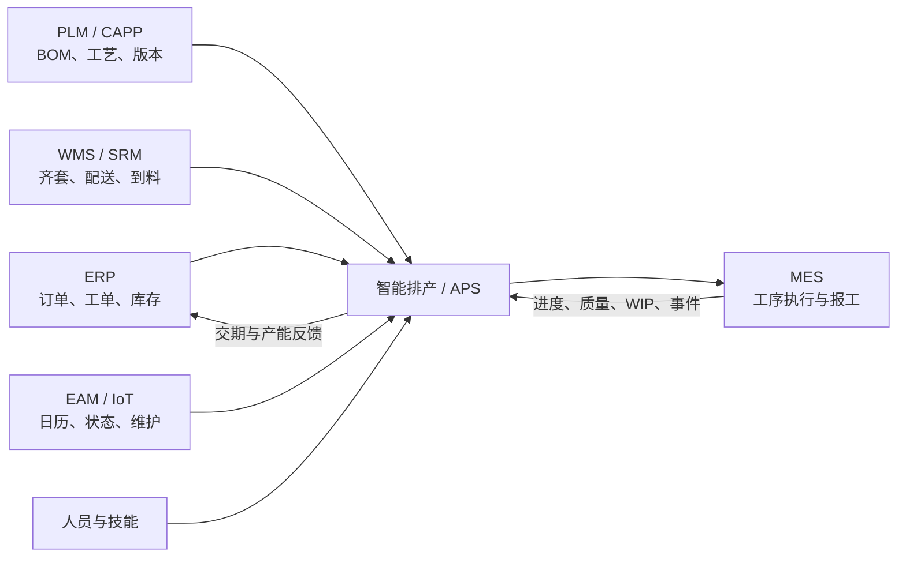
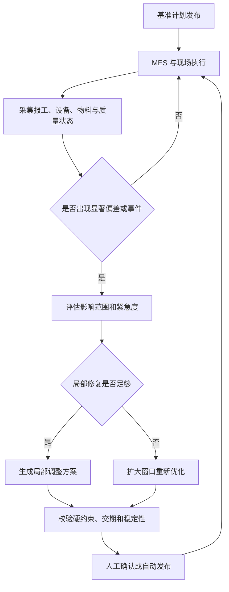
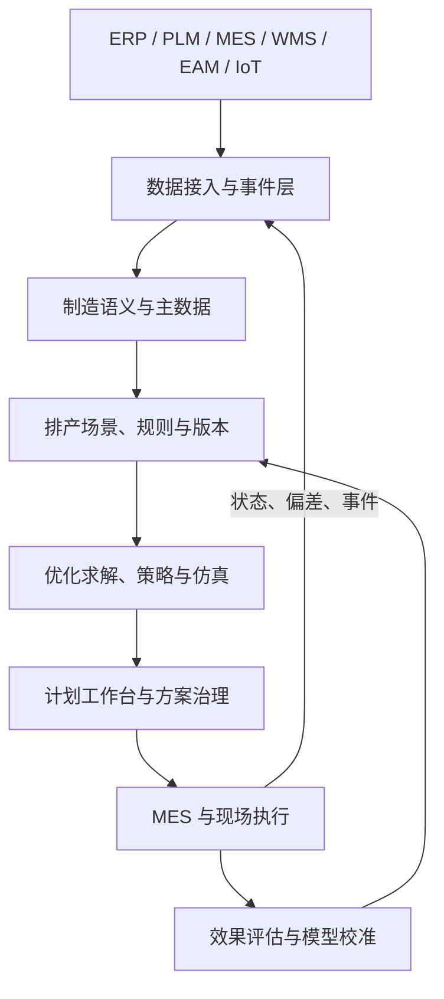

# 智能排产：从约束建模、优化求解到动态闭环决策

一家多品种、小批量制造企业在周一上午生成了本周生产计划。系统显示，所有订单都能按时完成，关键设备利用率也接近理想水平。

两个小时后，现场开始偏离计划。

一批关键物料因为来料检验没有通过，原定上午开工的工单无法投产；一台加工中心出现报警，维修人员预计需要停机两小时；销售临时插入一个必须在周三交付的紧急订单；原本分配给夜班的两名熟练工临时请假；某道工序的实际加工时间比标准工时长了 30%。

排产员打开 Excel，先把缺料工单向后拖动，再把紧急订单插入瓶颈设备的队列。为了减少延期，他把两个普通订单移到另一台设备，却忘记那台设备当天需要保养，而且替代设备需要不同的夹具。等这些问题被发现时，下游装配已经开始等料，原计划中的换型顺序也被打乱。

这个场景揭示了生产排程最真实的困难：**排产不是在一张静止的表格上排列任务，而是在不断变化的约束中持续分配稀缺资源。**

很多企业把智能排产理解为“用遗传算法或强化学习自动生成甘特图”。但甘特图只是结果的可视化。真正决定计划能否执行的，是系统是否知道订单的真实优先级、物料什么时候齐套、工序可以使用哪些设备、人员和工装、换型需要多长时间、哪些任务已经备料、哪些计划不应再被移动，以及现场发生变化以后应当局部修复还是全局重算。

因此，智能排产更准确的定义是：

> **把订单、工艺、资源、物料、日历和现场状态转化为可计算的约束模型，在限定时间内生成可执行方案，并根据插单、缺料、故障和进度偏差持续重排，通过执行反馈不断校准模型和决策。**

这不是一个单独的算法模块，而是一条完整的生产决策闭环：

```text
业务需求与制造约束
  → 形成可计算的排产场景
  → 生成并比较候选计划
  → 校验、确认和发布
  → MES 与现场执行
  → 感知事件与计划偏差
  → 局部修复或滚动重排
  → 用实际结果校准数据、规则和模型
```

智能制造调度相关综述显示，排程研究已经从相对静态、集中式的离线优化，逐步转向动态感知、实时决策、分布式协同与数字孪生驱动的闭环调度[1][2]。但技术路线越丰富，越需要先回答一个朴素问题：企业面对的究竟是哪一种排产问题？

> 资料口径：本文根据截至 **2026 年 10 月 19 日**可访问的智能制造调度、作业车间、柔性作业车间、数字孪生与深度强化学习相关论文整理。文章主要讨论离散制造，但其中的约束建模、动态重排和系统治理方法也适用于部分流程制造、批处理与装配场景。

---

## 一、先分清生产计划、排产、派工和重排

企业经常把“计划”和“排产”混在一起。学术论文中的 `scheduling` 也可能同时包含详细排程和实时派工。如果不先区分决策层级，系统就容易在错误的时间尺度上解决错误的问题。

### 1. 生产计划：决定生产什么和生产多少

生产计划通常面向月、周等较长周期，根据销售订单、需求预测、库存目标和总体产能，决定：

- 哪些产品需要生产；
- 每种产品生产多少；
- 何时需要完成；
- 哪个工厂或车间承担需求；
- 是否需要加班、外协或调整采购。

它关心的是需求与供给的大尺度平衡，不一定精确到某一道工序、某一台设备和某一分钟。

### 2. 产能计划：判断资源是否足够

产能计划把需求转换成资源负荷。例如，本周需要 800 小时车削能力，但现有日历只能提供 680 小时，那么系统需要提出加班、外协、换线、改交期或调整产品组合。

粗能力计划可以使用产品或工艺族的平均工时；有限产能计划则必须考虑资源容量、班次和时间冲突。它是连接经营计划与详细排产的桥梁。

### 3. 详细排产：决定每道工序何时由谁加工

详细排产把工单展开成工序，并给出：

- 工序选择哪台设备或哪条产线；
- 何时开始、何时结束；
- 同一资源上的加工顺序；
- 使用哪个班组、模具、刀具或工装；
- 工序之间何时转运；
- 何时换型、清洗、点检或维护。

它生成的是可以下达到现场的时间化方案。常见载体包括资源甘特图、工序队列、班次任务表和物料配送需求。

### 4. 现场派工：决定此刻下一件做什么

即使已经有详细计划，现场仍然需要回答：“这台设备刚刚空闲，现在应该加工哪一个任务？”

派工的时间尺度更短，通常以分钟或小时为单位。它会结合当前 WIP、设备状态、人员到岗、物料位置和任务优先级选择下一项作业。先进先出 `FIFO`、最短加工时间 `SPT`、最早交期 `EDD` 和关键比率 `CR` 都属于常见派工规则。

### 5. 动态重排：当现实变化时修复计划

计划发布后，订单、物料、设备和加工进度仍会变化。动态重排需要判断：

- 当前偏差是否值得调整计划；
- 只改变受影响的一小部分任务，还是重新计算整个时间窗口；
- 哪些任务已经备料、换型或开工，不能轻易移动；
- 新方案虽然减少延期，是否造成过多现场扰动；
- 重排结果是自动下发，还是需要计划员确认。

五个层级可以概括为：

| 层级 | 核心问题 | 典型时间尺度 | 典型输出 |
| --- | --- | --- | --- |
| 生产计划 | 生产什么、生产多少、何时交付 | 月、周 | 主生产计划、工单需求 |
| 产能计划 | 资源是否足够、瓶颈在哪里 | 月、周、日 | 负荷、扩容和外协建议 |
| 详细排产 | 每道工序何时在哪个资源上执行 | 周、日、班次 | 设备分配、开始时间、顺序 |
| 现场派工 | 当前资源下一件做什么 | 分钟、小时 | 任务队列、派工指令 |
| 动态重排 | 变化发生后怎样恢复 | 实时、事件触发 | 局部修复或新计划 |

这些层级不能被一个无限复杂的“大模型”替代。长期计划需要全局供需平衡，详细排产需要有限产能和复杂约束，实时派工需要快速响应，动态重排还要考虑计划稳定性。更合理的方式，是让不同时间尺度的决策相互衔接。

---

## 二、智能排产在企业系统中的位置

智能排产经常以 APS 产品的形式出现，但它不是一座孤岛。排产需要从多个业务系统获得事实，也必须把结果送回执行系统。

### 1. ERP 提供业务需求，而不是完整现场状态

ERP 通常管理销售订单、采购、库存、生产工单、成本与交付承诺。它可以告诉排产系统“需要生产什么”，却未必知道某一批物料正在待检、某台设备刚刚报警、某道工序已经完成了 60%，或者一套模具正在另一条产线上使用。

### 2. PLM 和 CAPP 定义产品怎样被制造

产品结构、BOM、工艺路线、工艺版本、替代工序和资源资格通常来自 PLM 或 CAPP。排产系统必须知道：

- 工序之间有什么前后置关系；
- 哪些设备具备加工能力；
- 不同设备上的加工时间是否相同；
- 是否允许替代路线、跳站、返工或委外；
- 产品变更后从哪个批次开始使用新版本。

如果工艺版本和工单没有建立生效关系，系统可能排出逻辑上可行、工程上错误的计划。

### 3. APS 承载计划模型、求解器和工作台

APS，通常指高级计划与排程系统，负责有限产能计划、物料约束、详细排产、方案比较和计划发布。智能排产能力通常位于这一层，但不代表必须购买一个独立 APS 产品。企业也可能在计划平台、供应链系统或自研决策服务中实现它。

### 4. MES 负责把计划变成真实执行

MES 接收工单和工序计划，控制开工、报工、过站、质量判定、设备状态和在制品流转。没有 MES 或其他可靠的执行反馈，排产系统发布计划以后就失去了对现场的感知，计划会迅速变成一张过期的表。

### 5. WMS、SRM 和设备系统补充关键约束

- WMS 提供物料批次、质量状态、实际货位和配送进度；
- SRM 提供供应商承诺、到料变更和外协状态；
- EAM 或设备平台提供维护窗口、设备健康和故障状态；
- 人力系统提供班次、技能、资格证有效期和缺勤信息；
- 能源平台提供峰谷电价、功率上限和用能约束。

这些系统的分工可以表示为：



一句话概括这些边界：

> **ERP 决定业务需求，PLM/CAPP 定义怎样制造，APS 计算何时由谁制造，MES 控制现场执行，WMS、EAM 和人员系统提供排产所需的真实资源状态。**

智能排产是贯穿这些系统的决策能力，而不是再建一个独立数据孤岛。

---

## 三、排产问题的本质：选择、排序与定时

不论使用数学规划、遗传算法还是强化学习，排产最终都需要做三类决策。

### 1. 选择：工序由哪个资源完成

在柔性车间中，同一道工序可能有多台候选设备。设备加工速度、精度、成本、当前负荷和换型要求不同。系统必须选择其中一个资源，有时还要同步选择人员、模具、刀具、程序版本和运输工具。

例如，工序 `O21` 可以在设备 `M2` 或 `M5` 上加工：

- `M2` 需要 50 分钟，但队列较长；
- `M5` 只需要 40 分钟，却需要额外换型 30 分钟；
- `M5` 所需夹具直到下午才能释放；
- 该产品在 `M5` 上加工后还需要增加一次质量确认。

选择不是简单地挑最快设备，而是评估该选择对整条工艺链和其他订单的影响。

### 2. 排序：资源先做谁、后做谁

多项任务竞争同一台设备时，顺序直接影响交付和切换成本。

如果按最早交期排序，可能频繁更换材料和刀具；如果按产品族连续生产，可以减少换型，却可能使一个紧急订单延期。排序必须在局部效率和订单承诺之间权衡。

### 3. 定时：任务具体何时开始和结束

任务开始时间不仅受设备空闲时间影响，还要满足：

- 前置工序已经完成；
- 物料已经齐套并配送到位；
- 操作人员具备资格且处于当班状态；
- 工装、模具和检具可用；
- 维护、清洁和质量等待窗口允许开工；
- 后续工序的等待时间没有超过工艺上限。

可以把一个排产任务简化为：

```text
ScheduleTask =
  工单 + 工序 + 资源集合
  + 开始时间 + 结束时间
  + 物料、人员、工装等附属资源
  + 方案版本 + 锁定状态
```

选择、排序和定时彼此耦合。设备选择改变加工时间和队列，排序改变后续任务的开始时间，开始时间又决定物料、人员和工装是否可用。这也是排产问题难以拆成几个独立步骤的原因。

---

## 四、约束比算法更重要

很多排产项目一开始就讨论选择哪一种算法，却没有完整列出现场规则。结果通常是算法很快给出一个“最优解”，计划员看一眼就发现不能执行。

真正的第一步，是把隐含在 Excel、工艺文件、班组经验和口头约定中的规则变成明确约束。

### 1. 工艺约束

最基本的约束是工序前后关系。如果工单 `J1` 包含三道工序：

```text
O11 下料 → O12 加工 → O13 检验
```

那么 `O12` 不能早于 `O11` 完成，`O13` 也不能在 `O12` 之前开始。装配场景还可能存在多条前置分支：只有所有子件都完成以后，总装任务才能开始。

实际工艺关系还包括：

- 工序之间最短等待时间；
- 工序之间最长等待时间；
- 不允许中断的连续工艺；
- 允许重叠加工的传递批；
- 返工、复检和条件分支；
- 可选工艺路线和替代工序。

### 2. 资源容量约束

多数离散设备同一时刻只能执行一个任务。但实际资源并不总是简单的“容量为 1”：

- 一台炉可以同时处理多个批次，但总重量和配方必须兼容；
- 一条装配线可以并行多个工位，却受节拍和缓冲区限制；
- 一名操作员可以看管多台自动设备，但不能同时执行两个手工作业；
- 一套模具只能被一台设备占用；
- 检验室同时可处理多个样品，但共享有限检具。

系统需要明确容量是按数量、重量、面积、槽位还是并发任务计算。

### 3. 资源资格与兼容约束

“有空闲设备”不等于“可以加工”。设备能力可能受产品、尺寸、精度、材料、程序、客户认证和质量等级限制。人员也可能需要特定技能或证书。

这类约束通常来自能力矩阵：

| 工序/产品 | 候选设备 | 标准工时 | 资格条件 |
| --- | --- | ---: | --- |
| 精加工 A | M1 | 45 分钟 | 默认资源 |
| 精加工 A | M3 | 38 分钟 | 需要夹具 T7 |
| 精加工 A | M5 | 55 分钟 | 仅允许非关键客户 |

如果能力矩阵长期依赖计划员记忆，所谓自动排产就只是把人工判断延后到结果检查阶段。

### 4. 物料约束

订单已经下达，并不代表物料现在可用。排产需要区分：

- 账面库存与可用库存；
- 在库物料与待检、冻结或已预占物料；
- 供应商承诺时间与实际到货概率；
- 物料到仓时间与配送到工位时间；
- 替代料是否获得工程和质量批准；
- 拆批以后每个子批次的齐套状态。

一个常见错误是只按当前库存判断齐套，忽略未来到料。另一个错误是把采购承诺当成确定事实，导致计划在到料延期后大面积失效。

### 5. 日历和维护约束

资源可用时间由班次、节假日、加班、保养、校准和停机窗口共同决定。设备日历还可能受到人员班次限制：设备可以 24 小时运行，但特定工序只有白班工程师能够放行。

维护任务也不应总被视为排产外部的固定黑箱。对于可移动的预防性维护窗口，生产排产和维护计划可以联合优化；如果关键设备健康风险升高，系统还需要评估是提前维护还是继续生产。

### 6. 换型和序列相关约束

换型时间经常取决于前后任务组合，而不是一个固定值。例如从浅色涂料切换到深色只需简单清洗，从深色切回浅色则需要彻底清洗；从小规格模具切换到大规格和反向切换的时间也可能不同。

因此，换型应表示为序列相关矩阵：

```text
SetupTime(资源, 前产品族, 后产品族)
```

如果只在所有任务上统一增加 20 分钟换型，求解器就无法识别更合理的生产顺序。

### 7. 批处理、拆批与合批约束

热处理、表面处理、清洗和烧结等工序常以批次加工。系统要决定：

- 哪些任务可以合批；
- 容器容量和装载率；
- 不同产品、配方或质量等级是否兼容；
- 是否等待更多任务以提高装载率；
- 等待合批会不会导致订单延期。

拆批则带来相反问题。将一个大工单拆成多个传递批可以缩短下游等待时间，但会增加搬运、报工和追溯复杂度。

### 8. 运输和缓冲约束

当车间依赖 AGV、行车、吊具或有限缓冲区时，只安排设备加工还不够。任务在设备上完成以后，可能因为没有运输资源或下游缓冲已满而无法卸载。2026 年的研究进一步把柔性作业车间加工与 AGV 运输纳入同一动态决策框架[10]，反映了排产从单设备资源向多资源协同扩展的趋势。

### 9. 质量与工艺时间窗约束

部分工艺要求前后工序之间不能间隔过长。例如涂覆后必须在规定时间内固化，混合后的材料必须在适用期内使用，某些高温工序完成后需要等待冷却才能检测。

质量状态也会改变计划：待检批次不能流入下游，抽检升级会增加检验资源负荷，返工会把已完成产品重新带回工艺路线。

### 10. 硬约束和软约束必须分开

硬约束表示任何方案都不能违反，例如设备资格、工序先后关系和安全限制。软约束表示可以付出代价后违反，例如偏好的设备、目标交期、减少换型和保持原计划稳定。

如果把所有经验都写成硬约束，模型会频繁无解；如果把真正的安全或质量要求当成软约束，系统又可能生成危险计划。

一种实用的分类方法是：

| 类型 | 含义 | 处理方式 |
| --- | --- | --- |
| 法规/安全约束 | 绝不能违反 | 硬约束 |
| 物理可行性 | 资源或工艺上不可能 | 硬约束 |
| 质量资格 | 未授权不能生产 | 通常为硬约束 |
| 客户交期 | 可以延期但有业务损失 | 软约束并设置高惩罚 |
| 首选设备 | 可使用替代设备 | 软约束 |
| 减少换型 | 可为了交期增加换型 | 软约束 |
| 保持原计划 | 可在重大异常下调整 | 软约束 |

排产模型的质量，首先取决于这种业务翻译是否准确，而不是求解器名称是否先进。

---

## 五、多目标优化：设备最忙不等于企业最好

排产没有一个天然唯一的“最优”。企业通常同时关心交期、周期、在制品、换型、成本、能耗和计划稳定性，这些目标往往互相冲突。

### 1. 常见目标指标

**最大完工时间 `Makespan`**：最后一个任务完成的时间。它适合衡量一组任务整体完成速度，却不直接体现每个订单是否按时。

**总延期与最大延期**：衡量订单超过交期的程度。总延期关注整体损失，最大延期关注最严重订单。

**准时交付率 `OTD`**：按期完成的订单比例。它直观，但可能掩盖延期程度：晚一分钟和晚十天都被计为一次延期。

**制造周期与 WIP**：任务从释放到完成经历的时间，以及系统中的在制品水平。过度追求设备满负荷可能导致 WIP 堆积和周期拉长。

**换型与非生产时间**：包括切换、清洗、预热、首件确认和程序准备。

**资源利用率**：应重点观察瓶颈资源，而不是要求所有设备都保持高利用率。非瓶颈设备保持适当空闲，反而可以为异常提供缓冲。

**能耗与碳排放**：在峰谷电价、功率上限和碳约束下，任务开始时间可能需要与能源成本联合优化。

**计划稳定性**：衡量新计划相对已发布计划改变了多少。动态环境中，稳定性本身就是需要优化的业务目标。

### 2. 加权目标的局限

最常见的方法是把多个目标加权：

```text
Score =
  w1 × 总延期
  + w2 × 换型时间
  + w3 × WIP
  + w4 × 计划扰动
```

这种方法实现简单，但权重很难解释。把“延期一天”和“增加一次换型”放到同一公式时，业务必须说明二者如何换算。权重在淡季有效，到了旺季或关键客户订单到来时可能立即失效。

### 3. 分层目标更符合许多业务场景

分层优化按照优先级逐级处理，例如：

1. 首先不违反安全、资格和物料硬约束；
2. 在可行方案中最小化关键订单延期；
3. 在不恶化关键订单的前提下降低总延期；
4. 再减少换型与加班；
5. 最后优化负荷均衡和计划稳定性。

这种方式更接近企业真实决策逻辑，也更容易向计划员解释。

### 4. Pareto 方案让业务参与选择

当目标之间没有统一换算关系时，可以保留一组不可支配方案。例如：

| 方案 | 延期订单 | 换型次数 | 加班小时 | 被移动任务 |
| --- | ---: | ---: | ---: | ---: |
| A：交期优先 | 1 | 14 | 12 | 18 |
| B：稳定优先 | 3 | 9 | 4 | 6 |
| C：成本优先 | 4 | 8 | 0 | 10 |

系统不必替管理者隐藏所有权衡。更有价值的做法，是把不同方案的代价清楚展示出来，让业务在明确后果的情况下选择。

---

## 六、先识别生产模式，再选择求解方法

“工厂有很多设备和工单”不足以定义一个排产问题。不同生产结构对应不同的数学模型和算法行为。

### 1. 单机与并行机

单机调度适用于所有任务竞争一台关键资源的场景，例如昂贵的检测设备或唯一的热处理炉。并行机调度则包含多台相同或不同能力的资源。

即使全厂很复杂，也可以围绕瓶颈资源抽象为单机或并行机问题，先解决最限制交付的部分。

### 2. 流水车间与混合流水车间

流水车间中，所有产品经过相同的工序顺序；混合流水车间则允许每个阶段有多台并行设备。标准化装配、包装、食品加工和部分半导体封装流程常接近这一结构。

它们的关键问题通常是阶段间节拍、缓冲、批次和设备选择。

### 3. 作业车间 `JSP`

作业车间中，不同工件具有不同工艺路线。例如：

```text
工件 J1：M1 → M3 → M2
工件 J2：M2 → M1 → M4
工件 J3：M3 → M4 → M1
```

每台设备上的任务彼此竞争，每个工件内部又有前后关系。这种交叉网络使问题成为经典组合优化问题。

### 4. 柔性作业车间 `FJSP`

柔性作业车间进一步允许同一道工序从多台候选设备中选择。因此，系统不仅要决定任务顺序，还要决定设备分配。机加工、模具制造和多品种小批量离散生产常具有这种特征。

2024 年的 FJSP 综述指出，现实扩展已经覆盖不确定加工时间、维护、运输、多资源、能耗和分布式生产等大量变体[3]。这也说明，企业不能只看到“柔性作业车间”这个名称，就直接套用标准算例模型。

### 5. 开放车间与项目调度

开放车间中，部分工序顺序可以改变，常见于维修、检测和服务作业。资源受限项目调度 `RCPSP` 则关注具有前置关系的活动如何共享有限资源，适用于大型装配、工程制造和检修项目。

### 6. 静态、动态与不确定性

除了生产结构，还必须判断环境特征：

- 所有任务是否在排产前已知；
- 新订单会不会随时到达；
- 加工时间是固定值还是概率分布；
- 设备故障是否需要建模；
- 交期、物料到达和人员可用性是否确定；
- 排产结果是一次性执行，还是持续滚动更新。

静态确定性模型适合生成基准计划。动态随机环境则需要预测、仿真、实时派工和重排机制。两者不是互相替代，而是排产系统中的不同层次。

---

## 七、算法谱系：从规则到强化学习

智能排产没有一种普遍最优算法。算法选择取决于问题规模、约束结构、求解时限、可解释性和对最优性的要求。

### 1. 派工规则：简单不等于无用

常见规则包括：

- `FIFO`：先到先服务；
- `SPT`：优先加工时间最短的任务；
- `LPT`：优先加工时间最长的任务；
- `EDD`：优先交期最早的任务；
- `CR`：根据剩余时间与剩余工作量的关键比率排序；
- 最少剩余工序、最小松弛时间和瓶颈优先等组合规则。

规则的优势是计算快、易解释、适合实时派工，也可以作为复杂算法的基线和初始解。它们的不足是局部决策难以看到长链路影响，同一规则在低负荷、高负荷和频繁扰动环境中的表现可能完全不同。

企业不应因为规则简单就跳过它。没有一个清晰的规则基线，就无法判断复杂算法究竟创造了多少价值。

### 2. 精确优化：把业务约束写成数学模型

精确方法包括混合整数规划 `MILP`、约束规划 `CP`、`CP-SAT`、动态规划、分支定界和各种分解算法。

它们的核心优势是：

- 可以明确表达决策变量、约束和目标；
- 能保证输出满足模型中的硬约束；
- 在可计算范围内可给出最优性或最优间隙；
- 便于分析无解、下界和约束冲突；
- 适合与业务规则、热启动和滚动窗口结合。

精确方法不等于只能处理教科书小问题。通过缩短排产窗口、聚合任务、固定冻结区、分解车间、提供优质初始解和限制求解时间，可以解决相当规模的工业问题。真正的挑战是建模质量和计算预算，而不是“数学规划已经过时”。

### 3. 元启发式：在巨大解空间中寻找高质量近似解

遗传算法、禁忌搜索、模拟退火、粒子群、蚁群、人工蜂群和大邻域搜索都属于常见路线。

它们适合：

- 问题规模较大；
- 目标非线性或多目标；
- 允许在限定时间内寻找高质量近似解；
- 难以用单一精确模型表达全部搜索结构。

但“使用了遗传算法”并不能说明方案质量。真正决定效果的是：

- 如何编码一个计划；
- 如何生成可行初始解；
- 交叉、变异或邻域是否符合问题结构；
- 违反约束后如何修复；
- 怎样保留精英方案并避免过早收敛；
- 在什么时间或质量条件下停止。

工业系统中常见的并不是纯元启发式，而是数学规划与邻域搜索的混合方法，也称 `matheuristic`。

### 4. 仿真优化：让计划先在模型中执行一次

数学排产模型往往对加工时间、运输和故障做简化。离散事件仿真可以进一步模拟：

- 加工时间波动；
- 队列和阻塞；
- 设备故障与维修；
- AGV 运输和路径拥堵；
- 缓冲区容量；
- 人员响应和班次变化。

系统可以先由求解器生成候选计划，再通过仿真比较准时率、WIP 和风险分布。这样评价的不只是名义条件下的最优值，还包括计划在不确定环境中的鲁棒性。

### 5. 机器学习：先预测排产模型需要的参数

机器学习最直接的价值，并不是替代求解器，而是改善求解器的输入：

- 根据产品、设备、人员和工艺参数预测实际加工时间；
- 预测供应商到料延误概率；
- 预测设备故障和性能下降；
- 预测返工、报废和质量等待；
- 预测订单变更或加急风险。

传统排产常把标准工时当成固定常数。如果实际工时长期偏离标准值，再强的求解器也只是在错误参数上优化。预测模型可以输出期望值、分位数或概率分布，使计划更贴近真实执行。

### 6. 强化学习：学习连续决策策略

强化学习把调度视为一个序贯决策问题：

- **状态**：当前设备、队列、工序、交期、WIP 和扰动信息；
- **动作**：选择下一项任务、设备、派工规则或重排操作；
- **奖励**：交期、利用率、换型、能耗和稳定性的组合；
- **环境**：车间仿真或数字孪生；
- **策略**：在不同状态下选择动作的模型。

Luo 的研究使用深度强化学习处理新任务动态插入的柔性作业车间调度[6]；后续研究继续探索动态 FJSP 中的策略学习、多目标优化和多资源协同[8][10]。

强化学习的吸引力在于，训练完成后可以快速输出动作，适合需要高频决策的动态场景。但它也带来明显风险：

- 训练环境与真实车间存在分布偏移；
- 奖励函数可能与真实经营目标错位；
- 模型可能在未见过的异常状态下做出不稳定决策；
- 很难仅依靠奖励保证所有硬约束；
- 仿真环境不准确时，策略会学习错误规律；
- 结果缺少计划员能够理解的原因说明。

因此，强化学习更适合选择派工规则、搜索算子、局部动作或重排时机，而不是在没有约束保护的情况下直接控制整个工厂。

### 7. 图神经网络：把调度结构交给模型理解

作业车间可以表示为析取图：节点代表工序，工艺边表示同一工件的前后关系，资源竞争边表示任务之间可能的设备顺序。

`Learning to Dispatch` 使用图神经网络编码作业车间状态，再通过深度强化学习学习派工策略[7]。这种表示比固定长度表格更贴近调度问题结构，也有助于策略迁移到不同规模的实例。

但结构化表示仍然不能自动解决真实数据、复杂业务约束和上线治理。图神经网络改善的是模型表达，不是企业实施的全部问题。

### 8. 企业级方案通常是混合系统

更务实的组合是：

```text
预测模型
  估计加工时间、到料、质量和故障风险

规则引擎
  管理资格、安全、冻结区和人工禁排条件

数学优化
  保证硬约束并生成基准计划

启发式与学习策略
  改善大规模搜索、实时派工和局部重排

离散事件仿真 / 数字孪生
  评估随机扰动下的执行效果

计划工作台
  比较方案、解释冲突、人工调整并受控发布
```

算法不应被组织成一场“谁替代谁”的竞争。预测、优化、仿真和学习解决的是不同问题，组合起来才构成可执行的智能排产能力。

---

## 八、动态排产：真正困难的是怎样应对变化

静态排产假设任务、资源和加工时间在求解前已经确定。真实工厂几乎从不满足这个假设。

常见扰动包括：

- 新订单到达、订单取消和交期修改；
- 关键客户临时加急；
- 物料延期、来料不合格和配送失败；
- 设备故障、降速和维护窗口变化；
- 人员缺勤、技能资源变化；
- 实际加工时间偏离标准工时；
- 质量异常、报废、返工和复检；
- AGV、行车、模具或检具临时不可用；
- 上游延迟导致下游工序连锁失效。

国内关于智能车间动态调度的综述将自适应、自学习、通用性和从被动重排走向主动调度视为重要发展方向[9]。这意味着排产系统不能只在每天早上计算一次计划，而要具备持续判断和修复能力。

### 1. 完全反应式调度

完全反应式方法不维护很长的固定计划，而是在设备空闲或事件发生时根据当前状态决定下一项任务。

这种方式响应快，适合高度动态、长期预测价值低的环境。但它容易缺少全局视角：每一步都看起来合理，累积起来却可能造成下游延期或瓶颈拥堵。

### 2. 周期性滚动排产

系统按照固定周期重新计算，例如每班、每两小时或每天滚动一次。滚动窗口只对未来一段时间详细排产，更远期使用粗粒度负荷。

周期性方式易于运维和协同，但重排周期很难统一：周期太长，计划不能及时反映异常；周期太短，系统和现场不断接收新版本。

### 3. 事件驱动重排

事件驱动方式在关键变化达到阈值时触发，例如：

- 瓶颈设备预计停机超过 30 分钟；
- 关键订单预计延期超过 4 小时；
- 物料到料时间晚于计划开工；
- 新插单优先级达到紧急等级；
- 实际进度偏差影响冻结区外的多个任务。

它比固定周期更灵敏，但必须控制触发频率。如果每次报工延迟几分钟都触发全局求解，计划会持续震荡。

### 4. 预测式和主动式排产

主动式方法在异常真正发生前，根据预测风险提前准备：

- 设备健康恶化时预留替代设备；
- 高风险到料为关键订单准备替代物料或备用路线；
- 加工时间不确定时为瓶颈工序设置缓冲；
- 对可能插入的高优先级需求保留适度柔性；
- 同时生成主计划和若干应急方案。

这种方法不是追求“预测所有未来”，而是识别对交付影响最大的风险，并提前降低恢复成本。

### 5. 重排不是把原计划全部推倒

发生扰动后最简单的做法，是用最新状态重新计算全部任务。但数学上更优的新计划，可能在现场造成更大损失。

例如，一项已经完成备料和换型准备的任务被移动到明天，意味着：

- 物料需要退回或重新标识；
- 模具、刀具和程序准备作废；
- 班组已经完成的协调失去意义；
- 下游人员和物流安排需要同步变化；
- 计划员要重新解释大量任务调整。

所以动态排产必须优化“恢复效果”和“计划扰动”两个目标。

### 6. 冻结区、半冻结区和可调整区

一个实用的滚动时间轴可以分为三段：

```text
现在 ───── 冻结区 ───── 半冻结区 ───── 可调整区 ───── 远期
       原则上不移动       高代价移动       可正常优化
```

**冻结区**包含已经开工、已经备料、已经换型或即将执行的任务。除安全、设备故障等重大事件外，不应移动。

**半冻结区**允许调整，但需要计算变更代价，并可能要求人工审批。

**可调整区**尚未进入现场准备，可以自由优化。

冻结区长度不是固定技术参数。它取决于备料提前期、换型准备、班组协同、工艺稳定性和计划发布节奏。

### 7. 局部修复与全局重排

系统需要根据影响范围选择恢复策略：

| 情况 | 更合适的策略 |
| --- | --- |
| 非瓶颈设备短暂停机 | 推迟本机队列或切换单个任务 |
| 某项物料延迟 | 移出受影响工单并回填可执行任务 |
| 紧急订单插入 | 在相关资源链上进行局部重排 |
| 瓶颈设备长时间故障 | 扩大窗口并全局重算 |
| 大量订单交期变化 | 重新平衡目标和产能 |
| 工艺版本重大变更 | 重建受影响工单的工艺与计划 |

局部修复速度快、扰动小，但可能牺牲全局效果；全局重排可能找到更优方案，却需要更多计算和现场调整。系统可以先尝试局部修复，在无法恢复关键目标时再扩大范围。

### 8. 计划稳定性要成为显式指标

稳定性不能只靠冻结区隐式保证，还应被量化：

- 被移动的任务数量；
- 开始时间变化的总和或平均值；
- 被重新分配的资源数量；
- 已备料、已换型任务的变化次数；
- 相对上一版本新增的延期；
- 单位时间内的重排次数。

可以为每个任务定义变更代价：

```text
ChangeCost(task) =
  时间移动代价
  + 资源变更代价
  + 准备状态代价
  + 距离开工时间的紧迫系数
```

距离开工越近、现场准备越充分，变更代价越高。

### 9. 动态排产闭环



这条闭环真正体现了“智能”：系统不仅会计算计划，还知道何时应该保持不动、何时局部调整，以及何时必须承认原计划已经失效。

---

## 九、数字孪生在排产中的真实作用

数字孪生经常被等同于三维车间可视化。对排产而言，三维画面并不是核心。真正有价值的是建立一个与物理生产状态持续同步、可以验证决策后果的运行模型。

### 1. 状态镜像

数字孪生需要持续知道：

- 每个工单和批次当前位于哪道工序；
- 设备是运行、待机、故障还是维护；
- 当前任务何时开始，预计何时结束；
- 物料、工装和人员是否可用；
- 缓冲区和运输资源处于什么状态；
- 计划与实际偏差正在怎样扩大。

这要求事件时间、对象身份和状态语义保持一致。仅仅把 MES 数据显示在一个三维模型上，并不构成可用于排产的数字孪生。

### 2. 行为模型

状态镜像回答“现在发生了什么”，行为模型则描述“接下来可能怎样发展”。它可以包含：

- 加工时间概率分布；
- 设备故障与修复模型；
- 队列、阻塞和缓冲区行为；
- AGV 运输时间和路径冲突；
- 人员响应时间；
- 换型、清洁和质量等待逻辑。

如果行为模型不能被实际执行数据持续校准，孪生模型会逐渐偏离现场。

### 3. 方案试验

候选计划可以先在数字模型中“执行”：

- 如果瓶颈设备加工时间波动 20%，交期风险多大；
- 如果某台设备在明天下午故障两小时，哪些订单受影响；
- 增加一辆 AGV 是否真的改善周期，还是把瓶颈转移到检验工位；
- 减少换型的计划是否造成下游集中到达和缓冲拥堵；
- 两个名义指标相近的方案，哪个在随机扰动下更稳定。

Negri 等提出的现场同步数字孪生框架，正是将物理状态同步、生产调度和不确定性处理结合起来[5]。它说明数字孪生的排产价值在于状态同步和决策验证，而不是视觉展示本身。

### 4. 模型校准闭环

数字孪生必须持续比较模拟结果与真实结果：

```text
预测加工 45 分钟，实际 58 分钟
预测运输 8 分钟，实际 17 分钟
预测设备可用率 96%，实际 89%
预测换型 20 分钟，实际中位数 27 分钟
```

偏差需要回到标准工时、概率分布、设备可靠性和物流模型中。没有这条校准链，数字孪生只是一个逐渐过时的仿真模型。

---

## 十、智能排产系统的六层架构

一个可落地的智能排产系统，可以拆成六个责任层。

### 1. 数据接入层

数据接入层负责从业务系统和现场系统获得事实：

| 来源 | 主要数据 |
| --- | --- |
| ERP | 订单、工单、库存、优先级、成本、交期 |
| PLM/CAPP | BOM、工艺路线、工序、版本、替代工艺 |
| MES | WIP、报工、开完工、质量、在制状态 |
| WMS/SRM | 批次、齐套、配送、到料承诺、外协进度 |
| EAM/IoT | 设备日历、维护、故障、健康与实时状态 |
| 人力系统 | 班次、人员、技能、资格和缺勤 |
| 能源平台 | 电价、功率限制、能耗与峰值 |

接入层不能只做批量数据导入。动态排产还需要事件流、状态时间戳、幂等处理和迟到数据机制。

### 2. 制造语义与主数据层

不同系统可能用不同编号表示同一对象。排产平台需要统一：

```text
订单 → 工单 → 批次 → 工序 → 排产任务
产品 → BOM → 工艺路线 → 工艺版本
设备 → 资源组 → 能力 → 日历 → 当前状态
人员 → 班组 → 技能 → 资格 → 可用时间
物料 → 批次 → 质量状态 → 可用时间 → 位置
```

这层还要处理版本和生效时间。例如工艺路线在 10 月 20 日生效，不代表 10 月 19 日已经投产的工单自动切换到新路线。

### 3. 场景与规则层

场景层把业务事实转成一次可求解输入：

- 排产范围与时间窗口；
- 当前 WIP 和已完成工序；
- 候选资源与加工时间；
- 资源日历和停机窗口；
- 物料预计可用时间；
- 冻结任务和人工计划锁定；
- 硬约束、软约束与目标优先级；
- 不确定性参数和风险情景。

同一批业务数据可以生成不同场景，例如“正常交付”“关键设备停机”“供应商延期”和“增加夜班”。场景必须版本化，才能解释为什么两次求解结果不同。

### 4. 求解与仿真层

这一层可以包含多个引擎：

- 有限产能计划；
- 详细排产求解器；
- 启发式和邻域搜索；
- 实时派工策略；
- 插单与故障局部修复；
- 多方案并行求解；
- 离散事件仿真；
- 冲突分析和不可行诊断。

求解器输出不应只有最终甘特图，还应包含目标值、约束违反情况、求解耗时、最优间隙、方案解释和输入版本。

### 5. 计划工作台

工作台是计划员与算法协作的界面，至少应提供：

- 订单、资源、工序和物料多视图；
- 资源甘特图和负荷曲线；
- 延期、缺料、设备冲突和能力不足提示；
- 锁定、拖动、拆批、合批和替代资源操作；
- 人工调整后的实时约束校验；
- 新旧方案和多个候选方案对比；
- 调整原因、审批、发布、撤回和版本记录；
- “为什么不能排”“为什么会延期”的解释。

拖动任务不只是前端修改时间。每一次拖动都可能影响前后工序、资源容量、物料、工装和交期，因此必须立即重新校验。

### 6. 执行反馈与治理层

计划发布后，系统需要：

- 把工序和资源安排下达到 MES；
- 记录现场是否接受、拒绝或修改；
- 持续采集实际开始、结束和数量；
- 比较计划值与实际值；
- 触发偏差告警和动态重排；
- 更新加工时间、到料和故障模型；
- 保存人工计划干预和原因；
- 对模型、规则、目标和权限进行审计。

完整架构如下：



---

## 十一、一个可落地的核心数据模型

排产系统不需要一开始就复制所有制造数据，但必须建立足够稳定的核心对象。

### 1. 需求与工单

`Order` 记录客户、数量、交期、优先级、允许拆分和延期成本。`WorkOrder` 记录产品、批次、释放时间、计划数量、已完成数量和当前状态。

订单与工单不能简单一一对应：一个订单可能拆成多个工单，多个订单也可能合并生产。系统需要保留需求分配关系，才能在工单完成后正确回写交付承诺。

### 2. 工艺与工序

`Routing` 和 `Operation` 至少需要包含：

- 工艺版本和生效范围；
- 工序前后关系；
- 候选资源与各自加工时间；
- 准备时间、加工时间和收尾时间；
- 是否允许拆分、并行或中断；
- 最短和最长等待；
- 所需人员、工装、物料和检验；
- 替代路线与返工路径。

### 3. 资源与日历

`Resource` 不应只有设备编号，还应包含：

- 资源类型和所属资源组；
- 能力、规格、效率和成本；
- 班次日历与例外日历；
- 当前状态与预计恢复时间；
- 可执行的产品和工序资格；
- 并发容量、批容量或人员看管比；
- 维护、校准和质量限制。

### 4. 换型矩阵

`SetupMatrix` 建议显式保存资源、前产品族、后产品族、换型时间和换型成本。对于复杂场景，还需要区分清洗、模具、程序、首件确认等组成部分。

### 5. 物料与附属资源

`MaterialAvailability` 需要记录物料、数量、批次、质量状态、当前位置、可用时间和置信度。`Tooling` 和 `WorkerSkill` 分别描述工装与技能资源。

预计到料时间必须与事实到料时间分开。模型预测、供应商承诺和实际收货是三种不同证据，不能覆盖在同一字段中。

### 6. 排产任务与方案

`ScheduleTask` 记录：

```text
工单与工序
分配资源
计划开始和结束
准备、加工和收尾时段
所需物料、人员和工装
冻结或锁定状态
方案版本与来源
相对上一版本的变化
```

`ScheduleScenario` 和 `ScheduleVersion` 则记录输入快照、规则版本、目标配置、求解器参数、生成时间、审批状态和发布范围。

### 7. 生产事件

动态排产依赖 `ProductionEvent`：

- 订单新增、取消和交期变化；
- 工序开始、完成、暂停和恢复；
- 设备故障、降速和修复；
- 物料到达、冻结和释放；
- 质量异常、返工和报废；
- 人员或工装状态变化；
- 人工锁定、解锁和计划修改。

事件必须包含业务时间、系统接收时间、来源、对象、严重度和幂等标识。否则迟到或重复事件会把排产状态推向错误方向。

三个数据原则尤其重要：

1. **事实值、承诺值和预测值分开保存**；
2. **工艺、规则、场景和计划都必须版本化**；
3. **每次人工计划修改和系统重排都必须可追溯**。

---

## 十二、贯穿案例：一个紧急订单怎样进入现有计划

假设一个柔性机加工车间当前有 20 个工单、8 台设备和 3 类共享工装。周一上午 10 点，销售插入一个周三必须交付的高优先级订单 `J21`。

`J21` 包含四道工序：

```text
O211 下料
  → O212 粗加工
  → O213 精加工
  → O214 检验
```

其中精加工只能使用 `M3` 或 `M5`。`M3` 是瓶颈设备，当前队列已经排到周二下午；`M5` 有空闲时间，但加工效率较低，还需要夹具 `T2`。原材料预计下午 2 点齐套。

### 1. 直接插队方案

系统将 `J21` 放到 `M3` 队列前部。结果是：

- 紧急订单可以在周三前完成；
- 两个普通订单预计延期；
- 原有产品族顺序被打断，增加三次换型；
- 12 个任务的开始时间发生变化；
- 已经完成备料的一个任务需要重新安排。

这个方案交期最好，但扰动和换型成本最高。

### 2. 替代设备方案

系统把精加工分配到 `M5`，并在下午夹具 `T2` 释放后开工。结果是：

- `J21` 仍可按时交付，但安全余量较小；
- 只影响 4 个现有任务；
- 不增加 `M3` 的换型；
- 需要额外首件检验；
- 如果 `M5` 加工时间波动超过 15%，订单存在延期风险。

### 3. 加班扩容方案

系统保留 `M3` 的白班计划，在周二增加夜班处理部分普通订单。结果是：

- 所有订单都能按时完成；
- 计划扰动较小；
- 增加 8 小时加班和相应人员成本；
- 夜班只有一名具备相关资格的操作员，人员风险较高。

### 4. 方案比较

| 指标 | 直接插队 | 替代设备 | 加班扩容 |
| --- | ---: | ---: | ---: |
| 延期订单数 | 2 | 0 | 0 |
| 新增换型 | 3 | 1 | 0 |
| 被移动任务 | 12 | 4 | 5 |
| 加班小时 | 0 | 0 | 8 |
| 紧急订单风险 | 低 | 中 | 低 |

计划员最终选择替代设备方案，并锁定已经备料的任务。系统将新计划发布给 MES，同时建立一条风险规则：如果 `O213` 实际开始时间晚于周二上午 10 点，或者 `M5` 预计完工时间继续后移，就自动重新评估加班方案。

这个案例体现了智能排产的真正输出：不是机械地产生唯一甘特图，而是基于约束生成多个可行方案，解释每个方案的代价，在业务确认后执行，并继续监测关键假设是否成立。

---

## 十三、怎样评价一个排产系统是否真的有效

很多项目用 Makespan 或算法收敛曲线证明系统有效，但企业真正关心的是交付、成本、稳定性和执行接受度。评价体系至少应包含四个维度。

### 1. 计划结果质量

结果质量回答“计划本身有多好”：

- 订单准时交付率；
- 延期订单数、总延期和最大延期；
- 制造周期、等待时间和 WIP；
- 瓶颈资源利用率；
- 换型次数和换型总时长；
- 加班、外协和制造成本；
- 能耗、峰值功率和碳排放；
- 关键客户、关键产品和普通订单的服务差异。

指标必须按订单、产品族、车间和时间分层。如果只看全厂平均准时率，系统可能通过牺牲少量高价值订单来改善整体数字。

### 2. 求解性能

求解性能回答“系统能否在业务允许的时间内给出可用答案”：

- 首个可行解需要多长时间；
- 限定时间内目标值改善多少；
- 精确方法的最优间隙；
- 不同订单和资源规模下的计算时间；
- 插单和故障发生后的恢复时间；
- 无解时能否指出冲突约束；
- 求解失败后是否有规则或上一个可行方案兜底。

详细周计划可以允许数分钟求解，设备故障后的现场派工可能只允许几秒。不能用同一个时限要求所有决策层级。

### 3. 计划稳定性

稳定性回答“新方案是否让现场付出过多调整成本”：

- 被移动任务占比；
- 开始时间变化的平均值和分布；
- 资源重新分配次数；
- 冻结区和已准备任务的变化次数；
- 每班或每天重排频率；
- 计划版本发布后被撤回的次数。

一个交期改善 1%，却让 40% 任务重新准备的方案，未必优于稍有延期但更加稳定的方案。

### 4. 系统和组织指标

智能排产最终由人和系统共同执行，因此还要观察：

- 系统自动生成计划的覆盖率；
- 计划员人工计划调整率；
- 人工调整的原因分布；
- 现场按计划执行率；
- 计划发布到 MES 的时延；
- 系统建议被接受、拒绝或覆盖的比例；
- 约束缺失、主数据错误和接口异常的数量；
- 从发现问题到恢复计划的平均时间。

人工修改不是失败本身。更重要的是记录原因：如果计划员经常因为同一种遗漏规则修改结果，说明约束模型需要完善；如果计划员只是沿用旧习惯，系统则需要用数据证明新方案的收益。

### 5. 四层验证方法

排产系统不应从实验室算法直接跳到自动下发。更稳妥的验证路径是：

#### 第一层：标准算例

使用公开 JSP、FJSP 或其他 benchmark 检查算法实现是否正确，并与已有研究结果比较。标准算例适合验证基础求解能力，但无法代表企业全部约束。

#### 第二层：历史回放

选取企业过去若干周或若干月的真实订单、资源日历和异常记录，在当时可获得的信息边界内重新排产，再与人工计划和实际结果比较。

历史回放必须避免“偷看未来”。例如，排周一计划时不能使用周三才知道的设备故障恢复时间。

#### 第三层：离散事件仿真

将加工时间波动、设备故障、运输和队列纳入仿真，重复运行不同随机情景，比较计划的平均表现、尾部风险和恢复能力。

#### 第四层：影子运行和现场试点

系统与计划员同时生成方案，但初期不自动下发。团队逐项分析差异，记录系统遗漏的约束和人工计划的隐含规则。模型稳定后，再选择一个产品族、瓶颈工序或班组进行受控执行。

这一过程可以概括为：

```text
标准算例证明“算法没有写错”
历史回放证明“对真实业务可能有改善”
仿真证明“面对随机扰动仍有韧性”
影子运行证明“现场能够理解和接受”
受控试点证明“业务收益真实发生”
```

---

## 十四、企业落地：从可计算到可信任

智能排产项目最常见的问题不是算法无法运行，而是范围过大、数据不足、责任不清和收益无法验证。落地应当循序推进。

### 阶段一：选择清晰边界

不要一开始就覆盖全部工厂、全部产品和全部约束。更合适的起点是：

- 一个交付问题明显的产品族；
- 一组高价值瓶颈设备；
- 一个频繁插单的车间；
- 一个换型成本很高的工序；
- 一段排产员工作量集中的流程。

同时明确排产范围、时间窗口、时间粒度、发布频率、决策责任和最关键的 1～2 个业务目标。

### 阶段二：建立约束清单和数据责任

通过访谈和现场观察，整理：

- 哪些规则绝不能违反；
- 哪些规则只是经验偏好；
- 哪些约束存在于系统，哪些只在 Excel 和人员记忆中；
- 哪些参数有可靠事实，哪些只是估计；
- 每项数据由哪个岗位和系统负责维护；
- 数据错误如何发现和纠正。

约束清单应由生产、工艺、设备、质量、物流和计划共同确认，不能只由 IT 或算法团队编写。

### 阶段三：建立人工规则基线

把当前人工计划逻辑显式化，并实现一组简单规则。基线需要回答：

- 当前人工计划平均需要多久；
- 订单延期、换型和 WIP 是多少；
- 遇到插单和故障需要多久恢复；
- 计划员平均修改多少次；
- 最常见的人工判断是什么。

没有基线，就容易把“系统能生成计划”误当成项目收益。

### 阶段四：先保证可行，再优化目标

初始版本应优先做到：

- 工艺顺序正确；
- 设备和人员资格正确；
- 日历、物料和工装不冲突；
- 已开工和已锁定任务保持不变；
- 无解时能解释原因；
- 计划员可以安全地人工调整。

在可行性稳定以后，再逐步引入交期、换型、WIP、能耗和稳定性等多目标。

### 阶段五：影子运行，吸收现场知识

影子运行期间，系统方案不直接替代人工计划，而是每天进行对比：

- 哪些任务的资源分配不同；
- 哪些订单交期判断不同；
- 计划员为什么拒绝某项建议；
- 是算法问题、参数问题、数据问题还是未建模约束；
- 人工判断是否真的在后续执行中更好。

计划员每次修改都应选择原因，例如“物料风险”“设备偏好”“客户承诺”“人员技能”“维护冲突”或“现场习惯”。这些数据会成为改进模型的重要证据。

### 阶段六：建立局部闭环

选择风险可控的范围，把计划下发到 MES，并自动获取执行反馈。此时重点不是继续增加算法复杂度，而是验证：

- 计划版本是否准确到达现场；
- 实际报工能否正确更新排产状态；
- 事件是否及时触发；
- 冻结区和局部重排是否有效；
- 系统失败时能否回退到已发布计划或人工计划。

### 阶段七：逐步引入预测、仿真和学习

当基础闭环稳定后，再增加：

- 实际加工时间预测；
- 到料延期和质量风险预测；
- 设备健康与维护窗口预测；
- 离散事件仿真和鲁棒方案比较；
- 学习型派工规则和搜索策略；
- 多车间、物流、维护和能源联合优化。

这个顺序很重要。AI 应当增强一个已经可运行的决策闭环，而不是掩盖主数据和业务责任问题。

### 阶段八：建立持续治理

生产环境一直在变化：新设备上线、工艺改版、客户策略调整、人员技能变化、能源规则更新。企业需要持续治理：

- 约束和目标的版本审批；
- 标准工时与实际工时偏差分析；
- 预测模型漂移监控；
- 求解器性能和失败率监控；
-人工计划覆盖行为分析；
- 业务 KPI 与算法 KPI 联合复盘；
- 重大异常后的规则和模型复盘。

智能排产不是上线一次就结束的软件项目，而是一套需要持续校准的生产决策机制。

---

## 十五、八种常见失败模式

### 1. 把算法先进当成系统先进

论文中的指标更好，不代表算法能表达企业全部约束，也不代表能在现场时限内稳定运行。算法只是系统的一部分。

### 2. 主数据不可信却直接优化

如果标准工时、工艺路线、设备资格和日历错误，求解器只会更加精确地产生错误计划。应先暴露数据质量，不应让人工计划长期在后台替系统补洞。

### 3. 把所有经验写成硬约束

历史经验中既有真实物理限制，也有过去条件下形成的习惯。全部设为硬约束会让模型经常无解，并把旧流程永久固化。

### 4. 只优化设备利用率

让每台设备都很忙可能增加 WIP、等待和交付周期。排产应保护系统瓶颈和订单流动，而不是追求所有局部资源的满负荷。

### 5. 每次异常都全局重排

频繁推翻计划会破坏备料、换型和班组安排。系统必须把计划稳定性和现场变更成本纳入决策。

### 6. 只有甘特图，没有不可行解释

计划员不仅需要看到结果，还需要知道：为什么订单无法按时完成、哪个约束造成冲突、增加哪种资源最有效、放宽哪个条件可以恢复可行。

### 7. 计划生成后没有执行反馈

如果系统不知道任务是否真实开工、设备是否故障、物料是否到位，它无法进行动态排产，也无法校准标准工时和预测模型。

### 8. 自动化等级超过组织准备度

在约束不完整、数据不稳定、责任不明确时直接自动下发，会迅速消耗现场信任。自动化应从建议、影子运行、受控确认逐步提升。

---

## 十六、未来趋势：智能排产会向哪里发展

### 1. 从被动重排走向主动调度

未来系统会更早使用到料、设备健康、质量和加工时间预测，在异常发生前准备缓冲、替代资源和应急方案，而不是只在计划失效后重算[9]。

### 2. 运筹优化与机器学习进一步融合

机器学习不会简单取代运筹优化。更可能的方向包括：

- 预测优化模型中的参数和不确定性；
- 学习分支、变量、邻域和搜索算子；
- 用强化学习选择规则或重排策略；
- 用优化层、动作屏蔽或修复机制保证硬约束；
- 用求解器生成训练数据和策略监督信号。

这种组合同时利用机器学习的模式识别能力和数学优化的约束保证能力。

### 3. 图表示与跨规模泛化

图神经网络能够表示工序依赖、资源竞争和多资源关系，为不同订单规模、不同车间拓扑之间的策略迁移提供更自然的结构[7]。未来重点将从“在一个 benchmark 上取得更好结果”转向跨规模、跨分布和真实扰动下的可靠泛化。

### 4. 生产、物流、维护、质量和能源联合决策

传统模型把加工设备视为唯一核心资源。实际生产还受 AGV、缓冲、模具、人员、检验、维护和能源约束。联合调度可以减少局部最优，但也会显著扩大状态和决策空间，因此需要分层、分解和多时间尺度协同[10]。

### 5. 数字孪生成为决策试验环境

数字孪生将更多承担状态同步、情景推演、策略训练和风险验证，而不是停留在三维看板。其可信度取决于是否持续用现场事实校准模型[5]。

### 6. 可解释与人机协同

计划员不会因为算法复杂就自动信任系统。未来排产系统需要回答：

- 哪些订单和资源决定了当前结果；
- 哪个约束是交付瓶颈；
- 为什么某个任务被移动；
- 放宽哪个条件可以改善多少；
- 新方案相对旧方案的收益和风险是什么；
- 结果对加工时间、到料和故障预测有多敏感。

排产解释不是生成一段自然语言总结，而是把约束、因果链、方案差异和反事实结果组织成可验证证据。

### 7. 从单厂优化走向供应网络协同

随着供应链数据更加实时，排产会逐步纳入跨工厂产能、供应商到料、委外加工、库存和物流。但不同主体具有独立目标、数据边界和决策权，未来系统需要处理的不只是更大规模优化，还有协商、权限和激励问题。

2026 年关于 Industry 4.0 调度的综述仍将实时数据集成、动态环境、不确定性、互操作和可扩展性列为核心挑战[11]。这说明智能排产的前沿并不只是设计更复杂的算法，而是让算法能够在真实制造系统中持续获得可信状态并稳定行动。

---

## 十七、结语：排产的“智能”有三个层次

智能排产可以用三个层次概括。

### 第一层：算得出

系统能够把订单、工艺、设备、物料、人员、工装和日历转化为明确模型，在复杂约束下生成一个可行计划。

这是基础。如果计划不满足工艺和资源条件，再先进的算法也没有业务价值。

### 第二层：跟得上

系统能够持续接收 MES、WMS、设备和供应链状态，识别计划偏差，在限定时间内选择局部修复或全局重排，同时控制现场扰动。

这决定了计划能否从一次性计算变成真实运行能力。

### 第三层：学得会

系统能够根据实际加工、到料、故障、质量和人工计划行为校准参数，预测未来风险，改进搜索和派工策略，并用持续评估证明改进有效。

这才是 AI 真正进入排产闭环的位置。

最终，一个成熟的智能排产系统不应以“使用了哪种算法”为标志，而应以五个问题来检验：

1. 计划是否真实可执行？
2. 现场变化后能否快速恢复？
3. 决策依据是否可以解释和追溯？
4. 业务改善是否经过真实数据验证？
5. 系统能否从每次执行和人工干预中继续学习？

当这五个问题都能得到稳定回答时，排产才不再是一张每天被现场追赶和修改的表格，而成为企业连接需求、资源与执行的实时决策系统。

---

## 参考文献

[1] Serrano-Ruiz J C, Mula J, Poler R. Smart manufacturing scheduling: A literature review. *Journal of Manufacturing Systems*, 2021, 61: 265-287. DOI: `10.1016/j.jmsy.2021.09.011`.

[2] Rossit D A, Tohmé F. Scheduling research contributions to Smart manufacturing. *Manufacturing Letters*, 2018, 15: 111-114. DOI: `10.1016/j.mfglet.2017.12.005`.

[3] Dauzère-Pérès S, Ding J, Shen L, Tamssaouet K. The flexible job shop scheduling problem: A review. *European Journal of Operational Research*, 2024, 314(2): 409-432. DOI: `10.1016/j.ejor.2023.05.017`.

[4] Xiong H, Shi S, Ren D, Hu J. A survey of job shop scheduling problem: The types and models. *Computers & Operations Research*, 2022, 142: 105731. DOI: `10.1016/j.cor.2022.105731`.

[5] Negri E, Pandhare V, Cattaneo L, et al. Field-synchronized Digital Twin framework for production scheduling with uncertainty. *Journal of Intelligent Manufacturing*, 2021, 32: 1207-1228. DOI: `10.1007/s10845-020-01685-9`.

[6] Luo S. Dynamic scheduling for flexible job shop with new job insertions by deep reinforcement learning. *Applied Soft Computing*, 2020, 91: 106208. DOI: `10.1016/j.asoc.2020.106208`.

[7] Zhang C, Song W, Cao Z, et al. Learning to Dispatch for Job Shop Scheduling via Deep Reinforcement Learning. *Advances in Neural Information Processing Systems 33*, 2020.

[8] Liu R, Piplani R, Toro C. Deep reinforcement learning for dynamic scheduling of a flexible job shop. *International Journal of Production Research*, 2022, 60(13): 4049-4069. DOI: `10.1080/00207543.2022.2058432`.

[9] 李新宇, 黄江平, 李嘉航, 李育鑫, 高亮. 智能车间动态调度的研究与发展趋势分析. *中国科学: 技术科学*, 2023, 53(7): 1016-1030. DOI: `10.1360/SST-2022-0481`.

[10] Ren F, Liu H, Huang H, Cao Y. Dynamic scheduling of flexible job-shop considering automatic guided vehicle transportation via deep reinforcement learning. *Future Generation Computer Systems*, 2026, 182: 108450. DOI: `10.1016/j.future.2026.108450`.

[11] Esfahani H, Nasiri M M, Jolai F, Werner F. A review of challenges and solution approaches in smart manufacturing: a view on scheduling in the Industry 4.0 era. *Journal of Industrial and Management Optimization*, 2026, 22(5): 2451-2478. DOI: `10.3934/jimo.2026090`.

[12] Chaudhry I A. A research survey: review of flexible job shop scheduling techniques. *International Transactions in Operational Research*, 2016, 23(3): 551-591. DOI: `10.1111/itor.12199`.
