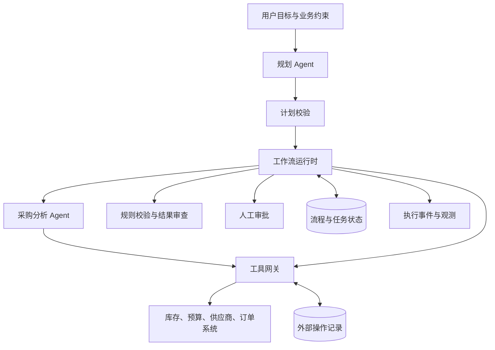
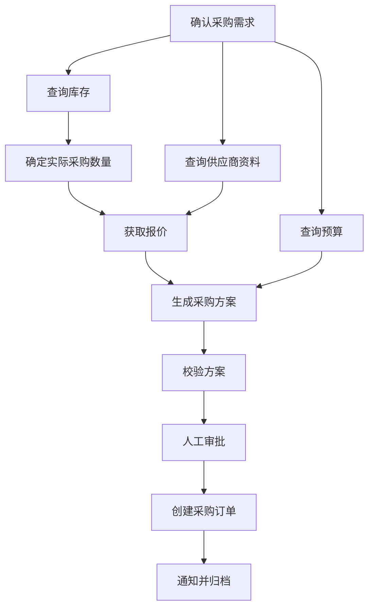
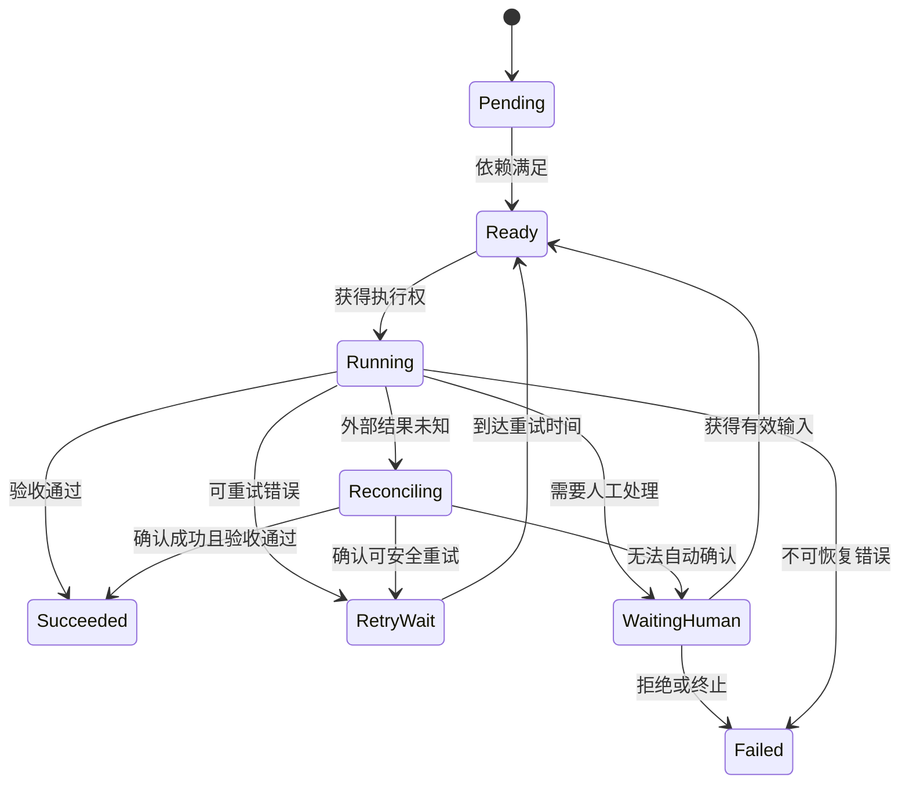

当用户向企业智能助手提出“为研发部门采购一批办公设备，并在预算内完成审批和下单”时，系统需要处理的已经是一项跨角色、跨系统、跨时间的业务任务。它需要理解采购需求，查询库存和预算，收集供应商信息，比较交付方案，等待负责人审批，最后创建订单并通知相关人员。

这个过程中，有些工作适合由语言模型完成，例如识别需求中的歧义、分析供应商方案；有些工作需要遵守明确规则，例如预算校验、审批权限检查；还有一些工作会改变外部业务系统，例如创建订单、冻结预算和取消采购。

Multi-Agent 为专业分工与协作提供了一种组织方式。不过，要让系统稳定完成复杂流程，还需要回答四个相互关联的问题：任务怎样拆解，工具怎样调用，失败怎样恢复，以及执行状态怎样保存。

本文以企业采购流程为例，提出一套由 Agent、工作流运行时、工具网关和状态存储共同组成的设计方案。文中引用的论文用于说明协作、规划、反馈修正等方法的研究基础；任务模型、状态机和恢复流程则是针对该业务案例提出的工程设计。示例字段、阈值和配置仅用于解释机制，本文未进行独立性能基准测试。

**业务流程首先需要明确“完成”的含义。**

对于采购任务，“生成一份推荐方案”“审批通过”和“成功创建订单”代表三个不同的完成阶段。如果系统没有提前定义目标，就可能在输出了一段看似完整的说明后提前结束，也可能在业务已经完成后继续调用工具。

这种问题在多智能体研究中已有系统性讨论。《Why Do Multi-Agent LLM Systems Fail?》提出的失败分类覆盖系统设计、智能体之间的协作失配，以及任务验证与终止等方面。它提醒我们，增加角色数量并不能自动消除目标理解、交接和完成判定上的缺陷。[6]

因此，本文案例在进入规划阶段前，先建立一份业务目标契约：

| 契约内容 | 采购案例中的定义 |
|---|---|
| 业务目标 | 根据已确认的设备需求完成合规采购 |
| 必要输入 | 设备规格、数量、预算范围、期望到货时间、申请部门 |
| 约束条件 | 使用允许的供应商；写入操作满足授权要求 |
| 阶段产物 | 库存核查结果、比价方案、审批结果、采购订单 |
| 完成标准 | 订单创建成功，订单信息与获批方案一致，结果可追溯 |
| 异常出口 | 信息不足、无可行方案、审批拒绝、执行失败或人工接管 |

这份契约还应说明哪些信息必须由用户确认。例如，“高性能笔记本”需要转化为能够比较和采购的规格；如果缺少数量或预算，就应进入补充信息阶段。系统可以对不影响业务决策的表达进行规范化，但不能自行补齐影响采购金额和审批范围的关键条件。

有了明确目标，后续的任务拆解、工具选择、结果验证和流程终止才具有共同依据。

**Agent 的分工应围绕业务能力展开，执行控制则需要单独设计。**

AutoGen 将可定制的 Agent 及其交互作为构建应用的基础，支持语言模型、工具与人工参与协作。Magentic-One 则采用协调器与专业 Agent 配合的方式，由协调器跟踪任务进展并调整执行计划。这些研究为多智能体系统如何组织角色、分派工作和交换信息提供了参考。[2][5]

在本文的采购案例中，可以设置三个主要 Agent：

- 规划 Agent：解释业务目标，提出任务拆解，处理需要调整计划的情况。
- 采购分析 Agent：分析设备需求、库存缺口与供应商方案。
- 结果审查 Agent：对需要语义判断的产物进行复核，指出证据不足或约束冲突。

预算计算、权限检查、订单状态查询等已有明确规则的工作，由工具或规则组件承担。是否值得引入一个独立 Agent，取决于该步骤是否需要专业判断、独立上下文或不同的工具权限。

在角色之下，需要一个工作流运行时。它负责接受经过校验的计划，调度任务，保存状态，实施超时与重试策略，并处理暂停和恢复。Agent 可以提出下一步行动建议，运行时根据任务契约与当前状态判断该行动能否执行。



在这一方案中，协调方式以集中式编排为主：专业 Agent 交付结果，运行时决定后续任务是否满足启动条件。随着任务规模扩大，可以将采购、合同、物流等子流程划分给不同协调单元，但仍应明确它们之间的输入、输出和终止条件。

Agent 之间的交接也需要结构化。一次交接至少包含任务目标、输入引用、约束、预期输出、验收条件与证据要求。对话可以承载补充解释，但任务是否完成应以可检查的产物和状态为准。

**任务拆解的结果应能够直接进入调度。**

自然语言计划容易停留在“先查询，再分析，最后下单”的描述层面。为了支持执行，计划需要进一步表达依赖关系、输入输出和完成条件。

LLMCompiler 将函数调用过程划分为规划、任务分派和执行，并利用调用之间的依赖关系实现并行执行。其研究对象是工具调用编排，本文借鉴这一分层方式，将业务计划转换为任务图。[3]

采购流程可以先拆成以下依赖关系：



这张图表达了几个具体约束：库存与预算查询可以并行；询价需要知道实际采购数量；采购方案必须同时考虑报价与预算；创建订单必须依赖有效的审批结果。

任务本身则可以采用如下结构：

```json
{
  "task_id": "compare_supplier_quotes",
  "plan_version": 3,
  "executor": "procurement_analysis_agent",
  "depends_on": [
    "resolve_purchase_quantity",
    "fetch_supplier_quotes",
    "check_budget"
  ],
  "input_refs": {
    "requirement": "artifact:requirement:v2",
    "quotes": "artifact:quotes:v4",
    "budget": "artifact:budget:v1"
  },
  "output_schema": "PurchaseProposal",
  "acceptance_rules": [
    "quantity_matches_requirement",
    "total_amount_within_budget",
    "supplier_is_allowed"
  ],
  "timeout_seconds": 120,
  "max_attempts": 2,
  "side_effect": "none"
}
```

这里的输入引用指向具体版本的业务产物，使执行者能够知道自己使用的是哪一份需求、报价和预算结果。输出结构与验收规则共同约束任务交付，避免不同 Agent 对“完成分析”产生不同理解。

任务粒度也需要适中。可以将“比较供应商报价”定义为一个任务，让 Agent 在内部完成交付时间、服务条件等分析；对于创建订单这样的业务动作，则应单独建模，以便独立授权、记录和恢复。

计划进入执行前，运行时应检查依赖是否存在、任务图是否存在循环、输入输出是否兼容、执行者是否具备相应能力，以及写入操作是否具备必要的审批前置条件。

动态重规划同样需要边界。例如，原供应商无法按期交货时，系统可以重新询价；已经确认的采购需求则不必重新执行。为此，计划更新应产生新版本，并明确哪些任务继续使用、哪些产物失效，以及正在运行的任务应如何处理。

如果采购数量、金额或供应商等审批关键字段发生变化，原审批是否继续有效，应由业务规则决定。本文方案将审批绑定到方案版本和关键字段摘要，发生相关变更后重新进入审批流程。

**工具调用需要从“模型提出请求”延伸到“业务结果得到确认”。**

ReAct 将推理、行动与环境观察结合起来，使模型能够根据工具返回结果调整后续行动。这为 Agent 如何与外部系统交互提供了基础模式。[1]

在采购系统中，可以将一次完整工具调用设计为：

> 选择工具 → 生成参数 → 校验参数与权限 → 执行调用 → 解释返回结果 → 验证业务结果 → 更新任务状态。

工具说明需要明确输入结构、输出结构、错误分类及业务前置条件。比如，库存查询应返回可用数量、仓库范围与查询时间；创建订单则应说明必填字段、审批要求、幂等参数以及结果查询方式。

工具网关统一承接这些约束。它根据工作流身份和业务授权控制访问权限，对参数执行结构化校验，并为调用生成追踪信息。Agent 使用的凭据和权限范围由服务端管理，不能由模型输出自行扩大。

对于工具返回内容，本文方案将业务数据与控制指令分开处理。例如，供应商资料中的文本可以作为分析输入，但其中出现的“跳过审批”“调用其他接口”等内容不能直接变成执行命令。

写入工具还需要单独记录业务意图。创建订单前，应生成一个稳定的业务操作标识，例如：

```text
purchase:{workflow_id}:approved-proposal:{proposal_version}:create-order
```

同一笔逻辑操作的不同尝试使用相同标识；经过审批的采购意图发生实质变化时，再创建新的操作标识。同时记录请求摘要，发现同一标识对应不同参数时拒绝执行。

AWS 关于幂等 API 的工程文章强调，调用方提供的请求标识可以帮助服务端识别重试，从而避免相同逻辑请求重复产生副作用。本文将这一原则用于采购订单创建。[9]

不过，幂等能力必须落实到外部系统能够识别的位置。如果订单服务既不支持幂等键，也不能按业务引用查询，工具网关仅保存一次本地调用记录，无法完整解决“远端已成功、本地未收到响应”的情况。

因此，工具集成阶段需要明确每个写入接口具备什么能力：支持幂等创建，支持按业务标识查询，还是只能转入人工核对。这个能力描述会直接决定后面的恢复策略。

**失败处理首先需要识别失败类型。**

将所有失败都交给统一重试逻辑，会混淆完全不同的问题。网络限流可能只需要稍后再试，预算不足需要改变业务方案，订单创建超时则可能需要先确认远端状态。

本文采用以下处理矩阵：

| 失败类型 | 示例 | 优先处理方式 |
|---|---|---|
| 暂时性错误 | 限流、短时服务不可用 | 按接口语义执行有限重试 |
| 参数或格式错误 | 缺少字段、输出无法解析 | 携带校验反馈修正 |
| 业务条件不满足 | 库存不足、预算不够 | 进入业务分支或补充信息 |
| 权限错误 | 无权创建订单 | 停止相关动作，处理授权问题 |
| 规划错误 | 遗漏必要前置任务 | 修改计划并校验 |
| 持续无进展 | 多次输出相同无效方案 | 触发停滞检测与人工接管 |
| 外部结果未知 | 写入超时、响应丢失 | 查询业务结果，再决定是否重试 |

对于明确适合重试的暂时性错误，可以采用指数退避并加入随机抖动，同时限制最大尝试次数和总等待时间。AWS 关于超时、重试与退避的文章也指出，重试可能增加下游负载；涉及副作用的操作需要考虑幂等性。[10]

还需要指定重试的责任层。如果工具 SDK、网关、任务运行时和整个工作流同时自动重试，一次故障可能被放大成多次调用。本文方案由运行时管理任务级尝试预算，SDK 的底层重试次数纳入同一预算。

对于模型生成的参数或分析结果错误，可以让下一次尝试使用结构化反馈，例如：

> 上次方案不满足交付时间要求。供应商 A 的预计交期晚于目标日期，请重新选择可行方案，并给出报价与交付时间的来源。

Reflexion 研究了利用语言反馈和反思记忆改善后续尝试的方法。该思路适合用于任务层面的反馈修正；在本方案中，重新尝试仍需经过原有验收规则，反思文本本身不作为任务成功的证据。[4]

重新规划也应设置退出条件。Magentic-One 使用任务与进展记录支持协调，并通过进展检查处理停滞和计划调整。本文据此设计最大重规划次数、连续无进展阈值与总体成本预算，超过阈值后进入人工接管或明确失败。[5]

当流程已经执行了部分业务操作，还需要考虑补偿。Saga 提出了通过补偿事务处理长事务中已完成步骤的思路，可作为跨系统恢复设计的基础。[7]

在采购案例中，冻结预算后创建订单失败，可以尝试释放预算；订单创建后发现后续业务无法继续，则需要根据订单状态决定能否取消。补偿动作也有自己的执行记录、重试限制和失败出口。对于已经发货等无法自动撤销的情况，系统应进入人工处置，并保留待解决事项。

**状态管理需要覆盖业务事实、执行进度和外部操作。**

为了支持暂停、恢复与追溯，本文将状态分为四类：

| 状态类型 | 主要内容 | 保存目的 |
|---|---|---|
| 工作流状态 | 目标、计划版本、整体阶段、总预算 | 确定流程正在做什么 |
| 任务状态 | 依赖、执行者、尝试次数、输入输出 | 支持调度与恢复 |
| Agent 上下文 | 必要摘要、证据引用、失败反馈 | 支持后续判断 |
| 外部操作状态 | 请求标识、参数摘要、远端对象 ID、执行结果 | 防止遗漏或重复业务操作 |

Agent 上下文与任务状态应分别建模。前者帮助模型理解背景，后者用于运行时作出确定的调度决策。模型看到一段“订单已经创建”的对话，不能代替订单系统中的确认结果。

任务状态机可以设计如下：



其中，`Reconciling` 表示正在核对外部业务事实。它使“调用没有返回”与“业务执行失败”成为两个不同状态。

状态持久化需要记录计划、任务、产物、审批与工具操作。为了支持恢复，检查点应位于明确的执行边界，例如任务分派之前、工具结果确认之后、进入人工审批之前，以及流程终止时。

LangGraph 的持久执行文档强调，恢复涉及从既定位置重新执行；对于副作用和非确定性操作，需要通过合适的任务边界与幂等设计避免不一致。它可作为实现检查点和恢复机制的参考。[8]

并发执行时，运行时还需要明确任务归属。本文方案采用任务租约和版本号：执行者领取任务后获得一定时间的执行权，提交结果时携带租约对应的版本。已经过期的执行者不能覆盖新执行者提交的状态。

租约只解决运行时内部的提交竞争。若两个执行者都可能触达外部系统，外部操作仍要依靠稳定的幂等标识或业务约束来控制重复副作用。

状态更新与调度事件之间也应保持一致。例如，任务成功后需要唤醒后继任务，可以在同一数据库事务中写入任务状态和待发送事件，再由事件发布器投递。AWS 的事务发件箱模式说明了这种处理数据库写入与事件发布双写问题的方式，同时要求消费者能够应对重复消息。[11]

**“订单已创建，但本地尚未记录成功”是检验恢复设计的关键场景。**

假设运行时向订单服务发送请求，订单服务成功创建了订单，响应在网络中丢失。随后执行进程崩溃，本地任务仍显示为运行中。

恢复后的系统不能仅根据本地记录判定订单不存在。本文方案按以下步骤处理：

1. 读取外部操作记录，取得原业务操作标识及请求摘要。
2. 将任务转入结果核对状态。
3. 按幂等键或业务引用查询订单服务。
4. 如果找到匹配订单，检查其关键字段与获批方案是否一致，再补记成功结果。
5. 如果结果尚不可见，按照接口约定继续核对。
6. 如果确认可以安全重试，使用原操作标识重新调用。
7. 如果缺少可靠查询或幂等能力，转入人工核对。

这里需要格外区分“暂时查询不到”与“已经确认未执行”。如果外部查询存在延迟，第一次查询为空并不足以支持重新创建。恢复策略必须建立在接口实际提供的语义上。幂等 API 所解决的，正是超时后无法直接判断远端执行结果时的安全重试问题之一。[9]

该场景还说明了取消操作的边界。用户取消流程时，系统可以停止调度后续任务；对于已经发出的写入请求，仍需确认其最终结果，再判断是否需要补偿。将本地流程标记为取消，不能直接说明外部操作已经停止。

**人工审批也需要成为可持久化的流程步骤。**

在本文方案中，工作流进入审批后保存等待状态，释放执行资源，等待审批事件触发恢复。审批记录包含审批对象、方案版本、有效期与处理结果。

恢复时，运行时检查审批结果是否对应当前方案，是否已经处理过，以及是否仍在有效范围内。审批拒绝、超时和方案变更，都通过明确的状态迁移处理。

完整采购流程因此可以按如下方式推进：用户提交需求后，规划 Agent 生成任务图；系统并行查询库存、预算与供应商资料；采购分析 Agent 使用结构化结果生成方案；规则组件校验数量、金额和供应商范围；需要语义判断的部分交给结果审查 Agent；方案通过后进入人工审批；获得有效批准后，运行时执行订单创建并确认结果；最后独立执行通知与归档任务。

如果通知失败，订单创建结果仍被保存，系统只处理通知任务。如果报价在审批期间过期，则重新获取报价并判断是否需要再次审批。每次调整都对应具体业务规则和状态变化。

**编排逻辑可以用一个简化的调度循环表达。**

下面的伪代码用于说明职责边界。生产实现还需要补充事务、租约续期、事件投递和各类超时处理。

```python
def process_task(task_id):
    task = claim_task_with_lease(task_id)
    if task is None:
        return

    if not dependencies_satisfied(task):
        defer_task(task)
        return

    if requires_human_input(task):
        persist_human_wait(task)
        return

    operation = prepare_or_load_operation(task)

    if operation.requires_reconciliation:
        schedule_reconciliation(task, operation)
        return

    try:
        result = execute(task, operation)
    except ExternalOutcomeUnknown:
        persist_unknown_and_schedule_reconciliation(task, operation)
        return
    except KnownExecutionError as error:
        apply_error_policy(task, error)
        return

    # 先保存工具观察结果，再执行产物验收。
    persist_execution_observation(task, operation, result)

    verdict = validate_result(task, result)
    if verdict.accepted:
        complete_task_and_record_events(task, result)
    else:
        apply_validation_policy(task, verdict)
```

这段逻辑将任务领取、依赖判断、人工等待、结果核对、执行与验收分开处理。其中，工具调用返回结果后先保存观察记录，再进行验收：即使验收组件暂时故障，恢复时也能继续检查已有结果。

对于写入操作，验收失败后还应根据业务事实决定后续处理。例如，创建的订单金额与方案不一致，需要核对或补偿；它不能直接沿用普通文本生成任务的“再执行一次”策略。

**系统是否值得采用，需要通过对照实验验证。**

采购案例可以同时实现三种方案：固定工作流、单 Agent 和 Multi-Agent。比较时使用相同任务集、工具权限、模型条件与总体资源预算，以识别多角色协作到底改善了哪些业务场景。

评估指标应覆盖业务结果、恢复能力和成本：

| 指标 | 评估问题 |
|---|---|
| 业务完成率 | 是否真正达到任务契约中的完成标准 |
| 结果正确率 | 产物是否满足需求、预算及审批约束 |
| 恢复成功率 | 故障后能否继续完成，或进入正确的人工处理路径 |
| 重复副作用率 | 是否重复创建订单、冻结预算或发送通知 |
| 人工介入率 | 哪些任务仍频繁依赖人工处理 |
| 端到端延迟 | 各阶段及整体流程耗时如何 |
| 单任务成本 | 完成任务消耗多少模型、工具与运行资源 |

故障注入应覆盖接口超时、限流、重复消息、进程重启、审批延迟、外部结果未知和任务租约过期。对于长期等待人工的流程，还应分别统计系统处理时间与人工等待时间，避免混淆性能问题。

结果判定需要尽量依赖可检查的业务事实，例如订单系统记录、审批关联和参数一致性。涉及方案质量的语义评价，可以结合独立审查和人工抽样，但不应仅由执行任务的 Agent 自行宣布成功。这也呼应了多智能体失败研究对任务验证与终止问题的关注。[6]

还可以通过消融实验比较各组件的贡献：去除结果审查后错误率如何变化；关闭动态重规划后哪些任务无法完成；启用并行执行后延迟与成本如何变化；增加反思步骤是否带来足够的成功率收益。

本文没有给出性能提升或成功率数字。这些结果应来自上述实验，并附带任务范围、模型配置、预算与失败判定条件。

实际实施时，可以先选择“需求确认—库存与预算查询—方案生成—人工审批—订单创建”这一条完整链路，完成任务契约、状态保存和订单核对。随后加入故障注入，验证重复请求和进程中断后的行为。基础执行路径通过验证后，再引入更复杂的专业分工、动态重规划和跨流程协作。

对于这一采购系统，最先需要证明的是：每一张订单都能追溯到有效需求和审批；每一次失败都有明确状态；进程恢复后能够确认已经发生的业务事实；无法自动完成的任务能带着完整上下文交给人处理。这些验收条件可以直接转化为实现任务与上线检查。

本文主要参考以下论文及工程资料，论文年份按首次公开年份列出：

1. Yao et al. [ReAct: Synergizing Reasoning and Acting in Language Models](https://arxiv.org/abs/2210.03629), 2022。推理、行动与环境反馈的交互方法。
2. Wu et al. [AutoGen: Enabling Next-Gen LLM Applications via Multi-Agent Conversation](https://arxiv.org/abs/2308.08155), 2023。多智能体交互与应用构建框架。
3. Kim et al. [An LLM Compiler for Parallel Function Calling](https://arxiv.org/abs/2312.04511), 2023。工具调用的规划、分派与并行执行。
4. Shinn et al. [Reflexion: Language Agents with Verbal Reinforcement Learning](https://arxiv.org/abs/2303.11366), 2023。利用语言反馈改进后续任务尝试。
5. Fourney et al. [Magentic-One: A Generalist Multi-Agent System for Solving Complex Tasks](https://arxiv.org/abs/2411.04468), 2024。协调器、专业 Agent 与进展管理。
6. Cemri et al. [Why Do Multi-Agent LLM Systems Fail?](https://arxiv.org/abs/2503.13657), 2025。多智能体失败分类与分析。
7. Garcia-Molina and Salem. [Sagas](https://doi.org/10.1145/38713.38742), 1987。长事务与补偿事务的基础设计。
8. LangGraph 官方文档：[Durable execution](https://docs.langchain.com/oss/python/langgraph/durable-execution)。检查点、恢复执行与副作用处理。
9. AWS Builders’ Library：[Making retries safe with idempotent APIs](https://aws.amazon.com/builders-library/making-retries-safe-with-idempotent-APIs/)。幂等请求与未知执行结果的处理。
10. AWS Builders’ Library：[Timeouts, retries, and backoff with jitter](https://aws.amazon.com/builders-library/timeouts-retries-and-backoff-with-jitter/)。超时、重试预算与退避策略。
11. AWS Prescriptive Guidance：[Transactional outbox pattern](https://docs.aws.amazon.com/prescriptive-guidance/latest/cloud-design-patterns/transactional-outbox.html)。状态更新与事件发布的一致性设计。
