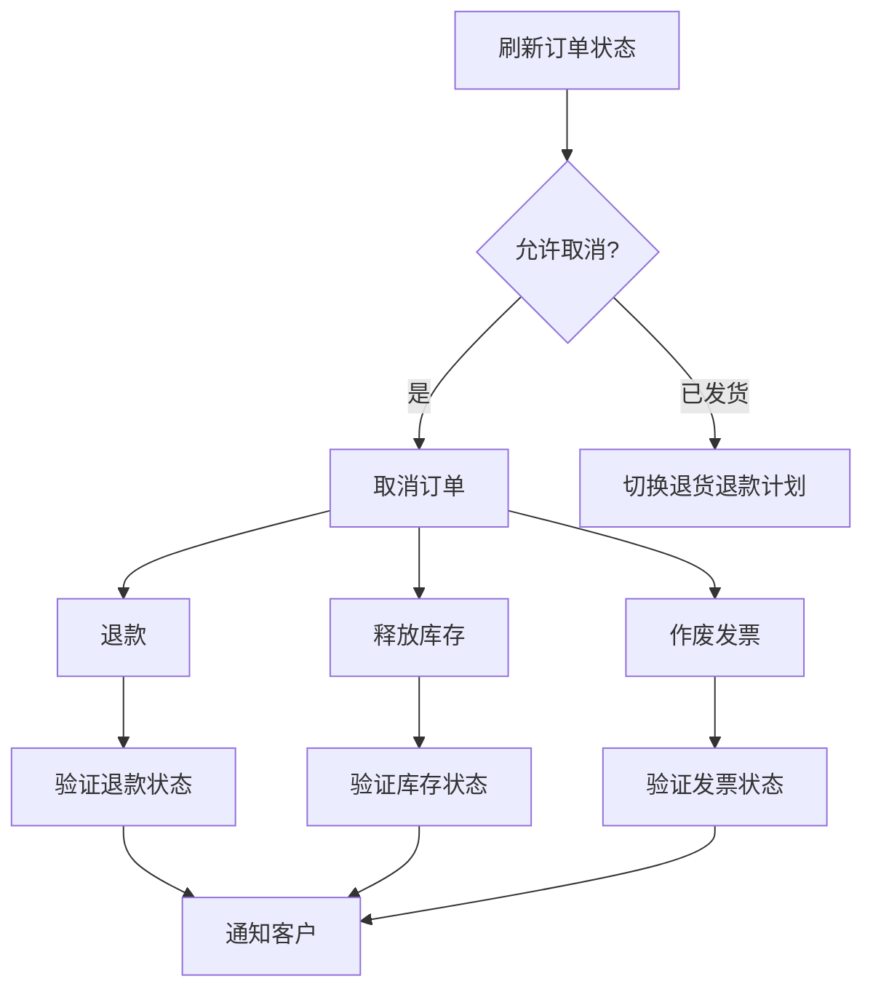
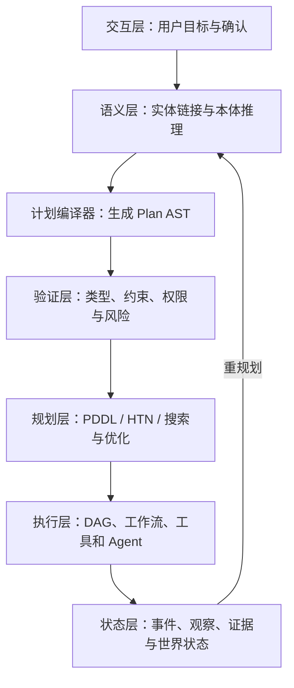

用户对企业智能体说：

> “取消订单 O-1001，退回已支付款项，释放库存，并通知客户。”

从语言上看，这是一条清楚的指令。但如果智能体直接根据这句话连续调用几个接口，马上会遇到一组没有写在句子里的问题：

- O-1001 指的是销售订单、采购订单，还是售后单？
- 订单是否已经发货，当前状态是否允许取消？
- 退款应退到原支付渠道，还是企业余额？
- 取消订单、释放库存、作废发票和退款之间有什么依赖关系？
- 哪些步骤可以并行，哪些步骤必须等待前一步提交？
- 高金额退款是否需要审批？
- 如果订单取消成功而退款超时，应该重试、补偿，还是转人工？
- 执行完成后，怎样证明目标真的达成，而不是接口只返回了 `200 OK`？

大语言模型擅长理解这句话，也能生成一段看起来合理的步骤；传统规划器擅长在明确的状态、动作和约束上搜索路径；本体擅长定义领域对象、关系和可推导知识；工作流与运行时则擅长可靠执行。真正困难的地方，是怎样把这些能力连接成一条可检查的链路。

本文提出一个工程化视角：在自然语言目标与执行运行时之间，引入一种称为 **Plan AST** 的结构化计划中间表示。本体负责提供语义、类型、状态和动作约束，Plan AST 负责保存计划的控制结构和依赖关系，规划器负责搜索可行或最优路径，运行时负责执行、观察与重规划。

先说明术语边界：

> **Plan AST 并不是当前自动规划领域已经统一定义的学术标准。** 它是本文综合 Ontology-Mediated Planning、PDDL、TIC、HTN、行为树与 LLMCompiler 后提出的工程中间表示。PDDL 是规划领域描述语言，不等同于 AST；它可以是 Plan AST 的编译目标之一。

这一区分很重要。本文不是把编程语言的源码 AST 生硬搬进 Agent，而是借用编译器的核心思想：先将概率性的语言理解结果转换成结构化中间表示，再做类型检查、约束验证、优化和执行。

---

## 一、为什么自然语言计划不能直接执行

自然语言计划常常把目标、事实、约束和动作混在一起。

例如“取消订单并尽快退款，但不能影响已经发出的包裹”，至少包含：

- **目标**：订单最终处于已取消状态，款项最终已退回；
- **事实**：存在一个订单以及与之关联的支付、库存和物流对象；
- **硬约束**：已经发货时不能直接取消；
- **偏好**：退款越快越好；
- **隐含动作**：查询订单、检查物流、取消订单、释放库存、发起退款、发送通知。

如果只让模型输出一串文本步骤，系统很难回答三个基本问题。

### 1. 这条计划是否合法

模型可能在订单已发货后仍调用取消接口，可能使用不存在的退款渠道，也可能把客户 ID 填进支付单号字段。语言上通顺，并不意味着类型、权限和业务约束正确。

### 2. 这条计划能否到达目标

“已经调用退款接口”不是“退款完成”。动作是否改变了世界状态，需要由动作效果、外部观察和目标条件共同判断。只记录动作名称，无法证明最终状态满足目标。

### 3. 发生变化后怎样修复

企业环境不是静态棋盘。计划生成后，订单可能被仓库锁定，库存可能已经出库，支付渠道可能超时。没有显式依赖、前置条件和观察点，系统只能从头让模型再猜一次。

对大模型规划能力的系统研究也支持这种谨慎。Valmeekam 等人在 NeurIPS 2023 的研究中发现，在其实验设置下，表现最好的 GPT-4 自主生成可执行计划的平均成功率约为 12%；PlanBench 进一步用自动规划领域和混淆命名测试模型，减少模型依赖常识记忆“猜答案”的空间。[7][8]

这并不说明 LLM 对规划没有价值，而是说明它更适合承担语义翻译、候选生成、启发式建议和解释，而不应单独承担所有正确性责任。

---

## 二、把 Agent 规划看成一次编译

如果把用户目标视为一种高层“源语言”，Agent 规划就可以类比为编译过程：

```text
自然语言目标      ≈ 源语言
领域本体          ≈ 类型系统、符号表与领域库
Plan AST          ≈ 中间表示 IR
路径搜索          ≈ 优化器
PDDL / 任务 DAG   ≈ 低层执行表示
工具调用          ≈ 目标指令
执行环境          ≈ 运行时
观察与重规划      ≈ 异常处理与动态编译
```

这个类比的重点不是名称，而是职责分离。

语言模型不必一次性生成最终调用序列。它先把用户意图翻译成结构化目标，并完成实体链接；本体补充对象类型、关系、动作签名和约束；规划器搜索满足目标的动作路径；Plan AST 保存顺序、并行、分支、观察与补偿结构；验证器拒绝非法计划；运行时只执行通过检查的节点。

LLM+P 已经展示了类似分工：LLM 将自然语言问题转换成 PDDL，经典规划器负责求解，再把规划结果转回自然语言。[6] TIC 又向前推进了一步：它不要求 LLM 直接生成最终 PDDL，而是让模型先生成逻辑可解释的中间表示，再用 ASP 推导隐含信息，最后确定性地编译成 PDDL。[5]

因此，Plan AST 的直接动机可以概括为：

> 不让概率模型同时负责理解、表示、推理、搜索、格式正确性和执行控制，而是在它们之间建立可检查的中间边界。

---

## 三、本体、Plan AST 与规划路径分别负责什么

这三个概念经常被混在一起，但它们回答的是不同问题。

| 层次 | 核心问题 | 典型内容 | 不应该承担的职责 |
| --- | --- | --- | --- |
| 本体 | 这个领域中有什么，语义是什么 | 对象类型、关系、状态、约束、动作签名、权限 | 保存某次任务的完整执行轨迹 |
| Plan AST | 这次任务准备怎样执行 | 顺序、并行、分支、观察、重试、补偿、变量绑定 | 自己完成全局路径搜索 |
| 规划器 | 从初始状态到目标有哪些路径 | 状态转移、启发式搜索、代价优化、可达性 | 直接调用真实业务系统 |
| 运行时 | 如何可靠地执行选定路径 | 调度、幂等、超时、日志、人工审批、状态回写 | 临时发明领域规则 |

### 1. 本体是领域语义与约束层

本体至少要告诉系统：

- `SalesOrder`、`Payment`、`InventoryReservation` 分别是什么类型；
- 订单通过什么关系关联支付单和库存预留；
- `PAID`、`SHIPPED`、`CANCELLED` 等状态的含义；
- `cancelOrder` 接收什么对象，要求什么前置条件，会产生什么效果；
- 哪些状态可以推导，哪些事实必须从外部系统观察；
- 谁有权执行动作，何时需要审批。

OWL 本体擅长表达类、属性、公理与开放世界下的推理。但企业动作、事务边界、API 映射和运行时策略未必都适合只用 OWL 表达。因此工程上的“可执行本体”通常是组合体：

```text
可执行本体
= 领域概念与关系
+ 状态与规则
+ 动作契约
+ 权限策略
+ 数据和工具映射
```

### 2. Plan AST 是一次计划的结构化快照

AST 的价值在于结构。Plan AST 不只保存动作列表，还应保存：节点类型、输入输出、变量绑定、前置条件、预期效果、顺序依赖、分支条件、观察点、重试与补偿策略、权限和本体版本。

### 3. 规划路径是搜索结果，不只是流程图

给定初始状态 `S0`、目标条件 `G`、动作集合 `A` 和代价函数 `C`，规划器要找到动作序列或偏序计划 `π`，使得：

```text
Apply(S0, π) ⊨ G
```

如果还要找低成本方案，则进一步求：

```text
π* = argmin C(π)
```

这里的成本不一定只是调用次数，还可以综合延迟、金额风险、人工审批、资源占用和失败概率。

---

## 四、最大的语义裂缝：开放世界与封闭世界

把本体接到规划器上，最容易忽略的不是语法转换，而是语义差异。

OWL 通常采用**开放世界假设**：知识库中没有“订单已发货”，不代表订单没有发货，只能说明当前不知道。经典 PDDL 规划通常采用**封闭世界假设**：初始状态中没有列出的命题，往往被视为假。

假设本体中没有下面的事实：

```text
shipped(O-1001)
```

在开放世界中，结论是“发货状态未知”；如果编译时直接把它变成 PDDL 中的 `not shipped`，规划器就可能选择取消订单，造成危险决策。

因此，本体到规划状态之间必须有一个明确的**状态投影边界**：

1. 选出本次规划真正需要的有限对象和谓词；
2. 将可通过本体推理得到的事实物化；
3. 区分 `true`、`false` 与 `unknown`；
4. 对关键未知事实插入观察动作，而不是擅自当作假；
5. 只有在某个局部范围满足完备性声明时，才允许封闭世界化。

```ts
type TruthValue = "true" | "false" | "unknown";

type GroundedFact = {
  predicate: string;
  arguments: string[];
  value: TruthValue;
  source: string;
  observedAt: string;
};
```

如果 `shippingStatus(O-1001)` 为 `unknown`，编译器生成的不是 `not shipped`，而是一个 `Observe` 节点：查询物流系统并刷新状态。只有拿到可验证结果后，计划才进入下一分支。

John 与 Koopmann 提出的 Ontology-Mediated Planning 正面处理了本体与规划形式系统的结合。他们强调本体和规划问题之间保持清晰接口，并将包含 OWL-DL 本体的规划规范重写到 PDDL，从而复用现有规划器。[4] 这一工作证明“本体推理后再编译到规划语言”是一条可行路线，也提醒工程实现不能把 RDF 三元组机械替换成 PDDL 谓词。

---

## 五、Plan AST 应该有哪些节点

一个实用的 Plan AST 不需要复刻所有编程语言语法，但要覆盖 Agent 任务的主要控制结构。

| 节点 | 含义 | 典型用途 |
| --- | --- | --- |
| `Goal` | 声明最终必须满足的状态 | 订单已取消且退款完成 |
| `Action` | 调用一个有契约的领域动作 | `cancelOrder(order)` |
| `Observe` | 从环境读取不可安全推导的事实 | 查询物流、查询退款状态 |
| `Sequence` | 子节点按顺序执行 | 检查后再取消 |
| `Parallel` | 无依赖的子节点并行执行 | 释放库存与作废发票 |
| `Choice` | 根据条件选择分支 | 已发货则转退货流程 |
| `Guard` | 执行前必须成立的条件 | 操作者拥有退款权限 |
| `Join` | 等待多个分支达到条件 | 退款、库存处理均完成 |
| `Retry` | 按策略重试可恢复失败 | 支付渠道瞬时超时 |
| `Compensate` | 处理部分提交后的业务恢复 | 释放失败时创建人工工单 |
| `Approval` | 暂停并等待人工或策略批准 | 大额退款审批 |
| `Replan` | 在局部状态变化后重新求解 | 发现订单已进入出库流程 |

一个简化的类型定义可以写成：

```ts
type PlanNode =
  | GoalNode
  | ActionNode
  | ObserveNode
  | SequenceNode
  | ParallelNode
  | ChoiceNode
  | GuardNode
  | ApprovalNode
  | ReplanNode;

type ActionNode = {
  kind: "Action";
  id: string;
  actionType: string;
  inputs: Record<string, ValueRef>;
  preconditions: Predicate[];
  expectedEffects: Predicate[];
  policy: {
    timeoutMs: number;
    maxAttempts: number;
    idempotencyKey: string;
  };
};
```

Plan AST 还应是强类型的。假设本体中的动作签名为：

```text
refundPayment(payment: Payment, amount: Money) -> Refund
```

那么下面的绑定必须在执行前被拒绝：

```text
refundPayment(payment = O-1001, amount = customerId)
```

因为 `O-1001` 是 `SalesOrder`，不是 `Payment`；`customerId` 也不是 `Money`。错误应在运行前成为确定的诊断，而不是线上副作用。

---

## 六、从自然语言目标到可执行路径

完整管线可以分为八步。


### 第一步：把语言变成目标，而不是直接变成动作

对于“取消订单 O-1001，退回已支付款项”，语言模型首先输出目标条件和用户约束：

```json
{
  "intent": "CancelOrderAndRefund",
  "entities": {
    "order": { "type": "SalesOrder", "externalId": "O-1001" }
  },
  "goal": {
    "allOf": [
      { "predicate": "orderStatus", "equals": "CANCELLED" },
      { "predicate": "paymentStatus", "equals": "REFUNDED" },
      { "predicate": "inventoryReserved", "equals": false }
    ]
  },
  "preferences": ["minimize_completion_time"]
}
```

这一步只描述“想要什么”，不提前锁死“怎样做”。否则模型生成的第一条路径会限制后续规划器的搜索空间。

### 第二步：实体链接与本体接地

系统将 `O-1001` 解析为唯一业务对象，并沿本体关系找到关联对象：

```text
SalesOrder(O-1001)
hasPayment(O-1001, P-9001)
hasReservation(O-1001, R-3008)
hasInvoice(O-1001, I-7712)
```

### 第三步：构造规划状态

状态构造不是把整个知识图谱复制给规划器，而是围绕目标做相关性裁剪。订单取消只需要加载订单、支付、库存、物流、发票、权限与策略相关事实。每条事实都应携带来源与新鲜度。

### 第四步：生成高层 Plan AST

```text
Goal: cancelled(order) ∧ refunded(payment) ∧ released(reservation)

Sequence
├── Observe: refreshOrderAndShippingState
├── Choice
│   ├── when cancellable(order): PlanSlot(CancelBeforeShipment)
│   ├── when shipped(order): PlanSlot(ReturnAndRefund)
│   └── otherwise: Escalate(ManualReview)
└── Verify: goalSatisfied
```

### 第五步：做静态检查

在路径搜索前，编译器检查对象存在性、参数类型、调用权限、目标一致性、动作契约、审批要求，以及关键未知状态是否存在观察节点。

### 第六步：搜索并优化路径

规划器根据动作前置条件和效果展开状态空间。搜索得到的可能不是唯一方案：

```text
方案 A：取消订单 -> 退款 -> 释放库存 -> 通知
方案 B：取消订单 -> [退款 || 释放库存 || 作废发票] -> 通知
方案 C：审批 -> 取消订单 -> [退款 || 释放库存] -> 通知
```

如果分支之间没有数据或业务依赖，方案 B 的关键路径更短；如果退款金额超过阈值，方案 C 才合法。路径选择必须服从硬约束，再在合法集合中优化软目标。

### 第七步：降低为执行 DAG

规划器给出的动作序列可以进一步做依赖分析。LLMCompiler 将函数调用分成 Planner、Task Fetching Unit 和 Executor，并根据依赖关系并行调度；论文报告在其实验任务上，相对 ReAct 获得最高 3.7 倍延迟加速、6.7 倍成本节省以及约 9% 的准确率提升。[9]



### 第八步：执行后验证目标

执行成功不能只看工具返回值。每个关键动作后要读取权威系统状态，并将观察结果写回世界状态：

```text
API accepted ≠ effect committed
effect committed ≠ business goal satisfied
```

只有当目标谓词重新求值为真，任务才能结束。

---

## 七、完整案例：取消订单与退款

### 1. 本体中的对象与动作

领域对象包括 `SalesOrder`、`Payment`、`InventoryReservation`、`Shipment`、`Invoice` 和 `Customer`。动作契约可以描述为：

```text
cancelOrder(order)
  pre: order.status in {CREATED, PAID}
       and not shipment.dispatched
  effect: order.status = CANCELLED

refundPayment(payment, amount)
  pre: payment.status = CAPTURED
       and linkedOrder.status = CANCELLED
  effect: payment.status = REFUND_PENDING

releaseReservation(reservation)
  pre: linkedOrder.status = CANCELLED
       and reservation.status = ACTIVE
  effect: reservation.status = RELEASED

voidInvoice(invoice)
  pre: linkedOrder.status = CANCELLED
       and invoice.status = ISSUED
  effect: invoice.status = VOID
```

注意，`refundPayment` 的即时效果是 `REFUND_PENDING`，不是 `REFUNDED`。支付渠道通常是异步系统，最终状态需要观察或接收事件。

### 2. 降低后的 Plan AST

```text
Goal CancelAndRefund(O-1001)
└── Sequence
    ├── Observe refresh(order, payment, shipment, reservation, invoice)
    ├── Guard actor.canCancel(order)
    ├── Choice
    │   ├── when shipment.dispatched
    │   │   └── Replan goal=ReturnAndRefund
    │   └── when order.cancellable
    │       └── Sequence
    │           ├── Action cancelOrder(O-1001)
    │           ├── Parallel join=all
    │           │   ├── Sequence
    │           │   │   ├── Action refundPayment(P-9001)
    │           │   │   └── Observe until payment=REFUNDED
    │           │   ├── Action releaseReservation(R-3008)
    │           │   └── Action voidInvoice(I-7712)
    │           └── Action notifyCustomer(C-1024)
    └── Observe verifyGoal
```

这棵树明确表达：状态刷新先于写操作；发货状态决定业务路径；取消成功是三个后续分支的共同前置条件；无冲突分支可以并行；退款必须观察到终态；结束前还要验证整体目标。

### 3. 如果退款失败怎么办

“失败就回滚”在跨系统业务中通常不现实。订单系统已经提交取消后，支付系统失败，数据库事务无法跨越两个系统自动回滚。更合理的是 Saga 式恢复策略：

1. 对可恢复错误按退避策略重试，始终使用同一幂等键；
2. 查询支付渠道，排除“请求超时但实际已受理”；
3. 达到重试上限后创建退款异常任务；
4. 将订单标记为 `CANCELLED_REFUND_PENDING`；
5. 通知客户退款处理中，而不是错误地声称已退款；
6. 由事件或人工处理继续推进，直到目标满足。

这说明 `Compensate` 并不总是“执行一个反向动作”。它也可能是进入一种受治理的中间状态，并确保任务不会静默丢失。

### 4. 局部重规划，而不是全盘重来

如果执行到一半发现发票作废接口暂时不可用，退款与库存释放的结果不应被丢弃。运行时应该冻结已经提交的效果，以当前世界状态作为新的 `S0`，只对未满足的子目标重新求解：

```text
已满足：cancelled(order), refunded(payment), released(reservation)
未满足：void(invoice), customerNotified(customer)
```

新的规划问题只包含剩余目标。这样能减少重复副作用，也让恢复过程可解释。

---

## 八、PDDL、HTN、行为树和 DAG 如何分工

Plan AST 不应该试图替代所有规划与执行表示。更实用的方式是把它作为统一上层 IR，根据任务性质编译到不同后端。

### 1. PDDL：适合状态空间搜索

PDDL 用谓词描述状态，用动作的前置条件和效果描述状态转移，适合回答“有哪些动作组合能从当前状态到达目标”。[1][2] 它适合动作模型清楚、初始状态有限且需要可行性或代价优化的任务，但不直接负责长时间运行的异步事务、人工审批、幂等和工具可观测性。

### 2. HTN：适合领域方法分解

HTN 将高层任务逐层分解成更具体的子任务。SHOP2 是这一方向的代表系统之一。[3] 当企业已经有稳定 SOP 时，“取消订单”通常不是任意搜索，而是按照订单类型、履约状态和金额选择不同分解方法，HTN 会比纯状态空间搜索更自然。

### 3. 行为树：适合反应式执行

行为树通过 Sequence、Fallback、Parallel 等控制节点组织行为，广泛用于机器人和游戏 AI。[13] 它适合反复 tick、持续观察环境，并在条件变化时快速切换行为。

### 4. DAG：适合工具依赖与并行调度

DAG 明确表示数据依赖和就绪条件，适合企业工具调用、批处理和多 Agent 调度。它不负责发现所有可达路径，但非常适合执行已经选定的偏序计划。

| Plan AST 子集 | 编译目标 | 主要职责 |
| --- | --- | --- |
| 目标、谓词、动作效果 | PDDL | 搜索可行或最优动作路径 |
| 高层任务与方法 | HTN | 复用领域 SOP 和分解知识 |
| 条件、观察、回退 | 行为树 | 动态环境中的反应式控制 |
| 动作与数据依赖 | DAG | 并行调度和可靠执行 |
| 补偿与人工任务 | 工作流引擎 | 长事务、等待和恢复 |

Plan AST 的作用不是强行统一底层语义，而是让上层目标、类型、来源和控制结构有一个稳定载体。

---

## 九、静态验证：执行前应该查出什么

Plan AST 一旦结构化，就可以像编译器检查程序一样检查计划。

### 1. 类型与绑定检查

检查动作输入是否与本体类型兼容、输出变量是否正确绑定、金额与时间是否满足值域，以及一个对象是否被错误地当成另一个对象使用。

### 2. 前置条件与效果检查

检查初始状态是否满足前置条件；如果不满足，前序节点的效果能否使其成立；关键事实未知时是否有观察节点；某个动作是否破坏已经满足的硬目标；最终是否存在路径覆盖全部目标谓词。

### 3. 控制流检查

检查分支是否完备、DAG 是否有环、`Parallel` 的汇合条件是否明确、重试是否有上限、补偿是否引用已经发生的效果，以及重规划是否会重复执行非幂等动作。

### 4. 治理检查

检查动作是否超出 Agent 授权范围、高风险动作是否有审批、敏感字段是否被传给不允许的工具，以及本体、策略和工具 Schema 版本是否兼容。

验证器不必证明整个现实世界，但至少应保证：在声明的抽象和动作契约成立时，这条计划在结构上是合法的。

---

## 十、运行时闭环：计划不是执行日志

Plan AST 是意图和预期路径，执行轨迹是现实中实际发生的事件。二者必须分开保存。

```text
Plan AST:      计划做什么、为什么这样依赖
Execution Log: 实际调用了什么、返回了什么
World State:   当前被确认的事实是什么
```

如果把工具返回直接覆盖计划节点，就会失去“预期与实际”的差异，无法判断偏离发生在哪里。运行时每执行一个节点，应产生结构化事件：

```json
{
  "planId": "plan-7842",
  "nodeId": "refund-payment",
  "attempt": 2,
  "status": "SUCCEEDED",
  "toolCallId": "call-9321",
  "startedAt": "2026-10-28T10:03:12Z",
  "finishedAt": "2026-10-28T10:03:14Z",
  "observedEffects": [
    { "predicate": "paymentStatus", "value": "REFUND_PENDING" }
  ]
}
```

ReAct 把推理、行动与观察放进循环，让模型能根据外部结果决定下一步。[10] SayCan 将语言模型给出的技能相关性与技能可执行性结合；Inner Monologue 则展示环境反馈如何进入高层规划循环。[11][12] 这些研究共同说明，计划不能在执行前一次性封死，外部观察必须持续校正内部状态。

生产系统还需要更严格的机制：用事件存储保存状态转移，用幂等键避免重复副作用，用检查点支持断点恢复，用版本号固定本体与工具契约，用目标谓词判断完成，并只把发生变化的子图交给局部重规划。

---

## 十一、工程架构如何落地

一套可实施的系统可以分成七层。



- **语义层**维护领域对象、关系、规则、动作目录和实体标识，提供推理、状态投影与版本管理。
- **计划编译器**接收结构化目标，生成高层 Plan AST，完成变量绑定、节点正规化、宏展开和后端选择。
- **验证层**运行确定性的类型、约束、权限和控制流检查，并返回机器可读诊断。
- **规划层**根据问题选择经典规划、HTN、约束求解或规则，输出动作序列、偏序计划或候选路径。
- **执行层**将低层 Plan AST 降低为 DAG、行为树或持久化工作流，负责调度、超时、重试、人工任务和补偿。
- **状态层**将工具结果转换为可验证事实，维护事实来源、时间戳和新鲜度。
- **治理层**贯穿所有层，记录目标、实体解析、本体版本、规划候选、验证结果、执行事件和最终证据。

系统中至少需要四个不同标识：

```text
goalId       一次业务目标
planId       目标对应的某个计划版本
executionId  某次计划执行
toolCallId   某个节点的一次外部调用
```

这样才能区分“同一目标重新规划”“同一计划恢复执行”和“同一动作重试”。

---

## 十二、常见误区

### 误区一：把 PDDL 直接叫作 Plan AST

PDDL 是形式化规划语言。AST 是某种语言或计划结构在程序内的表示。PDDL 可以解析成 AST，也可以由 Plan AST 编译得到，但二者不能直接画等号。

### 误区二：把知识图谱中的每条边都交给规划器

规划器需要任务相关、有限且语义明确的状态投影。把整张图复制成谓词会造成状态爆炸，也会把描述性关系误当成可变化状态。

### 误区三：把本体当作数据库 Schema

数据库 Schema 能说明字段类型，却通常不能表达业务概念等价、跨系统实体、可推导关系、动作语义和权限策略。反过来，本体也不负责替代事务数据库。

### 误区四：让 LLM 直接生成最终执行 JSON

这会把语义解析、动作选择、参数绑定、依赖调度和异常策略压在一次采样上。即使 JSON 语法正确，也无法保证业务正确。

### 误区五：把“工具调用成功”当作“目标完成”

接口成功只说明请求被接收。目标完成必须通过权威状态和目标谓词再次验证。

### 误区六：所有失败都从头重规划

已经提交的外部副作用不能被遗忘。重规划必须以最新世界状态为起点，冻结已确认效果，只求解未满足目标。

### 误区七：过早设计一个万能 Plan AST

IR 应从真实执行后端和验证需求反推。第一版覆盖 `Action`、`Observe`、`Sequence`、`Parallel`、`Choice`、`Guard` 和 `Approval`，通常就能支撑大量企业任务。

---

## 十三、怎样评估这套系统

只统计最终回答是否“看起来正确”远远不够。评估应覆盖六个层面。

| 层面 | 指标示例 |
| --- | --- |
| 语义接地 | 实体链接准确率、目标谓词准确率、未知状态识别率 |
| 计划合法性 | 类型通过率、前置条件违规率、权限违规拦截率 |
| 规划质量 | 可达率、最优性差距、计划长度、搜索时间 |
| 执行质量 | 目标达成率、节点成功率、重复副作用率、恢复时间 |
| 系统效率 | 端到端延迟、并行度、模型调用次数、工具调用成本 |
| 治理质量 | 可解释覆盖率、证据完整率、人工升级准确率、审计可重放率 |

测试集不能只有正常路径，还要包含缺失事实、冲突知识、工具 Schema 变化、并行写冲突、超时但实际提交、执行中状态变化、缺少审批、服务重启、目标不可达和用户中途修改目标。

PlanBench 的启发在于，规划能力应被拆成可机械验证的子能力，而不是只凭几个演示案例判断。[8] 企业系统也应建设自己的领域 PlanBench：固定本体版本、初始状态、目标、合法路径和故障注入，再持续比较不同模型、规划器和编译策略。

---

## 十四、渐进式落地路线

### 第一阶段：结构化，但不自动执行

让模型把目标转换成 Plan AST，系统只做类型检查、约束检查和可视化，由人确认后执行。此时主要验证表示能否覆盖真实业务。

### 第二阶段：受控动作与确定性编排

接入少量低风险、幂等工具。使用规则或 HTN 选择路径，用 DAG 执行。先把权限、审计、幂等和状态回写做牢。

### 第三阶段：引入规划器和多后端编译

对存在多条可行路径、资源竞争或代价权衡的场景，引入 PDDL、约束求解或优化器。Plan AST 根据任务编译到不同后端。

### 第四阶段：闭环观察与局部重规划

建立实时世界状态、事件驱动观察和检查点恢复。只有到这一步，系统才真正具备面对动态环境的持续规划能力。

每一阶段都应保留同一条原则：

> 模型负责处理模糊性，符号系统负责表达约束，规划器负责搜索，运行时负责兑现，观察系统负责把现实带回计划。

---

## 十五、研究脉络：这些论文分别解决了哪一段

“本体 + Plan AST + 规划路径”不是来自单篇论文，而是多条研究路线的交汇。

| 研究工作 | 主要贡献 | 对本文架构的启发 |
| --- | --- | --- |
| STRIPS / PDDL | 用前置条件和效果描述状态转移 | 计划必须建立在显式世界模型上 |
| SHOP2 / HTN | 用领域方法分解高层任务 | 稳定 SOP 可以作为可复用规划知识 |
| Planning with OWL-DL Ontologies | 将 OWL-DL 本体介导的规划重写到 PDDL | 本体与规划器之间需要严格接口和编译层 |
| LLM+P | LLM 翻译问题，经典规划器求解 | 语言理解与路径搜索应分工 |
| TIC | 先生成逻辑 IR，再推理并编译 PDDL | 中间表示能降低直接生成形式语言的错误 |
| PlanBench | 系统评估 LLM 的规划与变化推理能力 | 计划必须使用可执行性与目标达成来评测 |
| LLMCompiler | 将工具调用组织成可并行依赖图 | 规划结果还需要依赖分析和执行优化 |
| ReAct / SayCan / Inner Monologue | 将行动可行性与环境观察带回推理循环 | 执行必须是观察驱动的闭环 |
| PlanOwl | 从 OWL 和视觉环境生成 PDDL | 本体、感知与实例级规划问题可以自动连接 |

PlanOwl 把 OWL 中的领域结构与视觉语言模型识别出的环境实例结合，用于生成 PDDL 领域和问题文件。[15] KR 2025 的工作则继续研究开放世界本体知识、动作效果和经典规划编译之间的关系。[16] 这些研究都在朝同一个方向推进：让规划不再依赖完全手工编写、与业务语义脱节的世界模型。

工程系统仍需补上论文通常不会全部覆盖的部分：权限、幂等、审批、长事务、版本兼容、观测新鲜度、局部重规划和审计。Plan AST 的价值，正是在这些研究成果与生产运行时之间建立稳定接口。

---

## 结语：可靠 Agent 的关键不是生成更多步骤

一个 Agent 能写出十步计划，不代表它理解每一步的对象、状态和后果；一个规划器能找到最短路径，也不代表它使用的世界状态真实可靠；一个本体能描述复杂领域，也不代表它自动拥有执行闭环。

三者只有明确分工，才能形成可靠系统：

```text
本体回答：世界里有什么，规则是什么
Plan AST 回答：这次准备怎样组织行动
规划器回答：哪条路径可行，哪条成本更低
运行时回答：动作如何可靠发生
观察系统回答：现实是否真的变成了预期状态
```

因此，“本体 AST 规划路径”最值得保留的并不是一个新名词，而是一种工程方法：**把 Agent 的计划从一次不可控的文本生成，变成可以解析、检查、编译、执行、观测和重规划的中间程序。**

当计划拥有类型、依赖、前置条件、效果、证据和版本，智能体才不只是“会说下一步”，而是开始具备在真实业务系统中安全完成目标的基础。

---

## 参考文献

[1] Drew McDermott et al. *PDDL: The Planning Domain Definition Language*. AIPS, 1998. [原文](https://www.cs.yale.edu/homes/dvm/papers/pddl.pdf)

[2] Richard E. Fikes, Nils J. Nilsson. *STRIPS: A New Approach to the Application of Theorem Proving to Problem Solving*. Artificial Intelligence, 1971. [DOI](https://doi.org/10.1016/0004-3702(71)90010-5)

[3] Dana Nau et al. *SHOP2: An HTN Planning System*. Journal of Artificial Intelligence Research, 2003. [原文](https://doi.org/10.1613/jair.1141)

[4] Tobias John, Patrick Koopmann. *Planning with OWL-DL Ontologies*. ECAI, 2024. [会议论文](https://doi.org/10.3233/FAIA240988) · [扩展版](https://arxiv.org/abs/2408.07544)

[5] Sudhir Agarwal, Anu Sreepathy. *TIC: Translate-Infer-Compile for Accurate “Text to Plan” Using LLMs and Logical Representations*. NeSy, 2024. [原文](https://arxiv.org/abs/2402.06608)

[6] Bo Liu et al. *LLM+P: Empowering Large Language Models with Optimal Planning Proficiency*. 2023. [原文](https://arxiv.org/abs/2304.11477)

[7] Karthik Valmeekam et al. *On the Planning Abilities of Large Language Models: A Critical Investigation*. NeurIPS, 2023. [原文](https://papers.nips.cc/paper_files/paper/2023/hash/efb2072a358cefb75886a315a6fcf880-Abstract-Conference.html)

[8] Karthik Valmeekam et al. *PlanBench: An Extensible Benchmark for Evaluating Large Language Models on Planning and Reasoning about Change*. NeurIPS, 2023. [原文](https://proceedings.neurips.cc/paper_files/paper/2023/hash/7a92bcdede88c7afd108072faf5485c8-Abstract.html)

[9] Sehoon Kim et al. *An LLM Compiler for Parallel Function Calling*. ICML, 2024. [原文](https://proceedings.mlr.press/v235/kim24y.html)

[10] Shunyu Yao et al. *ReAct: Synergizing Reasoning and Acting in Language Models*. ICLR, 2023. [原文](https://arxiv.org/abs/2210.03629)

[11] Michael Ahn et al. *Do As I Can, Not As I Say: Grounding Language in Robotic Affordances*. CoRL, 2022. [原文](https://proceedings.mlr.press/v205/ichter23a.html)

[12] Wenlong Huang et al. *Inner Monologue: Embodied Reasoning through Planning with Language Models*. CoRL, 2022. [原文](https://arxiv.org/abs/2207.05608)

[13] Michele Colledanchise, Petter Ögren. *Behavior Trees in Robotics and AI: An Introduction*. 2018. [原文](https://arxiv.org/abs/1709.00084)

[14] Lin Guan et al. *Leveraging Pre-trained Large Language Models to Construct and Utilize World Models for Model-based Task Planning*. NeurIPS, 2023. [原文](https://papers.neurips.cc/paper_files/paper/2023/hash/f9f54762cbb4fe4dbffdd4f792c31221-Abstract-Conference.html)

[15] Mark Adamik, Paolo Forte. *PlanOwl: Automated PDDL Files Generation from OWL Ontologies and Visual Language Models*. AAAI Symposium Series, 2025. [原文](https://ojs.aaai.org/index.php/AAAI-SS/article/view/36944)

[16] Stefan Borgwardt et al. *Automated Planning with Ontologies Under Coherence Update Semantics*. KR, 2025. [原文](https://proceedings.kr.org/2025/72/)
