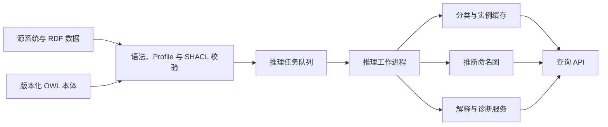

把“学生完成研究方法课并且有导师，因而具备开题资格”写成一段业务代码并不难。真正困难的是：当课程体系、人员角色和资格规则分散在多个系统中，如何让同一个结论仍具有稳定含义，如何发现互相矛盾的事实，以及如何回答“系统为什么得出这个结论”。

OWL 推理机处理的正是这类问题。它不依赖关键词相似度，也不是在图中沿边查找一个预先存储的答案，而是依据 OWL 公理和形式语义，计算哪些结论在逻辑上必然成立。只要本体声明了概念定义、关系约束和实例事实，推理机就能完成概念分类、实例归类、一致性检查与蕴含判断。

本文从 OWL 推理的语义基础出发，通过一个“研究生开题资格”案例说明 HermiT 如何推导隐含类型、发现逻辑冲突，并进一步讨论 Profile 选型、推理结果物化、解释生成、性能评测和生产架构。目标不是罗列工具命令，而是建立一套从本体建模到推理服务落地的完整认识。

## 一、推理机不是图查询器，而是逻辑后果计算器

假设知识库中只有以下显式事实：

```text
alice 是学生
alice 完成了 rm101
rm101 是研究方法课
alice 的导师是 professorLi
professorLi 是教师
```

再给出两个概念定义：

```text
研究生 ≡ 学生 且 至少完成过一门研究方法课
可开题学生 ≡ 研究生 且 至少有一位教师导师
```

知识库没有直接写入“alice 是研究生”和“alice 是可开题学生”。但是任何满足上述公理的解释都必须接受这两个结论，因此它们是知识库的逻辑后果：

```text
KnowledgeBase ⊨ GraduateStudent(alice)
KnowledgeBase ⊨ EligibleForThesis(alice)
```

符号 `⊨` 表示蕴含。推理机的核心问题不是“图里是否存在这条边”，而是“所有满足当前公理的模型中，这个结论是否都成立”。这一区别决定了 OWL 推理与普通图遍历的能力边界。

| 方式 | 主要输入 | 典型问题 | 结果性质 |
| --- | --- | --- | --- |
| 图查询 | 已存储的点、边和属性 | 谁完成了课程 `rm101`？ | 返回显式匹配的数据 |
| OWL 推理 | 事实、公理与形式语义 | `alice` 是否必然属于可开题学生？ | 返回显式或隐含的逻辑后果 |
| 规则引擎 | 条件与动作规则 | 条件满足后应执行什么动作？ | 触发规则结论或副作用 |
| 约束校验 | 数据形状和完整性要求 | 每名学生是否恰好填写一个学号？ | 输出合规或违规报告 |

在工程中，这四种能力经常组合，但不能互相替代。SPARQL 擅长读取图，OWL 推理负责语义蕴含，规则引擎负责过程性规则，SHACL 负责封闭式数据质量校验。

## 二、推理机读取什么：TBox、ABox 与 RBox

描述逻辑通常把知识库写成 `K = (T, A)`。工程实践还常把角色或属性公理单独称为 RBox。三部分共同构成推理输入。

### 1. TBox：概念层公理

TBox 描述类之间的语义关系，例如子类、等价类和互斥类：

```text
GraduateStudent ≡ Student ⊓ ∃completedCourse.ResearchMethodsCourse
EligibleForThesis ≡ GraduateStudent ⊓ ∃hasAdvisor.Faculty
Student ⊓ Faculty ⊑ ⊥
```

其中：

- `⊓` 表示交集，即“同时满足”；
- `∃R.C` 表示至少存在一个通过关系 `R` 连接到类 `C` 实例的对象；
- `⊑` 表示子类；
- `⊥` 表示不可能有实例的空类。

最后一条公理表示 `Student` 与 `Faculty` 互斥。它不是数据库唯一约束，而是关于世界中对象类型的逻辑陈述。

### 2. ABox：实例层事实

ABox 描述个体的类型和个体之间的关系：

```text
Student(alice)
ResearchMethodsCourse(rm101)
completedCourse(alice, rm101)
Faculty(professorLi)
hasAdvisor(alice, professorLi)
```

推理机将 TBox 与 ABox 结合后，才能从概念定义推导实例的新类型。

### 3. RBox：属性层公理

RBox 描述对象属性的层次和特征，例如：

```text
hasPrimaryAdvisor ⊑ hasAdvisor
hasAdvisor ≡ advises⁻
TransitiveObjectProperty(hasAcademicAncestor)
```

它们分别表示子属性、逆属性和传递属性。属性链也属于这一层，例如“导师所在学院是学生的培养学院”可以在满足 OWL 2 全局限制时建模为属性链。RBox 往往是推理成本和建模风险容易被低估的部分，尤其要谨慎使用传递性、基数约束和复杂属性链。

## 三、OWL 推理机提供哪些标准任务

“运行一次推理”不是单一操作。实际系统必须明确所需任务，因为不同任务的成本和可用优化并不相同。

| 推理任务 | 要回答的问题 | 在案例中的例子 |
| --- | --- | --- |
| 一致性检查 | 整个本体是否至少存在一个模型？ | `alice` 同时为互斥的学生和教师时是否冲突？ |
| 类可满足性 | 某个类是否可能拥有实例？ | “可开题学生”是否被公理定义成空类？ |
| 分类 | 类之间有哪些隐含的上下位关系？ | 可开题学生是否是学生的子类？ |
| 实例归类 | 每个个体必然属于哪些类？ | `alice` 是否被归为研究生？ |
| 蕴含检查 | 某条指定公理是否由知识库推出？ | 是否蕴含 `EligibleForThesis(alice)`？ |

分类通常计算并缓存完整类层次；实例归类也常称为 realization。ORE 2015 推理机竞赛正是围绕一致性、分类和实例归类，在 OWL 2 DL 与 OWL 2 EL 两类语料上比较系统[7]。这也提示工程团队：不能只测“本体能否加载”，而要对实际调用的任务分别压测。

## 四、最容易误解的语义：开放世界与非唯一名称

### 1. 不知道，不等于为假

OWL 采用开放世界假设。若知识库没有记录 `alice` 的导师，推理机只能说“目前无法推出她有导师”，不能据此推出“她没有导师”。因此，下面两个结论完全不同：

```text
未蕴含：hasAdvisor(alice, ?x)
明确蕴含：alice 属于没有任何导师的人
```

数据库校验通常采用封闭世界思路：字段为空就按缺失处理。OWL 则允许知识不完备，这更适合跨组织、跨来源知识集成，却不适合直接表达“表单必填”。表单完整性应交给 SHACL 或应用校验。

### 2. 名字不同，不保证对象不同

OWL 默认也不采用唯一名称假设。`alice` 与 `alice_001` 是两个 IRI，并不自动意味着它们指向两个不同对象。只有显式声明 `DifferentIndividuals`，或由其他公理推导出不同，推理机才必须将其解释为不同个体。反过来，`owl:sameAs` 会把两个标识视为同一对象，并传播其全部语义后果。

这对主数据治理很重要：不能把“IRI 不同”当作去重结论，也不能轻率使用 `owl:sameAs` 表示“相似”“可能相同”或“业务上相关”。

### 3. 没有闭合就不能做最大基数判断

假设声明“学生最多有一位主导师”，但知识库出现两个不同 IRI 的导师。由于非唯一名称假设，推理机可能推断两者相同，而不是立即报告冲突。只有再声明两位导师互不相同，或者通过键等条件确定它们不同，最大基数限制才会形成矛盾。

这不是推理机遗漏了错误，而是 OWL 语义与数据库约束语义不同。

## 五、OWL、SPARQL、SHACL 与规则引擎的边界

一个可维护的知识系统应把不同问题交给合适的机制。

| 需求 | 推荐机制 | 原因 |
| --- | --- | --- |
| 推导隐含类型和类层次 | OWL 推理机 | 具备形式语义，可进行可靠的蕴含判断 |
| 查询显式与已推导事实 | SPARQL | 擅长图模式匹配、聚合和结果投影 |
| 检查必填、数量、格式和闭合字段 | SHACL | 能输出面向数据质量的违规报告 |
| 表达带优先级、时间窗口或动作的规则 | 规则引擎 | 更适合过程语义、非单调规则与副作用 |
| 从文本提取候选事实 | 大语言模型或信息抽取 | 适合处理非结构化输入，但结果需校验 |

OWL 的目标是单调推理：加入新知识可能增加结论或暴露矛盾，但不会仅因新增事实就撤回先前的逻辑后果。诸如“如果没有审批记录，三天后自动拒绝”依赖缺省否定、时间和动作，不应勉强改写成 OWL 公理。

同样，SPARQL 的 `FILTER NOT EXISTS` 可以在当前数据快照上查找缺失关系，却不能把这种缺失自动解释为 OWL 世界中的否定事实。明确这条边界，可以避免许多看似合理、实则语义错误的知识图谱方案。

## 六、推理机内部如何得到结论

不同推理机并不使用同一种算法，但都要在语义保持正确的前提下避免穷举所有可能模型。

### 1. HermiT：面向 OWL 2 DL 的 hypertableau

HermiT 是一个完整支持 OWL 2 DL 主要表达能力的推理机，其核心算法是 hypertableau[4]。直观地说，它会把公理转换成适合规则化处理的形式，在候选模型中逐步加入必须成立的事实；若某条分支产生冲突，则回溯或阻止无穷展开。与早期 tableau 方法相比，hypertableau 通过更紧凑的规则和确定性优化减少不必要的分支。

对本文案例，推理过程可以简化理解为：

```text
Student(alice)
completedCourse(alice, rm101)
ResearchMethodsCourse(rm101)
    => GraduateStudent(alice)

GraduateStudent(alice)
hasAdvisor(alice, professorLi)
Faculty(professorLi)
    => EligibleForThesis(alice)
```

实际算法不是简单的生产规则系统。等价类、否定、析取、逆属性、基数和 nominals 会共同影响模型构造，推理机还必须保证终止性与完备性。上述过程只用于解释结论，不应当作 HermiT 的算法实现。

### 2. ELK：面向 OWL 2 EL 的饱和推理

ELK 专门针对 OWL 2 EL，采用基于 consequence 的饱和算法并为分类任务进行并行优化[5]。它不断应用可靠的推理规则，直到不能再产生新的概念包含关系。由于 OWL 2 EL 有意限制析取、全称量词和一般否定等高成本构造，ELK 能在大型生物医学术语本体上获得很好的分类性能。

二者不是“一个高级、一个低级”的关系。HermiT 追求更完整的 OWL 2 DL 表达能力，ELK 追求特定语言片段上的规模和吞吐。真正的选型依据是本体实际使用的公理与服务所需任务。

## 七、先选语言边界，再选推理机

OWL 2 DL 的表达力很强，但最坏情况下的推理复杂度也很高。W3C 因此定义了三个 OWL 2 Profiles，以受控表达力换取可预测的计算特性[1][2]。

| Profile | 适合场景 | 主要优势 | 典型限制或代价 |
| --- | --- | --- | --- |
| OWL 2 EL | 大型类层次、术语体系、生物医学本体 | 多项核心任务可在多项式时间完成，易于增量和并行优化 | 不支持一般析取、全称限制和任意最大基数 |
| OWL 2 QL | 关系数据库之上的本体访问 | 查询可重写为 SQL，数据复杂度低 | 本体表达能力受限，不适合复杂分类推理 |
| OWL 2 RL | 规则系统、RDF 数据与前向物化 | 可由规则引擎实现，易与三元组存储结合 | 某些存在量词和复杂类表达式受限 |
| OWL 2 DL | 复杂领域建模与完整语义推理 | 支持丰富类表达式、属性特征和基数约束 | 最坏情况复杂度高，对建模质量敏感 |

一个常见误区是先用尽 OWL 2 DL 的全部构造，再要求推理机解决性能问题。更可靠的顺序是：

1. 从能力问题确定必须支持的蕴含类型。
2. 用 OWL API 的 Profile 检查器确认本体落在哪个语言片段。
3. 删除没有业务价值、却显著提高复杂度的构造。
4. 根据数据规模、变更频率和查询延迟选择推理策略。
5. 用真实本体与真实 ABox 做基准，而不是只比较工具宣传数据。

例如，课程分类和先修关系若只依赖子类、等价类、存在量词与属性层次，优先保持在 OWL 2 EL 往往比盲目选择全功能推理机更合理。若确实需要一般否定、析取或精确基数，再升级到 OWL 2 DL。

## 八、主流推理机如何选择

| 推理机 | 主要定位 | 常见接入方式 | 适用判断 |
| --- | --- | --- | --- |
| HermiT | OWL 2 DL，hypertableau | OWL API、Protégé | 表达力丰富，需要一致性、分类和实例推理 |
| ELK | OWL 2 EL，高性能分类 | OWL API、Protégé | 类层次巨大，公理可控制在 EL Profile 内 |
| Pellet / Openllet | OWL DL 推理及解释能力 | OWL API、Jena | 既有 Java/Jena 系统或需要延续 Pellet 生态[6] |
| JFact | FaCT++ 的 Java 实现 | OWL API | 希望纯 Java 部署并交叉验证 DL 推理结果 |
| Konclude | 高性能 OWL 2 DL 服务 | CLI、HTTP 接口 | 独立进程部署、大型本体和服务化场景 |
| RDFox | 并行规则推理和高性能 RDF 存储 | Java、REST、SPARQL | 以 Datalog、OWL RL 物化和动态图数据为主 |

工具支持矩阵会随版本变化，选型时必须用目标版本重新核对。还应将以下条件纳入评估：

- 是否完整支持本体实际使用的公理，而不是笼统地声称“支持 OWL”；
- 是否需要增量推理、解释接口、超时、中断和并发查询；
- 推理机能否嵌入当前运行时，许可证是否满足部署方式；
- 首次分类、ABox 更新、缓存预热和内存峰值分别是多少；
- 在不一致本体、未知数据类型和异常公理下能否给出可诊断结果。

ORE 竞赛结果适合了解工具在标准语料上的整体表现，但不能代替项目基准。推理性能高度依赖本体结构，Matentzoglu 等人的研究表明，即使是看似简单的 subsumption 测试，难度也会因本体模块和公理组合产生明显差异[10]。

## 九、案例建模：把开题资格写成公理

本文使用如下最小本体：

```text
类：
  Student
  Faculty
  ResearchMethodsCourse
  GraduateStudent
  EligibleForThesis

对象属性：
  completedCourse
  hasAdvisor

等价类公理：
  GraduateStudent EquivalentTo
    Student and (completedCourse some ResearchMethodsCourse)

  EligibleForThesis EquivalentTo
    GraduateStudent and (hasAdvisor some Faculty)

互斥公理：
  Student DisjointWith Faculty
```

这里使用 `EquivalentTo` 而不是只有一个方向的 `SubClassOf`，是因为我们要给出充分且必要条件：满足右侧条件的个体应被识别为对应类，属于该类的个体也必须满足右侧条件。

如果只写成：

```text
EligibleForThesis SubClassOf
  GraduateStudent and (hasAdvisor some Faculty)
```

推理机只能从“已知某人可开题”推出她是有教师导师的研究生，不能反过来根据条件把她归为可开题学生。这是初学 OWL 时最常见的方向性错误之一。

还要注意，这个案例只演示语义推理，不等同于真实大学的完整开题制度。学分、成绩、培养方案版本、导师资格有效期和伦理审批等条件通常包含数值、时间与闭合数据要求，应由 OWL、SHACL 和业务规则分层承载。

## 十、用 OWL API 与 HermiT 运行推理

OWL API 为本体加载、修改、序列化和推理机调用提供统一 Java 接口[3]。下面使用 OWL API 5.1.20 与 HermiT 1.4.5.519 演示完整流程。

### 1. Maven 依赖

```xml
<dependencies>
    <dependency>
        <groupId>net.sourceforge.owlapi</groupId>
        <artifactId>owlapi-distribution</artifactId>
        <version>5.1.20</version>
    </dependency>
    <dependency>
        <groupId>net.sourceforge.owlapi</groupId>
        <artifactId>org.semanticweb.hermit</artifactId>
        <version>1.4.5.519</version>
    </dependency>
</dependencies>
```

示例使用 Java 11 以上版本。实际项目应锁定经测试的依赖树，避免由其他 RDF 或本体组件传递引入不同版本的 OWL API。

### 2. 创建本体并执行推理

```java
import java.util.Set;

import org.semanticweb.HermiT.Reasoner;
import org.semanticweb.owlapi.apibinding.OWLManager;
import org.semanticweb.owlapi.model.IRI;
import org.semanticweb.owlapi.model.OWLAxiom;
import org.semanticweb.owlapi.model.OWLClass;
import org.semanticweb.owlapi.model.OWLDataFactory;
import org.semanticweb.owlapi.model.OWLNamedIndividual;
import org.semanticweb.owlapi.model.OWLObjectProperty;
import org.semanticweb.owlapi.model.OWLOntology;
import org.semanticweb.owlapi.model.OWLOntologyManager;
import org.semanticweb.owlapi.profiles.OWL2DLProfile;
import org.semanticweb.owlapi.profiles.OWLProfileReport;
import org.semanticweb.owlapi.reasoner.InferenceType;
import org.semanticweb.owlapi.reasoner.OWLReasoner;

public class ThesisEligibilityReasoning {
    private static final String NS = "https://example.org/university#";

    public static void main(String[] args) throws Exception {
        OWLOntologyManager manager = OWLManager.createOWLOntologyManager();
        OWLDataFactory df = manager.getOWLDataFactory();
        OWLOntology ontology = manager.createOntology(
                IRI.create("https://example.org/university"));

        OWLClass student = cls(df, "Student");
        OWLClass faculty = cls(df, "Faculty");
        OWLClass researchMethodsCourse = cls(df, "ResearchMethodsCourse");
        OWLClass graduateStudent = cls(df, "GraduateStudent");
        OWLClass eligibleForThesis = cls(df, "EligibleForThesis");

        OWLObjectProperty completedCourse = property(df, "completedCourse");
        OWLObjectProperty hasAdvisor = property(df, "hasAdvisor");

        OWLNamedIndividual alice = individual(df, "alice");
        OWLNamedIndividual rm101 = individual(df, "rm101");
        OWLNamedIndividual professorLi = individual(df, "professorLi");

        OWLAxiom graduateStudentDefinition = df.getOWLEquivalentClassesAxiom(
                graduateStudent,
                df.getOWLObjectIntersectionOf(
                        student,
                        df.getOWLObjectSomeValuesFrom(
                                completedCourse, researchMethodsCourse)));

        OWLAxiom eligibilityDefinition = df.getOWLEquivalentClassesAxiom(
                eligibleForThesis,
                df.getOWLObjectIntersectionOf(
                        graduateStudent,
                        df.getOWLObjectSomeValuesFrom(hasAdvisor, faculty)));

        manager.addAxioms(ontology, Set.of(
                graduateStudentDefinition,
                eligibilityDefinition,
                df.getOWLDisjointClassesAxiom(student, faculty),
                df.getOWLClassAssertionAxiom(student, alice),
                df.getOWLClassAssertionAxiom(researchMethodsCourse, rm101),
                df.getOWLObjectPropertyAssertionAxiom(
                        completedCourse, alice, rm101),
                df.getOWLClassAssertionAxiom(faculty, professorLi),
                df.getOWLObjectPropertyAssertionAxiom(
                        hasAdvisor, alice, professorLi)));

        OWLProfileReport profile = new OWL2DLProfile().checkOntology(ontology);
        if (!profile.isInProfile()) {
            profile.getViolations().forEach(System.err::println);
            throw new IllegalStateException("Ontology is outside OWL 2 DL");
        }

        OWLReasoner reasoner = new Reasoner.ReasonerFactory()
                .createReasoner(ontology);
        try {
            System.out.println("consistent = " + reasoner.isConsistent());

            reasoner.precomputeInferences(
                    InferenceType.CLASS_HIERARCHY,
                    InferenceType.CLASS_ASSERTIONS);

            boolean isGraduateStudent = reasoner.getTypes(alice, false)
                    .containsEntity(graduateStudent);
            boolean isEligible = reasoner.isEntailed(
                    df.getOWLClassAssertionAxiom(eligibleForThesis, alice));

            System.out.println("graduate student = " + isGraduateStudent);
            System.out.println("eligible for thesis = " + isEligible);

            // 注入一条与 Student(alice) 冲突的事实。
            manager.addAxiom(
                    ontology,
                    df.getOWLClassAssertionAxiom(faculty, alice));
            reasoner.flush();

            System.out.println(
                    "consistent after conflict = " + reasoner.isConsistent());
        } finally {
            reasoner.dispose();
        }
    }

    private static OWLClass cls(OWLDataFactory df, String localName) {
        return df.getOWLClass(IRI.create(NS + localName));
    }

    private static OWLObjectProperty property(
            OWLDataFactory df, String localName) {
        return df.getOWLObjectProperty(IRI.create(NS + localName));
    }

    private static OWLNamedIndividual individual(
            OWLDataFactory df, String localName) {
        return df.getOWLNamedIndividual(IRI.create(NS + localName));
    }
}
```

预期输出为：

```text
consistent = true
graduate student = true
eligible for thesis = true
consistent after conflict = false
```

这段代码包含几个值得保留到生产系统的步骤：

1. **先做 Profile 检查。** 语法可解析不代表满足 OWL 2 DL 的全局限制。
2. **按任务预计算。** 分类和实例归类可提前完成，避免首个在线请求承担全部预热成本。
3. **用 `isEntailed` 表达业务判断。** 它比依赖某个缓存视图更直接地表达“指定公理是否为逻辑后果”。
4. **本体变更后调用 `flush()`。** 缓冲模式下，推理机不会自动看到尚未刷新到内部状态的变更。
5. **显式释放推理机。** 大本体的索引和缓存占用显著，生命周期必须受控。

## 十一、推断结果要不要写回知识图谱

推理机可以在查询时计算结论，也可以把结论物化为三元组。两种方式各有取舍。

### 1. 虚拟推断

虚拟推断只保存原始事实和公理，查询时通过推理机返回隐含结论。

优点是来源边界清楚，本体变化后不必清理大量旧结论；缺点是在线延迟依赖推理缓存，且跨进程查询需要专门的推理服务。

### 2. 物化推断

物化会把 `GraduateStudent(alice)` 等结论写入推断图，后续可由普通 SPARQL 直接读取。

优点是读取快，容易与搜索和分析系统集成；缺点是写放大、更新复杂，并且必须区分显式事实与推断事实。如果将两者混在同一张图中，本体版本变化后很难判断哪些三元组需要撤回。

生产中可采用分层命名图：

```text
graph:asserted/{source}/{batch}   原始断言及来源
graph:ontology/{version}          本体公理
graph:inferred/{version}/{run}    指定版本和运行批次的推断结果
graph:provenance/{run}            生成时间、软件版本和依赖关系
```

对低延迟、读多写少的知识库，可离线分类并增量物化；对频繁修改的编辑器或规则试验环境，保留虚拟推断通常更简单。无论采用哪种方式，都不应覆盖原始断言。

## 十二、把推理机放进生产架构

一个可运行的推理服务通常包括以下链路：



关键设计不是简单地“把 HermiT 包成 HTTP 接口”，而是明确状态和版本：

- **加载单元：** 本体版本、导入闭包、数据快照和推理机版本共同构成一次可复现运行。
- **发布门禁：** 语法、Profile、一致性、关键类可满足性和能力问题回归全部通过后才能发布。
- **进程隔离：** 大型 DL 推理任务应设置内存、超时和取消机制，必要时使用独立工作进程防止拖垮查询服务。
- **缓存键：** 至少包含本体散列、ABox 快照标识、推理机及配置版本，不能只按文件名缓存。
- **并发策略：** 不假设具体推理机实例线程安全；通常由不可变快照承载并发读，由新实例完成后台重建后原子切换。
- **失败语义：** “超时”“不一致”“不支持的公理”和“未蕴含”必须是不同状态，不能都返回 `false`。

对持续更新的知识图谱，还应测量增量更新是否真的优于重建。复杂公理变更可能使缓存大面积失效，强行增量化反而增加错误恢复和解释难度。

## 十三、推理结果必须能够解释

业务用户问“为什么 `alice` 可以开题”时，仅返回 `true` 不够。一个最小 justification 是足以蕴含目标结论、且删除其中任意一条后不再蕴含的公理集合[8]。

本案例的一组 justification 是：

```text
1. Student(alice)
2. completedCourse(alice, rm101)
3. ResearchMethodsCourse(rm101)
4. GraduateStudent ≡ Student
   ⊓ ∃completedCourse.ResearchMethodsCourse
5. hasAdvisor(alice, professorLi)
6. Faculty(professorLi)
7. EligibleForThesis ≡ GraduateStudent
   ⊓ ∃hasAdvisor.Faculty
```

Justification 回答“哪些公理足以支持结论”，proof 则进一步给出中间推导步骤，例如先推出 `GraduateStudent(alice)`，再推出 `EligibleForThesis(alice)`。Horridge 等人提出的 justification-oriented proof 将多个 justification 组织为证明结构，更适合查看公理之间的依赖[8]。

解释并不等于把全部公理原样展示给用户。研究表明，公理的呈现顺序、术语说明和中间结论都会影响人对解释的理解[9]。因此生产系统通常需要三层输出：

| 层次 | 面向对象 | 输出内容 |
| --- | --- | --- |
| 业务解释 | 学生、审核人员 | “已完成研究方法课且存在有效教师导师” |
| 逻辑解释 | 本体工程师 | 最小 justification 与中间推导 |
| 运行诊断 | 平台工程师 | 本体版本、数据来源、推理机版本、耗时和任务日志 |

对不一致本体，应生成导致冲突的最小或近似最小公理集合。例如 `Student(alice)`、`Faculty(alice)` 和 `Student DisjointWith Faculty` 已足以解释本案例冲突。解释计算本身也可能昂贵，在线接口需要设置上限，并允许异步生成。

## 十四、如何评测一台 OWL 推理机

只记录“总耗时”无法定位瓶颈。至少应拆分以下阶段：

| 指标 | 含义 | 需要固定的条件 |
| --- | --- | --- |
| 解析与导入耗时 | 读取主本体及 import closure | 文件格式、磁盘缓存、网络依赖 |
| 首次一致性耗时 | 建立内部索引并检查模型 | JVM 参数、冷启动状态 |
| 分类耗时 | 构建完整类层次 | 所需 InferenceType、超时 |
| 实例归类耗时 | 计算个体的隐含类型 | ABox 规模和类型分布 |
| 单次蕴含延迟 | 在线判断指定公理 | 预热状态、并发数、查询集合 |
| 更新后恢复耗时 | ABox 或 TBox 变更后重新可用 | 变更批次、增量配置 |
| 内存峰值 | 任务期间最大驻留内存 | 堆大小、GC 和采样方法 |
| 正确性 | 预期蕴含、非蕴含和冲突是否一致 | 固定测试集与期望结果 |

测试集应包含项目自己的本体快照、典型查询、边界公理和历史故障，而不只是合成数据。至少准备四类用例：

1. 应当蕴含的正例；
2. 在开放世界下未知、不能误判为假的用例；
3. 应保持一致但容易被误建模的边界用例；
4. 必须检测为不一致或不可满足的反例。

在同一语义范围内，可使用两种推理机交叉验证关键结论。若结果不同，先检查 Profile、导入闭包、数据类型、推理任务和工具版本，再判断是否为实现缺陷。公开评测研究同样强调，本体规模本身不能充分预测难度，公理结构与任务类型往往更关键[7][10][11]。

## 十五、常见工程误区

### 1. 把 domain 和 range 当作字段校验

声明 `hasAdvisor Domain Student` 的含义是：任何使用 `hasAdvisor` 作为主语的对象都可被推断为学生，而不是“非学生禁止填写该属性”。若一名教师误用了该属性，推理机可能把她同时归为学生，并在存在互斥公理时报告不一致。输入校验仍应使用 SHACL。

### 2. 只写必要条件，却期待自动归类

`EligibleForThesis SubClassOf GraduateStudent` 只能从前者推出后者。若要根据条件识别实例，需要等价类，或另一个方向的充分条件公理。

### 3. 把未蕴含翻译成“否”

业务 API 最好返回三值状态：`entailed`、`contradicted`、`unknown`。其中 `contradicted` 也必须由明确否定或互斥关系推出，不能用查询结果为空代替。

### 4. 不检查不可满足类

本体整体可以一致，同时某些类因互相冲突的限制而永远不可能有实例。发布门禁除 `isConsistent()` 外，还应检查 `getUnsatisfiableClasses()`，并排除必然存在的 `owl:Nothing` 后确认结果为空。

### 5. 无版本地保存推断事实

推断事实依赖本体、数据快照和推理机配置。缺少版本及来源后，它们会被误当作人工确认的原始事实，规则升级时也无法可靠撤回。

### 6. 用完整 ABox 阻塞每次请求

在线接口不应为每个请求重新加载本体并分类。应以版本化快照预热推理实例，或提前物化稳定结论；高成本解释和全量重建放入异步任务。

### 7. 用类规模估算推理难度

一万个结构规则的 EL 类可能比几百个包含复杂析取、否定和基数约束的 DL 类更容易处理。性能预算必须建立在实际公理和任务上。

## 十六、OWL 推理机与大语言模型如何协同

大语言模型适合把自然语言映射到候选术语、SPARQL 或本体编辑建议，OWL 推理机适合对形式化后的结论作确定性判断。二者的合理分工是“模型负责解释和生成候选，推理机负责可验证的语义结论”。

```text
用户问题
  -> LLM 识别实体、关系和目标判断
  -> 术语解析与 IRI 对齐
  -> 生成受限查询或待检验公理
  -> OWL 推理机执行蕴含/一致性检查
  -> explanation 服务返回依据
  -> LLM 将逻辑结果转成业务语言
```

这条链路需要三项约束：

- LLM 不能直接声称某个结论“已由本体证明”，必须引用推理服务返回的目标公理和运行标识；
- LLM 生成的新公理先进入候选区，经过 Profile、能力问题和一致性回归后才能发布；
- 回答中应区分显式事实、推断事实和模型生成的解释文本，避免把自然语言润色误当作新证据。

例如，用户问“为什么 Alice 可以开题”，LLM 可以组织自然语言，但底层证据必须来自 `isEntailed(EligibleForThesis(alice))` 及其 justification。这样，大模型提高了交互可用性，却不取代逻辑正确性的责任主体。

## 十七、从实验走向生产的落地路线

可以按以下顺序推进，而不是一开始就建设全量知识推理平台：

1. **定义能力问题。** 选择 5 至 10 个必须通过推理回答、且能验收的问题。
2. **建立最小本体。** 只引入回答这些问题所需的类、属性、公理和代表性实例。
3. **固定语言 Profile。** 在 CI 中运行 OWL 2 EL、RL 或 DL Profile 检查，任何越界都要求说明。
4. **建立语义测试。** 同时覆盖蕴含、未知、不一致和不可满足类。
5. **用真实快照选型。** 比较至少两种候选推理机的正确性、冷启动、更新和内存。
6. **设计来源与版本。** 显式事实、公理、推断结果和解释都具备可追溯标识。
7. **服务化并设置预算。** 对加载、分类、在线查询和解释分别设置延迟、内存与超时目标。
8. **小流量发布。** 先服务一个稳定场景，观察未知率、冲突率和人工复核结果，再扩展本体范围。

## 结语

OWL 推理机的价值不在于“自动生成更多三元组”，而在于让系统能依据明确语义回答：哪些结论必然成立，哪些概念不可能有实例，哪些事实不能同时为真，以及一个结论由哪些公理支持。

要获得这种能力，团队必须同时做好三件事：尊重开放世界和非唯一名称等语义前提；根据业务问题选择合适的 OWL Profile 与推理算法；把版本、测试、解释和性能预算纳入推理服务生命周期。HermiT、ELK 或其他工具只是执行器，真正决定系统质量的是可验证的本体设计与工程边界。

从一个小型、可解释、可回归的能力问题开始，比先建设庞大类库更可靠。当每条关键结论都能被重现、验证和解释时，OWL 推理才从本体编辑器中的演示功能，变成知识系统中可以依赖的基础能力。

## 参考资料

[1] W3C. [OWL 2 Web Ontology Language Profiles (Second Edition)](https://www.w3.org/TR/owl2-profiles/). W3C Recommendation, 2012.

[2] Markus Krötzsch. [OWL 2 Profiles: An Introduction to Lightweight Ontology Languages](https://doi.org/10.1007/978-3-642-33158-9_4). Reasoning Web, 2012.

[3] Matthew Horridge, Sean Bechhofer. [The OWL API: A Java API for OWL Ontologies](https://doi.org/10.3233/SW-2011-0025). Semantic Web, 2011.

[4] Birte Glimm, Ian Horrocks, Boris Motik, Giorgos Stoilos, Zhe Wang. [HermiT: An OWL 2 Reasoner](https://doi.org/10.1007/s10817-014-9305-1). Journal of Automated Reasoning, 2014.

[5] Yevgeny Kazakov, Markus Krötzsch, František Simančík. [The Incredible ELK: From Polynomial Procedures to Efficient Reasoning with EL Ontologies](https://doi.org/10.1007/s10817-013-9296-3). Journal of Automated Reasoning, 2014.

[6] Evren Sirin, Bijan Parsia, Bernardo Cuenca Grau, Aditya Kalyanpur, Yarden Katz. [Pellet: A Practical OWL-DL Reasoner](https://doi.org/10.1016/j.websem.2007.03.004). Journal of Web Semantics, 2007.

[7] Bijan Parsia, Nicolas Matentzoglu, Rafael S. Gonçalves, Birte Glimm, Andreas Steigmiller. [The OWL Reasoner Evaluation (ORE) 2015 Competition Report](https://doi.org/10.1007/s10817-017-9406-8). Journal of Automated Reasoning, 2017.

[8] Matthew Horridge, Bijan Parsia, Ulrike Sattler. [Justification Oriented Proofs in OWL](https://doi.org/10.1007/978-3-642-17746-0_23). International Semantic Web Conference, 2010.

[9] Matthew Horridge, Samantha Bail, Bijan Parsia, Ulrike Sattler. [Toward Cognitive Support for OWL Justifications](https://doi.org/10.1016/j.knosys.2013.08.021). Knowledge-Based Systems, 2013.

[10] Nicolas Matentzoglu, Matthew Horridge, Bijan Parsia. [OWL Reasoning: Subsumption Test Hardness and Modularity](https://doi.org/10.1007/s10817-017-9414-8). Journal of Automated Reasoning, 2018.

[11] An Ngoc Lam, Brian Elvesæter, Francisco Martin-Recuerda. [A Performance Evaluation of OWL 2 DL Reasoners Using ORE 2015 and Very Large Bio Ontologies](https://doi.org/10.5281/zenodo.8325084). 2023.
