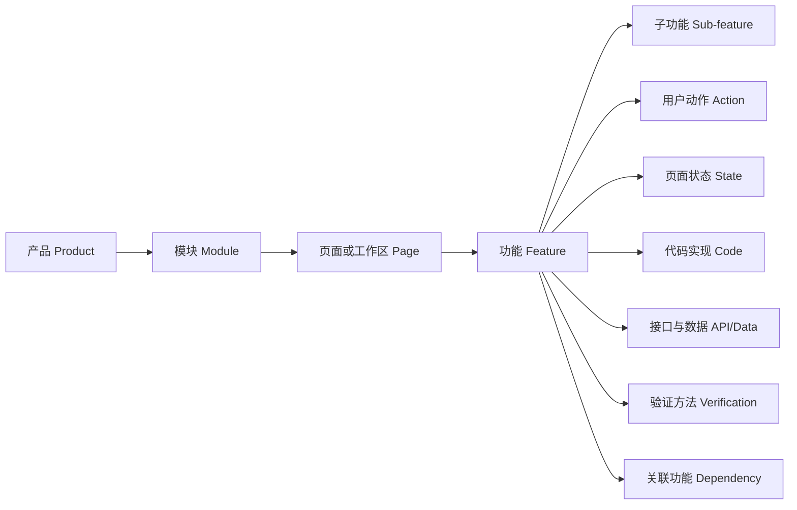
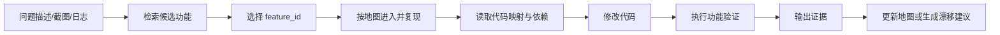

# 产品功能 Map：让 AI 能理解、定位、操作与验证产品

当 AI 助手开始参与需求分析、缺陷定位、代码修改和自动测试时，团队很快会遇到一个基础问题：AI 虽然能够搜索代码，却未必真正理解产品。

用户说“左侧栏很卡”，AI 不一定知道“左侧栏”对应哪个产品模块；用户只发来一张截图，AI 也未必知道如何进入该页面、需要什么权限、应该操作哪个元素，更不知道修复后怎样证明问题已经解决。于是它只能在代码库中广泛搜索、根据文件名猜测，或者不断询问人类下一步该点哪里。

这正是产品功能 Map 要解决的问题。

> **产品功能 Map 是一份面向人和 AI 的可执行产品索引。它不仅描述“产品有哪些功能”，还描述“功能是什么、怎样进入、如何定位、代码在哪里，以及怎样验证”。**

它把产品语义、用户界面、代码结构、数据接口和验证方法连接起来，使 AI 能够把一句模糊反馈映射到明确的功能节点，并完成从理解问题到验证结果的闭环。

---

## 一、功能 Map 不是传统功能清单

传统功能清单通常围绕产品规划展开，记录模块名称、需求状态、负责人和发布日期。它可以帮助产品经理管理范围，却不足以支持 AI 实际操作产品。

例如，一条普通记录可能只有“会话管理—搜索历史会话—已上线”。它告诉我们功能存在，却没有回答：用户从哪里进入，是否需要权限或特定数据，按钮怎样稳定定位，相关代码和接口在哪里，以及修改后怎样验证。

功能 Map 因此不只是树状目录，也不等同于站点地图、PRD、代码索引或测试用例集合。它是这些信息之间的连接层。

| 对象 | 主要回答的问题 | 局限 |
| --- | --- | --- |
| 功能清单 | 产品有什么 | 缺少入口、实现和验证信息 |
| 站点地图 | 页面怎样组织 | 难以表达跨页面流程和后台能力 |
| PRD | 为什么做、要做什么 | 通常不能直接执行，且容易过期 |
| 代码索引 | 实现在哪里 | 缺少用户语义和产品上下文 |
| 测试用例 | 怎样检查某个行为 | 缺少产品发现和代码定位能力 |
| 功能 Map | 功能是什么、怎样进入、如何实现和验证 | 需要持续维护 |

成熟的功能 Map 应成为产品事实层：产品、设计、研发、测试和 AI 助手都可以用同一个功能标识讨论同一件事。

---

## 二、功能 Map 要解决的四个问题

### 1. 这是哪个功能

当输入是用户语言、截图、日志或模糊缺陷描述时，AI 要能将其映射到一个或多个候选功能节点。例如：

```text
“左边的历史记录搜不到了”
    ↓
conversation.sidebar.search
```

这要求地图记录用户可见名称、内部名称、别名、关键词、页面区域和典型问题，而不能只保留研发内部术语。

### 2. 怎样进入并复现

AI 要知道从应用初始状态出发，经过哪些入口和操作到达目标功能，包括登录和权限要求、预置数据、菜单与按钮、URL、命令、快捷键、页面跳转和功能开关。

如果只有功能名称，没有可执行的进入路径，AI 仍然需要人类在旁边不断告诉它“下一步点哪里”。

### 3. 实现代码在哪里

AI 要能从产品功能定位到相关实现，包括前端组件、后端服务、API、数据模型、状态管理、事件和配置项。代码映射不必穷举所有文件，但必须给出稳定入口和清晰边界，帮助 AI 缩小搜索范围。

### 4. 怎样证明功能正常

AI 修改代码后，必须能够运行产品、执行操作并收集证据。功能 Map 因此要描述操作步骤、可观察结果、UI 和网络断言、正常及异常场景，以及适用的自动化测试或验证命令。

这一步让 AI 从“代码已经改完”走向“问题已经被验证解决”。

---

## 三、功能 Map 的整体结构

功能 Map 可以用树表达产品层级，但底层最好按图模型设计，因为真实产品中存在大量跨模块依赖。



推荐使用六级产品层级：

```text
产品 → 模块 → 页面/工作区 → 功能 → 子功能 → 用户动作
```

例如：

```text
协作平台
└── 会话模块
    └── 主工作区
        └── 会话侧边栏
            └── 会话搜索
                ├── 输入关键词
                ├── 查看搜索结果
                └── 打开目标会话
```

层级用于导航，关系用于诊断。“会话搜索”可能同时依赖身份认证、搜索服务、历史数据和侧边栏渲染，因此还需要记录 `depends_on`、`calls`、`renders` 和 `verified_by` 等关系。

---

## 四、功能节点需要包含什么

### 1. 身份信息

| 字段 | 说明 | 示例 |
| --- | --- | --- |
| `id` | 全局唯一且稳定的功能 ID | `conversation.sidebar.search` |
| `name` | 用户可见名称 | 会话搜索 |
| `internal_name` | 研发内部名称 | Conversation Search |
| `aliases` | 用户表达、旧名称和常见别名 | 历史记录搜索、聊天搜索 |
| `parent` | 上级功能节点 | `conversation.sidebar` |
| `status` | 规划中、实验中、已上线、已废弃 | `active` |

功能 ID 不应包含容易变化的 UI 文案或版本号。功能改名时更新名称和别名，而不是随意更换 ID。

### 2. 产品语义

产品语义帮助 AI 理解功能，而不只是知道名字。应记录功能解决的用户问题、主要角色、典型目标、功能边界、关键业务规则、检索关键词和典型反馈。

例如，“会话搜索”的边界应明确是搜索用户可访问的历史会话，而不是全文搜索当前会话消息。这样的边界可以防止 AI 修错模块。

### 3. 入口与导航路径

入口信息要写成 AI 可以执行的步骤，包括主入口和备用入口，菜单、按钮、标签页、URL、深链接、命令、快捷键，以及从应用启动状态开始的逐步导航。

同一功能可能存在多条路径。地图应标记推荐路径，同时保留其他路径，避免某个入口暂时失效后整个验证过程无法继续。

### 4. 前置条件和测试数据

AI 需要明确知道是否需要登录、什么角色和权限、是否依赖组织或项目、是否需要预置数据和功能开关，以及怎样创建和清理测试数据。

前置条件应尽量可自动执行。与其写“准备一些历史会话”，不如提供 Fixture 名称、测试数据脚本或明确创建步骤。

### 5. UI 定位信息

推荐按以下优先级记录关键元素：

1. 可访问性角色与名称，如 `getByRole('button', { name: '搜索会话' })`；
2. 稳定的 `data-testid`；
3. 稳定的业务属性或组件标识；
4. 可控的文本定位；
5. CSS 层级和位置选择器，仅作为最后手段。

每个元素应记录作用、role、ARIA label、`data-testid`、出现条件和父容器。不要把动态 class、列表序号或绝对坐标作为主要定位依据。

### 6. 页面状态与状态转换

一个功能不是一个静态页面，而是一组状态和状态转换。至少应描述默认、空、加载、成功、无结果、权限不足、服务异常、禁用和降级状态。

```text
默认 → 输入中 → 加载中 → 有结果
                    ├→ 无结果
                    └→ 请求失败
```

### 7. 代码实现映射

代码映射应围绕功能边界组织，给出功能目录或包、前端入口、路由、状态管理、后端服务、API 定义、数据模型、功能开关和相关测试。

不应手工复制所有文件名。更稳妥的做法是记录稳定入口，再由工具根据依赖图动态展开，否则每次重构都会产生大量无价值的文档修改。

### 8. 数据、接口和可观察信号

应记录使用的 API、关键请求与响应字段、领域事件、缓存和持久化位置、关键日志、指标、Trace 以及常见错误码。这样，AI 可以判断问题发生在 UI、前端状态、网络请求、后端服务还是数据层。

### 9. 验证方法

每个核心功能至少要有一条“最小成功路径”，包含初始状态、操作步骤、UI 和数据断言、性能或可访问性要求、需要保留的截图与日志，以及对应的自动化命令。

“页面看起来正常”不是合格标准。验证结果必须可观察、可重复、可判定。

### 10. 依赖、风险与维护信息

最后还要记录上下游功能、共享组件和服务、潜在受影响范围、隐私与权限风险、产品和技术负责人、最后验证时间、适用版本及废弃替代关系。

---

## 五、推荐的数据模板

功能 Map 可以使用 YAML、JSON 或数据库保存。关键不是文件格式，而是字段稳定、结构可解析，并能同时被文档系统和自动化工具消费。

```yaml
schema_version: "1.0"

id: conversation.sidebar.search
name: 会话搜索
internal_name: Conversation Search
aliases: [历史会话搜索, 聊天记录搜索]
parent: conversation.sidebar
status: active

summary: 在侧边栏中查找用户有权访问的历史会话。
actors: [authenticated_user]
out_of_scope:
  - 搜索当前会话中的消息正文
keywords: [左侧栏, 搜不到历史记录, 搜索没有结果]

entry_points:
  primary:
    type: ui
    steps:
      - 启动应用并登录
      - 进入主工作区
      - 展开会话侧边栏
      - 点击“搜索会话”按钮
  alternatives:
    - type: shortcut
      macos: Cmd+K
      windows: Ctrl+K

preconditions:
  permissions: [conversation:read]
  feature_flags: [conversation_search_v2]
  test_data:
    fixture: fixtures/conversations/search-basic.json
    setup_command: npm run fixtures:load -- search-basic

ui:
  trigger:
    role: button
    name: 搜索会话
    test_id: conversation-search-trigger
  input:
    role: searchbox
    name: 搜索历史会话
    test_id: conversation-search-input
  result_list:
    role: list
    test_id: conversation-search-results

states:
  - id: loading
    signal: 搜索进度指示器可见
  - id: results
    signal: 结果列表包含至少一项
  - id: empty
    signal: 显示“未找到会话”
  - id: error
    signal: 显示搜索失败提示和重试按钮

code:
  feature_root: src/features/conversation-search
  frontend_entry: src/features/conversation-search/index.ts
  backend_service: services/conversation-search
  tests:
    - tests/e2e/conversation-search.spec.ts

interfaces:
  - method: GET
    path: /api/conversations/search
    owner: conversation-service

observability:
  logs: [conversation_search_failed]
  metrics: [conversation_search_latency_ms, conversation_search_error_total]
  traces: [conversation.search]

verification:
  smoke:
    initial_state: 用户已登录，Fixture 已加载
    steps:
      - 打开会话搜索
      - 输入“季度复盘”
      - 等待搜索请求完成
      - 点击标题为“季度复盘”的结果
    assertions:
      - 搜索接口返回 200
      - 结果列表包含“季度复盘”
      - 点击后进入正确会话
      - 页面不存在未处理的控制台错误
    evidence: [screenshot, network_log, console_log]
    command: npm run test:e2e -- conversation-search.spec.ts

dependencies:
  depends_on: [identity.authentication, conversation.history, platform.search]
  impacts: [conversation.sidebar, conversation.open]

risk:
  level: medium
  reasons:
    - 搜索结果必须遵循会话访问权限

ownership:
  product_owner: collaboration-product
  engineering_owner: conversation-team
  last_verified_at: 2026-11-04
  verified_version: 3.12.0
```

团队不必从第一天填写全部字段。更合理的方式是先保证核心功能具备最小可用信息，再根据 AI 实际失败的位置逐步增加字段。

---

## 六、怎样从零构建功能 Map

### 第一步：确定范围和粒度

先选择边界清晰、缺陷较多或自动化收益较高的模块，不要一开始覆盖整个产品。合理的功能节点应满足两个条件：用户能够感知或触发；它可以独立进入、修改或验证。

粒度过粗，例如只有“工作台”，无法支持问题定位；粒度过细，例如为每个按钮 hover 状态建立节点，会造成维护成本失控。

### 第二步：建立功能骨架

从产品导航、路由、PRD、帮助中心、发布记录、Feature 目录、后端模块、自动化测试、客服工单和缺陷记录中汇总清单，先建立 `产品 → 模块 → 页面 → 功能` 骨架，并分配稳定 ID。

### 第三步：让 AI 实际探索产品

只扫描代码无法得到可靠的用户路径。应让 AI 在可控环境中启动应用，并使用浏览器、桌面自动化或模拟器逐一探索核心功能。

探索时采集页面入口、导航步骤、稳定 UI 属性、页面状态、网络请求、日志、Trace、代码入口和测试文件。自动生成内容只能作为初稿，产品、研发和测试至少要共同审核一次关键功能。

### 第四步：补齐验证闭环

为每个核心功能编写一条最小成功路径，并确保 AI 能独立执行。执行失败时，记录是缺少入口、权限、数据、稳定定位、可观察结果，还是地图已经与实际产品漂移。

这些失败不是单纯的测试问题，而是功能 Map 和产品可验证性需要改进的信号。

### 第五步：关联代码和依赖

通过代码搜索、路由表、依赖图和运行时 Trace，把功能节点与实现入口连接起来。优先建立稳定入口，不追求穷举所有文件。

当 AI 能从功能节点进入代码，又能从代码变更反查受影响功能时，功能 Map 才真正成为研发基础设施。

---

## 七、如何判断功能 Map 是否合格

功能 Map 的质量不能只看字段完整率。更有效的办法是设计实际任务，让 AI 使用地图完成，并按结果评分。

| 质量维度 | 要回答的问题 | 建议指标 |
| --- | --- | --- |
| 可发现性 | 模糊反馈能否映射到正确功能 | Top-1 准确率、Top-3 召回率、定位时间 |
| 可导航性 | 能否从初始状态进入功能 | 导航成功率、平均步数、人工介入次数 |
| 可定位性 | 能否找到 UI 元素和代码入口 | 选择器稳定率、代码入口命中率 |
| 可验证性 | 能否执行验证并产出证据 | 复现率、断言可判定率、证据完整率 |
| 新鲜度 | 地图是否与当前版本一致 | 失效入口比例、超期节点比例、同步延迟 |

一个实用的验收标准是：AI 在没有人工指路的情况下，能够根据一条模糊问题报告完成“识别功能 → 进入页面 → 复现问题 → 定位代码 → 执行验证”的完整流程。

---

## 八、功能 Map 必须持续维护

功能 Map 不是上线前编写一次的交付文档，而是随产品和代码共同演进的运行资产。

新增、删除或重命名功能，导航与快捷键变化，UI 定位属性变化，权限与测试数据变化，API 和数据模型变化，代码迁移，以及验证步骤变化，都应触发地图检查。

可以在 Pull Request 模板中增加：

```text
- 本次变更影响了哪些 feature_id？
- 是否改变入口、权限、UI 定位、接口或验证方法？
- 是否需要更新功能 Map？
```

CI 可以进一步检查地图引用的文件是否存在，路由和 API 是否仍可解析，`data-testid` 是否存在且唯一，验证命令能否执行，节点是否超过有效期，以及已删除功能是否仍被依赖。

还应定期让 AI 按地图重新遍历产品，将实际观察与记录比较。菜单或页面名称变化、导航失败、定位失效、出现未登记路由、API 变化或验证结果不一致时，自动生成漂移报告和更新建议。

AI 可以发现差异并生成初稿，但关键业务语义、权限边界和高风险验证仍应由责任人确认。每个功能节点至少要有产品负责人、技术负责人、最后验证时间和适用版本。

---

## 九、把功能 Map 接入 AI 工作流



| 阶段 | 主要使用的地图信息 |
| --- | --- |
| 问题归类 | 名称、别名、关键词、页面区域、典型问题 |
| 功能复现 | 入口、前置条件、测试数据、UI 定位 |
| 代码定位 | Feature 目录、路由、服务、接口、依赖 |
| 修复验证 | 状态、断言、日志、指标、自动化命令 |
| 影响分析 | 上下游功能、共享组件、风险等级 |
| 地图维护 | 版本、最后验证时间、漂移差异 |

对于大型产品，不应把整张地图一次性塞进模型上下文。更合适的做法是先按问题检索候选节点，再按需加载目标节点、父节点、依赖节点和验证信息。

---

## 十、分阶段落地路线

### 阶段一：建立最小地图

优先覆盖高频、高价值或高故障率功能。每个节点只要求稳定 ID、名称与说明、所属层级、用户进入路径、关键 UI 定位、代码入口和一条最小验证路径。

这一阶段的目标不是完整，而是让 AI 能够独立找到并验证一批核心功能。

### 阶段二：连接研发和测试

补充接口、状态、依赖、测试数据和可观察信号，并在 PR 中声明受影响的 `feature_id`。开始统计 AI 的功能识别、导航和验证成功率。

### 阶段三：自动维护和治理

将功能 Map 纳入 CI，自动检测无效路径、选择器和代码引用；定期运行地图遍历任务；对高风险功能设置更严格的验证和审批要求。

最终，功能 Map 可以同时服务于产品知识检索、缺陷自动分流、AI 编码、影响分析、E2E 测试、自动回归、发布检查以及客服问题诊断。

---

## 十一、常见失败方式

1. **只记录名称，不记录路径。** 这种地图只能帮助 AI 搜索关键词，不能帮助它操作产品。
2. **只从代码生成地图。** 代码结构不等于用户心智，必须结合运行中的产品进行探索。
3. **把截图当成稳定定位方式。** 视觉定位可以兜底，关键操作仍应提供可访问性名称或稳定属性。
4. **节点粒度失控。** 应围绕“能独立进入、修改或验证的用户能力”划分节点。
5. **只写成功路径。** 真实缺陷经常发生在空状态、异常状态、权限不足和数据边界中。
6. **把维护全部交给 AI。** AI 能发现差异，但关键业务语义和风险边界必须由责任人确认。

---

## 结语

功能 Map 表面上是一份产品文档，实际承担的是产品与 AI 之间的操作协议。

它将散落在产品经理记忆、设计稿、代码目录、测试脚本和运维日志中的知识组织到同一个功能节点下。这样，AI 面对一句模糊反馈时，不必从零猜测产品结构，而可以先确定功能，再进入环境、读取代码、执行修改并完成验证。

功能 Map 的最终验收标准不是“字段是否填满”，而是下面这条闭环是否成立：

> **任何一个产品问题，都能被映射到明确的功能；任何一个功能，都能被可靠地进入、定位、修改和验证。**

当这条闭环成立后，AI 才不只是会写代码的助手，而是开始具备理解产品、操作产品和对结果负责的工作能力。团队也才能从逐步指挥 AI，走向依靠可执行知识和验证机制管理多个 AI 助手。


