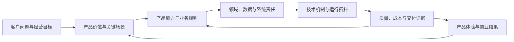

产品经理画了一张产品功能图：工作台、客户中心、订单中心、结算中心、数据报表。架构师画了一张技术图：网关、微服务、消息队列、缓存、数据库、容器平台。两张图都很完整，放在一起却回答不了几个基本问题：

- 客户最重要的任务由哪些技术能力共同保障？
- 一个产品模块变化，会影响哪些领域、数据和接口？
- 为什么某些操作必须实时完成，另一些可以异步处理？
- 标准版、专业版和私有化版的差异，会带来什么技术成本？
- 技术限制迫使体验降级时，应该怎样取舍？

问题不在于图画得不够多，而在于产品架构和技术架构被当成了两套互不相干的工作。前者停留在功能与页面，后者从框架和中间件出发，中间缺少可追踪的设计链路。

真正有效的架构是一个整体的不同投影：

- **产品架构描述价值如何被组织、组合和交付；**
- **技术架构描述这些价值如何被系统可靠、可持续地实现；**
- **两者通过领域语义、关键场景、数据责任、质量属性和演进约束交织在一起。**

本文以一款企业设备维护协同产品为贯穿案例，建立一套从产品价值到技术实现、再从运行证据返回产品决策的协同设计方法。

---

## 一、先把两个“架构”说清楚

### 1. 产品架构不是功能清单

产品架构描述产品如何把目标客户的问题组织成一套可理解、可组合、可演进的价值结构。它至少回答六类问题：

| 维度 | 需要回答的问题 | 典型产物 |
| --- | --- | --- |
| 客户与价值 | 为谁解决什么问题，成功意味着什么 | 客户分层、价值主张、结果指标 |
| 场景与旅程 | 用户在什么情境下完成哪些任务 | 关键旅程、服务蓝图、异常场景 |
| 能力与模块 | 产品由哪些稳定能力构成 | 能力地图、模块关系、导航结构 |
| 对象与规则 | 产品管理哪些核心对象及其生命周期 | 概念模型、状态机、业务规则 |
| 组合与差异 | 哪些能力共用，哪些随行业、客户或版本变化 | 套餐、权限、配置点、扩展机制 |
| 演进与经营 | 怎样交付、计量和持续演进 | 路线图、服务边界、成本与指标 |

菜单只是产品架构的一种界面投影。两个页面可以属于同一产品能力，一个页面也可能组合多个领域能力。只按页面划分产品，会把导航变化误认为业务边界变化。

### 2. 技术架构不是技术栈清单

技术架构描述系统如何分解职责、管理状态、协作运行，并在约束条件下满足质量要求。

| 视角 | 需要回答的问题 | 典型产物 |
| --- | --- | --- |
| 领域与逻辑 | 业务责任怎样划分，依赖方向如何控制 | 限界上下文、模块图、接口契约 |
| 数据与状态 | 谁拥有数据，状态如何变化和保持一致 | 数据所有权、事务边界、事件模型 |
| 应用与集成 | 系统、外部依赖和终端怎样协作 | 容器图、集成图、API 与事件 |
| 运行与部署 | 组件怎样部署、扩缩、隔离和恢复 | 部署拓扑、容量模型、故障域 |
| 横切能力 | 身份、安全、审计、观测如何统一实施 | 安全模型、遥测规范、平台能力 |
| 工程与演进 | 如何开发、测试、发布和替换 | 代码边界、流水线、ADR、迁移方案 |

Java、PostgreSQL、Kafka 和 Kubernetes 都只是候选技术。只有当它们被放入明确的职责、交互和约束中，才构成技术架构。

### 3. 架构是重要决策及其约束

架构不是所有细节的集合，而是那些影响范围大、改变成本高、会约束后续设计的重要决定。例如：

- 产品是否以“工厂”为隔离和计费单位；
- 一张维修工单是否允许跨工厂转派；
- 客户能否自定义工单状态；
- 核心报障在通知服务不可用时是否仍可成功；
- 租户采用逻辑隔离还是独立部署；
- 设备、工单和人员数据分别由谁拥有。

这些决定同时影响用户体验、商业承诺、领域模型、数据结构和运行成本，必须由产品与技术共同设计。

---

## 二、两类架构不是上下游交接，而是双向约束

“产品完成需求，再交给技术实现”的线性流程隐含了两个错误假设：产品目标可以脱离实现约束独立确定，技术团队只需要选择实现方式。

现实中的关系是持续闭环：



产品架构给技术架构提供语义和优先级。“高峰期现场人员必须能完成报障”会影响写入链路、依赖隔离和降级方式；“客户可以配置审批流程”会影响流程模型、扩展边界和版本兼容。

技术架构也会反向塑造产品。外部设备平台只支持每十分钟同步一次，产品就不能包装成实时状态；某种高度定制的部署方式无法标准升级，商业方案就需要限制适用客户并单独定价。

方案最终由四类约束共同形成：

1. **价值约束**：是否解决重要问题，客户是否愿意采用和付费；
2. **语义约束**：业务对象、规则和责任是否自洽；
3. **工程约束**：性能、可靠性、安全和团队能力是否支持；
4. **经营约束**：交付、运维、定制和资源成本是否可持续。

架构设计的任务，是在这些约束之间找到可解释、可验证、可演进的平衡。

---

## 三、不要追求三张图一一对应

团队很容易把产品模块、代码模块和部署服务画成相同形状：产品有订单中心，就建立订单服务；产品有报表中心，就建立报表服务。这种关系直观，却经常制造错误边界。

| 结构 | 分解依据 | 例子 |
| --- | --- | --- |
| 产品模块 | 用户心智、任务组织、价值组合 | 工作台、报障、维修、报表 |
| 领域或代码模块 | 业务语义、规则内聚、数据责任 | 工单、资产、排班、通知 |
| 部署单元 | 扩缩容、故障隔离、发布节奏、安全边界 | Web 应用、后台任务、报表工作进程 |

设备维护产品的“工单详情页”可能同时展示工单、设备、备件、人员和审计信息。它是一个完整体验，却跨越多个领域。反过来，“通知”可能没有独立菜单，但会服务报障、派工、催办和升级。

部署边界更不应该由菜单决定。通知发送与工单写入具有不同负载和失败模式，可以拆成独立工作进程；工单与设备虽然是不同领域模块，在早期仍可以运行于同一个模块化单体中。

三种结构可以相关，但不要求一一对应。正确做法是分别设计，并维护它们之间明确的映射。

---

## 四、建立一条从价值到证据的追踪链

连接两类架构最实用的工具，是为重要场景建立可追踪链：

```text
业务目标
  → 用户与关键场景
    → 产品能力和业务规则
      → 领域责任与数据所有权
        → 架构机制和运行依赖
          → 可验证的质量与经营证据
```

以“现场报障”为例：

| 层次 | 设计内容 |
| --- | --- |
| 业务目标 | 缩短设备故障从发现到首次有效响应的时间 |
| 用户场景 | 现场人员在移动网络不稳定时提交故障和照片，并得到受理结果 |
| 产品能力 | 快速报障、重复提交提示、离线草稿、进度反馈 |
| 业务规则 | 可提示相似工单，但不能静默丢弃；创建后必须产生唯一编号 |
| 领域责任 | 工单域负责受理；资产域提供设备快照；附件与通知各自处理后续任务 |
| 技术机制 | 本地草稿、幂等键、数据库事务、异步附件、事务性事件、通知重试 |
| 验证证据 | 提交成功率、受理延迟、重复比例、弱网测试、事件积压与通知时效 |

这条链让技术决策有业务依据。幂等不再是抽象的“最佳实践”，而是保护弱网重试下的报障体验和工单唯一性。

它也让产品承诺有实现边界。“得到受理结果”指核心工单已经可靠写入，不代表照片处理和通知全部同步完成。如果产品要求先识别图片才能报障，就能立刻发现核心路径新增了模型服务依赖，需要重评超时、降级和成本。

不必为所有按钮维护完整链路，应优先覆盖关键旅程、资金与权限操作、高流量路径、跨系统协作以及版本差异明显的能力。

---

## 五、从产品价值设计产品架构

### 1. 从关键旅程开始，而不是先列功能

案例有现场人员、维修工程师、维修主管和设备管理者四类角色。先描述端到端旅程：

```text
发现故障 → 提交报障 → 判断优先级 → 分派人员
         → 到场处理 → 使用备件 → 验收关闭 → 复盘分析
```

为每段旅程补充参与者、触发条件、输入、完成条件、异常分支、时间要求和业务指标。“分派完成”不是主管点击了按钮，而是符合技能和班次要求的人员已经承担责任；“维修完成”也不等于状态被改名，还可能要求故障原因、处理记录和验收信息齐全。

产品架构先定义业务完成的含义，技术架构才能保护这种含义。

### 2. 用稳定能力组织需求

| 能力域 | 核心能力 | 主要服务对象 |
| --- | --- | --- |
| 资产管理 | 设备台账、位置、状态、维护历史 | 设备管理者、维修人员 |
| 维修协同 | 报障、分级、派工、处理、验收 | 现场人员、主管、工程师 |
| 资源保障 | 人员技能、排班、备件申请与消耗 | 主管、工程师 |
| 规则自动化 | SLA、升级、审批、通知、自动分派 | 主管、系统管理员 |
| 运营分析 | 积压、响应时长、故障分布、成本分析 | 管理者 |
| 平台管理 | 组织、身份、权限、集成、审计 | 客户管理员、客户 IT |

能力比页面稳定，用于控制范围和复用关系，但不直接等于研发任务。每项能力还应标明当前成熟度、差异化程度、目标版本、依赖和衡量指标。

### 3. 找到核心对象与生命周期

案例中的核心对象至少包括设备、故障、工单、任务、人员、班次、备件和验收记录。“故障”是现实中观察到的问题，“工单”是组织建立的处理承诺，“维修任务”是分配给执行者的工作。一个故障可以产生多项任务，重复报障也可能关联到同一故障。

如果产品层没有区分这些概念，数据库里往往只剩一张不断增加字段的工单表，后续协作和统计都会含混。

状态转换也要明确执行者、前置条件、副作用和撤销方式。只有这样，“待分派”“处理中”“待验收”才是业务承诺，而不是界面标签。

### 4. 显式设计共性与变化

企业产品会面对不同优先级、审批层级、服务时限和组织结构。变化应分成三类：

- **内建规则**：保护核心语义和数据完整性，不允许客户绕过；
- **受控配置**：字段、模板、时限、通知和有限流程可以配置；
- **扩展能力**：通过 API、事件或外部自动化承接客户特有逻辑。

“一切可配置”会把产品变成难以测试的平台，“一切写死”又会让每个客户形成代码分支。必须明确什么稳定、什么可变，以及变化由谁承担成本。

### 5. 把套餐和服务边界视为架构

标准版支持单工厂，专业版支持多工厂与系统集成，专属版支持独立部署。这不只是销售包装：多工厂影响组织和授权；集成要求稳定 API、事件和配额；独立部署影响发布、监控和升级；更高服务等级影响冗余、值守和恢复投入。

套餐若在技术完成之后才设计，团队只能用条件判断、人工交付和特殊部署弥补。商业结构应在架构阶段进入讨论。

---

## 六、技术架构怎样承接产品架构

### 1. 依据领域责任划分边界

| 领域 | 拥有的核心信息 | 对外能力 |
| --- | --- | --- |
| 资产 | 设备身份、位置、分类和状态 | 查询设备、更新资产、记录状态变化 |
| 维修工单 | 故障受理、工单生命周期和验收 | 创建、派工、处理、挂起、关闭 |
| 人员与排班 | 技能、班次、可用性 | 查询候选人员、验证分派条件 |
| 备件 | 库存、预留和消耗记录 | 预留、领用、退回、对账 |
| 规则自动化 | 时限、升级和自动化策略 | 规则评估、到期触发、动作编排 |
| 通知 | 通道、模板、发送任务和结果 | 触达、重试、回执 |
| 分析 | 面向分析的事实和指标 | 聚合趋势、生成报表、导出 |

边界的关键是数据所有权和规则归属。工单域可以保存设备名称快照，但不能修改资产主数据；分析域可以复制工单事件形成统计模型，但不能成为修改工单状态的入口。

### 2. 先建立代码边界，再决定部署边界

假设团队只有八名研发人员，首年规模有限，可以采用模块化单体承载资产、工单、排班和规则模块，另设后台工作进程处理通知、导出和定时任务。

模块化单体不等于没有边界。模块仍应只通过公开接口协作，每个数据表有明确所有者，禁止跨模块任意写表，领域事件具有清晰语义，依赖方向可以自动检查。

是否拆服务，应由独立扩缩、故障隔离、发布频率、安全边界和团队自治等证据驱动。通知需要控制外部通道并独立重试，可以先独立运行；工单和资产只因菜单不同就拆服务，则会增加网络调用和一致性成本。

### 3. 根据业务承诺设计一致性

不是所有跨模块操作都需要强一致，也不能把所有问题推给最终一致性。

| 协作 | 一致性要求 | 产品表现 | 技术机制 |
| --- | --- | --- | --- |
| 创建工单与编号 | 同一事务完成 | 明确成功或失败，不出现无编号工单 | 数据库事务、唯一约束、幂等键 |
| 工单创建与通知 | 允许短暂延迟 | 工单已受理，通知状态可追踪 | 事务性事件、异步消费、重试 |
| 备件预留与处理 | 预留结果必须明确 | 显示已预留、失败或待确认 | 条件更新、预留记录、超时释放 |
| 工单与运营报表 | 允许分钟级延迟 | 展示数据更新时间 | 事件同步或增量抽取、对账 |

一致性是产品语义，不只是数据库选项。系统尚未确认时，产品状态就应是“待确认”，而不能提前显示成功。

### 4. 把质量要求写成场景

“高性能、高可用、安全”无法直接指导设计。更有效的表达是：工作日上午交接班高峰，在每分钟 300 次工单提交、第三方消息通道超时的情况下，核心报障请求的 95 分位受理延迟不超过 1.5 秒，已受理工单不丢失，消息转入积压并在通道恢复后继续处理。

这个场景会导出具体决策：通知不能位于核心写入的同步链路；请求需要幂等标识；事件投递不能与业务事务产生不可核对的双写；积压量和最老任务年龄必须可观测；恢复后需要限速，避免重试再次压垮通道。

质量场景是产品承诺与技术机制之间最重要的接口之一。

### 5. 让横切能力同时服务体验和治理

身份、权限、审计、配置和观测不仅是技术平台能力，也直接构成产品体验。客户管理员需要理解“谁能看哪个工厂、谁能关闭高优先级工单”，授权系统则必须将规则实施到页面、API、导出、后台任务和附件下载。

可观测性也不应只记录 CPU 和错误码。一次派工失败需要能关联用户操作、业务工单、规则判断、下游请求和最终结果。业务标识进入日志、指标和追踪之后，团队才能判断技术故障对产品任务造成了什么影响。

---

## 七、两类架构交织的八个关键位置

1. **产品能力与领域边界。** 产品能力说明客户能做什么，领域边界说明谁对规则和状态负责，二者通常是多对多关系。
2. **用户旅程与调用链路。** 产品标明同步点、可等待步骤、可撤销操作和失败反馈，技术据此划分同步与异步边界。
3. **业务对象与数据所有权。** 产品定义对象含义，技术定义权威来源、读写责任、复制方式和生命周期。
4. **业务状态与一致性机制。** 产品说“备件已预留”，系统就必须存在可抵御并发、超时和重复请求的预留事实。
5. **版本套餐与租户架构。** 套餐差异会进入权益、配额、隔离、计量和服务等级，不能散落为客户特例判断。
6. **可配置性与扩展架构。** 每个配置点都增加组合测试、迁移和支持成本；扩展接口还需要超时、权限、幂等和版本策略。
7. **服务承诺与可靠性成本。** 7×24 小时受理、分钟级恢复等承诺会直接影响冗余、备份、值守和演练投入。
8. **产品路线图与技术路线图。** 开放生态之前，需要提前具备稳定身份、API 版本、租户限流、事件契约、审计和开发者环境。

这八个位置最容易出现跨边界后果，也最值得产品与技术联合评审。

---

## 八、一套可执行的协同设计流程

### 第一步：限定范围和约束

写清目标客户、业务目标、时间窗口、团队、预算、现有系统、合规要求和明确不做的内容。案例首期可限定为三家工厂试点，覆盖报障、派工、处理和验收；复用现有身份系统；暂不建设预测性维护。

### 第二步：识别关键旅程和架构显著场景

筛选高价值、高风险、高流量、强合规和跨系统场景，为每个场景写明成功条件与失败表现。产品解释价值和用户语境，技术暴露依赖和故障问题，运营与交付补充真实环境约束。

### 第三步：形成能力、对象和变化模型

建立能力地图、核心对象关系、生命周期，以及共性与变化点。团队需要能回答：能力为什么存在，由哪些对象承载，什么规则不可破坏，哪些差异是产品正式支持的。

### 第四步：划分领域、数据和集成责任

依据业务语义而不是部门名称或页面菜单划分逻辑边界。先决定“工单域发布工单已创建事实，通知域负责触达”，再决定使用进程内事件、数据库任务表还是消息队列。

### 第五步：定义可验证的质量场景

为关键旅程补充负载、时延、可用性、恢复、安全、可修改性和可运维性目标。没有证据的数值应标记为待验证假设，不能直接成为对外承诺。

### 第六步：比较方案并记录取舍

针对重要决策提出候选方案，比较产品体验、交付周期、系统质量、团队能力和长期成本。记录为什么选择、承担什么代价，以及出现什么证据时重新评估。

### 第七步：用纵向切片验证

选择一条高风险旅程，从界面、领域规则、数据、集成、部署到观测形成可运行切片。例如验证“弱网重复提交报障，消息通道故障，系统仍可靠受理并在恢复后发送通知”。

### 第八步：同步产品与技术路线图

每个里程碑注明形成什么客户价值，需要哪些技术前置，以什么证据进入下一阶段，尚有哪些风险。试点与运行数据会改变假设，两条路线应按同一节奏复核。

---

## 九、协同产物不求多，但必须互相追踪

| 产物 | 主要内容 | 用途 |
| --- | --- | --- |
| 架构上下文 | 目标、范围、参与者、约束和外部系统 | 统一问题边界 |
| 产品能力地图 | 能力分层、价值、成熟度和版本归属 | 管理产品结构与投入 |
| 关键旅程 | 用户任务、前台体验、后台协作和异常 | 连接体验与系统行为 |
| 概念与状态模型 | 对象、关系、规则和生命周期 | 统一业务语义 |
| 领域与数据责任图 | 领域边界、所有权、接口和事件 | 控制依赖与数据冲突 |
| 质量场景表 | 环境、刺激、响应、指标和验证方式 | 驱动技术取舍与验收 |
| 场景映射矩阵 | 场景到能力、领域、机制、指标的映射 | 建立端到端追踪 |
| 架构决策记录 | 背景、候选、选择、代价、复核条件 | 保存决策理由 |
| 联合路线图 | 产品价值、技术前置、迁移与验证门槛 | 协调演进顺序 |

产物应共享稳定标识。例如关键场景 `SC-03` 同时出现在旅程、质量场景、接口测试、架构决策和发布验收中，需求变化时就能查询影响。

文档还应区分四种状态：**假设**是尚待验证，**设计**是已选方案但尚未证明，**已验证**是在明确条件下通过测试，**已承诺**是已经进入客户合同或服务范围。把设计目标误写成现有能力，是架构文档最危险的失真之一。

---

## 十、联合决策和持续治理

产品负责人对客户价值、范围和商业承诺负责，技术负责人对系统边界、质量和长期工程成本负责。核心对象或状态变化、新增跨领域流程、增加部署形态、开放高自由度配置、改变数据所有权时，两者应共同评审。

可以在三个时点设置联合检查：

- **发现评审**：问题是否值得解决，关键语义是否清楚，约束是否真实；
- **方案评审**：产品场景、领域责任、质量目标和技术机制是否形成闭环；
- **发布评审**：关键场景是否通过验证，降级和恢复是否演练，产品说明与真实行为是否一致。

上线后再用四层指标复核设计：

| 层次 | 案例指标 | 回答的问题 |
| --- | --- | --- |
| 业务结果 | 故障停机时间、首次响应时长 | 客户问题是否改善 |
| 产品行为 | 报障完成率、派工耗时、流程放弃率 | 用户是否顺利使用产品 |
| 系统质量 | 受理成功率、延迟、积压年龄、恢复时间 | 技术机制是否履行承诺 |
| 经营效率 | 单租户成本、交付工时、支持请求量 | 方案是否可持续经营 |

四层指标不能简单等同。首次响应变慢，可能是通知延迟，也可能是排班不足；需要沿场景追踪链调查，而不是只优化局部数字。

---

## 十一、常见反模式

**产品架构等于菜单树。** 菜单只表达如何找到功能，不表达规则、版本和后台服务。应以能力、旅程和核心对象作为主结构。

**技术架构从框架选型开始。** 先选微服务或消息队列，再寻找使用场景，会让技术反过来决定业务边界。

**一个产品模块对应一个微服务。** 三种结构的分解依据不同，强行对应会产生过细服务和跨服务事务。

**用“最终一致”掩盖产品状态。** 系统尚未确认的结果，产品却显示成功。应让“处理中、待确认、失败、可重试”成为正式状态。

**用定制满足每个客户。** 客户特例不断进入主干代码。应区分标准能力、受控配置和外部扩展，对专属能力明确价格与维护责任。

**产品路线不考虑技术前置。** 把开放平台、私有化或国际化当成普通功能，会低估身份、契约、隔离、交付和迁移工作。

**技术平台脱离产品需求建设。** 为“未来复用”建设庞大平台，却没有真实消费者。平台同样需要服务对象、契约、服务目标和采用成本。

**架构图完成后不再更新。** 图与系统脱节后只会产生虚假安全感。架构资料应与重要决策、契约测试、发布检查和运行指标关联。

---

## 十二、演进：稳定内核，允许外部形态变化

产品和技术都会变化，但不同部分不应以相同速度变化。案例的稳定内核可能是设备身份、工单责任、状态转换、租户边界和审计事实；可变部分可能是页面布局、通知通道、报表形式和部分审批流程。

演进时可以遵循三条原则。

第一，**先保持语义边界，再改变物理形态**。从模块化单体拆服务，或从共享数据库迁移到独立存储时，业务含义和责任不应同时被随意改写。

第二，**用触发条件而不是愿景驱动复杂化**。“以后客户会很多”不足以支持提前拆分；负载差异、故障隔离、发布冲突、合规边界和团队自治才是可检查的触发条件。

第三，**同时偿还产品债和技术债**。产品债包括概念混乱、流程分支过多、套餐边界不清；技术债包括依赖失控、数据重复和运行风险。若工单状态不断增加，应先确认产品语义；若每个客户都有独立部署脚本，问题也可能是产品没有定义受支持的交付边界。

只清理代码而不清理产品复杂度，技术债很快会再次出现。

---

## 十三、可直接用于评审的检查表

### 产品架构

- 目标客户、关键角色和业务结果是否明确？
- 是否描述了端到端关键旅程及异常分支？
- 核心对象、术语、状态和业务规则是否一致？
- 标准能力、配置能力和客户扩展是否有边界？
- 套餐、租户、计量、部署和服务承诺是否进入设计？

### 技术架构

- 每项核心数据是否有明确责任方？
- 模块依赖是否遵循业务责任，而不是任意互访？
- 同步、异步、事务和补偿是否与产品状态一致？
- 关键质量要求是否写成可测量场景？
- 部署单元是否由扩缩、隔离、发布和安全需要决定？
- 权限、审计和观测是否覆盖后台任务与数据出口？

### 交织关系与治理

- 每条关键旅程能否追踪到领域、数据、机制和指标？
- 产品模块、领域模块和部署单元是否明确映射而非强制相同？
- 技术限制是否诚实地反映为产品状态、范围或服务说明？
- 产品路线图是否包含技术前置、迁移和验证工作？
- 重要决策是否记录候选方案、代价和复核条件？
- 故障、降级、恢复和数据对账是否经过演练？
- 假设、设计、已验证能力和对外承诺是否被区分？
- 当前成本是否支持目标客户与商业模式？

---

## 结语：架构的完整单位是价值与实现的闭环

产品架构决定产品以什么概念理解客户，以什么能力组织价值，以什么边界支持差异；技术架构决定这些概念怎样成为可执行规则，这些能力怎样由系统协作完成，这些边界怎样在数据、接口和运行环境中被守住。

两者既不能合并成一张万能图，也不能分裂成两套各自正确的文档。它们应当通过关键旅程、领域语义、数据责任、质量场景和联合路线图建立稳定联系。

> **从客户价值定义产品结构，从业务语义划分系统责任，用质量场景选择技术机制，再用运行证据共同修正产品与技术。**

当团队能够沿着这条主线解释“为什么做、由谁负责、怎样运行、如何验证、何时演进”，产品架构和技术架构才真正交织成一个可交付、可经营、可持续演进的整体架构。
