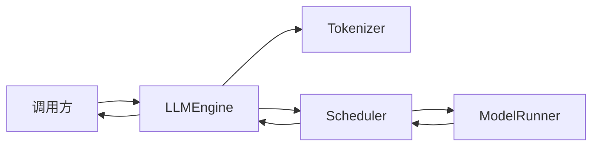
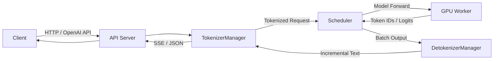
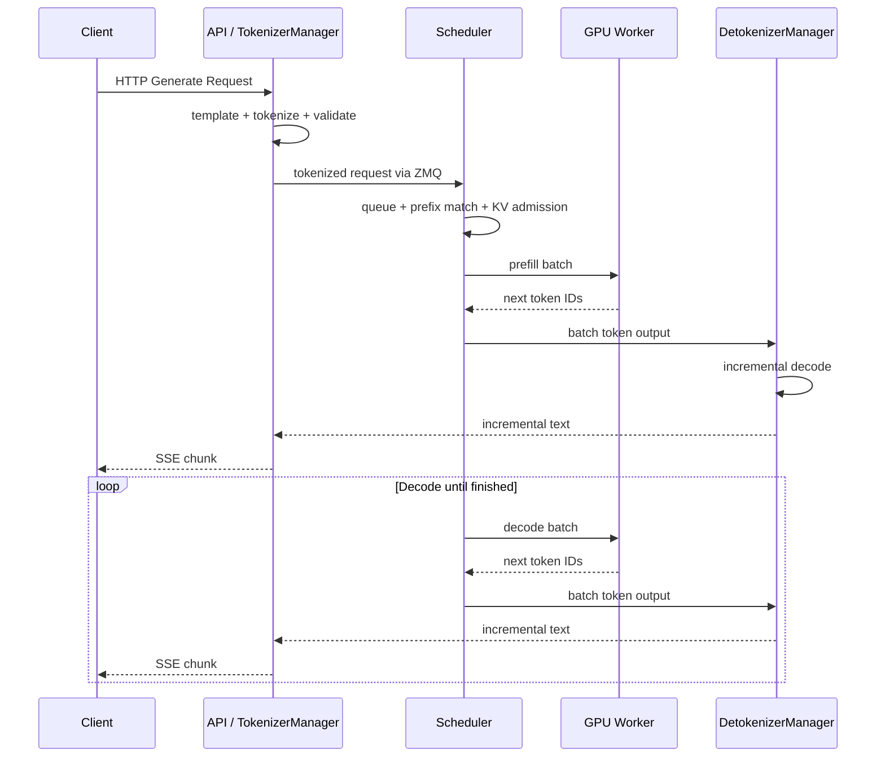
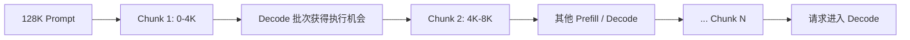

一个大模型推理框架，表面上只做了一件事：接收 Prompt，然后不断返回 Token。

但只要服务开始承载并发请求，问题就会迅速变复杂：HTTP 连接不能阻塞 GPU，分词不能卡住调度器，长 Prompt 不能长期占用一次执行机会，GPU 运行时 CPU 也不应该原地等待；与此同时，请求取消、流式输出、KV Cache 分配和多卡同步还必须保持一致。

理解这类系统最有效的方法，不是直接钻进数万行源码，而是先观察一个足够小的实现，再看生产框架为什么必须增加更多边界。

本文以 [nano-vLLM](https://github.com/GeeeekExplorer/nano-vllm) 作为最小参照，沿着一条请求的完整路径，拆解 SGLang 的四个核心角色：

- API Server：处理协议、连接与流式响应；
- TokenizerManager：把外部请求变成推理运行时能够调度的对象；
- Scheduler：管理批次、KV Cache 与模型执行；
- DetokenizerManager：把增量 Token ID 稳定地还原成文本。

在此基础上，再分析两项关键优化：**Chunked Prefill 如何限制长请求的单次占用时间，Overlap Loop 又如何把 CPU 工作藏到 GPU 执行窗口中。**

本文讨论的是 SGLang SRT 的主干设计。源码目录、参数名称和默认行为会随版本演进，具体部署应以安装版本为准。

## 一、先用 nano-vLLM 建立最小心智模型

nano-vLLM 的价值不在于覆盖生产系统的全部能力，而在于它保留了推理引擎最核心的闭环：请求进入、调度、模型执行、结果更新。

可以把它的主循环抽象成下面几步：

```python
def step():
    sequences, is_prefill = scheduler.schedule()
    token_ids = model_runner.call("run", sequences, is_prefill)
    scheduler.postprocess(sequences, token_ids)
    return collect_finished_sequences()
```

外围的 `generate()` 只需要持续调用 `step()`，直到全部序列结束：

```text
add_request(prompt)
  -> tokenizer.encode(prompt)
  -> scheduler.add(sequence)
  -> while not finished:
       scheduler.schedule()
       model_runner.run()
       scheduler.postprocess()
  -> tokenizer.decode(output_token_ids)
```

这段流程揭示了推理服务的三个基本事实。

第一，**调度器调度的不是字符串，而是带有状态的 Sequence**。它至少要记录输入 Token、输出 Token、当前位置、完成原因以及对应的 KV Cache 块。

第二，**Prefill 和 Decode 是同一序列的两个执行阶段**。新请求先处理整段输入，建立 KV Cache；之后每次只携带最新 Token 进入 Decode，生成下一个 Token。

第三，**模型的一次前向并不等于请求完成**。调度器需要在每轮执行后更新序列状态，把未完成序列重新放回运行集合，再组织下一轮批次。这就是 Continuous Batching 的基本循环。

### 1. 最小实现为什么容易读

在最小实现里，Tokenizer、Scheduler 和 ModelRunner 可以由同一个 `LLMEngine` 直接调用。函数返回值就是组件之间的通信协议，Python 调用栈就是控制流。



这种设计非常适合教学和离线推理，但它隐含了几个前提：调用方可以同步等待；分词和反分词不会影响 GPU 主循环；模型执行期间没有其他 CPU 工作；也不需要同时维护大量 HTTP 流式连接。

### 2. 从函数调用到服务系统

当引擎需要支持在线并发时，以下工作都可能与 GPU 执行互相干扰：

- 解析 OpenAI 兼容请求、校验参数和维护 SSE 连接；
- 执行 CPU 分词、多模态预处理和聊天模板拼接；
- 接收新请求、处理取消、超时与客户端断连；
- 对增量 Token 做反分词，识别停止字符串和输出片段；
- 管理多 GPU Worker、KV Cache 和分布式同步；
- 收集指标、打印日志与处理异常。

如果所有工作都串在一个循环中，任何一次较慢的 CPU 操作都可能制造 GPU 空洞；任何一次较长的 GPU 前向又会延迟网络层处理。因此，SGLang 没有把推理服务做成一个更大的 `step()`，而是把不同节奏的工作拆成若干协作组件。

## 二、SGLang 的整体架构

从逻辑上看，SGLang 的在线服务可以分成控制面、执行面和输出面：



这是一张逻辑图，不应机械理解为“一方框必然对应一个独立进程”。在常见部署中，HTTP Server 与 TokenizerManager 紧密协作，Scheduler 和 DetokenizerManager 则有清晰的进程边界；张量并行、数据并行或多节点部署还会继续扩展 Scheduler 与 Worker 拓扑。

这里最重要的不是进程数量，而是职责边界：

| 组件 | 主要输入 | 核心职责 | 主要输出 |
| --- | --- | --- | --- |
| API Server | HTTP 请求 | 协议适配、鉴权/参数处理、流式连接 | 内部生成请求 |
| TokenizerManager | 文本、采样参数、多模态输入 | 分词、校验、请求生命周期管理 | Token 化请求 |
| Scheduler | Token、运行状态、KV 资源 | 准入、批处理、缓存管理、模型执行 | 增量 Token ID 与完成状态 |
| DetokenizerManager | Token ID、跳过长度、停止条件 | 增量解码、文本拼接、输出清理 | 增量文本 |

### 1. API Server：协议边界，不是推理核心

API Server 面向外部世界。它负责把 `/generate` 或 OpenAI 兼容接口中的字段转换为内部请求，并把内部异步输出包装成 JSON 或 Server-Sent Events。

它关心的是：

- HTTP 请求是否合法；
- 是否启用流式输出；
- 客户端何时断开；
- 错误应映射成什么状态码；
- OpenAI 格式中的 usage、finish reason 如何返回。

它不应该直接决定哪个请求进入下一次 GPU Batch。否则网络协议的变化会渗入调度器，调度器的高频循环也会受 Web 框架影响。

### 2. TokenizerManager：请求生命周期的入口

TokenizerManager 的名字容易让人低估它。它不只是调用一次 `tokenizer.encode()`，还承担外部请求到内部请求之间的适配工作。

典型职责包括：

- 为请求生成或接收唯一的 request ID；
- 应用聊天模板并执行分词；
- 检查输入长度、采样参数和模型能力；
- 处理图像等多模态输入的预处理结果；
- 建立 request ID 到异步结果队列的映射；
- 将 Token 化请求发给 Scheduler；
- 接收增量文本并唤醒对应的 HTTP 流。

可以把 TokenizerManager 理解为一个异步请求代理。它一端面对延迟不确定的客户端连接，另一端面对高吞吐、批量化的推理运行时。

### 3. Scheduler：系统真正的控制中心

Scheduler 是 SGLang Runtime 的核心。它既做传统意义上的请求排序，也管理执行所需的资源状态。

一次调度决策至少需要同时考虑：

- 等待队列里有哪些新请求；
- 当前运行 Batch 中有哪些 Decode 请求；
- 本轮最多允许处理多少 Token；
- KV Cache 还有多少可用块；
- 请求已有多少前缀可以复用；
- 是否存在尚未完成的 Chunked Prefill；
- 某些请求是否已取消或满足停止条件；
- 模型、量化后端或投机解码是否带来额外约束。

因此，Scheduler 不只是一个优先队列。它同时维护请求状态机、内存账本和 GPU 提交顺序。

### 4. DetokenizerManager：为什么需要独立输出阶段

模型输出的是 Token ID，而客户端需要文本。最直接的做法，是每生成一个新 Token 就对全部输出重新执行一次 `decode()`；随着输出变长，这会重复扫描越来越长的 Token 序列。

增量反分词还存在语义问题：

- 一个 Unicode 字符可能跨越多个 Token；
- SentencePiece/BPE 的空格规则依赖相邻 Token；
- 特殊 Token 可能需要跳过；
- 停止字符串可能跨越两次增量输出边界；
- 流式输出不能把不完整字符发给客户端。

DetokenizerManager 会维护已读位置和一小段安全上下文，只解码新增区域，并把确认稳定的文本片段发回 TokenizerManager。把这项 CPU 工作移出 Scheduler 的关键循环，可以减少 GPU 提交之间的停顿。

## 三、ZMQ 如何把这些组件连成一条流水线

组件拆开之后，需要一套进程间通信机制。SGLang 使用 ZeroMQ 建立内部消息通道，传输 Token 化请求、批次输出、控制消息和运行状态。

从请求方向看，主路径是：

```text
API Server / TokenizerManager
  -- TokenizedGenerateReqInput --> Scheduler
  -- AbortReq ------------------> Scheduler

Scheduler
  -- BatchTokenIDOutput --------> DetokenizerManager

DetokenizerManager
  -- BatchStrOutput ------------> TokenizerManager
```

实际源码中还存在权重更新、健康检查、缓存操作、Embedding 请求和并行拓扑等消息类型，但主干仍然是“文本进入，Token ID 穿过执行面，文本回来”。

### 1. 为什么不是普通函数调用

ZMQ 带来的第一个收益是**节奏解耦**。TokenizerManager 可以继续接收请求，Scheduler 按 GPU 节奏批量消费；DetokenizerManager 也可以在 Scheduler 提交下一轮前向时处理上一轮输出。

第二个收益是**故障与资源隔离**。Tokenizer 是 CPU 密集组件，模型 Worker 持有 CUDA 上下文和大量显存。进程边界能避免 Python 线程调度、Web Server 生命周期和 CUDA 运行时过度耦合。

第三个收益是**拓扑可扩展**。本机进程可使用 IPC 通道，多节点或更复杂的并行部署可以在相同消息边界上扩展，而不必让 HTTP 层理解张量并行细节。

### 2. ZMQ 不会自动解决背压

消息队列不是无限缓冲区。如果入口持续快于 GPU，等待队列仍然会增长；如果 Detokenizer 或客户端消费过慢，输出也会积压。

一个生产系统仍然需要明确：

- 队列高水位和最大并发；
- 请求长度与输出长度上限；
- 超时和取消能否及时传到 Scheduler；
- 客户端断开后是否释放 KV Cache；
- 进程退出时未完成请求如何失败；
- 指标中的排队时间从哪一层开始计算。

因此，ZMQ 是组件之间的传输机制，不是流量治理策略。

## 四、一条请求如何穿过整个系统

下面沿着一条流式生成请求，观察每个阶段发生了什么。



### 1. 请求进入

API Server 解析请求后，TokenizerManager 创建 request ID，把文本转成 `input_ids`，并保存一个等待结果的异步通道。请求随后通过内部消息发送给 Scheduler。

这里已经发生了一次重要转换：外部世界中的“一个 HTTP 请求”，变成了运行时中的“一个可被暂停、分块、合批和取消的生成对象”。

### 2. Prefill 准入

Scheduler 收到请求后不会立即执行。它先检查输入是否合法、缓存资源是否足够、本轮 Token Budget 是否允许，并查询已有前缀缓存。

若 Prompt 有 `L` 个 Token，其中 `P` 个 Token 已命中前缀缓存，本次真正需要 Prefill 的长度约为：

```text
uncached_tokens = L - P
```

这里的 `P` 将由 Radix Cache 等前缀缓存结构决定。本文暂时只把它当作 Scheduler 的一个输入：**缓存命中会改变请求的实际计算成本，也就会改变调度决策。**

### 3. GPU 执行与状态更新

Scheduler 将若干 Prefill 或 Decode 请求组织成 Batch，准备位置、KV Cache 地址和采样元数据，然后调用 Model Worker。

GPU 返回后，Scheduler 需要：

- 把新 Token 追加到请求状态；
- 更新已生成长度和 KV Cache 占用；
- 判断 EOS、长度上限和其他停止条件；
- 将完成请求移出运行集合；
- 回收不再使用的缓存块；
- 把需要输出的 Token ID 发给 DetokenizerManager。

未完成请求保留在 Running Batch 中，等待下一轮 Decode。新请求则可以在后续轮次动态加入，这就是 Continuous Batching 与静态 Batch 的根本区别。

### 4. 文本返回

DetokenizerManager 收到 Token ID 后生成稳定的增量文本，再按 request ID 返回 TokenizerManager。后者找到相应的异步等待者，将文本片段送入 HTTP 流。

请求结束时，完成原因也沿这条链路返回。对于客户端来说，它只看到了连续的文本；在服务内部，这段文本已经跨过多个进程和许多次 GPU Batch。

## 五、Scheduler 每一轮究竟在做什么

忽略不同模型后端的细节，一个非 Overlap 的调度循环可以近似写成：

```python
while True:
    recv_requests()
    process_control_messages()

    batch = get_next_batch()
    if batch is None:
        wait_or_idle()
        continue

    result = run_batch(batch)
    process_batch_result(batch, result)
```

`get_next_batch()` 并不是简单地从队头取 N 条请求。它需要在“接纳新 Prefill”和“继续现有 Decode”之间分配 GPU 时间。

### 1. Waiting Queue 与 Running Batch

可以把 Scheduler 的核心状态简化为两个集合：

```text
Waiting Queue
  新到请求，尚未完成 Prefill 准入

Running Batch
  已有 KV Cache，可继续 Decode 的请求
```

新请求希望尽早 Prefill，以降低 TTFT；运行请求希望稳定 Decode，以降低 ITL。两者会争夺同一个 GPU。

如果调度器只偏爱新请求，大量 Prefill 会让已有流式输出不断停顿；如果只照顾 Running Batch，新请求又可能长期得不到首 Token。SGLang 的调度优化，本质上都在处理这组矛盾。

### 2. 两本账：Token Budget 与 KV Budget

调度器至少要维护两种不同资源预算。

**计算预算**通常以本轮可处理的 Token 数描述：

```text
scheduled_prefill_tokens + scheduled_decode_tokens
  <= step_token_budget
```

**缓存预算**描述执行后需要保留多少 KV：

```text
allocated_kv_tokens + newly_required_kv_tokens
  <= available_kv_capacity
```

两者不能混为一谈。一个 Prefill 请求可能本轮计算量很大，但生成结束后很快释放；一个长输出 Decode 每轮只计算一个新 Token，却会持续持有不断增长的 KV Cache。

当 KV 空间不足时，调度器可能无法接纳新请求，甚至需要暂停或撤回部分运行请求。吞吐优化如果忽略缓存峰值，最终会变成 OOM 或频繁重算。

### 3. 调度策略不是越复杂越好

常见策略可以按到达顺序服务，也可以把缓存命中长度、请求大小或优先级纳入排序。缓存感知策略可能减少 Prefill 计算，但也可能让不命中的请求等待更久。

评估策略时不能只看总 Token/s，还应同时观察：

- TTFT 的 P50、P95 和 P99；
- Decode 的 TPOT/ITL；
- 请求完成率和取消率；
- Prefill 与 Decode 的有效 Token 吞吐；
- KV Cache 命中率与驱逐量；
- 不同输入长度请求的等待时间分布。

调度器的目标不是让某个微基准数字最大，而是在给定 SLO 下提高 Goodput。

## 六、Chunked Prefill：不让长 Prompt 一次占满执行窗口

假设 GPU 正在为一批用户逐 Token 输出，此时进入一个 128K Token 的长文档请求。如果 Scheduler 把它作为一个完整 Prefill 一次提交，GPU 需要执行一个很长的前向过程。在这段时间里，正在 Decode 的请求无法产生新 Token，用户会看到明显卡顿。

Chunked Prefill 的思路很直接：**不要改变请求总工作量，而是限制它每轮最多推进多少输入 Token。**

假设一个请求还有 `N` 个未缓存输入 Token，Chunk 大小为 `C`，它需要的 Prefill 轮数近似为：

```text
prefill_steps = ceil(N / C)
```

128K Token 的请求若使用 4K Chunk，会被拆成约 32 个执行片段。每个片段完成后都保留已生成的 KV Cache，下一片段只继续处理后续 Token，并关注此前上下文。



### 1. 它解决的是 Head-of-Line Blocking

不分块时，单个长 Prefill 的执行时间直接成为其他请求本轮的等待时间。分块以后，最长连续占用时间受 Chunk 大小约束，调度器可以在块之间重新决策。

这带来三项主要收益：

- 降低长 Prefill 对 Decode ITL 的冲击；
- 让短请求有机会插入，改善队列公平性；
- 控制单轮 Token 数和临时内存峰值。

注意，Chunked Prefill 通常不会凭空减少这个长请求所需的总计算。它主要改变工作被切分和穿插的方式。

### 2. Mixed Chunk 进一步利用 Batch 空间

仅仅分块，仍然可能采用“这一轮只做 Prefill、下一轮只做 Decode”的交替方式。若模型后端支持混合执行，调度器还可以把 Prefill Chunk 和若干 Decode Token 放进同一个 Forward Batch。

例如，本轮预算为 4096 个 Token：

```text
3072 tokens: 长请求的一个 Prefill Chunk
1024 tokens: 1024 条运行序列各 Decode 1 Token
```

这种 Mixed Chunk 能更细粒度地共享执行机会，但 Batch 的元数据、注意力形状和内核调度也会更复杂。是否启用、默认值如何以及哪些后端兼容，都应以具体 SGLang 版本为准。

### 3. Chunk 大小是一项 SLO 权衡

Chunk 太大：

- 单轮 Prefill 时间仍然较长；
- Decode 更容易出现尾延迟尖峰；
- 长请求对短请求的干扰更明显。

Chunk 太小：

- Forward 次数和调度开销增加；
- GPU Kernel 可能无法形成理想规模；
- 长请求自身 TTFT 可能上升；
- 更多中间状态会增加实现和管理成本。

因此，Chunk Size 不应脱离负载选择。长文档离线摘要和在线聊天服务需要的配置不同。合理方法是固定代表性输入/输出分布，扫描 Chunk Size，并同时记录长请求 TTFT、普通请求 ITL 和总 Goodput。

### 4. 一个常见误解

“切成 32 块”不意味着注意力只在每个 4K 块内部计算。后续 Chunk 仍然必须关注此前上下文，已有部分通过 KV Cache 提供。分块改变的是执行边界，不是模型的因果语义。

## 七、Overlap Loop：不要让 CPU 和 GPU 轮流等待

Chunked Prefill 解决的是请求之间如何分享 GPU，Overlap Loop 解决的是一次调度迭代内部 CPU 与 GPU 如何并行。

### 1. 同步循环中的空洞

在最直观的同步循环里，时间线如下：

```text
CPU: [准备 Batch N]             [处理结果 N] [准备 Batch N+1]
GPU:                [执行 N]                                  [执行 N+1]
```

CPU 准备 Batch 时 GPU 没有新工作；GPU 执行时 CPU 又可能阻塞等待结果。处理输出、采样元数据、完成判断、回收缓存和接收请求，都会落在两次 GPU 执行之间。

如果单轮 Decode 很短，即使 CPU 只花几百微秒，也可能形成明显比例的调度开销。

### 2. Overlap 的基本时序

Overlap Scheduler 会保留流水线中的上一批状态。提交 Batch N 的 GPU 工作后，CPU 不立即同步等待，而是处理 Batch N-1 的结果，并为后续工作做准备。

```text
时间  ------------------------------------------------------>

GPU:  [ Batch N-1 ] [      Batch N      ] [   Batch N+1   ]
CPU:        [提交 N] [处理 N-1 / 收请求] [处理 N / 收请求]
```

伪代码可以写成：

```python
last_batch = None
last_result = None

while True:
    recv_requests()
    current_batch = get_next_batch()
    current_result = run_batch_async(current_batch)

    if last_batch is not None:
        process_batch_result(last_batch, last_result)

    last_batch = current_batch
    last_result = current_result
```

真实实现需要处理异步 CUDA 执行、Worker Client、结果就绪事件和多种 Batch 类型，但核心思想不变：**用当前批次的 GPU 时间覆盖上一批次的 CPU 后处理。**

### 3. 被重叠的 CPU 工作有哪些

可被放进重叠窗口的工作通常包括：

- 读取并整理上一轮输出 Token；
- 更新请求长度、完成状态和统计信息；
- 处理停止条件与请求取消；
- 向 DetokenizerManager 发送输出；
- 接收入口的新请求与控制消息；
- 准备下一轮的一部分调度元数据。

并非所有工作都能任意提前。下一轮 Decode 依赖上一轮采样出的 Token，KV Cache 的释放也依赖完成状态，因此实现必须明确哪些状态属于 Batch N，哪些状态可以被 Batch N+1 读取。

### 4. Overlap 的难点是状态一致性

同步代码天然满足“处理完 N，再开始 N+1”。引入 Overlap 后，系统同时持有当前批次和上一批次，以下问题都会变得敏感：

- 请求在 GPU 执行期间被客户端取消；
- 上一批结果显示请求已完成，但下一批元数据已部分准备；
- KV 块何时可以安全释放和复用；
- 统计指标应该归到提交时间还是完成时间；
- 异常发生时，哪一批请求已经执行、哪一批尚未提交；
- 多个并行 Rank 是否对批次顺序有一致认识。

所以 Overlap 不是简单地添加一个后台线程。它把同步状态机变成了一个浅流水线，需要批次级所有权和严格的生命周期管理。

### 5. Overlap 什么时候收益明显

可以用一个简化模型理解收益。同步迭代耗时近似为：

```text
T_sync = T_cpu + T_gpu
```

理想重叠后，稳态迭代耗时趋近于：

```text
T_overlap ≈ max(T_cpu, T_gpu) + T_unhidden
```

若 CPU 后处理为 0.5 ms，GPU Forward 为 2 ms，同步总计约 2.5 ms；理想重叠后接近 2 ms，再加无法隐藏的依赖开销。对于大量短 Decode Step，这类差异会累积成显著吞吐提升。

但如果 GPU 单步非常长，CPU 开销本来就占比极小，Overlap 的相对收益有限；如果 CPU 比 GPU 更慢，流水线仍会受 CPU 阶段限制。最终要看时间线，而不是只看 GPU 利用率均值。

## 八、Chunked Prefill 与 Overlap Loop 解决的是两个维度

这两项优化经常一起出现，但不能混为一谈。

| 机制 | 主要矛盾 | 优化对象 | 主要收益 | 主要代价 |
| --- | --- | --- | --- | --- |
| Chunked Prefill | 长 Prefill 与在线 Decode 争抢 GPU | 请求之间的执行粒度 | 公平性、ITL、内存峰值 | 更多调度轮次，长请求 TTFT 可能增加 |
| Mixed Chunk | Prefill 与 Decode 的 Batch 空间未充分共享 | 单次 Forward 的 Token 组成 | 提高 Batch 利用率 | 内核与元数据更复杂 |
| Overlap Loop | CPU 后处理与 GPU 执行串行 | 单个迭代内的执行流水线 | 减少 GPU 空洞，提高吞吐 | 状态机与异常处理更复杂 |

可以把它们放进同一张时间图：

```text
请求维度：  [长 Prefill Chunk 1] [Decode] [Chunk 2] [Decode] ...
执行维度：       GPU 执行 N      与      CPU 处理 N-1       重叠
```

前者决定“GPU 下一轮做谁的工作”，后者决定“GPU 做这一轮时 CPU 在做什么”。

## 九、对比 nano-vLLM：复杂度究竟换来了什么

回到最初的最小实现，可以更清楚地看到 SGLang 每一层复杂度的来源。

| 维度 | nano-vLLM 心智模型 | SGLang Runtime |
| --- | --- | --- |
| 使用方式 | Python 内嵌、教学与离线生成 | 在线服务、OpenAI 兼容 API |
| 控制流 | 单进程同步 `step()` | 多组件异步流水线 |
| 分词 | Engine 直接调用 | TokenizerManager 管理入口与生命周期 |
| 调度 | Waiting/Running 的最小 Continuous Batching | 缓存感知、分块、并行和多种请求类型 |
| 输出 | 完成后统一 decode 为主 | Detokenizer 增量输出与流式返回 |
| 通信 | Python 函数调用 | ZMQ 消息 + Worker 通信 |
| CPU/GPU 关系 | 顺序执行，便于理解 | Overlap Loop 隐藏 CPU 开销 |
| 长 Prefill | 受简单 Token Budget 约束 | Chunked Prefill / Mixed Chunk |
| KV Cache | Paged Cache 基础管理 | 与前缀缓存、调度策略和并行拓扑结合 |

nano-vLLM 并不是“错误的 SGLang”，SGLang 也不是“加了更多类的 nano-vLLM”。两者面向的系统边界不同。

最小实现优先保证概念可见：每轮发生了什么，可以沿调用栈直接追踪。生产实现优先保证不同工作负载互不阻塞：网络、CPU、GPU 和输出各自按合适节奏运行，再通过消息和状态机汇合。

## 十、如何阅读 SGLang 源码

直接从 CUDA Kernel 开始，往往会失去请求生命周期。更有效的顺序是沿数据流阅读。

### 第一步：找到服务入口

先看 HTTP 路由如何调用 TokenizerManager，确认普通生成、OpenAI 接口和流式输出最终汇聚到哪里。重点记录 request ID 在哪创建，异步生成器何时结束。

### 第二步：追踪内部消息类型

找到“Token 化请求”“Batch Token 输出”“Batch 文本输出”等数据结构。消息字段比类名更能说明组件契约：哪些状态跨进程，哪些状态只属于 Scheduler。

### 第三步：阅读 Scheduler 主循环

先忽略模型细节，只回答四个问题：

1. 新请求何时被接收？
2. Prefill Batch 如何形成？
3. Running Batch 如何继续 Decode？
4. 结果在何处更新请求与释放 KV？

之后再分别进入 Chunked Prefill、Overlap、投机解码和并行执行分支。

### 第四步：画出请求状态机

建议为一个请求记录如下状态：

```text
RAW
  -> TOKENIZED
  -> WAITING
  -> PREFILLING
  -> RUNNING / DECODING
  -> FINISHED | ABORTED | ERROR
```

遇到每一段源码，都问它在改变哪个状态、由谁持有资源、异常时由谁清理。这样比记忆函数名更可靠。

### 第五步：最后再看缓存结构

当请求路径和调度循环已经清晰，再看 Radix Cache 会容易得多。此时可以明确缓存不是独立插件，而是 Scheduler 的成本模型和内存模型的一部分：它既回答“已有多少 Token 不必重算”，也影响“哪些 KV 块暂时不能释放”。

## 十一、调优时应观察什么

只看 GPU Utilization 容易得出错误结论。一个 GPU 利用率很高的服务，可能正被长 Prefill 占满，而在线请求的 ITL 已经不可接受。

建议至少建立以下观测面：

| 层次 | 指标 | 用来判断什么 |
| --- | --- | --- |
| 入口 | 请求到达率、排队长度、取消率 | 是否过载，背压是否生效 |
| Tokenizer | tokenize 延迟、输入长度分布 | CPU 入口是否成为瓶颈 |
| Scheduler | waiting/running 数、每轮 Batch Token 数 | 调度是否形成有效批次 |
| Prefill | TTFT、Chunk 数、Prefill Token/s | 长请求的首 Token 成本 |
| Decode | TPOT/ITL、Decode Token/s | 流式生成是否稳定 |
| Cache | KV 使用率、命中长度、驱逐与重算 | 内存和复用是否有效 |
| 执行 | CPU gap、GPU kernel 时间、同步时间 | Overlap 是否真的隐藏开销 |
| 输出 | Detokenize 延迟、发送队列长度 | 输出链路是否反压运行时 |

验证 Chunked Prefill 时，应按输入长度分组观察 ITL 和 TTFT；验证 Overlap 时，应使用 GPU Timeline 或运行时 Trace 确认 CPU 工作确实落入 GPU 执行窗口。仅比较两个配置下的平均 Token/s，无法解释收益来自哪里。

## 十二、把整个系统压缩成一个判断框架

理解 SGLang，可以记住下面四层问题：

```text
协议层：请求怎样进入、怎样流式返回？
  -> API Server + TokenizerManager

调度层：下一轮执行哪些请求、多少 Token？
  -> Scheduler + Chunked Prefill

执行层：CPU 准备、GPU Forward、结果处理怎样并行？
  -> Model Worker + Overlap Loop

状态层：KV Cache 由谁持有，哪些前缀可以复用？
  -> Memory Pool + Radix Cache
```

nano-vLLM 把这四层折叠在一个清晰的同步循环里，让我们看见推理引擎的骨架；SGLang 再把它展开为异步组件和流水线，使它能够承载真实在线流量。

Chunked Prefill 和 Overlap Loop 也可以用一句话区分：**前者切分 GPU 工作以改善请求之间的公平性，后者流水化 CPU/GPU 工作以提高一次调度循环内部的效率。**

到这里，还有一个关键问题没有展开：当大量请求共享 System Prompt、对话历史或模板时，Scheduler 如何快速判断最长可复用前缀，如何让共享 KV Cache 被多个请求引用，又如何在显存不足时安全淘汰？

这正是下一篇要拆解的核心：**Radix Cache。**

## 延伸阅读

- [大模型推理服务：从显存预算到延迟与吞吐](../llm-inference-serving-memory-latency-throughput/)
- [PD 分离：从 Prefill/Decode 干扰到可扩展的大模型推理架构](../llm-prefill-decode-disaggregation/)

## 参考资料

1. [SGLang GitHub Repository](https://github.com/sgl-project/sglang)。
2. [SGLang: Efficient Execution of Structured Language Model Programs](https://arxiv.org/abs/2312.07104)。
3. [SGLang `TokenizerManager` Source](https://github.com/sgl-project/sglang/blob/main/python/sglang/srt/managers/tokenizer_manager.py)。
4. [SGLang `Scheduler` Source](https://github.com/sgl-project/sglang/blob/main/python/sglang/srt/managers/scheduler.py)。
5. [SGLang `DetokenizerManager` Source](https://github.com/sgl-project/sglang/blob/main/python/sglang/srt/managers/detokenizer_manager.py)。
6. [SGLang IPC Structures (`io_struct.py`)](https://github.com/sgl-project/sglang/blob/main/python/sglang/srt/managers/io_struct.py)。
7. [SGLang Server Arguments](https://docs.sglang.ai/advanced_features/server_arguments.html)。
8. [nano-vLLM GitHub Repository](https://github.com/GeeeekExplorer/nano-vllm)。
9. [ZeroMQ Guide](https://zguide.zeromq.org/)。

本文用伪代码提炼调度逻辑，并不对应某个版本的逐行源码。SGLang 迭代较快，生产配置应固定版本，并结合该版本的源码、Server Arguments 与实际 Trace 验证。
