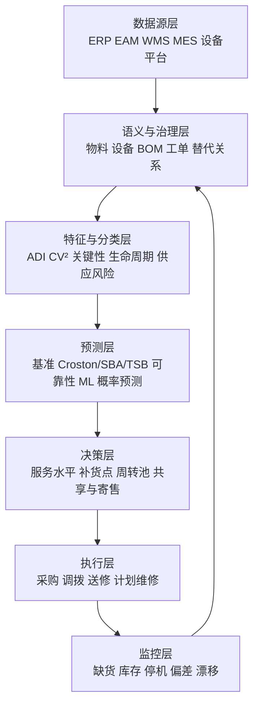

# 备件需求分析：从间歇性预测到库存与保障决策

一家制造企业有 3 万多个备件编码。过去三年里，超过一半的备件没有发生过领用，约四分之一只领用过一两次，少数常用消耗件却几乎每周都在出库。

如果按历史平均需求备货，大量低频备件会因为“平均值大于零”而被逐个采购，最终形成长期不动库存。如果只根据最近领用量压缩库存，关键设备发生故障时又可能因为一个低价值轴承、密封件或控制模块无法及时到货而停机。更麻烦的是，仓库记录的“领用”并不总等于真实消耗：有些是班组提前囤料，有些是检修项目集中领料，有些是缺货后用替代件完成维修，还有些需求因为没有库存而根本没有被完整记录。

这使备件需求分析不同于普通商品销售预测。商品预测通常关心未来卖出多少，备件分析则必须同时回答：

- 什么事件会触发需求；
- 需求为什么长时间为零，又为什么突然集中出现；
- 哪些需求可以由历史消耗预测，哪些必须由维修计划、装机规模和故障机理推导；
- 预测的不确定性如何转化为安全库存、补货点和服务水平；
- 当资金有限时，哪些备件值得优先保障，哪些可以共享、寄售、维修或按需采购。

因此，备件需求分析不应被理解为“给每个物料跑一个预测模型”，而应被理解为一个连接设备、维修、供应链和库存决策的闭环：

```text
设备与维修事件
  ↓
形成潜在备件需求
  ↓
经过库存、采购和领用流程被观测
  ↓
识别需求类型与关键性
  ↓
预测提前期内的需求分布
  ↓
制定储备、补货、维修与共享策略
  ↓
用缺货、库存和设备保障结果验证
```

---

## 一、备件需求分析的目标不是预测得准，而是保障得好

备件管理天然存在两个方向相反的风险。

一边是缺货风险。关键部件缺失可能延长平均修复时间，使设备停机从数小时扩大到数天。备件本身可能只值几百元，但对应的停产、延期、质量和安全损失可能高出几个数量级。

另一边是库存风险。备件通常品种多、通用性弱、周转慢，且会因设备改造、型号升级、供应商停产或材料老化而失去价值。为了避免一次缺货而给每个编码配置高库存，会迅速占用大量资金和库容。

所以，备件需求分析真正优化的是一个综合决策：

```text
期望总成本
= 持有成本
+ 订货与运输成本
+ 缺货和停机损失
+ 紧急采购成本
+ 报废与淘汰损失
+ 维修周转成本
```

这也解释了为什么预测误差最小的模型不一定是最好的模型。一个模型即使 MAE 更低，如果持续低估关键备件在采购提前期内的需求，仍可能造成严重缺货；另一个模型即使点预测误差略高，但能够给出校准良好的需求概率和分位数，反而更适合制定库存策略。

备件分析至少应同时评价三类结果：

| 层次 | 核心问题 | 典型指标 |
| --- | --- | --- |
| 预测层 | 数量和需求概率估计得怎样 | Bias、MAE、MASE、概率校准 |
| 库存层 | 库存策略能否满足需求 | Fill Rate、缺货次数、平均库存、周转率 |
| 保障层 | 是否改善设备与业务结果 | 等待备件停机时长、MTTR、紧急采购成本、报废金额 |

只评价第一层，容易把项目做成算法比赛；只有三层贯通，预测才能成为可执行的业务能力。

---

## 二、备件需求为什么比普通需求更难

### 1. 大量时间段没有需求

许多备件在按周或按月统计时会出现连续的零值。零需求不代表该物料没有价值，只表示在这个时间段内没有触发更换事件。对安全关键但故障率很低的部件来说，“多数月份为零”恰恰是正常状态。

### 2. 非零需求的间隔不规则

同一备件可能两个月没有需求，第三个月领用一个，随后半年没有需求，又在一次集中检修中领用五个。需求到达间隔本身是随机变量，普通指数平滑把每个零值都视为需求水平下降，可能产生系统性偏差。

### 3. 非零需求量也可能剧烈波动

一次故障通常只更换一个部件，计划检修却可能同时更换多台设备的同类部件。项目领料、批量预防更换、质量召回和事故修复都会形成块状需求。

### 4. 需求受设备生命周期影响

新设备早期可能因安装、调试和制造缺陷出现早期故障；稳定期故障率较低；老化期则可能因磨损、疲劳和腐蚀而上升。设备退役后，部分备件需求会快速下降，部分专用件却可能因为最后一批设备缺少替代方案而需要末次采购。

### 5. 观测到的出库量不等于真实需求

设某期真实需求为 `D_t`，实际发料量为 `I_t`，当库存不足时：

```text
I_t = min(D_t, 可用库存_t)
```

如果系统只保存发料量，那么缺货部分会从数据中消失。直接对 `I_t` 建模，会把受库存约束的结果误认为市场或维修需求下降，这属于典型的需求截断问题。

### 6. 业务行为会反过来改变数据

维修班组担心缺货，可能一次多领几个放在现场；采购人员为了满足最小订货量，可能批量下单；多个旧编码被新编码替代后，单个编码看起来需求下降，但物料族总需求并未改变。需求数据不是自然生成的纯净信号，而是业务规则和人员行为共同作用的结果。

---

## 三、先理解需求是怎样形成的

备件需求至少有四条形成路径，不能用同一种方法处理。

### 1. 故障驱动需求

设备发生随机故障后需要更换部件。其需求取决于装机数量、运行强度、环境、故障率、维修策略和部件可修复性。

如果共有 `N` 台同类设备，单台设备在未来周期内需要更换某部件的概率为 `p`，且每次故障消耗一个备件，那么简单情况下：

```text
E[D] = N × p
```

当设备年龄、工况和部件版本不同，应该按设备或设备群分别计算：

```text
E[D] = Σ N_g × p_g
```

这里的关键不是公式复杂度，而是把需求与真实装机基础连接起来。相同的历史领用量，在装机量从 100 台增长到 200 台后代表完全不同的故障水平。

### 2. 计划维修驱动需求

大修、定修、保养和法定检验通常在工单或计划中提前出现。此类需求具有较强的确定性，应优先由维修计划、BOM 和更换标准计算，而不是让时间序列模型猜测。

计划需求可以表示为：

```text
计划需求 = Σ 计划维修设备数 × 单台标准用量 × 预计更换比例
```

预计更换比例需要结合拆检结果、部件寿命和历史实际更换率修正。把“所有计划检查”直接视为“全部更换”，往往会高估需求。

### 3. 消耗驱动需求

滤芯、润滑剂、密封材料、紧固件和清洁用品等消耗件，通常与运行小时、产量、启停次数或保养频次相关。这类需求可能相对连续，可以使用回归、指数平滑或带外生变量的模型。

### 4. 项目与变更驱动需求

设备改造、新产线建设、集中技改、质量整改和供应商停产会产生一次性需求。它们在历史序列中表现为异常峰值，但对未来未必可重复。分析时应把项目需求与日常维护需求拆开，否则模型会把一次性事件错误外推。

最终可以把总需求拆为：

```text
总需求
= 随机故障需求
+ 计划维修需求
+ 稳定消耗需求
+ 项目与一次性需求
+ 人工调整
```

这种分解比直接对总领用量拟合一个黑盒模型更有解释性，也更容易由维修、设备和供应链部门共同审核。

---

## 四、先定义正确的对象和时间边界

### 1. 预测对象不一定是单个物料编码

企业常把 SKU 作为天然建模单位，但编码并不总等于业务需求对象。以下情况需要先处理物料关系：

- 新旧编码替代；
- 多个供应商编码对应同一规格；
- 同一备件适用于多个设备；
- 成套件可以拆分领用；
- 可修复件存在新件、旧件、送修件和在修件状态；
- 左右件、不同版本或不同材料不能完全互换。

如果替代关系明确，历史需求应迁移或聚合到可比的物料族；如果替代存在条件，则应在主数据中保留适用范围和转换规则，不能简单合并。

### 2. 时间颗粒度必须匹配决策周期

日粒度对低频备件会产生几乎全零的序列，月粒度又可能掩盖采购提前期内的风险。选择粒度时应考虑补货策略、供应商交付周期、维修计划更新频率、样本量和流程性集中领料。多数企业可以以周或月作为分析粒度，但库存计算最终应关注**提前期需求**，而不是执着于单期预测。

### 3. 决策时点决定可用数据

假设每月 25 日生成下月采购计划，那么模型只能使用 25 日之前已知的信息。月底完成的维修、事后补录的领用和后来确认的故障原因都不能泄漏到训练特征中。应为每类特征记录“业务发生时间”和“系统可见时间”，否则离线模型可能使用未来信息。

### 4. 需求与供应必须分开建模

需求分析回答未来可能需要多少，供应分析回答何时能够补到。采购提前期不是固定常数，而可能包含供应商生产、运输、质检、入库和审批时间，并受停产、进口、最低起订量和加急能力影响。

```text
缺货风险 = P(提前期内累计需求 > 当前库存位置)
```

库存位置通常包括现有库存、在途订单和待修复回件，并扣除已分配或欠交数量。

---

## 五、建立可分析的数据底座

备件需求项目经常不是败在模型上，而是败在编码、时间和业务语义无法对齐。

| 数据域 | 关键字段 | 主要用途 |
| --- | --- | --- |
| 备件主数据 | 编码、规格、单位、单价、可修复性、替代关系 | 统一分析对象 |
| 设备台账 | 设备、型号、位置、投运时间、状态、关键性 | 建立装机基础 |
| 设备 BOM | 设备与部件关系、单机用量、适用版本 | 将维护事件映射到备件 |
| 库存流水 | 出库、退库、调拨、盘点、报废及时间 | 重建实际库存变化 |
| 维修工单 | 故障、设备、部位、措施、工时、换件记录 | 识别需求原因 |
| 采购数据 | 下单、承诺、到货、质检、价格、供应商 | 估计真实提前期 |
| 维修计划 | 保养、大修、技改、计划日期和范围 | 推导确定性需求 |
| 运行数据 | 运行小时、产量、负载、启停、环境 | 解释消耗和故障变化 |

一次备件需求可能跨越多个系统：故障发生、创建工单、申请领料、仓库发料、完成维修、退回旧件、创建采购、供应商到货。建议建立统一事件链，至少保留故障发生、需求提出、期望满足、实际发料、维修完成和缺货关闭时间。

数据治理还应重点处理退库冲销、现场库存、单位换算、替代领用和集中补录。异常峰值不能自动删除：它可能是录入错误，也可能是大修、事故、批量质量问题或季节性工况。正确做法是先发现异常，再关联工单和项目解释，最后决定它是否进入未来基线。

---

## 六、用需求特征建立第一层分类

Croston 方法的提出，是因为传统指数平滑不适合大量零需求的序列[1]。后续研究进一步指出，间歇性需求不只取决于零值多少，还取决于非零需求量本身的波动[2][3]。

### 1. 平均需求间隔 ADI

若观察期长度为 `T`，其中有 `N` 个非零需求期：

```text
ADI = T / N
```

ADI 越大，表示需求发生越稀疏。例如观察 24 个月，只在 6 个月出现需求，则 `ADI = 4`。

### 2. 非零需求平方变异系数 CV²

只对非零需求量计算均值 `μ` 和标准差 `σ`：

```text
CV² = (σ / μ)²
```

CV² 越大，表示每次需求量越不稳定。

### 3. 经典四象限分类

Syntetos、Boylan 和 Croston 提出的分类思路，常以 `ADI = 1.32` 和 `CV² = 0.49` 作为经验分界[3]：

| 类型 | ADI | CV² | 典型特征 |
| --- | ---: | ---: | --- |
| 平稳 Smooth | 较低 | 较低 | 经常发生，数量稳定 |
| 波动 Erratic | 较低 | 较高 | 经常发生，数量波动大 |
| 间歇 Intermittent | 较高 | 较低 | 间隔长，单次数量较稳定 |
| 块状 Lumpy | 较高 | 较高 | 间隔长，单次数量也不稳定 |

这组阈值适合做初始画像，不应被当成跨企业不变的自然定律。时间粒度一变，ADI 就会变化；业务服务水平、成本结构和样本长度不同，最优分类边界也可能不同。企业应使用历史回测和库存仿真验证阈值。

仅有 ADI 和 CV² 不足以支持库存决策，还应计算零需求比例、最长连续零需求期、距最近一次需求的时间、需求间隔波动、非零需求量分位数、趋势和突变、缺货期间、装机量变化以及计划需求占比。尤其是“距最近一次需求的时间”，对识别正在衰退或淘汰的备件很重要。TSB 方法正是通过持续更新需求发生概率，使长期不再发生需求的物料预测逐步下降[5]。

---

## 七、第二层分类必须加入价值、关键性和供应风险

需求模式回答“怎样预测”，却不能单独回答“怎样管理”。一个每月消耗十个的普通滤芯和一个五年才可能使用一次的主轴模块，不能只按频率排序。

### 1. 价值分类

ABC 通常按年度消耗金额排序：

```text
年度消耗金额 = 年需求量 × 单价
```

它适合识别资金占用重点，但会把低频、高关键性的低价备件排到 C 类。因此 ABC 只能反映经济价值，不能替代关键性评价。

### 2. 关键性分类

关键性可以由 FMECA、设备关键度和专家评审共同确定，至少考虑安全和环境影响、瓶颈产能损失、设备冗余、临时修复能力、缺件增加的停机时间、故障可检测性以及质量和合规后果。

VED 是常见表达：Vital、Essential、Desirable。实际评分时应保留各维度原始分数和评审依据，避免最后只剩一个无法解释的综合等级。

### 3. 供应风险分类

供应风险至少包括平均提前期及其波动、合格供应商数量、最小订货量、进口与运输限制、供应商停产概率、加急能力、质量验收周期和一次合格率。提前期很长且波动大的物料，即使历史需求不高，也可能需要更早触发补货或建立替代方案。

### 4. 生命周期分类

建议把设备和备件状态至少分为导入、稳定、老化、退役过渡和已淘汰：

- 导入期历史不足，需要使用同类设备、BOM 和工程判断；
- 稳定期可以更多依赖历史需求和故障统计；
- 老化期要考虑故障率随年龄上升；
- 退役期要降低常规补货，同时评估末次采购；
- 已淘汰物料要处理剩余库存、替代件和处置计划。

### 5. 形成多维策略矩阵

| 组合 | 典型策略 |
| --- | --- |
| 高关键、长交期、低频 | 保险储备、状态监测、供应保障、定期人工复核 |
| 高价值、可修复、低频 | 周转件模型、修复能力管理、共享库存 |
| 低关键、短交期、低频 | 按需采购或零库存 |
| 高频、低波动、通用件 | 自动补货、框架协议、常规统计预测 |
| 生命周期末期、不可替代 | 末次采购与退役计划联动 |

Bacchetti 和 Saccani 指出，备件分类与需求预测必须与库存政策连接，而不是作为两个孤立步骤存在[7]。多维分类的真正目的，就是减少错误模型和错误库存策略的组合。

---

## 八、预测方法一：先建立简单、可靠的基准

任何复杂模型都必须与简单基准比较，否则无法证明新增复杂度带来了真实价值。

### 1. 零需求与朴素基准

对极低频物料，“下一期仍为零”可能在多数时间点都正确。它不能直接用于保障关键备件，但可以揭示准确率等指标为何会失真：一个永远预测零的模型可能拥有很高的逐期命中率，却在真正发生需求时完全失败。

还应设置全周期平均、最近非零需求量、移动平均、季节朴素和简单指数平滑等基准。这些模型可解释、容易维护，也是判断高级模型是否过拟合的重要参照。

### 2. Croston 方法

Croston 方法把问题拆成两个部分：非零需求量的平均水平，以及非零需求之间的平均间隔。只在需求发生时更新两个估计，再用“需求量估计 ÷ 间隔估计”得到单位时间需求率。它开创了间歇性需求专用预测方法，但原始形式存在偏差[1][2]。

### 3. SBA 修正

Syntetos-Boylan Approximation，简称 SBA，通过修正因子降低 Croston 预测的偏差[2]。在许多经典间歇性需求比较中，它是重要基准，但并不意味着对所有物料、所有评价指标都最优。

### 4. TSB 方法

TSB 方法分别更新需求发生概率和非零需求量[5]。即使某期没有需求，也会更新发生概率，因此当物料逐渐淘汰时，预测能够持续下降。它特别适合存在停产、替代和需求衰退风险的场景。

### 5. 聚合与分解

对日或周粒度过于稀疏的序列，可以先把多个时间段聚合，再预测聚合需求，最后分解回原粒度。这会降低零值比例，但会损失短期时点信息，并引入聚合窗口选择问题。

模型选择不应只由需求类型标签决定。更稳妥的做法是，在每个类别内让多个候选模型进行滚动回测，再依据库存成本、服务水平和稳定性选择。

---

## 九、预测方法二：用可靠性和维修计划解释需求

当历史需求很少、设备状态变化明显或维修计划可得时，纯时间序列信息不足。此时应使用因果结构更清晰的需求驱动模型。

### 1. 基于故障率的需求估计

若部件寿命服从某种分布，可以通过可靠度函数 `R(t)` 或失效率 `h(t)` 估计未来更换概率。常见寿命分布包括指数、Weibull 和对数正态分布。

例如 Weibull 分布的失效率可随形状参数表现为下降、稳定或上升，从而描述早期故障、随机故障和磨损故障。对不同年龄的设备，应根据当前年龄计算条件失效概率，而不是假设所有设备故障风险相同。未来区间 `(t, t+L]` 内的条件失效概率为：

```text
P(T ≤ t+L | T > t) = 1 - R(t+L) / R(t)
```

再将各设备或设备群的概率汇总为提前期需求分布。

### 2. 基于装机基础的回归

当无法准确拟合寿命分布时，可以建立带外生变量的计数模型：

```text
需求次数 ~ 装机数量 + 运行小时 + 设备年龄
          + 负载 + 环境 + 维修策略 + 设备型号
```

Poisson、负二项、零膨胀模型和层次贝叶斯模型都可用于计数需求。若数据存在明显过度离散，简单 Poisson 的均值等于方差假设通常过强。

### 3. 将维修计划转成确定性需求

```text
维修计划
→ 设备与任务包
→ 标准维修 BOM
→ 更换概率与单机用量
→ 时间分布
→ 净需求
```

净需求还要扣除可用库存、已下单数量和预计修复回件。计划延期或范围变化时，应同步调整，而不是继续沿用旧需求。

### 4. 预测性维护如何影响备件需求

状态监测和剩余寿命预测可以把一部分随机故障需求转化为可计划需求。但不能把每个设备告警直接转换为一个备件需求，中间还需要故障模式与备件的映射、告警置信度、检查与更换策略、备件组合以及机会维修规则。预测性维护提供的是条件需求证据，而不是无条件采购指令。

---

## 十、可修复件不能按普通消耗件建模

电机、控制器、泵、阀组和高价值模块可能在故障后送修，再次回到可用库存。此时企业关心的不是“买多少个”，而是整个周转池是否足以覆盖维修循环。

可修复件至少存在可用库存、已安装、故障待修和修理中四种状态。需求与回件是两个随机过程：

```text
期末可用件
= 期初可用件
+ 新购到货
+ 修复回件
- 安装需求
- 报废与隔离
```

如果只预测安装需求而忽略修复周期、修复成功率和在修队列，会高估新购数量或低估短期缺货风险。缩短检测和维修周期、提高修复成功率、建立交换件机制，有时比新增库存更经济。对高价值可修复件，应联合优化周转池规模、维修能力、外修合同和新购补充。

---

## 十一、机器学习适合解决什么，不适合替代什么

机器学习的优势不是自动消除间歇性，而是可以融合更多上下文，并在大量相关 SKU 之间共享统计信息。

### 1. 两阶段模型

可以把需求拆成两个任务：

```text
第一阶段：未来窗口是否发生需求
第二阶段：发生后需求量是多少
```

第一阶段使用分类模型输出发生概率，第二阶段使用回归或计数模型估计条件需求量。最终可以得到期望需求，也可以通过概率组合生成需求分布。

### 2. 全局模型

单个备件历史很短，但企业拥有成千上万个备件。全局模型可以同时学习多个 SKU，并使用物料类别、设备型号、关键性、装机量和供应属性作为特征。这种跨序列学习有助于冷启动，但必须避免把本质不同的物料强行混合。

### 3. 可用的外生特征

- 装机数量和设备年龄结构；
- 运行小时、产量、负载和启停次数；
- 未来维修计划和检修窗口；
- 故障告警、健康评分和 RUL；
- 季节、温度、湿度和工况；
- 物料族、供应商和替代关系；
- 历史缺货、提前期与价格变化。

机器学习模型必须满足三个约束：特征在预测时点真实可得；模型能够表达不确定性；结果与简单基准和库存仿真比较。在样本稀疏、主数据混乱、缺货未记录的情况下，换成更复杂的模型通常不会解决根本问题。

---

## 十二、真正需要预测的是提前期需求分布

采购决策关心的不是下一个月的单点需求，而是从发出订单到补货可用这段时间内，累计会需要多少。

设随机提前期为 `L`，各期需求为 `D_t`，则提前期需求为：

```text
D_L = Σ D_t，t 位于补货提前期内
```

库存策略需要估计 `P(D_L = 0), P(D_L = 1), P(D_L = 2), ...`，或者至少得到中位数、90% 分位数和 99% 分位数。

### 1. 为什么均值不够

两个物料的月均需求都可能是 0.2，但风险结构完全不同：物料 A 每五个月稳定消耗一个；物料 B 多数时间为零，偶尔一次消耗十个。相同均值不能导出相同安全库存，库存需要由分布尾部和缺货后果决定。

### 2. 同时建模需求与提前期

如果供应提前期波动明显，应对需求和提前期联合模拟。用平均提前期替代真实分布，会低估延期供应商带来的风险。

### 3. 概率预测怎样评价

概率预测不能只看点误差，还应检查：

- **校准性**：预测为 80% 的事件是否大约有 80% 发生；
- **锐度**：在保持校准的前提下，区间是否足够窄；
- 分位数损失或 CRPS；
- 基于该分布设置库存后，服务水平是否达到目标。

Snyder 等人的研究表明，间歇性需求需要能够表达随机到达和需求量不确定性的统计模型，而不仅是对均值进行平滑[6]。

---

## 十三、评估模型时，避免被高准确率误导

### 1. 使用滚动时间回测

不能随机打乱时间序列划分训练集和测试集。正确做法是在多个历史决策时点重复模拟：

```text
用 1-24 月预测 25-27 月
用 1-25 月预测 26-28 月
用 1-26 月预测 27-29 月
……
```

每次只使用当时可见的数据，并按照真实采购提前期评估累计需求。

### 2. 不要把 MAPE 作为核心指标

当实际需求为零时，MAPE 无法定义；当实际需求很小时，百分比误差会被极度放大。备件预测可使用 Bias、MAE、MASE、RMSSE、分位数损失、需求发生概率的 Brier Score 和概率分布的 CRPS。

MASE 使用朴素预测误差进行尺度化，可以在不同量纲序列之间比较[8]。但任何统计指标都不应替代库存结果。

### 3. 分开评价需求发生和需求数量

两阶段模型应分别检查是否识别出非零需求窗口、概率是否校准、需求发生后的数量误差，以及高估和低估是否集中在关键物料。只看总体 MAE，模型可能通过大量零需求期获得好分数，却错过少数真正重要的事件。

### 4. 运行库存仿真

对每个候选模型和库存政策进行历史回放：

1. 在每个决策日生成预测；
2. 按策略触发采购或维修；
3. 使用当时可知的真实提前期或重采样提前期；
4. 逐日或逐周更新库存；
5. 记录缺货、延期满足、库存和成本；
6. 对关键性类别分别汇总。

| 指标 | 含义 |
| --- | --- |
| Cycle Service Level | 一个补货周期内不发生缺货的概率 |
| Fill Rate | 需求数量中被立即满足的比例 |
| Ready Rate | 任意时点有库存可用的概率 |
| 平均库存 | 平均资金和库容占用 |
| 缺货持续时间 | 需求等待备件的时间 |
| 紧急采购次数 | 计划外采购压力 |
| 呆滞与报废 | 长期不动和生命周期损失 |

服务水平定义必须写清楚。Cycle Service Level、Fill Rate 和 Ready Rate 含义不同，不能都笼统称为“满足率”。

---

## 十四、把预测结果转换为库存策略

预测只是输入，库存政策决定何时补、补多少以及由谁承担风险。

### 1. 连续检查 `(s, Q)`

当库存位置降到再订货点 `s` 时，订购固定批量 `Q`。适合价值较高、需要持续监控且订购批量受约束的物料。

```text
s = 提前期需求的目标分位数
```

对间歇性需求，直接套用正态分布的“均值 + z × 标准差”可能失真，最好使用经验分布、计数分布或仿真得到分位数。

### 2. 定期检查 `(R, S)`

每隔 `R` 个周期检查一次，把库存位置补到 `S`。适合集中采购、供应商定期送货和大量普通物料。保护期应包括检查间隔与补货提前期。

### 3. 基础库存策略

每发生一个需求就补一个，使库存位置恢复到目标水平。适合高价值、单位需求为一、需求稀疏的备件，也是可修复件周转管理的重要基础。

### 4. 保险备件

对低频但缺货后果极高、采购周期极长且无替代方案的部件，持有一件或少量保险库存可能是理性选择。其依据不是平均需求，而是风险暴露：

```text
持有成本 < 故障概率 × 无备件时的期望损失
```

保险备件仍需定期检查设备退役、部件老化、存储条件和替代方案，不能采购后永久不复核。

### 5. 零库存与按需采购

对低关键、短交期、可替代且需求极少的物料，零库存可能优于“每种都备一个”。但必须确认供应商承诺、加急渠道和替代料真实可用。

### 6. 共享、寄售与服务合同

单个工厂难以经济持有的高价值低频件，可以通过区域共享库、集团调拨、供应商寄售、按可用性付费或设备服务合同分担风险。此时分析对象从单仓库存扩展为整个保障网络。

模型给出的理论库存还要经过包装规格、最小订货量、保质期、存储条件、预算、订单日历、替代件和设备退役计划等业务约束校验。最终策略应是算法建议与业务规则的可解释组合。

---

## 十五、一个示例：同样低频的三个备件，策略完全不同

下面用一个简化案例说明分类、预测和库存决策如何衔接。数值仅用于演示。

| 属性 | 轴承 A | 控制模块 B | 密封组件 C |
| --- | ---: | ---: | ---: |
| 年均需求 | 2.4 | 0.4 | 3.0 |
| 单价 | 800 元 | 80,000 元 | 1,500 元 |
| 采购提前期 | 14 天 | 180 天 | 45 天 |
| 缺货后果 | 一般 | 关键产线停机 | 可临时修复 |
| 可修复 | 否 | 是 | 否 |
| 替代性 | 多供应商 | 无直接替代 | 有条件替代 |
| 生命周期 | 稳定 | 设备老化期 | 稳定 |

如果只看历史年均需求，三个物料都属于低频需求。但合理策略不同。

**轴承 A** 单价低、交期短、供应来源多，可以使用简单间歇性预测和定期补货，保持较低库存。

**控制模块 B** 单价高、交期长、关键性高且可修复。应根据装机设备故障率估计需求，同时管理可用件、在修件、修复周期和修复成功率。可能需要一个共享周转件，但不应因为年均需求 0.4 就简单计算“库存 0.4 个”。

**密封组件 C** 可以临时修复且存在条件替代。库存策略可以接受更低的目标服务水平，同时维护替代规则和加急采购渠道。

这个例子说明，历史需求只描述了过去发生什么，策略还需要关键性、供应风险、可修复性和替代能力共同决定。

---

## 十六、系统落地需要怎样的架构

一个可运行的备件需求分析系统，可以分为六层。



### 1. 数据与语义层

建立物料、设备、BOM、工单、仓库和供应商的统一标识，管理替代关系、生效日期和数据质量。没有这一层，模型输出很难追溯到具体设备和业务事件。

### 2. 特征与分类层

按固定周期更新需求特征、关键性、生命周期和供应风险。分类变化要保留版本，以便解释为什么某个物料的策略发生变化。

### 3. 模型层

维护多个候选模型，而不是一套算法覆盖全部 SKU。模型注册信息应包括适用类别、训练窗口、参数、评估结果、上线时间和回退版本。

### 4. 决策与执行层

将需求分布、提前期分布、服务水平和成本约束转成库存参数。对高关键物料提供情景模拟和人工复核入口。预测建议必须进入采购、调拨、送修和维修计划流程，并记录接受、修改或拒绝原因。只把结果展示在看板上，不会自然产生业务价值。

### 5. 监控层

同时监控模型和业务：需求概率是否失准、预测偏差是否持续累积、需求模式是否变化、提前期是否恶化、服务水平是否达标、库存与报废是否上升，以及人工调整是否集中在某类物料。

人工调整记录是重要数据。它能揭示模型缺少的项目信息、供应商事件和现场知识，也能识别长期无依据的经验加库存。

---

## 十七、实施时最容易犯的十个错误

### 1. 对全部 SKU 使用同一种模型

高频消耗件、低频保险件、可修复件和项目件的需求机制不同，统一算法会掩盖业务差异。

### 2. 把领用量直接当真实需求

缺货、替代、囤料、退库和补录都会扭曲领用记录。需求标签必须经过业务重建。

### 3. 只按 ABC 管理

年度消耗金额不能表达停机后果。低价关键件可能比高价普通件更值得优先保障。

### 4. 把经典分类阈值当成固定标准

ADI 和 CV² 的阈值受时间颗粒度、样本长度和成本结构影响，应通过本企业数据验证。

### 5. 使用随机训练测试划分

这会破坏时间顺序，甚至让未来信息进入训练集。必须采用滚动回测。

### 6. 以 MAPE 和平均准确率作为唯一结果

零需求会让 MAPE 失效，大量零值又会让平均准确率虚高。应使用适合间歇性需求的指标并进行库存仿真。

### 7. 只预测单期点值

采购需要提前期累计需求的概率分布。单点预测无法支持差异化服务水平和安全库存。

### 8. 忽略供应提前期的波动

需求稳定但供应不稳定，同样会缺货。提前期必须基于真实订单履约数据估计。

### 9. 忽略设备和物料生命周期

旧设备退役后继续按历史平均补货，会形成呆滞；老化设备故障上升时仍使用稳定期参数，又会低估需求。

### 10. 模型上线后不记录决策结果

如果不知道建议是否被采用、库存为何被人工修改、缺货最终如何解决，就无法判断模型是否真正改善业务，也无法继续学习。

---

## 十八、企业可以怎样分阶段建设

### 阶段一：把账和对象对齐

目标是获得可信的物料、设备、BOM、库存和工单关系。主要工作包括编码治理、单位统一、替代关系整理、库存流水重建、设备关键性梳理和缺货记录补充。此阶段不必急于建设复杂模型，但要形成可重复的数据质量检查。

### 阶段二：建立分类与基准策略

计算 ADI、CV²、价值、关键性、供应风险和生命周期，形成策略矩阵。上线历史均值、SBA、TSB 等可解释基准，并对常用件配置基础补货规则。这一阶段的价值通常来自清理明显不合理的统一库存标准，而不是模型精度提升。

### 阶段三：打通维修和可靠性信息

将维修计划、装机基础、设备年龄、故障模式和运行强度纳入需求分析。针对高关键、长交期备件建立可靠性驱动模型，对可修复件建立周转池模型。

### 阶段四：开展概率预测与库存优化

为重点类别输出提前期需求分布，联合模拟需求与供应波动，按目标服务水平优化库存。通过滚动回测比较旧策略与新策略的缺货、库存和成本。

### 阶段五：形成跨系统闭环

让预测和库存建议进入 ERP、EAM、WMS 和采购协同流程；把实际到货、维修结果、缺货损失和人工调整反馈给模型。此时系统才从分析工具升级为持续运行的决策能力。

---

## 十九、衡量项目价值的指标体系

项目验收不应写成“预测准确率提升 10%”就结束。建议建立四组指标。

### 1. 数据质量

- 物料与设备 BOM 关联完整率；
- 工单换件记录完整率；
- 需求原因可解释比例；
- 替代关系和生命周期状态维护及时率；
- 缺货和未满足需求记录完整率。

### 2. 预测质量

- 各需求类别的 Bias、MASE 和概率校准；
- 提前期累计需求的分位数覆盖率；
- 高关键物料低估率；
- 模型稳定性和人工调整率。

### 3. 库存绩效

- Fill Rate 和 Ready Rate；
- 平均库存金额与库存周转；
- 呆滞、超储和报废金额；
- 紧急采购、调拨和加急运输次数；
- 可修复件平均周转时间和在修积压。

### 4. 业务保障

- 因等待备件造成的停机时长；
- 备件等待占 MTTR 的比例；
- 关键设备计划外停机损失；
- 计划检修物料齐套率；
- 供应中断下的恢复时间。

指标应按关键性、价值、供应风险和生命周期分层查看。总体库存下降可能掩盖关键备件服务水平恶化，总体满足率上升也可能只是常用低价值物料贡献的结果。

---

## 二十、结语：把备件从静态库存变成动态保障能力

备件需求的困难，不在于序列中有很多零，而在于每个非零需求背后都可能有不同原因：随机故障、计划维修、集中项目、设备老化、供应替代或人员行为。若不理解这些机制，任何模型都只能在被业务过程扭曲后的领用记录上寻找相关性。

一套成熟的备件需求分析方法，应完成五个转变：

1. 从预测领用量，转向重建真实需求；
2. 从单一时间序列，转向融合设备、维修和供应信息；
3. 从统一模型，转向按需求机制和关键性分类管理；
4. 从单点预测，转向提前期需求分布与情景风险；
5. 从追求预测精度，转向改善库存、服务水平和设备保障结果。

最终，企业需要的不是一张“未来需求预测表”，而是一套能够持续回答以下问题的决策系统：

> 哪些备件可能在什么时间因为什么原因被需要，现有库存与供应能力能否覆盖风险，如果不能，应该采购、维修、共享、替代还是调整维护计划，并且这次决策是否真的减少了停机和浪费。

当这些问题能够被数据、模型和流程共同回答时，备件就不再只是仓库中的静态资产，而成为设备可靠运行的一种动态保障能力。

---

## 参考文献

[1] Croston, J. D. Forecasting and Stock Control for Intermittent Demands. *Operational Research Quarterly*, 1972, 23(3): 289-303. DOI: 10.1057/jors.1972.50.

[2] Syntetos, A. A., Boylan, J. E. The Accuracy of Intermittent Demand Estimates. *International Journal of Forecasting*, 2005, 21(2): 303-314. DOI: 10.1016/j.ijforecast.2004.10.001.

[3] Syntetos, A. A., Boylan, J. E., Croston, J. D. On the Categorization of Demand Patterns. *Journal of the Operational Research Society*, 2005, 56(5): 495-503. DOI: 10.1057/palgrave.jors.2601841.

[4] Boylan, J. E., Syntetos, A. A., Karakostas, G. C. Classification for Forecasting and Stock Control: A Case Study. *Journal of the Operational Research Society*, 2008, 59(4): 473-481. DOI: 10.1057/palgrave.jors.2602312.

[5] Teunter, R. H., Syntetos, A. A., Babai, M. Z. Intermittent Demand: Linking Forecasting to Inventory Obsolescence. *European Journal of Operational Research*, 2011, 214(3): 606-615. DOI: 10.1016/j.ejor.2011.05.018.

[6] Snyder, R. D., Ord, J. K., Beaumont, A. Forecasting the Intermittent Demand for Slow-Moving Inventories: A Modelling Approach. *International Journal of Forecasting*, 2012, 28(2): 485-496. DOI: 10.1016/j.ijforecast.2011.03.009.

[7] Bacchetti, A., Saccani, N. Spare Parts Classification and Demand Forecasting for Stock Control: Investigating the Gap Between Research and Practice. *Omega*, 2012, 40(6): 722-737. DOI: 10.1016/j.omega.2011.06.008.

[8] Hyndman, R. J., Koehler, A. B. Another Look at Measures of Forecast Accuracy. *International Journal of Forecasting*, 2006, 22(4): 679-688. DOI: 10.1016/j.ijforecast.2006.03.001.

[9] Kennedy, W. J., Patterson, J. W., Fredendall, L. D. An Overview of Recent Literature on Spare Parts Inventories. *International Journal of Production Economics*, 2002, 76(2): 201-215. DOI: 10.1016/S0925-5273(01)00174-8.

[10] Hu, Q., Boylan, J. E., Chen, H., Labib, A. OR in Spare Parts Management: A Review. *European Journal of Operational Research*, 2018, 266(2): 395-414. DOI: 10.1016/j.ejor.2017.07.058.

[11] Dekker, R., Pinçe, Ç., Zuidwijk, R., Jalil, M. N. On the Use of Installed Base Information for Spare Parts Logistics: A Review of Ideas and Industry Practice. *International Journal of Production Economics*, 2013, 143(2): 536-545. DOI: 10.1016/j.ijpe.2011.11.025.

[12] Wang, W., Syntetos, A. A. Spare Parts Demand: Linking Forecasting to Equipment Maintenance. *Transportation Research Part E: Logistics and Transportation Review*, 2011, 47(6): 1194-1209. DOI: 10.1016/j.tre.2011.04.008.

[13] Cavalieri, S., Garetti, M., Macchi, M., Pinto, R. A Decision-Making Framework for Managing Maintenance Spare Parts. *Production Planning & Control*, 2008, 19(4): 379-396. DOI: 10.1080/09537280802034471.

[14] Altay, N., Litteral, L. A., Rudisill, F. Effects of Correlation on Intermittent Demand Forecasting and Stock Control. *International Journal of Production Economics*, 2012, 135(1): 275-283. DOI: 10.1016/j.ijpe.2011.08.002.

[15] van Wingerden, E., Basten, R. J. I., Dekker, R., Rustenburg, W. D. More Grip on Inventory Control Through Improved Forecasting: A Comparative Study at Three Companies. *International Journal of Production Economics*, 2014, 157: 220-237. DOI: 10.1016/j.ijpe.2014.08.018.
