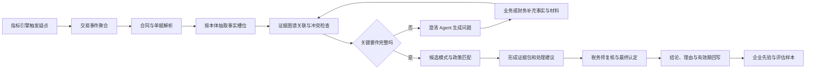
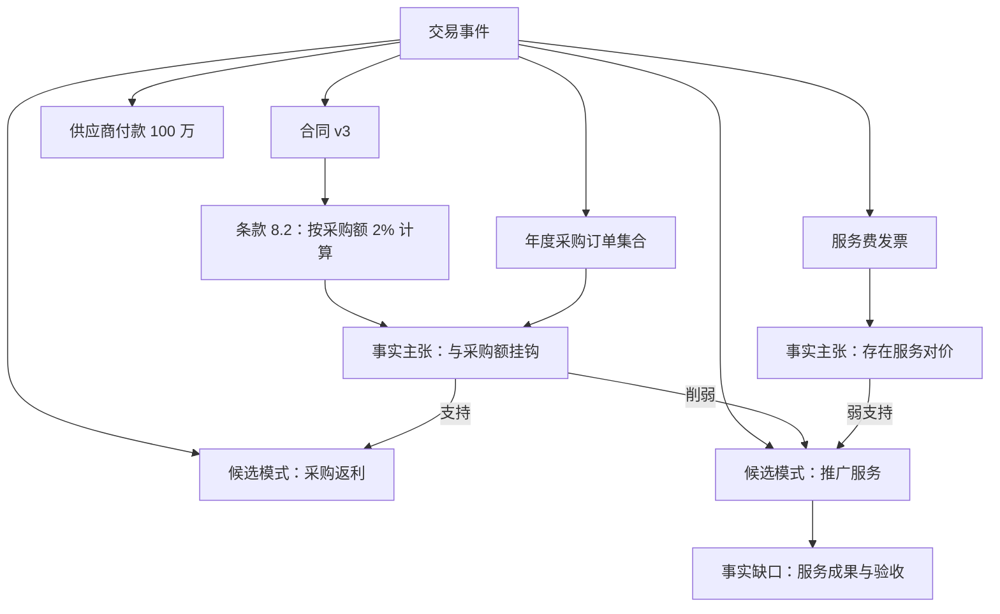

> AI 能读懂税法文字、结构化发票和申报表，也能执行指标公式；但业务实质是交易结构、权责约定与风险承担的组合，它藏在合同条款、履约行为、业务流程和口头约定里，不是数字和条文自带的。

返利、延长保修和商超联营，是理解财税 AI 能力边界的三个典型场景。它们共同表现出一种反直觉现象：**资金流、发票和会计科目看起来很相似，税务定性却可能完全不同。**

这并不是因为大模型“税法背得不够多”。税法条文解决的是规则问题，而业务实质认定首先要解决事实问题：交易双方到底约定了什么，谁承担风险，款项对应什么对价，合同是否得到真实履行。没有这些输入，再强的模型也只能在多个假设之间选择，而不能把假设变成事实。

因此，面向中税网智税宝这类财税风险与专业服务场景，Agent 的合理定位不是自动替税务师拍板，而是充当**业务实质要素抽取助手、证据组织者和疑点提示器**：找到材料，拆出判定要件，暴露事实缺口，列出候选定性，再把有来源的证据包交给专家。

本文从 FDE 和 Agent 架构师视角讨论如何把这条边界落实成系统。文中方案是基于该类产品定位提出的通用架构设计，不代表任何厂商未公开的内部实现，也不构成针对具体交易的税务意见。

## 一、三个例子：相同表象，为什么会导向不同定性

### 1. 返利：采购价款返还，还是推广服务收入

假设某供应商年末向渠道企业支付 100 万元。银行流水只能说明“上游向下游付款”，发票摘要可能写“服务费”，财务也可能把款项记入其他业务收入。仅看这些数据，至少存在两种解释。

**解释 A：供货返利。** 款项与年度采购量、采购金额或销售目标挂钩，是采购完成后的价款返还。其经济含义更接近采购价格调整，可能涉及相应的增值税处理。

**解释 B：市场推广服务费。** 供应商委托渠道企业完成地推、展会、广告投放或门店陈列，服务内容可识别、履约结果可验证，并且存在独立定价。此时款项的对价是服务，而不是采购价款返还。

两种模式的银行流水几乎一样，决定差异的却是另一组事实：

| 判定要素 | 供货返利方向 | 独立推广服务方向 |
| --- | --- | --- |
| 金额计算基础 | 与采购额、采购量或销售目标挂钩 | 与服务工作量、里程碑或交付成果挂钩 |
| 款项对价 | 采购价款返还或销售奖励 | 独立、可区分的推广服务 |
| 履约证据 | 采购与结算记录 | 活动方案、投放记录、验收材料 |
| 独立定价 | 通常缺少独立服务定价 | 服务范围和价格可以单独确认 |
| 关键材料 | 返利协议、采购合同、结算单 | 服务合同、成果物、验收单 |

模型即使检索到了“平销返利”的政策，也仍然缺少一个关键前提：**当前这 100 万元是否满足该业务模式的事实要件。**如果合同写的是服务费，但实际没有服务团队、交付物和验收记录，合同名称不能单独证明它就是服务收入；反过来，如果确有独立服务，也不能因为付款方恰好是供应商，就一律认定为返利。

### 2. 延保：商品的附随义务，还是可拆分的独立服务

企业销售设备或消费品时，售后相关款项同样容易被名称带偏。

**模式 A：商品自带质保。** 法定或合同约定的基础质保已经包含在商品售价中，客户不能单独选择，也没有另行支付对价。售后义务依附于商品销售。

**模式 B：单独销售延长保修。** 客户可以选择是否购买，在基础质保期之外获得额外服务，合同单独列明范围、期限和价格。此时延保可能构成独立的服务安排，其税务与会计处理需要单独分析。

判断重点不在财务摘要是否写了“售后费”，而在以下事实：

- 客户能否只购买商品而不购买延保；
- 延保是否单独报价、单独签约、单独开票；
- 服务从商品交付时开始，还是从基础质保结束后开始；
- 服务承诺是否超出法律规定或商品合同中的基础义务；
- 谁实际承担维修、更换与赔付责任，第三方是否参与履约。

如果企业只提供一张包含“产品及服务”的发票，而没有合同拆分、定价规则和履约记录，模型无法从总金额中反推出双方真实约定。它可以指出“存在独立延保的可能”，却不能自行补出一份不存在的延保条款。

### 3. 联营：商超提供场地和收银，还是买断后再销售

商超联营更能说明资金流与业务实质之间的距离。消费者在商场付款，商场扣除一定比例后把余款结算给品牌方。从流水看，两种模式完全可能一致。

**模式 A：代销或联营服务。** 品牌方保留商品相关风险，商场提供场地、收银、客流与运营服务，并按扣点取得收入。

**模式 B：购销模式。** 商场先采购商品，再以自己的名义对外销售，承担存货、跌价和滞销等风险，通过购销价差获利。

真正影响判断的不是“联营”这个业务名称，而是权利义务如何分配：

| 判定要素 | 代销或服务方向 | 购销方向 |
| --- | --- | --- |
| 商品控制与存货风险 | 主要由品牌方承担 | 主要由商场承担 |
| 零售定价权 | 品牌方主导或双方协商 | 商场具有更强自主权 |
| 滞销商品处理 | 可退回品牌方，品牌方承担损失 | 商场承担滞销与跌价损失 |
| 质量与退换货责任 | 品牌方承担主要商品责任 | 商场作为销售方承担相应责任 |
| 商场收益 | 扣点、佣金或服务费 | 商品购销差价 |
| 结算依据 | 实际销售额乘约定比例 | 采购价、数量与结算周期 |

更复杂的是，合同文字与实际履行还可能不一致。合同名为《联营协议》，实际却约定商场保底采购、不得退货并自主定价；或者合同名为《购销合同》，品牌方却能随时调货并承担全部滞销损失。此时必须同时检查合同条款和履约事实，不能只做文档标题分类。

### 4. 三个案例的共同结构

这三类交易表面不同，底层都可以还原为同一个认定框架：

```text
业务实质 = 交易主体 + 真实对价 + 权利义务 + 风险承担 + 控制权转移 + 实际履约
```

发票、流水和分录能够证明交易留下了某种形式记录，但不能天然证明每个等号右侧的要素。**形式证据是事实认定的输入，不是业务实质本身。**

## 二、真正的难点：不是文本理解，而是法律事实认定

### 1. 规则正确，不等于适用前提已经成立

普通 RAG 很容易完成这样的链路：用户提到“返利”，系统检索返利政策，模型总结政策并生成处理建议。问题是，这条链路把一个尚未确认的业务用语，当成了已经认定的法律事实。

一个完整的专业判断至少包含四层：

1. **材料层**：合同、发票、流水、业务台账中写了什么。
2. **事实层**：哪些内容经过多项证据支持，可以作为当前交易事实。
3. **模式层**：这些事实更符合返利、服务、代销还是购销等候选模式。
4. **规则层**：在主体、时间、地域和交易条件成立时，适用什么政策与处理规则。

RAG 主要加强第四层的检索，也能辅助第一层阅读；业务实质认定的主要困难却集中在第二层与第三层。系统如果跳过事实确认，引用再准确的政策，也可能是“正确地回答了错误的问题”。

### 2. 业务信息非结构化、碎片化，而且经常缺失

关键事实可能分散在框架合同、补充协议、采购订单、返利结算单、售后承诺书、邮件、即时沟通记录、门店操作 SOP 和业务人员记忆中。财税系统通常只接入账、票、表，天然缺少最能说明交易安排的那部分信息。

即使系统接入合同，也会遇到三个问题：

- **材料不全**：主合同没有返利条款，条款在后签的补充协议中；
- **表达不规范**：合同只写“按约返还”，金额计算方式另存在 Excel 中；
- **约定与履行不一致**：合同约定推广服务，实际没有任何服务记录。

因此，“没有抽取到某条款”只能表达为“在当前已取得材料中未发现”，不能直接改写成“双方没有该约定”。这是财税 Agent 必须遵守的证据语义。

### 3. 财务、业务和税法使用的不是同一套词典

业务人员说的“返利”，可能是价格折让、销售奖励、营销补贴或推广服务费；商场说的“联营”，可能对应代销、租赁、平台服务或商品购销；财务科目中的“售后服务费”，也可能同时容纳多种交易。

```text
业务标签“返利” ≠ 已认定的平销返利
合同名称“联营协议” ≠ 已认定的代销关系
发票项目“服务费” ≠ 已证明存在独立服务
```

大模型最容易在这里产生“流畅的误判”：它能围绕一个词生成专业解释，却没有先验证这个词在当前企业中的真实含义。

### 4. 定性依赖多要素权衡，不是单条 if 规则

平销返利不能只看“是否收到供应商付款”，联营不能只看“谁向消费者收钱”，延保也不能只看“是否单独列了一行价格”。真实案件中，合同、发票、结算单和人员陈述还可能相互矛盾。

这意味着工程上需要区分三种对象：

- **证据**：原始文件、单据、记录及其定位；
- **事实主张**：从证据中抽取出的陈述，可能尚未核实；
- **认定事实**：经过交叉验证或人工确认、允许进入专业判断的事实。

把模型抽取结果直接写成“认定事实”，是高风险系统中最危险的捷径之一。

## 三、能力边界：AI能做到哪里，应该停在哪里

### 1. AI适合完成的任务

在材料充分、任务被清晰约束时，大模型可以显著降低专家的机械工作量：

- 对扫描合同进行 OCR、版面恢复和条款切分；
- 识别交易主体、金额、期限、结算公式和权责条款；
- 按交易模式本体定向抽取判定要件；
- 关联合同、发票、资金流水、入库单与业务台账；
- 检索与候选模式相关的有效政策，并校验适用时间；
- 找出证据支持、证据冲突和关键事实缺口；
- 生成面向业务人员的澄清问题；
- 按模板形成专家复核材料和风险报告初稿。

这些任务的共同点是：**输出能够回到输入材料进行核验。**模型说“条款与年度采购额挂钩”，系统应当同时给出合同名称、版本、页码、条款号和原文片段。

### 2. AI不应越过的边界

以下动作不应由模型在无人约束下完成：

- 把合同中没有写明的权责关系补全为“行业惯例”；
- 因为发票写“服务费”就认定存在独立服务；
- 在证据冲突时静默选择其中一个版本；
- 把模型置信度等同于证据充分性；
- 在政策适用条件和业务事实尚不完整时给出唯一结论；
- 直接生成对外生效、无法追溯到责任人的税务认定意见。

尤其要区分两个问题：模型是否“觉得”某模式更可能，以及现有证据是否足以支持专业人员采用该模式。前者是概率判断，后者是证据与责任判断，二者不能用一个置信分数替代。

### 3. 合理的产品定位

对于智税宝这类财税专业场景，更稳健的流程是：

> 指标引擎发现疑点 → Agent 聚合交易材料 → 定向抽取业务要件 → 构建候选模式和证据链 → 对缺失事实发起澄清 → 税务师完成最终认定。

例如，系统可以输出：

> 已取得的返利协议显示，该笔回款按年度采购额的 2% 计算，支持“采购返利”候选模式。当前材料中未发现可独立定价的推广服务条款，也未取得推广成果与验收记录。但系统无法排除补充协议或线下履约材料尚未接入，建议核实是否存在独立服务、实际执行记录及对应定价依据。

这段话明确说明发现了什么、判断边界在哪里，以及下一步应向谁核实。它比直接写“该款项属于平销返利”更符合 Agent 的证据地位。

## 四、总体架构：从自动判定改为受控事实推理

目标不是让模型“凭理解看懂一切”，而是把专家的认定过程拆成可以验证的系统步骤。



这条链路有三个门禁：**材料门禁**检查合同、附件与履约记录是否齐全；**事实门禁**检查关键要件是否确认、证据是否冲突；**责任门禁**检查最终结论是否经过具备相应职责的人员审核。只要任一门禁未通过，Agent 都应改变输出状态，而不是仅仅降低一个置信分数。

## 五、交易模式本体：先定义“需要知道什么”

### 1. 本体不是名词表，而是认定问题的结构

如果只给模型一份税法知识库，它会围绕用户提到的名词检索。如果给它交易模式本体，系统可以先问：要判断这一模式，需要哪些事实？哪些事实已经取得？哪些仍然缺失？

以返利为例，一个面向实质认定的模式可以包含：

| 槽位 | 含义 | 典型证据 | 状态 |
| --- | --- | --- | --- |
| `calculationBasis` | 款项如何计算 | 协议、结算单 | 已确认/待核实/冲突 |
| `linkedToPurchase` | 是否与采购量或金额挂钩 | 返利条款、采购台账 | 是/否/未知 |
| `independentService` | 是否存在可区分服务 | 服务条款、交付物 | 是/否/未知 |
| `separatePricing` | 服务是否单独定价 | 报价单、合同附件 | 是/否/未知 |
| `servicePerformance` | 服务是否真实履行 | 验收、工时、成果物 | 已证明/未证明 |
| `paymentPurpose` | 付款对应的真实对价 | 付款申请、访谈记录 | 候选事实 |
| `effectivePeriod` | 安排在哪一期间有效 | 合同版本、生效条款 | 时间区间 |

延保本体可以复用“独立定价、可区分履约义务、责任承担方”等通用概念，再补充基础质保期限、延保起始点和维修责任。联营本体则重点描述存货风险、定价权、退货权、控制权转移时点与收益计算方式。

因此，本体至少需要三层：

1. **通用交易层**：主体、合同、对价、商品、服务、权利、义务、风险和履约事件。
2. **税务模式层**：返利、推广服务、独立延保、代销、购销等候选模式及其判定要件。
3. **企业扩展层**：企业内部业务标签、合同模板、系统字段和历史专家口径。

通用层保证跨场景复用，模式层承载专业认定框架，企业层解决“同一个词在这家公司里到底指什么”。

### 2. OWL负责表达语义，SHACL负责检查事实槽位

下面是一段简化的 Turtle 示意。它不是可以直接发布的税务规则，而是展示如何把交易事实和候选模式变成机器可处理的结构。

```turtle
@prefix tx:   <https://example.com/tax#> .
@prefix rdfs: <http://www.w3.org/2000/01/rdf-schema#> .
@prefix owl:  <http://www.w3.org/2002/07/owl#> .
@prefix xsd:  <http://www.w3.org/2001/XMLSchema#> .
@prefix sh:   <http://www.w3.org/ns/shacl#> .

tx:TransactionCase a owl:Class .
tx:RebateAssessment a owl:Class ;
    rdfs:subClassOf tx:TransactionCase .

tx:linkedToPurchase a owl:DatatypeProperty ;
    rdfs:domain tx:RebateAssessment ;
    rdfs:range xsd:boolean .

tx:hasIndependentService a owl:DatatypeProperty ;
    rdfs:domain tx:RebateAssessment ;
    rdfs:range xsd:boolean .

tx:supportedBy a owl:ObjectProperty ;
    rdfs:domain tx:TransactionCase ;
    rdfs:range tx:Evidence .

tx:RebateAssessmentShape a sh:NodeShape ;
    sh:targetClass tx:RebateAssessment ;
    sh:property [
        sh:path tx:linkedToPurchase ;
        sh:minCount 1 ;
        sh:maxCount 1 ;
        sh:message "需确认款项是否与采购量或采购金额挂钩"@zh
    ] ;
    sh:property [
        sh:path tx:hasIndependentService ;
        sh:minCount 1 ;
        sh:maxCount 1 ;
        sh:message "需确认是否存在可区分的独立服务"@zh
    ] ;
    sh:property [
        sh:path tx:supportedBy ;
        sh:minCount 1 ;
        sh:message "每项评估至少需要关联一项来源证据"@zh
    ] .
```

这里要避免一个常见误区：**SHACL 校验通过不等于税务定性成立。**它只能说明系统要求的字段已经存在并满足数据约束。字段值是否真实、证据是否充分、规则是否适用，仍需要证据校验和专业判断。

反过来，SHACL 校验失败也不代表交易违规，它只代表当前事实包不完整。系统应把校验消息转换成待核实问题，而不是输出风险结论。

### 3. 槽位必须带来源，不能只有值

一个生产级事实槽位不应只是 `linkedToPurchase: true`，还需要保存来源与状态：

```json
{
  "field": "linkedToPurchase",
  "value": true,
  "status": "extracted_unverified",
  "source": {
    "documentId": "contract-2026-018",
    "version": "v3",
    "page": 12,
    "clause": "8.2",
    "quote": "按年度累计采购额的2%计算奖励"
  },
  "extractor": {
    "type": "llm",
    "modelVersion": "model-version",
    "runId": "run-7f3a"
  }
}
```

只有这样，专家才能从结构化字段一键回到原文，系统也才能在合同换版后识别哪些事实需要重新验证。

## 六、多模态证据图谱：把票、账、资金与合同放回同一笔交易

### 1. 图谱的核心不是“上图”，而是保留关系和来源

单据通常按各自系统的主键存储：合同有合同号，发票有发票号码，流水有银行参考号，入库单又有另一套编号。业务实质认定需要先建立一个更高层的**交易事件**，把这些材料按主体、金额、时间、订单和结算关系聚合起来。

证据图谱可以包含企业、交易对手、合同、条款、发票、付款、订单、入库、退货、服务成果、事实主张、候选模式、政策规则和专家结论。关系则表达 `依据合同`、`对应发票`、`证明履约`、`支持主张`、`反驳主张`、`替代版本` 和 `由专家确认`。



这个图中，发票项目只能对“推广服务”形成弱支持，合同计算条款和采购订单则对“采购返利”形成更直接的支持。系统不应该把所有边都当成相同权重，更不能因为某个节点出现一次就完成定性。

### 2. 证据需要表达支持、冲突和缺失

建议为每个事实要件维护四种状态：

- **已支持**：至少有符合要求的证据，且没有未解决的重大冲突；
- **待核实**：模型从材料中抽取到相关内容，但尚未交叉验证；
- **存在冲突**：不同材料或人员陈述给出不一致信息；
- **当前缺失**：已接入材料中没有找到所需信息。

“当前缺失”与“事实为否”必须严格区分。没有找到推广验收单，不等于推广服务一定没有发生；它只意味着企业还不能用该材料证明服务履行。

### 3. 合同约定和实际履约应当分开建模

对于每个关键权责，图谱最好同时保留两类边：

```text
约定事实：合同规定谁承担滞销风险
履约事实：实际滞销商品由谁回收或承担损失
```

如果合同约定品牌方承担退货，但历史退货单显示商场自行报损，系统应标记“约定与履行冲突”，并提高人工复核优先级。这个冲突本身往往比某个孤立指标更有价值。

## 七、交互式澄清 Agent：事实不足时，系统应该提问

当要件检查发现信息缺失时，Agent 应围绕“会改变候选模式排序的关键事实”提问，而不是输出一份几十项通用问卷。

针对返利场景，可以问：

> 该笔款项是否对应独立的推广服务？如是，请提供服务范围、单独定价依据以及交付或验收材料。

针对联营场景，可以问：

> 商品在门店滞销时能否无条件退还品牌方？最近一次滞销处理由哪一方承担损失？请关联退货单或报损记录。

针对延保场景，可以问：

> 客户能否只购买商品而不购买延保？延保费是否在合同、订单和发票中单独列示？

好问题应满足三个条件：业务人员听得懂，答案能够落入明确槽位，并且答案变化确实可能改变候选定性。

业务人员的回答本身也是证据，但只是一项人员陈述，不能自动覆盖合同与单据。系统应记录回答人、岗位、时间、关联问题和附件，并区分仅有陈述、附带材料、经责任人确认和经系统数据交叉验证等状态。

澄清循环还必须有停止条件：关键要件齐全且无重大冲突时进入候选判断；关键材料确认无法提供时标记“证据不足”并提交专家；连续两轮未解决同一冲突时升级人工访谈；高金额、高影响或关联交易即使材料齐全，也保留专家审核。

## 八、候选判断：输出证据包，而不是一行答案

Agent 的交付物不应只有“高风险/低风险”或一个模式名称，而应至少包含：

```json
{
  "caseId": "case-2026-00421",
  "assessmentStatus": "expert_review_required",
  "candidateModels": [
    {
      "model": "purchase_rebate",
      "supportingFacts": ["fact-12", "fact-18"],
      "contradictingFacts": ["fact-23"],
      "missingFacts": ["independent_service_performance"],
      "applicablePolicies": ["policy-version-id"]
    },
    {
      "model": "marketing_service",
      "supportingFacts": ["fact-23"],
      "contradictingFacts": ["fact-12"],
      "missingFacts": ["service_pricing", "service_acceptance"]
    }
  ],
  "aiConclusion": "candidate_only",
  "expertDecision": null
}
```

政策引用必须带版本、生效时间、适用主体和原文定位，避免把已经失效或不适用于当前期间的规则带入判断。

单一的 87% 置信度很难说明专业问题。更可用的做法是拆成材料完整度、抽取可靠度、证据一致性、要件覆盖度、政策适配度和专家确认状态。这些维度分别对应不同补救动作：材料不全就补材料，抽取不稳就回看原文，证据冲突就访谈，政策不匹配就重新检索。

风险报告还应明确区分三层结论：

1. **AI 提取事实**：从哪些材料抽取了什么，处于何种核验状态。
2. **AI 候选判断**：哪些模式可能成立，各自有什么支持、冲突和缺口。
3. **专家最终认定**：由谁在何时基于哪些事实作出结论，是否附带条件和有效期。

这三块不能只在数据库中用字段区分，前端展示、导出报告和审计日志也要保持一致。

## 九、人工先验与持续学习：让系统记住结论，但不要固化错误

企业可以预先标注：与供应商 A 的年度结算属于采购返利，与品牌方 B 采用代销模式，某类延保由第三方服务商承保。后续指标命中时，Agent 可以优先带入这些上下文，不必每次从零分析。

但标签必须包含法人主体、交易对手、合同版本、商品或业务线、生效时间、专家确认人和确认依据。“A 供应商 = 联营”这种永久标签过于粗糙，双方可能同时存在购销与代销，合同也可能在新年度发生变化。

专家历史工单是很有价值的 few-shot 示例和检索材料，但历史结论只能提高某候选模式的先验概率，不能覆盖当前交易出现的反向证据。一次审核完成后，也不应只保存“通过/驳回”，还要沉淀最终理由、决定性要件、被采纳的证据、有效澄清问题和结论适用范围。

## 十、Agent 编排：角色可以拆，责任不能散

在实现上，可以将能力拆成多个专用节点，但没有必要为每个动作都包装一个“人格化 Agent”。更重要的是输入输出契约、失败策略和状态控制。

| 节点 | 主要职责 | 关键约束 |
| --- | --- | --- |
| 交易聚合 | 归并合同、票、款、货和业务记录 | 保留匹配依据，不确定关联不得静默合并 |
| 文档解析 | OCR、条款切分、结构恢复 | 保留页码、坐标、版本和原文 |
| 要件抽取 | 按本体填充事实槽位 | 未发现不等于否，禁止补全事实 |
| 证据校验 | 交叉验证、冲突检测、完整性检查 | 输出支持与反驳关系 |
| 政策检索 | 查找候选规则及适用条件 | 校验时效、主体、税种和地域 |
| 澄清交互 | 针对缺失要件生成问题 | 问题必须可落槽位，回答必须留痕 |
| 候选评估 | 组织多种可能性与证据包 | 不输出无证据的唯一结论 |
| 专家审核 | 完成事实确认和专业认定 | 记录责任人、理由与有效期 |

工作流引擎负责状态机、超时、重试、审批和人工接管；大模型负责语义理解、抽取与语言生成；规则引擎负责确定性约束；图谱负责关系查询和证据追踪。不要让大模型同时承担这四种系统职责。

## 十一、FDE落地：从一个模式跑通，而不是先建“大而全”知识图谱

### 1. 第一阶段：选一个高价值场景定义黄金流程

返利通常是合适的起点，因为它同时涉及合同、采购、资金、发票和政策判断，且判定要件相对清晰。FDE 应与税务专家共同完成：

- 收集一批真实脱敏案例，覆盖返利、服务费、材料缺失和证据冲突；
- 复盘专家实际查看了哪些材料、问了哪些问题；
- 定义最小本体、关键槽位与证据等级；
- 形成 Agent 输出模板和人工审核界面；
- 建立“允许不确定”的验收标准。

此时不要急着把所有税种和交易模式放进统一大图。先验证系统能否在一个模式中稳定找到决定性事实，并正确识别“无法判断”。

### 2. 第二阶段：打通证据链和澄清闭环

接入合同库、发票、资金和采购台账，建立交易聚合规则。让用户可以从字段跳回原文，也能对抽取结果进行确认、纠正和补证。

这阶段的核心指标不是模型回答看起来是否专业，而是：

- 专家查找材料的平均时间是否下降；
- 关键要件抽取的准确率与召回率；
- 证据引用是否指向正确原文；
- 缺失要件是否被完整识别；
- 澄清问题是否真正减少后续往返。

### 3. 第三阶段：扩展相邻模式并复用通用概念

在返利跑通后，可扩展推广服务、延保、代销和购销。新模式应优先复用主体、对价、风险、控制权、履约和证据等通用概念，只增加真正具有领域差异的槽位。

这样，本体扩展是“复用基础结构并增加约束”，而不是为每个场景复制一套独立字段。长期看，通用概念的质量比模式数量更重要。

### 4. 第四阶段：形成企业级先验与评估体系

将专家结论沉淀为有版本、有范围的企业业务标签，并建立持续评估。建议重点监控：

| 指标 | 目的 |
| --- | --- |
| 关键要件召回率 | 防止漏掉影响定性的事实 |
| 事实抽取准确率 | 防止错误填充槽位 |
| 证据引用准确率 | 确保结论可以回到原文 |
| 冲突发现率 | 衡量跨源核验能力 |
| 错误确定性结论率 | 检查系统是否在证据不足时过度判断 |
| 专家改单率 | 衡量候选模式和建议的可用性 |
| 平均复核时长 | 衡量实际效率收益 |
| 同类案件一致性 | 检查专家与系统口径是否稳定 |

其中，“错误确定性结论率”应被视为红线指标。财税 Agent 可以多提示一个待核实项，但不应把缺失事实包装成确定结论。

## 十二、几个容易踩中的架构误区

**误区一：把更多政策塞进向量库，就能识别业务实质。**政策库解决“规则在哪里”，不能自动解决“本案事实是什么”。继续增加文档数量只会提高检索覆盖，无法弥补合同与履约数据缺失。

**误区二：让大模型直接读取全部材料并生成最终报告。**长上下文可以容纳更多文本，但不能保证模型稳定地区分版本、来源和证据等级。生产系统仍需要显式的交易聚合、事实槽位、证据引用和流程状态。

**误区三：用一个知识图谱包办所有推理。**图谱擅长组织对象与关系，OWL 擅长表达概念语义，SHACL 擅长校验数据形状，规则引擎擅长执行确定性条件，大模型擅长理解非结构化材料。它们应协同工作，而不是互相冒充。

**误区四：把专家历史结论当作永久真相。**历史结论依赖当时的合同、政策和履约事实。任何先验都需要有效期、适用范围和反向证据触发机制。

**误区五：为了自动化率，隐藏“不确定”。**在高风险专业系统中，拒绝判断不是失败。能准确说明“缺什么、为什么不能判断、下一步问谁”的 Agent，通常比一个总能给答案的 Agent 更有生产价值。

## 十三、面试口述版：三分钟讲清楚

如果面试官问“AI 为什么难以判断返利、延保、联营这类业务实质”，可以这样回答：

> AI 的短板不在于不会读税法，而在于税法适用需要先认定事实。返利、延保和联营的税务定性，不是由发票名称或资金流直接决定的，而取决于合同中的对价、权责安排、风险承担和实际履约。比如同样是供应商向企业付款，可能是与采购额挂钩的返利，也可能是有独立交付和定价的推广服务；同样是商场收消费者全款，也可能是代销服务或商品购销。
>
> 大模型可以做合同 OCR、条款抽取、政策匹配和证据整理，但在合同缺失、口头约定未记录或材料互相冲突时，它不能把猜测变成业务事实。所以财税 Agent 不应该直接下最终结论。
>
> 我的设计是先建立交易模式本体，把每类模式的判定要件定义成事实槽位；再用证据图谱关联合同、发票、资金、货物流和履约材料。槽位缺失时，由澄清 Agent 向业务人员提问；证据冲突时升级人工复核。最后系统输出候选模式、支持和反对证据、政策依据与待核实项，由税务师完成实质认定。
>
> 也就是说，AI 负责找证据、拆要件、发现冲突和缩小判断空间，专家负责事实确认与最终定性。这样既能提高处理效率，又保留财税场景需要的责任边界和可追溯性。

如果继续追问“本体有什么用”，可以补充：

> 本体不是给合同贴标签，而是把专家脑中的认定框架显式化。OWL 用于统一交易主体、对价、权利义务和风险等概念，SHACL 用于检查关键事实槽位是否完整。校验失败只表示信息不足，不能直接推出违规；校验通过也只表示输入齐全，最终结论仍要结合证据和政策判断。

## 结语

财税 Agent 的核心价值，不是用一段流畅文本替代税务师，而是把原本散落在合同、票据、流水、台账和人员经验中的事实，组织成一套可核查的认定材料。

对于返利、延保和联营这类场景，可靠系统应遵循一条清晰边界：

```text
AI 提取材料中的事实主张
规则和图谱检查要件与证据
澄清流程补齐业务上下文
专家确认事实并完成最终定性
```

税法条文可以被检索，指标可以被计算，合同条款可以被抽取，但业务实质不能在关键事实缺失时被“生成”出来。真正成熟的 Agent 架构，不是让模型更敢下结论，而是让系统知道什么时候证据足够、什么时候必须提问，以及什么时候应把决定权交还给专业人员。
