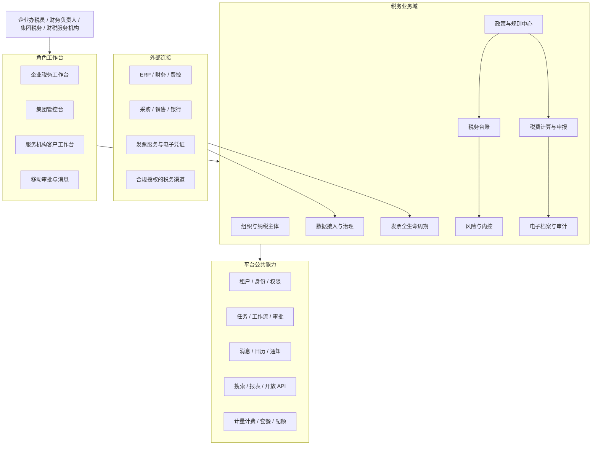
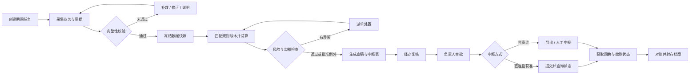
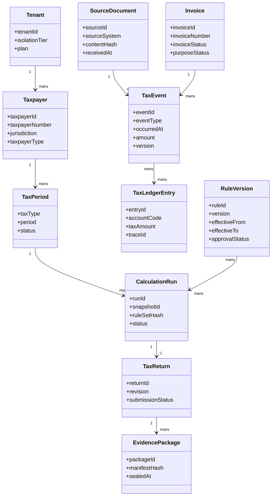
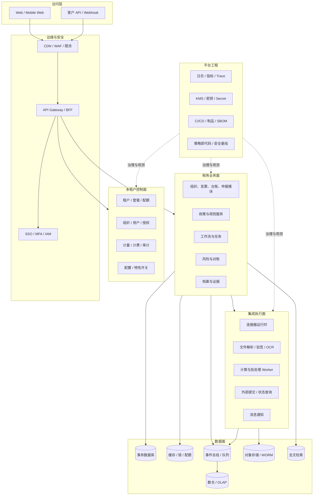
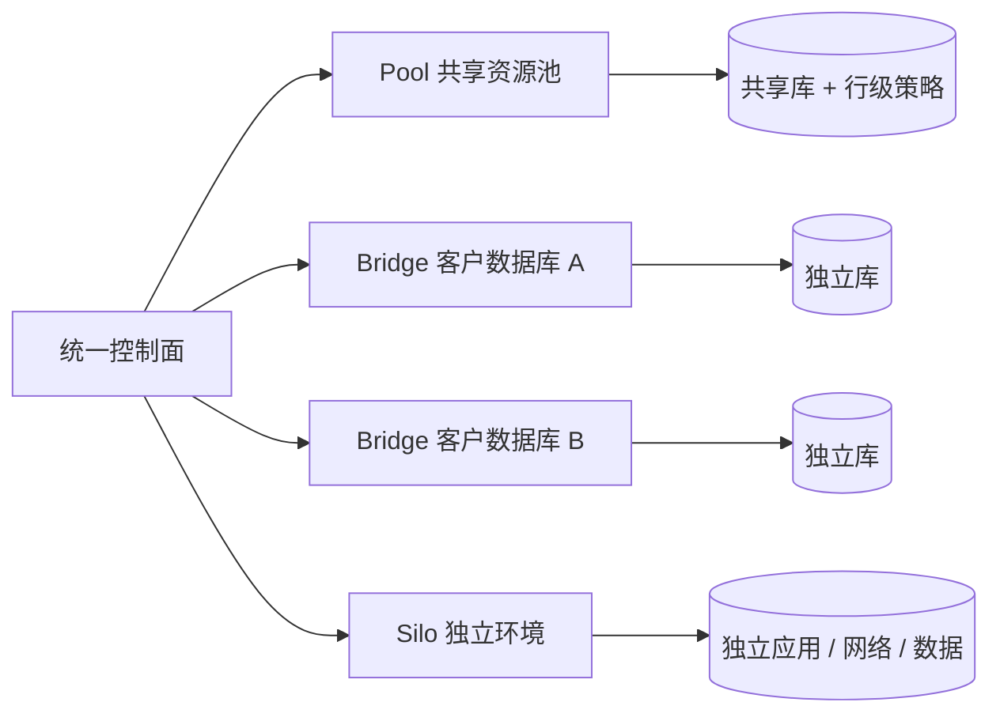

税务 SaaS 不是把申报表搬到网页上，也不是给财务系统增加一个“自动报税”按钮。它处理的是一条必须可解释、可复核、可追溯的事实链：

> 原始业务事实 → 标准涉税事件 → 发票与凭证 → 税务台账 → 计算底稿 → 申报表 → 提交回执 → 电子档案

链条中的任一步都可能受到税种、地区、纳税人身份、业务类型、政策生效日期和历史版本影响。一旦只保留最终数字而丢失来源、口径和过程，系统就很难回答税务人员最关心的三个问题：这个数从哪里来、为什么这样算、当时依据的规则是什么。

本文以中国境内企业税务管理为背景，面向成长型企业、集团企业、连锁或平台型企业以及财税服务机构，给出一套可落地的产品与技术架构。第一阶段建议覆盖增值税、企业所得税预缴、附加税费和数电发票，再按客户结构扩展更多税种与地区能力。

文中的政策时间点和制度要求来自文末官方资料，检索截至 2026 年 10 月；产品模块、服务边界、SLO 和技术选型属于架构建议，不等同于监管规定。尤其需要注意：并非所有企业都能直接接入税务机关或“乐企”相关接口，产品承诺必须以当地规则、接入身份和实际授权为准。

## 一、行业变化与设计前提

税收征管正在从“经验管税”转向“分类分级管理”和数据驱动的风险监管。对企业软件而言，影响最大的不是某一个页面，而是数据形态和责任边界发生了变化。

1. **数电发票成为全国性基础设施。** 国家税务总局公告 2024 年第 11 号明确，自 2024 年 12 月 1 日起在全国正式推广应用全面数字化电子发票。系统不能再把发票仅视为 PDF 或图片，而要同时管理结构化数据、版式文件、来源渠道、用途状态和生命周期事件。
2. **电子凭证进入标准化处理阶段。** 财政部等部门在 2025 年推广电子凭证会计数据标准。接收、验签、解析、入账、归档和调阅应形成统一链路，不能长期依赖人工下载与附件上传。
3. **电子档案不是廉价对象存储。** 会计档案与电子档案管理要求决定了系统需要保存真实性、完整性、可用性、安全性相关证据，包括原始文件、结构化数据、哈希、版本、操作记录和关联关系。
4. **数据安全责任扩大。** 税务数据通常同时包含商业秘密、个人信息和身份认证材料。多租户隔离、最小权限、数据分级、留痕与删除策略都必须进入产品设计，而不是上线前补一轮安全测试。

因此，税务 SaaS 的核心竞争力应当是可信闭环，而不是表单数量：把分散的业务数据转成稳定的税务语义，在规则版本约束下完成计算与复核，并把每次决策需要的证据完整保存下来。

## 二、产品定位与边界

### 2.1 目标用户

| 用户 | 核心诉求 | 典型能力 |
| --- | --- | --- |
| 企业办税员 | 减少采集、核对和填报工作 | 发票归集、台账、试算、申报任务 |
| 财务负责人 | 掌握税负、进度和异常 | 月结看板、差异分析、审批、风险总览 |
| 集团税务团队 | 统一口径并穿透下属主体 | 组织树、政策下发、合并视图、跨主体对比 |
| 业务与采购人员 | 在源头修正涉税问题 | 发票协同、红冲流程、异常补充材料 |
| 财税服务机构 | 批量、稳定地服务多个客户 | 客户工作台、任务批处理、人员授权、服务质检 |
| 审计与内控人员 | 复核过程并获取证据 | 只读穿透、底稿、操作日志、档案导出 |

### 2.2 产品应该做什么

- 连接 ERP、财务、采购、销售、费控、银行、开票平台和合法授权的税务渠道。
- 建立统一税务主数据和标准涉税事件，消除来源系统口径差异。
- 管理发票的采集、查验、认证用途、红冲、异常协同和归档。
- 按税种形成台账、计算底稿、申报表数据和差异解释。
- 通过规则、工作流和职责分离控制复核、审批、提交与支付。
- 形成政策、规则、计算、申报、回执和档案之间的证据链。

### 2.3 产品不应该承诺什么

- 不应承诺所有地区、所有税种都能“一键直连申报”。
- 不应把第三方发票识别结果直接当作税务事实，关键字段必须校验并保留原件。
- 不应让大模型自主发布税务规则、修改应纳税额、提交申报或发起缴款。
- 不应把“规则配置化”解释为无需税务专家、测试和审批。
- 不应绕过客户授权、税务机关准入条件或接口使用规范。

## 三、产品架构

产品架构围绕“主体、数据、规则、任务、证据”组织，而不是按照页面菜单拆分。上层服务角色，中间层形成税务闭环，底层提供共用能力。

### 3.1 八个核心产品域

**组织与纳税主体**：租户、法人、分支机构、税务登记、主管机关、纳税人资格、税种认定、银行账户、办税人员和代理关系。组织结构与纳税主体不能混为一谈，同一个集团可能有多层管理组织和大量独立申报主体。

**数据接入与治理**：连接器、文件导入、字段映射、主数据匹配、质量校验、重复检测和对账。接入数据先落原始层，再生成标准事件，禁止连接器直接修改申报表。

**发票全生命周期**：销项、进项、数电发票和其他电子凭证的采集、验真、验签、查重、用途确认、红冲、状态同步、异常协同与归档。发票状态要按事件演进，不能用一个可随意覆盖的字段代表全部历史。

**税务台账**：按纳税主体、税种、期间和业务口径沉淀销项、进项、优惠、调整和跨期事项。台账既是计算输入，也是业务事实到申报表之间的解释层。

**税费计算与申报**：期间任务、数据锁定、规则选取、试算、底稿、申报表映射、复核审批、导出或渠道提交、回执同步和更正申报。计算结果必须可以重放，且能固定到当时的数据快照与规则版本。

**风险与内控**：完整性、合规性、勾稽关系、异常波动和跨源差异检查。风险项需要证据、责任人、处置意见、复核结论和关闭标准，而不是只显示一个分数。

**政策与规则中心**：政策原文、适用范围、结构化规则、版本、生效区间、测试案例、发布审批和影响分析。政策知识与可执行规则要关联，但不能混成同一种对象。

**电子档案与审计**：归档包、原件、结构化数据、哈希、签章或验签结果、元数据、保管期限、访问记录、导出和销毁审批，支持从申报数字反向穿透到底稿、台账、凭证和原始业务单据。

### 3.2 角色和职责分离

平台权限不应停留在“管理员、普通用户”两级。建议采用 RBAC 与 ABAC 组合：角色决定可以执行的动作，属性进一步限定租户、组织、纳税主体、税种、期间、金额和数据敏感级别。

典型冲突职责包括：规则编制与规则发布、申报经办与最终审批、凭证修改与审计复核、付款发起与付款批准、密钥管理与业务运维。小型客户人员不足时可以配置例外流程，但必须显式记录风险接受人和有效期限。

## 四、关键业务流程

月度税务结账应设计成有门禁、有回退、有证据的状态机。即使外部渠道不可用，系统也应保留待办、重试和人工接管路径。

流程中至少设置以下控制点：

| 控制点 | 系统动作 | 失败后的处理 |
| --- | --- | --- |
| 数据完整性门禁 | 检查来源覆盖率、断号、重复、借贷平衡和主数据缺失 | 阻止冻结并生成责任人任务 |
| 快照冻结 | 固定原始数据版本、标准事件版本和范围 | 变更必须解锁并记录原因 |
| 规则匹配 | 固定税种、地区、身份、期间和规则版本 | 无匹配或多重匹配时阻止计算 |
| 风险检查 | 输出差异金额、证据和建议处置 | 支持修正、说明或批准例外 |
| 职责分离 | 经办、复核、审批、提交和缴款按角色约束 | 禁止同一人完成冲突步骤 |
| 外部状态确认 | 以查询和回执确认最终结果 | 超时进入未知态，禁止盲目重提 |
| 归档封存 | 生成内容清单、哈希和关联索引 | 不完整时不允许期间关闭 |

## 五、核心领域模型

领域模型应明确“事实、规则、计算运行、申报实例、证据”是不同生命周期的对象。下面是简化后的聚合关系。

几个关键约束：

- `SourceDocument` 只追加、不原地覆盖。纠错通过新版本和替代关系完成。
- `TaxEvent` 使用业务幂等键去重，键可以由租户、来源、业务类型、外部单号和版本共同组成。
- `CalculationRun` 固定数据快照、参数、规则集合哈希、软件版本和每一步中间值。
- 更正申报创建新的 `TaxReturn` 修订版，不覆盖原申报和原回执。
- `EvidencePackage` 的清单需要关联所有原件、结构化数据、日志和哈希，支持独立校验。

## 六、政策与税务规则架构

税务规则的难点不是表达一个公式，而是回答规则在什么条件、什么时间、对什么对象有效。建议把规则拆成五部分：

1. **选择条件**：税种、地区、纳税人类型、行业、业务标签、期间和前置资格。
2. **数据要求**：输入字段、口径、数据来源、缺失值策略和质量门槛。
3. **计算逻辑**：税基、税率、扣除、抵免、舍入方式、上限与下限。
4. **解释模板**：政策依据、变量含义、中间值和结果如何展示给用户。
5. **治理元数据**：政策来源、编制人、复核人、版本、生效区间、测试集和发布记录。

计算金额应使用确定性十进制定点算法，例如 Java `BigDecimal`，并在规则层明确精度和舍入模式，禁止用二进制浮点数处理税额。规则引擎需要支持按历史时间重放；对同一数据快照和规则版本重复执行，应得到完全相同的结果。

规则变更上线前至少执行三类测试：法规示例和专家金标测试、历史期间回放测试、受影响租户与金额的差异测试。高风险变更应先影子运行，只比较新旧结果，不立即改变正式申报数据。

## 七、总体技术架构

技术架构建议区分控制面、业务面、集成执行面和数据面。控制面负责租户、身份、套餐和全局配置；业务面处理税务领域事务；集成执行面隔离不稳定的外部系统；数据面承载事实、证据、检索和分析。

### 7.1 从模块化单体开始

税务台账、计算、申报和证据关系事务性强，早期直接拆成大量微服务会增加分布式一致性和排障成本。更稳妥的演进方式是：

- 核心税务业务采用模块化单体，模块之间通过明确接口和领域事件协作，数据库表按模块归属，禁止跨模块随意写表。
- 文件解析、OCR、电子签名验证、外部连接器、计算 Worker 和通知作为独立进程部署，因为它们资源模型不同、故障频率高或需要单独扩缩容。
- 当某个模块在团队归属、伸缩、可用性或发布节奏上形成独立边界后，再提取为服务。

服务数量不是架构成熟度指标。清晰的数据所有权、可重放的计算、可靠的状态机和可观测性比拆分粒度更重要。

### 7.2 事件、一致性与幂等

系统内部可以采用事务 + Outbox 模式：业务变更和待发布事件写入同一数据库事务，再由发布器送入消息系统。消费者使用 Inbox 或处理记录去重，并将重复消费视为正常情况。

对外部申报、开票、状态同步等操作，不能宣称端到端“恰好一次”。正确处理方式是：

1. 为每次业务意图生成稳定的幂等键和请求流水号。
2. 保存请求摘要、外部流水号、响应和签名信息。
3. 超时后先查询外部状态，不立即重复提交。
4. 区分成功、失败、处理中、未知和需要人工确认等状态。
5. 通过定时对账与补偿任务收敛内部状态和外部事实。

批处理任务按租户、纳税主体、税种和期间分片。每个分片设置并发、速率、重试预算和死信队列，避免大型租户或异常接口耗尽共享资源。

## 八、多租户与部署架构

多租户隔离不只是给业务表增加 `tenant_id`。隔离范围至少包括身份令牌、数据库连接、缓存键、消息主题或消息头、对象存储前缀、搜索索引、日志、备份、配额和运维工具。

可根据客户风险等级提供三种部署档位：

| 模式 | 数据与计算方式 | 适用客户 | 代价 |
| --- | --- | --- | --- |
| Pool 共享池 | 共享应用与数据库，行级租户隔离 | 中小客户、标准套餐 | 成本最低，隔离控制要求最高 |
| Bridge 桥接 | 共享应用，独立 Schema 或数据库 | 中大型企业、较强合规要求 | 成本和运维复杂度适中 |
| Silo 独占 | 独立应用与数据资源，可独立网络 | 集团、强监管或专有化客户 | 隔离最强，交付与升级成本最高 |

无论采用哪种模式，都应在服务端从认证上下文解析租户，不接受前端自由传入的租户标识作为信任来源。数据库访问层强制租户过滤；PostgreSQL 场景可叠加 Row-Level Security 作为纵深防御，但不能以它替代应用层授权。自动化测试需要专门覆盖跨租户 ID 猜测、缓存污染、异步任务串租户、导出越权和运维查询泄漏。

大客户独占部署仍应使用同一产品版本、制品和自动化交付链路。长期维护客户分支会快速吞噬规则更新速度，应通过配置、扩展点和特性开关实现差异化。

## 九、数据架构

建议构建四层数据体系，同时维持从任意派生数据到原始证据的血缘。

| 层级 | 主要内容 | 设计原则 |
| --- | --- | --- |
| L0 原始证据层 | API 原始响应、文件、影像、电子凭证、验签结果 | 不可变、内容寻址、保留采集时间与来源 |
| L1 标准事实层 | 标准订单、交易、付款、凭证、发票、税务事件 | 统一编码、版本化、幂等、可回溯原始记录 |
| L2 税务语义层 | 税务台账、调整项、计算快照、底稿、申报表 | 固定规则版本、期间和纳税主体口径 |
| L3 服务分析层 | 风险指标、经营分析、集团汇总、监管报表 | 面向查询优化，不反向修改业务事实 |

### 9.1 数据质量闭环

每批数据都应生成质量报告，至少度量完整性、唯一性、及时性、一致性、有效性和跨源勾稽。质量问题要成为可分派的业务对象，包含问题规则、影响范围、金额、责任人、修复动作和复核结果。

关键对账包括：订单与开票、发票与凭证、凭证与总账、银行流水与收付款、台账与申报表、申报表与回执。对账不能只给“相差 1 万元”，还要能下钻到造成差异的记录集合。

### 9.2 存储分工

- 事务数据库保存组织、台账、流程、规则元数据和状态机，不存放大型原始文件。
- 对象存储保存原件、归档包和大批量导入文件，启用版本、保留策略、服务端加密和生命周期管理；需要防篡改的归档可使用 WORM 能力。
- 搜索引擎服务于政策、发票和档案检索，它是派生索引，不是事实来源。
- 数仓或 OLAP 服务集团分析、风险模型和运营指标，通过 CDC 或领域事件同步，避免分析查询影响申报事务。
- 缓存只保存可重建数据；敏感内容设置短 TTL，所有键必须包含租户边界。

## 十、外部集成与“乐企”边界

外部系统变化快、质量不一，应通过标准连接器框架隔离。每个连接器需要定义版本、认证方式、权限范围、限流策略、数据契约、幂等键、错误分类、重试规则、状态查询和对账任务。

推荐的数据流是：

> 外部数据 → 原始落盘 → 完整性与签名校验 → 标准化 → 业务匹配 → 人工例外队列 → 税务事实

上海税务发布的乐企自用规范指引等官方材料体现了接入主体、管理要求和接口使用边界。产品设计可以预留乐企或类似能力的适配层，但销售与实施阶段必须确认客户是否满足当地条件、采用自用还是服务模式、数据范围和授权期限。没有准入或授权时，系统应提供合规的文件导入、结果导出和人工确认流程，不能用浏览器自动化绕过安全控制。

第三方连接器的凭据应进入独立 Secret 或 KMS，按租户加密并限制可见范围。支持轮换、吊销和到期提醒，日志中不得输出令牌、证书私钥、身份证件完整号码或申报密码。

## 十一、安全与合规架构

税务 SaaS 需要把安全控制映射到数据全生命周期，而不是只列一组安全产品。

### 11.1 数据分级与最小化

建议将数据分为公开、内部、敏感、核心四级，并形成字段目录。纳税人识别信息、个人身份信息、银行账户、认证凭据、交易明细和未公开经营数据分别定义采集目的、使用范围、保存期限、脱敏方式和删除规则。测试环境默认使用合成或脱敏数据，禁止直接复制生产库。

个人信息处理应遵循明确目的、最小必要、授权可证和期限可控。客户合同、隐私政策、子处理者清单、数据导出与删除流程要与系统实际行为一致；存在跨境处理时另行评估数据出境要求。

### 11.2 身份、授权与高风险操作

- 企业用户支持 SAML 或 OIDC 单点登录，管理员、规则发布者和申报审批人强制 MFA。
- 短期令牌与可撤销会话结合，敏感操作要求重新认证。
- 导出、规则发布、解锁期间、提交申报、变更银行信息和查看凭据等操作执行细粒度授权。
- 高风险操作使用四眼审批，必要时加入金额门槛、时间窗和来源网络策略。
- 客服或运维临时进入客户环境采用即时授权，限定工单、范围和有效期，全程留痕并通知客户。

### 11.3 加密、密钥与审计

传输链路采用现代 TLS；数据库、备份、对象存储和消息系统启用静态加密。高敏感字段可使用应用层信封加密，租户级数据密钥由 KMS 托管并定期轮换。生产密钥与业务数据库分离，应用不持久化明文凭据。

审计日志记录谁在什么时间、以什么租户和角色、对哪个对象执行了什么动作、动作前后摘要及结果。日志采用追加写和防篡改存储，访问本身也要审计。审计日志不能成为敏感数据副本，只记录必要标识和脱敏摘要。

### 11.4 安全工程

交付链路应包括依赖锁定、静态扫描、密钥扫描、镜像扫描、SBOM、制品签名、基础设施即代码检查和部署审批。对外 API 执行签名或 OAuth 2.0、时间戳、防重放、租户限流和 Schema 校验。定期进行越权、跨租户、文件解析、供应链和业务逻辑测试。

《网络数据安全管理条例》《个人信息保护法》以及会计档案、电子档案相关制度提供了合规底线，但具体落地仍需要结合组织规模、部署区域、数据类别和客户合同进行法律与安全评估。

## 十二、可靠性与可观测性

税务系统的流量具有强烈的申报期峰值，不能只看月均 QPS。容量模型应覆盖月末、季末、年初汇算准备以及政策变化后的集中重算。

建议按用户旅程定义 SLO，而不是为所有接口设同一个可用率：

| 能力 | 建议目标 | 说明 |
| --- | --- | --- |
| 登录与工作台 | 月度可用性 ≥ 99.9% | 不包含约定维护窗口 |
| 核心台账查询 | P95 < 2 秒 | 以常用筛选范围为基准 |
| 计算任务受理 | 月度可用性 ≥ 99.95% | 受理成功不等于计算完成 |
| 外部申报提交 | 内部受理 ≥ 99.9% | 外部渠道可用性单独披露 |
| 关键数据 | RPO ≤ 5 分钟，RTO ≤ 2 小时 | Silo 客户可另行约定 |
| 电子档案 | 跨故障域冗余并定期恢复演练 | 定期校验对象与清单哈希 |

所有同步请求和异步任务贯穿 `tenant_id`、`trace_id`、`business_id` 和 `job_id`，但日志输出前要脱敏。核心观测指标包括采集延迟、队列积压、规则命中率、计算耗时、差异金额、外部未知态数量、重试成功率、归档完整率和租户资源消耗。

灾备不能止于“做了备份”。至少按季度执行可证明的恢复演练，验证数据库时间点恢复、对象版本恢复、消息重放、搜索重建、密钥可用性和租户级恢复。演练结果记录实际 RPO、RTO、数据校验差异和整改项。

## 十三、AI 能力及控制边界

大模型适合处理非结构化知识和解释任务，不适合成为最终税额的唯一计算器。可以优先建设以下能力：

- 基于官方政策库的问答，回答中给出原文链接、发布日期、适用范围和引用片段。
- 从合同、公告和凭证中提取候选字段，由确定性校验和人工复核后入账。
- 将台账、总账和申报表差异转成可读解释，并关联原始记录。
- 根据风险证据生成处置建议或沟通草稿，但不自动关闭风险。
- 辅助税务专家把政策转成规则草案和测试案例，但不能自行发布。

以下动作必须由确定性系统和有权限的人完成：最终税额计算、规则发布、期间解锁、申报提交、缴款、凭据变更和档案销毁。

AI 请求进入独立网关，执行租户隔离、敏感字段脱敏、模型白名单、提示词版本管理、输出过滤、成本配额和全链路审计。默认禁止模型供应商使用客户数据训练；高敏感客户可选择私有模型或关闭 AI。离线评测集应覆盖引用准确率、适用条件识别、数字一致性、拒答和跨租户泄漏测试。

## 十四、建议技术栈

以下组合偏向成熟、可维护和可审计，不是唯一选择：

| 层级 | 建议选型 | 选择理由 |
| --- | --- | --- |
| 前端 | React + Next.js + TypeScript | 适合复杂工作台、服务端渲染和统一类型治理 |
| 核心后端 | Java 21 + Spring Boot | 事务、批处理、生态和工程治理成熟 |
| 规则计算 | Java `BigDecimal` + 受控 DSL/决策表 | 确定性金额计算与可审查规则表达 |
| 事务存储 | PostgreSQL | 事务能力、JSON、分区和行级策略完善 |
| 缓存 | Redis | 短期缓存、限流、配额和协调 |
| 消息 | Kafka 或云托管队列 | 事件解耦、异步任务和可回放数据流 |
| 对象存储 | S3 兼容服务 | 原件、归档包、版本和保留策略 |
| 搜索 | OpenSearch | 政策、发票与档案全文检索 |
| 分析 | ClickHouse 或云数据仓库 | 大规模明细分析和集团聚合 |
| 工作流 | 成熟工作流引擎或显式状态机 | 长事务、人工任务、超时与补偿 |
| 运行平台 | Kubernetes + 托管数据库 | 弹性、隔离和标准化交付 |
| 可观测性 | OpenTelemetry + 指标/日志/Trace 后端 | 统一上下文和厂商中立采集 |

早期团队不应为了技术栈完整度自建所有基础设施。数据库、消息、对象存储、KMS 和可观测后端优先使用符合部署要求的托管服务，团队把精力放在税务语义、规则治理和数据质量上。

## 十五、分阶段实施路线

### 阶段一：可信数据底座（0 至 3 个月）

完成租户与纳税主体、身份权限、ERP 或文件接入、原始证据层、标准发票模型、基础台账和质量报告。选择一种业务模型和一个地区作为试点，先跑通数据到台账的可追溯链路。

**退出条件**：关键来源覆盖率达到 95% 以上；重复数据可控；任意台账记录能追溯到原始文件或 API 响应；跨租户测试全部通过。

### 阶段二：增值税闭环（3 至 6 个月）

建设数电发票生命周期、增值税规则、计算底稿、风险检查、申报表映射、审批、结果导出和电子档案。申报初期采用人工提交加回执回传，先验证口径和控制流程。

**退出条件**：试点客户连续三个期间与人工金标结果一致；每个申报表关键单元格可下钻；规则回放稳定；归档包完整可验证。

### 阶段三：规模化 SaaS（6 至 12 个月）

增加企业所得税预缴和附加税费，完善集团视图、服务机构工作台、套餐计费、Bridge 隔离、开放 API、连接器平台、运营后台和灾备体系。

**退出条件**：申报峰值压测通过；大型租户不会拖垮共享池；租户迁移可演练；RPO、RTO 和关键 SLO 达标；客服访问全部即时授权化。

### 阶段四：生态与智能化（12 个月以后）

按准入条件接入更多官方或生态渠道，扩展税种、地区规则和电子凭证类型，引入受控政策问答、差异解释和规则辅助。形成政策变更监测、影响分析、规则灰度与客户通知闭环。

**退出条件**：AI 引用和数值评测达到门槛；高风险动作保持人工审批；新增地区和税种有标准测试包；规则变更可量化影响并快速回退。

## 十六、验收指标

产品上线不能只验收“功能可用”，建议建立五组指标：

| 维度 | 示例指标 |
| --- | --- |
| 数据 | 来源覆盖率、字段完整率、重复率、未匹配率、采集时延 |
| 税务正确性 | 金标一致率、规则命中率、计算重放一致率、申报表差异金额 |
| 效率 | 单主体结账时长、人工调整笔数、异常平均关闭时间、批量处理成功率 |
| 控制 | 高风险操作审批覆盖率、职责冲突数、审计日志完整率、档案校验成功率 |
| 平台 | SLO、队列积压、租户资源公平性、单位主体成本、RPO/RTO 演练结果 |

其中“自动化率”不能作为唯一北极星指标。税务场景中，未经复核地自动完成错误动作比保留人工步骤风险更高。更合适的核心指标是：在可证明正确和可追溯的前提下，缩短完成一次税务结账所需的时间。

## 十七、常见失败模式

1. **从申报表倒推产品。** 只建设填表页面，缺少业务事实、台账和证据层，结果是每次政策变化都要改大量页面和脚本。
2. **把规则写死在代码里。** 无法按生效日期回放，也无法让税务专家审查变更。规则可以配置，但发布必须经过测试和审批。
3. **过早微服务化。** 团队花大量时间解决分布式事务和版本协调，却没有建立稳定领域模型。
4. **把 OCR 当作事实来源。** 识别结果没有原件、置信度、验真和人工例外，容易把技术误差带入申报。
5. **只在业务表加租户字段。** 缓存、消息、搜索、日志、导出或运维工具仍可能造成跨租户泄漏。
6. **外部超时后直接重试。** 申报或开票可能已经成功，重复提交会造成更复杂的异常，必须先查询并对账。
7. **规则更新直接全量发布。** 没有历史回放、影响分析和灰度，错误会同时影响所有客户。
8. **宣称 AI 全自动办税。** 缺少确定性计算、授权和审批，无法承担税务责任，也难以通过审计。
9. **为大客户长期维护代码分支。** 每次政策更新都要多线合并和验证，最终失去 SaaS 的规模效应。

## 结语

税务垂直 SaaS 的壁垒不在于接了多少接口或画了多少申报表，而在于能否稳定维护一条可信事实链：数据有来源、规则有版本、计算可重放、操作有授权、外部状态可对账、结果有证据。

产品建设应先把一个税种、一个地区、一个客户类型做深，使用真实期间和人工金标验证，再扩展到更多税种与渠道。技术上从边界清晰的模块化核心出发，把高波动、高资源消耗的集成与计算任务独立部署；业务上坚持规则治理、职责分离和证据归档。这样形成的系统，才同时具备正确性、可审计性和 SaaS 规模化能力。

## 参考资料

以下资料优先选取中国政府部门和云架构官方文档，访问时间为 2026 年 10 月 29 日：

1. 中共中央办公厅、国务院办公厅：《[关于进一步深化税收征管改革的意见](https://app.www.gov.cn/govdata/gov/202103/24/469672/article.html)》
2. 国家税务总局：《[关于推广应用全面数字化电子发票的公告（国家税务总局公告 2024 年第 11 号）](https://fgk.chinatax.gov.cn/zcfgk/c100012/c5236067/content.html)》
3. 国家税务总局：《[全面数字化电子发票有关问题的解答](https://www.chinatax.gov.cn/chinatax/n810356/n3010387/c5236173/content.html)》
4. 财政部等九部门：《[关于推广应用电子凭证会计数据标准的通知（财会〔2025〕9 号）](https://www.mof.gov.cn/jrttts/202505/t20250521_3964264.htm)》
5. 财政部：《[电子凭证会计数据标准（推广应用版）](https://kjs.mof.gov.cn/zt/kuaijixinxihuajianshe/dzpzkjsjbzshsd/sjbz/202505/t20250519_3964020.htm)》
6. 财政部、国家档案局：《[会计档案管理办法](https://www.mof.gov.cn/zcsjtsgb/gztsgb/201512/t20151211_3578376.htm)》
7. 国务院：《[网络数据安全管理条例](https://app.www.gov.cn/govdata/gov/202409/30/520076/article.html)》
8. 全国人民代表大会常务委员会：《[中华人民共和国个人信息保护法](https://www.cac.gov.cn/2021-08/20/c_1631050028355286.htm)》
9. 国家税务总局上海市税务局：《[全面数字化的电子发票乐企自用直连服务的规范指引（2025 年版）](https://shanghai.chinatax.gov.cn/xxgk/tzgg/202304/t466805.html)》
10. 国务院：《[中华人民共和国发票管理办法](https://fgk.chinatax.gov.cn/zcfgk/c100010/c5195084/content.html)》
11. 国家档案局：《[电子档案管理办法](https://www.saac.gov.cn/daj/xzfgk/202412/41b270e9dfc44f48a09adcc5f4fe8296.shtml)》
12. AWS Well-Architected：《[SaaS Tenant Isolation](https://wa.aws.amazon.com/saas.question.SEC_2.en.html)》
13. AWS Solutions Library：《[Multi-tenant SaaS Architecture](https://docs.aws.amazon.com/solutions/multi-tenant-architectures-on-aws/)》

