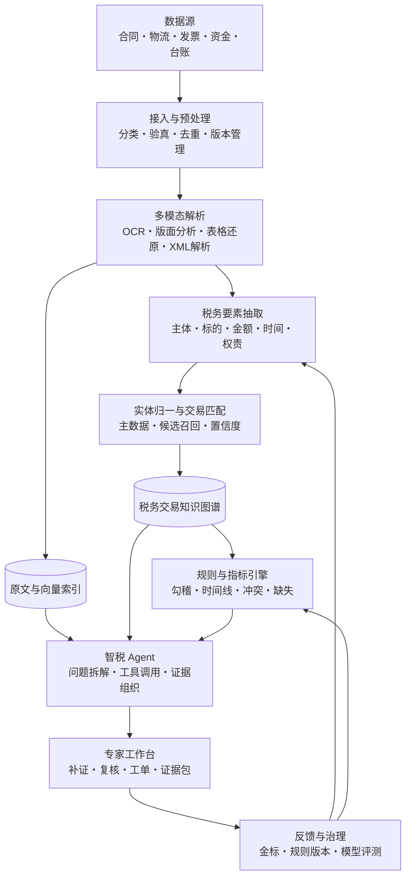
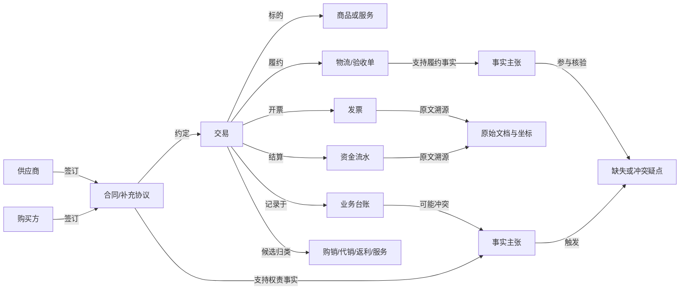

> 税务证据链闭环，本质不是分别检索合同、发票、物流单和银行回单，而是把多模态异构材料中提取出的事实要素做实体对齐和关系绑定，形成可追溯、可交叉核验的交易图谱。当同一笔交易的合同、货物或服务、发票、资金与台账互相印证时，证据链才算闭环；要素缺失或彼此冲突，则形成需要进一步核查的风险疑点。

传统税务风控擅长从申报表、发票和财务指标中发现数字异常。例如，企业税负率突然下降、进销项品名不匹配、存货周转率偏离行业水平，规则引擎都可以快速触发预警。但指标只能说明“这里可能有问题”，无法直接回答三个更重要的问题：异常来自正常经营变化，还是来自不真实交易；企业提供的解释有没有材料支持；不同材料描述的到底是不是同一笔交易。

要回答这些问题，系统不能停留在“查到一段合同原文”或“让大模型总结几份附件”。它必须把原始材料转化为带来源的交易事实，再围绕同一交易进行金额、数量、主体、时间、权责和风险承担的交叉核验。这个过程需要多模态 RAG、知识图谱、确定性规则和 Agent 协同完成。

本文面向中税网智税宝一类财税风险与专业服务场景，给出一套可用于面试表达、方案设计和工程落地的完整思路。文中讨论的是通用架构，不代表任何厂商未公开的内部实现，也不构成针对具体交易的税务意见。

## 一、先给结论：证据链解决的是“异常能否被事实解释”

税务风险判断中经常混淆三种不同的结论：指标异常、证据疑点和业务定性。

| 层级 | 系统要回答的问题 | 主要依据 | 典型输出 |
| --- | --- | --- | --- |
| 指标异常 | 数值是否偏离预期 | 申报、发票、财务指标与动态基线 | 预警命中记录 |
| 证据核验 | 异常是否有事实支撑，材料是否一致 | 合同、物流、发票、资金、台账 | 闭环、缺失、冲突或待确认 |
| 业务定性 | 交易实质和税务处理应如何认定 | 完整事实、适用政策与专业判断 | 税务师复核意见 |

证据链位于指标和专业定性之间。它既不是简单的附件管理，也不是自动替税务师作结论，而是把分散材料组织成一套可以核查的事实底座。

以“收到供应商支付的 100 万元”为例，银行流水只能证明付款事实。它可能是与采购额挂钩的返利，也可能是独立推广服务的对价，还可能是往来款或保证金退回。要判断哪一种解释更可信，至少要同时核验：

- 合同或补充协议如何约定款项性质；
- 金额是否与采购量、销售额或服务工作量挂钩；
- 是否存在独立的服务内容、成果物和验收记录；
- 发票品名、会计处理与合同约定是否一致；
- 返利台账、结算单和银行备注能否互相印证。

因此，证据链闭环的实际价值可以概括为：

```text
指标发现异常
    ↓
证据链补充业务上下文并交叉核验
    ↓
自洽：解释异常、降低误预警
缺失：要求补充材料
冲突：升级风险、提交专家复核
```

这里的“自洽”只表示现有材料之间没有发现实质矛盾，并不自动等于交易一定合规。系统仍需保留抽检、后续观察和人工复核机制。

## 二、什么是税务里的四流证据链

税务证据链通常围绕合同流、货物流或服务流、发票流和资金流展开，再由业务台账补充项目、批次和结算口径。所谓“四流一致”，不是要求每个数字机械相等，而是要求差异能够被交易结构和有效证据合理解释。

### 1. 合同流：交易规则是什么

合同流不只包含主合同，还包括框架合同、订单、补充协议、返利协议、联营协议、质保协议和历次变更文件。它提供的是交易的规则层事实：

- 交易双方及其角色；
- 商品或服务标的；
- 数量、单价和计价方式；
- 交付、验收与结算条件；
- 所有权和风险何时转移；
- 退换货、库存跌价和质量责任由谁承担；
- 是否存在与采购量或销售量挂钩的返利；
- 服务是否可以独立识别、独立定价和独立验收。

合同名称不能代替合同内容。“推广服务协议”不必然证明存在独立服务，“联营协议”也不必然证明企业不承担存货风险。系统需要抽取具体权利义务，再与实际履约证据核对。

### 2. 货物流或服务流：交易是否真实履行

货物交易通常涉及出库单、入库单、运输单、签收单、验收单和退货单；服务交易则可能涉及工时记录、项目里程碑、成果物、服务确认单和验收报告。这一层主要回答谁向谁交付了什么、何时交付、实际数量与批次是什么，以及服务是否真实发生。

对服务型交易而言，“没有物流”不是证据缺失，但必须有与服务性质相适应的履约材料。系统的证据模板需要按交易模式变化，不能机械要求所有交易都具备运输单。

### 3. 发票流：税务凭证如何描述交易

发票流包括数电票结构化数据、版式文件、红字信息确认单、红字发票和发票状态变化。关键要素包括购销方、品名、规格、数量、金额、税额、税率、开票日期、备注和红蓝字状态。

发票是重要税务凭证，但发票品名本身不能完整表达交易实质。例如，“服务费”可能对应真实服务，也可能只是对返利款项的表面描述。发票必须和合同及履约证据一起核验。

### 4. 资金流：对价如何结算

资金流包括银行流水、收付款回单、承兑汇票、第三方支付记录、对账单、结算单和返利结算记录。主要抽取收付方、账号、金额、币种、日期、用途、流水号和结算方式。

合同金额、发票金额和回款金额并不总是一对一相等。预付款、质保金、分期结算、手续费、折扣和多张发票合并付款都会形成合理差异。因此，核验不能只写成简单的等值判断，而要支持时间窗口、容差、聚合与拆分关系。

### 5. 辅助台账：把跨周期材料连接起来

存货台账、项目台账、研发台账、返利台账、工期台账和结算台账，往往承担交易关联键的作用。它们提供合同号、订单号、项目号、批次号、结算周期和内部业务编号，使跨月、分批和一对多交易能够被还原。

由此可以得到更准确的闭环定义：

> 同一笔交易或同一组可解释的关联交易中，主体、标的、数量、金额、时间、交易性质和权责安排能够互相印证；存在差异时，差异具有明确业务原因和来源证据。

## 三、为什么普通 RAG 无法独立完成闭环

普通 RAG 的典型链路是：把文档切片并向量化，根据用户问题召回若干片段，再由大模型生成答案。它很适合回答“合同里的结算条款是什么”，却不天然适合回答“这张发票、这笔回款和这份合同是否属于同一交易”。

### 1. 税务材料不是单一文本形态

| 材料类型 | 常见格式 | 处理重点 |
| --- | --- | --- |
| 结构化数据 | 发票 XML、银行流水、申报表 | 字段映射、验真、状态与版本 |
| 半结构化表格 | Excel 台账、结算单、对账单 | 表头识别、合并单元格、跨页续表 |
| 非结构化文本 | PDF 合同、补充协议、验收报告 | 章节、条款、版本和长文本语义 |
| 图片或扫描件 | 运单、签收单、纸质回执 | OCR、版面、印章、手写与坐标 |

如果把所有材料都转成纯文本切片，会丢失表格行列、页面位置、签章区域和文档层级；如果只保留图片，又难以执行稳定的字段核验。多模态处理的目标不是“让模型看更多格式”，而是为不同材料选择合适的解析路径，并保留结构与来源。

### 2. 文档相似不等于交易相关

同一供应商在一个月内可能有几十份合同、数百张发票和多笔合并付款。语义相似度可以找到“看起来相关”的材料，但无法保证它们属于同一交易。反过来，描述差异很大的材料也可能实际相关：合同写“XX 系列设备”，发票写具体型号，物流单只写内部物料编码。

因此，关联必须综合使用多种信号：

- 合同号、订单号、发票号、项目号等强标识；
- 交易主体、商品、数量、金额和时间窗口；
- 客商别名、商品主数据与内部编码；
- 文本和图像语义相似度；
- 已有关联节点形成的图结构约束。

### 3. 检索结果不能直接表达跨文档冲突

普通 RAG 可能同时召回以下两段文字：

- 合同：“商品未售出前，所有权及存货风险由品牌方承担。”
- 入库台账：“本批商品按采购入库，跌价损失由我方承担。”

如果没有统一的“库存风险承担方”事实槽位，模型只能临时阅读并尝试比较。结果会受提示词、上下文长度和材料顺序影响，难以稳定执行，也无法把冲突作为结构化风险项持续跟踪。

正确做法是将两段文字分别转换为带来源的事实主张：

```text
事实主张 A：库存风险承担方 = 品牌方
来源：联营协议第 8.2 条，第 12 页

事实主张 B：库存风险承担方 = 我方
来源：入库台账“风险归属”列，第 36 行

核验结果：同一交易、同一事实槽位出现互斥取值
```

### 4. RAG 找到的是候选证据，不是已确认事实

检索片段可能来自旧版本合同、作废发票、其他项目或 OCR 错误。系统必须区分原始证据、从证据中抽取的事实主张、经规则或人工确认的业务事实，以及基于事实形成的风险判断。

只有保持这四层分离，才能避免模型生成的解释反向污染正式事实层。因此，完整方案应当是：

> 多模态解析与检索负责发现候选证据，实体对齐和交易匹配负责确定关联范围，知识图谱负责表达事实与证据关系，规则引擎负责执行确定性核验，Agent 负责按风险问题编排这些能力并生成可解释结果。

## 四、总体架构：RAG、图谱、规则和 Agent 如何分工

一个可落地的系统可以划分为九个层次。



各组件的边界应当明确。

| 组件 | 适合承担的工作 | 不应承担的工作 |
| --- | --- | --- |
| 多模态解析 | OCR、表格恢复、字段定位、版面坐标保留 | 直接判断交易是否违规 |
| RAG | 找到相关合同条款、单据和政策 | 把相似文档自动认定为同一交易 |
| 知识图谱 | 连接实体、交易、证据和事实主张 | 在事实缺失时生成业务事实 |
| 规则引擎 | 金额勾稽、时间线、必备材料和确定性冲突 | 处理所有开放性业务解释 |
| 大模型 | 条款理解、候选抽取、问题拆解和结果表述 | 修改原始证据或直接作最终定性 |
| Agent | 按任务调用检索、图查询和规则服务 | 绕过权限、审批和审计控制 |
| 税务师 | 确认关键事实、适用政策和最终意见 | 被迫逐份查找低价值附件 |

这套分工的核心不是堆叠技术，而是把概率能力和确定性能力放在合适位置：大模型理解复杂材料，规则执行稳定校验，图谱保存关系与来源，专家承担高影响判断。

## 五、完整处理链路：从文件进入系统到形成风险工单

### Step 1：接入、分类和版本治理

系统首先接入企业上传文件、业务系统接口和合法授权的数据源。每份材料进入系统时，都应生成不可变的文档标识，并记录租户与所属企业、数据来源、文件哈希、文档类型、业务期间、原始版本、作废状态、权限和访问日志。

这一步看似是文档管理，实际上决定了后续结论能否审计。如果只保留解析后的文本而没有原件、哈希和版本，系统将无法证明某个判断当时依据的是哪份材料。

分类可以采用“规则优先、模型补充”的方式：XML 和标准发票通过结构直接识别；合同、运单和回单使用版面分类模型；低置信度结果进入人工分拣。分类错误会导致抽取模板选错，因此需要把分类置信度传递到后续链路。

### Step 2：按材料类型进行多模态解析

不同材料采用不同的解析器，而不是统一交给大模型自由阅读：

- PDF 原生文本保留段落、页码、标题和字符坐标；
- 扫描 PDF 和图片执行 OCR、方向纠正、印章与手写区域识别；
- Excel 保留工作表、单元格坐标、公式、合并关系和隐藏行列；
- 发票 XML 使用标准解析器获取字段，并与版式文件互相校验；
- 银行流水优先使用接口或结构化导出，图片回单只作为佐证。

解析产物不能只有一段纯文本。至少应同时保存原始文件、标准化文本、版面块、表格结构、页码坐标和解析置信度。这样专家点击图谱事实时，才能直接跳转到原始页面的具体区域。

### Step 3：面向税务场景做定向要素抽取

要素抽取应围绕预先定义的事实模式执行，而不是让模型随意总结。

| 文档类型 | 关键抽取要素 |
| --- | --- |
| 合同 | 双方角色、标的、数量、定价、结算、交付、验收、风险转移、返利条件、退换货责任 |
| 物流单据 | 收发方、货物、规格、数量、日期、运单号、签收人、批次 |
| 服务材料 | 服务范围、期间、工作量、成果物、验收方、验收日期、里程碑 |
| 发票 | 购销方、品名、规格、数量、金额、税额、税率、日期、红蓝字状态 |
| 资金凭证 | 收付方、账号、金额、币种、日期、用途、流水号、结算方式 |
| 业务台账 | 项目号、合同号、订单号、批次号、结算周期、数量、金额、状态 |

每个抽取值都应携带来源和置信度：

```json
{
  "field": "inventory_risk_bearer",
  "value": "brand_owner",
  "confidence": 0.94,
  "source_document_id": "DOC-2026-00187",
  "page": 12,
  "bounding_box": [126, 418, 952, 566],
  "extractor_version": "contract-extractor-3.2",
  "review_status": "unreviewed"
}
```

这里的 `value` 仍然是“从材料中抽取出的事实主张”，而不是经过确认的最终事实。低置信度字段、关键主体和高金额字段应进入人工校验或使用确定性解析器复核。

### Step 4：实体归一，解决同物异名和同名异物

实体对齐是最容易被低估、也最影响图谱质量的一步。常见问题包括：

- 企业全称、简称、历史名称和品牌名并存；
- 商品使用营销名称、发票名称、规格型号和内部物料编码；
- 同一项目在合同、ERP 和台账中使用不同编号；
- OCR 将统一社会信用代码、金额或日期识别错误；
- 同名企业或同系列商品被错误合并。

系统需要建设客商主数据、商品主数据和项目映射库，并组合以下策略：

1. 使用统一社会信用代码、银行账号、税号等稳定标识进行精确匹配；
2. 使用标准名称、别名词典、地址和联系人做规则归一；
3. 使用商品编码、规格型号、计量单位和描述语义做候选匹配；
4. 对模糊候选计算置信度，保留匹配理由；
5. 高影响或低置信度合并必须由人工确认。

错误合并会把无关材料串成虚假闭环，错误拆分则会造成证据缺失。因此，实体归一结果必须可撤销、可重放，并保留人工修订历史。

### Step 5：生成候选交易关联

完成实体归一后，系统还需要判断每份证据属于哪一笔交易。建议采用多级候选策略。

**第一级：强标识关联。** 合同号、订单号、项目号、运单号、发票号和银行附言中的明确引用，可以直接产生高置信度候选。

**第二级：组合规则关联。** 当强标识缺失时，组合主体、商品、金额、数量和时间窗口。例如，同一购销双方、相同型号、发货后 30 天内开票、金额在容差范围内，可以形成候选边。

**第三级：语义召回。** 使用向量或多模态检索召回相似合同条款、商品描述和结算备注，扩大候选覆盖范围。

**第四级：图结构重排。** 如果某发票已与订单关联，而该订单又属于某合同，则与合同相关的物流单优先级应提高。

最终关联分数可以抽象为：

```text
关联置信度 =
  强标识得分
  + 主体一致得分
  + 标的相似得分
  + 金额数量匹配得分
  + 时间窗口得分
  + 图路径支持得分
  - 冲突惩罚
```

分数不是税务结论，只用于排序和流程分流。高置信度关联可以自动进入图谱；中置信度关联等待业务人员确认；低置信度关联仅作为检索候选，不能写入正式关系层。

### Step 6：构建以交易为中心的证据图谱

图谱的核心不是把所有文档互相连线，而是引入“交易”或“交易组”作为中心业务实体。合同、订单、交付、发票、资金和台账围绕交易聚合，原始文档则通过证据关系支持具体事实主张。



建议至少区分五类对象：

1. **业务实体**：企业、账户、商品、服务、项目和业务模式；
2. **交易实体**：合同、订单、交易、批次、交付、发票和付款；
3. **证据对象**：原始文件、页面、表格行、OCR 片段和结构化记录；
4. **事实主张**：金额、数量、风险承担方、结算条件等带来源的陈述；
5. **核验结果**：一致、差异可解释、缺失、冲突和待确认。

这种分层可以避免一个常见错误：把大模型抽取值直接作为图谱中的唯一真相。当两份材料给出不同取值时，图谱应该同时保存两条事实主张及其来源，再由核验规则生成冲突，而不是静默覆盖其中一条。

### Step 7：在图谱上执行交叉核验

核验分为形式一致性和业务实质一致性两类。

#### 形式一致性核验

形式一致性适合由规则引擎执行，主要包括：

- 合同、订单、交付、发票和付款主体是否一致；
- 商品名称、规格、数量和计量单位能否映射；
- 合同金额、开票金额和结算金额是否在允许差异内；
- 交付、验收、开票和付款的时间顺序是否合理；
- 红冲、退货、折扣和质保金是否得到反向或延期处理；
- 一对多、多对一和分期交易能否完整聚合。

规则需要表达业务容差，而非只做绝对相等。例如：

```text
若合同约定分批开票：
    比较累计开票金额与已验收批次金额
若存在 5% 质保金：
    回款差额在质保期内不视为异常
若发生退货和红冲：
    使用净数量和净金额重新勾稽
```

#### 业务实质一致性核验

业务实质核验关注合同权责是否与实际履约一致。例如：

- 合同称为代销，但企业是否实际承担库存跌价和退货风险；
- 款项称为服务费，但是否存在独立服务、定价和验收；
- 延保是否独立销售，还是商品原有质保的一部分；
- 返利是否与采购量或销售目标挂钩；
- 资金收付方与合同主体不一致时，是否存在合法三方结算安排。

这类核验通常不能用单条规则完成，而应将交易模式拆成一组判定要件。例如，“独立推广服务”可以要求：

```text
必要事实：服务内容可识别
必要事实：存在独立定价或合理定价依据
必要事实：存在交付或验收证据
反向事实：金额仅与采购额或销量挂钩
反向事实：无人员、活动、成果物或验收记录
```

系统输出的应是“支持该模式的证据”“反对该模式的证据”和“尚缺事实”，而不是仅凭得分自动认定交易性质。

### Step 8：由 Agent 组织核验任务

智税 Agent 的价值在于把用户问题转成可执行的证据任务。例如，税务师问：“这笔 100 万元回款是不是返利？”Agent 可以依次执行：

1. 识别目标资金流水和交易主体；
2. 查询图谱中已关联的合同、采购、发票和台账；
3. 检索补充协议中与采购量、销售目标和服务相关的条款；
4. 检查是否存在独立服务成果与验收记录；
5. 调用返利和服务模式核验规则；
6. 汇总支持证据、反向证据、缺失项和关联置信度；
7. 生成复核建议，并附原文引用和图谱路径。

Agent 不应仅输出一段自然语言。更可用的结果结构是：

| 输出项 | 示例 |
| --- | --- |
| 当前判断 | 返利特征较强，需税务师复核 |
| 支持证据 | 金额按年度采购额 3% 计算；无独立服务定价 |
| 反向证据 | 发票品名为“市场推广服务费” |
| 缺失材料 | 未发现推广成果物及验收单 |
| 冲突项 | 发票描述与合同计价依据不一致 |
| 原文引用 | 协议第 4.2 条、返利台账第 18 行、银行回单 |
| 建议动作 | 补充服务合同、成果物、验收人与定价依据 |

### Step 9：进入专家复核和反馈闭环

核验结果可以按证据状态分流：

- **证据自洽、异常可解释**：降低预警等级，保留归档和抽检；
- **证据基本一致但关联不确定**：要求业务人员确认交易映射；
- **关键证据缺失**：生成补证清单和截止时间；
- **材料出现实质冲突**：升级高可疑工单，提交税务师；
- **金额重大或政策复杂**：无论模型置信度多高，都进入专家复核。

专家对实体归一、交易关联、事实主张和风险结论的修订，应形成结构化反馈，用于更新别名库、规则案例和评测集。但专家改单不能未经治理就直接用于在线模型训练，否则错误标注或个别口径可能被放大。

## 六、两个典型案例：返利与联营如何形成证据链

### 案例一：一笔“服务费”是否实为平销返利

假设企业收到上游供应商 100 万元，发票开具品名为“市场推广服务费”。仅看发票和流水，交易似乎属于服务收入。但证据图谱进一步发现：

- 补充协议约定，年度采购额达到 3000 万元后按 3% 支付奖励；
- 返利结算台账按采购金额计算，结果正好接近 100 万元；
- 系统未发现独立服务报价、推广方案、成果物和验收单；
- 付款时间发生在年度采购结算完成后；
- 会计凭证和发票将款项记录为推广服务费。

图谱可以把这些材料组织成一组结构化事实：

| 判定要件 | 证据结果 | 来源 |
| --- | --- | --- |
| 是否与采购额挂钩 | 是 | 补充协议第 4.2 条 |
| 是否有独立服务内容 | 未发现 | 合同库检索结果 |
| 是否有独立定价 | 否 | 返利结算公式 |
| 是否有成果和验收 | 缺失 | 项目及验收材料库 |
| 发票如何描述 | 推广服务费 | 数电票明细 |

此时系统不应直接输出“已构成平销返利”，而应输出：**现有证据更支持采购返利特征，且发票描述与计价依据存在不一致；需要企业补充独立服务的合同、交付和验收证据，并由税务师判断业务实质及税务处理。**

这个案例体现了 RAG 与图谱的不同职责：RAG 找到补充协议和可能的服务材料，图谱把采购额、结算公式、资金和发票挂到同一交易上，规则则检查服务模式的必要证据是否存在。

### 案例二：联营合同与实际库存风险冲突

假设商场与品牌方签订“联营协议”，合同写明未售商品所有权和存货风险由品牌方承担，商场按销售额扣点结算。如果真实履约与该约定一致，业务形态可能更接近提供场地或平台服务。

但系统从其他材料中发现：

- 入库台账将商品登记为商场采购入库；
- 商品滞销后由商场自行计提跌价准备；
- 退货需要品牌方审批，部分滞销商品无法退回；
- 消费者退货损失由商场承担；
- 资金结算表现为商场先支付固定采购价，再自行获得销售差价。

合同主张“品牌方承担库存风险”，台账和实际结算却显示“商场承担主要风险”。这不是缺少一张单据，而是关键权责事实发生冲突。

系统应将疑点表述为：

```text
冲突槽位：存货风险承担方
合同证据：品牌方承担
履约证据：商场承担跌价、退货与销售损失
影响：交易模式可能与合同名称不一致
建议：核查采购入库依据、退货记录、跌价承担和最终结算规则
```

这类冲突通常比单纯金额不相等更有业务价值，因为它直接指向业务模式和税务处理基础可能不一致。

## 七、多模态检索是图谱的反向入口

图谱并不意味着所有问题都必须先完成全量建模。实际系统可以同时支持正向和反向两种工作方式。

### 1. 正向：从风险对象自动展开证据

从一张发票、一笔回款或一个指标预警出发，系统通过已有图关系带出所属交易和合同、对应订单与物流、相关发票和红冲记录、收付款与结算台账，以及已执行的核验规则和历史复核意见。

这种方式速度快、结果稳定，适用于关系已经建立的高频交易。

### 2. 反向：从自然语言问题补充图谱

当图谱缺少证据时，税务师可以直接提问，例如“这笔回款有没有可能是返利”。Agent 将问题拆成检索槽位，在未结构化材料中寻找：

- 与采购量、销售目标挂钩的条款；
- “奖励”“返还”“补差”“市场支持”等同义表达；
- 同期间的结算表和补充协议；
- 独立服务内容、成果物和验收材料。

召回结果先作为候选证据，经抽取、实体对齐和置信度检查后，再补入图谱。不能把向量检索的 Top-K 结果直接永久连到交易节点，否则图谱会逐渐积累大量看似相似、实际无关的边。

可以用一句话区分两者：

> 多模态检索负责在海量材料中找到可能相关的证据，知识图谱负责保存证据属于谁、支持什么事实、与哪些事实冲突；二者配合，才能形成可核验的交易证据链。

## 八、证据链如何降低指标误预警

证据链并不是独立于指标引擎的另一个系统，而应成为风险分流的重要输入。

假设系统发现某企业当月增值税税负率显著下降。仅凭指标无法判断原因，但证据链可以继续核验：

- 当月是否发生集中设备采购；
- 设备合同、发票、付款和验收是否一致；
- 设备是否已入账并进入固定资产台账；
- 供应商、物流和资金是否存在异常闭环；
- 进项取得时间与业务发生时间是否合理。

如果设备采购证据完整，金额与时间线自洽，税负下降就有较强经营解释，预警可以降级为观察项。如果只存在大额进项发票，却没有合同、付款、验收和资产记录，风险反而应升级。

由此可以形成更合理的风险评分思路：

```text
综合可疑度 =
  指标偏离程度
  + 关键证据冲突权重
  + 关联异常权重
  + 业务模式风险权重
  - 已验证解释强度
```

这里要特别注意：证据链只能帮助系统调整“可疑度”，不能把“材料齐全”直接转换成“合规”。虚假交易同样可能伪造完整材料，因此高金额、高风险和异常网络关系仍需人工复核或外部数据验证。

## 九、可追溯与可审计：每条结论都要回到原文

税务场景对可解释性的要求，不是让模型再生成一段“原因说明”，而是要求每个事实和核验结果都能沿着确定路径回到原始材料。

一条完整的溯源链可以表示为：

```text
风险结论
→ 命中的核验规则及版本
→ 输入事实主张
→ 抽取字段及置信度
→ 原始文档版本
→ 页码、表格行或 OCR 坐标
```

系统至少需要保存：

- 原始文件、文件哈希和签名验真结果；
- 文档版本、作废状态和生效期间；
- OCR、解析器、抽取模型和规则版本；
- 实体合并、交易关联和人工修改记录；
- Agent 调用过的工具、输入数据范围和输出摘要；
- 专家复核意见、审批人和时间；
- 导出证据包的内容清单与生成时间。

面向稽查、审计或内部复核的证据包，可包括原始文件、关键原文片段、字段勾稽表、交易关系图、缺失与冲突清单、规则版本以及专家意见。大模型的完整思维过程不应作为审计依据；应保留的是可验证的工具调用、证据引用和结构化决策记录。

## 十、工程落地中的关键约束

### 1. 不允许模型补造事实

当合同缺失、扫描件无法识别或台账不完整时，系统应明确标记“证据缺失”或“无法确认”。“根据行业惯例推测”只能作为待核实假设，不能写入正式事实层。

### 2. 低置信度关系不能自动固化

实体合并和交易关联错误，会产生比单字段抽取错误更大的连锁影响。关键主体、银行账号和高金额交易应采用更高门槛，并支持人工确认、撤销和历史重放。

### 3. 支持真实交易中的多对多关系

一份框架合同可以对应多笔订单，一张发票可以覆盖多个批次，一笔付款也可能结算多张发票。图模型和核验规则如果只支持一对一，生产环境会产生大量虚假冲突。

### 4. 区分“没有证据”和“反向证据”

未检索到验收单只表示证据缺失，不能直接推出服务没有发生；台账明确记录“未验收”才属于反向证据。两者在风险权重和处置动作上应明显不同。

### 5. 时间和版本是一级属性

合同补充协议、发票红冲和台账更正都会改变某一时点的有效事实。图谱关系必须包含生效时间、失效时间和记录时间，否则系统可能用后来的材料解释过去的判断。

### 6. 数据隔离和最小权限不可缺失

合同、银行流水和纳税资料包含商业秘密与敏感信息。检索、图查询和 Agent 工具调用都必须继承租户、组织和文档级权限，不能因为向量召回或缓存键设计不当造成跨企业数据泄漏。

## 十一、边界：闭环不等于自动定性

一套可信方案必须主动说明能力边界。

### 1. 图谱只能呈现一致、缺失和冲突

图谱可以证明“合同与台账对风险承担方的描述不一致”，但是否构成某种税务性质、适用哪项政策以及如何处理，仍需要结合完整事实和专业判断。

### 2. 系统受限于企业提供的材料

企业缺少补充协议、签收单或台账时，系统只能列出证据缺口，不能从其他企业案例中生成当前企业的业务事实。

### 3. 未数字化约定无法被自动覆盖

口头约定、线下备忘录和实际操作惯例如果没有进入系统，多模态检索和图谱都无法感知。此时需要访谈业务人员，并将访谈纪要作为有来源、待确认的补充证据。

### 4. 材料自洽仍可能是伪造闭环

形式完备不等于交易真实。系统还需要关注异常关联企业、循环交易、相同设备或地址、资金回流等网络特征，并通过外部合法数据和专家核查验证真实性。

### 5. 最终责任不能转移给模型

Agent 可以给出候选业务模式、支持证据和风险建议，但不能自主修改申报结果、销号重大风险或替代有权人员作出最终定性。所有高影响动作都应经过授权、复核和留痕。

## 十二、如何评估这套方案是否真正有效

系统评测不能只看问答是否流畅，也不能只看预警量是否下降。应同时覆盖数据、关联、核验和业务效果。

| 维度 | 建议指标 | 主要风险 |
| --- | --- | --- |
| 解析 | OCR 字符准确率、表格还原准确率 | 原文被错误读取 |
| 抽取 | 关键字段准确率、关键要件召回率 | 漏掉或误填事实 |
| 归一 | 客商、商品实体对齐准确率 | 错误合并或拆分 |
| 关联 | 交易关联 Precision、Recall、Top-K 命中率 | 证据挂错交易 |
| 核验 | 冲突识别率、缺失识别率、错误降噪率 | 漏报高风险 |
| 溯源 | 引用准确率、原文可达率 | 无法审计 |
| 业务 | 误预警下降率、专家改单率、平均复核时长 | 没有实际收益 |

风险分级需要分别观察精确率和召回率：

- 自动降噪场景应优先控制错误降级，宁可少自动关闭，也不能把真实高风险压下去；
- 高风险召回场景应防止漏掉关键冲突，但也要监控专家收到的无效工单数量；
- 低置信度关联应独立评估，不能把人工确认后的结果算成完全自动命中。

评测集应覆盖一对多、多对一、跨期结算、红冲退货、主体变更、OCR 失败和证据互相矛盾等困难案例，而不只是材料整齐的标准样本。

## 十三、分阶段建设路线

### 第一阶段：做通一个高价值场景

选择误预警高、材料相对明确的场景，例如大额进项异常解释或供应商返利核验。先接入合同、发票、资金和核心台账，定义最小事实模式和证据清单。

### 第二阶段：建立主数据与交易关联

完善客商、商品、项目和合同编号归一，支持常见的一对多和分期结算。通过人工金标验证交易关联质量，这是图谱可用性的基础。

### 第三阶段：上线确定性核验与证据工作台

优先建设主体、金额、数量和时间线规则，并让专家可以一键回到原文、确认关联和标记冲突。此阶段已经能够显著减少人工找材料时间。

### 第四阶段：引入 Agent 编排和反向补证

让 Agent 根据风险问题调用图查询、多模态检索和规则服务，输出结构化证据摘要与补证清单。严格限制写操作和最终定性权限。

### 第五阶段：扩展业务模式并形成持续治理

逐步扩展返利、联营、延保、三方结算和关联交易等复杂模式，建立规则版本、模型评测、专家反馈和线上漂移监控。

这条路线的关键原则是：先把高价值事实、关系和溯源做稳，再扩大模型推理范围。没有可靠的交易关联，复杂的 Agent 只会更快地产生难以验证的解释。

## 十四、面试时怎么讲清楚

面试表达不必从技术名词开始。可以先指出传统指标风控的问题，再自然引出证据链。

### 1. 三分钟口述版

> 税务证据链闭环，核心是把合同、物流或服务单据、发票、资金流水和业务台账这些异构材料打通。传统指标只能发现数字异常，但不能区分是正常经营波动还是真实风险；普通 RAG 虽然能找到合同片段，却不知道这张发票、这笔回款和这份合同是不是同一笔交易，也很难稳定发现跨文档冲突。
>
> 我的方案分四步。第一步，对 PDF、扫描件、Excel、发票 XML 和银行流水做分类解析与定向要素抽取，得到主体、标的、金额、时间、权责和风险承担等事实槽位，并保留页码与 OCR 坐标。第二步，通过客商和商品主数据做实体归一，再结合合同号、项目号、主体、金额、时间窗口和向量相似度，把材料关联到同一交易。第三步，以交易为中心构建知识图谱，把合同、交付、发票、资金和台账挂在一起，并用规则引擎检查金额、数量、时间线和权责描述是否一致。第四步，由 Agent 根据具体风险问题调用检索、图查询和规则服务，输出支持证据、反向证据、缺失项和原文引用。
>
> 证据互相印证时，可以解释指标异常、降低误预警；关键证据缺失时要求补证；证据彼此冲突时升级为高可疑工单，把完整证据包提交税务师判断返利、联营等业务实质。这里多模态检索负责找证据，图谱负责建立证据之间的关系，Agent 负责组织核验流程，税务师负责最终定性。

### 2. 面试官追问“为什么不用长上下文直接读完”

可以回答：

> 长上下文解决的是一次能放入多少材料，不解决文档版本、实体归一、交易归属、确定性勾稽和持续审计问题。生产系统必须把事实槽位、证据来源、关系置信度和规则结果结构化保存，否则每次提问都重新临时推理，结果不稳定，也无法解释某条结论来自哪一页、哪个版本的材料。

### 3. 面试官追问“知识图谱的核心价值是什么”

可以回答：

> 核心价值不是可视化，而是把文档级检索提升为交易级核验。图谱让系统知道哪些材料属于同一交易、每份材料支持什么事实、不同事实是否冲突，并能够沿着关系回到原文。这样规则和 Agent 才能围绕交易执行跨文档校验，而不是把若干相似片段拼成答案。

### 4. 面试官追问“怎么防止 AI 误判”

可以回答：

> 我会把原始证据、抽取主张、确认事实和风险结论分层保存。关键字段优先走结构化解析和规则校验；低置信度实体合并与交易关联必须人工确认；证据不足时系统只能输出缺失，不能补造事实；高金额和业务实质判断保留税务师终审。同时所有结论都能回溯到原始文档、坐标、模型和规则版本。

## 结语

税务风险的难点，不是系统能否找到一份合同或算出一个指标，而是能否证明分散材料共同描述了什么交易，以及这些材料之间是否互相印证。

多模态 RAG 解决“证据在哪里”，实体归一和交易匹配解决“证据属于谁”，知识图谱解决“证据之间是什么关系”，规则引擎解决“哪些差异可以确定性核验”，Agent 解决“如何围绕风险问题组织整个过程”，税务师则负责在完整事实和政策基础上完成业务实质判断。

因此，成熟的智税 Agent 不应追求在材料不全时仍然给出确定答案，而应把能力体现在三个方面：找全相关证据，准确暴露缺失与冲突，并把每个判断可靠地送回原文。证据自洽时，它帮助指标风控降噪；证据缺失或冲突时，它把真正值得专家关注的风险推到前台。这才是 RAG 与知识图谱在财税场景中的实际价值。
