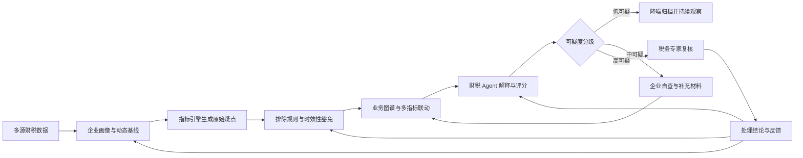
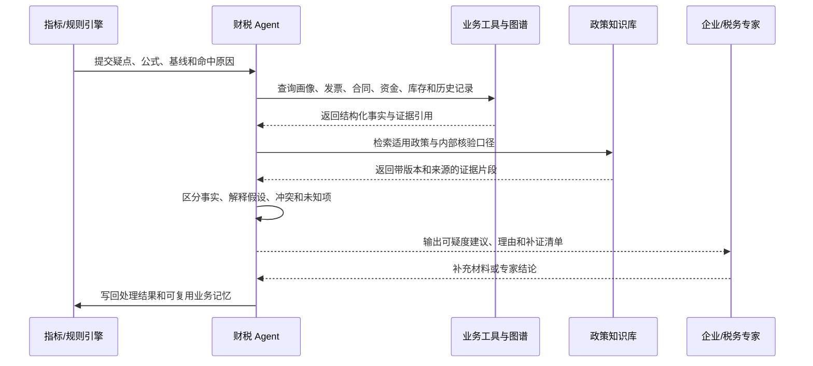

> 财税指标预警本质上是统计相关性判断，不是业务实质判断。指标越界只说明“值得核查”，不能直接推出“存在偷逃税行为”。

企业的增值税税负突然下降，可能是隐匿收入，也可能是集中采购设备形成了大额进项；存货周转率显著下降，可能是滞销，也可能是旺季前备货；其他应收款长期挂账，可能涉及股东借款，也可能只是项目保证金。数值相同，业务事实和税务后果可能完全不同。

这正是财税风险预警最棘手的地方：**系统擅长发现偏离，却不天然理解偏离背后的经营原因。**如果直接把行业均值或固定区间当成风险结论，预警量会快速增长，税务专家却不得不把时间花在大量可被正常经营解释的事项上。企业也会因为反复收到低价值提醒，逐渐忽略真正重要的风险。

因此，一个成熟的财税风控系统不应只追求“多报”，而应回答四个问题：

1. 这个指标相对于谁异常，是相对行业、相对同类企业，还是相对企业自己？
2. 是否存在能够解释异常的经营事件，并且有真实材料支持？
3. 合同、发票、资金、物流、库存和申报数据能否相互印证？
4. 系统应该自动降噪、要求企业补证，还是提交税务专家复核？

本文围绕这四个问题，设计一套由**动态基线、排除规则、业务图谱、财税 Agent 和专家终审**构成的误报治理体系。这里讨论的是通用工程方法，不对任何具体厂商未公开的内部实现作事实判断。

---

## 一、先划清边界：疑点、风险与定性不是一回事

财税风控中最容易发生的概念混淆，是把“指标异常”“风险疑点”和“违法定性”当成同一个结论。实际上，它们是三个不同层级。

| 层级 | 系统回答的问题 | 典型产物 | 能否直接定性 |
| --- | --- | --- | --- |
| 指标异常 | 数值是否偏离预期范围 | 指标命中记录 | 不能 |
| 风险疑点 | 偏离是否缺乏合理解释，证据是否存在矛盾 | 疑点、可疑度和补证清单 | 不能 |
| 专业定性 | 事实、适用政策和处理程序是否足以支持结论 | 专家意见、整改或处置结论 | 由有权人员决定 |

指标引擎可以稳定地计算税负率、毛利率、存货周转率和投入产出关系，但它看到的只是经营结果的投影。例如，增值税税负可以被简化表示为：

```text
增值税税负率 = 当期应纳增值税额 / 当期应税销售收入
```

当分子因为集中取得进项而下降时，税负率会降低；当分母因为收入确认时点变化而上升时，税负率也会降低。单看结果，系统无法知道是哪一种原因，更无法仅凭这个比率判断业务是否真实。

所以，指标的正确定位应是**高召回的线索发现器**。它宁可先发现更多可疑变化，再由后续机制补充上下文、验证证据和控制误报。问题不在于指标会产生疑点，而在于系统是否把未经验证的疑点直接升级成高风险结论。

## 二、为什么一套行业阈值注定不够

### 1. 行业标签无法表达真实经营模式

行业代码是分类工具，不是企业业务模型。即使处于同一个制造业子类，企业也可能采用完全不同的生产与交易方式：

- 自研自产企业自行采购原材料，拥有设备、人员和完整生产环节；
- 来料加工企业由委托方提供主要材料，自身可抵扣进项较少；
- 委托加工企业把生产环节交给外部供应商，成本和发票结构不同；
- “生产加贸易”企业既销售自产商品，也转售外购商品；
- 定制设备企业按项目履约，采购、生产、验收和收入确认跨越多个期间。

如果这些企业共用同一税负区间，来料加工企业可能因为进项少而长期表现为税负偏高，大宗贸易业务则可能因为薄利高周转而长期表现为税负偏低。两者都偏离行业均值，但偏离本身并不能证明风险。

更准确的基准至少需要加入经营模式、收入结构、纳税人类型、企业规模和地域等信息。换言之，阈值不是“按行业查一张表”，而是企业画像经过分层后得到的一个参考分布。

### 2. 企业生命周期会改变指标基准

固定阈值通常隐含了一个假设：企业已经进入稳定经营期，采购、生产、销售和回款大致连续。但真实企业会经历筹建、新投产、扩产、成熟、收缩和清算等阶段。

新投产企业可能在数月内集中采购生产线、厂房和软件系统，形成大量进项，却还没有稳定收入；扩产企业可能提前锁定原材料，使存货和预付款快速上升；清算企业则可能集中处置资产、回收债权并终止日常采购。把这些阶段放进同一模型，指标自然会频繁越界。

生命周期不是备注字段，而应成为风险模型的正式输入。系统不仅要知道企业属于哪个行业，还要知道企业当前处于什么经营阶段，以及阶段判断由哪些事实支持。

### 3. 阶段性事件会打破平稳性假设

财税指标往往按月、季度或年度计算，而企业经营并不服从整齐的会计期间。以下事件都可能造成合法但显著的短期波动：

- 新增厂房、设备或不动产；
- 旺季前集中备货或大宗原料锁价采购；
- 一次性大额订单、退货或价格调整；
- 处置固定资产或终止某条业务线；
- 收到政府补助；
- 项目验收、质保金结算或工程分包结算；
- 出口、免税、简易计税等业务占比发生变化。

这些事件不应该简单加入永久白名单。正确做法是记录事件的发生时间、影响范围、预期持续期和佐证材料，在适用期间内调整可疑度，期满后重新评估。

### 4. 会计核算差异会投射为指标差异

不同企业可能在允许的核算框架内采用不同处理方式，例如费用资本化与费用化、返利确认、履约进度估计、质保金确认和成本归集。财务口径、税务口径与管理口径之间也可能存在调整项。

这意味着某些“报表不匹配”首先是口径解释问题，而不是风险定性问题。系统必须保留指标公式、数据来源、会计期间和口径版本，否则连异常是否真实存在都无法复现。

### 5. 单点指标缺少因果上下文

“税负低于下限”只描述了结果，没有描述原因。要区分隐匿收入与集中采购，至少还需要回答：

- 进项增长由哪些发票构成？
- 是否存在对应合同、付款和验收入库？
- 采购物是否形成固定资产或真实库存？
- 供应商与企业是否存在异常关联？
- 后续期间的产能、销售或库存消耗是否与采购相符？

只有把指标放回完整业务链路，系统才有机会从“相关性预警”走向“可解释的风险判断”。

## 三、五类高频误预警场景

### 1. 增值税税负偏低

某制造企业过去 12 个月税负率稳定在 2% 左右，本月下降到 0.4%。指标引擎会合理地认为这是显著变化，但后续可能出现两种完全不同的解释。

第一种是企业采购了新生产线，设备发票、采购合同、银行付款、验收单和固定资产卡片能够互相对应。税负下降由阶段性进项抵扣造成，异常真实但可疑度较低。

第二种是企业申报收入下降，但开票、收款、发货和能耗数据之间出现冲突，且无法提供合理说明。此时税负偏低与多条证据矛盾相互印证，应升级处理。

关键不是“税负低不低”，而是**低税负能否被完整证据链解释**。

### 2. 存货周转率异常

存货大幅增长可能意味着滞销、虚增采购，也可能只是季节性备货、在途物资或委托加工。系统需要区分：

- 库存是否与历史旺季规律一致；
- 采购是否有合同、付款和入库记录；
- 库龄结构是否持续恶化；
- 后续销售是否消化了库存；
- 账面库存与仓储、物流或盘点记录是否匹配。

一次性增长与持续多个周期无法解释的增长，风险含义并不相同。

### 3. 其他应收款长期挂账

长期挂账经常被用于识别股东借款、变相分红或关联资金占用，但“长期”不是唯一判断条件。项目保证金、租赁押金、投标保证金和正常计息的关联方拆借，都可能形成较长账龄。

要进一步判断，需要核验交易对手身份、款项用途、协议、利率、还款安排、实际资金流和后续执行情况。即使企业提供了一份协议，也不能自动降级；协议内容必须与付款、计息和偿还事实一致。

### 4. 收入与成本变动不匹配

项目制企业可能按履约进度确认收入，而采购发生在前、验收发生在后；总包项目的分包结算也可能跨期。收入和成本在单月不匹配并不罕见。

真正值得关注的是：项目台账、合同履约节点、验收记录、成本归集和收入确认政策之间是否一致。如果企业用“项目制”解释所有波动，却拿不出项目级数据，解释强度仍然不足。

### 5. 研发费用占比异常

研发费用骤降可能是项目暂停、阶段切换或人员调整；骤升可能是新项目启动，也可能存在不恰当归集。系统不能只比较占比，还应关联研发立项、人员工时、材料领用、设备使用、成果记录和项目结项信息。

这些场景揭示了同一个规律：**业务说明只能提出解释假设，材料和跨源数据才能提高解释可信度。**

## 四、总体方案：建立四层降噪漏斗

误报治理不是增加一个更复杂的阈值，而是让原始疑点依次通过四层判断。



四层分别解决不同问题：

1. **动态基线**判断“相对谁异常”，降低粗粒度行业阈值带来的偏差。
2. **排除规则**识别已知、可结构化表达的合规场景。
3. **业务图谱**连接多源数据，检查证据是否完整、是否相互矛盾。
4. **财税 Agent**理解非结构化材料，生成解释、补证清单和分流建议。

这套架构的关键是职责分离。确定性计算交给指标和规则；实体关联与关系查询交给图谱；政策检索和材料理解交给 Agent；最终定性与高影响处置保留人工责任。

## 五、第一层：从固定阈值升级为动态基线

### 1. 企业自身基线优先，行业对标为辅

企业自身历史通常比行业均值更能反映其经营模式。若一家企业税负率长期稳定在 2.2%，突然下降到 0.5%，这个变化往往比“行业均值为 2%”更有信息量。相反，如果企业多年稳定在 0.8%，仅仅低于行业均值并不足以持续触发高等级预警。

因此，可以把预警信号拆成三类：

- **纵向异常**：相对企业自身历史发生突变；
- **横向异常**：相对同画像企业群体明显偏离；
- **结构异常**：多个相关指标之间的关系发生变化。

三类信号的组合比单一行业阈值更稳健。例如，只有横向偏低但企业自身长期稳定，可以保持观察；横向偏低且纵向突降，则需要进一步核验。

### 2. 用分布和区间代替单点

行业均值容易被极端值影响，也无法表达样本分散程度。工程上更适合使用中位数、分位数和稳健离差。例如，可用中位数绝对偏差构造稳健标准分：

```text
robust_z = 0.6745 × (当前值 - 历史中位数) / MAD
MAD = median(|历史值 - 历史中位数|)
```

`robust_z` 对极端值不那么敏感，适合包含偶发波动的财税时间序列。但任何公式都不能机械套用：当历史样本过少、指标大量为零或企业模式已经变化时，应降低模型置信度，而不是生成看似精确的分数。

对于季节性明显的企业，应比较同季、同月或相同业务周期，而不是只做简单环比。还可以结合滚动窗口、指数加权移动平均和变化点检测，识别趋势漂移与突然跳变。

### 3. 企业画像决定参考群体

动态基线服务至少需要以下画像维度：

| 维度 | 示例 | 对基线的影响 |
| --- | --- | --- |
| 行业细分 | 通用设备制造、农产品加工 | 决定基本经营与税负结构 |
| 经营模式 | 自产、来料加工、贸易、混合经营 | 影响进销项和毛利结构 |
| 企业规模 | 小微、中型、大型 | 影响样本可比性与波动幅度 |
| 生命周期 | 筹建、新办、扩产、成熟、清算 | 影响采购、收入和资产变化 |
| 业务结构 | 出口、免税、简易计税占比 | 影响税负计算与可比口径 |
| 地域与季节 | 区域价格、淡旺季 | 影响采购、销售和库存周期 |

画像标签必须带来源、置信度和有效期。例如，“扩产期”可以来自已核验的设备采购和项目资料，而不能仅由模型根据一段说明永久写入。

### 4. 冷启动与基线失效

新办企业没有足够历史数据，可以先使用同画像群体基线，并明确标记低置信度。随着企业积累数据，再逐步提高自身基线权重。

当企业新增业务线、发生并购或经营模式明显变化时，旧基线会失效。系统应通过变化点、主营构成变化和人工反馈触发重新分群，而不是继续用旧历史评价新业务。

## 六、第二层：用排除规则处理已知场景

动态基线解决“异常是否显著”，排除规则解决“是否存在已知解释”。规则适合表达边界清楚、数据可验证的场景。

例如，低税负疑点可以配置如下决策逻辑：

```text
如果：
  税负率显著低于自身基线
并且：
  本期新增固定资产进项达到设定影响程度
并且：
  发票、合同、付款、验收和资产卡片能够匹配
并且：
  供应商与交易不存在已知高风险信号
那么：
  将疑点调整为“阶段性进项影响”
  降低处理优先级，但保留后续观察任务
```

这里有三个容易被忽视的设计点。

第一，**豁免不是删除**。疑点仍应保留原始指标、命中规则、证据引用和调整结果，以便复查。

第二，**豁免必须有时效**。设备采购对税负的影响可能持续若干期间，但不能永久覆盖后续所有低税负。

第三，**材料存在不等于材料有效**。规则要尽可能校验金额、日期、交易对手、资产入账和付款关系，而不是仅判断附件数量大于零。

规则对象可以设计为一个有版本的数据结构：

```json
{
  "rule_id": "vat-low-fixed-asset-001",
  "version": 3,
  "scope": ["general-taxpayer", "manufacturing"],
  "conditions": [
    "vat_burden_below_dynamic_lower_bound",
    "verified_fixed_asset_input_ratio_above_threshold"
  ],
  "effect": "downgrade_to_low_suspicion",
  "valid_for_periods": 3,
  "required_evidence": [
    "invoice",
    "contract",
    "payment",
    "acceptance",
    "asset_card"
  ],
  "owner": "tax-risk-team"
}
```

随着场景增加，规则数量会不断膨胀，因此需要版本管理、冲突检测、命中统计、回放测试和责任人机制。规则不是一次性配置，而是一项持续运营的知识资产。

## 七、第三层：业务图谱把单点异常变成证据链判断

规则擅长判断明确条件，却难以回答跨系统关系问题。业务图谱的价值，是把企业经营活动中的对象和关系组织起来，让系统能够沿着一笔业务检查“合同、发票、资金、货物和申报”是否一致。

### 1. 图谱需要连接什么

核心实体通常包括：

- 企业、客户、供应商和关联方；
- 合同、订单、项目和履约节点；
- 发票、申报表和财务凭证；
- 银行流水、付款和回款；
- 商品、原材料、库存和物流单据；
- 设备、产线、能耗和产能；
- 人员、研发项目和工时记录。

图谱不是为了画一张复杂关系图，而是为了支持具体核验问题。例如：某张大额设备发票对应哪份合同，付款是否流向开票方，设备是否验收入账，后续是否形成合理产能。

### 2. 从证据缺失到证据冲突

风险判断应区分三种状态：

- **证据完整且一致**：正常经营解释得到多源支持，可以降低可疑度；
- **证据暂缺**：当前无法判断，要求企业补充材料；
- **证据相互冲突**：不同数据源无法同时成立，应提高可疑度。

“没有找到材料”不等于“证明违规”。它可能只是数据尚未接入或企业尚未提交。因此，高风险升级应更多依赖明确冲突、持续异常和多项信号共振，而不是单纯的附件缺失。

### 3. 多指标联动示例

假设系统发现税负偏低，可以继续检查：

1. 存货是否持续增长；
2. 是否存在对应采购付款；
3. 进项品名与销售品名是否符合企业业务；
4. 产量、能耗和人员是否支持申报规模；
5. 相关客户或供应商是否高度集中或存在异常关联；
6. 异常是否在后续期间恢复或持续扩大。

单个信号可能容易解释，多条独立证据同时矛盾则更值得关注。由此，风控逻辑从“税负低，所以报警”升级为“税负、库存、资金和产能之间无法形成一致的业务解释，所以升级”。

### 4. 图谱的工程难点

图谱效果受主数据质量直接限制。同一供应商可能在合同、发票和银行系统中使用不同名称；商品名称也可能存在简称、型号和税收分类差异。没有稳定的实体解析、口径映射和时间版本，图谱会制造新的错误关联。

因此，图谱建设应优先服务高价值核验路径，从少数关键实体和关系开始，而不是一开始追求覆盖所有财税对象。

## 八、第四层：财税 Agent 负责解释、补证与分流

前三层主要处理结构化数据。现实中的关键解释却常藏在合同条款、项目说明、会计备注、历史访谈和政策文件里，这正是 Agent 可以发挥作用的地方。

### 1. Agent 不是新的风险裁判

财税 Agent 的正确定位是：

- 汇总与疑点相关的数据和材料；
- 提出可能的正常经营解释和风险解释；
- 通过 RAG 检索适用政策、内部口径和历史案例；
- 明确哪些事实已经证实，哪些仍是推断；
- 生成补证清单、可疑度建议和专家工单摘要。

它不应直接执行以下动作：

- 把企业定性为违法违规；
- 在没有人工审批时永久销号高风险疑点；
- 自行修改申报数据或对外提交材料；
- 用生成的政策内容替代可追溯的正式依据。

Agent 可以影响队列顺序和调查效率，但高影响结论必须由有权人员确认。

### 2. 一次分析的标准流程



Agent 的输入不应只有一句“税负偏低”。至少要包含指标公式、观察期、当前值、基线区间、历史趋势、企业画像、已命中规则和数据完整度。否则模型会在缺乏事实的情况下生成听起来合理的解释。

### 3. 输出必须结构化

一个可审计的 Agent 输出可以包含：

```json
{
  "finding_id": "F-20261103-00128",
  "suggested_level": "medium",
  "confidence": 0.72,
  "verified_facts": [],
  "plausible_explanations": [],
  "conflicts": [],
  "unknowns": [],
  "required_evidence": [],
  "policy_citations": [],
  "recommended_action": "request_evidence",
  "human_review_required": true
}
```

`confidence` 表示模型对当前分流建议的把握，不代表企业违法概率。二者必须在产品界面和数据模型中明确区分。

### 4. RAG 只能引用有效依据

财税政策具有时效、地域、税种、纳税人类型和适用事项等约束。知识库不能只存一段切碎后的文本，还要保留：

- 文件名称、发布机构和文号；
- 生效、失效和修订时间；
- 适用税种、地域和主体；
- 原文位置和版本；
- 内部解读与正式政策之间的类型差异。

Agent 应先根据业务事实形成检索条件，再返回具体依据。若检索不到有效政策，应明确标记“依据待核实”，不能凭模型记忆补全条款。

### 5. 企业业务记忆必须可治理

企业可以补充说明：“本月税负下降是因为采购生产线。”系统不应把这句话直接变成永久豁免，而应将其拆成：

- 企业声明：采购生产线；
- 已验证事实：合同、发票、付款、验收和资产卡片；
- 影响指标：增值税税负、固定资产和现金流；
- 适用期间：预计影响的申报周期；
- 复核条件：后续投产、产能或折旧记录是否出现。

业务记忆应记录来源、证据、有效期和责任人。事实与推断分开存储，过期后重新验证，避免一次解释演变成长期白名单。

## 九、风险评分：分数服务于分流，不制造伪精确

风险评分可以统一多个信号，但不能把复杂判断伪装成一个绝对准确的数字。更合理的做法是让评分明确表达构成因素：

```text
可疑度 =
  指标偏离强度
  × 异常持续性
  × 多源证据冲突度
  × 数据可信度
  × 场景先验权重
  - 已验证解释强度
```

实际实现不一定采用简单乘法，可以使用可校准的统计模型、树模型或规则评分卡。无论采用哪种方法，都应保留每个因素的贡献，避免只输出一个无法解释的总分。

建议至少区分三个业务等级：

| 等级 | 典型特征 | 系统动作 |
| --- | --- | --- |
| 低可疑 | 有典型合规场景，证据较完整，无明显冲突 | 降噪归档，设置观察期 |
| 中可疑 | 指标异常成立，存在合理解释，但证据不足 | 生成自查清单，补证后重评 |
| 高可疑 | 多项指标共振，证据冲突或解释无法成立 | 创建专家工单，限制自动降级 |

还需要单独设置“数据不足”状态。数据不足不是中风险的同义词，也不应该被系统强行映射成一个看似明确的等级。

评分上线前必须经过概率校准和分层验证。例如，不能只看总体准确率，还要检查不同企业规模、经营模式和生命周期下是否存在系统性偏差。

## 十、端到端架构：确定性系统托底，Agent 处理语义

生产系统可以划分为九个核心模块：

| 模块 | 核心职责 | 主要输出 |
| --- | --- | --- |
| 数据接入与治理 | 接入申报、财务、发票、资金、合同等数据并统一口径 | 标准化事实数据 |
| 企业画像服务 | 管理行业、模式、规模、阶段和特殊业务标签 | 带来源和时效的画像 |
| 指标计算平台 | 按版本化公式计算指标和趋势 | 原始指标与计算血缘 |
| 动态基线服务 | 构建企业自身和同画像群体基准 | 区间、偏离度和置信度 |
| 规则引擎 | 执行预警、排除和升级规则 | 规则命中与处理建议 |
| 业务图谱 | 关联主体、交易和证据关系 | 证据路径与冲突信号 |
| 知识库与 RAG | 管理政策、口径和案例 | 带版本的依据引用 |
| Agent 编排层 | 调用工具、解释疑点、生成补证与分流建议 | 结构化分析结果 |
| 工单与审计平台 | 承载企业补证、专家复核和结果回流 | 最终结论与完整轨迹 |

在调用边界上，模型不应直接连接原始生产数据库。工具层需要完成租户隔离、字段授权、参数校验、查询限额、敏感信息脱敏和审计记录。任何写操作都应使用明确接口，并按风险配置人工审批、幂等和回滚能力。

系统还要保存每次判断时使用的版本，包括指标公式、画像、规则、图谱快照、政策版本、模型、提示词和工具结果。只有这样，半年后才能回答“当时为什么把这个疑点降为低可疑”。

## 十一、用一个完整案例看分层治理如何工作

假设某制造企业本月增值税税负率从过去一年的 2.1% 降到 0.45%。

### 第一步：指标引擎发现异常

动态基线服务确认当前值同时满足：低于企业自身历史区间，也低于同经营模式企业的合理分位区间。系统生成原始疑点，但暂不推送高风险工单。

### 第二步：排除规则检查阶段性事件

规则引擎发现本月固定资产进项显著增加，并找到生产线采购发票。由于验收和资产入账信息尚未接入，规则不能直接降级，只将“设备采购”标记为待验证解释。

### 第三步：图谱核验证据链

图谱关联到采购合同、银行付款、设备供应商、验收单和固定资产卡片。金额与日期基本一致，未发现付款回流和异常关联。与此同时，新增设备与企业现有业务范围相符。

### 第四步：Agent 检索与解释

Agent 汇总证据并检索相关抵扣政策和内部核验口径，输出：税负下降与集中采购设备在时间和金额上能够对应；当前未发现证据冲突；仍需观察后续期间资产使用和生产变化。

### 第五步：分流与留痕

系统建议将疑点设为低可疑，保留三期观察任务，不创建高优先级专家工单。所有证据、规则版本、政策引用和 Agent 分析进入审计记录。

如果图谱在第三步发现付款最终回流到企业关联账户，或者设备并未验收入账，同一个指标就会走向相反结果：解释假设失效，可疑度上升并进入专家复核。

这个案例说明，最终等级不是模型“猜出来”的，而是由每一层逐步增加或削弱证据形成的。

## 十二、专家复核不是兜底按钮，而是学习闭环

人工复核的价值不只是处理 Agent 不会的问题，还要为系统产生可学习的高质量反馈。专家工单应展示：

- 原始指标、公式、基线和趋势；
- 触发与排除规则；
- 已验证事实、证据冲突和未知项；
- Agent 的解释假设及政策引用；
- 企业补充说明与材料；
- 系统建议等级及各因素贡献。

专家可以确认、降级、升级或要求继续补证，并选择标准化原因码。自由文本意见可以保留，但不能只有自由文本，否则难以统计哪类规则最容易误报、哪类 Agent 建议最常被改判。

反馈写回后可以用于四类优化：

1. 调整动态基线和画像分群；
2. 新增、修改或下线排除规则；
3. 改善图谱实体关联和数据质量；
4. 更新 Agent 评测集、提示词和检索策略。

不能把专家结论未经审查地直接用于在线自学习。财税规则和模型变更应先经过离线回放、版本审批和灰度验证，避免一次误判被系统批量放大。

## 十三、如何评估系统是否真的降低了误报

只统计“预警数量减少”是危险的，因为系统也可能通过少报来降低误报。至少要同时观察风险效果、运营效率和 Agent 质量。

### 1. 风控效果

- **精确率**：被升级的疑点中，有多少经复核确有处理价值；
- **召回率**：已知高风险事项中，有多少被系统发现；
- **误报率**：被预警事项中，有多少最终被合理解释；
- **分级校准**：高、中、低可疑等级是否对应不同的实际命中概率；
- **分群表现**：不同规模、行业和经营模式下是否存在明显偏差。

### 2. 运营效率

- 每个有效风险所需的专家时间；
- 专家平均复核时长和工单积压量；
- 中风险补证后可自动降级的比例；
- 企业重复提交同类说明的次数；
- 从疑点产生到形成可执行结论的周期。

### 3. Agent 质量

- 政策引用是否真实、有效并适用于当前期间；
- 关键结论是否都能追溯到证据；
- Agent 是否混淆已验证事实与推断；
- 补证清单是否必要且与疑点相关；
- 专家对建议等级的改判率；
- 同一案例重复运行时结论是否稳定。

评测集应覆盖正常经营、真实风险、材料缺失、政策版本变化、企业画像错误和对抗性说明等场景。尤其要保留历史误报案例，验证新版本是否真正解决旧问题，同时没有造成新的漏报。

## 十四、落地路线：不要一开始就让大模型承担全部判断

### 第一阶段：把指标和数据口径做扎实

先选取误报量高、业务价值高的少数指标，统一公式、数据来源和计算血缘；建立基础企业画像与专家复核原因码。没有可靠数据底座，Agent 只会更流畅地解释错误数据。

### 第二阶段：建立规则降噪和证据清单

沉淀高频合规场景，为每类场景定义所需证据、有效期和后续观察条件。通过历史工单回放，测量规则减少了多少低价值预警，又漏掉了多少真实风险。

### 第三阶段：打通关键证据链

优先连接发票、合同、资金、库存和资产等高价值数据，围绕具体疑点构建关系查询。此阶段不必追求一个包罗万象的知识图谱。

### 第四阶段：引入 Agent 辅助分析

先让 Agent 做材料摘要、政策检索、补证清单和工单摘要，再逐步参与可疑度建议。所有建议与专家结果对比，达到稳定门槛后再扩大自动分流范围。

### 第五阶段：建立持续评测与治理

将专家反馈转化为固定回归集，监控规则、模型和知识库版本。高风险场景保持人工审批，低风险自动降噪也应设置抽检和漂移监控。

这条路线的原则是：**先把确定性链路做对，再让模型处理确定性系统难以覆盖的语义问题。**

## 十五、架构取舍：规则、图谱、模型和人各自做什么

纯规则方案可控、可审计，但难以穷举业务场景，维护成本会随规则数量快速上升。纯大模型方案擅长理解说明和材料，却存在幻觉、稳定性和责任边界问题。图谱能够关联证据，但依赖高质量主数据，也不能单独完成政策适用和专业定性。

因此，更现实的方案是混合架构：

> 规则指标引擎负责稳定发现疑点，动态基线负责提高比较质量，排除规则负责处理明确场景，业务图谱负责连接多源证据，财税 Agent 负责解释、补证和分流，税务专家负责最终复核与责任闭环。

没有任何系统能够把误报降到零。过度压低误报通常会牺牲召回率，使真正风险被漏掉。工程目标应是建立可度量的平衡：在保持关键风险检出能力的前提下，把专家资源集中到证据矛盾更强、潜在影响更大的事项上。

## 十六、面试时如何讲清楚这套方案

面对“指标误预警怎么解决”这类问题，可以先给结论，再按层次展开：

> 固定行业阈值最大的问题，是忽略企业经营模式和阶段差异。很多指标波动来自集中采购、季节性备货或项目结算，属于真实但合规的经营现象，所以单点指标会产生大量假阳性。我的处理方式不是直接取消指标，而是建立四层降噪：先以企业自身历史为主、细分行业对标为辅，形成动态基线；再用有时效和证据要求的排除规则处理已知场景；然后关联合同、发票、资金、库存和产能，判断多条证据是否一致；最后由财税 Agent 检索政策、解释异常、生成补证清单并做可疑度分流。低可疑事项归档观察，中可疑要求补证，高可疑提交税务专家复核。Agent 不直接定性或自动销号，所有判断都保留证据、版本和审计轨迹。

如果面试官继续追问工程细节，可以重点补充三点：

1. 动态基线要处理冷启动、季节性和经营模式变化，不能只是计算平均值。
2. 企业说明只是解释假设，必须与合同、资金、发票和实物流转交叉验证。
3. 系统效果不能只看预警量下降，要同时看精确率、召回率、专家工时和分级校准。

这三点能够体现方案不是把大模型套在传统规则之外，而是完整考虑了数据、决策、审计和人机协同。

## 结语

财税风险管理的困难从来不只是“有没有规则”，而是统计异常与业务实质之间存在距离。行业阈值可以快速发现偏离，却无法独自回答偏离为何发生；企业说明可以提供线索，却不能代替证据；大模型能够理解材料和组织解释，却不能承担没有约束的风险定性。

真正可落地的系统，需要把这些能力放在正确的位置：用指标保证发现能力，用动态基线减少粗粒度比较，用规则处理确定场景，用图谱验证证据关系，用 Agent 解释和分流，再由专家完成高影响判断。

因此，财税 Agent 最有价值的角色不是“替代税务师”，而是成为指标预警与专业判断之间的**降噪层、解释层和效率层**。它把原本散落在数据、材料和人员经验中的信息组织成可核验的证据链，让有限的专家时间真正用在值得处理的风险上。
