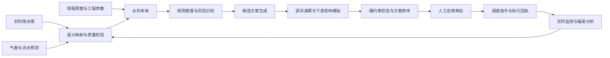

# 基于洪水预测的本体决策：一次水库防洪调度的完整流程

7 月 18 日 08:00，某流域防汛值班室收到新一轮气象预报：未来 12 小时，水库上游可能出现一次集中强降雨，面雨量中值为 165 毫米，局部最大雨量超过 230 毫米。洪水预报模型进一步给出判断：水库入库流量将在当日 18:00 左右达到峰值，中值预测为 2380 立方米每秒。

此时，水库水位为 146.80 米，距离 147.00 米的汛限水位只剩 0.20 米。与此同时，下游支流也将形成洪峰。如果水库立即按最大能力泄洪，水库本身的压力可以降低，但出库洪水可能与支流洪水叠加，反而提高下游县城的淹没风险；如果继续保持小流量下泄，水库又可能在入库洪峰到达后快速逼近设计洪水位。

调度人员面对的并不是一个简单的“水位是否超限”问题，而是一个多对象、多时间尺度、多约束的动态决策问题：

- 预报是否足够可信，是否需要立即行动；
- 应该提前腾出多少防洪库容；
- 什么时候增加出库流量，什么时候必须压低泄量；
- 水库安全与下游防洪安全发生冲突时如何取舍；
- 预测出现偏差后，原方案还能否继续执行；
- 系统为什么推荐某个方案，依据了哪些数据和规则。

这正是本体决策可以发挥作用的场景。它不替代洪水预报模型，也不替代调洪演算和人工会商，而是把水库、河道、测站、预测结果、风险对象、调度规则和执行权限组织成统一的业务语义，使系统能够回答：**当前发生了什么、可能发生什么、允许采取什么动作，以及为什么推荐这样做。**

> 场景说明：本文采用典型流域防洪业务构造匿名化案例。工程名称和数值均为教学示例，不对应某一座真实水库，也不能直接作为实际调度依据。真实调度必须使用经主管部门批准的调度规程、实时监测数据和授权流程。

---

## 一、场景不是“预测洪峰”，而是“决定下一步怎么做”

### 1. 流域与工程对象

案例流域由上游山区集水区、控制性水库、干流河道、下游支流和县城防洪控制断面组成。水库承担防洪、供水和发电任务，汛期以防洪安全为最高优先级。

核心工程参数如下。

| 对象或指标 | 示例值 | 业务含义 |
| --- | ---: | --- |
| 当前库水位 | 146.80 m | 已接近汛限水位 |
| 汛限水位 | 147.00 m | 汛期正常运行控制上限 |
| 设计洪水位 | 154.50 m | 重要安全约束 |
| 校核洪水位 | 156.20 m | 极端条件下的安全边界 |
| 当前入库流量 | 180 m³/s | 洪水尚未明显起涨 |
| 当前出库流量 | 120 m³/s | 维持正常下泄 |
| 当前可用防洪库容 | 6800 万 m³ | 吸纳本轮洪水的主要空间 |
| 下游常规安全泄量 | 800 m³/s | 不考虑支流叠加时的控制值 |
| 支流洪峰影响时段 | 14:00 至 18:00 | 主库应主动避峰的窗口 |
| 影响时段建议出库上限 | 450 m³/s | 防止控制断面流量超限 |

水库下游 32 公里处是县城控制断面。该断面的流量不仅受水库出流影响，还受区间产流和支流来水影响。因此，“出库流量低于 800 立方米每秒”并不总是安全：当支流已经贡献 600 立方米每秒时，水库再下泄 700 立方米每秒，就可能使控制断面流量突破防洪警戒线。

### 2. 08:00 时刻的预测结果

系统接入三类预测：

| 预测类型 | 预测结果 | 不确定性表达 |
| --- | --- | --- |
| 气象预测 | 未来 12 h 面雨量 165 mm | P10/P50/P90 为 120/165/215 mm |
| 入库洪水预测 | 洪峰 2380 m³/s，18:00 出现 | 峰值区间 1950 至 2920 m³/s，时间误差约 ±2 h |
| 支流洪水预测 | 15:30 左右到达县城断面 | 峰值区间 520 至 720 m³/s |

这里不能只保留一个确定值。若系统只看到“洪峰 2380 立方米每秒”，很容易给出一套看似精确的单一方案；但当实际洪峰接近 P90 情景时，这套方案可能失效。因此，预测本体实例不仅要记录预测值，还要记录模型版本、发布时间、有效期、概率分位、空间范围和数据质量。

### 3. 决策目标与优先级

本次调度目标不是简单地把水位降到最低，而是按以下优先级处理：

1. 不突破大坝安全硬约束；
2. 尽量不使下游控制断面超过保证水位；
3. 在支流洪峰期间实施错峰，减少洪峰叠加；
4. 保留应对 P90 偏大洪水的安全余量；
5. 在安全约束满足后，再考虑供水、发电和弃水损失。

前四项是安全目标，第五项是效益目标。系统必须区分硬约束和软偏好，不能通过“综合评分较高”掩盖某个方案已经违反安全边界。

---

## 二、本体如何表示这个防洪世界

本体的第一项作用，是让来自不同系统的数据指向同一个现实对象。例如，水情系统中的 `RSV_A01`、调度系统中的“上游控制水库”和预案文档中的“A 水库”，必须被识别为同一对象；否则系统无法把当前水位、调度规则和下游影响连接起来。

### 1. 核心对象

本场景需要的对象不只是“水库”和“洪水”，而是一组可以参与计算、推理和执行的业务对象。

| 本体类 | 典型实例 | 关键属性 |
| --- | --- | --- |
| `Basin` 流域 | 某河流域 | 面积、边界、行政区 |
| `Reservoir` 水库 | A 水库 | 水位、库容、防洪等级、运行状态 |
| `RiverReach` 河段 | 水库至县城河段 | 演进时间、安全流量 |
| `ControlSection` 控制断面 | 县城断面 | 警戒水位、保证水位、实时流量 |
| `HydroStation` 水文站 | 入库站、县城站 | 监测对象、数据时效、质量码 |
| `ForecastRun` 预测批次 | 08:00 洪水预报 | 模型、版本、发布时间、置信度 |
| `FloodEvent` 洪水事件 | 7·18 洪水过程 | 起止时间、洪峰、洪量、等级 |
| `ProtectedObject` 防洪对象 | 县城、村庄、桥梁 | 防护等级、人口、脆弱性 |
| `DispatchPlan` 调度方案 | 分阶段错峰方案 | 时段、目标泄量、适用条件 |
| `DispatchOrder` 调度指令 | 09:15 第 01 号指令 | 审批人、执行人、状态、回执 |

### 2. 关键关系

对象之间的关系决定了风险如何传播：

```text
上游集水区 --产流进入--> A水库
A水库 --泄流影响--> 下游河段
下游支流 --汇入--> 县城控制断面
县城控制断面 --保护--> 县城防洪对象
洪水预测 --描述--> 未来入库过程
调度方案 --作用于--> A水库
调度指令 --依据--> 已审批调度方案
```

如果缺少这些关系，系统只能分别看到一条水位数据和一条降雨预报；建立关系后，才能沿着“降雨影响集水区、集水区形成入库洪水、水库泄流与支流在断面叠加、断面超限影响县城”的路径完成风险推理。

### 3. 状态、事件与时间

防洪决策中的事实都有时间边界。`146.80 m` 不是水库的永久属性，而是 08:00 的观测状态；`2380 m³/s` 也不是已发生事实，而是某个模型在 08:00 对 18:00 的预测。

因此，每条关键数据至少需要附带：

```json
{
  "subject": "reservoir:A",
  "property": "waterLevel",
  "value": 146.80,
  "unit": "m",
  "observedAt": "07-18T08:00:00+08:00",
  "receivedAt": "07-18T08:01:12+08:00",
  "qualityCode": "VALID",
  "source": "station:RSV_A_LEVEL_01"
}
```

预测数据还要额外保存 `forecastIssuedAt`、`validTime`、`scenario` 和 `modelVersion`。这样，决策引擎才能拒绝使用过期预报，也能在事后复盘时还原“当时的人和系统究竟知道什么”。

### 4. 动作、权限和责任

面向决策的本体还必须描述动作：

- `IncreaseDischarge`：增加出库流量；
- `DecreaseDischarge`：减少出库流量；
- `OpenSpillwayGate`：开启泄洪闸；
- `StartEmergencyResponse`：启动应急响应；
- `NotifyDownstream`：通知下游相关单位；
- `RequestJointConsultation`：发起联合会商。

每个动作都要包含前置条件、参数范围、影响对象、授权角色、审批要求和执行后的验证方法。例如，“把出库流量提高到 700 立方米每秒”不能只是一个文本建议，还要检查闸门能力、下游安全泄量、流量变化率限制、通知提前量和当前指令是否冲突。

---

## 三、本体不替代模型，而是组织模型与规则协同工作

本体决策最容易被误解为“把所有业务逻辑都写成知识图谱规则”。实际系统中，不同问题应交给不同引擎处理。

| 能力 | 负责回答的问题 | 典型实现 |
| --- | --- | --- |
| 本体与知识图谱 | 对象是谁、如何关联、规则适用于谁 | RDF/OWL、图数据库、语义服务 |
| 规则引擎 | 当前事实触发了什么业务规则 | 决策表、规则 DSL、SHACL/SWRL 或领域规则服务 |
| 水文预测模型 | 未来会来多少水、何时到达 | 降雨径流模型、机器学习模型、集合预报 |
| 调洪演算模型 | 给定入流与泄流后水位如何变化 | 水量平衡、库容曲线、洪水演进模型 |
| 优化器 | 在约束下如何生成更优方案 | 动态规划、模型预测控制、多目标优化 |
| 人工会商 | 是否采纳方案并承担调度责任 | 防汛会商、审批和调度指令流程 |

整体流程如下：



本体在其中充当的是“语义控制层”：它为模型提供正确的对象、参数和约束，再把模型输出转换成可解释的风险与动作。洪水过程的数值计算仍由经过验证的专业模型完成，安全联锁仍由确定性控制系统保证，最终调度仍由有权限的责任人批准。

---

## 四、08:00 至 08:20：数据进入后先做语义化和质量校验

### 1. 接入实时监测与预测

08:00 后，平台接收到以下增量信息：

- 26 个雨量站最近 6 小时降雨；
- 水库水位、入库流量、出库流量和闸门状态；
- 上下游 5 个水文站的水位流量；
- 08:00 气象格点预报；
- 08:05 生成的入库洪水集合预报；
- 下游支流洪水预测；
- 水库当前检修状态和可用泄洪设施。

数据接入后不能直接触发调度。系统先把站码、工程编码、时间和单位映射到本体对象，并执行四类检查：

1. **完整性检查**：关键测站是否缺报；
2. **时效性检查**：数据延迟是否超过业务阈值；
3. **合理性检查**：水位、流量是否超出物理范围；
4. **一致性检查**：水位变化与入出库流量是否大体相符。

### 2. 发现并处理一个异常点

08:06，上游 3 号雨量站上报 5 分钟降雨 86 毫米，明显偏离周边站点。质量规则将其标记为 `SUSPECTED`，但不直接删除：

```text
若单站 5 分钟雨量 > 50 mm
且相邻 3 个站点均 < 10 mm
且雷达回波不支持强对流中心
则标记为疑似异常，并降低该站数据权重。
```

随后，降雨融合服务使用雷达估测和邻站数据进行替代计算，并保留原始值、修正值、修正方法和责任记录。这样既避免一个坏点把洪峰预测推得过高，也不会丢失审计证据。

### 3. 形成 08:20 决策快照

所有通过校验的数据被固化为 `DecisionSnapshot-0718-0820`。快照包含：

- 当时最新且有效的监测事实；
- 各预测模型的版本与输出；
- 水库调度规程版本；
- 当前可用闸门与机组状态；
- 下游防洪对象和安全阈值；
- 数据异常及其处理方式。

后续每一个方案都绑定这个快照。若 09:00 预报更新，系统不会悄悄覆盖旧方案的输入，而会创建新的快照并重新计算，保证决策过程可追溯。

---

## 五、08:20 至 08:30：从事实推理出风险，而不是直接给命令

### 1. 第一层推理：当前状态识别

规则引擎首先得到三个判断：

```text
事实 F1：当前水位 146.80 m，距汛限水位仅 0.20 m。
事实 F2：未来 12 h 预测面雨量 P50 为 165 mm，达到强降雨触发条件。
事实 F3：未来 24 h 预测洪量 P50 为 1.18 亿 m³，大于当前可用防洪库容 0.68 亿 m³。
```

由此推理出 `FloodControlStorageInsufficientRisk`，即“若维持当前下泄方式，可用防洪库容不足以安全承接预测洪水”。

### 2. 第二层推理：上下游风险耦合

系统沿本体关系继续检查，发现水库与下游支流将在同一控制断面汇合，且支流洪峰预计在 15:30 到达。于是产生第二个风险：

```text
若水库高出流时段与支流洪峰时段重叠
且控制断面预测流量超过警戒阈值
则识别为 DownstreamPeakSuperpositionRisk。
```

这条规则说明，系统不能只以“降低库水位”为目标。若在 14:00 至 18:00 持续大流量泄洪，可能把风险从水库转移到县城。

### 3. 第三层推理：预测不确定性放大风险

P50 情景下，当前防洪库容已经偏紧；P90 情景下，洪峰可能达到 2920 立方米每秒。系统因此把风险从“较高”提升为“高”，并要求：

- 必须生成偏大洪水备用方案；
- 方案评价不能只运行 P50 情景；
- 调度指令必须设置失效条件；
- 每 30 分钟滚动更新一次入流预测；
- 在自动建议后进入人工联合会商。

风险推理的输出不是“立即开闸”，而是一份结构化风险事件：

```json
{
  "riskType": "COMPOUND_FLOOD_CONTROL_RISK",
  "level": "HIGH",
  "affectedObjects": ["reservoir:A", "section:county", "protectedObject:countyTown"],
  "validWindow": "07-18T08:20/07-19T08:20",
  "evidence": ["F1", "F2", "F3", "forecast:tributary-0800"],
  "requiredActions": ["GENERATE_DISPATCH_OPTIONS", "JOINT_CONSULTATION"],
  "reviewInterval": "30m"
}
```

---

## 六、08:30 至 08:45：生成候选方案，而不是只输出一个答案

系统根据允许动作、硬约束和历史调度模板生成四个候选方案。候选方案先通过规则过滤，再进入调洪演算。

### 方案 A：维持当前下泄

出库流量继续保持 120 立方米每秒，等待入库洪水明显起涨后再调整。

该方案对下游短期影响最小，但会浪费洪峰到来前的预泄窗口。初步水量平衡已经显示其无法满足 P50 情景的库容要求，因此只作为对照方案，不具备推荐资格。

### 方案 B：持续大流量预泄

从 09:00 起将出库流量提高到 700 立方米每秒，并持续至 20:00。

该方案能快速腾出库容，但 14:00 至 18:00 与支流洪峰重叠，可能使县城断面流量超限。它违反“支流洪峰影响时段出库不超过 450 立方米每秒”的硬约束，因此在进入最终排序前被淘汰。

### 方案 C：分阶段预泄、避峰和再泄洪

该方案按照上下游洪峰传播过程分为四个阶段：

| 阶段 | 时间 | 目标出库流量 | 决策意图 |
| --- | --- | ---: | --- |
| 提前预泄 | 09:00 至 13:30 | 650 至 700 m³/s | 在支流洪峰前腾出库容 |
| 主动避峰 | 13:30 至 18:00 | 不高于 400 m³/s | 避免与支流洪峰叠加 |
| 削峰调度 | 18:00 至 23:00 | 700 至 900 m³/s | 在下游压力下降后释放库容 |
| 退水控制 | 23:00 后 | 随入流递减 | 平稳降低水位，避免流量突变 |

具体泄量不是固定不变，而是在每个阶段的上下限内由滚动优化器计算。闸门调整还要满足流量变化率限制，不能从 120 立方米每秒瞬间跳到 700 立方米每秒。

### 方案 D：偏大洪水应急方案

当实测累积雨量、入库流量或新预报达到 P90 触发条件时，方案 D 接管：提前启动更高级别响应，扩大泄洪能力，通知下游做好人员转移准备，并缩短滚动计算周期。

方案 D 不是当前立即执行的主方案，而是方案 C 的备用分支。它把“什么情况下原方案失效”提前写清楚，避免现场在风险突然升高时重新从零决策。

---

## 七、08:45 至 09:00：专业模型验证方案是否真的可行

### 1. 调洪演算的基本约束

对每个候选方案，调洪模型根据水量平衡计算水库状态：

```text
下一时段库容 = 当前库容 + 时段入库水量 - 时段出库水量
下一时段水位 = 水位库容曲线(下一时段库容)
```

模型还要考虑泄洪建筑物能力、闸门开度与流量关系、尾水影响、机组状态以及河道传播时间。随后，下游洪水演进模型把水库出流、区间产流和支流来水叠加到县城控制断面。

### 2. 三种预测情景下的结果

下表为示意性演算结果：

| 方案 | P50 最高库水位 | P90 最高库水位 | 县城断面峰值 | 硬约束结果 |
| --- | ---: | ---: | ---: | --- |
| A 维持现状 | 154.10 m | 155.38 m | 930 m³/s | P90 安全余量不足 |
| B 持续大流量 | 152.64 m | 153.71 m | 1280 m³/s | 下游峰值超限 |
| C 分阶段错峰 | 152.92 m | 153.96 m | 1010 m³/s | 全部通过 |
| D 应急方案 | 152.40 m | 153.35 m | 1160 m³/s | 仅在应急条件下可接受 |

县城断面并非零风险。方案 C 的 1010 立方米每秒仍可能触发警戒响应，但低于保证流量控制值，并且没有突破方案设定的硬约束。与方案 B 相比，它用水库防洪库容换取了下游错峰时间。

### 3. 方案排序不能用一个总分替代安全判断

系统先执行硬约束校验：

- 最高库水位不得超过方案对应的安全边界；
- 下游控制断面不得超过保证水位；
- 闸门动作不得超出设备能力；
- 出库流量变化率不得超限；
- 必须满足预警通知提前量；
- 指令必须由有权角色审批。

任何一项不满足，方案直接标记为 `INFEASIBLE`，不参加效益排序。对剩余可行方案，再比较最高库水位、下游峰值、弃水量、供水影响、发电损失和对预测误差的敏感性。

最终，系统推荐方案 C，方案 D 作为偏大洪水备用方案。推荐理由不是“综合得分最高”一句话，而是：

> 方案 C 在 P50、P90 情景下均未突破水库安全边界；通过在 13:30 至 18:00 主动压低出库流量，使水库出流与支流洪峰错开；方案对洪峰提前 2 小时和增大至 P90 的情景仍保有安全余量。其代价是增加约 620 万立方米预泄水量和一定发电机会损失，但安全收益优先级更高。

---

## 八、09:00 至 09:20：系统给建议，联合会商作决定

### 1. 会商界面展示什么

调度人员看到的不是一段大模型生成的结论，而是一组可核验的决策证据：

- 当前水位、入流、出流及数据时效；
- P10、P50、P90 三种入库过程线；
- 各方案的水位和出库流量过程线；
- 县城断面在各方案下的洪水过程；
- 命中的调度规则和规程条款；
- 被淘汰方案及淘汰原因；
- 主方案失效条件和备用方案；
- 数据异常、模型偏差与剩余不确定性。

### 2. 人工修正系统建议

会商中，水库运行人员补充了一条系统尚未获取的现场信息：2 号泄洪闸当天完成检修，但尚未经过满行程试运行。按照运行规程，该闸不能立即承担高强度调节任务。

这条信息被结构化为设备状态：

```text
gate:spillway-02 operationalStatus = CONDITIONAL
gate:spillway-02 maxAllowedOpening = 40%
gate:spillway-02 requiresOnSiteConfirmation = true
```

系统据此重新分配 1 号闸、2 号闸和发电机组的泄量，并再次验证总泄量目标是否可达。推荐方案的阶段目标保持不变，但执行路径发生了变化。

这一过程体现了本体决策的重要价值：人工不是在系统之外口头修改结论，而是把新事实补充到同一语义模型中，让方案重新计算、重新校验并留下记录。

### 3. 审批与指令生成

09:18，防汛责任人批准修订后的方案 C。系统生成第一阶段调度指令，内容包括：

- 指令编号和依据的决策快照；
- 09:30 至 10:00 分级增泄目标；
- 10:00 至 13:30 的目标流量区间；
- 各闸门和机组的建议动作；
- 下游通知范围和完成时限；
- 监测频率、复核时间和终止条件；
- 审批人、执行人和回执要求。

在下游单位确认收到预警、现场人员确认设备状态后，指令进入可执行状态。任何关键确认缺失，系统都不会把“已推荐”误写成“已执行”。

---

## 九、09:30 之后：执行不是终点，滚动校正才是闭环

### 1. 执行状态回写

09:30，水库开始分级增泄。平台每 5 分钟接收闸门开度、实际出库流量和库水位，并将计划值与实际值比较：

```text
计划出库流量：420 m³/s
实际出库流量：398 m³/s
偏差：-22 m³/s
原因：2号闸开度受限
处置：在1号闸允许范围内补偿，并重新预测水位
```

动作是否执行成功，不能只看控制系统返回“命令已接收”，还要看现实状态是否达到目标。只有当实际流量进入容差区间并稳定持续规定时间，动作实例才从 `EXECUTING` 转为 `VERIFIED`。

### 2. 11:00 的第一次滚动修正

11:00，实测面雨量略低于 P50，但上游西部区域雨强持续增加。新一轮洪水预报将峰值从 2380 调整为 2520 立方米每秒，峰现时间提前至 17:20。

系统比较新旧决策快照后判断：

- 主方案仍未突破失效阈值；
- 提前到达的洪峰缩短了预泄时间；
- 13:30 前需要额外腾出约 180 万立方米库容；
- 当前下游条件允许把 11:10 至 13:00 的目标泄量从 680 提高到 740 立方米每秒。

由于调整幅度仍在已审批方案的授权区间内，值班调度人员复核后执行，无需重新走最高级别审批；若目标泄量需要突破授权上限，则必须重新会商。这种“按动作风险分级授权”的设计，兼顾了响应速度和责任边界。

### 3. 15:30 的主动避峰

支流洪峰按预测到达县城断面。水库此时将出库流量控制在 380 立方米每秒，利用前期腾出的库容暂时拦蓄主河洪水。县城断面峰值被控制在方案预计范围内。

这一时刻最能说明本体决策与单点阈值控制的差别：水库水位正在上涨，单看本库状态似乎应该增加泄量；但系统知道支流洪峰正在通过县城，也知道当前上涨属于方案允许的“以库容换错峰时间”。因此，决策不是被一个水位阈值机械触发，而是基于上下游对象关系、预测时间窗和整体安全目标作出。

### 4. 18:10 的洪峰确认与后续泄洪

入库流量在 17:35 达到 2470 立方米每秒后开始回落。系统连续三个计算周期确认洪峰已过，同时下游支流流量明显下降，于是建议进入第三阶段，将出库流量逐级提高到 820 立方米每秒。

22:40，库水位达到本轮最高值 152.76 米，低于方案 C 的 P50 预测值。次日 06:00，水位回落至 150.90 米，水库恢复到可控状态。

---

## 十、一次完整决策如何做到可解释、可追溯

调度结束后，系统能够还原一条完整证据链：

```text
08:00 气象预报发布
  ↓
08:05 洪水模型生成 P10/P50/P90 入库过程
  ↓
08:20 形成数据质量合格的决策快照
  ↓
规则 R-17 判断防洪库容不足
  ↓
关系链识别水库出流与支流洪峰叠加风险
  ↓
生成 A/B/C/D 四个候选方案
  ↓
调洪演算淘汰 A，硬约束淘汰 B
  ↓
推荐 C，绑定偏大洪水备用方案 D
  ↓
人工补充 2 号闸受限状态，系统重新计算
  ↓
责任人审批并生成第 01 号调度指令
  ↓
执行回执、实测状态和滚动预测持续回写
  ↓
洪峰过后验证目标达成，关闭风险事件
```

对于“为什么 15:30 水位上涨却没有加大泄量”这一追问，系统可以给出结构化解释：

1. 当时县城断面正处于支流洪峰影响窗口；
2. 规则要求该窗口内水库出库不高于 450 立方米每秒；
3. 当前水库水位虽上涨，但仍低于方案阶段控制线；
4. P90 情景复算仍未突破水库安全边界；
5. 因此前期预泄形成的库容被用于拦蓄主河洪水，待支流退水后再增加下泄。

这种解释与普通报表不同。它不仅展示数据，还展示事实、规则、模型结果、审批和动作之间的因果链条。

---

## 十一、事后复盘：把一次洪水变成下一次决策的知识

### 1. 对预测误差进行分解

本次洪水实测洪峰为 2470 立方米每秒，比 08:00 的 P50 预测高 3.8%；峰现时间提前 25 分钟，仍落在预测误差范围内。复盘时需要区分误差来源：

- 气象面雨量误差；
- 土壤前期含水量估计误差；
- 降雨径流模型参数误差；
- 河道传播时间误差；
- 测站观测误差。

只有完成误差归因，才能决定应该调整哪个模型、哪个参数或哪个数据质量规则。

### 2. 评价决策效果

本次方案可从四个方面评价：

| 评价维度 | 结果 |
| --- | --- |
| 水库安全 | 最高水位 152.76 m，未突破阶段控制线 |
| 下游安全 | 水库与支流实现错峰，控制断面未超过保证水位 |
| 执行稳定性 | 未出现闸门超限和出库流量突变 |
| 决策效率 | 从首轮预测接入到方案批准约 78 分钟 |

还应记录两项不足：2 号闸检修状态未及时同步到设备系统；异常雨量站虽然被正确识别，但人工确认耗时偏长。这些问题分别形成设备数据治理任务和测站运维工单。

### 3. 更新案例库，而不是随意修改安全规则

本次过程可以沉淀为一个案例实例，记录适用条件、预测情景、方案、执行轨迹和实际效果。后续遇到相似洪水时，系统可以检索该案例辅助生成候选方案。

但案例成功不意味着系统可以自动放宽安全阈值。汛限水位、设计洪水位、下游安全泄量和审批权限属于受控规则，必须通过正式评审和版本发布流程更新。本体可以学习新的关联和方案模板，但不能绕过治理机制自行改变安全边界。

---

## 十二、工程落地时必须守住的五条边界

### 1. 本体负责语义与约束，不伪装成水文模型

本体擅长表达对象、关系、状态、规则和证据，但洪水形成、库水位变化和河道演进仍应由经过率定和验证的专业模型计算。把复杂物理过程全部改写成若干逻辑规则，会失去精度和可信度。

### 2. 预测必须包含不确定性

单值预测无法支撑高风险调度。系统至少应保留多个概率情景或置信区间，并验证主方案在偏大、提前和局部异常情景下是否仍可行。

### 3. 推荐、审批、执行和验证是四种不同状态

系统推荐一个动作，不等于动作已经获批；动作获批，不等于控制系统已经执行；控制系统接收指令，也不等于现实流量达到目标。本体状态机必须明确区分这四个阶段。

### 4. 高风险动作必须保留人工责任链

防洪调度涉及公共安全。自动化系统可以缩短信息整理、方案生成和复算时间，但正式指令仍需按照法规、规程和权限审批。系统的作用是让审批者看到更完整的证据，而不是让责任主体消失。

### 5. 每条结论都要能够回到原始证据

风险等级、方案评价和调度建议都应能追溯到监测数据、预测版本、规则版本、模型参数、人工修正和审批记录。无法复现的“智能建议”不能进入生产调度链路。

---

## 十三、结语：本体把预测变成可执行的决策上下文

在水利场景中，预测回答的是未来可能发生什么，调度回答的是现在应该采取什么行动。两者之间缺少的，不是另一个更大的模型，而是一层能够组织对象、状态、规则、约束、动作、权限和证据的决策上下文。

本案例中的完整闭环可以概括为：

```text
实时感知
  → 预测未来雨洪过程
  → 将数据映射到流域本体
  → 推理水库与下游复合风险
  → 生成多个调度候选方案
  → 用专业模型演算和校验
  → 人工会商审批
  → 下发指令并验证执行
  → 根据新数据滚动修正
  → 复盘并沉淀案例知识
```

本体决策的价值，不是让知识图谱替代调度专家，也不是让大模型直接控制闸门，而是让每一次建议都建立在一致的对象语义、明确的安全约束和可追溯的证据链上。只有这样，洪水预测才能从一条“未来可能有风险”的消息，转化为一套可计算、可讨论、可审批、可执行和可复盘的防洪行动方案。
