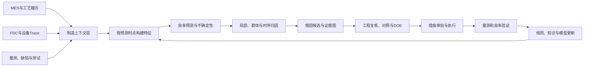

# 从预测低良率到解释为什么：良率预测与归因的完整方法

一家制造企业建立了一个良率预测模型。

模型在测试集上的准确率很高，也能在产品完成最终测试之前，给出某个批次可能低良率的预警。项目做到这里，看起来已经接近成功。但真正进入生产现场后，工程师提出了更困难的问题：

- 为什么这个批次会低良率？
- 是哪一道工序、哪台设备、哪个腔体或哪组参数造成的？
- 模型排在第一位的特征，是物理根因，还是产品、时间和设备状态的代理变量？
- 如果调整这个参数，良率是否真的会提高？
- 调整会不会改善一个指标，却让另一个缺陷模式恶化？

这些问题揭示了良率智能分析中的一道分界线：**预测模型回答“可能发生什么”，归因方法回答“模型为什么这样判断”，而根因分析最终要回答“改变什么，才能稳定地改变结果”。**

三者有关联，却不是同一件事。

半导体制造尤其能体现这种差异。一片晶圆可能经过数百道工序，跨越不同设备、腔体、配方、材料和等待时间，最终才在 WAT、CP、封装测试或 FT 中得到质量反馈。模型很容易从海量变量中找到统计规律，却很难仅凭历史相关性证明某个变量就是根因。2026 年发表的一篇晶圆良率预测综述也将小样本学习、模型透明性和多模态融合列为该领域的重要研究方向。[1]

因此，一个真正有用的良率分析系统，不应该只追求更高的预测分数，而应建立下面这条完整链路：

```text
制造数据与业务上下文
  → 在正确时间点预测质量风险
  → 解释模型依赖了哪些证据
  → 形成可调查的根因候选
  → 用机理、对照和试验验证
  → 执行受控改善
  → 用后续良率证明改善有效
```

本文以半导体制造为主要案例，但其中的方法同样适用于面板、光伏、电池、汽车零部件、精密加工和流程工业等场景。

> 资料口径：本文根据截至 **2026 年 10 月 19 日**可访问的公开论文整理。文章重点不是比较某一种算法，而是建立一套从任务定义到工程行动的完整方法。

---

## 一、先把三个问题分开：预测、归因与根因

很多项目从一开始就把“预测良率”和“分析良率原因”写在同一个目标里，结果是模型虽然能够输出特征重要性，却无法回答工程师真正关心的因果问题。

正确的做法，是先区分三个层次。

### 1. 良率预测：提前估计未知结果

良率预测的基本形式是：在产品最终质量尚未完全可见时，利用当前已经获得的数据，估计未来良率或低良率风险。

设某片晶圆或某个批次的最终良率为 `Y`，在预测时点 `t` 之前可获得的信息为 `X≤t`，预测模型学习的是：

```text
Ŷ = f(X≤t)
```

其中最重要的不是模型多复杂，而是 `X≤t` 的边界是否真实。如果预测发生在刻蚀工序完成后，就不能使用后续量测、最终测试结果或事后维护记录。否则模型离线表现再好，也无法在那个时间点上线运行。

良率预测通常包括四类任务：

| 任务 | 典型输出 | 业务用途 |
|---|---|---|
| 回归 | 预测良率为 92.4% | 排产、成本和产出估计 |
| 分类 | 低良率风险为 81% | 批次预警、Hold 和增测 |
| 排序 | 风险最高的前 20 个批次 | 分配有限的工程调查资源 |
| 分布预测 | 良率区间及不确定性 | 判断是否需要人工复核 |

### 2. 模型归因：解释预测由哪些变量推动

归因分析关注的是模型行为。例如：

- 某个 Chamber 使该晶圆的预测良率下降了多少；
- 某段等待时间是否把风险推高；
- 全部低良率样本中，哪些工序的特征贡献最大；
- 哪些变量组合经常共同推动异常预测。

SHAP、Permutation Importance、PDP、ALE 和局部反事实解释都属于这一层。它们可以帮助工程师理解模型，却不能自动证明物理因果关系。

### 3. 根因分析：寻找可干预、可复现的原因

根因不是“与低良率最相关的变量”，而是一个具有干预意义的判断：

> 在其他条件可比时，如果改变因素 `A`，质量结果 `Y` 会以可复现的方式发生变化。

因此，根因分析至少要考虑：

- 时间顺序是否成立；
- 是否存在产品、材料、设备选择等混杂因素；
- 是否符合工艺和失效机理；
- 相同关系能否跨批次复现；
- 调整因素后，良率是否真的改善；
- 改善是否伴随新的副作用。

可以把三者概括为：

| 层次 | 核心问题 | 典型输出 | 能否直接指导调参 |
|---|---|---|---|
| 预测 | 会不会低良率 | 风险、良率值、置信区间 | 否 |
| 模型归因 | 模型为什么这样预测 | 特征贡献、重要性排序 | 通常不能 |
| 因果根因 | 改变什么能改善良率 | 因果效应、验证证据 | 在受控条件下可以 |

良率智能系统的价值，不是用其中一个层次替代其他层次，而是让三层顺序衔接。

---

## 二、良率不是一个简单标签

模型效果不理想时，团队通常先讨论特征和算法。实际上，许多问题在标签定义阶段就已经产生。

### 1. 分析对象必须明确

“良率”可以属于不同对象：

- Die 良率；
- Wafer 良率；
- Lot 良率；
- 工序直通率；
- 装配一次通过率；
- 产品最终测试良率；
- 特定 Bin 或失效模式对应的损失率。

如果模型输入以 Wafer 为单位，标签却是 Lot 平均良率，模型会把同一批次中的所有晶圆视为相同结果，掩盖晶圆间差异。如果一个产品存在多个主要失效模式，只预测总良率，又可能把不同机理混合成一个难以解释的目标。

很多时候，更好的任务不是直接预测总良率，而是拆成：

```text
总良率
  ← 各类 Bin Loss
  ← 各类电性或物理失效模式
  ← 对应工艺与设备机制
```

总良率适合经营和产能判断，失效模式更适合工程归因。两种粒度应同时保留。

### 2. 标签时间必须明确

对每个样本，至少要保存三个时间：

1. 制造事件发生时间；
2. 模型做出预测的时间；
3. 最终标签可确认的时间。

这三个时间决定哪些特征可以使用，也决定模型能提前多久创造价值。

例如，使用 CP 数据预测 FT 良率是一个合法任务；使用 FT 之后生成的复判结论去预测 FT 良率，则属于标签泄漏。使用事后维护记录预测维护前生产的批次，也会产生类似问题。

### 3. 预测目标应与行动对应

一个模型是否有价值，取决于预测时是否还来得及行动。

| 预测时点 | 可用数据 | 可能动作 |
|---|---|---|
| 投产前 | 产品、材料、历史设备状态 | 排产和设备分配 |
| 关键工序后 | 加工履历、FDC、虚拟量测 | Hold、增测、返工或路径调整 |
| CP 前 | 全流程履历、Inline 量测 | 测试资源安排、风险分层 |
| CP 后 | Die 测试和 Wafer Map | 封装分流、FT 良率预测 |

越早预测，潜在业务价值通常越高，但可用证据更少，不确定性也更大。系统不应承诺一个脱离信息条件的“最早预测”，而应设计多个时间点的递进式模型。

---

## 三、真正决定上限的是数据组织，而不是模型名称

制造数据不是一张天然适合机器学习的宽表。它更像一个跨对象、跨粒度、跨时间的事件网络。

### 1. 良率预测需要哪些数据

常见数据可以分为六类。

| 数据类型 | 代表内容 | 主要价值 |
|---|---|---|
| 产品与路线 | 产品、版本、工艺路线、返工路径 | 定义可比样本和流程上下文 |
| 加工履历 | Tool、Chamber、Recipe、Run 时间 | 还原每个对象经历了什么 |
| 设备与传感器 | 温度、压力、流量、功率、Alarm | 描述真实执行状态 |
| 量测与缺陷 | CD、膜厚、Overlay、缺陷图像 | 提供过程结果证据 |
| 测试与良率 | WAT、CP、FT、Bin、Wafer Map | 定义质量结果和损失模式 |
| 资源与环境 | 材料批次、PM、耗材、班次、环境 | 识别慢变量和外部影响 |

Lee 和 Roh 在 2023 年提出的可扩展良率预测框架，将多类晶圆制造数据用于模型比较，再用 SHAP 解释最佳模型，说明多源数据融合和可解释性可以在同一流程中组织。[2]

但“接入更多数据”并不等于“获得更多有效信息”。如果对象身份、时间边界和业务含义没有统一，更多数据只会扩大错误关联的规模。

### 2. 样本主键要和业务问题一致

假设预测对象是一片 Wafer，那么一行样本至少需要对应：

```text
Product + Lot + Wafer + PredictionTime
```

如果预测对象是一次 Process Run，则主键可能是：

```text
Tool + Chamber + RunId + StartTime
```

主键不仅用于 Join，也定义了模型学习的统计单位。以下做法都很危险：

- 把一次设备 Run 的特征直接复制给整批晶圆，却忽略 Slot 和加工顺序；
- 用 Lot 平均特征预测 Wafer 级标签；
- 在返工后覆盖原始路线，而不是保存完整事件版本；
- 将多个 Recipe 版本合并成同一个类别；
- 只保留设备名称，不保留 Chamber、模块和位置。

### 3. 时间不是一个普通字段

在长流程制造中，时间既是索引，也是潜在原因。

Bae、Jang 和 Kim 在 2026 年的研究中，将设备使用数据与累计循环时间结合，用于半导体良率预测。他们强调，设备履历描述设备条件，而累计循环时间还承载了晶圆在多道工序间经历的时间与累计环境暴露信息。[4]

因此，时间特征不能只保留“开始时间”和“结束时间”，还应根据工艺机理构造：

- 工序间等待时间；
- 从关键工序到量测的时间；
- 累计循环时间；
- 材料开封后的暴露时间；
- 距离上次 PM、清腔、换件的 Run 数和时长；
- 设备连续运行时长；
- 同一 Chamber 中的加工顺序；
- 周期、班次和季节性环境变化。

时间特征还必须按预测时点截断。一个可靠的特征平台应支持 `as-of join`：只关联在预测时已经发生并可获得的事实。

### 4. 高维数据不等于大样本

制造数据经常出现一种错觉：系统里有数十亿条传感器记录，于是项目似乎拥有“大数据”。但真正独立的质量标签可能只有几百个 Lot 或几千片 Wafer。

高频 Trace 增加的是每个样本内部的观测点，并不自动增加独立样本数量。如果直接把所有时间点展开为特征，模型很容易过拟合设备噪声、产品批次和短期环境。

更稳妥的做法是按工艺阶段提取具有明确意义的特征：

- 均值、标准差、斜率和波动；
- 峰值、谷值、超限面积和稳定时间；
- 阶段切换时的响应速度；
- Trace 与参考曲线的距离；
- 频域、形状和变化点特征；
- 由领域知识定义的比值和交互项。

对图像、Wafer Map 和完整时序，可以使用深度模型学习表示，但仍应保留可回溯到原始 Run 和工艺阶段的映射。

---

## 四、模型路线：先建立可解释基线，再增加复杂度

良率预测没有一种在所有工厂、产品和阶段都最优的算法。合理的模型路线应由数据结构和业务目标决定。

### 1. 统计模型：建立第一条可信基线

线性回归、Logistic 回归、广义线性模型、混合效应模型和生存分析仍然具有重要价值。

它们适合：

- 样本量有限；
- 工程关系相对清晰；
- 需要估计方向、效应和不确定性；
- 产品、设备和批次具有层级结构；
- 希望建立可审计的基线。

统计模型未必能获得最高预测精度，却可以暴露数据定义问题。例如一个设备类别突然表现出异常大的系数，团队应先检查该设备是否只加工某种产品，而不是立即将它认定为高风险设备。

### 2. 树模型：结构化制造数据的常用主力

随机森林、XGBoost、LightGBM 和 CatBoost 能处理非线性、变量交互、缺失值和混合类型特征，通常适合设备履历、量测、材料和聚合传感器特征组成的宽表。

它们的优势是：

- 对特征缩放不敏感；
- 能表达阈值效应；
- 训练和推理成本可控；
- 容易配合 SHAP 做局部解释；
- 在中等样本量下往往比复杂深度模型稳定。

2023 年的可扩展良率预测研究比较了多种模型，在其具体数据集上由随机森林取得最佳表现。但这个结论不应被理解为“随机森林普遍最好”，更合理的启示是：应在统一数据切分、统一指标和统一特征边界下比较候选模型。[2]

### 3. 时序模型：保留过程动态

当质量与 Trace 形状、阶段变化和加工顺序密切相关时，可以使用：

- 1D CNN；
- LSTM、GRU；
- TCN；
- Transformer；
- 自监督时序表示学习。

时序模型的关键问题不是网络层数，而是对齐。不同 Run 的工艺阶段、采样频率和持续时间可能不同。如果简单按绝对时间插值，模型可能学习到 Recipe 时长而不是设备状态。更可靠的方式是先按工艺阶段、事件或状态机对齐，再在阶段内部建模。

### 4. 空间模型：理解 Wafer Map 和缺陷分布

Wafer Map 不只是图像。中心、边缘、环状、划痕、局部聚集和重复图形，往往对应不同设备和工艺机制。

CNN、视觉 Transformer、图模型和空间统计方法可以用于：

- Wafer Map 模式分类；
- 缺陷聚类；
- 空间区域的良率预测；
- 将失效分布与设备位置、腔体结构和量测偏移关联。

但空间模型同样需要避免快捷学习。例如产品版图、测试覆盖率或固定缺口方向可能成为模型识别产品的捷径，而不是失效模式本身。

### 5. 多模态模型：让不同证据在同一对象上汇合

未来的良率预测会越来越多地联合：

- 结构化制造履历；
- 高频设备时序；
- 缺陷图像；
- Wafer Map；
- 工程文本、Alarm 和维护记录；
- 工艺路线和设备关系图。

多模态并不意味着把所有数据直接送入一个大模型。更可控的架构通常是先为每类数据建立编码器，再在 Wafer、Lot 或 Process Run 层完成融合，同时保存每个模态的缺失标记和独立质量评分。

---

## 五、模型评估：防止一个无法上线的高分模型

良率预测最容易出现的问题，不是模型训练失败，而是评估方式让一个不具备真实泛化能力的模型看起来很好。

### 1. 随机切分通常不够

如果将同一 Lot 中的 Wafer 随机分到训练集和测试集，模型可以利用批次共享信息“认出”测试样本。如果同一设备状态、材料批次或产品版本同时出现在两侧，评估也可能明显乐观。

制造场景至少应考虑四种验证：

| 验证方式 | 回答的问题 |
|---|---|
| 按时间切分 | 模型能否预测未来生产 |
| 按 Lot 分组 | 模型能否处理未见过的批次 |
| 按设备或产品留出 | 模型能否跨设备、跨产品泛化 |
| 滚动回测 | 模型在持续漂移中是否稳定 |

正式上线指标应以时间外测试为主。随机交叉验证可以用于开发阶段比较，但不能代替未来时间段回测。

### 2. 指标要对应业务损失

回归任务可以使用 MAE、RMSE、分位数损失和预测区间覆盖率；分类任务可以使用 Precision、Recall、F1、ROC-AUC 和 PR-AUC。

但这些指标仍然不能直接表示制造价值。更实用的指标包括：

- 低良率批次的 Top-K 召回率；
- 漏报造成的预计质量损失；
- 误报造成的 Hold、增测和产能成本；
- 平均提前预警时间；
- 工程师调查范围缩小比例；
- 单位调查资源发现的有效异常数。

可以把阈值选择写成一个成本问题：

```text
期望成本
= 漏报数量 × 单次漏报损失
+ 误报数量 × 单次误报成本
+ 调查与增测成本
```

模型阈值应由这类成本函数决定，而不是默认使用 0.5。

### 3. 预测值必须带上可信程度

两个样本都被预测为 85% 良率，不代表它们具有相同可信度。一个可能与训练数据高度相似，另一个可能来自新产品、新 Recipe 或刚维护过的设备。

因此，系统还应输出：

- 预测区间；
- 模型间分歧；
- 与训练分布的距离；
- 特征缺失程度；
- 是否处于已知适用范围；
- 不确定性对应的处置等级。

低置信度不应被包装成确定结论，而应触发增测、人工复核或降级到规则策略。

---

## 六、归因分析：把模型分数变成可调查证据

预测模型输出一个风险值，工程师仍然不知道从哪里开始调查。归因分析的作用，是把模型内部的统计关系转换成有层次的证据。

### 1. 全局归因：模型整体依赖什么

全局归因回答：在整个分析周期中，哪些变量、工序和设备最影响模型输出？

常用方法包括：

- Permutation Importance；
- SHAP 全局重要性；
- PDP；
- ALE；
- 按工序聚合的特征贡献；
- 特征交互分析。

单个传感器的重要性往往不够稳定。更合理的汇总方式是按照业务层级聚合：

```text
传感器特征
  → 工艺阶段
  → Process Run
  → Chamber / Tool
  → 工序
  → 制造模块
```

这样才能回答“应优先调查哪个工序”，而不只是列出数百个难以行动的字段。

### 2. 局部归因：这一个样本为什么高风险

局部解释关注单个 Wafer、Lot 或产品。以 SHAP 为例，模型输出可以被表示为基线值与各特征贡献之和：

```text
预测结果 = 基线结果 + Σ 特征贡献
```

Lundberg 和 Lee 在 2017 年提出 SHAP 的统一解释框架，用 Shapley value 将一次预测相对基线的变化分配给不同特征。[6]

在良率场景中，一个局部解释可能呈现为：

```text
同产品历史基线良率                 96.2%
Chamber C-07                      -1.8%
刻蚀后等待时间过长                 -1.2%
某压力稳定阶段波动增加              -0.9%
关键 CD 量测偏移                   -0.7%
材料批次历史表现较好                +0.4%
------------------------------------------------
预测良率                            92.0%
```

它的价值是让工程师看到风险是如何形成的，但这里的 `-1.8%` 是对模型输出的贡献，不是“更换 Chamber 一定能提高 1.8% 良率”的因果承诺。

### 3. 群体归因：这次异常是否有共同模式

生产现场很少只调查一片晶圆。更常见的问题是：最近一周的低良率批次是否共享同一种原因？

群体归因可以按以下步骤进行：

1. 根据产品、失效模式和时间窗口定义异常群体；
2. 选择具有可比性的正常对照群体；
3. 聚合异常样本的局部贡献；
4. 比较异常与正常群体的贡献差异；
5. 找出共同经过的设备、腔体、材料和时间窗口；
6. 检查贡献是否集中在少数对象，还是广泛分布。

群体归因比全局重要性更接近工程调查，因为它能够区分“长期重要变量”和“本次异常的主要驱动因素”。

### 4. 时序归因：异常发生在过程的哪一段

对 FDC 和高频 Trace，仅输出“压力重要”没有足够价值。工程师还需要知道：

- 哪个工艺阶段重要；
- 异常从哪个时间点开始；
- 是均值偏移、波动增加还是稳定时间变长；
- 该变化是否在低良率批次中重复出现。

Kim 等人在 2023 年提出了一套基于连续设备传感器数据的低良率诊断流程，使用顺序随机森林缩小异常时间和关键传感器范围，并在真实半导体数据中验证了该流程。[5]

这类方法的关键不是自动宣布根因，而是把海量 Trace 缩小为可视化、可复查的时间段和传感器候选。

### 5. 归因稳定性比一张漂亮图更重要

如果更换一个随机种子、一个时间窗口或一组相关特征，重要性排序就完全变化，那么归因结果不适合直接指导行动。

归因结果应额外评估：

- 不同模型间是否一致；
- 不同时间窗口间是否稳定；
- Bootstrap 后排名是否变化；
- 相关变量是否发生贡献替代；
- 分产品、设备和工艺版本后是否仍成立；
- 移除该特征后，模型和结论如何变化。

归因报告最好给出排名区间、方向一致性和证据覆盖率，而不是只给一个精确到小数点的贡献值。

---

## 七、为什么 SHAP 第一名不等于第一根因

可解释模型让分析更透明，也容易制造一种新的过度自信：既然模型已经解释了，就认为原因也已经找到。

这种推断至少会在五种情况下出错。

### 1. 混杂因素

假设某台设备只加工高难度产品，模型可能发现该设备与低良率高度相关。但真正原因可能是产品难度，而不是设备本身。

```text
产品难度 → 设备分配
产品难度 → 良率
```

此时设备是一个代理变量。

### 2. 共线与替代

温度、压力、功率和气体流量可能由同一个控制状态共同驱动。模型会在相关变量之间分配贡献，不同算法甚至会选择不同代表变量。

### 3. 后果被误认为原因

某项下游量测可能对预测非常重要，因为它已经反映了缺陷结果。但它并不是最早可干预的原因。

### 4. 选择偏差

只有高风险批次才会被额外量测。如果模型直接使用“是否被量测”或额外量测结果，它可能学习到历史调查策略，而不是制造机理。

### 5. 分布变化

旧 Recipe 下建立的归因关系，在新材料、新设备或新产品上可能失效。重要性是相对于训练分布产生的，不是永恒规律。

Senoner、Netland 和 Feuerriegel 在半导体制造研究中，将非线性模型、SHAP 和质量管理方法结合，用于识别改善重点，并通过现场试验验证改善行动。[3] 这项研究真正重要的地方，不只是使用 SHAP，而是没有停在特征重要性：它进一步选择行动，并用现场实验确认效果。

这正是模型归因与根因确认之间必须补上的一段。

---

## 八、从根因候选到因果验证

因果分析不一定意味着必须从零建立一套复杂数学系统。制造场景中更可行的路径，是把工艺知识、历史对照、统计设计和受控试验逐层结合。

### 1. 先画出工艺因果图

因果图不必一开始就覆盖全厂。可以从一个失效模式和一段关键流程开始：

```text
材料批次 ───────────────┐
                         ↓
设备维护状态 → Trace 特征 → Inline 量测 → Bin Loss
       ↓             ↑
Chamber 选择     Recipe 版本
       ↑             ↑
       └── 产品类型 ──┘
```

这张图迫使团队明确：

- 哪些变量发生在原因之前；
- 哪些变量是中介；
- 哪些变量可能同时影响处理因素和良率；
- 哪些变量不应被控制，因为它们是原因作用的一部分；
- 哪些关系来自机理，哪些只是数据假设。

Marazopoulou 等人在制造领域因果发现研究中强调了生产阶段、可解释性和装配线数据特征对因果结构学习的重要性。[7] 2022 年的制造业因果发现综述则指出，领域知识、数据质量和可验证性仍然是该方向落地的核心挑战。[10]

### 2. 建立可比对照组

对某个嫌疑 Chamber，可以比较：

- 同产品、同 Recipe、相近时间的其他 Chamber；
- 该 Chamber 维护前后的结果；
- 相同材料批次在不同设备上的结果；
- 相同设备在不同产品和工艺窗口下的结果。

对照组不是越大越好，而是越可比越好。常见方法包括：

- 分层比较；
- 倾向得分匹配或加权；
- 回归调整；
- 双重差分；
- 合成对照；
- 中断时间序列。

这些方法可以减少已观测混杂，却不能消除所有未观测因素。因此结果仍应与工艺机理和后续试验结合。

### 3. 用贝叶斯网络组织不确定证据

制造根因分析通常面对多个可能原因、噪声传感器和不完整证据。贝叶斯网络能够把变量之间的依赖关系表示为图，并在新证据到来时更新根因概率。

Dey 和 Stori 在 2005 年提出使用贝叶斯网络融合过程信息，对制造过程偏差进行概率根因诊断。[8] 2024 年，Wang、Liu 和 Lu 又提出集成贝叶斯网络，从历史生产数据中学习产品缺陷根因，以改善单一网络在稳健性、随机性和样本量方面的限制。[9]

贝叶斯网络的优势是输出“各候选原因在当前证据下的概率”，而不是给出一个不带不确定性的唯一答案。但网络结构仍需要结合工艺方向约束，不能把数据学出的每条边都当作已证实因果。

### 4. 用 DOE 或受控试验完成确认

如果一个因素具有较高业务影响，并且调整风险可控，最终仍应通过 DOE、分批试验或受限现场实验确认。

试验设计需要明确：

- 调整哪个因素和水平；
- 哪些条件保持不变；
- 样本量是否足以区分实际改善和随机波动；
- 观察哪些主要指标和副作用指标；
- 如何随机化或分块；
- 什么结果算成功；
- 如何回滚。

没有验证的归因只能称为假设。完成验证并在后续批次中复现，才能逐步升级为工程规则。

### 5. 用证据等级管理结论

为了避免系统把相关性包装成确定原因，可以给根因结论定义证据等级：

| 等级 | 证据 | 系统允许的动作 |
|---|---|---|
| L1 相关线索 | 统计差异或特征重要性 | 展示和人工调查 |
| L2 重复关联 | 多批次、多模型方向一致 | 建议增测和重点检查 |
| L3 准因果证据 | 对照、匹配或自然实验支持 | 建议受控调整 |
| L4 试验验证 | DOE 或现场实验确认 | 形成正式改善措施 |
| L5 稳定复现 | 多周期、多产品验证 | 进入规则、控制或自动化 |

这套分级能够把“模型发现”与“生产动作”之间的权限边界明确下来。

---

## 九、一个端到端案例：从低良率预警到根因关闭

下面用一个简化的晶圆制造案例，串联预测与归因的完整过程。案例中的数字用于说明方法，不代表特定工厂数据。

### 1. 定义问题

某产品在刻蚀、清洗和关键量测完成后，仍需数天才能获得 CP 良率。团队希望在该预测时点识别最终良率低于 93% 的晶圆，并将高风险样本送入增测和工程复核。

预测对象定义为 Wafer，标签包括：

- CP 总良率；
- 是否低于 93%；
- 三类主要 Bin Loss。

### 2. 构建数据

系统按 Wafer 汇总：

- 产品和工艺版本；
- 各工序实际经过的 Tool、Chamber 和 Recipe；
- 关键 Trace 的阶段特征；
- PM 后 Run 数和耗材使用次数；
- 工序等待时间与累计循环时间；
- Inline CD、膜厚和缺陷数据；
- 材料批次与环境信息。

所有特征按预测时间做截断，CP 和后续信息只用于标签，不进入输入。

### 3. 建立预测模型

团队先训练 Logistic 回归作为基线，再训练 LightGBM。数据按时间切分，并按 Lot 分组，避免同批次泄漏。

模型不只输出低良率概率，还输出：

- 预测良率区间；
- 与训练分布的距离；
- 是否包含新 Recipe 或新设备组合；
- 本地特征贡献。

### 4. 发现异常群体

上线后，系统在连续三个 Lot 中识别出 18 片高风险 Wafer。局部解释显示，多个样本都由以下因素推动：

- 刻蚀 Chamber `C-07`；
- 压力稳定阶段波动增加；
- 刻蚀后等待时间变长；
- 边缘 CD 均匀性轻微偏移。

这些特征共同出现，但没有任何单项超过传统规格限。

### 5. 形成根因候选

团队按同产品、同 Recipe、相近时间选择正常对照，发现：

- `C-07` 的风险显著高于同型号其他 Chamber；
- 异常在某次 PM 之后逐渐增加；
- 压力稳定时间与耗材使用次数同步上升；
- 边缘 CD 偏移与最终 Wafer Map 的边缘 Bin Loss 方向一致。

此时可以形成一条根因假设：

```text
耗材或 PM 后状态变化
  → 压力稳定过程发生漂移
  → 刻蚀边缘均匀性下降
  → 边缘 CD 偏移
  → 特定 Bin Loss 上升
```

### 6. 执行验证

工厂先对高风险批次增加边缘测点，再对目标 Chamber 执行受控维护和校准。维护后的工程批与同型号 Chamber 做分块对照，同时观察：

- Trace 稳定时间；
- 边缘 CD 和均匀性；
- 主要 Bin Loss；
- 其他电性指标和潜在副作用。

如果 Trace 和量测恢复，但最终 Bin Loss 没有改善，说明中间链路仍不完整；如果三层指标按预期改善并在后续批次中复现，根因假设才得到支持。

### 7. 沉淀为长期机制

问题关闭后，系统应保存：

- 异常对象和时间窗口；
- 根因候选及证据；
- 采取的措施；
- DOE 或对照设计；
- 改善前后结果；
- 适用产品、设备和版本范围；
- 失效条件与回滚标准。

验证后的经验可以转化为新的 FDC 特征、动态抽样规则、维护建议或模型特征，而不只是停留在一份分析报告中。

---

## 十、生产系统应该怎样分层

良率预测与归因不是一个 Notebook，而是一套持续运行的数据和决策系统。



### 1. 制造上下文层

这一层负责统一 Product、Lot、Wafer、Process Run、Tool、Chamber、Recipe、Material 和 Measurement 等对象，并保存它们的时间关系和版本。

### 2. 特征与标签层

这一层不只是保存特征值，还应保存：

- 特征定义；
- 原始数据来源；
- 计算窗口；
- 可用时间；
- 版本；
- 适用产品和工艺范围；
- 缺失与质量标记。

### 3. 模型服务层

模型服务至少输出四类结果：

1. 预测值或风险；
2. 不确定性；
3. 适用范围判断；
4. 解释和证据链接。

### 4. 归因与调查层

这一层需要支持从模型结果回到原始证据：

- 点击某个重要特征，查看对应 Process Run；
- 查看异常与正常群体的分布；
- 查看 Trace 发生变化的阶段；
- 查看设备维护、材料和量测上下文；
- 保存工程师的确认、驳回和补充原因。

### 5. 行动与治理层

模型不应直接绕过工程审批修改关键 Recipe。系统需要定义：

- 哪类风险只告警；
- 哪类风险触发增测；
- 哪类风险可以 Hold；
- 哪类建议需要工艺、设备和质量共同审批；
- 哪些已验证规则可以自动执行；
- 如何回滚和审计。

自动化等级不能高于证据等级。

---

## 十一、落地路线：不要从“全厂智能归因”开始

良率项目最常见的失败方式，是一开始就试图接入所有数据、覆盖所有产品，并承诺自动找到所有根因。

更可行的路线分为四个阶段。

### 阶段一：建立可信预测基线

选择一个产品、一类明确失效和一个可行动的预测时点，完成：

- 标签和样本定义；
- 时间切分与泄漏检查；
- 可解释基线模型；
- 业务成本指标；
- 影子运行。

验收重点不是单次高分，而是未来时间段的稳定性。

### 阶段二：把解释接入工程调查

建立：

- 局部和群体归因；
- 按工序、设备和参数的贡献聚合；
- 异常与正常对照；
- 原始 Trace 和量测证据回溯；
- 工程师反馈入口。

这一阶段的核心指标是缩短调查时间和减少无效排查。

### 阶段三：建立因果验证流程

对高频、高损失问题建立：

- 工艺因果图；
- 对照组设计；
- 证据等级；
- DOE 模板；
- 改善效果与副作用评估；
- 根因知识库。

### 阶段四：进入受控闭环

只有经过长期验证的模式，才逐步进入：

- 动态抽样；
- 设备维护建议；
- 生产路径调整；
- 参数补偿；
- APC 或 Run-to-Run 控制。

每一步都应保留人工接管、适用范围和回滚机制。

---

## 十二、项目验收不能只看模型指标

一个完整的良率预测与归因项目，至少应从五个维度验收。

### 1. 数据可信度

- Wafer 和 Process Run 是否可以完整追溯；
- 时间、Recipe 和设备版本是否正确；
- 特征是否严格遵守预测时点；
- 标签是否稳定且可复现。

### 2. 预测能力

- 时间外测试性能；
- Top-K 低良率召回；
- 提前预警时间；
- 不同产品和设备上的最差表现；
- 不确定性是否校准。

### 3. 解释质量

- 归因是否稳定；
- 能否回到原始证据；
- 是否按工艺层级组织；
- 工程师是否能够理解和使用；
- 是否明确区分相关与因果。

### 4. 业务效果

- 根因定位时间缩短多少；
- 减少多少受影响产品；
- 降低多少无效增测和人工拼数；
- 改善措施带来多少良率、成本和产能收益；
- 误报造成多少额外负担。

### 5. 闭环能力

- 分析结果是否进入处置流程；
- 改善是否经过后续量测和良率验证；
- 经验是否沉淀为规则、特征或知识；
- 模型漂移后能否发现、回滚和重训。

---

## 十三、仍然困难的问题与未来方向

### 1. 新产品和小样本

新产品没有足够历史标签，却往往最需要风险预测。未来需要更多使用迁移学习、层级模型、元学习、仿真数据和机理先验，把成熟产品知识迁移到新产品，同时避免把旧产品偏差一起复制过去。

### 2. 跨工序长程依赖

最终良率可能由很早以前的微小偏差与后续工序共同作用形成。单工序模型难以表达这种传播路径。工艺图、图神经网络、序列模型和因果图可能成为重要工具，但前提仍是可靠的制造谱系和时间关系。

### 3. 多模态证据对齐

结构化数据、Trace、图像、Wafer Map 和工程文本的时间与粒度不同。多模态模型不仅要融合表示，还要回答每项证据属于哪个 Wafer、哪个 Run、哪个工艺阶段，以及在预测时是否已经可用。

### 4. 概念漂移与模型失效

Recipe、设备、材料、产品组合和测试程序会持续变化。模型监控不能只看输入分布，还要监控：

- 预测误差是否上升；
- 归因方向是否改变；
- 低置信度样本是否增加；
- 新类别和新组合是否出现；
- 改善规则是否仍然有效。

### 5. 从模型解释走向因果决策

未来系统需要从“哪些特征重要”进一步走向：

- 如果改变参数，结果可能怎样变化；
- 对哪些产品和设备有效；
- 改善幅度和不确定性是多少；
- 是否存在副作用；
- 在什么证据条件下允许执行。

这意味着预测模型、因果模型、工艺机理、优化算法和生产治理必须协同工作，而不是继续作为彼此分离的模块。

---

## 结语：良率模型的终点不是预测分数，而是可验证的改善

良率预测解决的是“提前知道风险”，归因分析解决的是“理解模型证据”，根因分析解决的是“找到可以干预的原因”。

三者之间不能跳步：

```text
预测准确
≠ 解释可信
≠ 找到根因
≠ 改善一定有效
```

一个成熟的系统应当做到：

- 在真实可用的时间点预测，而不是利用未来信息获得离线高分；
- 把特征贡献组织成工序、设备和时间证据，而不是只输出字段排名；
- 把模型归因当作根因候选，而不是因果结论；
- 用对照、机理和试验逐步提高证据等级；
- 让每次行动都有适用边界、审批、回滚和效果验证；
- 把验证后的经验重新沉淀为数据、规则、模型和控制能力。

真正有价值的良率智能，不是告诉工程师“模型认为这批产品有问题”，而是帮助团队更早发现风险、更快组织证据、更严谨地验证原因，并把一次改善转化为可以持续复用的制造能力。

---

## 参考论文

以下出版信息检索截止于 2026 年 10 月 19 日。

1. Ruyue Jing, Pang Guo, Xin Xu, Yanning Chen, Fang Liu, Dongyan Zhao, Yining Chen, Bo Wu. [A Survey on Semiconductor Wafer Yield Prediction by Artificial Intelligence](https://doi.org/10.1016/j.mejo.2025.106958). *Microelectronics Journal*, Vol. 167, 106958, 2026.
2. Youjin Lee, Yonghan Roh. [An Expandable Yield Prediction Framework Using Explainable Artificial Intelligence for Semiconductor Manufacturing](https://doi.org/10.3390/app13042660). *Applied Sciences*, 13(4), 2660, 2023.
3. Julian Senoner, Torbjørn Netland, Stefan Feuerriegel. [Using Explainable Artificial Intelligence to Improve Process Quality: Evidence from Semiconductor Manufacturing](https://doi.org/10.1287/mnsc.2021.4190). *Management Science*, 68(8), 5704–5723, 2022.
4. Young-Mok Bae, Chan-Young Jang, Kwang-Jae Kim. [Temporal-Enhanced Semiconductor Yield Prediction by Combining Equipment Usage Data and Accumulated Cycle Time Data](https://doi.org/10.1007/s00170-026-18104-7). *The International Journal of Advanced Manufacturing Technology*, 144, 4295–4308, 2026.
5. Eunji Kim, Jinwon An, Hyun-Chang Cho, Sungzoon Cho, Byeongeon Lee. [A Sensor Data Mining Process for Identifying Root Causes Associated with Low Yield in Semiconductor Manufacturing](https://doi.org/10.1108/DTA-08-2022-0341). *Data Technologies and Applications*, 57(3), 397–417, 2023.
6. Scott M. Lundberg, Su-In Lee. [A Unified Approach to Interpreting Model Predictions](https://papers.nips.cc/paper/7062-a-unified-approach-to-interpreting-model-predictions). *Advances in Neural Information Processing Systems 30*, 2017.
7. Katerina Marazopoulou, Rumi Ghosh, Prasanth Lade, David Jensen. [Causal Discovery for Manufacturing Domains](https://arxiv.org/abs/1605.04056). arXiv:1605.04056, 2016.
8. Shuvra Dey, James A. Stori. [A Bayesian Network Approach to Root Cause Diagnosis of Process Variations](https://doi.org/10.1016/j.ijmachtools.2004.06.018). *International Journal of Machine Tools and Manufacture*, 45(1), 75–91, 2005.
9. Karen Wang, Chao Liu, Yuqian Lu. [Ensemble Bayesian Network for Root Cause Analysis of Product Defects via Learning from Historical Production Data](https://doi.org/10.1016/j.jmsy.2024.06.001). *Journal of Manufacturing Systems*, 2024, 102–115.
10. Matej Vuković, Stefan Thalmann. [Causal Discovery in Manufacturing: A Structured Literature Review](https://doi.org/10.3390/jmmp6010010). *Journal of Manufacturing and Materials Processing*, 6(1), 10, 2022.
