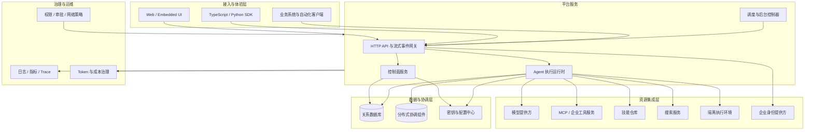
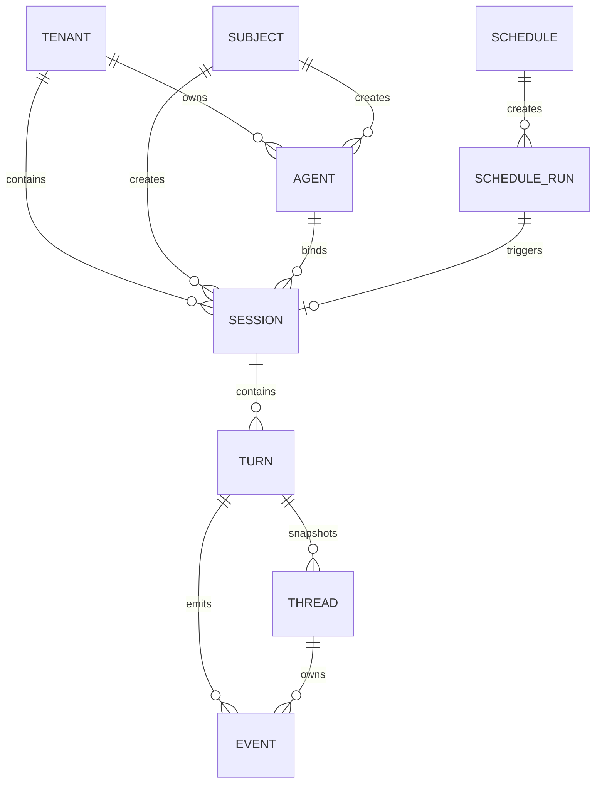
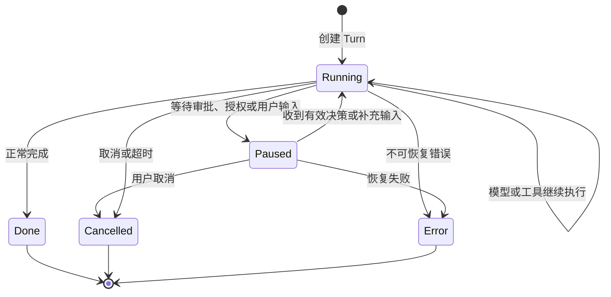
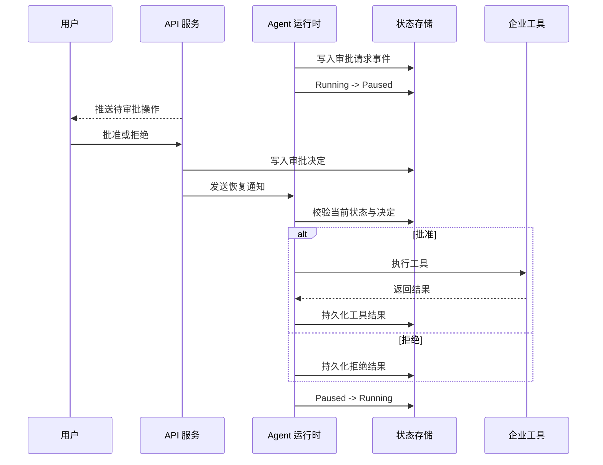
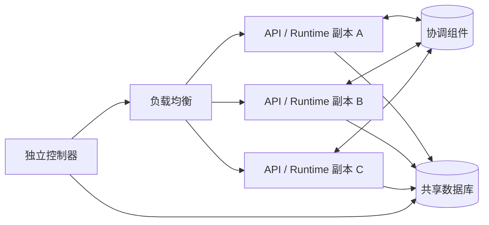

# 企业级 Agent Harness 架构设计：从模型调用到可信执行平台

## 摘要

大语言模型能够生成文本、调用工具和编写代码，但这些能力并不会自然形成一个可以稳定运行在企业生产环境中的 Agent。真正的生产系统还需要处理状态持久化、长任务执行、工具权限、人工审批、代码隔离、上下文控制、分布式协调、故障恢复、审计追踪以及成本治理等问题。

Agent Harness 是位于模型与业务系统之间的运行时和治理层。它不负责让模型“变得更聪明”，而是负责将模型的不确定推理过程约束在一个可执行、可暂停、可恢复、可审计的系统中。本文从架构目标、领域模型、执行引擎、上下文工程、工具接入、沙箱隔离、权限治理、分布式部署和测试评测等方面，给出一套企业级 Agent Harness 的完整设计。

---

## 一、为什么企业需要 Agent Harness

构建一个能够调用工具的 Agent 原型并不困难：准备一段系统提示词，将若干工具描述发送给模型，然后不断执行模型返回的工具调用，直到模型输出最终答案即可。

但原型进入生产环境后，问题会迅速扩大：

- 一次任务运行十几分钟，服务重启后如何恢复？
- 工具执行到一半，用户如何取消？
- 多个服务副本之间如何找到正在执行任务的节点？
- 模型尝试删除数据时，如何暂停并等待审批？
- 代码执行如何避免影响宿主机和内部网络？
- 工具返回数十万字节内容时，如何避免上下文被撑满？
- 用户完成第三方授权后，原任务如何继续？
- 如何回答“这次任务调用了什么、花了多少钱、为什么失败”？
- 定时运行的 Agent 如何避免重复触发？
- 不同部门和租户的数据如何严格隔离？

这些问题已经超出 Prompt Engineering 或模型 SDK 的职责。企业需要的是一个围绕 Agent 执行生命周期构建的基础设施层，即 Agent Harness。

可以将它理解为 Agent 的“应用服务器”：模型提供推理能力，工具提供外部行动能力，而 Harness 负责执行、状态、安全和治理。

## 二、Agent Harness 的职责边界

一个完整的 Agent Harness 应承担六类职责。

第一类是**运行时职责**，包括模型调用、工具执行、循环控制、流式事件、暂停恢复、取消和超时。

第二类是**上下文职责**，包括系统指令构建、工具延迟加载、技能装载、历史压缩、大结果外置和 Token 预算控制。

第三类是**资源职责**，包括模型、工具服务、技能、搜索服务、沙箱环境和认证凭证的解析与注入。

第四类是**状态职责**，包括会话、执行轮次、线程、事件、快照、指标和调度记录的持久化。

第五类是**治理职责**，包括身份认证、资源授权、人工审批、网络策略、密钥保护、审计和成本分析。

第六类是**平台职责**，包括 API、SDK、交互界面、控制器、部署、扩缩容和可观测性。

Harness 不应绑定某一个模型厂商，也不应将某一种数据库、工具协议或沙箱实现写死在核心执行循环中。它的核心价值来自稳定的领域契约，以及围绕这些契约构建的可替换适配器。

## 三、架构目标与设计原则

企业级 Agent Harness 首先是一个分布式执行系统，其次才是一个 AI 应用。因此，设计时应优先保证以下质量属性。

### 3.1 可恢复

服务进程、网络连接和外部工具都可能失败。系统必须能够根据持久化状态判断任务处于什么阶段，并允许客户端重新订阅事件、查询终态或继续未完成的交互。

### 3.2 可控制

每次执行都必须有明确的状态、超时、迭代上限和取消入口。模型不能无限循环，也不能绕过平台直接执行高风险操作。

### 3.3 可审计

系统需要保存模型输出、工具调用、审批决策、授权过程、子 Agent 创建、上下文压缩和最终状态等关键事实。审计记录应来自运行时事件，而不是事后拼接日志。

### 3.4 可扩展

模型、工具、技能和沙箱应通过稳定接口接入。核心运行时只依赖抽象能力，不依赖具体供应商。

### 3.5 安全默认

高风险工具默认需要审批，代码默认在隔离环境中执行，外部 URL 默认经过 SSRF 检查，凭证由平台托管而不是进入 Agent 定义或模型上下文。

### 3.6 状态外置

API 和执行节点应尽量无状态。持久状态存入数据库，跨副本控制消息交给协调组件，从而支持水平扩展和滚动升级。

### 3.7 事件先于内存

任何影响可恢复状态的变化，都应先完成持久化，再修改内存对象。其基本顺序是：

```text
生成事件 -> 持久化成功 -> 更新内存状态 -> 向下继续执行
```

如果数据库写入失败，内存状态就不应越过持久化边界。这一原则是故障恢复和事件一致性的基础。

## 四、总体架构

企业级 Agent Harness 可以划分为接入层、控制面、执行面、资源集成层、数据协调层和治理运维层。



### 4.1 接入与体验层

接入层向不同使用者提供一致的执行能力。交互式用户通过 Web 界面使用 Agent，业务应用通过 SDK 或 HTTP API 创建会话、发起执行并消费事件，平台开发者则可以嵌入现成交互组件。

接入层不应自行实现 Agent 状态机。它只负责提交命令、展示事件和发送用户决策。这样可以避免 Web、SDK 和自动化客户端形成三套不同的执行语义。

### 4.2 控制面

控制面管理相对稳定的配置资源，包括模型连接、工具连接器、技能、沙箱提供方、沙箱环境、Agent 定义、权限策略和定时任务。

控制面保存的是“可以使用什么”和“如何配置”，执行面负责决定“本次运行实际使用什么”。二者分离后，凭证更新、模型切换和工具治理不需要修改 Agent 核心逻辑。

### 4.3 执行面

执行面负责一次 Turn 的完整生命周期。它解析 Agent 定义，恢复历史状态，装载资源，运行模型与工具循环，产生事件，处理暂停和恢复，并在结束时写入终态及指标。

### 4.4 数据与协调层

数据库保存会话、执行轮次、事件、快照、资源配置和调度记录。分布式协调组件不应成为业务事实的唯一存储，它主要用于跨副本请求应答、任务定位和取消通知等临时控制消息。

## 五、核心领域模型

清晰的领域模型是 Harness 可演进的前提。建议将系统中的核心对象定义如下。

### 5.1 Agent Definition

Agent Definition 是可复用的 Agent 模板，通常包含：

- 使用的模型；
- 系统指令；
- 初始消息；
- 可访问的工具服务；
- 工具启用、禁用和审批策略；
- 技能列表；
- 输出格式；
- 沙箱、子 Agent、搜索和上下文策略；
- 最大循环次数等运行限制。

Agent Definition 不应保存工具认证令牌或模型密钥，只保存对受管资源的引用。

### 5.2 Session

Session 是一次持续交互的业务容器。它绑定一个 Agent 定义，保存创建者、租户、来源、外部业务 ID、元数据、共享状态和累计指标。

Session 不等同于一次模型请求。一个 Session 可以包含多个 Turn，并在多个 Turn 之间复用上下文和沙箱资源。

### 5.3 Turn

Turn 表示一次输入触发的执行过程。它具有明确的开始时间、终止时间、状态、输入、前序 Turn、快照和指标。

将 Turn 作为持久化边界，可以自然支持暂停、取消、超时、分支和历史回放。

### 5.4 Thread

Thread 是独立的推理上下文。根 Agent 拥有根 Thread，动态子 Agent 各自拥有独立 Thread。Thread 保存消息上下文、上下文占用、能力状态和完成结果。

### 5.5 Event 与 Snapshot

Event 记录执行过程中已经发生的事实，例如模型消息、工具结果、审批请求、审批决策、沙箱创建和线程完成。Snapshot 保存当前可继续执行的聚合状态。

事件适合审计和流式消费，快照适合快速恢复。二者结合可以避免每次启动都重放完整历史，也避免只保存快照导致过程不可解释。



## 六、Agent 执行引擎

执行引擎的核心不是一个简单的 `while` 循环，而是一个受持久化状态、外部输入和策略约束的异步状态机。

### 6.1 标准执行流程

一次 Turn 通常经历以下步骤：

1. 校验 Session、Agent 和调用者权限；
2. 创建 Turn，并持久化 `turn.created` 事件；
3. 恢复前序 Turn 的 Thread 快照；
4. 解析模型、工具、技能、搜索和沙箱资源；
5. 将本次用户输入写入根 Thread；
6. 构建系统指令、历史上下文和工具描述；
7. 调用模型并流式产出模型事件；
8. 如果模型请求工具，则进入工具选择、审批和执行流程；
9. 将工具结果写回上下文，再次调用模型；
10. 直到产生最终输出、达到迭代上限、被取消或发生错误；
11. 持久化终态事件，聚合成本和耗时；
12. 释放或保留本次使用的外部资源。

### 6.2 Turn 状态机



终态写入需要遵循“首次成功写入生效”的原则。多个取消请求、超时回调和执行异常可能同时到达，但一个 Turn 只能拥有一个最终结果。

### 6.3 运行中输入

Agent 在运行过程中可能接收审批决定、用户补充信息、客户端工具结果或授权完成通知。这些输入不应直接调用内存对象，而应先写入持久化的 Turn Inbox，再由拥有该 Turn 的执行器消费。

这样做可以解决三个问题：

- API 请求和执行器可能位于不同副本；
- 输入可能在执行器短暂重连时到达；
- 重复提交可以通过事件 ID 去重。

### 6.4 取消与超时

取消分为本地取消和跨副本取消。执行节点首先在本地维护 `AbortSignal`，用于中断模型请求、工具调用和沙箱命令。当 API 节点无法在本地找到 Turn 时，通过协调组件向其他副本发起带超时的取消请求。

无论实时取消是否成功，数据库终态仍是最终事实来源。系统必须避免把协调组件当成唯一状态存储。

## 七、持久化事件与一致性

Agent 的执行过程天然包含大量异步边界。仅靠应用日志无法提供可靠恢复，因此需要一套面向领域事件的持久化机制。

### 7.1 事件分类

事件可以分为四类：

- 生命周期事件：Turn 创建、暂停、恢复、完成、取消和错误；
- 内容事件：模型消息、工具调用和工具结果；
- 交互事件：审批请求、审批决定、客户端工具请求和用户补充输入；
- 资源事件：工具服务初始化、第三方授权请求、沙箱创建和子 Thread 创建。

每个事件至少应包含事件 ID、事件类型、创建时间、Turn ID 和可选的 Thread ID。

### 7.2 顺序保证

数据库中的事件顺序不能只依赖创建时间。分布式环境中的时间精度、时钟差异和批量写入都可能造成冲突。更稳妥的方式是使用单调、可排序的事件 ID 作为 Turn 内排序键，将时间戳用于展示和分析。

### 7.3 原子边界

以下操作应在同一个事务中完成：

- 创建 Turn、更新 Session 当前指针并写入创建事件；
- 修改暂停状态并写入状态事件；
- 写入终态、写入完成事件并聚合 Session 指标；
- 创建调度运行记录并维护下一次触发时间。

### 7.4 分支与历史链路

Turn 应保存前序 Turn ID 和祖先信息，以支持从历史节点继续对话或形成分支。查询 Session 时间线时，应明确锚定某个分支，避免客户端翻页期间新 Turn 的到来改变结果窗口。

## 八、上下文工程

上下文工程决定了 Agent 的运行成本和长任务稳定性。一个企业级 Harness 不能把所有历史消息和全部工具描述无条件塞给模型。

### 8.1 分层指令构建

系统指令可以按以下层次组装：

1. 平台级安全与行为约束；
2. Agent 角色和任务指令；
3. 当前可用能力说明；
4. 沙箱、技能和文件使用说明；
5. 输出格式约束；
6. 当前时间、租户或业务上下文。

结构化组装比字符串拼接更容易控制顺序、去重和按能力启用。

### 8.2 工具延迟加载

企业可能接入数百个工具。如果将所有工具 Schema 一次性发送给模型，不仅成本高，也会降低工具选择准确率。

更合理的方式是：

- 预加载少量高频工具；
- 仅提供工具目录或搜索能力；
- 根据任务按需加载具体工具 Schema；
- 对只读工具和写入工具应用不同选择策略。

### 8.3 上下文压缩

当上下文接近模型窗口阈值时，运行时应对较早历史进行摘要，并产生上下文覆盖事件。压缩阈值可以显式配置，也可以根据模型窗口按比例计算。

压缩结果必须保留：

- 用户目标和硬约束；
- 已完成的重要步骤；
- 关键事实和数据来源；
- 尚未完成的事项；
- 已发生的审批和授权结果；
- 后续执行所需的文件与资源引用。

### 8.4 大型工具结果外置

当单个工具结果或累计工具结果超过 Token 阈值时，应将完整内容写入沙箱文件，只向模型提供摘要、文件路径和读取方法。这样既保留数据，又避免大结果反复进入上下文。

### 8.5 子 Agent 隔离上下文

复杂任务可以拆分给子 Agent。每个子 Agent 使用独立 Thread，只接收完成子任务所需的上下文，结束后将结构化结果返回根 Agent。这样可以减少上下文相互污染，并允许并行执行。

## 九、工具集成与治理

工具是 Agent 从“生成内容”走向“产生业务影响”的关键，也是风险最高的边界。

### 9.1 目录与实例分离

平台应区分工具目录和已配置实例。目录描述某类工具如何连接、需要哪些配置；实例保存企业实际部署地址、认证方式和可用状态。Agent 只引用实例名称，不直接携带 URL 和凭证。

### 9.2 工具选择策略

每个工具服务应支持：

- 启用哪些工具；
- 禁用哪些工具；
- 哪些工具预加载；
- 哪些工具需要审批；
- 是否允许子 Agent 使用；
- 超时和结果大小限制。

选择规则应支持工具名称，也应支持 `read-only`、`write`、`destructive` 等策略标签。

### 9.3 认证与授权

工具认证通常存在两种模式。

平台级凭证适合共享服务账号，由密钥中心托管，运行时按需注入。用户级凭证适合需要个人身份的系统，应通过 OAuth 等流程完成授权，并将令牌绑定到租户、用户和工具实例。

凭证不应出现在系统提示词、Agent 定义、工具描述、普通日志或客户端可见事件中。

### 9.4 工具可靠性

运行时需要统一处理连接失败、Schema 错误、超时、取消、限流和远端业务错误。对于可能产生副作用的工具，不应进行无条件自动重试。只有具备幂等键或明确幂等语义时，才可以安全重试。

## 十、隔离执行与沙箱

当 Agent 需要运行代码、处理文件或执行命令时，沙箱是企业安全边界，而不是一个可选的开发便利功能。

### 10.1 按需创建

沙箱不必在每个 Turn 开始时创建。运行时可以将沙箱能力作为一个延迟工具，只有 Agent 首次执行代码、操作文件或装载技能时才创建环境。

这种设计能够降低启动延迟和资源成本，并避免无沙箱需求的任务占用计算资源。

### 10.2 生命周期

沙箱生命周期一般包括：

1. 根据环境模板创建实例；
2. 注入最小化运行配置；
3. 上传工具客户端和技能文件；
4. 建立代码执行通道；
5. 执行命令和文件操作；
6. 将沙箱引用写入 Turn 快照；
7. 后续 Turn 重新挂载；
8. Session 结束或超时后回收。

### 10.3 安全控制

沙箱至少需要限制 CPU、内存、磁盘、运行时间、进程数和网络访问。宿主机文件系统、容器运行时套接字、云元数据地址和集群内部管理接口都不应默认可达。

工具凭证应保留在 Harness 一侧。即使代码需要调用企业工具，也可以通过受控代理通道转发，而不是将长期密钥写入沙箱。

## 十一、Human-in-the-Loop

人工参与不是对 Agent 自动化能力的削弱，而是企业系统中必要的控制机制。

### 11.1 审批触发

审批策略可以按工具名称、工具标签、资源范围和操作风险配置。推荐的默认规则是：

- 查询类工具可直接执行；
- 写入类工具需要确认；
- 删除、发布、付款等破坏性或高价值操作必须审批；
- 管理员可以在限定范围内配置策略豁免。

### 11.2 暂停与恢复

当工具调用需要审批时，运行时不应占用请求线程等待。它应：

1. 持久化审批请求事件；
2. 将 Turn 状态更新为 Paused；
3. 释放流式连接和可释放资源；
4. 等待用户提交批准或拒绝事件；
5. 恢复执行器并重新验证 Turn 状态；
6. 执行工具或将拒绝结果反馈给模型。



### 11.3 询问用户与客户端工具

除审批外，Agent 还可能需要用户补充参数，或者请求浏览器执行只能在客户端完成的操作。二者都可以复用“产生请求事件、暂停、接收输入、恢复”的机制，避免为每种交互单独设计状态模型。

## 十二、身份、权限与多租户

生产部署应接入企业身份提供方，通过 OIDC 获取稳定的用户主体标识。认证完成后，系统还必须执行资源授权，不能把“已经登录”等同于“可以访问所有资源”。

### 12.1 权限模型

资源权限可以分为：

- Agent：使用、管理、删除；
- Session：查看、管理、删除；
- Schedule：管理、删除；
- Tenant：创建 Agent 等租户级动作。

Agent 的“使用权”和“管理权”应分离。用户可以使用团队共享 Agent，但不能修改其工具和安全策略。

### 12.2 租户隔离

所有数据库查询都应显式包含租户条件，唯一约束也应以租户作为组合键的一部分。Session、Agent、工具凭证、调度任务和外部 ID 都必须位于明确的租户边界内。

### 12.3 服务身份

控制器调用 API 服务时应使用独立的服务凭证。在高安全环境中，可以叠加双向 TLS，使客户端证书和服务密钥共同参与认证。

## 十三、网络与密钥安全

Agent 可以动态选择模型地址、工具服务和搜索目标，因此出站网络策略必须成为应用层能力。

### 13.1 SSRF 防护

对所有可配置 URL 执行以下检查：

- 仅允许 HTTP 和 HTTPS；
- 阻止回环、链路本地、云元数据和未授权私网地址；
- 域名解析后再次检查目标 IP；
- 重定向后的地址重新校验；
- 阻止列表优先于允许列表；
- 明确允许的内部服务可以按主机名放行。

应用层校验不能完全替代基础设施网络策略。生产环境还应通过防火墙、网络策略或服务网格限制实际出口。

### 13.2 Secret 管理

Secret 应通过密钥中心、容器 Secret 或引用式配置注入。配置文件只保存 Secret 引用，不保存明文值。日志系统需要对认证头、Cookie、令牌和常见密钥字段统一脱敏。

## 十四、分布式运行与横向扩展

在生产环境中，API 服务通常需要运行多个副本。此时最难的问题不是 HTTP 负载均衡，而是运行中 Turn 的归属和控制。

### 14.1 无状态 API 与有状态执行

从部署角度看，API 节点应是可替换的；但从单次 Turn 看，执行器在运行期间持有模型流、取消信号、沙箱连接和工具客户端。因此系统需要区分：

- 数据库中的持久状态；
- 当前执行节点中的短期活动状态；
- 协调组件中的跨节点定位和通知状态。

### 14.2 跨副本取消

当取消请求到达任意 API 副本时，该副本先检查本地执行器。如果 Turn 不在本地，则通过协调组件广播或定向请求。拥有该 Turn 的节点中断执行并返回结果。

协调请求必须设置超时。超时后，调用方仍可通过数据库冻结 Turn 或标记取消，但需要接受远端外部调用可能存在短暂滞后的事实。

### 14.3 优雅停机

收到终止信号后，服务应停止接收新的 Turn，通知现有执行器取消或排空，等待数据库写入和流式连接关闭，然后再断开协调组件和数据库连接。

容器平台的终止宽限时间必须大于应用内部的排空超时，否则进程可能在写入终态前被强制杀死。



## 十五、定时任务与后台控制器

定时任务不应由每个 API 副本各自扫描，否则容易重复触发。更稳妥的方式是运行独立控制器，负责周期性扫描待执行记录并通过内部 API 发起 Session 或 Turn。

### 15.1 数据模型

Schedule 保存 Cron、时区、Agent、输入和启停状态。Schedule Run 保存计划触发时间、实际状态、失败原因和关联 Session。

### 15.2 防止重复触发

数据库应对同一 Schedule 的待执行记录建立唯一约束。控制器在事务中完成当前记录状态更新和下一条记录生成，从而减少并发和进程重启造成的重复。

### 15.3 竞态处理

暂停、修改 Cron、删除和控制器派发可能同时发生。架构必须为每种竞态定义明确语义。例如，已经生成且被控制器获取的执行记录可以继续运行，但暂停后不再生成下一次记录。

控制循环本身应保证单实例，或者使用数据库锁和租约实现主节点选举。

## 十六、可观测性与成本治理

Agent 系统的可观测性需要覆盖模型、工具、沙箱和用户交互，传统的 HTTP 请求耗时远远不够。

### 16.1 结构化日志

日志字段至少应包含租户 ID、Session ID、Turn ID、Thread ID、模型、工具、执行节点和错误类别。日志内容不得直接记录密钥或完整敏感业务数据。

### 16.2 分布式追踪

每次 Turn 应创建根 Trace，模型调用、工具调用、子 Agent、沙箱命令和控制器派发作为子 Span。Trace Context 应跨 HTTP、工具协议和沙箱执行通道传播。

### 16.3 指标体系

关键指标包括：

- Turn 数量、成功率、错误率和取消率；
- 执行时长和首个事件延迟；
- 模型输入、输出、缓存和推理 Token；
- 单 Turn 与单 Session 成本；
- 工具调用次数、耗时和错误率；
- 审批等待时长；
- 沙箱创建时间和失败率；
- 上下文压缩次数；
- 定时任务延迟和失败数。

### 16.4 FinOps

成本需要在 Turn 结束时形成可持久化指标，并向 Session、Agent、模型、租户和时间窗口聚合。企业可以据此设置预算、识别高成本 Agent，并比较不同模型在准确率、延迟和费用上的综合表现。

## 十七、API、SDK 与交互层

平台应以 OpenAPI 或等价的机器可读契约作为 HTTP Schema 的单一事实源，并基于该契约生成多语言 SDK，避免手写客户端长期漂移。

### 17.1 流式协议

Turn 的实时输出适合使用 SSE。客户端需要同时支持两条路径：

- 连接正常时，持续消费事件直到收到终态；
- 连接提前中断时，查询 Turn 状态并补拉持久化事件。

“流结束”不等于“任务完成”。代理、浏览器或负载均衡都可能提前关闭连接，客户端必须以持久化终态为准。

### 17.2 可嵌入 UI

交互层应将展示组件与运行时容器分离。展示组件只接收数据和回调，运行时容器负责订阅事件、读取状态和发送命令。通过插槽和主题变量，企业可以替换视觉组件，而无需重写审批、授权和流式处理逻辑。

## 十八、部署模式

同一套架构可以支持从个人开发到企业集群的渐进式部署。

### 18.1 本地模式

本地模式可以使用单进程和嵌入式数据库，减少依赖并提供快速体验。它应默认只监听本机地址，并明确提示该模式不具备生产认证、高可用和完整数据保护能力。

### 18.2 托管模式

团队和生产环境应使用外部关系数据库、分布式协调组件、多副本服务和独立控制器。身份认证、强随机服务密钥、数据库密码、协调组件认证和 TLS 都应在暴露服务前完成配置。

### 18.3 Kubernetes 部署

推荐将 API/Runtime 和 Controller 部署为独立工作负载。生产配置还应覆盖：

- Readiness、Liveness 和启动探针；
- Pod 终止宽限时间；
- PodDisruptionBudget；
- 资源请求与限制；
- Secret 引用；
- 外部数据库和协调服务；
- Ingress 与公开回调地址；
- 数据库迁移 Job；
- 网络策略和出口控制。

## 十九、可靠性设计

企业级 Harness 应在设计阶段建立故障矩阵，而不是等线上故障发生后逐项补丁。

| 故障场景 | 主要风险 | 推荐处理方式 |
| --- | --- | --- |
| 模型超时 | Turn 长时间占用 | 超时、取消信号、有限重试 |
| 工具超时 | 外部副作用未知 | 记录调用 ID，避免盲目重试 |
| 流式连接中断 | 客户端误判失败 | 终态查询与事件补拉 |
| 数据库写入失败 | 内存与持久状态分叉 | 先持久化后修改内存 |
| 执行节点退出 | Turn 悬挂 | 超时冻结、租约或恢复策略 |
| 协调组件不可用 | 跨副本控制失败 | 数据库作为最终事实源 |
| 沙箱初始化失败 | 资源泄漏 | 统一关闭接口和后台回收 |
| OAuth 中断 | Turn 无法继续 | 持久化授权状态并支持重试 |
| 调度重复 | 重复产生业务影响 | 唯一约束和事务派发 |
| 重复用户事件 | 审批执行两次 | 事件 ID 去重 |

系统还应区分可重试错误、需要用户操作的错误和永久错误。错误分类必须进入 API 和事件契约，而不是仅存在于日志文本中。

## 二十、测试与评测体系

Agent Harness 的测试不能只检查最终回答文本。需要分层验证运行时和基础设施契约。

### 20.1 工程测试

- 状态机和事件顺序单元测试；
- 数据库实现一致性测试；
- 工具协议和沙箱提供方契约测试；
- 审批、授权、取消和恢复集成测试；
- 多副本取消与协调组件故障测试；
- 调度竞态和唯一约束测试；
- API、OpenAPI 与 SDK 兼容性测试；
- 容器和 Kubernetes 冒烟测试。

### 20.2 Agent 能力评测

能力评测应使用相同任务、相同工具和相同系统指令，对准确率、成本、Token 和延迟进行联合比较。评审模型只接收任务标准和答案，不应知道答案来自哪个 Harness 或模型，以减少偏差。

单次运行不足以说明问题。Agent 具有随机性，应进行多轮试验并比较分布，而不是只展示最好结果。

## 二十一、扩展性设计

为了避免平台核心被具体供应商侵入，以下能力应定义为独立端口：

- 模型调用接口；
- 工具服务接口；
- 沙箱提供方接口；
- 搜索提供方接口；
- Session Store 接口；
- 身份认证与授权接口；
- Trace 接口；
- Secret 解析接口；
- 跨副本请求应答接口。

接口抽象并不意味着为每个类都创建一层包装。只有存在真实替换需求、隔离边界或测试价值的部分才需要端口。领域 Schema 应保持单一所有者，数据库、API、SDK 和 UI 从同一契约派生，避免出现多个近似但不一致的类型定义。

## 二十二、落地路线

企业可以分四个阶段建设 Agent Harness。

### 第一阶段：建立可靠执行基础

完成 Session、Turn、事件流、模型调用、基础工具执行、超时取消和持久化。此阶段的目标是让一次 Agent 执行可追踪、可查询、可终止。

### 第二阶段：补齐安全边界

加入企业登录、租户隔离、资源权限、人工审批、OAuth、沙箱和出站网络策略。此阶段之后，平台才适合连接真实企业系统。

### 第三阶段：支持规模化运行

引入关系数据库、分布式协调、多副本 API、独立控制器、定时任务、优雅停机和完整可观测性。

### 第四阶段：优化智能与成本

建设工具延迟加载、上下文压缩、大结果外置、技能系统、子 Agent、模型路由、成本预算和持续评测体系。

## 二十三、上线检查清单

在面向团队或公网开放前，至少确认以下事项：

- 已启用企业身份认证；
- 服务凭证不是默认值；
- 数据库和协调组件已启用认证；
- 所有 Secret 均通过引用注入；
- 工具与模型 URL 已启用 SSRF 检查；
- 沙箱无法访问宿主机和未授权内网；
- 写入和破坏性工具存在审批策略；
- Turn 具备迭代上限、超时和取消能力；
- 流断开后客户端能够查询终态；
- 事件、终态和成本指标能够持久化；
- 已验证优雅停机时间；
- 定时任务不会被多副本重复派发；
- 日志完成敏感信息脱敏；
- 数据库迁移、备份和恢复流程已经演练；
- 已建立准确率、成本和延迟回归基线。

## 结语

企业级 Agent Harness 的本质，不是对模型 API 再做一层封装，而是将具有不确定性的模型推理转化为可治理的生产工作负载。

在这一架构中，Agent 不再是一次短暂请求，而是一个拥有身份、状态、资源、权限和生命周期的执行实体；工具调用不再是普通函数调用，而是可能产生业务影响的受控操作；上下文不再是不断增长的消息数组，而是需要预算、压缩和分层装载的运行资源；代码执行也不再发生在应用进程中，而是在隔离、受限、可追踪的环境里完成。

当持久化状态机、事件日志、人工审批、沙箱隔离、权限治理、分布式协调和可观测性形成闭环之后，Agent 才真正具备从实验性能力走向企业生产系统的基础。
