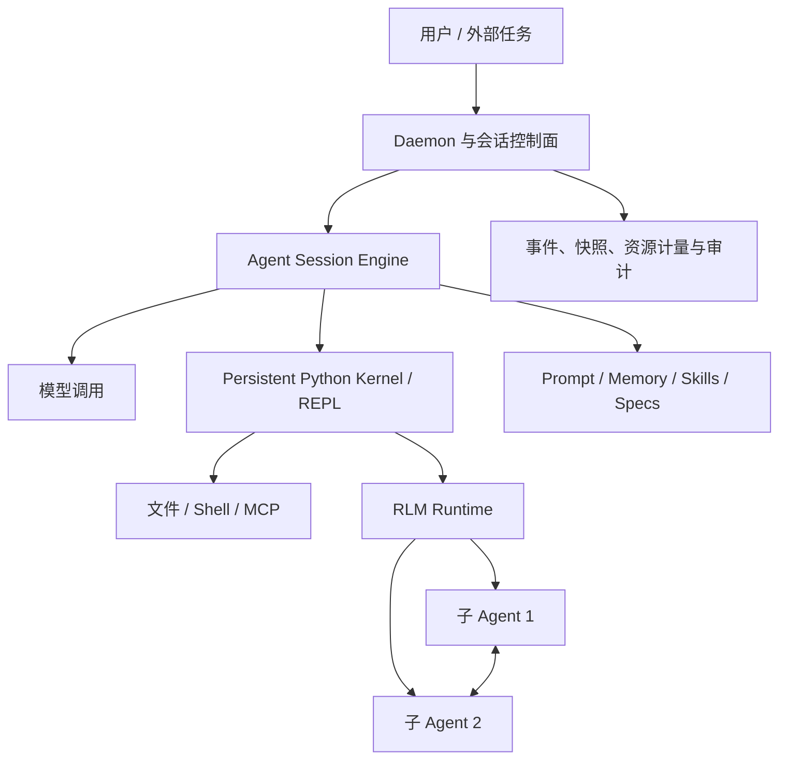
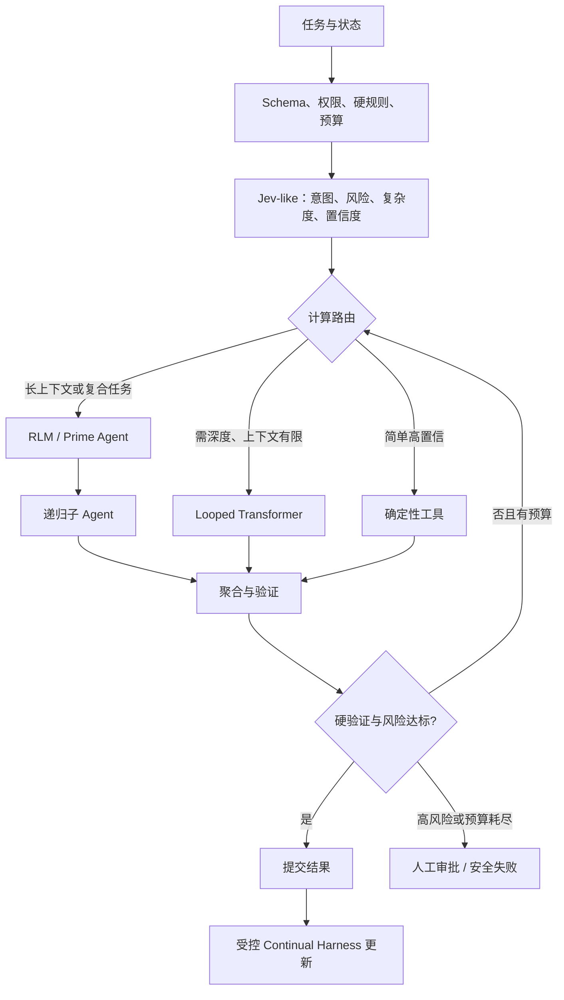

# 从循环深度到递归智能体：Looped Transformer、Jev 与 Prime Agent RLM

> 资料核验时间：2026-11-07。本文区分同行评审论文、预印本、第三方黑盒评测与厂商声明。

## 一、三者不在同一抽象层

| 路线 | 所在层 | 操作对象 | 主要目标 |
| --- | --- | --- | --- |
| Looped Transformer | 模型内部 | 共享参数块、隐藏状态 | 用参数共享换取有效计算深度 |
| Jev-like | 决策接口/训练目标 | 选项、量表、概率 | 快速做类型化、可校准决定 |
| RLM | 推理范式 | 外部上下文、代码、递归调用 | 处理超长上下文与可分解问题 |
| Prime Agent | Agent harness | REPL、会话、工具、子 Agent、记忆 | 长时运行、恢复和递归协作 |

它们对应三种循环：模型内隐藏状态循环、系统内决策与置信门控循环、模型外上下文与子 Agent 递归。本文“类 Jev”指类似 TypeSafe AI Jev 的结构化概率决策模型，不是 JEPA。

证据分级：**A** 为同行评审或可复现研究；**B** 为预印本、公开代码；**C** 为第三方黑盒评测；**D** 为厂商声明。Jev 尚未公开完整架构、权重、参数规模和 RLCD 训练细节。2026 年的 RLM、Recursive Agent Harness 与 Prime Agent 论文也仍是快速演进的预印本成果。

## 二、Looped Transformer：参数共享与有效深度

标准 Transformer 使用不同参数逐层变换：

\[
h^{(0)}=Embed(x),\qquad h^{(l+1)}=F_{\theta_l}(h^{(l)})
\]

Looped Transformer 让同一块重复更新隐藏状态：

\[
h^{(t+1)}=F_\theta(h^{(t)},x,e_t),\qquad \hat y=G(h^{(T)})
\]

循环不是机械重复，而是学习误差修正、信息传播或固定点逼近。Universal Transformer 在 2018 年已结合自注意力、跨深度递归与动态停机。[1]

《Looped Transformers are Better at Learning Learning Algorithms》在数据拟合型 ICL 任务中报告，用标准 Transformer 不到 10% 的参数达到可比表现。[2，A] 这不能外推成通用的“参数压缩 90%”。《Reasoning with Latent Thoughts》报告，一个 \(k\) 层块循环 \(L\) 次，在多类合成推理问题上接近 \(kL\) 层非循环模型。[3，A/B] 一些任务需要的是有效深度，而非每一步的新参数。

《Scaling up Test-Time Compute with Latent Reasoning》训练了 35 亿参数、8000 亿 token 的概念验证模型，通过 recurrent block 在测试时增加隐藏空间计算，在部分推理基准上继续获益。[4，B]

```text
显式推理：输入 → token → token → token → 答案
隐式循环：输入 → h1 → h2 → h3 → ... → hT → 答案
```

latent reasoning 不要求把每一步翻译成语言，但隐藏状态难审计，循环仍消耗算力和时延，超出训练深度分布可能退化。

动态停机可写为 \(T(x)=\min\{t:q_{halt}(h^{(t)})>\tau\}\)。《Looped Transformers for Length Generalization》在具有已知迭代解法的任务上报告，自适应步数改善未见长度泛化。[5，B]

若共享块参数量为 \(P_b\)，单次计算量为 \(C_b(n)\)，则 \(P_{loop}\approx P_b\)，但 \(C_{loop}\approx T C_b(n)\)。权重显存可能下降，FLOPs 和串行时延不会自动下降。核心价值是将**模型容量**与**计算深度**部分解耦，而非无条件提高吞吐。

## 三、Jev-like：类型化概率决策

TypeSafe AI 将 Jev 描述为 System One Model：输入程序状态与类型化问题，输出固定选项、rubric 位置或命题概率，而不是任意字符串。[8，D] 可抽象为 \(p_\theta(y\mid s,q,\mathcal Y)\)。它适合路由、审核、风险分层、检索相关性和升级判断。

厂商声称 Jev 不会 hallucinate，并称其快和高效两个数量级。[8，D] 这不是独立研究结论。结构化模型仍可能选错、对 OOD 输入过度自信、因候选集不全被迫选择，以及受注入和状态污染影响。受限输出缩小生成型幻觉的表面积，但不能消除错误分类和概率失准。

2026 年 9 月的预印本对 Jev 1.13.0 做了 37 个数据集、346,009 次请求的黑盒评测。作者报告成本低于 10 美元，在 IMDB、SST-2、HellaSwag、ARC 上达到 95%–99% 准确率。[9，C] 另一项预印本将 Jev 与 19 个通用 LLM 比较，报告其在知识与常识任务上有竞争力，但 MathQA 比 frontier 模型中位数低 17.7 个百分点，并低于参与比较的 19 个模型。[10，C]

若一批样本均被赋予 0.8 正确概率，理想情况下应约有 80% 真正正确。常用指标包括 Brier Score、NLL、ECE、reliability diagram 和 risk-coverage。生产系统关心的是：在错误风险上限内能自动覆盖多少请求。

TypeSafe AI 将训练方法称为 Reinforcement Learning for Calibrated Decisions（RLCD），但公开资料不足以复现。相邻研究用 Brier score 或 logarithmic scoring rule 训练置信度，[11][12] 只能作为理论参照，不能反推 Jev 的实现。这里的 RLCD 也不是 Reinforcement Learning from Contrastive Distillation。

## 四、RLM：把上下文变成环境变量

截断、RAG、摘要和更大窗口往往预先决定“保留什么”。关键证据一旦丢失，模型难以补救；能装下大量 token 也不等于能稳定定位和聚合。

《Recursive Language Models》把超长 prompt 放入外部环境，让模型用代码搜索、切分并递归调用自身：[13，B]

```python
context = load_external_prompt()
chunks = partition(context, search(context, query_terms))
partial = [llm(subproblem(c)) for c in chunks]
answer = llm(aggregate(partial))
```

论文报告 RLM 可处理达到模型窗口约两个数量级之外的输入，并在四类长上下文任务上相对若干压缩和 Agent 基线提升。[13，B] 结果依赖模型、任务与成本口径，不能外推为固定收益。RLM 的风险包括程序错误、覆盖遗漏、递归树成本爆炸和聚合错误。

《Recursive Agent Harnesses》把递归单元从一次模型调用升级为完整 Agent harness：子节点拥有独立上下文、文件、代码执行、工具和多步规划。[14，B] 这适合代码库和研究任务，也扩大写冲突、状态不一致和权限传播面，必须设置递归深度、并发预算、写入所有权、取消传播与验证器。

## 五、Prime Agent：RLM 的长期运行时

Prime Agent 围绕两个抽象展开：[15][16][17]

- **RLM**：把 context/history 作为变量，以持久 Python REPL 为控制环境，把工具与子 Agent 当作程序调用；
- **Continual Harness**：把补充 prompt、memory、skill 和 sub-agent specification 作为可版本化状态，在证据支持下小幅更新。

公开仓库当前以 Rust crates 为主，可见 kernel、RLM runtime、snapshot、cancellation、daemon session engine、RLM children、recovery 和 messaging 等模块。[17，B]



持久 REPL 让大型日志和中间表留在环境，模型只读取必要切片。所谓“自改进”不是在线修改基础权重；候选 skill、memory 和 prompt 应经过独立回归、安全评测、局部发布、快照与回滚。基础 system prompt、权限和安全策略不应由 Agent 自主覆盖。

## 六、统一架构提案

下面是综合设计，不是已有论文验证的单一系统。



硬规则负责边界；Jev-like 层负责低成本路由；Looped Transformer 为边界清晰的问题增加 latent depth；RLM 处理长上下文、多来源和多工具任务；最终结果由测试、schema、引用和人工门禁验证。

递归任务应满足 \(\sum_jB_j+B_{aggregate}\le B_{parent}\)，深层预算按 \(B_r\le\gamma^rB_0,\gamma<1\) 衰减。路由阈值应来自 risk-coverage 与业务损失，而非拍脑袋。

## 七、工程与评估

1. 先记录成功率、人工接管率、总 token、P95/P99 时延、工具错误、恢复次数和每个成功任务成本。
2. 类型化决策先用于低风险、有标签的路由；保留 `other/unknown` 与 `abstain`；影子运行后按 risk-coverage 开放自动执行。
3. recurrent depth 分别做参数量相同、FLOPs 相同和延迟相同对照，覆盖循环外推和动态停机。
4. RLM 从只读任务开始，限制深度、并发、调用数与 token；子任务返回固定 schema 和证据位置；聚合检查覆盖与冲突。
5. Continual Harness 更新经过去重、归因、离线回放、安全门禁、小范围发布、监控和回滚，不能直接写入全局记忆。

| 对象 | 质量 | 效率 | 可靠性/安全 |
| --- | --- | --- | --- |
| Looped Transformer | exact match、长度与循环外推 | 参数、FLOPs、显存、P95 | 残差、答案翻转、错误停机 |
| Jev-like | accuracy、F1、AUROC | 每千次成本、吞吐、P99 | NLL、Brier、ECE、risk-coverage、OOD |
| RLM / Prime Agent | 端到端成功、证据完整率 | 调用、token、CPU、wall-clock | 恢复、取消、幂等、写冲突、越权 |

统一消融应依次比较普通模型、快决策路由、latent loop、RLM、子 Agent 与 continual state，并在相同成功标准下报告总成本和尾延迟。

## 八、结论

Looped Transformer 将参数量与有效深度部分解耦；Jev-like 模型把自由生成收缩成可校准的类型化决定；RLM 和 Prime Agent 把上下文、程序、工具、子 Agent 和记忆纳入可编程、可恢复的长期运行时。

合理架构不是用一条路线替代另两条，而是分层协同。真正困难的不是“循环更多次”，而是知道何时继续、何时停止、何时递归、何时拒答，以及如何证明新增计算带来可验证的进展。

## 参考文献与一手资料

1. **Universal Transformers**. ICLR 2019. <https://arxiv.org/abs/1807.03819>
2. **Looped Transformers are Better at Learning Learning Algorithms**. ICLR 2024. <https://arxiv.org/abs/2311.12424>
3. **Reasoning with Latent Thoughts**. ICLR 2025. <https://arxiv.org/abs/2502.17416>
4. **Scaling up Test-Time Compute with Latent Reasoning**. <https://arxiv.org/abs/2502.05171>
5. **Looped Transformers for Length Generalization**. <https://arxiv.org/abs/2409.15647>
6. **Can Looped Transformers Learn to Implement Multi-step Gradient Descent?** <https://arxiv.org/abs/2410.08292>
7. **On the Role of Depth and Looping for In-Context Learning with Task Diversity**. <https://arxiv.org/abs/2410.21698>
8. TypeSafe AI. **Introducing System One Models & Jev**. 厂商材料。<https://typesafe.ai/blog/introducing-system-one-models-and-jev>
9. **Evaluating and Benchmarking the System One Model Jev**. 黑盒评测预印本。<https://arxiv.org/abs/2609.37647>
10. **Specialized Decision Models vs. General-Purpose LLMs**. 黑盒评测预印本。<https://arxiv.org/abs/2610.11978>
11. **Beyond Binary Rewards**. <https://arxiv.org/abs/2507.16806>
12. **Rewarding Doubt**. <https://arxiv.org/abs/2503.02623>
13. **Recursive Language Models**. 预印本。<https://arxiv.org/abs/2512.24601>
14. **Recursive Agent Harnesses**. 预印本。<https://arxiv.org/abs/2606.13643>
15. **Prime Agent: A Self-Improving RLM Harness**. 预印本。<https://arxiv.org/abs/2608.23552>
16. Prime Intellect. **Prime Agent: A self-improving RLM agent**. <https://www.primeintellect.ai/blog/prime-agent>
17. PrimeIntellect-ai. **prime-agent**. <https://github.com/PrimeIntellect-ai/prime-agent>
