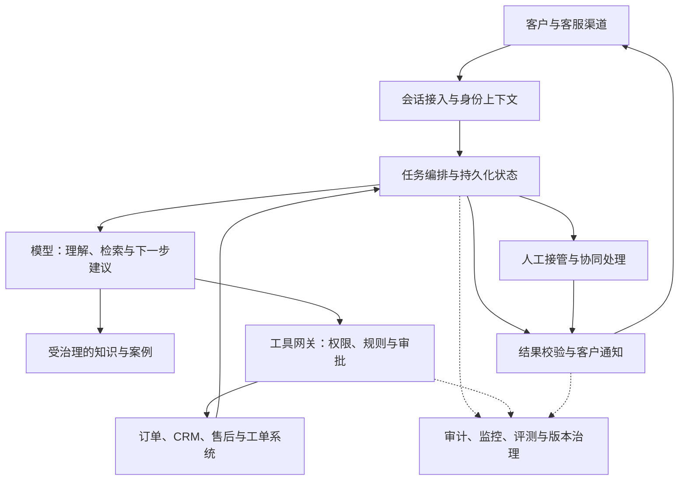
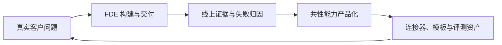

# 从“能回答”到“能解决”：客服 Agent 与 FDE 落地规划

客户发来一句话：“订单一直没收到，能不能直接退款？”

一个问答机器人可以解释退款政策；一个接了订单接口的机器人可以补充物流状态。但要真正处理这个问题，系统还需要确认客户身份、核验订单归属、区分物流延迟与丢件、检查售后条件、征得必要确认、提交申请，并在失败时保留现场、交给有权限的人继续处理。

这段距离，就是“能回答”与“能解决”之间的距离。

很多客服 AI 项目停留在前半段：模型选好了，知识库接好了，演示也足够流畅，真正上线后却发现业务规则没有写清、接口无法支撑、异常无人接手，最后仍然依赖人工补洞。

**客服 Agent 负责在授权范围内解决客户问题；客服 FDE 负责把这套能力放进真实业务，并让它能够持续运行和复制。** 两者不是两个独立话题，而是同一条业务价值链的产品侧与交付侧。

> 本文将 FDE 理解为 Forward Deployed Engineer，即前线部署工程师。讨论面向企业客服场景，既适用于供应商面向客户的交付，也适用于企业内部跨业务线落地。文中案例、架构、团队配置和时间表均为规划建议，不是某家企业的项目实测结果。公开资料核对日期为 2026 年 11 月 16 日；厂商产品描述不等于独立验证结论。

## 一、客服 Agent 的目标，不是把所有咨询都留在机器端

### 1.1 从对话自动化，走向问题解决

传统 FAQ、规则机器人和工单工作流并没有失去价值。对范围固定、分支清晰的业务，它们往往更便宜，也更容易验证。大模型新增的价值，主要体现在理解不规范表达、整合上下文，以及面对信息缺口时选择下一步。

因此，可以把客服能力区分为三个层次：

| 层次 | 用户获得什么 | 如何证明有效 |
| --- | --- | --- |
| 知识问答 | 政策说明、操作指引、产品解释 | 回答有依据，适用范围正确 |
| 业务办理 | 查询状态、提交申请、修改预约 | 业务系统中存在正确的执行结果 |
| 复杂协同 | 排查问题、收集证据、升级处理 | 调查可追溯，交接完整，责任明确 |

三层不是强制升级阶梯，也不是越往下越好。一个只需要准确解释产品政策的场景，没有必要让 Agent 获得账户修改权限。

更重要的是，“发起退款申请”和“退款到账”是两个不同的完成状态。如果 Agent 只完成申请，就应该明确告知申请编号、当前状态和后续处理方式，而不是宣布“退款已经完成”。

### 1.2 人工不是失败兜底，而是服务体系的一部分

客服工作同时包含事实查询、规则执行、情绪安抚、利益协商和责任判断。它们适合的自动化程度不同。

对高频、低风险、规则清晰的问题，Agent 可以独立处理；对高额赔付、身份争议或复杂投诉，Agent 更适合整理证据、生成摘要、协助人工决策。

一个健康的目标不是“转人工越少越好”，而是：**该自动化的问题被可靠解决，该交给人的问题尽早、完整地交出去。** 用户明确要求人工时，不应通过反复追问制造障碍。人工暂不可用时，则要说明服务时间、预计等待方式及可选渠道。

## 二、先规划场景，再规划模型和架构

### 2.1 用业务价值与落地条件选择首批任务

最常见的错误，是先采购模型或平台，再寻找适合它的业务。更稳妥的做法，是从历史工单中挑选能够形成完整闭环的任务。

| 场景 | 业务收益 | 主要依赖 | 建议起步方式 |
| --- | --- | --- | --- |
| 产品使用与政策咨询 | 降低重复解答成本 | 可信且有版本的知识 | 检索问答，引用来源 |
| 订单与物流查询 | 缩短等待和查询时间 | 身份、订单、物流接口 | 先只读，再扩展异常处理 |
| 标准退换货申请 | 减少重复录入和分派 | 售后规则、审批、写入接口 | 小范围授权办理 |
| 技术故障排查 | 降低上下文切换和调查成本 | 日志、产品文档、历史案例 | 先辅助人工，再验证自主排查 |
| 争议赔付、账号归属纠纷 | 降低人工取证负担 | 风控、法律与授权机制 | 人工决策，Agent 辅助 |

场景评审可以综合比较业务量、人工处理成本、规则清晰度、数据可用性、集成投入和错误损失。但风险红线不应被总分抵消：没有可靠身份校验，即使改地址的需求量很高，也不该开放自动修改。

首期通常更适合选择少量高频任务，验证“受理—处理—确认—追踪”的完整链路，而不是一次覆盖全部意图、渠道和语言。

### 2.2 产品路线不是越来越自主，而是逐步验证授权

建议把能力规划分成三个阶段：

1. **人工辅助。** 提供知识检索、回复建议、会话摘要和字段提取，由人工确认后执行。
2. **受限自治。** 在明确的场景、客群、渠道和权限范围内独立处理，越界即升级。
3. **多步骤协同。** 在持久化流程中组合查询、确认、审批和操作，持续追踪异步结果。

每个阶段都需要退出条件。即使低风险查询运行稳定，也不意味着可以自动获得退款或账户管理权限；新增工具、新业务线和新地区都应重新评估。

### 2.3 采购平台还是自建，要看业务约束

成熟客服平台适合渠道和流程较标准、希望尽快试点的团队；自建或混合方案适合核心系统特殊、权限复杂、数据隔离要求较高的场景。

选型时不只比较模型回答效果，还要验证：系统连接器能否覆盖真实动作，权限能否在后端强制执行，日志和评测是否可导出，变更是否支持灰度与回滚，以及计费口径如何定义“解决”。

FDE 的存在并不意味着必须自建平台。恰恰相反，能用成熟能力解决的问题，不应再投入团队重复开发。

## 三、生产架构：让模型理解问题，让系统约束行动

Anthropic 在《Building Effective Agents》中区分了预定义路径的工作流与动态决定过程的 Agent，并建议从足够简单的方案起步。[1] 这给客服系统提供了一个重要提醒：业务步骤多，并不自动证明需要高度自主的 Agent。

本文建议采用混合结构：模型处理自然语言和信息缺口，流程系统管理状态，业务服务强制执行关键规则。



图中的模型不是执行权限的最终裁判。它可以建议“为这个订单申请退款”，但是否允许退款、额度是多少、能否重复提交，应由业务服务在执行时校验。

### 3.1 知识、实时事实和业务规则要分开管理

政策文档回答“通常如何处理”；业务系统回答“这位客户现在处于什么状态”；执行规则决定“当前是否允许操作”。三者不能全部塞进同一个向量库。

知识治理至少需要明确来源、负责人、适用产品、地区、版本、生效时间和访问权限。历史客服回复可以作为案例，不应天然成为现行政策。

检索结果冲突时，系统要按事先约定的权威顺序处理；无法消除冲突就转人工。对于订单状态和可退金额，应读取实时业务服务，而不是根据历史对话推断。

### 3.2 把安全边界放在工具和业务服务中

一个可上线的业务工具，不只是函数名和参数，还应具备以下契约：

- **调用者身份与资源范围：** 租户和用户身份来自可信会话，不允许模型任意指定其他客户。
- **参数与规则校验：** 订单归属、金额、状态和地区限制在服务端重新检查。
- **幂等与并发控制：** 网络重试不能造成重复退款；状态变化后要重新校验。
- **确认与审批：** 用户确认具体操作，敏感事项取得有范围、有时效的审批凭证。
- **结果与错误语义：** 区分已完成、待处理、明确失败和结果未知，提供关联编号。

“提醒模型不要越权”不能代替权限控制。用户输入、附件和检索文档也不能获得修改系统规则的权力。对提示注入的防护，要同时依赖内容隔离、最小权限和后端校验。

日志本身也可能包含隐私。应限制采集范围、脱敏展示、控制访问与保留期限，不应为了排障把客户凭证、完整银行卡号或无关个人信息发给模型。

### 3.3 长任务交给流程系统，不让模型一直等待

退款审核、物流核查和跨部门工单可能持续数小时甚至数天。此时需要的是持久化状态、事件回调、超时处理和人工任务，而不是让一次模型调用保持运行。

流程应记录已完成步骤和外部操作编号。操作超时后，先查询业务结果，再决定是否重试；回滚 Agent 版本，也不意味着已经发生的退款或发货可以撤销。不可逆动作需要独立的补偿和事故处置方案。

多 Agent 同样不是默认选项。只有职责、权限或专业领域确实需要拆分，并且收益能够覆盖通信、延迟与调试成本时，才值得引入。

## 四、客服 FDE：把现场问题转化为工程能力

### 4.1 为什么产品上线前后都需要 FDE

真实项目的障碍，常常不在模型本身：业务文档没有覆盖例外，身份信息无法跨系统关联，接口只有人工操作入口，客服与 IT 对“处理完成”的定义不同。

这些问题需要有人同时理解业务、能写代码、会排查系统，并推动相关人员达成决策。这是客服 FDE 的主要工作，而不是替客户长期手工维护 Prompt。

Sierra 的公开实践介绍了 Agent Engineer 与产品经理共同参与部署、对接客户系统并持续迭代的方式。[2] Decagon 在 AI Engineer 的分享中，则把面向客户的 Agent 构建和从企业需求中提炼产品能力同时纳入前线工程工作。[3]

这些实践值得借鉴，但不构成统一组织标准。本文将客服 FDE 定位为：**对约定场景的技术落地负责，并把交付中发现的共性问题转化为可复用能力。** FDE 不是企业客服业务的最终政策制定者。

### 4.2 明确职责边界，避免“所有问题都找 FDE”

| 工作事项 | 最终决策或责任归属 | FDE 的主要工作 |
| --- | --- | --- |
| 客服政策与服务承诺 | 客服业务负责人 | 梳理歧义，提出可执行规则草案 |
| 场景目标与业务验收 | 业务负责人，产品经理协同 | 评估可行性，提供验收证据 |
| 通用产品方向 | 产品负责人 | 提交真实需求、原型与复用依据 |
| Agent 构建与客户侧集成 | 约定的技术交付负责人 | 实现、测试、排障和部署 |
| 后端权限与系统稳定性 | 相应系统负责人 | 对接权限、接口和异常恢复 |
| 隐私、安全与合规审批 | 对应职能负责人 | 落实控制并提供审计材料 |
| 日常内容运营与服务质量 | 客服运营负责人 | 工具支持、疑难归因、技术改进 |

小团队可以一人承担多个角色，但责任不能消失。特别是政策例外和风险接受，应由有权限的业务及安全负责人批准，不能由驻场工程师临时拍板。

## 五、FDE 的交付方法：先定义成功，再构建 Agent

### 5.1 业务诊断：拿到真实任务，而不只是需求描述

项目启动时，应抽样查看历史工单、会话、升级记录和处理耗时，覆盖不同渠道、客群及异常类型。样本需要按授权使用，并对标注数据进行脱敏。

诊断不只是计算高频意图，还要找出人工到底花时间在哪里：是寻找答案、跨系统查询、判断规则，还是等待其他部门？如果主要瓶颈是内部审批慢，增加一个聊天 Agent 并不能直接缩短审批时间。

此阶段的交付物是一份场景清单，写清目标人群、入口、业务价值、接口依赖、风险及不做事项，并建立人工服务的现状基线。

### 5.2 场景契约：把“处理好”写成可验收的条件

每个试点场景都应有一页简明契约：

| 契约项 | 需要说明的内容 |
| --- | --- |
| 触发条件 | 哪些诉求进入本流程，如何处理混合诉求 |
| 必要信息 | 缺什么字段，何时查询，何时向客户补问 |
| 允许操作 | 可调用哪些工具，对哪些资源生效 |
| 成功状态 | 哪个业务结果证明任务完成 |
| 升级条件 | 哪些情况必须交给人工或其他团队 |
| 失败恢复 | 超时、重复、部分成功、结果未知如何处理 |
| 验收方法 | 使用哪些样本、规则和线上观察窗口 |

Decagon 用 AOP（Agent Operating Procedures）描述将人工 SOP 转为 Agent 可执行流程的产品方法。[4] 本文不把 AOP 当作行业通用标准，而是借此强调：人工手册中的隐含判断，必须在工程落地时补全。

### 5.3 贯穿案例：标准退款申请如何变成执行规范

下面是一份简化的设计示例。退款条件和额度应由企业真实政策确定，而不是复制示例中的流程。

```yaml
scenario: 标准退款申请
scope:
  - 已登录且订单归属验证通过的客户
  - 当前售后政策允许的订单
steps:
  - 从可信登录态获得客户身份，查询订单
  - 读取当前售后规则与可申请金额
  - 说明操作对象、金额和退款去向，取得客户确认
  - 如规则要求审批，等待有效审批凭证
  - 提交申请，使用稳定的业务幂等键
  - 查询或订阅申请状态，告知申请编号与后续路径
completion:
  application_submitted: 系统返回有效申请编号，明确告知尚未到账
  refund_completed: 业务系统确认退款完成
escalate_when:
  - 身份或订单归属无法验证
  - 政策存在冲突或需要例外授权
  - 工具结果未知且无法查询确认
  - 用户要求人工或出现需人工处理的争议
```

这份规范还不是安全控制本身。服务端必须重新验证规则，客户确认应绑定具体动作与金额，审批不能只是一段模型声称“已获批准”的文本。

例如提交申请时网络超时，Agent 不应马上再次发起一笔新申请。正确做法是使用同一业务关联标识查询：已成功则返回原申请，确认未执行后再按规则重试，无法确认则保留未知状态并升级。

### 5.4 评测验收：检查结果，也检查过程

客服评测不能只问“回复听起来对不对”。至少要覆盖以下几类任务：

- **正常路径：** 信息完整、符合规则、工具成功。
- **信息不足：** 多个订单、缺失字段、用户前后陈述不一致。
- **政策边界：** 临界时间、特殊地区、政策版本切换。
- **工具异常：** 超时、限流、部分成功、重复回调和并发操作。
- **安全对抗：** 伪造身份、诱导越权、恶意文档指令、跨租户数据请求。
- **人工协同：** 用户主动要求人工，或业务规则触发升级。

验收证据应包括业务最终状态、工具调用记录、规则遵守情况和客户沟通质量。接口成功返回不一定意味着业务完成；语言合理也不代表操作正确。

对可确定事项用程序断言，对复杂沟通可引入模型评审，并通过人工抽检校准。保留未参与调试的测试集，对同类边界样本重复运行，观察输出波动。离线模拟有价值，但不能代替真实流量验证。

### 5.5 灰度与移交：让项目不依赖某一个人

先进行不执行真实写操作的影子运行或人工辅助，再按场景、客群和流量逐步开放。记录模型、提示词、知识、流程和工具版本，避免一次修改多个因素却无法归因。

每个失败样本都要进入分类：知识错误、规则缺失、模型选择错误、接口故障、身份权限问题，或业务流程本身不合理。对应修复应落在正确层次，而不是所有问题都通过增加 Prompt 条款解决。

移交时，除了演示和报告，还应交付配置清单、评测集、监控告警、故障手册、回滚方案和负责人名单。客服运营能在权限范围内完成普通更新并通过验收，才说明系统开始摆脱对 FDE 的日常依赖。

## 六、团队规划：围绕交付闭环建队，而不是招聘“万能工程师”

### 6.1 初期采用小型跨职能团队

以下是单业务线试点的配置示例，不是行业配比：

- 一名业务负责人，负责政策、范围和验收，能够协调一线客服。
- 一名产品负责人，负责场景优先级和共性需求。
- 一至两名 FDE，负责构建、接口集成、评测接入与上线排障。
- 共享平台研发、测试、安全及运营支持，并明确投入时间和响应机制。

角色可以兼任，但“共享资源”必须落实到具体负责人。若身份、订单或支付团队不能参与，FDE 数量再多也难以交付。

招聘和培养应看综合工程能力：能否读懂客服流程、完成 API 集成、设计失败恢复、构建评测，并向业务人员解释风险与取舍。只会演示模型效果，不足以承担生产交付。

随着项目增加，可以分化出场景构建、复杂集成和平台工程方向。拆分依据应是实际瓶颈，而不是先设计庞大组织。

### 6.2 用需求分层，避免退化为定制外包

| 需求类型 | 推荐处理方式 | 应沉淀的资产 |
| --- | --- | --- |
| 品牌话术、普通政策参数 | 客户侧配置 | 配置模板与校验规则 |
| 常见工单、订单系统对接 | 标准化集成 | 连接器与契约测试 |
| 行业共性业务流程 | 模板化交付 | 场景包、样例与评测集 |
| 跨客户反复出现的能力缺口 | 产品路线评审 | 平台能力与迁移方案 |
| 单客户特殊需求 | 单独评估收益与维护责任 | 隔离扩展，不分叉核心平台 |

不是所有定制都应该产品化，也不是出现两次就值得进入底座。应结合复用范围、安全影响、维护成本和产品方向判断。项目初期可以做局部验证，但要避免把客户专属逻辑硬编码进共享主干。

### 6.3 建立现场到产品的反馈闭环

建议固定召开交付与产品联合评审。FDE 提交的不是一句“客户要这个功能”，而是问题证据、受影响场景、当前替代方案、预期收益和复用假设。

平台团队提供标准扩展点、连接器框架和评测设施；FDE 用真实项目验证；验证后的共性能力再进入标准产品。衡量这个机制是否有效，可以看下一次同类部署是否更快、返工是否更少、运营是否更自主。

FDE 的绩效也应兼顾质量和复用。如果只看项目上线数量，团队容易把长期维护成本留给别人；如果只看平台代码贡献，又可能忽略客户实际问题。更合理的是综合观察交付周期、验收质量、生产事故、复用效果和移交完成度，而不是简单统计工时或代码行数。

## 七、效果衡量：把覆盖率、解决率和客户体验分开

Intercom 的 Fin 性能文档分别展示参与率、解决率、自动化率和客户体验，并在解决状态中区分确认与推定。[5] 这说明同一个“解决率”，也可能包含不同证据等级，跨产品或跨项目比较前必须核对口径。

以下是本文建议的企业内部指标定义，并非照搬某家平台的统计方式。

### 7.1 用完整漏斗避免“只挑简单问题”

```text
全部服务请求
  → 符合已发布场景范围的请求
  → Agent 实际接手的请求
  → 有证据证明独立解决的请求
  → 在约定观察窗口内未因同一问题重开的请求
```

其中，“请求”应关联到客户的具体问题或任务，不宜机械等同于一个聊天窗口。用户换渠道追问，不能被当成上一个窗口已经成功解决；一段对话包含多个问题时，也应说明统计规则。

建议同时报告：

- **实际覆盖率：** Agent 接手请求数 / 全部符合统计条件的服务请求数。
- **接手后的有效解决率：** 经验证独立解决请求数 / Agent 接手请求数。
- **端到端自动解决占比：** 经验证独立解决请求数 / 全部符合统计条件的服务请求数。
- **同问题重复咨询率：** 在约定窗口内因同一问题再次求助的请求比例。

接手后的解决率很高，但覆盖率很低，不代表整体收益很高；自动解决占比上升，同时投诉和重复咨询也上升，也不能视为成功。

结果未知、待审批、客户沉默，应有独立状态。对知识咨询，可以采用用户确认、质量抽检等证据；对业务操作，应尽量以业务记录为准。推定解决可以作为观察指标，但不应悄悄等同于已验证成功。

### 7.2 质量、安全与体验共同构成门槛

| 维度 | 核心观察项 | 需要防范的误读 |
| --- | --- | --- |
| 业务结果 | 任务完成、重复咨询、错误关闭 | 关单不等于解决 |
| 客户体验 | 满意度、响应与解决时长、人工可达性 | 快速回复不等于快速解决 |
| 安全质量 | 越权、泄露、错误操作、政策违规 | 小样本零事故不证明没有风险 |
| 人工协同 | 交接完整性、重复询问、接管耗时 | 转人工本身不等于失败 |
| 系统可靠性 | 工具错误、未知状态、恢复耗时 | 模型可用不等于业务链路可用 |
| 交付效率 | 首次上线周期、返工、复用和运营自主性 | 项目数量不能代替交付质量 |

人工接管时，至少带上用户诉求、已核验身份状态、关键事实与证据、已经执行的操作、未完成事项和升级原因。人工回复后，原 Agent 不应继续并发执行冲突动作。

指标应按场景、渠道、语言及风险分层比较，并报告样本量。试点前约定验收阈值、观察周期和停止条件。高风险场景还应设置明确的严重事件处置机制，不能用平均满意度抵消一次越权操作。

### 7.3 ROI 要计算总成本，而不是只看 Token

```text
每个有效解决问题的综合成本
=（模型与平台费用 + 集成及运维投入 + 评测与内容治理成本
   + 人工接管及返工成本 + 可合理估算的错误损失）
  / 经验证有效解决的问题数
```

比较时应保持场景和服务质量尽量一致，并计入一次性交付投入在合理期间内的分摊。否则，只让 Agent 处理简单问题，再与全部人工工单均值比较，很容易高估节省。

节省的客服工时不一定马上变成现金收益，也可能体现为减少排队、承接业务增长或把人工转向复杂服务。预算规划应区分这几种收益，避免把理论容量全部计算为裁员收益。

## 八、90 天试点路线：每一阶段都有继续或停止的依据

90 天不是上线保证，而是用于管理试点的示例节奏。接口缺失、数据授权和合规评审可能延长周期。计划应围绕验收门槛，而不是为了赶日期扩大权限。

| 阶段 | 核心工作 | 主要交付物 | 进入下一阶段的条件 |
| --- | --- | --- | --- |
| 第 1—2 周：定义问题 | 样本分析、基线测量、依赖与风险盘点 | 场景契约、范围清单、责任分工、验收草案 | 有业务负责人，数据与系统接入路径明确 |
| 第 3—6 周：构建验证 | 知识治理、接口封装、流程实现、离线评测 | 可运行版本、接口契约、评测报告、故障手册 | 关键风险受控，未知与异常状态可恢复 |
| 第 7—10 周：有限上线 | 影子运行、人工辅助、小流量授权、失败归因 | 线上指标、问题清单、版本记录、回滚演练 | 业务质量达到事先约定门槛，人工接管可用 |
| 第 11—13 周：运营移交 | 稳定性验证、培训、配置移交、复用评审 | 运营手册、成本报告、场景包、下一阶段计划 | 能独立运营，扩量收益与风险都有证据 |

试点结束不只有“全面推广”一种结论。还可以继续保持辅助模式、缩小范围、修复接口后重试，或停止某个不经济的场景。这些都是有效决策。

停止或降级条件应在上线前写清，例如出现跨租户数据访问、无法追踪的写操作、关键业务指标恶化，或人工接管链路失效。触发后先限制相关操作、保全证据，再恢复人工路径和评估影响。

预算也应按阶段安排：探索期购买验证所需的最小能力；通过门槛后再扩展模型用量、连接器和运营投入。团队容量规划不仅看并行项目数，还要留出线上事故、政策更新和平台沉淀的时间。

## 九、规模化之后，真正需要积累什么

一个项目成功，只能说明在特定边界内方法可行。规模化需要把“这个客户能用”转化为“下一次更容易交付”。

值得积累的资产包括：经过审查的知识与政策模板、带权限语义的工具连接器、可复用的场景流程、正常与异常评测集、指标定义、故障归因库，以及运营人员能独立使用的配置和发布能力。

它们共同构成一个持续改进的循环：



这个循环也解释了客服 FDE 为什么不该成为长期人工补洞的队伍：如果相似问题每次都要从头研究、逐项定制、依赖原作者排障，那么客户数量增长只会线性增加交付压力。

**更好的 FDE 团队，会让现场经验不断进入产品，让下一次交付更轻，让客户日常运营更自主。**

## 结语：让“处理完成”成为可验证的事实

客服 Agent 的竞争力，不只是模型说得自然，更在于它能否理解业务边界、获得正确证据、可靠执行操作，并在不确定时停下来。

客服 FDE 的竞争力，也不只是快速完成演示或定制，而在于把真实业务中的模糊规则、系统依赖和异常处理，转化为可以验收、维护和复用的工程能力。

规划这两件事时，应始终抓住三条主线：

1. **用业务结果定义产品。** 不把自动回复、静默离开或机器关单直接当成解决。
2. **用确定性系统约束行动。** 不把权限、安全与关键规则只交给模型承诺。
3. **用可复用资产推动交付。** 不让每一个新场景都依赖新的人工补洞。

从“能回答”走向“能解决”，不是给聊天机器人多接几个接口，而是重新设计产品能力、工程交付和服务运营之间的连接方式。客服 Agent 与 FDE，正是这套连接中的两个关键角色。

## 参考资料与阅读说明

以下资料用于说明具体厂商的方法与公开实践。本文的架构、职责表、指标口径和 90 天计划是综合这些思路提出的规划建议，不代表厂商标准，也不承诺相同效果。本文未使用厂商宣传中的解决率作为普适验收指标。

1. [Anthropic：Building Effective Agents](https://www.anthropic.com/engineering/building-effective-agents)。参考其工作流与 Agent 的架构区分，以及从简单方案起步的方法。
2. [Sierra：Shipping and Scaling AI Agents](https://sierra.ai/jp/blog/shipping-and-scaling-ai-agents)。参考其客户旅程设计、部署协作与持续迭代实践。
3. [AI Engineer：How Forward Deployed Engineering is done at Decagon](https://www.ai.engineer/talks/7wu2hsRfvV0-forward-deployed-engineering-is-done-at-decagon)。参考其将客户侧构建与通用产品能力相连接的 FDE 经验分享。
4. [Decagon：Agent Operating Procedures: From Manual SOPs to Automated AI Logic](https://decagon.ai/blog/from-sops-to-agent-operating-procedures)。参考其将人工 SOP 显式化、转为 Agent 执行流程的产品思路；AOP 为该厂商所使用的术语，不是统一行业标准。
5. [Intercom：Monitor Fin’s Performance with Clarity and Confidence](https://www.intercom.com/help/en/articles/11390083-monitor-fin-s-performance-with-clarity-and-confidence)。参考其分开观察自动化、参与、解决与客户体验的指标实践，以及确认／推定解决的状态区分。产品文档会持续更新，使用时应核对当前定义。
