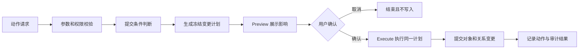
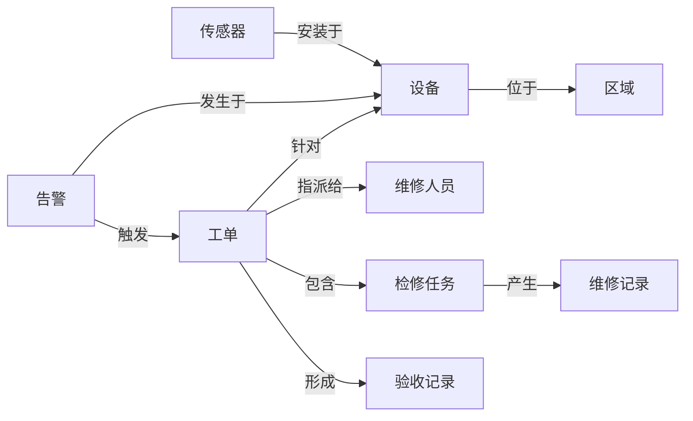

# 从业务语义到可运行对象：企业本体的搭建逻辑与实施方法

> 本体建设不是把数据库表换一套名字，也不是画完一张实体关系图就结束。真正可用的企业本体，需要把业务对象、属性、关系、规则、动作和数据来源组织成统一语义，并经过校验、映射、发布和运行，最终成为可以查询、分析、操作和持续演进的业务能力。

很多企业已经积累了大量业务系统、数据仓库、接口和报表，但当用户提出一个看似简单的问题时，系统仍然很难直接回答：

- 这个告警对应哪台设备？
- 设备当前由谁负责？
- 最近一次检修解决了什么问题？
- 哪些工单受同一个故障影响？
- 如果关闭这张工单，会更新哪些状态、生成哪些记录？

这些问题并不只是“有没有数据”的问题，而是数据之间缺少统一的业务解释。数据库知道表和字段，接口知道请求和响应，页面知道按钮和表单，但它们未必共同理解什么是“设备”“告警”“工单”“负责人”和“关闭工单”。

企业本体要解决的，正是这种业务语义分散问题。

本文从工程实施角度说明一套完整的本体搭建逻辑：如何从业务材料中识别事实，如何建立对象、属性、关系和动作，如何连接真实数据，如何管理草稿与正式版本，以及如何让本体真正进入查询、分析和业务操作链路。

---

## 一、本体建设究竟在建设什么

### 1. 本体不是数据库模型的同义词

数据库模型主要解决数据如何存储：一张表有哪些字段、字段使用什么类型、主键和外键是什么、表之间如何连接，以及如何建立索引提高查询效率。

本体首先解决业务如何理解这些数据：

- 业务中存在哪些稳定对象；
- 每类对象具有什么业务属性；
- 对象之间存在什么语义关系；
- 对象经历怎样的生命周期；
- 用户和系统可以对对象执行什么动作；
- 不同系统中的记录如何映射到同一个业务概念。

例如，数据库中可能存在 `device_base_info`、`iot_alarm_log`、`repair_ticket`、`employee` 等表。本体不会简单地把这些表改名为“设备”“告警”“维修单”和“员工”，而是要进一步回答：

- `device_base_info` 中的一行是否就是一个设备对象；
- 一条告警记录是设备属性，还是具有独立生命周期的告警对象；
- 维修单和设备之间是“处理”“关联”还是“由设备产生”；
- 员工编号、负责人编号和处理人编号是否指向同一种人员对象；
- 设备当前状态应该读取台账、物联网平台，还是最近一次人工检修结果。

因此，数据库结构可以为本体提供证据，但不能代替业务建模。

### 2. 本体也不只是一张知识图谱

知识图谱通常强调节点、边和图查询，本体则需要进一步定义这些节点和边为什么成立、遵守什么约束，以及怎样参与业务运行。

一个可运行的企业本体至少包含以下资产：

| 资产 | 回答的问题 | 运行价值 |
|---|---|---|
| 对象类型 | 业务中有哪些独立事物 | 形成对象列表、详情和统一身份 |
| 属性 | 对象具有哪些状态和特征 | 支持展示、筛选、排序和分析 |
| 枚举 | 哪些值属于受控业务分类 | 统一状态、等级和类型口径 |
| 关系 | 对象之间如何连接 | 支持追踪、影响分析和跨对象查询 |
| 接口 | 不同对象共享什么能力契约 | 统一能力发现和复用方式 |
| 动作 | 对象允许执行什么业务操作 | 支持预览、执行、审计和回写 |
| 映射 | 语义对象从哪里获得真实数据 | 让模型从“可描述”变为“可使用” |
| 版本 | 变更何时进入正式运行 | 支持发布、回滚、比较和追溯 |

本体的最终目标不是“把知识存起来”，而是把业务认知转化为可运行的对象能力。

### 3. 一条完整的本体建设链路


这条链路包含三个不能混淆的层次：

1. **语义层**：定义业务对象是什么。
2. **映射层**：说明对象数据从哪里来。
3. **运行层**：让对象能够被查询、分析和操作。

如果只有语义层，没有映射，对象只是一个空壳；如果只有映射，没有稳定语义，系统仍然只是表和字段的拼接；如果没有发布和运行治理，模型变更就可能直接影响正式业务。

---

## 二、先划定业务域，而不是先导入数据表

本体建设最常见的错误，是拿到数据库后立即做“表转对象、字段转属性”。这种方法看似高效，实际上会把历史系统的技术结构原样带入语义层。

正确的起点是业务目标。

### 1. 用业务问题定义建设目标

开始建模前，应先形成一组清晰的能力问题。例如在设备运维场景中：

- 用户需要查看哪些设备及其当前状态？
- 告警发生后，需要追踪到哪些设备、区域和责任人？
- 如何从告警创建工单？
- 工单关闭前需要满足哪些条件？
- 管理者需要分析哪些故障类型、响应时长和维修结果？
- 上层应用或智能体需要调用哪些查询和动作？

这些问题决定本体必须覆盖哪些对象、关系和动作。没有业务问题约束的模型，很容易变成“概念很多，但没有一条业务链路能跑通”的分类目录。

### 2. 识别参与角色

角色决定谁以什么方式消费本体。常见角色包括：

| 角色 | 主要诉求 |
|---|---|
| 一线业务人员 | 查看对象、筛选任务、执行动作 |
| 业务负责人 | 分析状态、风险、效率和影响范围 |
| 领域专家 | 审核对象定义、规则和业务口径 |
| 实施人员 | 配置数据源、映射和版本 |
| 上层应用 | 通过稳定接口消费对象与关系 |
| 智能体 | 发现可用对象、查询能力和受控动作 |
| 治理人员 | 管理权限、发布、恢复和审计 |

角色分析不是权限配置的附属步骤，它会直接影响模型。例如，“维修工”如果需要独立排班、被多个工单引用并拥有技能等级，那么它应当作为人员对象或人员角色进入本体，而不能只是工单上的一个文本字段。

### 3. 以业务流程确定边界

一个本体配置通常应该覆盖一个相对完整的业务域，而不是一个页面，也不是整个企业。

范围过小会导致关系断裂。例如只建立“告警”对象，却不覆盖设备、工单和责任人，用户只能看到告警列表，无法继续追踪和处置。

范围过大则会把生产、采购、财务、人力和设备运维全部放进一个模型，导致对象数量迅速膨胀，版本变更和责任边界难以控制。

判断业务域边界可以使用三个问题：

1. 这些对象是否围绕同一组核心流程流转？
2. 它们是否由相近的业务团队维护和验收？
3. 它们是否需要在同一个变更周期中共同发布？

以设备运维为例，可以把业务域定义为：从设备状态感知、告警产生、工单创建、任务分派、维修执行到结果验收的完整闭环。备件采购和财务结算可以通过关系或接口接入，但不一定要在第一阶段全部纳入。

### 4. 建立场景清单

业务域确定后，需要把需求整理成场景，而不是立即整理字段。

| 场景类型 | 示例 |
|---|---|
| 对象查询 | 查询停机设备、未处理告警、逾期工单 |
| 关系追踪 | 从告警追到设备、区域、工单和负责人 |
| 分析决策 | 分析故障率、平均响应时长和重复故障设备 |
| 状态变更 | 接单、转派、开始维修、提交验收、关闭工单 |
| 跨系统协同 | 从物联网告警生成运维工单并回写处理结果 |

每个场景都应能够反推模型需求：需要哪些对象、属性、关系、筛选条件和动作。这样建立的本体天然面向业务使用，而不是面向静态展示。

---

## 三、从材料中提取事实，而不是让模型自由猜测

企业本体通常来源于多种材料：业务制度、需求文档、数据库 DDL、接口说明、样例数据、术语表、流程图和用户口述。自动化生成可以降低整理成本，但不能取消事实依据。

### 1. 建模材料的六种证据角色

不同材料能够证明的内容不同。可以把输入片段划分为以下角色：

| 证据角色 | 可以支持的事实 |
|---|---|
| 业务语义 | 对象含义、业务关系、生命周期、动作和规则 |
| 结构定义 | 字段类型、主键、非空约束、外键和表结构 |
| 样例数据 | 值的形态、典型范围和潜在异常 |
| 术语规则 | 同义词、命名规范、标准编码和口径说明 |
| 生成要求 | 输出范围、表达偏好和交付要求 |
| 无关内容 | 不应进入本体的上下文或噪声 |

这里有一个重要原则：**材料可以提供它有能力证明的事实，不能越权证明其他事实。**

例如，一份样例数据中恰好只有“高、中、低”三个风险等级，并不能证明完整枚举只有三个值；一个字段在十条样例中都不为空，也不能证明它在业务上必填；一个名为 `id` 的字段不一定就是业务主键。

### 2. 建立证据驱动的生成过程

较可靠的自动生成流程，不应让大模型直接输出最终 YAML 或 JSON，而应把“理解材料”和“生成规范模型”拆开。


这套流程中，模型负责理解自然语言，程序负责确定性合并、命名、引用修正和格式生成。这样可以避免同一轮生成同时承担语义判断、标识设计、引用闭合和序列化，降低整份模型因局部错误而失效的概率。

### 3. 中间模型应保存什么

结构化语义中间模型至少应保存：

- 对象及其描述；
- 对象属性和类型判断；
- 对象之间的关系；
- 枚举及其候选值；
- 每条事实对应的材料标识和原文证据；
- 无法确认的约束；
- 材料之间的冲突；
- 生成质量告警。

中间模型是本次生成过程的事实载体，但不是正式运行版本。用户确认后，还需要把它规范化为正式本体内容，并进入草稿、校验和发布流程。

### 4. 处理证据不足

自动生成遇到证据不足时，应保守降级，而不是补全一个看起来合理的答案：

- 无法证明必填时，不设置必填；
- 无法证明主键时，标记为待确认；
- 无法确定数据类型时，使用兼容范围更大的类型并产生告警；
- 无法确认完整枚举时，不把样例值当成封闭全集；
- 无法判断关系基数时，保留关系但要求人工确认；
- 无法确认两个同名概念是否相同时，不自动合并。

自动化降低的是表达和整理成本，不是业务人员对概念正确性的责任。

---

## 四、识别对象：找到具有独立身份和生命周期的事物

对象类型是本体的骨架。对象识别错误，后面的属性、关系、映射和动作都会建立在错误基础上。

### 1. 对象识别的五个判断标准

一个概念通常适合建成对象，如果它满足以下多个条件：

1. **具有稳定身份**：可以通过编号、组合键或平台身份唯一识别。
2. **具有独立生命周期**：会创建、变化、关闭、失效或归档。
3. **可以独立查询**：用户需要单独查看列表和详情。
4. **参与多种关系**：会被多个对象引用或影响其他对象。
5. **承载业务动作**：用户或系统会对它执行受控操作。

在设备运维场景中，可以识别出以下对象：

| 对象 | 成为对象的原因 |
|---|---|
| 设备 | 有资产编号、状态、位置和完整生命周期 |
| 告警 | 有告警编号、发生时间、等级和处理状态 |
| 工单 | 有独立状态流转和操作入口 |
| 检修任务 | 可以被分派、开始、暂停和完成 |
| 维修人员 | 被多个任务引用，并具有组织和技能关系 |
| 故障类型 | 如果只用于固定分类，适合做枚举；如果具有诊断规则和知识条目，可建成对象 |
| 维修记录 | 需要独立审计和追溯时，应建成事件或记录对象 |

### 2. 区分对象、属性和枚举

| 判断 | 对象 | 属性 | 枚举 |
|---|---|---|---|
| 是否有独立身份 | 是 | 否 | 使用稳定编码 |
| 是否有独立生命周期 | 通常有 | 依附对象 | 通常没有 |
| 是否独立查询 | 是 | 随对象展示 | 作为选项使用 |
| 是否参与关系 | 可以 | 一般不参与 | 一般不参与 |
| 示例 | 设备、告警、工单 | 设备名称、告警时间 | 告警等级、工单状态 |

例如，“工单状态”不应被建成一批状态对象；“维修结果”如果只是成功、失败、部分完成，适合做枚举；但“验收记录”如果有验收人、时间、意见、附件和复核过程，就应成为独立对象。

### 3. 为每类对象建立对象卡片

对象卡片是对象进入运行前的最小定义。它至少包含：

| 字段 | 说明 | 工单示例 |
|---|---|---|
| 显示名称 | 面向用户的名称 | 维修工单 |
| 稳定标识 | 用于接口、配置和引用 | `MaintenanceWorkOrder` |
| 业务描述 | 说明代表什么、不代表什么 | 针对设备异常发起并受控流转的维修任务单 |
| 主标识 | 唯一识别对象实例 | `work_order_no` |
| 标题字段 | 列表和详情优先展示 | 工单编号、工单标题 |
| 对象分组 | 用于组织对象空间 | 运维执行 |
| 关键状态 | 驱动筛选和动作可用性 | 待接单、处理中、待验收、已关闭 |
| 主要关系 | 对象与上下游的连接 | 针对设备、来源告警、指派人员 |
| 可用动作 | 对象允许执行的操作 | 接单、转派、提交验收、关闭 |

对象描述必须说明业务边界。例如“维修工单”代表受控执行任务，不代表原始告警，也不代表最终维修记录。清晰的边界能够避免多个对象承担相同语义。

### 4. 对象身份与来源编号分离

企业数据经常来自多个系统。不同来源可能使用不同编号，也可能重复使用同一个编号。因此，应区分：

- **平台对象身份**：本体运行时稳定识别同一个对象；
- **来源系统身份**：用于和原始记录对账、同步和恢复；
- **业务编号**：面向用户展示和业务沟通。

设备从资产系统迁移到新的 EAM 系统后，来源编号可能改变，但不应自动变成一台新设备。只有身份合同明确，跨系统数据融合才不会依赖脆弱的字符串匹配。

---

## 五、定义属性：把字段提升为业务口径

属性用于描述对象的状态、特征、时间、位置和度量。属性建模的重点不是字段数量，而是业务口径是否清楚。

### 1. 属性的常见类别

| 属性类别 | 作用 | 示例 |
|---|---|---|
| 标识属性 | 唯一识别和外部引用 | 设备编码、工单编号 |
| 标题属性 | 列表和详情中的主要名称 | 设备名称、工单标题 |
| 状态属性 | 表示生命周期阶段 | 运行状态、处理状态 |
| 分类属性 | 支持分组、筛选和规则 | 设备类型、告警等级 |
| 时间属性 | 表示发生、生效和变化时间 | 告警时间、接单时间 |
| 位置属性 | 描述空间或组织位置 | 厂区、车间、坐标 |
| 度量属性 | 支持比较和聚合 | 温度、振动值、响应时长 |
| 描述属性 | 补充业务语义 | 故障现象、处理说明 |
| 来源属性 | 支持追溯和审计 | 来源系统、更新时间 |

### 2. 每个属性需要回答的问题

一个完整属性定义至少要说明：

- 属性属于哪个对象；
- 业务名称和稳定标识是什么；
- 业务含义和统计口径是什么；
- 使用什么数据类型；
- 是单值还是多值；
- 是否必填；
- 是否是对象标识；
- 是否有单位、精度或取值范围；
- 是否引用枚举或其他对象；
- 是否可筛选、排序和聚合；
- 是否允许业务动作修改；
- 数据最终来自哪里。

属性身份应包含对象归属。例如 `Device.status` 和 `WorkOrder.status` 都叫“状态”，但它们的取值、生命周期和规则完全不同，不能仅以 `status` 作为全局身份。

### 3. 时间属性必须区分语义

业务系统中的“时间”经常被混用。至少应区分：

- 事件发生时间；
- 数据采集时间；
- 来源系统更新时间；
- 平台同步时间；
- 业务生效时间；
- 业务失效时间；
- 动作执行时间。

例如，告警在 10:00 发生，10:01 被网关采集，10:03 同步到平台，10:10 被人工确认。这四个时间不能被一个 `update_time` 替代，否则后续无法准确计算响应时长和数据新鲜度。

### 4. 度量属性要包含单位和精度

温度、压力、金额、距离和持续时长等属性，不能只定义为数字。还需要确定单位、精度、合法范围、聚合方式，以及不同来源是否需要换算。

“振动值为 12”没有业务意义，除非明确它是速度、位移还是加速度，以及使用什么单位和采样口径。

### 5. 枚举用于统一受控取值

状态、类型、等级等固定业务分类适合使用枚举。枚举项应包含稳定编码和显示名称：

```yaml
enums:
  WorkOrderStatus:
    title: 工单状态
    permissible_values:
      pending:
        title: 待接单
      processing:
        title: 处理中
      pending_acceptance:
        title: 待验收
      closed:
        title: 已关闭
```

稳定编码用于接口、规则和历史数据，显示名称用于用户界面。修改显示名称通常不应改变编码；已经进入正式版本的编码也不应随意重命名，否则会破坏映射、查询和历史引用。

---

## 六、定义关系：让对象形成可追踪的业务网络

关系不是数据库外键的简单展示，而是对业务连接的正式命名。

### 1. 一条关系需要完整定义

每条关系至少包含：

- 源对象；
- 关系名称；
- 目标对象；
- 关系方向；
- 一对一、一对多或多对多基数；
- 是否必需；
- 关系本身是否带属性；
- 关系从哪里产生；
- 关系何时生效、失效或删除。

设备运维中的关系可以表示为：

| 源对象 | 关系 | 目标对象 | 基数 |
|---|---|---|---|
| 告警 | 发生于 | 设备 | 多对一 |
| 工单 | 针对 | 设备 | 多对一 |
| 工单 | 来源于 | 告警 | 多对多或多对一 |
| 工单 | 指派给 | 维修人员 | 多对一 |
| 检修任务 | 属于 | 工单 | 多对一 |
| 维修记录 | 记录 | 检修任务 | 多对一 |

关系名称应使用业务语言。“工单针对设备”比 `work_order_device_fk` 更稳定，因为前者表达业务语义，后者只是当前物理实现。

### 2. 关系方向要服务业务阅读

物理数据中可能只保存 `work_order.device_id`，但业务上需要双向阅读：

- 从工单查看它针对哪台设备；
- 从设备查看它关联哪些工单。

不一定要重复存储两条关系，但查询层应能根据关系定义支持正向和反向访问。关系方向必须明确，否则“包含”“属于”“影响”“来源于”等语义容易被颠倒。

### 3. 关系来源需要可解释

关系可以来自不同机制：

| 来源 | 示例 |
|---|---|
| 外键 | 工单中的设备编号指向设备 |
| 关联表 | 工单与多个告警通过关联表连接 |
| 对象属性 | 当前负责人字段引用人员对象 |
| 规则生成 | 同一区域且同时发生的告警被判定为相关 |
| 空间计算 | 传感器位于某个车间范围内 |
| 业务动作 | 转派动作建立工单与新负责人的关系 |

关系定义和关系来源应分开。前者表达业务语义，后者说明运行时如何得到这条关系。

### 4. 关系有属性时，应考虑关系对象化

如果一条关系本身包含分派时间、分派人、负责范围、生效时间、结束时间、状态和备注等业务信息，那么它可能不再是简单的边，而应建成“任务分派”之类的业务对象。对象化后，关系可以拥有独立身份、生命周期和审计记录。

---

## 七、接口和动作：让本体从可查询走向可执行

如果本体只能描述对象，它仍然只是一个高级数据目录。企业业务需要在对象上执行操作，因此动作是可运行本体的重要组成部分。

### 1. 动作不是页面按钮

页面按钮只是动作入口。真正的业务动作应该是独立、可复用、可校验和可审计的资源。

例如“关闭工单”不能只在某个页面中编写以下逻辑：

- 判断所有检修任务是否完成；
- 判断是否已有验收结果；
- 更新工单状态；
- 更新设备状态；
- 生成维修记录；
- 通知发起人。

如果逻辑只存在于页面，那么移动端、接口调用、批量处理和智能体调用就可能产生不同结果。把它定义为本体动作后，不同入口都调用同一套业务契约。

### 2. 动作的基本结构

| 动作要素 | “关闭工单”示例 |
|---|---|
| 动作名称 | 关闭工单 |
| 稳定标识 | `close_work_order` |
| 挂载对象 | 维修工单 |
| 目标对象 | 当前选中的工单 |
| 输入参数 | 验收结果、处理说明、操作人 |
| 提交条件 | 工单处于待验收状态，检修任务均已完成 |
| 业务规则 | 更新状态、写入关闭时间、生成维修记录 |
| 影响对象 | 工单、设备、检修任务、维修记录 |
| 预览结果 | 展示将修改的对象和属性 |
| 执行结果 | 返回每个目标的成功、失败或跳过原因 |

### 3. 规则型动作与函数型动作

简单、确定性的动作可以由规则表达，例如更新属性、创建对象、建立关系、解除关系、发送通知和校验状态。

复杂动作适合绑定一个精确、不可变的函数版本，例如：

- 从多个对象读取数据；
- 调用预测模型或外部系统；
- 生成多对象变更计划；
- 组合复杂结果；
- 根据算法计算资源分配方案。

函数不应绕过本体运行时直接随意修改数据。更稳妥的方式是让函数生成结构化变更计划，再由平台统一校验权限、对象范围、字段可写性和并发条件后提交。

### 4. Preview 和 Execute 必须分离

高风险动作不应点击后立即写入。标准流程是：



Preview 的核心价值不是“显示一句确认提示”，而是让用户知道会修改哪些对象和属性、会创建或删除哪些关系、哪些目标不满足条件，以及是否包含外部系统调用。Execute 应执行同一份冻结计划，不能在确认后重新计算一套不同结果。

### 5. 接口用于抽象共享能力

当多类对象具有共同能力时，可以通过接口定义统一契约。例如“可定位对象”可以要求对象提供位置、坐标系和更新时间；“可审批对象”可以要求对象提供状态、申请人、审批动作和审计信息。

接口解决的是“对象承诺提供什么能力”，对象实现关系说明“哪些对象满足该契约”。这样，上层应用和智能体可以按能力发现对象，而不必写死所有对象类型。

---

## 八、数据映射：把语义模型连接到真实世界

对象、属性和关系定义完成后，下一步不是立即发布，而是配置数据映射。映射回答的是：这些业务对象的实例究竟从哪里来。

### 1. 本体定义和数据映射必须分离

假设“设备状态”当前来自物联网平台，未来改为从统一资产平台读取。业务上的“设备状态”并没有改变，变化的是数据来源。如果把来源信息直接写死在对象定义里，每次系统迁移都需要修改本体语义。

因此，应把两种版本分开：

- 本体配置版本管理对象、属性、关系、枚举、接口和动作；
- 映射版本管理对象数据源、属性来源和关系来源。

这种分离允许业务模型和数据接入按不同节奏演进。

### 2. 对象主数据源

每个可查询对象都需要一个主数据源，用于确定对象列表的主行集和稳定身份。

以设备对象为例：

| 配置项 | 示例 |
|---|---|
| 主数据源 | 资产管理系统设备台账 |
| 主键字段 | `equipment_id` |
| 对象标题 | `equipment_name` |
| 实例过滤条件 | 已启用且未报废 |
| 来源更新时间 | `updated_at` |

主数据源不是“提供属性最多的数据源”，而是最适合定义对象实例集合和身份的数据源。

### 3. 辅助数据源

对象属性可能来自其他系统。例如设备基础信息来自资产台账，实时运行状态来自物联网平台，最近维修时间来自工单系统。这些来源可以作为辅助数据源连接到同一个对象。

辅助来源必须明确：

- 如何和主对象匹配；
- 可以提供哪些属性；
- 数据新鲜度如何判断；
- 来源失败时是否保留上一成功状态；
- 是否允许参与对象回写。

### 4. 属性来源映射

| 来源类型 | 示例 | 默认写入边界 |
|---|---|---|
| direct | 直接读取表字段 | 满足条件时可回写 |
| constant | 固定业务值 | 通常由配置维护 |
| derived | 由表达式或规则计算 | 不直接回写来源字段 |
| pipeline output | 由数据管线产生 | 由管线负责更新 |
| platform edit | 平台人工或动作编辑 | 写入平台受治理状态 |
| external capability | 外部能力返回结果 | 按能力合同处理 |

同一个业务属性应有明确的可信来源。多个系统同时给同一个属性供值时，必须定义优先级、新鲜度和冲突策略，不能依赖查询时随机选择非空值。

### 5. 关系映射

关系映射需要说明如何从数据中生成对象连接。例如：

```text
WorkOrder.device_id
  -> 匹配 Device.equipment_id
  -> 形成“工单针对设备”关系
```

多对多关系可能来自关联表，空间关系可能来自几何计算，业务动作也可以创建动态关系。无论来源是什么，最终都应投影为统一的关系语义。

### 6. 回写边界

不是所有可读取属性都允许修改。通常只有满足以下条件的属性才适合直接回写：

- 来源是可写的主数据源；
- 属性来自直接字段映射；
- 当前用户和动作具备写权限；
- 数据源支持一致性和并发控制；
- 修改不会破坏来源系统的业务规则。

管线输出、派生值和只读辅助来源默认不应直接回写。涉及真实业务状态变更时，应通过本体动作统一执行，而不是提供任意字段更新接口。

---

## 九、用统一内容模型组织本体资产

一个企业本体不仅包含 Schema，还包含与运行相关的扩展资源。可以使用聚合结构统一保存：

```json
{
  "meta": {
    "contentFormat": "ontology-aggregate-v1",
    "schemaFormat": "linkml",
    "ontologyProfile": "tudou-linkml-v1"
  },
  "schema": {},
  "interfaces": [],
  "actions": [],
  "implements": []
}
```

各部分职责如下：

- `schema`：保存对象、属性、类型、枚举和关系定义；
- `interfaces`：保存可复用的能力契约；
- `actions`：保存对象动作、参数、条件和实现引用；
- `implements`：保存对象对接口的实现关系；
- `meta`：声明内容格式、Schema 格式和平台规范版本。

### 1. 为什么需要受控规范

通用建模语言往往具有很强的表达能力，但产品编辑器和运行时不一定能安全支持全部语法。因此，企业平台通常需要定义一个确定、可编辑的子集，并明确：

- 哪些根级字段允许使用；
- 属性应放在什么位置；
- 支持哪些数据类型；
- 如何表示数组和对象引用；
- 如何表示枚举；
- 哪些高级能力只读；
- 哪些历史格式必须显式迁移。

规范的目标不是限制业务，而是保证同一个合法模型经过加载、编辑、保存和重新加载后，语义保持稳定。

### 2. 对象属性必须保留归属

对象自有属性应明确保存在所属对象下。例如：

```yaml
classes:
  MaintenanceWorkOrder:
    title: 维修工单
    attributes:
      status:
        title: 工单状态
        range: WorkOrderStatus
        required: true
```

这里的完整属性身份是 `MaintenanceWorkOrder.status`，而不是全局的 `status`。两个对象即使都有状态属性，也可以分别使用不同枚举、必填约束和业务描述。

只有在多个对象共享完全一致的核心语义、类型、基数和约束时，才适合使用全局共享属性。为了减少字段数量而强行复用，会让一个对象的修改意外影响其他对象。

### 3. 规范化不等于修改业务语义

保存前可以进行确定性规范化，例如：

- 对字典键进行稳定排序；
- 统一显示名称字段；
- 移除明确允许省略的空值；
- 将枚举简写转换为统一结构；
- 统一对象自有属性的保存位置。

但规范化不得擅自修改对象和属性标识、数据类型、必填约束、单值或多值、关系方向、枚举编码，以及动作和接口引用。

语义等价应比较规范化后的业务结构，而不是比较 YAML 的缩进、字段顺序或文本格式。

---

## 十、建立分层校验门禁

“文件可以解析”只说明语法没有完全损坏，不代表本体可以运行。正式保存和发布前，需要经过多层校验。

### 1. 聚合结构校验

检查内容格式和模型格式是否正确，`schema`、`interfaces`、`actions` 和 `implements` 是否位于正确位置，各部分是否使用允许的数据结构，以及平台规范版本是否声明。

### 2. Schema 可加载性校验

使用标准 Schema 加载器验证对象、属性、类型和枚举结构，而不是仅把文件当普通 YAML 或 JSON 解析。普通解析器只能证明文本格式有效，无法证明模型满足建模语言的元模型约束。

### 3. 平台规范校验

检查：

- 对象属性位置是否合规；
- 数据类型是否在支持范围内；
- 多值和对象引用是否使用规范表达；
- 全局共享属性是否满足复用条件；
- 显示名称和稳定标识是否分离；
- 是否使用平台无法安全编辑的高级能力。

### 4. 引用完整性校验

引用校验至少包括：

- 属性引用的枚举是否存在；
- 对象引用的目标类型是否存在；
- 关系两端对象是否存在；
- 动作引用的对象和属性是否存在；
- 接口实现引用是否完整；
- 主键、标题字段和状态字段是否有效；
- 删除或重命名是否产生悬空引用。

这类校验可以理解为“引用闭包”：一个正式模型中，每个引用都必须能够在允许的资源范围内找到合法目标。

### 5. 项目影响检查

模型在运行后会被映射、动作、函数、页面和上层应用使用。因此，发布前还要检查：

- 现有映射是否引用了被修改的属性；
- 动作条件和规则是否仍然有效；
- 函数声明的读取和编辑范围是否变化；
- 查询筛选和聚合字段是否仍然存在；
- 物理承载结构是否需要迁移；
- 上层应用是否依赖旧对象或旧枚举编码。

校验错误应返回稳定错误码、业务位置和技术原因，使前端、日志和自动化工具能够一致处理，而不是依赖解析一段自然语言错误信息。例如：

```json
{
  "code": "UNKNOWN_ENUM_REFERENCE",
  "message": "Property references an enum that does not exist",
  "path": "schema.classes.MaintenanceWorkOrder.attributes.status.range",
  "details": {
    "enum": "WorkOrderState"
  },
  "traceId": "ONTOLOGY-20261016-001"
}
```

---

## 十一、配置版本与映射版本必须独立治理

本体进入企业运行后，版本治理的重要性不低于建模本身。

### 1. 两类版本管理不同变化

| 版本类型 | 管理内容 | 示例 |
|---|---|---|
| 配置版本 | 对象、属性、关系、枚举、接口和动作 | 工单新增“验收等级”属性 |
| 映射版本 | 对象数据源、属性来源和关系来源 | 验收等级从新字段 `acceptance_level` 读取 |

业务模型可能先变化，数据字段稍后上线；数据源可能迁移，但业务对象不变。把两类变化绑定在一个版本号中，会导致发布范围不清和回滚困难。

映射正式版本应记录自己基于哪个配置版本。这样才能回答：当前对象服务中的属性和关系，究竟是按照哪一版业务模型解释的。

### 2. 已发布版本不可变

正式版本应作为不可变快照存在。编辑正式版本时，不应直接更新原内容，而应创建基于它的编辑草稿。

```text
已发布版本 N
  -> 第一次修改创建编辑草稿
  -> 后续保存更新同一草稿并增加 revision
  -> 执行模型校验和影响分析
  -> 发布为新的正式版本 N+1
  -> 原草稿关闭
```

不可变发布带来三个直接收益：

1. 正式业务使用的模型不会被后台编辑静默改变；
2. 每次发布都有完整快照，可以比较和追溯；
3. 出现问题时可以明确恢复到某个已知版本。

### 3. 使用 revision 控制并发

草稿保存和发布时，应携带客户端读取到的预期修订号。服务端在事务内检查当前修订号：

- 相同则执行变更并将 revision 加一；
- 不同则拒绝保存，要求用户重新加载；
- 不允许后写入的客户端覆盖先保存的修改。

这比“最后一次保存覆盖前面所有内容”更适合多人协作和自动助手参与编辑的场景。

### 4. 使用原子领域命令编辑模型

编辑操作应表达业务意图，例如新增属性、更新属性、重命名草稿属性、废弃已发布属性、新增枚举值、更新关系和修复动作引用。

一批命令应作为一个原子事务执行：全部成功后才更新草稿，任何命令或后续校验失败则整批不落库。这样可以避免“枚举已经修改，但引用它的属性修改失败”之类的中间状态。

### 5. 标准发布顺序


只有配置版本和映射版本均完成发布，才应把对象能力视为正式可用。模型已发布、数据尚未构建、映射仍是草稿，是三个完全不同的状态。

### 6. 历史模型需要显式迁移

当历史模型使用旧结构或平台无法安全编辑的语法时，不应在普通保存中偷偷转换。更可靠的做法是：

- 将当前模型分类为可编辑、可迁移或不支持；
- 对可迁移模型生成独立迁移草稿；
- 展示迁移前后的语义差异；
- 通过校验后由用户显式发布；
- 对不支持模型保持只读和原始导出能力。

显式迁移可以避免一次普通字段修改意外重写整份历史模型。

---

## 十二、对象运行时：决定对象“现在是什么”

完成模型和映射之后，本体才真正进入运行阶段。运行时需要回答一个比建模更难的问题：同一个对象在多个数据来源、平台编辑和业务动作共同作用下，当前状态究竟是什么。

### 1. 对象最终状态的组成

```text
来源基础状态
  + 平台编辑层
  + 动作执行结果
  + 冲突解析策略
  = 对外提供的最终对象状态
```

例如，资产系统记录设备状态为“运行”，物联网平台刚刚上报“离线”，维修人员又在平台中标记“检修中”。系统不能简单选择最后一个非空值，而应根据属性来源合同、时间、动作状态和冲突策略生成最终状态。

### 2. 当前状态和追加事实分离

运行时通常同时需要两类数据：

- **当前状态**：用于对象列表、详情和实时查询；
- **追加事实**：用于审计、回放、对账和恢复。

如果把每次变化都直接追加到一张无限增长的业务表中，当前查询会越来越复杂；如果只保存当前值，又无法解释它是如何形成的。因此，需要将对象当前状态、来源状态、平台编辑、提交记录和审计记录分层保存。

### 3. 业务写入只能走统一提交边界

对象和关系变更应由统一运行时提交，而不是页面、函数和外部应用分别直接写表。统一提交边界负责：

- 校验对象和属性是否存在；
- 校验动作是否允许修改目标；
- 校验字段是否可写；
- 校验来源只读边界；
- 处理并发和幂等；
- 写入对象、关系和提交记录；
- 产生审计和待投递事件。

这样才能保证页面操作、批量任务、函数执行和智能体调用遵守同一套规则。

### 4. 外部镜像与平台编辑需要分层

外部系统同步过来的对象状态，可以看作来源基础状态；平台人工修改或动作执行产生的变化，应进入独立编辑层。读取时再按正式策略解析最终状态。

这种分层能够回答：

- 当前值最初来自哪个系统；
- 平台是否覆盖过这个值；
- 覆盖何时发生、由谁发起；
- 来源后来更新时是否产生冲突；
- 撤销编辑后应恢复到哪个来源状态。

如果直接把平台编辑覆盖到镜像表中，这些问题都会失去答案。

### 5. 删除应优先采用可恢复生命周期

在企业本体中，删除对象、关系或旧承载结构具有较高风险。更稳妥的设计是：

- 先退出活动集合；
- 进入可恢复回收状态；
- 保留对象身份和来源身份；
- 检查动作、关系、应用和数据产物引用；
- 在保护窗口内允许恢复；
- 不把普通人工确认直接等同于不可逆物理清除。

这使版本恢复、事故排查和跨系统对账有可靠基础。

---

## 十三、从模型到对象服务和分析能力

本体发布后，应该向上提供统一的对象能力，而不是让每个应用重新理解映射和物理数据结构。

### 1. 对象服务

对象服务通常包括：

- 获取对象类型；
- 查询对象列表；
- 按业务属性筛选和排序；
- 获取对象详情；
- 查询关联对象；
- 查看关系方向和统计；
- 获取对象可用动作；
- 在权限范围内更新对象。

上层应用使用的是对象名称、属性和关系，不需要知道数据来自 MySQL、PostgreSQL、外部数据平台还是物化结果。

### 2. 受控分析查询

分析能力不应直接向上层开放自由 SQL，而应先暴露一份分析 Schema，说明：

- 有哪些可分析对象；
- 哪些字段可以筛选、分组和聚合；
- 字段使用什么类型和枚举；
- 可以沿哪些关系路径联查；
- 支持哪些操作符。

上层页面或智能体据此生成受控逻辑查询，再由服务端完成校验、映射解析和物理查询编译。

```text
业务问题
  -> 获取分析 Schema
  -> 生成受控逻辑表达式
  -> 校验对象、字段、关系和操作符
  -> 解析正式映射
  -> 编译物理查询
  -> 返回结果和查询计划
```

这种方式既保留了灵活分析能力，也避免上层绕过对象权限和数据边界直接访问底层表。

### 3. 为智能体提供可信语义边界

智能体可以使用本体完成三类工作：

1. 发现当前有哪些业务对象和属性；
2. 根据关系路径组织查询和分析；
3. 在动作契约、权限和确认机制下执行操作。

本体不会自动让智能体变得可靠，但它可以显著缩小智能体的自由猜测空间。智能体看到的是稳定对象、受控字段、明确关系和可预览动作，而不是任意数据库和任意接口。

---

## 十四、设备运维本体的端到端示例

下面把前面的逻辑压缩成一条可实施链路。

### 1. 业务目标

建设一套设备异常处置能力，使运维人员能够：

- 查询设备及其实时状态；
- 从告警追踪设备、区域和责任人；
- 根据告警创建和分派工单；
- 记录维修过程并提交验收；
- 分析故障率、响应时长和重复故障。

### 2. 核心对象

| 分组 | 对象 |
|---|---|
| 资产 | 设备、设备类型、区域 |
| 感知 | 传感器、观测值、告警 |
| 执行 | 工单、检修任务、维修记录、验收记录 |
| 组织 | 运维班组、维修人员 |
| 知识 | 故障类型、处理方案 |

其中，设备类型和故障类型是否建成对象，需要根据是否具有独立规则、知识条目和关系决定。如果只是固定分类，则使用枚举即可。

### 3. 关键关系



### 4. 核心动作

| 动作 | 挂载对象 | 主要效果 |
|---|---|---|
| 从告警创建工单 | 告警 | 创建工单并建立来源关系 |
| 接单 | 工单 | 记录处理人和接单时间，更新状态 |
| 转派工单 | 工单 | 更新负责人并记录分派事实 |
| 开始维修 | 工单 | 更新工单和设备状态 |
| 提交验收 | 工单 | 创建验收记录并进入待验收状态 |
| 关闭工单 | 工单 | 冻结处理结果、关闭任务并更新设备状态 |

### 5. 数据映射

| 数据来源 | 映射对象 | 主要字段 |
|---|---|---|
| 资产管理系统 | 设备、区域 | 设备编号、名称、类型、位置 |
| 物联网平台 | 传感器、观测值、告警 | 传感器编号、采集时间、告警等级 |
| 运维系统 | 工单、任务、维修记录 | 工单编号、状态、负责人、处理结果 |
| 组织系统 | 班组、维修人员 | 人员编号、班组、技能等级 |

设备以资产管理系统为主数据源，物联网平台作为实时状态辅助来源；工单由运维系统或本体动作创建；维修人员通过统一人员编号与组织系统关联。

### 6. 发布流程

```text
业务材料和数据结构准备
  -> 生成并核对对象、属性、关系和枚举草稿
  -> 完善动作、接口和规则
  -> 通过结构与引用校验
  -> 发布本体配置版本 1.0.0
  -> 配置对象、属性和关系映射
  -> 通过映射校验
  -> 发布映射版本 1.0.0，并关联配置版本 1.0.0
  -> 验证设备列表、告警详情和工单关系
  -> Preview 并执行“从告警创建工单”动作
  -> 检查对象状态、关系和审计记录
```

### 7. 最小验收闭环

一个完整的验收场景可以是：

1. 在设备列表中找到一台异常设备；
2. 打开设备详情，看到实时状态和最近告警；
3. 从告警详情追踪到设备、区域和责任班组；
4. 预览“从告警创建工单”；
5. 确认将创建的工单、关系和初始状态；
6. 执行动作并回读新工单；
7. 将工单指派给维修人员；
8. 完成检修和验收；
9. 关闭工单后检查设备状态和维修记录；
10. 在分析查询中统计该类故障的平均处理时长。

如果这条链路能够使用同一套对象、关系、动作和版本合同运行，本体才真正从模型进入业务。

---

## 十五、如何验收一个本体是否可用

“保存成功”不是本体验收标准。验收应覆盖语义、数据、关系、动作、分析和治理六个方面。

### 1. 语义验收

- 对象名称是否使用业务语言；
- 对象边界是否清楚；
- 属性是否具有明确口径；
- 状态和枚举是否符合真实流程；
- 关系名称、方向和基数是否正确；
- 是否存在重复或含义冲突的概念。

### 2. 数据验收

- 每个核心对象是否有稳定主键；
- 对象列表能否获得真实实例；
- 标题、状态、时间和来源字段是否有值；
- 属性来源是否唯一并可追溯；
- 主数据源和辅助数据源是否正确匹配；
- 数据新鲜度和来源失败是否可见。

### 3. 关系验收

- 能否从对象详情进入关联对象；
- 正向和反向查询是否符合业务阅读；
- 关系来源是否可解释；
- 多对多关系是否出现重复或遗漏；
- 动作创建的动态关系是否可以回读。

### 4. 动作验收

- 动作是否挂载在正确对象上；
- 参数和提交条件是否完整；
- Preview 是否不写入业务数据；
- Preview 是否展示完整影响范围；
- Execute 是否使用同一冻结计划；
- 失败是否能定位到具体对象和原因；
- 执行后对象、关系和审计是否一致。

### 5. 分析验收

- 分析 Schema 是否暴露正确对象和字段；
- 枚举是否可用于筛选；
- 度量属性是否支持正确聚合；
- 关系路径是否支持联查；
- 权限裁剪后的字段是否不会泄漏；
- 查询结果是否能追溯到正式映射版本。

### 6. 版本和治理验收

- 当前正式配置版本是否明确；
- 当前正式映射版本是否明确；
- 映射版本是否记录配置基线；
- 未发布草稿是否与正式能力隔离；
- 版本差异是否可查看；
- 历史版本是否可恢复；
- 修改和动作执行是否有审计记录。

---

## 十六、常见失败模式

### 1. 直接按数据库表建对象

**后果**：业务对象被历史系统结构绑死，同一个对象在多个系统中被重复建模。

**改进**：先从业务身份和生命周期识别对象，再配置表和字段映射。

### 2. 把所有名词都建成对象

**后果**：模型膨胀，用户无法分辨核心对象，简单分类也需要复杂关系查询。

**改进**：使用独立身份、生命周期、查询需求和动作入口判断是否对象化。

### 3. 把属性名称当成业务口径

**后果**：多个系统中的 `status`、`type`、`time` 被误认为同一个概念。

**改进**：属性必须绑定所属对象，并明确业务含义、单位和时间语义。

### 4. 关系只写在描述中

**后果**：页面和接口无法查询关联对象，影响分析只能重新写 SQL。

**改进**：将核心业务连接定义为正式关系，并配置方向、基数和来源。

### 5. 动作逻辑散落在页面和接口中

**后果**：不同入口执行结果不同，无法统一预览、权限和审计。

**改进**：把操作定义为本体动作，页面只负责发起、确认和展示结果。

### 6. 有模型但没有数据映射

**后果**：可以看到对象类型，却查不到任何对象实例。

**改进**：每个可查询对象配置主数据源、稳定主键、属性来源和关系来源。

### 7. 多来源属性没有冲突策略

**后果**：同一个对象在不同页面显示不同状态，查询结果不可解释。

**改进**：为每个属性定义唯一可信来源，或显式定义优先级、新鲜度和冲突解析策略。

### 8. 配置保存后立即影响正式业务

**后果**：编辑过程中的不完整模型直接破坏查询、动作和上层应用。

**改进**：使用草稿、校验、影响分析和不可变正式版本。

### 9. 混淆配置版本和映射版本

**后果**：本体属性已经发布，但正式映射仍基于旧版本，导致字段为空或关系失效。

**改进**：独立管理两类版本，并记录映射版本的配置基线。

### 10. 只看接口返回成功

**后果**：接口虽然返回成功，用户页面仍可能空白、关系方向错误或动作结果未刷新。

**改进**：沿真实用户路径验收列表、详情、关系、动作和分析结果。

---

## 十七、推荐实施路径

企业本体不适合一次性追求“大而全”。更可行的方式是围绕一条真实业务闭环逐步扩展。

### 阶段一：建立最小语义闭环

- 选择一个边界清晰的业务域；
- 定义 5 到 15 个核心对象；
- 完成关键属性、枚举和关系；
- 建立术语表和对象卡片；
- 通过结构和引用校验。

目标是让业务人员认可“这些对象确实代表我们的业务”。

### 阶段二：接入真实数据

- 为核心对象配置主数据源；
- 建立稳定身份匹配；
- 配置属性和关系来源；
- 定义只读和可写边界；
- 发布首个配置版本和映射版本。

目标是让对象列表、详情和关系查询返回真实结果。

### 阶段三：形成可执行闭环

- 选择一到三个高价值动作；
- 定义参数、条件和影响范围；
- 实现 Preview 和 Execute；
- 接入权限、幂等和审计；
- 使用真实对象完成端到端验收。

目标是让本体从“统一查询层”升级为“受控业务操作层”。

### 阶段四：扩展分析和智能能力

- 发布分析 Schema；
- 开放受控逻辑查询；
- 支持跨对象聚合和关系分析；
- 为应用和智能体提供对象、关系和动作目录；
- 建立字段级和对象级权限裁剪。

目标是让上层系统在可信语义范围内复用本体能力。

### 阶段五：完善演进和生命周期治理

- 建立版本比较、恢复和显式迁移；
- 建立模型变更影响分析；
- 建立对象承载迁移和恢复机制；
- 建立来源状态、冲突和新鲜度治理；
- 建立容量、归档和可恢复删除策略。

目标是让本体成为长期运行的企业资产，而不是一次性交付物。

---

## 十八、总结

企业本体的搭建逻辑可以压缩为一句话：

> 从业务目标出发识别稳定对象，用属性、枚举和关系表达业务语义，用接口和动作定义可复用能力，用映射连接真实数据，再通过校验、双版本发布和对象运行时保证它可以被长期、安全地使用。

一套成熟的本体应当具备六项能力：

1. **可理解**：业务人员能够看懂对象、属性和关系；
2. **可连接**：不同系统的数据能够映射到统一语义；
3. **可查询**：对象列表、详情和关系可以稳定访问；
4. **可分析**：字段、枚举和关系路径可以参与受控分析；
5. **可执行**：业务动作可以预览、确认、执行和审计；
6. **可演进**：模型和映射能够独立版本化、发布、恢复和迁移。

本体建设因此不是一项单纯的建模工作，而是一套连接业务认知、数据事实和执行机制的工程体系。对象定义只是起点；只有当真实数据能够按照正式映射进入对象服务，业务动作能够按照统一合同改变对象状态，版本和审计能够解释每一次变化时，本体才真正成为企业的业务语义基础设施。
