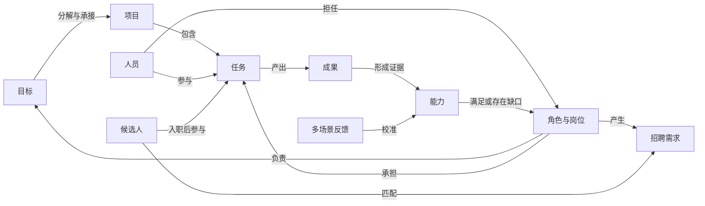
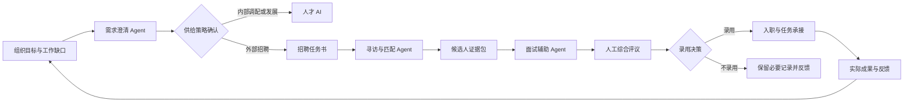
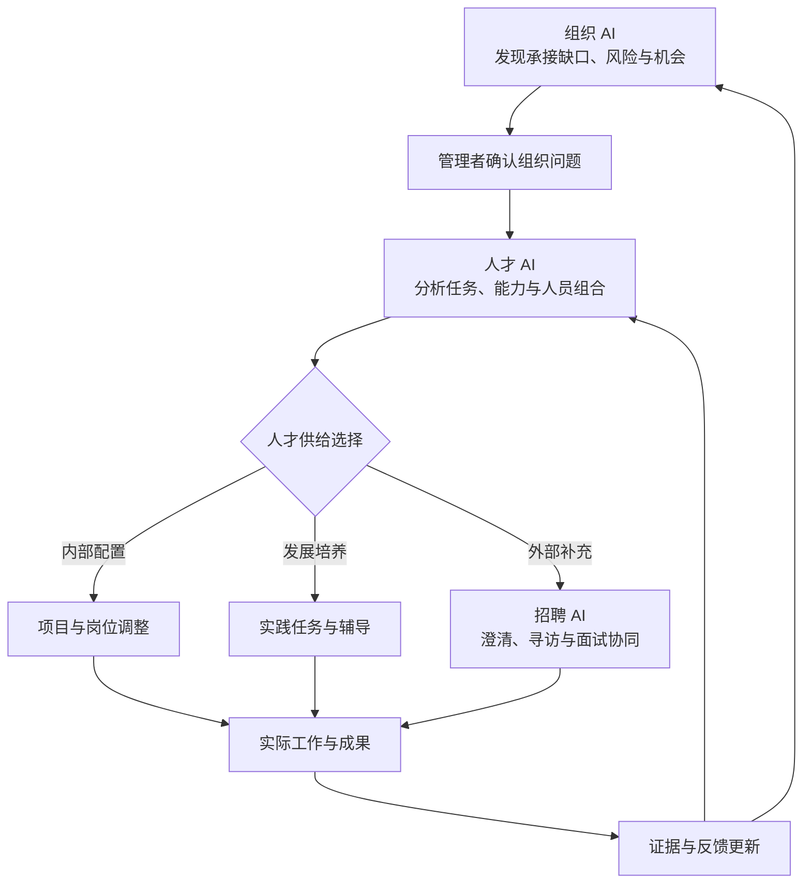

# 从工作数据到组织智能：组织 AI、人才 AI 与招聘 AI 的协同闭环

> 面向管理者、HR 负责人和数字化负责人的组织智能建设框架

## 摘要

企业中的目标、项目、任务、岗位、人才和招聘数据通常分散在不同系统，导致管理者能够看到局部状态，却难以解释组织如何运转。本文结合 People Analytics、数字化协作、任务型劳动分析、人员—环境匹配、技能抽取、算法招聘与 AI 风险治理等研究，提出以“工作事实网络”为共同基础的组织智能框架。框架将组织 AI、人才 AI 与招聘 AI 分别用于识别目标承接、进展风险和协作断点，形成基于实际任务与成果的人岗理解，以及协同完成需求澄清、人才寻访、匹配和面试辅助。本文进一步给出数据对象、证据分层、Agent 流程、系统架构、治理禁区与分阶段实施路径。核心结论是：三类 AI 的价值不在于独立生成评分，而在于以可追溯证据连接组织问题、人才判断与用人行动，同时保留有意义的人工控制和明确的决策责任。

**关键词：** 组织智能；People Analytics；人才管理；算法招聘；AI Agent；工作图谱；负责任 AI

企业正在把 AI 引入目标管理、项目协作、人才盘点和招聘流程。但如果这些应用各自建设，组织 AI 只看到任务状态，人才 AI 只看到简历和标签，招聘 AI 只看到职位描述与候选人材料，它们仍然无法回答管理者真正关心的问题：目标为什么没有被有效承接，项目风险来自资源不足还是协作受阻，某项关键工作需要什么能力，内部是否已有合适人才，外部招聘又应补充什么样的人。

这些问题的共同基础不是更多的模型，而是对组织如何运转形成一套可核验的事实表达。目标、项目、任务、角色、成果、反馈、能力和岗位并非彼此孤立的数据表，它们共同构成一张动态的工作网络。AI 的价值，在于沿着这张网络整理事实、识别关系、提出解释和建议，并把管理者的判断转化为后续行动。

本文提出一个统一视角：**组织 AI、人才 AI 与招聘 AI 不是三个相互独立的助手，而是建立在同一“工作事实网络”上的三类应用。**

- 组织 AI 从目标和工作出发，发现承接关系、进展风险与协作断点；
- 人才 AI 从任务、成果和反馈出发，理解人在具体业务环境中的能力与贡献；
- 招聘 AI 将组织能力缺口转化为可执行的用人需求，并参与寻访、匹配和面试协同；
- 新成员进入组织后的实际工作表现，再回流到组织与人才模型中，形成持续校准的闭环。

这个闭环的目标不是给员工生成一个“万能分数”，也不是让算法替代管理责任，而是让组织决策获得更完整的证据、更清晰的解释和更及时的行动入口。

---

## 一、为什么传统管理数据难以解释组织如何运转

### 1. 数据按系统保存，问题却跨越系统

组织中的数据通常沿管理工具分散：战略和 OKR 在目标系统，里程碑在项目系统，任务在协作工具，岗位和履历在人力资源系统，候选人在招聘系统，反馈则散落在会议、消息、文档和复盘记录中。每个系统都能说明局部状态，却很难共同解释一项业务结果。

例如，一个重点项目延迟可能同时涉及多个事实：上层目标多次调整，关键任务没有明确责任人，依赖团队没有同步资源，岗位所需能力在当前团队中不足，招聘需求又迟迟没有澄清。单看项目红黄灯，只能看到“延期”；把目标、项目、责任和能力连接起来，才可能理解延期的形成过程。

这意味着，组织智能建设不能从一个孤立的 HR 场景或单一报表开始，而应先回答三个基础问题：

1. 组织中有哪些稳定的业务对象，例如目标、项目、任务、岗位、人员和成果？
2. 这些对象之间通过什么关系连接，例如承接、负责、依赖、贡献、评审和匹配？
3. 每个结论来自什么证据，何时产生，由谁确认，当前是否仍然有效？

People Analytics 研究也显示，数据本身并不会自动转化为组织价值；有效实施还依赖分析能力、利益相关者参与、组织惯例和治理机制[1-3]。因此，建设重点不是“把所有数据接进大模型”，而是形成从业务问题、事实证据到管理行动的完整链路。

### 2. 状态记录不等于管理洞察

管理看板擅长汇总已发生的状态，例如目标完成率、任务逾期数、岗位空缺数和招聘周期。但管理者更需要知道：

- 哪些目标没有被项目和任务有效承接；
- 哪些风险正在形成，但尚未表现为里程碑延期；
- 哪些协作关系长期依赖少数关键人员；
- 一个问题是执行不足、资源不足、能力不足，还是目标本身不稳定；
- 内部调配、人才发展和外部招聘中，哪种干预更合适。

从状态到洞察，需要在数据之上增加业务语义、时间关系和因果假设。AI 可以帮助发现模式和生成解释，但解释必须回到可检查的事实，不能把相关性直接包装成因果结论。

### 3. 数字痕迹不能直接等同于贡献

数字化工作会留下大量痕迹：创建了多少任务、参加了多少会议、发送了多少消息、提交了多少文档。这些数据容易获取，却不天然代表工作质量和业务贡献。Aaltonen 与 Stelmaszak 的案例研究发现，当知识工作者知道痕迹数据会被用于监测时，会主动调整自己以及周围人的行为，从而改变数据本身[6]。算法管理还可能通过持续量化强化控制，重塑员工行为和组织权力关系[7]。

因此，组织智能必须坚持一个基本原则：**工作数据是理解组织的证据入口，而不是对人的直接判决。** 任务数量、在线时长和沟通频次只能作为情境信号；真正的贡献判断还需要结合目标难度、角色责任、成果质量、协作影响、外部约束和多方反馈。

---

## 二、共同基础：建立可核验的工作事实网络

### 1. 从数据汇总转向对象与关系

工作事实网络不是把所有系统数据集中到一个仓库后再做搜索，而是建立一套跨系统的业务语义。它至少应包含以下核心对象：

| 对象 | 关键属性 | 典型关系 |
| --- | --- | --- |
| 目标 | 目标层级、周期、衡量标准、状态 | 分解为项目、由角色承接、受指标衡量 |
| 项目 | 范围、里程碑、优先级、健康度 | 支撑目标、包含任务、依赖其他项目 |
| 任务 | 交付物、期限、状态、阻塞原因 | 由人员负责、依赖任务、产生成果 |
| 角色与岗位 | 职责、权限、能力要求、组织位置 | 承接目标、负责工作、需要能力 |
| 人员 | 经历、当前角色、可用性、发展意愿 | 参与项目、完成任务、获得反馈 |
| 成果 | 业务结果、质量标准、验收记录、影响范围 | 对目标作出贡献、证明能力、接受评审 |
| 能力 | 知识、技能、熟练度、适用情境 | 被岗位要求、被工作验证、可被培养 |
| 反馈 | 来源、场景、内容、时间、可信范围 | 评价成果、说明协作、校准能力判断 |
| 招聘需求 | 业务背景、任务使命、约束、优先级 | 来源于能力缺口、对应岗位、匹配候选人 |
| 候选人 | 经历、证据、意愿、限制条件 | 匹配需求、参与面试、形成评价 |

这些对象需要稳定标识、统一时间语义和来源信息。一个项目的名称可能变化，一名员工可能调岗，一项能力的要求也可能随业务阶段改变。系统不仅要知道“是什么”，还要知道“在什么时间、什么上下文中成立”。

图 1：工作事实网络。箭头表达可追溯的业务关系，不代表仅凭关系即可推出因果结论。

### 2. 区分事实、推断、评价与决策

系统中的信息应按证据性质分层管理：

- **观察事实**：来自权威系统或可核验记录，例如里程碑日期、任务负责人、交付物和审批结果；
- **AI 推断**：模型基于多个事实形成的判断，例如“该项目存在跨团队依赖风险”，需要附依据、置信度和适用范围；
- **人工评价**：管理者、同事、客户或面试官作出的专业判断，需要记录评价场景和责任主体；
- **组织决策**：资源调整、晋升、调岗、录用等正式动作，必须由有权主体作出并保留理由。

四类信息不能混写。AI 识别到“疑似能力缺口”，不等于已经确认某人能力不足；一次负面反馈，也不能直接覆盖长期表现。清晰分层能够减少自动化结论被误用，也让后续复核和纠错成为可能。

### 3. 用时间与上下文保持结论有效

人才和组织判断高度依赖情境。同一个人在成熟产品维护中表现稳定，并不必然意味着适合从零到一的探索项目；一个团队在资源充足时形成的交付速度，也不能直接用于资源收缩后的预测。因此，每项能力证据和风险判断都应带有：

- 发生时间与有效周期；
- 所属业务、产品和组织环境；
- 任务复杂度、角色和责任边界；
- 数据来源和确认主体；
- 与结论相反或尚未覆盖的证据。

这使 AI 的输出从静态标签变成“在特定情境下、基于当前证据的可更新判断”。

---

## 三、组织 AI：从工作数据到运行洞察

组织 AI 的核心不是替管理者阅读更多周报，而是把目标、项目、任务和责任连接起来，持续回答三类问题：工作是否被有效承接，进展是否正在偏离，协作是否出现结构性断点。

### 1. 发现目标承接缺口

目标承接分析应沿着“战略目标—部门目标—项目—任务—成果”逐层检查。典型异常包括：

- 目标存在，但没有对应项目、预算或负责人；
- 项目活动很多，却无法说明支撑哪个目标；
- 下级目标与上级目标在衡量口径上不一致；
- 同一目标被多个团队重复承接，但责任边界不清；
- 目标发生变化后，原有项目和任务没有同步调整；
- 关键结果有完成比例，却缺少可验收的成果证据。

AI 可以把这些异常整理为待核实问题，并展示关系路径。例如：“目标 G-17 的关键结果要求在第三季度完成区域试点，但当前关联项目的里程碑落在第四季度，且没有前置试点任务。”这类表达比笼统的“目标有风险”更利于管理者行动。

### 2. 识别进展风险，而不只报告延期

真正有价值的风险识别应发生在结果恶化之前。系统可以综合以下信号：

| 风险类型 | 可观察信号 | 需要补充的判断 |
| --- | --- | --- |
| 计划风险 | 关键路径余量收窄、里程碑频繁后移 | 计划是否合理，是否存在外部不可控因素 |
| 依赖风险 | 前置任务未完成、跨团队响应长期等待 | 依赖是否真实关键，责任人是否已经对齐 |
| 资源风险 | 关键人员并行承担多个高优先级项目 | 是否可重新排序、安排替补或缩小范围 |
| 决策风险 | 方案反复修改、关键决策长期未确认 | 是信息不足、权限不清还是目标冲突 |
| 能力风险 | 同类任务持续返工、专业评审无法通过 | 是能力缺口、需求不清还是标准变化 |
| 协作风险 | 交接次数增加、信息集中于少数节点 | 是否形成单点依赖，是否需要调整机制 |

AI 应提供风险信号、证据链、影响对象和建议核实动作，而不应仅输出一个不可解释的概率。管理者可以确认、驳回或补充原因，这些反馈再用于校准后续识别。

### 3. 定位协作断点和组织机会

协作分析不应以消息数量或会议次数评价个人。更有意义的是观察工作流中的结构关系，例如：

- 哪些交付频繁卡在跨团队交接处；
- 哪些角色承担大量协调，却没有相应决策权限；
- 哪些专家成为多个项目的单点依赖；
- 哪些团队之间存在重复建设或相似问题；
- 哪些临时协作模式已经反复出现，值得固化为正式机制；
- 哪些高质量成果可以被其他团队复用。

数字化协作技术对团队沟通和绩效的影响取决于任务依赖、团队边界与技术使用方式，不能脱离工作设计解释[4]。社会协作分析也更适合作为理解协作模式的框架，而不是把互动频率直接变成员工绩效[5]。

“值得管理者关注的契机”不仅是风险，也包括可放大的正向变化。例如，一个跨部门小组连续解决多项关键问题，可能说明组织中正在形成新的能力中心；某类项目的交付质量显著提高，可能意味着一套新方法值得标准化。组织 AI 应同时发现异常与机会，避免系统只成为风险报警器。

### 4. 组织 AI 的输出形式

组织 AI 的主要交付物可以包括：

- 目标承接地图：展示目标到项目、任务、责任人和成果的路径；
- 风险雷达：按影响、紧迫性和证据强度排列待关注事项；
- 协作断点清单：说明断点位置、持续时间和受影响工作；
- 管理议题摘要：把分散异常归并为资源、能力、决策或机制问题；
- 行动建议：给出需要追问、协调、调整或升级的候选动作；
- 证据包：保留数据来源、时间、规则版本及人工确认记录。

最终决策仍由管理者负责。系统的作用是让管理者更早看到问题、更快理解背景，并减少在多个系统之间人工拼接信息的成本。

---

## 四、人才 AI：从实际贡献到人岗理解

传统人才系统主要保存人员属性，例如学历、履历、职级、证书和培训记录。这些信息有助于建立基础档案，却难以说明一个人在真实业务中解决过什么问题、在什么条件下取得结果，以及下一步适合承担什么任务。人才 AI 的关键转变，是从静态标签转向基于工作证据、业务情境和发展意愿的动态理解。

### 1. 以“任务—能力—情境”连接工作与人才

任务视角认为，岗位可以被拆解为一组需要完成的任务，技术、流程与组织变化会改变任务组合，也会重新定义能力需求[8-9]。因此，人才理解不应只问“这个人属于什么岗位”，还应进一步分析：

- 他实际承担过哪些任务，任务的复杂度、约束和影响范围是什么；
- 他在任务中承担主责、协作、评审还是决策角色；
- 形成了哪些可验收成果，成果质量和业务影响如何；
- 哪些能力被成果支持，哪些仍只是自述或他人判断；
- 这些证据产生于什么业务阶段、团队结构和资源条件；
- 当任务和情境发生变化时，已有经验能否迁移。

据此，能力不应被表达为脱离场景的永久属性，而应被描述为：“在某类任务、某种复杂度和特定业务环境中，已有若干证据表明其能够达到某一表现水平。”这种表达比简单的技能标签更接近组织实际，也更便于识别证据不足和适用边界。

### 2. 建立基于证据、允许更新的人才画像

人才画像可以由多类证据共同构成，但不同证据的权重和含义不能混同。

| 证据类型 | 典型内容 | 主要局限 |
| --- | --- | --- |
| 工作任务 | 负责范围、复杂度、依赖关系、持续时间 | 被分配任务不等于具备相应能力 |
| 成果证据 | 交付物、业务结果、质量评审、客户反馈 | 结果同时受资源、团队和环境影响 |
| 协作证据 | 跨团队贡献、知识复用、问题协调 | 互动数量不能直接代表协作质量 |
| 多场景反馈 | 经理、同事、客户、下属或评审者反馈 | 可能存在近因效应、关系偏差和口径差异 |
| 学习与资质 | 课程、证书、作品、测评结果 | 学习完成不等于已在工作中迁移 |
| 个人意愿 | 职业方向、任务偏好、地点与时间约束 | 意愿会变化，需要本人确认 |

AI 可以进行证据归并、冲突提示和时间衰减处理。例如，系统可以指出“该员工在两个增长项目中承担实验设计并形成可复用方法，但尚缺少大规模商业化阶段的结果证据”，而不是直接给出“增长能力 85 分”。对于推断出的技能，应允许员工和管理者查看来源、补充证据、提出异议并修正。

岗位广告和履历中的技能抽取已经形成较多研究，常见方法包括技能词典、监督学习、语义表示和知识图谱[11-14]。但技能抽取解决的是“文本中提到了什么”，并不自动回答“这个人真实掌握到什么程度”。其中，基于技能—职业图谱进行大模型蒸馏的研究仍属于预印本探索[14]。企业应用需要把文本识别结果与真实任务、成果和人工验证连接起来，避免把关键词命中误当作能力证明。

### 3. 从岗位名称转向岗位使命与关键任务

岗位解析不应从复制历史职位描述开始，而应从业务需要反推岗位设计。一个可执行的岗位模型至少包括：

1. **岗位使命**：岗位要为哪项目标和业务结果负责；
2. **关键任务**：日常、周期性和关键事件中分别要完成什么工作；
3. **成果标准**：什么样的交付物或结果可以证明任务完成；
4. **必要能力**：完成关键任务所需的知识、技能、判断和协作能力；
5. **权限与接口**：岗位拥有哪些决策权，依赖哪些角色，与谁交接；
6. **情境约束**：业务阶段、地域、合规、技术栈、客户类型和资源条件；
7. **可培养与须具备项**：哪些能力必须在上岗前具备，哪些可以通过实践发展。

AI 可以比较岗位定义与真实工作，发现“职位描述强调的内容”和“团队实际需要解决的问题”之间的偏差。当大量关键任务长期由岗位之外的人承担时，问题可能不是员工表现，而是岗位设计、权限配置或人员结构已经不适应业务。

### 4. 支撑排兵布阵，而不是自动分配人

人岗匹配研究表明，匹配并非只有“人与岗位”一个维度，还涉及个人与组织、团队、主管以及具体任务之间的适配[10]。因此，项目组建和内部流动不能只计算技能相似度。人才 AI 应同时呈现：

- 任务要求与已有能力证据的覆盖程度；
- 相似情境经验及其可迁移性；
- 当前负荷、时间窗口和地域限制；
- 团队能力互补性与关键角色备份；
- 个人发展意愿和可能获得的发展价值；
- 已知风险、证据缺口和需要进一步核实的问题。

系统可以生成若干人员组合方案，并解释每种方案的优势、代价与不确定性。例如，方案 A 具备更强的即时交付能力，但关键知识集中在一人；方案 B 的初期磨合成本较高，却能建立长期备份。管理者据此作出选择，同时与相关人员确认意愿和现实约束。对于晋升、淘汰、薪酬等高影响决策，人才 AI 更不应成为未经复核的自动决定工具。

### 5. 形成可验证的人才发展闭环

人才发展应从泛化课程推荐，转向围绕真实任务建立“能力假设—实践任务—成果反馈—证据更新”的闭环：

1. 根据目标岗位或未来任务提出能力假设；
2. 选择风险可控但有挑战度的实践任务；
3. 明确辅导者、资源、成果标准和检查节点；
4. 在实际交付中收集成果与反馈；
5. 更新能力判断，并决定继续发展、扩大责任或调整方向。

这种方法把发展机会嵌入业务，而不是把培训完成率当作成长本身。AI 可以帮助匹配实践任务、提示辅导节点和整理证据，但发展目标需要员工参与确认，组织也必须提供真实机会，不能把“能力不足”全部归因于个人。

---

## 五、招聘 AI：从用人需求到招聘协同

招聘 AI 的起点不应是收到一份固定职位描述后批量筛简历，而应追溯需求为何产生：是新增业务、人员替补、短期项目，还是内部能力结构发生变化；问题能否通过调整目标、流程、人员配置或人才发展解决；如果确实需要外部招聘，最关键的任务和不可妥协条件是什么。

### 1. 需求澄清 Agent：把模糊缺口转化为招聘任务

需求澄清 Agent 可以读取经授权的目标、项目、岗位和团队能力信息，与用人经理进行结构化对话，形成一份可检验的招聘任务书，内容包括：

- 需求对应的业务目标和产生原因；
- 入职后 3 至 12 个月需要完成的关键任务与成果；
- 必须具备、可以培养和仅属加分项的能力；
- 汇报关系、决策权限、协作接口和资源条件；
- 地点、时间、预算、合规等硬约束；
- 内部调配、外部招聘或短期合作等不同供给方案；
- 面试需要验证的核心假设及对应证据。

Agent 的价值在于暴露冲突，而不是自动润色职位描述。例如，用人经理要求“十年经验、能独立负责”，却只赋予执行权限和初级预算，系统应提示岗位责任、权限与薪酬定位不一致。需求在发布前仍需用人经理和 HR 共同确认。

### 2. 寻访与匹配 Agent：从关键词召回转向证据对齐

寻访 Agent 可以把招聘任务书转化为检索策略，在合法授权的数据源中寻找候选人，并将候选人的经历、项目、作品和意愿与关键任务对齐。匹配结果应至少包含：

- 符合项：由哪些材料支持，证据的时间和场景是什么；
- 待验证项：材料中没有充分说明，但可能通过面试或作业验证；
- 冲突项：地点、行业限制、薪酬、时间或职业意愿是否不一致；
- 替代路径：候选人虽不符合传统背景要求，但哪些相邻经验可能迁移；
- 不确定性：资料缺失、来源可信度和模型推断边界。

这一步不宜使用单一总分掩盖不同维度。对于关键条件，可以采用“证据充分、部分支持、未知、存在冲突”等可解释状态。候选人池还应支持来源和筛选结果的群体差异检查，避免历史招聘偏好被模型复制。

### 3. 面试辅助 Agent：让评价围绕同一组工作假设

面试辅助 Agent 可以基于岗位关键任务生成结构化问题和评分锚点，为每位候选人补充针对性追问，并在面试后整理证据。一个完整流程包括：

1. 面试前：把每轮面试对应到需要验证的能力和任务，减少重复提问；
2. 面试中：在获得必要授权的前提下记录要点，提示尚未覆盖的关键问题；
3. 面试后：区分候选人陈述、面试官观察和 AI 总结，要求面试官独立提交评价；
4. 综合评议：展示证据一致处、冲突处和未验证项，避免简单平均评分；
5. 候选人沟通：同步流程状态和必要说明，改善协作与体验。

AI 不应根据面部、声纹、口音、表情或与工作无关的人格推断来判断候选人，也不应生成面试官未表达的评价。录音、转写和分析应取得相应授权，并设置明确的保存期限和访问范围。

图 2：招聘 Agent 工作流。Agent 负责整理、匹配和提示，供给策略、综合评议与录用决定由有权人员确认。

### 4. 研究进展与现实边界

招聘 Agent 已从单点简历筛选扩展到需求分析、候选人匹配、沟通和面试协同。已有研究提出多 Agent 招聘流程，以及引入上下文和解释机制的匹配框架[18-19]。一项 2025 年预印本还报告了 AI 辅助招聘在特定实验设置中的收益[20]，但预印本结果不能直接外推为所有企业场景中的稳定效果。

更成熟的研究结论集中在风险端。算法招聘中的偏差缓解实践常缺少统一定义、充分验证和外部审计[15]；系统性综述表明，算法决策可能在招聘与人才管理中产生或放大歧视[16-17]。因此，企业不能以“模型比人更客观”为建设前提，而应通过岗位相关性、群体差异、解释质量、人工复核和实际入职表现持续检验系统。

---

## 六、三类 AI 如何形成组织智能闭环

三类 AI 的边界可以按问题区分：组织 AI 解释工作系统，人才 AI 理解人在工作中的能力与发展，招聘 AI 解决经确认的外部人才供给。它们共享事实与反馈，但不能互相越权。

图 3：组织 AI、人才 AI 与招聘 AI 的协同闭环。闭环中的每一次判断都应保留证据、责任主体和人工确认状态。

以“产品国际化进展迟缓”为例，组织 AI 先发现多个区域项目重复延期，并定位到合规评审和本地化交付两个共同断点。管理者确认这不是单个项目执行问题，而是跨区域能力与机制不足。人才 AI 随后分析团队承担过的相关任务和成果，发现内部已有一名具备东南亚交付经验的项目负责人，但缺少欧盟数据合规的深度能力。

此时，组织可以先调整项目责任、建立区域交付模板，并为内部负责人安排更大范围的实践任务；对无法通过短期发展补齐的合规能力，再由招聘 AI 形成外部需求。需求澄清 Agent 将“招聘国际化人才”改写为具体使命：在六个月内建立目标市场的数据合规评审机制，完成两项产品的准入支持，并培养内部接口人。候选人入职后的任务成果继续进入工作事实网络，用于检验当初的岗位假设和匹配判断。

这个案例说明，招聘不是所有组织问题的默认答案。只有当组织机制、内部配置和人才发展方案都被纳入比较时，外部招聘才是一个被证据支持的供给选择。

---

## 七、系统架构：从数据连接到可治理的 Agent

一个可持续的组织智能平台可以分为五层。分层的目的不是追求技术复杂度，而是确保原始事实、模型推断、流程动作和组织决策彼此可区分、可追溯。

### 1. 数据源层

数据源包括目标、项目、任务、文档、会议、审批、HR、学习、招聘和业务结果系统。接入时应建立数据目录、责任人、更新频率、质量规则和合法使用范围。并非所有可获得的数据都应接入；私人消息、非工作信息和高敏感数据必须经过更严格的必要性评估。

### 2. 语义与证据层

这一层将分散记录映射为目标、项目、任务、人员、岗位、成果、能力、反馈和候选人等对象，并维护对象之间的关系。每条事实需要保留来源、时间、授权状态和版本；每项推断需要保留输入证据、模型或规则版本、置信信息和人工确认结果。

知识图谱或关系模型可以支持跨对象查询，但不应把所有关系都解释为因果关系。对文档和对话等非结构化内容，可采用检索增强生成辅助理解；生成内容必须引用原始片段，并遵守原数据权限，防止检索结果越权暴露。

### 3. 分析与模型层

该层组合规则、统计模型、图分析、优化模型和大语言模型：规则用于明确约束和异常检查，统计模型用于趋势与风险估计，图分析用于承接和依赖关系，大语言模型用于语义抽取、证据归纳与交互。不同问题应选择可验证的最小模型，不必让大语言模型承担全部判断。

模型输出应包含证据覆盖度、反例、适用范围和不确定性。对于人才匹配、候选人筛选等高影响场景，还要进行群体差异、稳健性和漂移测试，并提供人工纠错机制。

### 4. Agent 与流程层

Agent 负责在权限范围内组织多步工作，例如收集项目事实、生成风险核实清单、发起需求澄清、准备面试问题或提醒责任人补充信息。每个 Agent 都应有明确的目标、可用工具、数据边界、停止条件和升级规则。

可以自动执行的动作应限制在低风险、可撤销的范围，例如生成草稿、创建待确认事项和发送提醒。岗位发布、候选人淘汰、录用、调岗、晋升和资源重配等动作必须经过有权人员确认，且系统应记录确认人和理由。

### 5. 交互与治理层

不同角色需要不同视图：管理者看到组织问题与证据链，HR 看到岗位和人才供给，员工看到与本人相关的画像、来源和纠错入口，招聘团队看到候选人流程与评价依据，治理人员看到访问、模型和决策审计记录。系统默认遵循最小权限，并支持敏感字段遮蔽、用途限制、留存期限和访问告警。

### 6. 用多维评测代替单一“准确率”

组织智能系统的评测至少应覆盖五类指标：

| 评测维度 | 代表性指标 |
| --- | --- |
| 业务有效性 | 风险提前发现时间、承接问题关闭率、岗位需求返工率、招聘周期与入职后任务达成情况 |
| 模型质量 | 事实抽取准确性、证据引用正确率、风险识别精确率与召回率、匹配结果校准度 |
| 人机协同 | 建议采纳与驳回原因、人工修订幅度、关键流程漏审率、使用者理解度 |
| 公平与治理 | 不同群体的入选率和错误率差异、申诉处理时长、越权访问数、敏感数据使用合规率 |
| 系统运行 | 数据新鲜度、链路完整率、响应时间、成本、可用性与模型漂移 |

业务指标不能孤立解释。例如招聘周期缩短，可能来自筛选标准放松；建议采纳率很高，也可能是使用者过度依赖系统。评测需要结合质量、公平和长期结果，并通过对照试点、抽样复核和定期审计形成证据。

---

## 八、治理边界：组织智能首先是责任系统

组织与人才数据直接影响员工和候选人的机会。技术可行不等于用途正当。治理不能在系统上线后补充一份说明，而应进入数据接入、模型设计、流程权限和效果评测的每个阶段。

### 1. 明确目的并执行最小必要

每个场景应有具体目的，例如“发现项目依赖风险”或“验证候选人是否具备某项关键任务经验”，而不是笼统地声明“提升管理效率”。只有对该目的必要、相关且合法的数据才能被处理。用途发生变化时，需要重新评估，而不能把原本用于协作的数据无条件转为绩效或招聘决策依据。

### 2. 保留有意义的人工控制

“有人点击确认”不等于有效的人类监督。审核者需要能够理解建议依据，看到不确定性和替代选项，有时间提出异议，并有实际权限改变结果。系统还应监测自动化偏见，即使用者是否因为 AI 给出建议而减少独立判断。

### 3. 保障公平、透明、纠错与安全

公平治理需要从岗位相关性开始：使用的特征是否与工作任务直接相关，历史标签是否包含旧有偏见，模型对不同群体的错误是否集中。透明不要求向所有人公开模型源代码，但应让受影响者知道数据用途、主要判断依据、人工责任主体以及如何提出异议。安全措施则包括身份鉴别、最小权限、加密、日志、隔离、供应商管理和事件响应。

中国《个人信息保护法》第二十四条要求利用个人信息进行自动化决策时保证透明、公平、公正，不得在交易条件上实行不合理差别待遇，并对信息推送和商业营销规定了相应选择权；第五十五条将利用个人信息进行自动化决策等活动纳入个人信息保护影响评估范围[21]。企业在部署人才匹配、筛选和评价能力时，应结合具体处理活动评估合法性基础、敏感个人信息、告知同意、个人权利和影响评估要求，而不能仅依赖产品层面的“AI 声明”。

NIST AI 风险管理框架以 Govern、Map、Measure、Manage 四类职能组织 AI 风险管理，强调治理应贯穿系统生命周期[22]。欧盟 AI Act 将就业、人员管理和自雇准入中的若干 AI 用途列为高风险场景，并设置风险管理、数据治理、技术文档、记录、透明度、人类监督、准确性和安全等要求[23]。跨地域企业需要根据实际角色、用途和适用时间表进行法律评估。

### 4. 设置明确禁区

以下做法原则上不应进入组织智能系统：

- 以消息数、在线时长、会议次数等代理指标生成通用员工排名；
- 推断与工作无关的健康、情绪、政治观点或其他敏感特征；
- 仅凭 AI 输出自动淘汰候选人或作出晋升、解雇决定；
- 使用来源不明、未经授权或超过必要留存期的数据训练和分析；
- 隐瞒模型局限，或把概率性推断作为确定事实呈现；
- 因员工或候选人行使查询、更正、解释和申诉权而给予不利待遇。

禁区需要转化为产品限制、权限规则和审计测试，而不能只停留在制度文本中。

---

## 九、实施路径：从一个管理问题开始

组织智能不适合以“汇聚全公司所有数据”为第一步。更稳妥的方式，是选择一个重要、边界清晰且能够人工核验的问题，在真实管理流程中验证价值和风险。

### 阶段一：建立共同语言与试点边界

选择一个目标明确的场景，例如重点项目的目标承接与跨团队依赖。定义核心对象、关系、权威数据源、责任人和成功指标，完成隐私与影响评估。试点初期优先使用结构化事实和明确规则，避免一开始接入大量消息或构建复杂个人画像。

### 阶段二：形成“发现—判断—行动”闭环

让组织 AI 生成少量高价值议题，由管理者确认原因并采取行动。记录哪些提示有效、哪些是误报、管理者补充了什么上下文，以及行动后风险是否缓解。只有当系统能进入例会、项目评审或资源协调等现有机制，洞察才真正成为组织能力。

### 阶段三：扩展人才与招聘场景

当工作对象和证据链较稳定后，再将关键任务映射到岗位和能力，支持内部人才发现、项目组建和发展任务。对于经确认需要外部补充的缺口，接入招聘需求澄清、寻访和面试辅助。扩展过程中始终验证原始目的，避免工作协作数据被无边界转用于个人评价。

### 阶段四：建立组织级治理与持续校准

成立由业务、HR、数据、法务、安全和员工代表参与的治理机制，维护场景清单、风险分级、模型登记、评测标准和申诉流程。定期复核岗位变化、数据漂移、群体差异、供应商版本和实际业务结果。系统退出、模型停用和历史数据删除也应有明确方案。

一个场景是否可以扩大，应至少满足四项条件：事实链路基本完整，使用者能理解并复核输出，业务结果有可重复的改善证据，公平与隐私风险处于可接受且可管理范围。任何一项不满足，都应先修正设计，而不是依靠扩大使用规模来弥补。

---

## 十、结语

组织 AI、人才 AI 和招聘 AI 的共同价值，不在于分别增加一个对话入口，而在于把组织问题、工作事实、人才证据和供给行动连接起来。组织 AI 让管理者看见目标如何被承接、风险在哪里形成；人才 AI 让岗位和人员理解回到真实任务、成果与情境；招聘 AI 则把经过确认的能力缺口转化为可协同、可解释的招聘流程。

这套体系成立的前提，是始终区分事实与推断、建议与决策、效率与正当性。AI 可以扩大管理者的观察范围，减少信息整理成本，并提出过去难以及时发现的问题；它不能替代管理者解释业务背景、承担用人责任，也不能把复杂的人简化为一个分数。

真正成熟的组织智能，不是“系统知道所有人做了什么”，而是组织能够在必要、合规的边界内，用可靠证据理解工作如何发生，及时发现需要干预的风险与机会，并让每一次组织和人才决策都更清楚、更可复核，也更尊重人的主体性。

### 研究与应用局限

本文提出的是面向企业建设的综合框架，不代表三类 AI 已具有统一、成熟的行业实现。现有研究跨越信息系统、人力资源管理、劳动经济学和计算机科学，不同研究的任务、样本与评价口径差异较大。尤其是大语言模型招聘 Agent 和技能推断领域，部分结果来自原型系统、研讨会论文或预印本，长期效度与跨组织可迁移性仍需验证。

此外，工作成果并不完全由个人能力决定，数字化系统也无法覆盖非正式协调、隐性知识、机会差异和外部环境。企业应把本文框架视为可检验的设计假设，通过小范围试点、参与式设计、持续评测和独立审计逐步校准，而不是直接转化为统一的人才评分体系。

---

## 参考文献

[1] Marler, J. H., & Boudreau, J. W. (2017). An evidence-based review of HR Analytics. *The International Journal of Human Resource Management, 28*(1), 3-26. https://doi.org/10.1080/09585192.2016.1244699

[2] Tursunbayeva, A., Di Lauro, S., & Pagliari, C. (2018). People analytics: A scoping review of conceptual boundaries and value propositions. *International Journal of Information Management, 43*, 224-247. https://doi.org/10.1016/j.ijinfomgt.2018.08.002

[3] Wang, L., Zhou, Y., Sanders, K., Marler, J. H., & Zou, Y. (2024). Determinants of effective HR analytics implementation: An in-depth review and a dynamic framework for future research. *Journal of Business Research, 170*, 114312. https://doi.org/10.1016/j.jbusres.2023.114312

[4] Lane, J. N., Leonardi, P. M., Contractor, N. S., & DeChurch, L. A. (2024). Teams in the digital workplace: Technology's role for communication, collaboration, and performance. *Small Group Research, 55*(1), 139-183. https://doi.org/10.1177/10464964231200015

[5] Schwade, F. (2021). Social collaboration analytics framework: A framework for providing business intelligence on collaboration in the digital workplace. *Decision Support Systems, 148*, 113587. https://doi.org/10.1016/j.dss.2021.113587

[6] Aaltonen, A., & Stelmaszak, M. (2024). The performative production of trace data in knowledge work. *Information Systems Research, 35*(3), 1448-1462. https://doi.org/10.1287/isre.2019.0357

[7] Kellogg, K. C., Valentine, M. A., & Christin, A. (2020). Algorithms at work: The new contested terrain of control. *Academy of Management Annals, 14*(1), 366-410. https://doi.org/10.5465/annals.2018.0174

[8] Autor, D. H. (2013). The “task approach” to labor markets: An overview. *Journal for Labour Market Research, 46*, 185-199. https://doi.org/10.1007/s12651-013-0128-z

[9] Autor, D. H., & Handel, M. J. (2009). Putting tasks to the test: Human capital, job tasks, and wages. *NBER Working Paper No. 15116*. https://doi.org/10.3386/w15116

[10] Kristof-Brown, A. L., Zimmerman, R. D., & Johnson, E. C. (2005). Consequences of individuals' fit at work: A meta-analysis of person-job, person-organization, person-group, and person-supervisor fit. *Personnel Psychology, 58*(2), 281-342. https://doi.org/10.1111/j.1744-6570.2005.00672.x

[11] Khaouja, I., Kassou, I., & Ghogho, M. (2021). A survey on skill identification from online job ads. *IEEE Access, 9*, 118134-118153. https://doi.org/10.1109/ACCESS.2021.3106120

[12] Shi, B., Yang, J., Guo, F., & He, Q. (2020). Salience and market-aware skill extraction for job targeting. In *Proceedings of the 26th ACM SIGKDD International Conference on Knowledge Discovery & Data Mining*, 2871-2879. https://doi.org/10.1145/3394486.3403338

[13] Kavas, H., Serra-Vidal, M., & Wanner, L. (2025). Multilingual skill extraction for job vacancy-job seeker matching in knowledge graphs. In *Proceedings of the Workshop on Generative AI and Knowledge Graphs (GenAIK)*, 146-155. https://aclanthology.org/2025.genaik-1.15/

[14] Pezeshkpour, P., Iso, H., Lake, T., Bhutani, N., & Hruschka, E. (2023). Distilling large language models using skill-occupation graph context for HR-related tasks. *arXiv preprint arXiv:2311.06383*. https://arxiv.org/abs/2311.06383

[15] Raghavan, M., Barocas, S., Kleinberg, J., & Levy, K. (2020). Mitigating bias in algorithmic hiring: Evaluating claims and practices. In *Proceedings of the 2020 Conference on Fairness, Accountability, and Transparency*, 469-481. https://doi.org/10.1145/3351095.3372828

[16] Köchling, A., & Wehner, M. C. (2020). Discriminated by an algorithm: A systematic review of discrimination and fairness by algorithmic decision-making in the context of HR recruitment and HR development. *Business Research, 13*, 795-848. https://doi.org/10.1007/s40685-020-00134-w

[17] Fabris, A., Baranowska, N., Dennis, M. J., Graus, D., Hacker, P., Saldivar, J., Zuiderveen Borgesius, F., & Biega, A. J. (2025). Fairness and bias in algorithmic hiring: A multidisciplinary survey. *ACM Transactions on Intelligent Systems and Technology, 16*(1), 1-54. https://doi.org/10.1145/3696457

[18] Gan, C., Zhang, Q., & Mori, T. (2024). Application of LLM agents in recruitment: A novel framework for automated resume screening. *Journal of Information Processing, 32*, 881-893. https://doi.org/10.2197/ipsjjip.32.881

[19] Lo, F. P.-W., Qiu, J., Wang, Z., Yu, H., Chen, Y., Zhang, G., & Lo, B. (2025). AI hiring with LLMs: A context-aware and explainable multi-agent framework for resume screening. In *Proceedings of the IEEE/CVF Conference on Computer Vision and Pattern Recognition Workshops*, 4223-4232. https://www.openaccess.thecvf.com/content/CVPR2025W/MEIS/html/Lo_AI_Hiring_with_LLMs_A_Context-Aware_and_Explainable_Multi-Agent_Framework_CVPRW_2025_paper.html

[20] Aka, A., Palikot, E., Ansari, A., & Yazdani, N. (2025). Better together: Quantifying the benefits of AI-assisted recruitment. *arXiv preprint arXiv:2507.08029*. https://arxiv.org/abs/2507.08029

[21] 全国人民代表大会常务委员会. (2021). 《中华人民共和国个人信息保护法》. https://www.gov.cn/xinwen/2021-08/20/content_5632486.htm

[22] National Institute of Standards and Technology. (2023). *Artificial Intelligence Risk Management Framework (AI RMF 1.0)*. https://www.nist.gov/itl/ai-risk-management-framework

[23] European Commission. (n.d.). *AI Act Service Desk: Employment*. https://ai-act-service-desk.ec.europa.eu/en/employment-0
