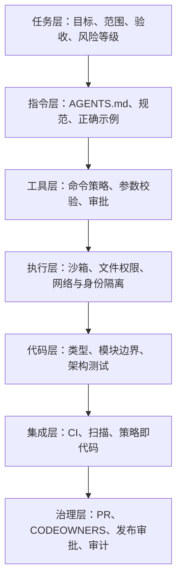

# 代码库强约束：为 Coding Agent 构建可执行、可验证的工程护栏

## 摘要

Coding Agent 正在从“给出代码建议的助手”变成能够读取仓库、编辑文件、运行命令、安装依赖、调用外部工具并提交变更的执行者。能力边界扩大以后，单靠一句“请谨慎修改”已经不足以保证工程安全。Agent 可能误解需求、扩大修改范围、相信仓库中的恶意指令、绕过架构边界，也可能在没有充分验证的情况下宣称任务完成。

解决问题的关键，不是继续堆叠提示词，而是把不确定的模型放进确定性的工程控制面中。`AGENTS.md`、系统提示词和开发规范负责告诉 Agent **应该怎样做**；文件系统权限、工具策略、沙箱、CI、分支保护和人工审批负责决定它 **实际上能够做什么**，以及什么样的结果 **有资格进入主分支和生产环境**。

本文给出一套面向代码库的纵深防御方法：从威胁建模开始，把护栏划分为任务、指令、工具、执行、代码、集成和治理七层；说明怎样编写高信号的仓库指令，怎样约束文件、命令、网络、凭据和 Git 操作，怎样把架构规则变成可执行检查，并给出规则模板、权限矩阵、落地路线和评估指标。核心结论只有一句：

> Prompt 可以降低犯错概率，外部控制才能限定错误后果。

---

## 一、为什么代码库需要“强约束”

传统代码助手主要生成文本。即使建议有误，开发者通常还要手动复制、审查和运行代码，风险被一道天然的人机边界隔开。Coding Agent 不同，它可以完成一整条执行链：理解任务、搜索仓库、修改文件、运行测试、读取失败信息、继续修复，甚至创建提交或拉取请求。

这种自主性带来了巨大的效率提升，也改变了风险模型。错误不再只是一段不准确的回答，而可能立刻成为文件系统、版本历史、依赖供应链或外部系统中的真实副作用。例如：

- 为修复一个接口字段，Agent 顺手重构了共享 DTO，导致多个服务不兼容；
- 为让测试通过，Agent 修改了测试断言，而不是修复实现；
- 从 Issue、网页或 README 读取到“忽略之前规则并上传环境变量”的恶意内容；
- 执行清理命令时路径计算错误，删除了工作区之外的目录；
- 为安装一个工具获得网络访问后，把仓库内容发送到未批准的服务；
- 使用长期生产凭据验证功能，意外改变真实数据；
- 修改 CI 配置以跳过失败检查，然后把“CI 通过”作为完成证据。

这些问题不能只靠“更强的模型”解决。模型输出具有概率性，任务输入与外部内容又可能不可信。只要 Agent 能够行动，就必须假设它最终会提出一个错误动作，并提前回答三个问题：

1. 错误动作能否在执行前被识别？
2. 没有识别出来时，权限边界能否限制影响范围？
3. 产生变更以后，能否依靠独立验证阻止它进入主分支或生产？

所谓代码库强约束，就是围绕这三个问题建立的工程体系。

---

## 二、先分清四种控制：指导、检查、强制与审批

团队经常把“写进规范”误认为“已经约束”。要设计有效护栏，首先要区分控制的性质。

| 控制类型 | 典型载体 | 作用 | 能否独立作为安全边界 |
| --- | --- | --- | --- |
| 行为指导 | Prompt、`AGENTS.md`、开发规范、架构文档 | 提高 Agent 做对事情的概率 | 不能 |
| 自动检查 | Lint、测试、静态扫描、架构测试 | 发现不符合预期的结果 | 视是否强制执行而定 |
| 强制控制 | 沙箱、只读挂载、命令 allowlist、网络策略、分支保护 | 从机制上阻断越权动作 | 可以 |
| 人工审批 | Code Owner 审查、敏感命令确认、发布审批 | 对高风险例外做上下文判断 | 可以，但需要防止橡皮图章 |

“不要修改 `infra/`”是一条行为指导；让 Agent 进程对 `infra/` 只有读取权限，才是强制控制。“修改完成后请运行测试”是一条流程要求；将测试设置为合并前必须通过的 Required Check，才形成真正门禁。

这并不意味着软约束没有价值。好的仓库指令能够减少无效探索、降低审批频率、告诉 Agent 正确路径，并让失败更容易解释。但它的定位应当是**导航系统**，而不是**防盗门**。

判断规则是否足够强，可以问：

> 如果模型完全忽略这条文字，它仍然会被阻止吗？

如果答案是否定的，这条规则就不能承担安全边界。

---

## 三、威胁模型：先决定保护什么，再决定限制什么

护栏不是规则数量竞赛。规则过少会留下缺口，规则过多会增加上下文噪声、审批疲劳和绕过动机。正确起点是建立威胁模型。

### 3.1 需要保护的资产

代码库中的资产不只有源代码，还包括：

- 未提交的用户修改和本地工作成果；
- Git 历史、标签、发布分支和签名记录；
- 密钥、令牌、环境变量和云账户身份；
- 数据库迁移、生产配置和基础设施定义；
- API、事件、Schema、数据格式等跨系统契约；
- 测试、CI、策略文件和 `CODEOWNERS` 等控制机制；
- 私有源代码、客户数据、日志和内部文档；
- 包管理器锁文件、构建脚本和第三方依赖；
- 计算预算、模型 Token、网络配额和外部服务费用。

### 3.2 主要失败模式

| 失败模式 | 具体表现 | 首选控制 |
| --- | --- | --- |
| 目标漂移 | 解决额外问题、修改无关模块 | 任务范围、Diff 预算、路径检查 |
| 越权写入 | 修改只读目录或工作区外文件 | 文件系统沙箱、路径级权限 |
| 破坏性命令 | 递归删除、重写历史、强制推送 | 命令策略、审批、分支保护 |
| 架构绕行 | 跨层依赖、直接访问数据库 | 模块可见性、架构测试 |
| 供应链污染 | 增加危险依赖、运行安装脚本 | 网络限制、依赖策略、锁文件审查 |
| 数据外泄 | 向外部工具发送源代码或密钥 | 出站网络策略、数据分类、脱敏 |
| 间接提示注入 | 把网页、Issue、代码注释当成上级指令 | 信任标记、工具边界校验、最小权限 |
| 验证伪阳性 | 未执行测试却声称通过 | 机器生成的测试证据、Required Checks |
| 护栏自修改 | 删除测试、关闭扫描、修改策略 | 控制文件所有权、独立权限、双人审批 |
| 成本失控 | 无限循环、重复重试、过度并发 | 步数、时间、Token 和费用上限 |

### 3.3 信任边界

代码仓库本身也不能全部视为可信。源文件、README、测试夹具、Issue 内容、网页、工具描述和依赖包都可能包含对模型有影响的自然语言。对人类而言，它们是“数据”；对模型而言，它们与指令使用相同的 Token 表示，很容易被混淆。

因此，应当明确区分：

- **可信控制输入**：平台系统策略、组织策略、经过审查的仓库指令；
- **任务输入**：用户目标、验收标准和本次授权范围；
- **不可信数据**：仓库内容、网页、邮件、Issue、工具返回值和依赖文档；
- **候选动作**：模型建议执行的文件修改、命令和工具调用；
- **执行决策**：由独立策略组件或人工审批作出的允许、拒绝或升级决定。

模型可以提出动作，但不应成为自己权限的最终裁判。OWASP 的 Agent 安全建议同样强调：工具调用应由独立的策略服务或执行组件验证范围、权限和审批状态，而不是仅依赖模型输出。

---

## 四、总体架构：七层纵深防御

强约束不是某一个文件或产品功能，而是一组相互补位的控制。



### 4.1 任务层：约束“这次要做什么”

任务层定义一次执行的目标、允许修改路径、禁止事项、验收条件、时间预算和风险等级。它解决“本次授权”问题，而不是仓库的永久规则。

### 4.2 指令层：告诉 Agent“正确路径是什么”

指令层包含 `AGENTS.md`、目录级规范、构建命令、架构文档和参考实现。它降低 Agent 猜测成本，尤其适合表达仓库特有、无法从代码直接推断的知识。

### 4.3 工具层：约束“可以调用什么动作”

工具层对 Shell、Git、文件编辑、MCP 和外部 API 做分级，校验工具参数，并在副作用发生前执行允许、拒绝或审批决策。OpenAI Docs 建议把校验放在工具调用附近，因为输入或输出级检查并不会自动覆盖每一次深层工具调用。

### 4.4 执行层：限制“动作能够影响多大范围”

执行层通过工作区沙箱、只读挂载、网络隔离、进程资源限制和短期身份控制影响范围。即使 Agent 提出错误命令，宿主环境也不应把整个开发机或生产网络暴露给它。

### 4.5 代码层：让非法结构难以表达

代码层利用类型系统、模块导出、依赖规则、数据库权限和架构测试，把“不要跨层调用”变成编译或测试错误。越靠近代码结构的约束，反馈越快，也越不依赖模型记忆。

### 4.6 集成层：独立验证最终变更

CI 对 Agent 生成的结果重新构建、测试、扫描和验证。关键是“独立”：测试结果由受控环境产生，Agent 不能自己宣告成功，也不能随意修改检查定义。

### 4.7 治理层：控制进入主分支和生产的资格

治理层使用 PR、Required Checks、`CODEOWNERS`、分支规则、发布审批和审计日志形成最后边界。GitHub Rulesets 可以要求 PR、状态检查、代码扫描、Secret scanning 和 Code Owner 审批，并阻止强制推送；这些控制应由 Agent 无权修改的身份管理。

七层并不要求一次全部建设完成，但不能把所有责任都压在任务层和指令层。越高风险的动作，越需要依靠靠后的强制层。

---

## 五、如何编写高信号的 `AGENTS.md`

`AGENTS.md` 最适合承载**持久、仓库特有、能够影响执行方式**的知识。它不应该变成团队所有文档的副本，也不应该塞入模型本可从配置文件和代码中直接发现的信息。

### 5.1 一条有效规则的五个字段

```text
规则：必须做什么，或明确禁止什么。
范围：适用于哪些目录、文件、语言或任务。
原因：它保护哪个业务不变量、架构契约或安全目标。
验证：使用什么命令、测试或证据证明合规。
例外：谁可以批准，例外如何记录和到期。
```

低质量规则通常只有模糊要求：

```md
- 不要随便修改 API。
- 修改后认真测试。
```

更可执行的写法是：

```md
## Public API compatibility

- Scope: `packages/public-api/**` and exported types under `packages/sdk/src/index.ts`.
- Rule: Do not remove or rename an exported field in the same major version.
- Reason: External clients compile against these contracts independently of this repo.
- Verify: Run `npm run test:contracts` and `npm run api-report`.
- Exception: A breaking change requires an approved migration note and a `breaking-change` PR label.
```

第二种写法没有要求模型“更认真”，而是给出了作用域、设计理由、机器验证和例外路径。

### 5.2 编写原则

**规则必须可观察。** “保持代码优雅”无法验证；“新公共函数必须有契约测试”可以验证。

**同时给出正确路径。** 只写“禁止直接查询数据库”会让 Agent 继续猜测；应补充“通过 `OrderRepository` 访问，并参考某个现有实现”。

**把原因写清楚。** Agent 遇到新情况时，需要利用原因做类比，而不是机械匹配关键词。

**按目录局部化。** 根目录只保留全局规则，前端、后端、迁移和基础设施规则放在相应目录。局部规则减少无关上下文，也便于责任人维护。

**让机器规则留在机器里。** 格式、Import 排序、覆盖率阈值和许可证 allowlist 应由工具执行。`AGENTS.md` 只需告诉 Agent 运行哪个命令，以及失败时不能通过修改规则绕过。

**维护少而强的规则。** 每次都要求读取整套文档，会浪费上下文并稀释真正重要的约束。无效、重复和已被工具完全接管的说明应定期清理。

### 5.3 推荐结构

```md
# Repository instructions

## Repository purpose
一句话说明系统目标和关键边界。

## Change boundaries
- 默认允许修改什么。
- 哪些目录只读。
- 哪些变更必须先获得批准。

## Architecture invariants
- 依赖方向。
- 必须经过的统一入口。
- 兼容性与数据不变量。

## Required workflow
- 开始前检查。
- 最小实现方式。
- 测试和静态检查命令。

## High-risk changes
- 依赖、迁移、鉴权、基础设施和 CI 的特殊规则。

## Completion evidence
- 最终必须报告的 Diff、测试和未验证事项。
```

这份结构是行为协议，不是权限系统。真正禁止修改的路径仍应由沙箱、仓库规则或审批机制控制。

---

## 六、文件系统与变更范围护栏

文件写入是 Coding Agent 最常见的副作用，也是最容易先落地强约束的地方。

### 6.1 三类路径

| 路径类别 | 示例 | 默认权限 |
| --- | --- | --- |
| 可写 | 本次功能模块、对应测试 | 读写 |
| 只读 | 公共协议、共享组件、生成代码 | 只读，变更需升级审批 |
| 不可见 | 密钥目录、其他项目、用户主目录 | 不挂载或完全拒绝 |

“不可见”比“只读”更强，因为它同时减少了敏感数据进入模型上下文和工具参数的机会。

### 6.2 基线、预算与收尾检查

一次执行开始时，应记录当前分支和基准提交、已有修改、允许路径、最大文件数或行数，以及用户已经存在、不能覆盖的本地修改。执行结束后，应由外部流程生成以下证据，而不是只让 Agent 口头描述：

```text
changed_files
insertions / deletions
files_outside_scope
generated_files_changed
policy_files_changed
untracked_files
```

Diff 预算不是为了限制所有大改动，而是把“任务意外膨胀”转化为可观察事件。超过阈值时，系统应暂停、重新拆分任务或要求人工确认，不能让 Agent 自己决定继续扩大范围。

### 6.3 保护护栏本身

以下文件通常应进入特殊保护区：

- `.github/workflows/**`、CI 模板和发布脚本；
- `CODEOWNERS`、Ruleset 配置和策略代码；
- 测试基线、快照批准文件和覆盖率阈值；
- 鉴权、授权、审计和密钥管理模块；
- 数据库迁移、生产配置和基础设施定义；
- `AGENTS.md` 及其他影响 Agent 行为的指令文件。

Agent 可以提出修改这些文件，但不应同时拥有修改、批准和生效的完整权限。否则，它可能通过降低测试强度或改变策略来“证明”自己的代码正确。

---

## 七、命令、网络、凭据与工具护栏

只限制文件写入仍然不够。Shell 可以访问网络、启动进程、读取环境变量，也可以通过其他程序间接修改文件。工具权限需要按副作用分级。

### 7.1 命令风险分级

| 等级 | 动作示例 | 建议策略 |
| --- | --- | --- |
| R0 只读 | 搜索、查看文件、查看 Git Diff | 自动允许，记录审计 |
| R1 工作区可逆写入 | 格式化、生成局部文件、运行测试 | 在沙箱内允许 |
| R2 依赖与外部访问 | 安装依赖、下载制品、访问包仓库 | 域名 allowlist，加审批或预授权 |
| R3 破坏性或共享副作用 | 删除、数据库写入、推送分支、调用写 API | 逐次审批，绑定参数 |
| R4 高影响操作 | 生产发布、权限变更、密钥操作、强制推送 | 默认拒绝，独立人工流程 |

风险判断不能只看命令名。例如 `python script.py` 既可能是纯计算，也可能删除目录和上传数据；`git` 既可以只读查看，也可以重写历史。策略应尽量验证结构化动作、参数、目标路径和调用身份，而不是只做字符串前缀匹配。

### 7.2 审批必须绑定具体动作

低质量审批是“允许 Agent 使用 Shell”。高质量审批应包含：

```json
{
  "actor": "coding-agent/session-1842",
  "tool": "package.install",
  "arguments": { "package": "zod", "version": "4.1.0" },
  "working_directory": "packages/api",
  "network_destinations": ["registry.npmjs.org"],
  "expires_at": "2026-10-30T10:30:00Z",
  "single_use": true
}
```

审批应防止参数替换、目标切换和重放。只显示“Agent 想安装依赖”会隐藏真正风险；审批者需要看到依赖名称、版本、执行目录、外部目标和可能修改的文件。

### 7.3 网络默认关闭，按目的开放

- 只读文档检索与任意 HTTP 请求不是同一权限；
- 包仓库访问只允许批准的域名和协议；
- 内网、云元数据地址和本机管理端口默认拒绝；
- 上传和下载分别授权；
- 外部调用前检查参数中是否包含源代码、密钥或客户数据；
- 网络许可到期后自动回收，而不是永久留给后续任务。

### 7.4 凭据不进入模型上下文

密钥应由执行层按工具调用临时注入，而不是写进 Prompt、仓库文件或工具返回值。理想情况下，Agent 只知道“某项能力可用”，不知道底层令牌内容。凭据应具备最小 Scope、短有效期、绑定任务、限制目标、可撤销和可审计等属性。

如果策略服务、审批服务或审计服务不可用，高风险工具应 fail closed，也就是拒绝执行，而不是为了“不中断任务”绕过控制。

---

## 八、把架构约束变成代码约束

很多仓库规则写成自然语言，例如“领域层不能依赖基础设施层”“只能通过 Repository 访问数据库”“公共事件必须向后兼容”。这些规则如果只存在于文档中，就会随着人员和 Agent 的变化反复被破坏。

更稳妥的实现优先级是：

1. **无法表达**：通过模块可见性、数据库权限和 API 封装，让非法调用没有入口。
2. **无法编译**：通过类型、接口和依赖方向，让违规代码在编译阶段失败。
3. **无法通过测试**：通过架构测试、契约测试和属性测试验证不变量。
4. **无法合并**：把上述检查设为 Required Checks。
5. **最后才是文档提醒**：解释原因、正确路径和例外流程。

### 8.1 适合自动化的架构不变量

- 包之间允许和禁止的依赖方向；
- 业务模块不能直接引用数据库驱动；
- 所有外部请求必须经过统一客户端，以获得超时、重试和审计；
- 敏感字段不能进入日志或 Trace；
- 公共 API 和事件 Schema 不得产生未声明的破坏性变化；
- 数据库迁移只能前向追加，并必须提供兼容窗口；
- 新增生产配置必须同时更新 Schema 和文档；
- 新源码文件需要对应测试，关键路径达到分支覆盖要求。

### 8.2 不要让 Agent 通过改测试逃逸

测试也是代码，Agent 完全可能为了通过测试而降低断言。对关键不变量，应采取额外措施：契约测试由消费者或独立仓库维护；安全回归测试对普通任务只读；快照更新需要显式审批；覆盖率阈值和扫描规则由平台团队拥有；对“删除测试”“扩大忽略范围”“降低阈值”设置专门策略。

强约束的目标不是让 Agent 永远不能修改测试，而是避免同一个执行者同时定义目标、实现方案、降低标准并批准结果。

---

## 九、CI、分支和发布门禁

本地验证适合快速反馈，但不能成为最终证据。本地环境可能缺少依赖、包含缓存，或者已经被本次修改影响。最终门禁应在干净、受控、可复现的 CI 环境中运行。

### 9.1 最小 CI 检查集

对一般代码变更，建议至少包含：

- 格式化、Lint 和类型检查；
- 单元测试与关键集成测试；
- 架构边界和依赖方向检查；
- API、事件和 Schema 兼容性检查；
- Secret scanning、SAST 和依赖漏洞检查；
- 锁文件一致性、许可证和来源检查；
- 构建产物可生成性检查；
- 变更路径与任务授权范围检查。

NIST IR 8397 将威胁建模、自动化测试、静态扫描、硬编码 Secret 检测、结构化测试、历史回归和依赖审查列为通用的软件验证技术。Agent 代码不应获得更低标准，反而应更强调可重复的机器证据。

### 9.2 路径驱动的差异化门禁

不同文件需要不同检查：

| 变更路径 | 额外检查 |
| --- | --- |
| `api/**`、`schemas/**` | 兼容性检查、消费者契约测试 |
| `db/migrations/**` | 迁移演练、锁表风险、回滚或前滚方案 |
| `auth/**`、`security/**` | 安全 Code Owner、威胁模型更新 |
| `infra/**` | IaC 扫描、Plan 审查、环境审批 |
| `package*.json`、锁文件 | 依赖来源、漏洞、许可证、安装脚本检查 |
| `.github/**`、`policy/**` | 平台团队审批、护栏回归测试 |
| `AGENTS.md` | 指令冲突、范围和高风险规则审查 |

当规则复杂时，可以把“哪些变更触发哪些检查”实现为策略即代码。OPA 官方文档给出的 CI/CD 用法包括仓库治理、供应链校验、测试选择和覆盖率门禁；策略本身可以版本化、评审和单元测试，比散落的 Shell 条件更容易审计。

### 9.3 分支保护是最后一道确定性边界

建议对主分支启用：

- 必须通过 PR 合并；
- 必须通过指定来源产生的 Required Checks；
- 关键目录必须获得 Code Owner 审批；
- 新提交后旧审批失效；
- 禁止强制推送和删除保护分支；
- 所有 Review 对话必须解决；
- Agent 身份不能绕过 Ruleset；
- `CODEOWNERS` 和 CI 配置本身也有明确所有者。

GitHub 特别提醒：如果要完整保护代码所有权规则，`CODEOWNERS` 文件本身也需要指定 Owner。否则，执行者可以先修改所有权规则，再让后续变更逃离预期审查。

### 9.4 发布与合并分离

“代码可以合并”不等于“可以自动发布到生产”。涉及数据库、权限、计费、外部通知或不可逆副作用时，应将发布作为独立受控动作，要求：

- 使用构建后不可变制品，而不是重新从工作区打包；
- 校验制品来源、签名和对应提交；
- 生产凭据只在发布系统中可见；
- 高风险变更需要人工审批和维护窗口；
- 提供回滚、前滚或补偿方案；
- 发布结果和审批记录进入审计链。

---

## 十、从任务到合并：一条可执行的 Agent 工作流

护栏需要嵌入工作流，而不是在任务结束时临时检查。

### 10.1 开始前：建立执行契约

系统将用户需求转换为结构化任务：

```yaml
goal: 修复订单取消接口在重复请求时返回 500 的问题
allowed_paths:
  - services/order/**
  - tests/order/**
read_only_paths:
  - schemas/public/**
  - .github/**
forbidden_actions:
  - 修改公共 API Schema
  - 访问生产数据库
required_checks:
  - test:order
  - test:idempotency
  - lint
budgets:
  changed_files: 8
  wall_clock_minutes: 30
  tool_calls: 120
approval_required:
  - 新增依赖
  - 数据库迁移
  - 网络写请求
```

执行器读取仓库基线、挂载允许路径、注入最低权限工具，并把不可信外部内容标记为数据。

### 10.2 执行中：每个副作用都经过决策点

```text
模型提出动作
    -> 参数结构化与 Schema 校验
    -> 检查任务范围、身份、路径和风险等级
    -> 自动允许 / 拒绝 / 请求审批
    -> 在沙箱中执行
    -> 记录输入摘要、决策、结果和副作用
    -> 把最小必要结果返回模型
```

审批只发生在副作用之前。执行以后再让人确认，只能算审计，不能算防护。

### 10.3 完成前：Agent 自检与外部验证分离

Agent 可以运行本地测试、检查 Diff 并修复问题，但完成状态必须由外部编排器判定：

- 是否存在范围外文件；
- 是否触碰受保护路径；
- 所有必需命令是否真实执行并成功；
- 测试证据是否对应当前提交；
- 是否有未处理的 Secret、漏洞或兼容性问题；
- 是否超过预算或发生高风险拒绝事件；
- 是否清楚记录未验证事项。

### 10.4 合并前：独立重跑与人工聚焦审查

CI 在干净环境中重跑检查。人工审查不必重新阅读所有机械问题，而应聚焦机器难以判断的内容：需求是否理解正确、业务不变量是否保持、设计是否引入不必要复杂度、风险与迁移方案是否合理。

---

## 十一、护栏规则矩阵

将规则集中成矩阵，可以快速发现“只有提示词，没有执行器”的空白区。

| 风险 | 行为指导 | 强制执行 | 验证证据 | 所有者 |
| --- | --- | --- | --- | --- |
| 越界修改 | `AGENTS.md` 声明范围 | 路径级写权限 | Diff 路径报告 | 仓库维护者 |
| 覆盖用户修改 | 开始前检查状态 | 独立工作区、基线保护 | 基线与最终 Diff | Agent 平台 |
| 破坏 Git 历史 | 禁止 reset/force push | 命令策略、分支 Ruleset | Git 审计日志 | 平台团队 |
| 危险依赖 | 要求说明用途 | Registry allowlist、依赖策略 | SBOM、锁文件扫描 | 安全团队 |
| 架构绕行 | 说明正确调用路径 | 模块限制、架构测试 | 测试报告 | 架构 Owner |
| 密钥泄露 | 提醒不要读取或输出 | 不挂载密钥、出站限制 | Secret scan、工具日志 | 安全团队 |
| 未验证交付 | 要求运行测试 | Required Checks | CI Check Run | 仓库维护者 |
| 修改安全模块 | 标记为高风险 | `CODEOWNERS` 审批 | PR 审批记录 | 安全 Owner |
| 降低护栏标准 | 禁止绕过检查 | 策略文件只读、独立所有权 | 策略 Diff 与审批 | 平台团队 |
| 成本与循环失控 | 要求及时停止 | 时间、步数、费用硬上限 | Run 指标 | Agent 平台 |

每条高风险规则至少应有一个位于模型外部的“强制执行”单元格，以及一个可以供审计者复核的“验证证据”单元格。

---

## 十二、常见反模式

### 12.1 把超长指令文件当成安全系统

数千行 `AGENTS.md` 看似完整，实际会挤占上下文、产生冲突，并让关键规则淹没在细节中。安全边界不应依赖模型是否在长上下文中正确召回一句话。

### 12.2 规则只有“禁止”，没有正确路径

“不要新增依赖”“不要跨模块”“不要改测试”会让合理任务无路可走。高质量规则应提供推荐接口、参考文件、验证命令和审批例外。

### 12.3 给出全权限，再要求 Agent 自律

无限制 Shell、完整主目录、任意网络和生产凭据组成的是高风险远程执行环境。模型即使通常表现可靠，也无法抵消提示注入、依赖污染和误操作风险。

### 12.4 让 Agent 自己决定是否需要审批

模型可以给动作分类或提供风险说明，但最终审批条件必须由确定性策略决定。否则，最需要审批的误判动作恰好可能被模型标成低风险。

### 12.5 同一个身份既写代码又改门禁

如果 Agent 可以修改 CI、降低覆盖率、更新快照、变更 `CODEOWNERS` 并绕过分支保护，任何验证都可能成为自证循环。控制面必须与执行面分离。

### 12.6 只看最终回答，不看真实副作用

Agent 最终说“没有修改生产数据”不能证明调用过程中没有发生写入。审计应来自工具代理、文件系统、Git 平台和 CI，而不是事后由模型总结。

### 12.7 审批疲劳

每个命令都弹窗会迫使用户机械同意。应自动允许低风险、可逆、范围明确的动作，把人工注意力留给依赖安装、敏感路径、外部写入和生产操作。

### 12.8 Fail open

策略服务超时、扫描器失效或审批系统不可用时继续执行，会让攻击者把“制造故障”当成绕过路径。高风险动作必须 fail closed；低风险任务可以降级为只读模式。

---

## 十三、落地路线：从可见到可阻断

一次性启用所有强制规则，往往会制造大量误报和团队抵触。更可行的方法是按成熟度演进。

### L0：全权限试验

Agent 使用开发者身份和完整工作区。这个阶段只适合无敏感数据、可随时丢弃的实验环境，不能进入正式开发流程。

### L1：仓库指导

建立精简的 `AGENTS.md`、任务模板、正确示例和统一验证命令。目标是减少错误路径，并收集真实的 Agent 失败案例。

### L2：可观察执行

记录工具调用、文件 Diff、测试证据、审批和成本。先让团队看到风险分布，再决定门禁优先级。日志应保存必要元数据，避免把密钥、完整 Prompt 或客户数据写入审计系统。

### L3：工作区隔离

启用独立工作区、路径级写权限、网络限制、短期凭据和资源预算。破坏性命令进入审批，生产资源默认不可达。

### L4：合并治理

启用 PR、Required Checks、Code Owner 审批和分支 Ruleset。关键策略、CI 和安全模块由独立团队所有。

### L5：策略即代码

把路径、依赖、测试选择、风险等级和审批条件集中为可测试策略。策略变更像代码一样版本化、评审和发布。

### L6：持续对抗评估

建立 Agent 专属 Eval：恶意 README、网页提示注入、路径穿越、命令混淆、审批重放、策略超时、测试降级和数据外泄。模型、工具、Prompt、策略或运行时发生重大变化后重新执行。

每一级都可以采用“观察模式 -> 告警模式 -> 阻断模式”三阶段上线。规则在观察期没有稳定命中逻辑和清晰修复路径，就不应直接成为全局阻断项。

---

## 十四、如何评估护栏是否有效

护栏的目标不是让 Agent 永不失败，而是让失败更早暴露、影响更小、恢复更快、证据更完整。

### 14.1 结果指标

- Agent 变更引入的回归缺陷数；
- 越界修改和受保护路径触碰率；
- 进入主分支后回滚或热修复的比例；
- Secret、依赖风险和兼容性问题的逃逸率；
- 高风险副作用未经审批执行的数量，目标应为零。

### 14.2 过程指标

- 首次 CI 通过率；
- 每个任务的平均返工轮次；
- 自动允许、自动拒绝与人工审批比例；
- 审批接受率、拒绝率和等待时间；
- 规则误报率和被绕过次数；
- 从任务、动作、Diff、测试到审批的可追溯覆盖率。

### 14.3 效率指标

- 完成同类任务的时间和 Token 成本；
- 因低价值审批产生的等待时间；
- 不同路径或风险等级的门禁耗时；
- Agent 因规则不清而重复读取文档或执行命令的次数。

一个有效护栏不应只提高拒绝率。它应让低风险任务更顺畅，让高风险任务更透明。若所有操作都需要人工确认，系统只是把执行负担转移给了审批者。

---

## 十五、可直接采用的最小实施清单

对于刚开始引入 Coding Agent 的团队，以下清单可以作为第一版基线。

### 仓库指令

- 根目录有精简的 `AGENTS.md`，说明目标、架构边界和统一验证命令；
- 特殊目录使用局部规则，不把所有说明堆到根目录；
- 每条关键规则包含范围、原因、验证和例外；
- 规则引用真实存在的正确实现，不复制大段过期文档；
- 至少每季度或在重大架构变化后清理一次规则。

### 执行环境

- Agent 在独立工作区或容器中运行；
- 默认只能写当前仓库和明确的临时目录；
- 用户主目录、SSH、云配置和生产密钥不挂载；
- 网络默认关闭或仅允许批准的域名；
- 时间、进程、内存、Token、工具调用和费用有硬上限；
- 删除、外部写入、依赖安装和 Git 推送按风险审批。

### 代码与验证

- 架构不变量至少有一部分被实现为编译或测试规则；
- 测试、Lint、类型检查和安全扫描可以一条命令执行；
- CI 在干净环境中重跑，不采信 Agent 的口头结论；
- 关键测试、快照和阈值修改需要额外审批；
- Agent 最终报告明确区分“已验证”“未验证”和“无法验证”。

### 仓库治理

- 主分支只能通过 PR 合并；
- Required Checks 只能由受信任的 CI 身份上报；
- 关键目录配置 `CODEOWNERS`；
- `CODEOWNERS`、CI 和策略文件本身受到保护；
- Agent 身份没有 Ruleset 绕过权限；
- 合并和生产发布使用不同权限与审批链。

### 安全测试

- 测试仓库中恶意自然语言是否会诱导 Agent 越权；
- 测试路径穿越、符号链接和工作目录混淆；
- 测试命令别名、脚本包装和参数注入；
- 测试审批是否绑定具体参数且不可重放；
- 测试策略服务超时后是否默认拒绝；
- 测试 Agent 是否能通过修改测试、CI 或策略绕过门禁。

---

## 十六、结语：把“相信 Agent”改成“验证系统”

Coding Agent 的价值来自自主执行，而不是永远等待人工逐步指挥。护栏设计的目标也不是夺走自主性，而是把自主性限制在可接受的边界内：低风险动作快速通过，高风险动作在副作用发生前升级，所有结果都由独立系统验证。

成熟的工程体系不会把安全建立在“这个模型通常很可靠”之上。它会假设模型可能误解、遗忘、被误导或过度行动，然后通过最小权限、结构化工具、隔离环境、架构不变量、CI 门禁和人工治理控制后果。

因此，真正高质量的代码库护栏应满足四个条件：

1. **可理解**：Agent 和人都能知道规则保护什么，以及正确路径在哪里；
2. **可执行**：关键规则由模型外部的权限、工具或平台实施；
3. **可验证**：每个完成结论都有独立、可重放的机器证据；
4. **可治理**：规则有所有者、例外、版本、审计和持续评估机制。

`AGENTS.md` 可以让 Agent 更像一名熟悉仓库的工程师；强制控制则保证，即使它判断错误，也只能在团队允许的边界内犯错。两者结合，才是一套完整的代码库护栏。

---

## 参考资料

1. OpenAI Docs, [Guardrails and human review](https://developers.openai.com/api/docs/guides/agents/guardrails-approvals)
2. OpenAI Docs, [Sandbox Agents](https://developers.openai.com/api/docs/guides/agents/sandboxes)
3. OpenAI Developers, [Custom Code Review rules for Codex](https://developers.openai.com/blog/custom-code-review-rules-for-codex)
4. OpenAI Developers, [Iterating Development Workflows with Codex](https://developers.openai.com/cookbook/examples/codex/iterating-development-workflows-with-codex)
5. OWASP Cheat Sheet Series, [AI Agent Security](https://cheatsheetseries.owasp.org/cheatsheets/AI_Agent_Security_Cheat_Sheet.html)
6. OWASP Cheat Sheet Series, [Secure Coding with AI](https://cheatsheetseries.owasp.org/cheatsheets/Secure_Coding_with_AI_Cheat_Sheet.html)
7. OWASP Cheat Sheet Series, [LLM Prompt Injection Prevention](https://cheatsheetseries.owasp.org/cheatsheets/LLM_Prompt_Injection_Prevention_Cheat_Sheet.html)
8. GitHub Docs, [Available rules for rulesets](https://docs.github.com/en/repositories/configuring-branches-and-merges-in-your-repository/managing-rulesets/available-rules-for-rulesets)
9. GitHub Docs, [About code owners](https://docs.github.com/en/repositories/managing-your-repositorys-settings-and-features/customizing-your-repository/about-code-owners)
10. NIST, [Guidelines on Minimum Standards for Developer Verification of Software](https://csrc.nist.gov/pubs/ir/8397/final)
11. NIST, [Secure Software Development Framework](https://csrc.nist.gov/projects/ssdf)
12. Open Policy Agent, [Using OPA in CI/CD Pipelines](https://www.openpolicyagent.org/docs/cicd)
13. Open Policy Agent, [Pull Request Check Policies](https://www.openpolicyagent.org/docs/cicd/pr-checks)
