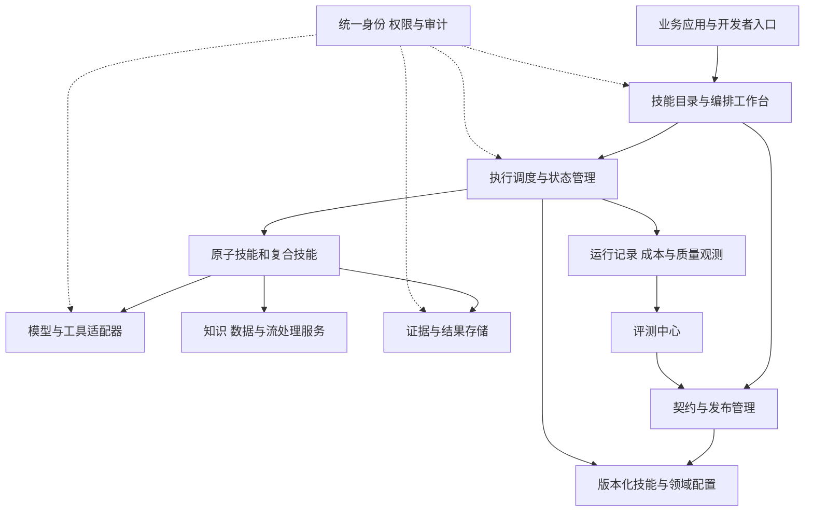

# 企业级元技能平台产品设计：从共性需求抽象到可组合能力矩阵

> 文档类型：产品设计方案  
> 版本：v1.0  
> 日期：2026年10月22日  
> 面向读者：企业 AI 产品负责人、平台产品经理、领域专家、架构师及研发负责人

## 摘要

企业级元技能平台的建设目标，是把跨业务反复出现的处理能力沉淀为可独立调用、可组合、可评估和可治理的产品资产。业务团队通过选择这些能力、补充领域配置并编排业务流程，构建适合自身场景的业务技能。

本文提出一套从需求调研、共性抽象、技能分层到产品矩阵、运行治理和价值验证的设计方案。平台以标准化能力契约为连接基础，以证据和评测为质量基础，以版本、权限和运行管理为生产基础，重点形成三类复合能力产品：跨规范一致性校验、研发文档泛化语义提取、多源数据动态融合成流。

全文采用“需求变更后，识别设计与测试中的偏差”作为贯穿案例，说明原子能力怎样组合成可交付的业务流程。案例中的业务名称、数据、阈值和阶段安排均为设计示例，不代表已上线产品或实测结果。论文引用用于说明可借鉴的方法及其边界；产品功能、组织机制与实施建议属于本文方案，仍需通过企业试点验证。

## 一、产品背景与目标：把重复建设转化为能力复用

### 1.1 从三个看似不同的需求开始

假设一家企业同时提出以下需求：研发部门希望识别需求文档与设计文档的差异，质量部门希望检查检验要求是否覆盖产品规范，运营部门希望把多个系统中的客户信息持续融合为统一视图。

业务对象不同，但任务中存在相似操作：识别材料结构、抽取实体与约束、对齐同一对象、比较不同表达、处理冲突，并输出可解释的结果。这些操作是元技能平台的候选建设对象。

立项前需要验证这种共性是否真实存在。仅凭“都要用大模型”“都要处理文档”不足以证明适合共建平台。产品团队应收集现有流程的工时、失败案例、接口差异和维护记录，判断哪些环节重复、重复的频率多高，以及统一建设能否降低实际成本。

### 1.2 产品价值与用户分工

平台的价值假设是：稳定的共性能力可以被多条业务链路复用，业务差异能够通过有限的配置和扩展表达，从而减少重复开发与重复验证。

| 用户角色 | 要完成的工作 | 平台提供的产品价值 | 应验证的结果 |
|---|---|---|---|
| 业务技能开发者 | 快速交付业务流程 | 检索、试用和组合已有技能 | 新流程交付时间缩短 |
| 领域专家 | 将业务知识变成可执行判断 | 管理术语、规则、例外和评测样本 | 配置可审核，判断有依据 |
| 技能开发者 | 建设和维护共性能力 | 标准接口、调试环境、评测与发布 | 同一实现服务多个消费者 |
| 平台运营者 | 保证能力长期可用 | 依赖、版本、权限、成本和质量管理 | 运行稳定，维护责任清晰 |
| 业务负责人 | 改善具体业务结果 | 查看完整流程的收益与质量 | 总处理成本或业务风险下降 |

业务负责人关注的是需求变更有没有漏检、复核需要多久、结果是否可用。技能数量与调用次数只作为运营数据，不能单独证明产品价值。

### 1.3 与现有平台的职责关系

元技能平台管理“有哪些可信能力、如何调用、如何组合、如何维护”。模型服务提供推理能力；知识与数据平台提供内容、数据及访问控制；业务应用承接用户任务与结果处置；Agent 运行平台承接自主决策过程及执行生命周期。

如果企业已有工作流引擎、流处理引擎或统一权限系统，应通过适配器接入。元技能平台重点补齐能力契约、语义适配、技能资产管理和质量验证，不以重复建设这些基础设施作为立项目标。

首期范围宜聚焦可观测、可复核的分析任务。业务系统中的修改、通知和审批提交应作为独立动作节点，沿用既有授权规则，避免分析技能隐含外部副作用。

## 二、概念体系与分层：让“元技能”成为可管理的产品对象

### 2.1 本文的定义

本文将元技能定义为：**面向跨业务共性操作，具有稳定能力契约、明确适用边界和独立质量标准，可被多种业务流程复用的基础技能单元。**

这里采用产品层面的工作定义，不把 Meta-Skill 作为统一的学术分类，也不预设平台必须采用元学习算法。能力是否成立，最终取决于可复用性、可组合性和业务验证结果。

为避免概念混用，平台采用以下分层：

| 层级 | 定义 | 示例 |
|---|---|---|
| 基础资源与工具 | 可访问的模型、数据、规则引擎和外部接口 | 文档读取接口、模型服务、数据库查询 |
| 原子技能 | 完成单一语义职责，可独立验证 | 约束抽取、单位归一、实体匹配 |
| 复合技能 | 将多个原子技能组织成稳定能力 | 文档语义提取、规范一致性校验 |
| 业务技能 | 加入业务对象、领域政策与处置流程 | 研发需求变更影响分析 |
| 业务应用 | 面向用户的任务入口和协作体验 | 研发评审工作台 |

“跨规范一致性校验”包含条款抽取、对象对齐、条件判断和证据汇总，适合定义为复合技能。将这些环节进一步拆解后，才能找到与其他产品共享的原子能力。

### 2.2 原子性的判断依据

原子技能不必只包含一次模型调用，也不应按代码函数的大小拆分。一个约束抽取技能可以内部执行分段、模型推断、结构修复和证据定位，只要对外承担的是一个稳定职责。

建议使用四项标准确定拆分边界：

1. 能否用一句清晰的话描述输入与目标结果。
2. 能否在不运行完整业务流程的情况下独立评估。
3. 能否被多个消费者使用，并保持稳定的语义。
4. 能否独立升级，而不迫使消费者理解内部实现。

例如，“检查接口响应时间是否满足要求”可拆成约束抽取、测量口径对齐和约束满足性判断；是否再把数字识别单独产品化，需要看它是否存在独立消费者和维护收益。

### 2.3 泛化能力的边界

高泛化能力应表现为在新场景中保留稳定处理逻辑，使用有限配置适配差异。需要明确支持的语言、材料结构、数据规模、业务领域和输出类型。

可以将一个技能实例理解为：

```text
技能实例 = 稳定能力实现 + 领域配置包 + 运行上下文
```

领域配置包包含术语、目标结构、适用规则和校准样本；运行上下文包含租户、身份、数据范围和任务预算。配置也需要版本与评测，否则业务差异只是被搬进了难以维护的提示词。

Voyager 展示了通过技能库积累、检索和复用可执行行为的思路，其实验环境为 Minecraft。[1] 本文借鉴技能资产化机制；面向企业的权限、接口兼容和服务保障，需要另行设计和验证。

### 2.4 技能的标准描述

每个可发布技能必须同时具备“能调用”和“能判断是否适用”两类信息。

| 契约维度 | 必填内容 |
|---|---|
| 身份 | 唯一标识、名称、版本、负责人、维护状态 |
| 能力语义 | 职责、适用对象、支持范围、明确的不支持项 |
| 输入输出 | 结构定义、字段含义、单位、枚举、必填约束 |
| 运行条件 | 依赖版本、执行模式、资源限制、超时和预算 |
| 质量 | 评测数据范围、指标、已知薄弱场景、复核策略 |
| 数据与权限 | 读取范围、写入动作、敏感等级、保留策略 |
| 结果追溯 | 输入版本、来源定位、配置版本、执行记录 |
| 异常 | 无结果、证据不足、输入不支持、依赖失败等状态 |

技能市场中的自然语言描述帮助发现能力；正式契约决定能否执行。两者需要保持一致。

## 三、需求抽象方法：从业务材料中找到稳定的共性

### 3.1 第一步：采样真实任务，而非汇总功能愿望

调研对象应包含正常案例、失败案例和例外案例。每个案例至少记录触发事件、输入材料、处理步骤、判断依据、输出消费者、错误后果及当前成本。

以需求变更为例，产品经理将某接口的性能要求从“P95 响应时间不超过 500ms”改为“不超过 300ms”。评审人员需要找到相关设计与测试材料，判断指标、统计口径和测试条件是否一致，并识别需要更新的内容。

这一任务同时涉及文档理解、对象关联、约束比较和版本识别。直接建设一个“智能评审助手”会掩盖这些可复用部分。先还原任务，有助于明确平台值得沉淀的能力。

### 3.2 第二步：把业务动作分解为语义操作

| 业务动作 | 共性操作 | 候选原子技能 | 需要保留的领域配置 |
|---|---|---|---|
| 找到性能要求 | 定位约束及其条件 | 约束抽取 | 性能指标词表、目标结构 |
| 找到同一个接口 | 对齐不同材料中的对象 | 实体匹配 | 接口标识规则、别名 |
| 比较设计与要求 | 判断方向性满足关系 | 约束满足性判断 | 基准版本、比较策略 |
| 找出未覆盖的测试 | 判断要求是否有对应验证 | 覆盖关系判断 | 测试类型、覆盖定义 |
| 跟踪后续变化 | 识别对象状态与版本变化 | 变化检测 | 事件类型、订阅范围 |

拆解时需要把事实获取、语义解释和业务处置分开。例如“需求必须由负责人批准”属于业务政策，不能被隐藏在通用抽取技能中。

### 3.3 第三步：区分共性、配置和专用逻辑

对于每个候选技能，比较多个场景的输入结构、处理步骤、输出语义和错误模式。

如果只是术语和目标字段不同，通常可通过配置扩展。如果对象具有不同的因果含义、时序约束或评价标准，则应检查是否需要另一个技能，或在上层保留专用逻辑。

例如，需求中的“允许响应时间”和监控系统中的“实际响应时间”都带数值和单位，但分别表达要求与观测值。二者必须在语义结构中区分，不能因为字段都叫 `latency` 就直接合并。

### 3.4 第四步：用新场景检验抽象

建议采用“先设计、再留出验证”的方法：用部分业务建立能力和配置机制，再使用未参与设计的业务评测复用效果。针对新业务记录新增配置量、代码修改量、标注与复核工时，以及准确率变化。

如果每接入一个部门都要修改技能核心逻辑，说明抽象边界仍不稳定。如果技能足够通用，却需要大量参数才能表达常见任务，也需要降低配置复杂度，提供面向领域的配置模板。

### 3.5 第五步：形成可审核的入库决策

候选能力只有满足以下条件才进入平台路线图：存在明确消费者；有可独立验收的结果；公共实现能够承担维护责任；预计节省的重复建设成本高于平台化与迁移成本。

单个业务也可以先孵化候选技能，但应标记为“待验证复用”，不提前计入跨业务复用成果。对需求频率低、变化快或高度依赖隐性经验的能力，可先保留在业务层。

本阶段的交付物包括需求证据表、业务到技能映射、候选契约、领域配置样例、评测样本和入库决策记录。平台产品经理应能解释每个原子技能从哪里来，以及为什么值得成为公共资产。

## 四、产品矩阵：围绕稳定的输入输出组织能力

### 4.1 六类能力与首期重点

下表是建议的候选矩阵，具体实现顺序由试点确定。“首期”表示贯穿案例依赖的能力，不代表全部独立建设为微服务。

| 能力类别 | 候选技能 | 主要输入 | 标准输出 | 建设建议 |
|---|---|---|---|---|
| 内容理解 | 结构识别、对象抽取、约束抽取、关系抽取 | 文档及目标结构 | 结构化对象与来源证据 | 首期聚焦文本与规则表格 |
| 语义对齐 | 术语归一、单位归一、对象匹配、字段映射 | 候选对象与领域词表 | 映射、条件与匹配依据 | 首期覆盖对象及指标对齐 |
| 规则校验 | 条件判断、满足性判断、冲突识别、覆盖判断 | 规范、事实及规则包 | 分类、证据与待复核项 | 首期覆盖数值要求与覆盖关系 |
| 数据融合 | 去重、来源裁决、实体合并、增量更新 | 多源记录与融合政策 | 带来源的融合对象 | 第二阶段扩展 |
| 事件处理 | 变化检测、事件标准化、窗口聚合、分发 | 变更记录或事件 | 带时间与版本的事件流 | 依据时效需求逐步引入 |
| 结果交付 | 证据汇总、差异解释、报告生成 | 分析结果及证据包 | 报告、问题列表和结构化结果 | 首期提供可复核报告 |

这些能力可以由规则、传统算法、模型或混合方式实现。产品层应对外承诺能力与质量范围，把实现选择留给技能开发者。

### 4.2 统一的中间对象

组合能力需要一组共享对象。建议首期至少定义文档快照、业务对象、约束、证据、发现项和事件。

以约束为例，其最小语义应包含：约束主体、指标、操作符、值、单位、统计口径、适用条件、有效期、来源及版本。这样，“接口 P95 延迟小于等于 300ms”才能与“平均延迟小于等于 0.3 秒”区分。

共享结构应提供稳定核心与受控扩展字段。扩展字段需要声明含义和所属领域；没有经过映射验证的同名字段不能自动视为同义。

### 4.3 能力资产与领域资产共同管理

平台同时维护技能包和领域配置包。前者包含实现、契约、公共评测集与运行要求；后者包含术语、结构、规则、领域样本和负责人。

发布业务技能时，将两者绑定为明确版本。相同抽取技能配合研发领域配置，可提取接口和验收条件；配合质量领域配置，可提取检验对象和允许范围。能否达到质量要求，需要在对应领域分别评测，不能沿用其他领域的通过结论。

UIE 将不同信息抽取任务组织为统一的文本到结构生成问题，并通过 Schema 引导目标结构。[2] 这一研究启发了本文对统一抽取接口的设计，但特定企业文档的解析质量、长文处理和证据准确性仍需要独立验证。

## 五、三类核心能力产品：把共性能力做成可交付产品

### 5.1 跨规范一致性校验

#### 5.1.1 用户任务与输入条件

用户希望知道：多个规范或材料是否对同一对象提出冲突要求，实施方案是否满足指定基准，以及验证材料是否覆盖必须检查的事项。

这三类问题分别对应“规则间兼容性”“实施满足性”和“验证覆盖度”，应在任务创建时明确选择。它们的判断方向和证据要求不同。

输入至少包含基准文档、被校验材料、版本、适用对象与环境、有效时间、优先级政策和校验范围。如果缺少关键版本或条件，系统应提示补充，或将相关项标记为证据不足。

#### 5.1.2 核心处理流程


候选对生成应优先使用对象标识、章节关系和已有映射，再通过语义检索补充。若相关条款未被召回，后续判断再准确也无法发现问题，因此候选召回需要独立评测。

对明确的数值、单位与枚举约束，优先使用确定性比较。模型用于理解表达、识别条件或提出候选关系；最终报告必须关联实际材料中的证据。

#### 5.1.3 不同检查关系必须给出不同结论

假设两个有效规范分别要求同一指标 `P95 ≤ 300ms` 与 `P95 ≤ 500ms`，且对象与条件一致。两项要求可以同时满足，应标记为“兼容但严格程度不同”。

如果设计验收门槛只有 `P95 ≤ 500ms`，而基准要求为 `P95 ≤ 300ms`，则现有设计门槛不足以保证满足基准。这属于满足性问题，不能由此直接推断实际系统已经超标。

如果基准要求与可信实测值相比较，则需要确认测量环境、窗口和统计口径，再判断观测结果是否满足要求。平均值与 P95 即使单位相同，也不能直接替代。

建议采用两个相互独立的结果维度：

| 维度 | 可能值 | 目的 |
|---|---|---|
| 关系结论 | 等价、兼容、矛盾、未满足、未覆盖、不可比较、待判断 | 表达业务关系 |
| 证据状态 | 充分、不足、来源失效、存在争议 | 表达结论依据的可用性 |

“未覆盖”必须限定在本次已成功处理的材料集合内。如果存在解析失败、无权限访问或候选召回不足，应输出覆盖状态未知，不能直接将未找到等同于不存在。

#### 5.1.4 结果与交互设计

结果页首先显示评审范围、材料版本、有效发现项和未完成分析范围。用户点击发现项后，左右对照基准条款与对应材料，查看适用条件、判断依据和建议处置。

建议的发现项结构如下，字段和值仅为示例：

```json
{
  "finding_id": "F-017",
  "comparison_mode": "implementation_satisfaction",
  "subject": "OrderQueryAPI",
  "reference": {
    "document_version": "REQ-v3",
    "metric": "latency",
    "statistic": "p95",
    "operator": "<=",
    "value": 300,
    "unit": "ms",
    "evidence_id": "E-101"
  },
  "candidate": {
    "document_version": "DESIGN-v2",
    "metric": "latency",
    "statistic": "p95",
    "operator": "<=",
    "value": 500,
    "unit": "ms",
    "evidence_id": "E-204"
  },
  "relation": "not_satisfied",
  "evidence_status": "sufficient",
  "explanation": "设计门槛弱于需求基准，不能保证满足要求。",
  "review_status": "pending"
}
```

生产中的证据对象还需保存材料快照标识、页码或块定位、原文片段、内容校验值与访问权限。结果页上的证据读取必须重新检查当前权限，不能只凭原任务权限展示。

领域专家可接受、驳回、标记例外或要求补充材料。例外需要记录范围、有效期和批准依据；反馈进入候选评测样本，经过审核后再用于更新规则或技能。

ContractNLI 将合同中的假设判断与证据片段识别结合，为“结论与证据一起输出”的设计提供参考。[3] 本文的跨规范版本比较、方向性满足关系和覆盖判断超出了该论文原始任务，需要专门定义样本与评价规则。

### 5.2 研发文档泛化语义提取

#### 5.2.1 从文档生成可消费的研发对象

该产品的目标是将需求、设计、接口和测试文档转化为可被下游技能使用的结构化对象。用户选择目标结构，提交材料，获得可定位原文的对象、关系和约束。

首期建议支持正文、标题层级与规则表格，并明确对扫描件、跨页复杂表格、图中信息和公式的支持范围。解析不完整时应暴露缺失信息，不能让结构化输出掩盖材料处理失败。

#### 5.2.2 提取流程与目标结构

处理过程包括文档解析、保留结构的分段、对象与关系抽取、跨段合并、结构验证及来源校验。长文分段应保留标题路径、表头和引用关系，避免将关键限定条件与目标内容分离。

| 对象类型 | 示例字段 | 典型下游消费者 |
|---|---|---|
| 需求项 | 标识、主体、行为、条件、验收要求 | 覆盖检查、变更分析 |
| 接口 | 名称、参数、返回值、错误条件、性能要求 | 接口一致性校验 |
| 约束 | 对象、指标、操作符、阈值、单位、统计口径 | 满足性判断 |
| 依赖关系 | 源对象、目标对象、类型、方向 | 影响范围分析 |
| 测试项 | 前置条件、步骤、预期结果、关联需求 | 测试覆盖判断 |

对于未出现的字段，输出缺失状态；对于冲突表达，保留候选及各自证据；对于推断形成的关系，显式标记为推断。原文事实与推断结果不能混为同一种证据。

#### 5.2.3 泛化与适配机制

不同业务通过目标结构、领域词表、标注示例和后处理规则进行适配。配置界面应让专家选择字段含义、是否必填、允许值及可接受的来源方式，而非要求专家编写长篇提示词。

新领域接入分为三步：先用小批样本确认结构表达能力，再校准抽取与来源定位，最后使用独立样本验收。若新增对象需要改变核心处理流程，应记录为能力扩展，重新评估版本兼容性。

UIE 提供统一结构生成的研究基础。[2] 产品还需要单独处理文档格式、来源锚定、权限和版本，才能将抽取结果变为长期维护的企业对象。

#### 5.2.4 验收重点

质量评估至少包含对象、属性、关系和约束的正确性，以及来源定位、缺失字段识别和推断标记的准确性。不同字段对业务影响不同，应按字段类型报告结果。

对关键阈值、单位和对象标识，设置独立验收要求。一个整体抽取分数不能掩盖关键数字错误；重复对象合并错误也需要单独统计，否则会在后续融合与校验中放大。

### 5.3 多源数据动态融合成流

#### 5.3.1 产品目标与输出形态

该产品将不同来源的记录和变更持续转化为一致、可追溯的业务对象更新。输出同时包括“当前融合视图”和“变化事件”，分别服务查询与订阅消费者。

贯穿案例中，需求系统、文档平台和测试系统都可能更新同一个接口的信息。平台需要识别它们指向的对象、保留不同属性的含义，并触发受影响分析。

Schema Matching 研究对模式匹配的方法进行了分类，可为字段和结构映射提供参考。[4] 但字段映射不能自动完成实体身份确认、来源裁决和业务状态合并，这些仍需要独立能力。

#### 5.3.2 处理链路与融合政策


接入方式可包括事件订阅、变更数据捕获和定期拉取。系统应展示源系统能力及实际采集间隔，避免将定时扫描描述为实时数据。

融合政策必须按字段语义定义。需求系统可作为批准需求版本的权威来源，文档平台可作为设计内容的权威来源，测试系统可作为执行结果的权威来源。来源优先级宜细化到属性及状态，不能简单给整个系统排一个全局顺序。

每个融合字段保留来源记录、源版本、有效时间和政策版本。来源间存在无法自动解决的冲突时，保留候选值与冲突状态，交由指定负责人处理。

#### 5.3.3 时间、乱序与重复

事件应区分业务发生时间、平台接收时间和处理完成时间。对于按时间窗口汇总的任务，还需声明窗口、允许迟到范围和结果修订方式。

Dataflow Model 讨论了无界、乱序数据处理中的正确性、延迟与成本权衡，为这些设计提供依据。[5] 产品应允许不同订阅场景选择更新时效与修订策略，并明确结果的完整性条件。

去重优先依赖稳定事件标识，必要时使用来源记录与版本组合。遇到断连恢复，应从已确认位置继续读取，并通过版本检查避免旧事件覆盖新状态。来源不提供可靠版本或连续日志时，应明确恢复能力的局限，补充定期对账。

端到端交付语义需要覆盖输入、处理状态和输出系统。若外部消费者无法参与事务，可采用至少一次投递，并要求其按事件标识幂等处理。不能仅凭流处理引擎的内部保证，就承诺所有外部动作只发生一次。

#### 5.3.4 重放、撤回与增量分析

平台需要支持指定来源和时间范围的重放，用于修正规则或补齐遗漏。重放时应记录使用的融合政策版本，产生可区分的执行批次，并防止重复触发外部动作。

来源删除、身份误合并和权限撤销也要进入处理流程。误合并需要能够恢复来源记录并重新生成实体映射；删除或撤销应按企业保留政策处理缓存、视图和下游通知。

增量分析可以根据“证据—抽取对象—比较结果”的依赖关系定位影响范围。若共享词表、全局政策或身份映射发生变化，局部重算可能不足，应扩大范围或触发全量复核。

验收需覆盖实体误合并率、漏合并率、来源追溯完整度、事件新鲜度、恢复后结果一致性及重复事件对下游的影响。

## 六、技能组合机制：让能力在约束内可靠协作

### 6.1 组合兼容性需要检查五个方面

“可任意组合”在产品中应落实为：在数据、语义、上下文、权限及运行条件满足时，技能可以灵活连接。

| 检查项 | 要回答的问题 | 不满足时的处理 |
|---|---|---|
| 结构兼容 | 上游字段类型能否满足下游输入？ | 配置显式映射或拒绝连接 |
| 语义兼容 | 单位、统计口径、对象与关系是否一致？ | 引入转换技能或人工确认 |
| 上下文兼容 | 版本、有效期和适用条件是否匹配？ | 补充上下文或标记不可比较 |
| 权限兼容 | 当前身份能否读取输入并执行动作？ | 缩小范围或走既有授权流程 |
| 运行兼容 | 批处理或流处理、规模、预算是否适配？ | 分批执行、调度或拒绝运行 |

结构校验应尽量在保存编排时完成，动态数据和权限校验则需要在执行时重新进行。转换节点应展示含义与损失，例如单位换算可以精确完成，但统计口径转换通常需要原始数据支持。

### 6.2 编排对象与执行状态

平台提供顺序、并行、条件分支、人工复核和事件触发等节点类型。每个节点记录输入引用、技能版本、领域配置版本、输出引用、状态、成本和异常信息。

节点状态可设计为待执行、运行中、等待人工、成功、失败、取消和跳过。证据不足属于业务结果，不一定是执行故障；网络超时与解析器崩溃属于技术异常，不能统一显示为“未发现问题”。

流程需要明确完成条件：哪些节点必须成功，哪些结果允许部分返回，哪些缺失会阻断最终报告。报告应显示已分析范围与未完成范围，防止部分成功被误读为完整校验。

### 6.3 自动规划的适用方式

首期使用经过评测的固定模板，并允许用户调整节点和配置。随后可引入“自然语言目标—候选技能检索—计划生成—契约校验—执行”的辅助编排流程。

Toolformer 研究模型学习何时、如何调用外部工具，为工具调用决策提供方法启发。[6] HuggingGPT 展示了通过语言模型进行任务规划、模型选择、执行和结果汇总的方案。[7] 两者都不能替代企业环境中的权限校验、版本约束和异常恢复。

自动生成的计划应包含显式的数据依赖、前置条件和终止条件。平台校验通过后才能进入运行；涉及业务提交的节点遵循既有授权要求。模型不能通过生成一份计划扩大实际权限。

### 6.4 失败恢复与成本管理

只对可重试的暂时性故障执行有限次数重试。对于输入结构不合法、证据缺失或权限不足，应进入明确的处理分支。

对有副作用的节点，使用业务幂等键和持久化执行记录；发生超时而结果未知时，先查询外部状态，再决定是否重试。补偿动作必须由业务定义，因为已经发出的通知或已生效的决策通常无法靠删除内部记录恢复。

成本预算应覆盖模型调用、解析、检索、存储、重试及人工复核。长流程执行前给出估算范围，运行中持续更新；超过预算时按任务政策暂停、缩小范围或结束，并说明已完成内容。

缓存键至少包含输入快照、技能版本、配置版本和适用的数据权限范围。对包含权限敏感结果的缓存，命中后仍需执行授权检查。

## 七、平台功能与用户体验：从发现技能到完成业务任务

### 7.1 产品模块与核心页面

| 模块 | 核心页面或功能 | 用户应得到的结果 |
|---|---|---|
| 技能目录 | 检索、筛选、能力详情、示例、评测说明 | 判断某技能是否适合任务 |
| 技能工作台 | 契约定义、实现接入、样本调试、版本比较 | 创建可独立验证的技能 |
| 领域配置中心 | 术语、结构、规则、例外、配置版本 | 将领域知识变为受控配置 |
| 编排工作台 | 模板、节点连接、兼容性检查、调试 | 生成可执行的业务流程 |
| 评测中心 | 数据集、评测任务、分组结果、版本对比 | 判断能力能否发布或升级 |
| 运行中心 | 实例状态、失败定位、成本、恢复与取消 | 管理运行中的业务任务 |
| 结果与复核中心 | 证据对照、意见、例外、反馈 | 完成业务判断与处置 |
| 治理中心 | 权限、依赖、发布、审计、下线 | 保持能力长期可控可维护 |

技能目录不宜只展示一个综合评分。详情页应显示支持的材料类型、已验证领域、评测样本范围、关键错误类型、运行条件和维护状态，让使用者判断与自身任务是否匹配。

### 7.2 贯穿案例：需求变更后的评审流程

业务开发者选择“需求变更影响分析”模板，接入需求、设计和测试材料。领域专家确认性能指标词表、对象映射和本次评审基准。平台校验输入结构、数据访问范围和必需技能版本。

当 `REQ-v3` 生效后，变化检测技能定位修改的性能约束；语义提取技能形成标准约束；对象匹配技能找到相关设计与测试项；满足性判断发现设计门槛未同步；覆盖检查确认测试是否验证新阈值。

评审人员在结果页看到三类内容：已确认的偏差、需要补充信息的事项、已完成检查且满足要求的事项。若某测试材料没有访问权限，应展示“此范围未完成分析”，不将它放入通过清单。

评审完成后，用户可将确认的问题交给既有流程处理。动作节点记录执行结果与业务单号，方便后续跟踪。下一次材料更新时，平台重新分析受影响对象，并保留旧结论的版本历史。

### 7.3 三个界面设计原则

首先，任务页面围绕用户要完成的工作组织。普通评审人员看到的是基准、范围、进度和发现项；需要诊断时再展开节点信息、模型调用和日志。

其次，区分任务执行成功与业务检查通过。流程正常结束但发现偏差，属于成功交付分析结果；流程失败则不能得出业务通过结论。

最后，每个待处理状态都应给出明确下一步。证据不足时说明缺少哪些材料；对象匹配有歧义时提供候选；规则冲突时交由指定负责人裁决，避免只显示无法操作的错误码。

### 7.4 逻辑架构与平台职责



控制层维护技能、配置、计划和发布状态；执行层调度任务、调用能力并保存运行状态；数据与证据层保留输入快照、结果和可追溯关系。身份与权限贯穿所有层。

首期可以采用较简单的部署方式，只要这些职责和数据边界清晰。是否拆分服务，应根据调用量、故障隔离要求、维护团队及基础设施条件决定。

## 八、企业级治理与资产运营：让技能能够长期使用

### 8.1 生命周期与发布要求

技能按草稿、评测、试用、发布、废弃和下线管理。正式发布至少要求契约完整、必要评测通过、负责人明确、权限声明可执行、回滚方案可用。

试用阶段应限制消费者与业务范围，收集真实材料分布下的质量问题。进入正式发布前，确认试用暴露的主要问题已经解决，或已被清晰纳入适用边界。

技能版本与模型版本、提示词版本、规则版本、解析器版本和领域配置版本形成可追溯关系。接口没有变化也可能产生行为变化，因此模型或规则更新同样需要回归评测。

### 8.2 兼容性、依赖与升级

业务流程应锁定已验证版本，平台维护消费者依赖图。发布新版本时，先识别受影响流程，再执行代表性样本和关键业务链路回归。

对于字段删除、含义变化或判断口径变化，应视为潜在的不兼容变更。升级期间可保留旧版，并提供迁移说明和期限。紧急回滚时恢复的是一组可运行版本组合，而非只回滚某个提示词。

下线前需要确认活跃消费者已迁移，历史结果仍能解释，必需的审计与证据记录有明确保留方式。

### 8.3 权限与数据治理

平台执行权限取决于发起身份、技能许可范围、资源本身的访问控制及租户政策共同允许的范围。中间结果、缓存、搜索索引和导出文件也需要纳入访问控制。

文档中的文字属于待处理数据。即使材料包含“忽略规则”“调用某工具”等内容，也不能改变系统的执行权限和计划。工具调用应由受控流程和授权机制决定。

模型或外部服务的数据使用条件、敏感字段处理方式和保留期限由企业政策配置。日志优先保存必要的标识、状态和证据引用，完整内容按分级与审计需求保存。

### 8.4 质量反馈与责任机制

每个技能明确产品负责人、实现维护者和领域评审人。业务团队报告问题时，应附输入版本、结果标识和期望判断，使平台能够复现和归因。

反馈经过去重、审核与归类后，进入评测集或配置变更流程。不能把所有用户改写都自动视为正确答案，尤其在存在部门口径差异时，需要先确定规则适用范围。

平台运营应定期审查低复用技能、重复能力、长期无人维护技能和异常成本技能。保留、合并或下线的依据，是使用情况、业务必要性及维护投入；低调用频率但支撑关键流程的能力仍可能具有较高价值。

### 8.5 成本与服务承诺

为每类技能建立不同的服务说明。短文本抽取可按任务延迟管理；大文档处理可按队列等待与完成时效管理；事件融合可按数据新鲜度、恢复时间和交付语义管理。

服务承诺应明确材料规模、负载条件、错误预算和维护窗口。内部费用归集可以采用任务、对象或处理量等业务可理解的单位，再映射到底层资源消耗。

## 九、评估体系：同时验证能力质量、泛化效果与业务收益

### 9.1 分层评估，避免一个分数替代所有问题

| 层次 | 核心指标 | 需要回答的问题 |
|---|---|---|
| 原子能力 | 抽取准确率与召回率、字段正确率、来源定位准确率 | 基础能力是否可靠？ |
| 复合能力 | 发现项准确率、漏检率、覆盖判断准确率 | 组合后能否完成目标任务？ |
| 跨业务泛化 | 新领域质量变化、适配工时、核心代码修改量 | 是否真正减少重复建设？ |
| 运行质量 | 成功率、恢复能力、延迟、单次成功任务成本 | 能否稳定运行？ |
| 业务价值 | 交付周期、复核时间、总处理成本、关键问题遗漏 | 是否改善业务结果？ |

不同材料类型、部门和难度分组分别报告结果。平均指标良好时，也需要检查关键类别是否退化。

### 9.2 数据集与评测设计

建立公开说明范围的公共评测集与受权限保护的领域评测集。用于开发和调参的材料与最终验收材料分离；同一文档的相近版本尽量放在同一分组，减少内容泄漏。

跨业务验证使用未参与抽象设计的场景，并记录允许提供的配置和样例数量。若在看过验收结果后修改规则，该批数据就不再作为独立验收集。

校验样本应包含相同条件下的真冲突、不同条件下的表面差异、版本更替、缺失信息、单位转换、统计口径差异和无法访问的材料。融合样本应包含乱序、重复、迟到、删除、来源冲突和错误身份合并。

对于存在争议的样本，由领域专家制定标注规则并完成裁决；报告中保留争议比例与评价范围。关键结论结合样本量和不确定性解释，避免小样本结果被包装为稳定承诺。

### 9.3 对照方案与贡献验证

至少设置当前人工流程或现有系统作为基线，并选择一个业务专用实现作为对照。比较范围应覆盖同一批材料、相同输出要求和同等复核标准。

在必要时，通过移除证据定位、对象对齐或增量分析等机制，观察质量或成本变化，确认平台组件是否产生实际贡献。对于业务正确性指标，最终由领域评审定义可接受结果。

平台化方案可能增加初次建设投入。评估时需要同时观察首个业务和后续业务的接入成本，才能判断共性抽象是否带来持续收益。

### 9.4 建议统一的运营指标口径

**跨业务有效复用率**可以定义为：在统计周期内，被至少两个预先定义的独立业务场景用于正式流程的已发布原子技能数，除以同期在正式流程中实际使用的原子技能总数。测试调用、演示调用和无业务差异的重复实例不计入。

**单次有效任务成本**可以定义为：统计周期内全部生产任务的模型、计算、存储、重试及可归集人工复核成本，除以通过业务验收的任务数。失败任务的成本计入分子，避免通过忽略失败夸大收益；建设与长期维护投入另行计入总拥有成本。

**新业务适配成本**应包含配置、数据准备、标注、开发、评测和流程接入工时。只统计新增代码量，会漏掉大量人工适配成本。

**数据新鲜度**应区分源系统可见延迟、平台采集延迟、处理延迟和消费可见延迟；若业务时间缺失或跨系统时钟不可比，应明确可测范围。

### 9.5 发布门槛与置信度使用

具体门槛由试点基线与错误后果决定。高影响问题可以优先保证召回并增加人工复核；低影响批量任务可以在允许范围内优化成本与吞吐。

如果结果显示概率或置信度，应说明分数的产生方式和校准范围。模型自报的“95% 置信度”不能直接理解为真实正确概率。未完成校准时，优先展示证据状态、规则命中情况与复核建议。

发布评审需要同时通过能力质量、关键业务链路、运行恢复和成本可接受性检查。任一核心指标不达标，都应有明确的范围限制或修复计划。

## 十、从零到一的实施路径与决策机制

### 10.1 首个闭环的选择

建议以“研发文档提取与一致性校验”为首个闭环。该场景可以共享对象抽取、约束抽取、对象对齐和证据能力，并通过评审人员复核形成质量反馈。

多源动态融合依赖接入条件、身份映射和恢复机制，可在已有闭环上逐步增加。首期先保留事件接口与版本记录，实际采用批量还是增量更新，由业务时效要求和数据源条件决定。

### 10.2 四阶段路线图

以下节奏是范围规划示例，前提是已有可访问材料、业务专家和基本部署环境。具体周期应在需求采样与数据盘点后调整，各阶段以验收结果作为推进条件。

| 阶段 | 参考周期 | 核心工作 | 交付物 | 进入下一阶段的条件 |
|---|---|---|---|---|
| 需求与契约验证 | 第1—3周 | 场景采样、材料盘点、技能拆解、基线评估 | 需求证据、候选契约、评测样本、范围说明 | 业务问题明确，关键数据可用，验收口径一致 |
| 首个闭环试点 | 第4—8周 | 文档提取、对象对齐、校验、证据与复核 | 可运行模板、结果工作台、试点评测报告 | 关键质量达标，复核过程可用，运行可追溯 |
| 跨业务复用验证 | 第9—12周 | 引入独立业务、完善配置、执行回归 | 第二场景交付、适配成本记录、契约修订 | 复用收益可观察，核心实现改动受控 |
| 增量与平台运营 | 第13周起 | 多源接入、事件融合、版本治理、运营 | 订阅能力、治理流程、成本与质量看板 | 根据消费者增长和收益决定持续扩展 |

如果首个闭环质量尚不稳定，应先修复抽取、对齐和证据问题。扩大技能目录或增加自动规划不能替代基础能力达标。

### 10.3 最小可用产品的建议范围

首期提供受控材料导入、标准对象与约束抽取、指定基准校验、证据对照、人工复核和结果导出。开发侧提供技能登记、固定模板、版本绑定、评测和基本运行记录。

配置界面先覆盖试点实际需要的术语、对象映射和规则。复杂画布、自动技能生成、广泛多模态处理和全面实时接入，可以在消费者需求与质量基础明确后逐步扩展。

建议以这些用户故事作为验收起点：

| 用户故事 | 可观察的验收结果 |
|---|---|
| 评审人员上传指定版本的需求与设计材料 | 系统展示分析范围，发现项能跳转到双方证据 |
| 领域专家修正规范术语和单位规则 | 配置生成新版本，并能查看评测变化 |
| 开发者将既有抽取技能用于第二业务 | 核心实现保持稳定，适配工作量有完整记录 |
| 任务执行中发生暂时性故障 | 状态可查询，可恢复步骤不重复产生业务动作 |
| 用户无法访问某份相关材料 | 系统明确标记未分析范围，结果不冒充完整通过 |
| 新版本质量退化 | 能定位受影响消费者并恢复已验证版本组合 |

### 10.4 团队协作与职责

平台产品负责人负责抽象边界、产品路线和跨业务验收；领域专家负责语义、例外和标注裁决；算法与数据工程人员负责抽取、匹配、融合及评测；平台研发负责契约、执行、权限和运行管理；业务团队负责真实场景试用及价值验收。

这些是需要有人承担的职责，不等于固定岗位或人数要求。立项时应明确每项交付物的责任人及投入时间，尤其是领域专家的持续参与。

### 10.5 继续投资、调整或停止的判断

如果第二个业务接入时，核心能力保持稳定且总适配成本明显下降，可继续扩展领域包和消费者。如果接入持续依赖大量专用代码，应重新划分技能边界或将能力保留在业务侧。

如果自动化减少了初筛时间，却增加了等量甚至更多复核时间，需要重新评估判断质量和结果呈现。如果融合系统无法获得可信的对象标识与来源版本，应先补齐数据条件，再承诺更高时效的业务闭环。

平台扩张应以“新增业务能否更快获得可验收结果”为持续决策依据。可复用能力、受控组合和可追溯证据，是需要通过每一轮业务交付反复验证的产品承诺。

## 参考文献与使用边界

以下七篇文献按本文首次引用顺序排列，选择依据是与设计问题的相关性，不构成截至文档日期的完整研究综述。题名、作者和年份依据论文原始页面或 DOI 登记信息核对；本文仅引用支撑设计讨论的方法，不移用论文中的性能数字作为企业产品目标。

**[1] Wang, Guanzhi, et al. (2023). Voyager: An Open-Ended Embodied Agent with Large Language Models. arXiv:2305.16291.**

原始页面：`https://arxiv.org/abs/2305.16291`

对应章节：2.3。可借鉴可执行技能的积累、存储和检索机制。适用边界：实验围绕 Minecraft，未验证本文提出的企业级能力治理和服务机制。

**[2] Lu, Yaojie, et al. (2022). Unified Structure Generation for Universal Information Extraction. Proceedings of ACL 2022, pp. 5755–5772.**

原始页面：`https://aclanthology.org/2022.acl-long.395/`  
DOI：`10.18653/v1/2022.acl-long.395`

对应章节：4.3、5.2。可借鉴统一结构生成与 Schema 引导机制。适用边界：企业材料解析、证据来源校验和特定领域效果仍需单独验证。

**[3] Koreeda, Yuta, and Christopher D. Manning. (2021). ContractNLI: A Dataset for Document-level Natural Language Inference for Contracts. Findings of EMNLP 2021, pp. 1907–1919.**

原始页面：`https://aclanthology.org/2021.findings-emnlp.164/`  
DOI：`10.18653/v1/2021.findings-emnlp.164`

对应章节：5.1。可借鉴文档级推断与证据识别的结合。适用边界：合同假设推断不同于本文提出的跨规范校验、覆盖分析与版本适用性判断。

**[4] Rahm, Erhard, and Philip A. Bernstein. (2001). A Survey of Approaches to Automatic Schema Matching. The VLDB Journal, 10, pp. 334–350.**

DOI：`10.1007/s007780100057`  
出版页面：`https://link.springer.com/article/10.1007/s007780100057`  
书目信息核验：`https://api.crossref.org/works/10.1007/s007780100057`

对应章节：5.3。提供模式匹配研究的方法背景。适用边界：不直接解决实体融合、流式处理与冲突裁决。本次出版页面受访问验证限制，通过 DOI 登记核对书目信息，未据此作逐项实验或方法细节解读。

**[5] Akidau, Tyler, et al. (2015). The Dataflow Model: A Practical Approach to Balancing Correctness, Latency, and Cost in Massive-Scale, Unbounded, Out-of-Order Data Processing. Proceedings of the VLDB Endowment, 8(12), pp. 1792–1803.**

原始论文：`https://research.google.com/pubs/archive/43864.pdf`  
作者机构页面：`https://research.google/pubs/the-dataflow-model-a-practical-approach-to-balancing-correctness-latency-and-cost-in-massive-scale-unbounded-out-of-order-data-processing/`

对应章节：5.3。可借鉴无界和乱序数据的处理语义，以及正确性、延迟和成本之间的权衡。适用边界：语义映射、实体识别和企业权限属于另外的设计问题。

**[6] Schick, Timo, et al. (2023). Toolformer: Language Models Can Teach Themselves to Use Tools. arXiv:2302.04761.**

原始页面：`https://arxiv.org/abs/2302.04761`

对应章节：6.3。可借鉴工具选择、调用时机及参数生成的研究思路。适用边界：工具调用能力不等于生产环境中的执行授权与可靠性保证。

**[7] Shen, Yongliang, et al. (2023). HuggingGPT: Solving AI Tasks with ChatGPT and its Friends in Hugging Face. arXiv:2303.17580.**

原始页面：`https://arxiv.org/abs/2303.17580`

对应章节：6.3。可借鉴任务规划、模型选择、执行和结果汇总的分工。适用边界：本文的契约检查、版本治理与业务验收属于额外的产品设计。
