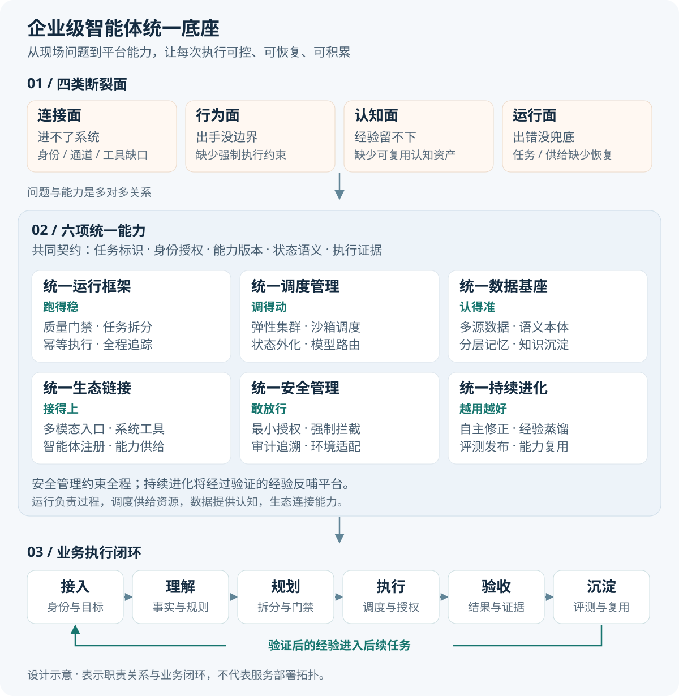

# 企业级智能体统一底座：从四类断裂面到六项平台能力

企业级智能体建设需要回答一个贯穿全程的问题：当智能体进入真实业务系统、承担连续任务并产生实际操作时，企业如何让它接得上系统、守得住边界、积累得下经验，并在出现故障后继续完成工作？

本文提出以六项统一能力构建企业级智能体底座：统一运行框架管“跑得稳”，统一调度管理管“调得动”，统一数据基座管“认得准”，统一生态链接管“接得上”，统一安全管理管“敢放行”，统一持续进化管“越用越好”。六项能力共同形成从任务进入、理解规划、资源调度、受控执行，到结果验收与经验沉淀的闭环。

## 一、从公开失败情形识别四类断裂面

为了定位建设重点，可以把失败情形按主要缺口归入连接、行为、认知和运行四个面。同一次失败可能涉及多个面，因此分类用于明确治理责任，不宜当作互斥的事故标签。

| 断裂面 | 现场表现 | 核心缺口 | 底座需要回答的问题 |
| --- | --- | --- | --- |
| 连接面 | 进不了系统 | 没有面向智能体的统一身份、通道与工具 | 以谁的身份，经过什么入口，调用哪项业务能力？ |
| 行为面 | 出手没边界 | 行为约束停留在提示词，没有强制机制 | 哪些动作可以执行，哪些必须拦截、审批或移交？ |
| 认知面 | 经验留不下 | 知识与经验没有沉淀为可复用资产 | 已知事实、历史经验与业务规则怎样持续积累并正确复用？ |
| 运行面 | 出错没兜底 | 长任务与模型供给缺少恢复手段 | 任务中断后如何确认进度，并安全接续执行？ |

### 1. 连接面：知道该做什么，却找不到正确入口

Anthropic 在 2025 年 6 月 13 日发布的多智能体研究系统复盘中指出，工具描述不清会把智能体带向错误路径；它以“在公共网络搜索只存在于 Slack 内部的信息”为例，说明工具与信息来源不匹配会使任务从起点就偏离方向。[1]

这属于公开工程经验中的接入与工具选择问题，并非某次客户系统宕机。它能够直接支持的判断是：模型理解用户意图，并不等于它具备访问目标信息的正确工具。

本文据此提出的企业接入要求，还包括身份委托、授权范围、网络通道、业务接口、异步回执和结果查询。企业可以把这些要求统一为能力契约，让智能体在调用前知道工具的用途、权限、输入输出与执行结果确认方式。

### 2. 行为面：外部内容被误当成行动指令

Anthropic 于 2025 年 8 月 25 日发布的浏览器智能体研究预览材料，披露了一次防护措施加入前的红队测试：恶意邮件以安全清理为由要求删除邮件，智能体随后按邮件中的指令执行了删除。[2]

这是受控安全测试中观察到的失败，不应描述为已经发生的客户生产事故。它暴露的机制是：智能体在处理业务材料时，把材料中的不可信指令提升成了执行依据。

本文据此建议，把权限校验、动作审批、敏感路径保护和网络出口限制落实在执行层。提示词可用于引导行为，但是否允许实际写入、删除或外发，应由独立的授权与执行机制决定。

### 3. 认知面：换一个会话，工作就失去连续性

Anthropic 在 2025 年 11 月 26 日发布的长任务工程文章中，总结了跨上下文执行的典型失败：前一会话留下半成品与不充分的进度记录，后一会话需要重新判断工作状态；也有智能体看到已有部分成果后，过早宣告任务完成。[3]

这些观察直接说明的是跨会话状态与任务进度传递不足。“经验留不下”是本文在此基础上提出的平台层问题：如果连完成情况与验证依据都无法可靠继承，进一步复用解决方法与业务经验就缺少基础。

因此，平台应分别管理任务状态、业务知识、执行经验和正式规则。保存对话只是原始记录；让后续任务能够检索、理解并验证历史经验，才构成可复用的认知资产。

### 4. 运行面：共享依赖失效，任务失去持续执行条件

Cloudflare 对 2025 年 6 月 12 日服务中断的复盘指出，Workers KV 的底层存储依赖故障影响了多项服务，包含 Workers AI 与 AI Gateway；其中 AI Gateway 请求错误率峰值达到 97%。[4]

这是实际基础设施事故，能够说明共享依赖可能同时影响 AI 服务与访问入口，但不能据此断言某个具体智能体平台没有恢复能力。

本文由此提出两层恢复要求：一层解决任务自身的状态持久化、断点接续和副作用核对；另一层解决模型、工具、身份服务和存储等依赖的限流、隔离、降级与故障切换。仅增加执行副本，无法覆盖所有共享依赖故障。

## 二、六项统一能力如何覆盖四类断裂面

四类断裂面描述业务现场的问题，六项统一能力描述平台的职责。两者形成多对多关系。

| 统一能力 | 核心目标 | 主要治理对象 | 重点覆盖的断裂面 |
| --- | --- | --- | --- |
| 统一运行框架 | 跑得稳 | 任务过程、质量门禁、幂等执行、协作路径 | 运行面、行为面 |
| 统一调度管理 | 调得动 | 集群、沙箱、状态、模型供给与插件资源 | 运行面、连接面 |
| 统一数据基座 | 认得准 | 业务事实、语义、本体、分层记忆 | 认知面 |
| 统一生态链接 | 接得上 | 多模态入口、业务系统、工具与外部智能体 | 连接面 |
| 统一安全管理 | 敢放行 | 身份、权限、动作边界、审计与环境适配 | 行为面，并贯穿其他各面 |
| 统一持续进化 | 越用越好 | 反馈、经验、能力资产与版本更新 | 认知面、运行面 |

建议建立如下职责关系：生态链接提供入口和能力契约，数据基座提供业务事实与语义，运行框架组织任务推进，调度管理供给执行资源，安全管理约束全过程，持续进化把经过验证的结果反哺平台。

这里的“统一”，应落实为统一的任务、身份、能力、状态与证据契约。不同执行引擎、模型和第三方智能体可以通过适配层接入这一体系；无法满足关键治理要求的能力，应限制其接入范围。

图 1：四类断裂面与六项能力形成多对多关系。安全管理贯穿执行全过程，持续进化将经过验证的经验反哺平台；下方闭环表示业务步骤，不代表六项能力按顺序串行调用。

## 三、统一运行框架：让智能体“跑得稳”

统一运行框架负责把多意图理解、任务拆分、决策规划、工具调用、结果核验组织成有状态的执行过程。建议所有受管智能体遵循同一套运行时契约，使任务能够暂停、重试、接续和验收。

### 1. 在关键节点插入可执行的质量门禁

质量门禁建议覆盖意图确认、计划生成、工具调用和最终交付四类节点。不同业务可以加载不同规则，但每次检查都应留下规则版本、判定结果、失败原因与后续动作。

例如，生成采购方案后检查数量与预算，调用业务接口前检查参数与授权，收到回执后检查实际业务状态，交付前检查成果是否满足任务约定。

不达标后的处理应按原因分流：结构或格式错误可局部修复，证据不足可补充检索，暂时性依赖异常可退避重试，业务条件不成立则调整计划或移交。自动重跑需要设置次数、时间与成本上限；已经产生副作用的动作必须先核对执行结果。

### 2. 将长程幂等落实到每个业务动作

“多次执行结果一致”建议定义为：对同一个已确认的业务操作，重复请求不会造成重复写入、重复扣减或重复通知，并可返回同一份已确认回执。自然语言生成不作为逐字一致的承诺。

建议为任务、步骤和写入动作分别建立稳定标识。业务动作使用幂等键关联请求摘要、执行状态和外部回执；同一键下参数发生变化时，应拒绝复用或创建新操作。

如果调用超时，平台应将动作标记为“结果待确认”，优先查询外部业务状态。目标系统支持幂等请求时可以安全重发；不支持时需要业务唯一约束、去重记录或人工核对。无法确认副作用的动作，不应直接重做。

### 3. 形成可解释、可核对的执行证据链

建议记录用户目标、意图拆分、计划版本、引用资料、规则命中、授权判定、工具输入摘要、回执与验收结果，并将它们关联到同一任务及其子步骤。

“全程透明可溯”应以可观察证据为基础。决策说明可以保存简明依据与所用证据，不应把模型生成的解释当作内部推理的完整还原，也不应为了可观测性无差别记录凭据和敏感数据。

### 4. 按复杂度动态调整拆分与执行路径

建议按依赖数量、数据范围、动作风险、预算与时限选择执行方式：简单任务直接处理，有明确步骤的任务按流程推进，存在独立子问题时采用并行协作，依赖紧密的步骤按顺序执行。

执行过程中允许依据新证据调整计划，但计划变化需要保留版本。子任务应有清晰的目标、产物、完成条件和责任边界；涉及共享数据修改时，应指定唯一写入责任或采用并发控制。

## 四、统一调度管理：让智能体“调得动”

统一调度管理负责把任务放到合适的执行环境，并在负载变化与节点故障时维持有序推进。建议将任务状态与工作进程分离，让执行副本能够按需增加、退出与接管。

### 1. 多副本集群与弹性资源管理

建议综合队列积压、等待时间、运行任务数、资源利用率及下游配额进行扩缩容。调度策略需要同时考虑优先级、公平性和租户额度，避免单个复杂任务耗尽共享资源。

节点接管应具备租约、所有权版本与过期执行者隔离机制，防止故障恢复时新旧副本同时提交同一动作。增加工作副本也需要受模型、数据库及业务接口容量约束。

### 2. 多类型沙箱与大规模动态调度

建议按任务选择代码、浏览器、容器或虚拟机等执行环境，并分别控制文件系统、网络、凭据与资源配额。沙箱之间需要隔离临时文件、会话状态和密钥，结束后按策略回收。

“万级沙箱”应作为容量建设目标单独验收，明确是累计创建量、同时存活量还是同时活跃执行量，并给出启动延迟、失败率与资源成本。预热、复用和休眠策略应在隔离要求内实施。

### 3. 状态外化与跨会话恢复

建议外化保存所有影响恢复的持久状态，包括任务计划、步骤状态、检查点、事件记录、产物引用、审批凭证、模型版本与外部操作标识。进程内部缓存可以重建，未确认操作必须保留待核对状态。

断点恢复的验收边界应设在已提交的检查点与持久化事件上。接续前需要重新校验权限、凭据有效期和业务前提。对于已在外部系统生效的动作，回退需要依赖撤销或补偿流程；恢复内部快照不等于撤销外部事实。

### 4. 多模型供给与插件编排

建议为模型建立能力、质量、时延、成本、数据边界和可用性档案，按任务约束选择合适的模型。这里的“最优”应有明确评价函数与测试范围。

备用模型切换需要通过工具协议、结构化输出和业务质量验证。遇到不兼容的任务，可以暂停等待或移交处理，不能仅因接口可调用就视为可替代。

插件应包含版本、权限、依赖和生命周期声明，支持兼容性检查、灰度发布与回滚。长任务建议固定依赖版本，避免执行期间升级改变动作含义。

## 五、统一数据基座：让智能体“认得准”

统一数据基座负责为智能体提供可理解、可验证、可追溯的业务上下文。建议复用企业已有的数据中台、湖仓、目录和主数据能力，并补充面向智能体的语义与记忆管理。

### 1. 多源接入保留业务事实的来源与边界

数据库、业务接口、文档、日志与多媒体材料应进入统一目录，并携带来源、时间、权限、版本和质量标记。连接器还应约定同步方式、更新延迟、删除传播和异常处理机制。

对外承诺“无缝对接”时，建议落实为可验收的字段映射、身份对齐、增量同步与权限继承。不同来源存在冲突时，需要明确权威来源和冲突处理规则。

### 2. 用语义网络与动态本体组织业务认知

建议把客户、订单、设备、工单等实体，以及它们的关系、状态和规则组织为可查询的语义网络。语义检索负责发现相关信息，业务对象标识与结构化约束负责确认信息究竟对应哪个对象。

“本体锚点”可定义为连接自然语言与业务对象的稳定标识。例如，“延期订单”应能关联到具体订单、当前交期、依赖物料和适用规则。

动态本体应有版本与审核机制：智能体可以提出新概念、关系或规则候选，业务负责人确认后再发布，并保留兼容映射与历史解释能力。

### 3. 分层记忆与认知资产沉淀

建议按用途管理四层信息：工作记忆保存当前任务上下文，情景记忆保存历史任务及结果，语义记忆保存业务概念与知识，程序记忆保存经过验证的流程与工具使用方法。

从执行轨迹提炼经验时，应保留适用条件、来源、验证证据、权限、有效期和版本。失败经验同样可以沉淀，例如某接口的限制条件、某类任务常见的前提缺失，以及需要人工处理的边界。

## 六、统一生态链接：让智能体“接得上”

统一生态链接负责把不同输入、业务系统、工具和智能体转化为平台可发现、可授权、可调用的能力。

### 1. 多模态输入输出采用统一任务封装

建议对语音、文本、图像、代码和视频统一管理身份、任务标识、权限、时间信息和产物引用，并保留各模态的专用处理链路。识别或转换结果应能回溯原始材料中的位置，便于复核。

### 2. 自动封装需要补齐业务执行语义

接口描述、服务目录和行业协议可以作为生成工具适配器的基础。生成后还应校验字段含义、授权方式、异常码、超时规则、异步状态、幂等能力与补偿方式。

对于专有系统与行业协议，应明确适配责任和测试范围。自动生成的封装经过契约验证后，才进入受管能力目录。

### 3. 多来源智能体统一注册纳管

建议为自研、合作方与外部平台智能体登记身份、能力、版本、责任方、所需权限及数据边界。调用时还需约定任务交接、状态查询、取消、产物与事件回传方式。

跨生态治理应依据实际可执行的控制能力分级：能接收请求但无法回传状态或执行证据的智能体，可以限定在低风险、只读范围；高风险业务需要完整的授权与审计支持。

### 4. 底层能力统一供给

模型、工具、算子和技能应进入统一目录，并携带输入输出契约、版本、权限与运行依赖。运行时按需加载，调度层负责资源分配，安全层在调用前后落实约束。

## 七、统一安全管理：让企业“敢放行”

统一安全管理建议采用贯穿任务生命周期的控制机制，把用户授权、智能体身份、工具权限与数据边界关联起来。

### 1. 多层身份与最小授权

每次动作应能够回答：由谁发起、哪个智能体执行、代表谁访问、针对什么资源、处于什么任务范围。角色分级提供基础权限，再结合数据范围、动作类型、环境和有效期限制授权。

审批记录应绑定具体动作与参数。计划或目标对象变化后，需要重新判定审批是否仍然有效。

### 2. 从行为到系统的分层防护

建议在行为层识别目标偏离与异常操作；在工具层校验调用参数和权限；在逻辑层约束操作顺序、额度与业务前置条件；在系统层限制进程、路径、网络和资源访问。

危险命令与敏感路径保护应由执行环境强制落实。对于高危动作，采用拒绝、审批、受限执行或移交等明确策略，并记录触发原因。

### 3. 分层持久化与审计指标

建议分别管理运行事件、决策证据、业务回执和安全审计记录，通过统一标识关联查询。事件可物化为任务成功率、门禁拦截率、恢复时长、资源消耗等指标，并保留从指标追溯到原始事件的能力。

“全量记录”应覆盖所有关键动作及其结果，同时落实脱敏、访问控制和保留期限。是否满足具体合规要求，需要按照适用制度与审计标准逐项验证。

### 4. 国产基础软硬件适配

建议把国产芯片、操作系统、数据库与中间件适配作为平台交付能力，建立具体型号、版本与部署组合的兼容矩阵。

验收应覆盖模型推理、工具执行、沙箱隔离、数据持久化、性能和故障恢复。完成适配的范围应据实列出，不能以“全面适配”代替组合验证，也不能将兼容性直接等同于安全合规。

## 八、统一持续进化：让平台“越用越好”

统一持续进化负责把执行反馈转化为经过验证的知识与能力。建议分别管理单次任务内的自主修正，以及跨任务的平台资产更新。

### 1. 在任务边界内探索和纠错

智能体可在既定权限、预算和时限内尝试未知路径，根据失败反馈调整计划、切换工具或补充信息。探索过程同样经过质量门禁与安全约束；需要扩大权限或改变业务目标时，重新走授权流程。

### 2. 将执行经验蒸馏为候选资产

建议从执行轨迹中提炼有效策略、失败条件、工具使用经验与业务判断依据。高频流程可以形成标准能力候选，并描述输入条件、执行步骤、完成标准和例外情况。

候选资产需要经过验证后发布，防止把偶然成功、错误假设或过期规则推广到后续任务。个体经验因此可以成为平台资产，同时保留适用范围与责任归属。

### 3. 通过评测与版本发布形成进化闭环

建议建立“采集反馈—提炼候选—离线评测—灰度发布—运行观察—保留或回滚”的更新流程。评价指标同时覆盖质量、安全、时延、成本与人工介入情况。

执行中产生的脚本、工具、知识与流程模板可以反哺平台，但进入共享目录前应检查权限、敏感信息、依赖和维护责任。外部新技术与新能力也通过相同的插件准入、评测和版本机制接入。

## 九、用一个业务任务串起六项能力

以“识别延期订单，生成并提交合规的调整方案”为示例。以下为设计情景，不代表已经上线的系统。

1. **接入任务。** 生态链接接收用户请求，绑定身份与任务标识，提供订单、库存、排产和审批能力。
2. **理解业务。** 数据基座关联订单、交期、物料与业务规则，标明事实来源及更新时间。
3. **规划执行。** 运行框架拆分查询、分析、方案比较和提交步骤，为交付设置质量门禁。
4. **分配资源。** 调度管理选择模型和执行环境，对独立查询并行处理，对写入步骤保留明确依赖。
5. **约束动作。** 安全管理检查数据权限和修改权限，需要审批的方案在审批通过后提交。
6. **处理中断。** 提交请求超时后，系统保存待确认状态；恢复时通过外部业务标识查询结果，确认是否已经生效。
7. **验收交付。** 运行框架核对业务状态与方案约束，形成结果、回执和执行证据。
8. **沉淀经验。** 持续进化模块提炼有效策略和失败条件，经评测后更新知识或标准能力。

这条链路将六项能力落实为同一任务中的责任与接口，也使中断、越权、数据冲突和质量不达标都有明确处理位置。

## 十、把平台目标转化为可验收结果

建议以端到端业务任务作为验收单位，并覆盖正常路径、异常路径与恢复路径。

| 验收目标 | 建议验证场景 | 应提供的证据 |
| --- | --- | --- |
| 接得上 | 身份过期、接口变化、异步任务完成、外部智能体交接 | 身份映射、契约测试、状态与回执关联 |
| 跑得稳 | 质量不达标、请求重复、工具超时、计划调整 | 门禁记录、去重结果、计划版本、最终验收 |
| 调得动 | 突发负载、节点退出、模型不可用、沙箱资源不足 | 排队与扩缩容记录、接管结果、恢复时间 |
| 认得准 | 数据冲突、规则更新、权限变化、跨会话续接 | 来源与版本、检索证据、失效传播、状态继承 |
| 敢放行 | 提示注入、越权写入、危险命令、敏感路径访问 | 拦截与审批记录、执行边界、审计追踪 |
| 越用越好 | 经验提炼、能力更新、质量回归、版本回滚 | 评测集、对照结果、发布与回滚记录 |

具体指标应固定任务范围、统计窗口和成功标准。例如，恢复成功应以任务安全接续并完成为依据，同时核查重复副作用；经验复用效果应在独立任务集上评估，避免仅凭训练样本或原任务重跑判断进步。

建设可以从一条具有查询、写入、审批和异常恢复的业务链路开始，先打通身份、能力契约、状态持久化、执行约束和验收，再扩展沙箱规模、多模型供给与经验复用。六项能力共用同一套任务与证据体系，后续扩展才有可继承的基础。

## 参考资料与事实边界

[1] Anthropic，How we built our multi-agent research system，2025-06-13。用于支持工具选择、信息来源匹配等公开工程经验。

`https://www.anthropic.com/engineering/multi-agent-research-system`

[2] Anthropic，Piloting Claude in Chrome，2025-08-25。本文仅引用首次发布材料中披露的恶意邮件删除指令红队测试，不将其表述为客户生产事故，也不以历史测试结果代表当前产品表现。

`https://claude.com/resources/articles/claude-for-chrome`

[3] Anthropic，Effective harnesses for long-running agents，2025-11-26。用于支持跨上下文任务的进度传递不足、半成品交接与过早宣告完成等研发观察。

`https://www.anthropic.com/engineering/effective-harnesses-for-long-running-agents`

[4] Cloudflare，Cloudflare service outage June 12, 2025，2025-06-12。用于支持共享存储依赖故障影响 AI 服务与网关的事故事实。

`https://blog.cloudflare.com/cloudflare-service-outage-june-12-2025/`
