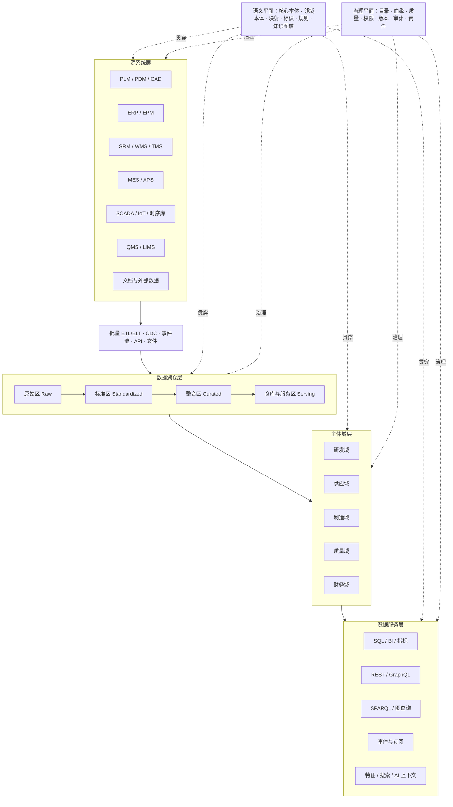
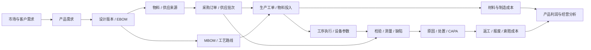

# 基于本体的企业级数据底座：从湖仓到数据服务的语义架构

> 企业数据底座真正困难的部分，不是把更多数据搬进平台，而是让研发、供应、制造、质量和财务能够用同一套业务语言解释这些数据。数据湖仓负责保存事实，本体负责定义事实的含义，主体域负责组织业务责任，数据服务负责把统一语义转化为可消费的能力。

## 摘要

大型企业通常已经建设了 ERP、PLM、MES、QMS、WMS、SRM、数据仓库、数据湖和实时数据平台。系统数量越来越多，数据规模持续增长，但跨系统分析仍然需要大量人工确认：同一个产品在 PLM 和 ERP 中是不是同一个对象，设计 BOM 与制造 BOM 如何对应，供应商批次最终进入了哪些产品，某次质量异常与哪台设备、哪道工序、哪个设计版本有关，一项制造成本又怎样追溯到订单、工单、物料和质量损失。

这些问题表面上是数据集成问题，本质上却包含语义不一致问题。传统 ETL 能够转换字段和表，主数据能够统一部分编码，数据仓库能够统一部分指标，但它们未必能够显式表达“产品版本使用物料”“批次执行工序”“设备参与生产活动”“检验结果评价质量特性”“财务分录归集产品成本”等跨领域关系。

本文提出一套本体驱动的企业级数据底座架构。整体采用“**四层架构、两个横向平面**”：源系统层通过批量、CDC、事件流、API 和文件进入数据湖仓层；数据湖仓负责保存原始数据、标准数据、跨源事实和服务模型；主体域层围绕研发、供应、制造、质量和财务建立领域本体、主数据、数据产品与指标；数据服务层通过 SQL、指标、API、图查询、事件和 AI 上下文对外提供能力。企业核心本体、领域本体、源映射和知识图谱构成语义平面，目录、血缘、质量、安全、版本和责任体系构成治理平面。

文章的核心结论是：**本体不应被建设成数据湖仓之外的另一座数据孤岛，也不应被等同于知识图谱数据库；它应成为连接业务概念、物理数据和数据服务的语义控制平面。**

---

## 一、数据很多，为什么企业仍然回答不了一个完整问题

设想一家制造企业遇到一批产品质量异常。管理者希望知道：

- 哪些已生产或已交付产品受到影响；
- 它们使用了哪个设计版本和哪版 BOM；
- 涉及哪些供应商、采购订单和来料批次；
- 经过哪些工序、设备、工装和人员；
- 异常发生前后的工艺参数是什么；
- 哪些检验结果违反了哪一条质量规范；
- 返工、报废、索赔和保修造成了多少损失。

回答这些问题所需的数据往往已经存在：设计数据在 PLM，物料与订单在 ERP，供应商在 SRM，库存和批次在 WMS，执行过程在 MES，设备数据在 SCADA 或时序数据库，检验结果在 QMS 或 LIMS，成本和凭证又回到 ERP 财务模块。

困难不在于“没有数据”，而在于这些系统用不同方式描述同一个业务世界。

例如：

- PLM 中的 `Part` 可能表示设计零部件，ERP 中的 `Material` 表示可采购、可库存或可核算的物料，两者并不总是一一对应；
- PLM 记录设计版本，MES 记录生产使用版本，但历史数据可能只保存了物料编码；
- WMS 的批次、MES 的生产批次和 QMS 的检验批可能具有不同边界；
- 设备在资产系统中是固定资产，在 MES 中是生产资源，在质量分析中又是影响因子；
- “成本”可能指标准成本、实际成本、边际成本、制造成本或全生命周期成本。

传统系统集成通常从接口和字段出发。A 系统把 `material_code` 传给 B 系统，B 系统再将其写入 `item_no`。这种方式能够让数据流动，却没有显式说明两个字段为什么可以映射、各自代表什么对象、适用于哪个时间范围，以及编码变化以后历史关系如何解释。

因此，企业数据底座至少要同时解决三个问题：

1. **事实在哪里。** 原始记录、历史明细、事件流和文档怎样被可靠保存。
2. **事实是什么意思。** 不同系统中的表、字段、代码和事件如何映射到统一业务概念。
3. **事实怎样被使用。** 统一后的数据怎样通过查询、指标、API、事件和智能应用进入业务流程。

数据湖仓主要解决第一个问题，企业本体主要解决第二个问题，数据产品和数据服务主要解决第三个问题。企业级数据底座必须把三者组织成一条完整链路。

---

## 二、论文研究给出的四条关键线索

企业本体并不是一个新概念。Uschold 等人提出的 Enterprise Ontology 已经尝试用统一概念描述企业活动、组织、资源、计划和业务关系[1]。Grüninger 和 Fox 随后提出以“能力问题”驱动本体设计与评价：一套本体是否有效，不取决于概念数量，而取决于它能否回答预先定义的业务问题[2]。

近年的数据平台研究则从另一条路径走向同一个问题。数据湖解决了异构数据低成本汇聚问题，但缺少元数据、语义和治理的数据湖容易退化为难以理解和使用的数据集合。语义数据湖研究因此把元数据图、领域本体、语义标注、映射和知识图谱引入数据湖架构，使数据不仅“能找到”，还能够按照业务含义被关联和解释[7][8]。

综合相关研究，可以提炼出四条对企业架构最重要的线索。

### 1. 本体应当连接业务语言与物理数据

Song 等人提出企业语义信息层，用本体在业务术语和多源信息系统之间建立中介层[3]。这种思路的重要价值在于：业务使用者不必直接面对源系统表结构，源系统也不必为了全企业统一而重构自身数据库。

企业可以定义“产品”“设备”“生产活动”“质量事件”等稳定概念，再分别说明这些概念在 PLM、ERP、MES 和 QMS 中由哪些数据实现。这样，物理模型可以随着系统升级而变化，而上层业务语义保持相对稳定。

### 2. 湖仓负责数据事实，本体负责语义上下文

Lakehouse 研究试图在开放数据湖存储之上提供数据仓库所需的事务、版本、审计、模式约束和高性能查询能力[4]。这解决了数据平台的存储与计算一致性问题，但湖仓中的表仍然需要业务解释。

一张名为 `fact_operation_execution` 的表可以保存工序执行事实，却不能仅凭表名说明：工序是计划定义还是执行实例，返工是否形成新的执行活动，设备更换是否影响活动身份，工序结果又如何关联质量特性。本体与语义模型需要在湖仓之上补足这部分含义。

### 3. 数据不必全部复制到知识图谱

Ontology-Based Data Access，简称 OBDA，提供了一种重要实现方式：数据继续保存在关系数据库或湖仓中，本体定义业务视图，映射定义业务概念与物理表之间的关系，查询引擎再把语义查询重写为 SQL。Ontop 是这一方向的代表性系统[5]。

这意味着企业可以构建“虚拟知识图谱”，而不是先把数十亿条事实全部转换为 RDF。对于高频多跳关系、实体解析结果和规则推理所需数据，可以物化到图数据库；对于大规模明细、时序数据和高实时事务数据，则可以留在湖仓或源系统中，通过标识和映射按需访问。

### 4. 工业本体需要分层和模块化

Industrial Ontologies Foundry 的工作强调工业本体不能由各项目独立建设，而需要顶层本体、核心本体、领域参考本体和应用本体之间的分层关系[9]。这种设计既避免每个领域重复定义时间、组织、位置、测量和活动，也防止一个巨大的中央模型吞噬所有领域细节。

对企业而言，可以将其转化为：

```text
顶层与工业基础概念
        ↓
企业核心本体
        ↓
研发 / 供应 / 制造 / 质量 / 财务领域本体
        ↓
质量追溯、成本分析、供应风险等应用本体
        ↓
源系统映射、查询、规则和数据服务
```

这四条线索共同指向一个结论：本体不是单独部署的一套“知识系统”，而是企业数据架构中的语义控制机制。

---

## 三、总体蓝图：四层架构与两个横向平面

企业级数据底座可以概括为下面这张蓝图：



这张图有三个需要特别说明的地方。

第一，图中的四层是职责分层，不一定对应四套独立产品。一个湖仓平台可能同时承载原始区、整合区、数据仓库和部分数据服务；一个知识图谱平台也可能同时承担本体管理、实体关系和图查询。

第二，主体域不是源系统的简单分组。研发域不等于 PLM，制造域不等于 MES，财务域也不等于 ERP 财务模块。一个主体域会从多个源系统取得数据，并围绕稳定的业务对象和责任边界形成领域数据产品。

第三，本体不是源系统层和数据服务层之间的一条额外流水线。它横向贯穿所有层：在源端解释字段，在湖仓中约束标准模型，在主体域中定义对象和关系，在服务端形成稳定契约。

### 1. 分层原则

这套架构遵循七条原则：

1. **源系统自治。** 不要求所有业务系统采用同一数据库模型。
2. **湖仓保存事实。** 原始记录、历史状态、事件和计算结果均有可追溯载体。
3. **本体统一含义。** 统一对象、关系、状态、度量、规则和上下文。
4. **主体域组织责任。** 数据定义、质量和服务由明确领域负责。
5. **逻辑与物理解耦。** 同一个业务概念可以映射到多个物理数据源。
6. **虚拟与物化并存。** 根据规模、实时性和查询模式选择访问方式。
7. **服务隐藏实现。** 消费方使用业务对象和指标，不依赖底层表名与字段名。

---

## 四、源系统层：不强求统一模型，但必须建立可解释映射

源系统是业务事实产生和业务事务执行的地方。建设数据底座时，最容易犯的错误，是把统一语义理解成统一源系统模型，试图要求所有系统按照一套标准改造数据库。这通常代价极高，也会破坏源系统对自身业务的优化。

更现实的方式，是允许每个系统保留局部模型，同时建立到企业本体的显式映射。

### 1. 源系统映射包含什么

一个完整映射不只是“字段 A 对应字段 B”，至少应包含：

| 映射内容 | 需要回答的问题 |
| --- | --- |
| 类型映射 | 哪些记录可以被解释为某类业务对象 |
| 标识映射 | 源主键怎样转换为稳定的企业对象标识 |
| 属性映射 | 字段表示哪个业务属性，使用什么数据类型和单位 |
| 关系映射 | 外键、关联表或业务规则表示什么对象关系 |
| 代码映射 | 本地状态和分类怎样对齐企业标准代码 |
| 时间映射 | 记录时间、业务发生时间、生效时间和处理时间分别是什么 |
| 来源映射 | 事实来自哪个系统、接口、文件和处理任务 |
| 质量规则 | 哪些条件下记录有效、完整、可信或需要隔离 |

例如，MES 中一条工序报工记录可以映射为 `OperationExecution`，但还要进一步说明：

- `route_operation_id` 指向计划工序定义；
- `equipment_id` 指向实际参与执行的设备；
- `start_time` 和 `end_time` 是业务发生时间；
- `report_time` 是记录进入系统的时间；
- `good_qty` 与 `scrap_qty` 使用什么计量单位；
- 返工报工是原执行活动的修改，还是一个新的执行活动。

只有这些含义明确后，跨系统查询才不会停留在字段拼接层面。

### 2. 企业标识不是简单建立一个全局 ID

跨系统集成的关键是判断“两个记录是否指向同一个现实对象”。但不是所有对象都适合使用同一种主数据策略。

可以把标识策略分成四类：

- **权威标识**：员工、法人、供应商等由明确主系统维护；
- **组合标识**：生产批次可能由工厂、产品、日期和流水号共同确定；
- **版本标识**：产品、BOM、工艺路线需要同时表示对象身份和版本身份；
- **事件标识**：设备报警、生产执行、检验和财务分录通常是一次发生的事件或记录。

本体需要区分“对象”和“对象标识记录”。编码可以变化，系统主键也可以变化，但现实对象在一定生命周期内仍可能是同一个。反过来，同一个物料编码在不同工厂、不同生效期或不同配置下，也未必代表完全相同的业务对象。

### 3. 语义适配器隔离源系统变化

建议在源系统与企业语义之间设置语义适配器。它可以是配置化映射、SQL 视图、流处理规则、R2RML 映射、JSON-LD 上下文或专门的转换服务。

当 ERP 升级导致表结构变化时，只需调整 ERP 适配器；只要“采购订单”“订单行”“供应商”等上层概念没有变化，主体域模型和数据服务不必同步重构。这正是语义层提供的架构稳定性。

---

## 五、数据湖仓层：统一承载批量、实时、历史和多模态事实

数据湖仓是企业数据底座的事实存储与计算中心。本体可以解释数据，但不能替代大规模明细存储、事务一致性、增量处理、查询优化和成本控制。

### 1. 原始区：保留事实证据

原始区保存源系统数据的原始形态，核心目标不是方便分析，而是保证可回放和可追溯。

需要保留：

- 原始字段和原始值；
- 来源系统和采集任务；
- 采集时间和源端更新时间；
- 文件、消息或日志位置；
- 解析版本和校验结果；
- 删除、更新和补数记录。

原始区不应过早套用企业统一模型。否则，错误的映射和清洗规则可能让源事实不可恢复。

### 2. 标准区：统一技术格式与基础标准

标准区负责处理那些相对确定、跨领域通用的技术差异，例如：

- 时间格式和时区；
- 字符编码和空值表示；
- 数值类型、精度和单位换算；
- 基础代码和行政区划；
- 重复记录和异常格式；
- 敏感字段识别与脱敏标记。

需要注意，格式标准化不等于业务语义统一。把所有日期转成 ISO 格式，并不能说明它是创建时间、生效时间还是业务发生时间。

### 3. 整合区：围绕业务对象形成跨源事实

整合区是湖仓与本体结合最紧密的位置。这里需要完成：

- 企业对象标识解析；
- 主数据和参考数据关联；
- 源字段到本体属性映射；
- 源关系到业务关系映射；
- 事件时间和有效时间建模；
- 数据来源、处理过程和质量状态记录；
- 面向主体域的统一事实模型建设。

整合区不一定直接存储 RDF。它可以继续使用关系表、宽表、列式文件和时序表，只要每个数据集能够明确对应哪些本体概念、属性与关系。

例如，生产执行事实表可以保存在湖仓中，而在语义层被解释为：

```text
某次生产活动
  执行了某项计划工序
  作用于某个生产批次
  使用了某批物料
  由某台设备和某个班组完成
  产生了某批产品和一组过程参数
```

### 4. 仓库与服务区：为稳定消费优化

服务区面向确定的查询和服务负载，可以建立：

- 星型模型和宽表；
- 指标聚合表；
- 实时状态表；
- 数据 API 投影；
- 机器学习特征集；
- 图谱节点和关系投影；
- 搜索索引与向量索引。

同一个业务事实可以根据消费方式形成多个物理投影，但它们必须引用同一个语义定义。例如，“一次合格率”可以物化到指标表中，也可以通过图查询关联工序与检验结果，但二者应使用同一质量特性范围、统计粒度和时间规则。

### 5. 流批一体不是使用同一个引擎，而是使用同一套语义

实时数据和批量数据的处理路径可以不同：

- 财务结算和历史重算适合批处理；
- ERP、PLM 和 MES 事务变化适合 CDC；
- 设备测点和工序事件适合事件流；
- 文档、图纸和检验报告适合文件或 API 接入。

真正的统一不是强制使用同一个计算引擎，而是确保实时流和批量表中的对象、状态、单位和事件具有一致含义。Kharlamov 等人在工业场景中研究了静态数据、历史数据与实时流的本体化联合访问，说明语义访问不仅要处理关系映射，还要处理窗口、聚合和实时查询优化[6]。

---

## 六、语义平面：本体如何贯穿数据底座

语义平面由本体、映射、标识、规则和知识图谱共同组成。它不是一个单一数据库，也不等于一个本体文件。

### 1. 本体分层

企业可以采用四级语义结构：

```text
顶层与工业基础本体
    定义对象、过程、角色、时间、空间、质量、测量等基础范畴
                        ↓
企业核心本体
    定义组织、人员、地点、产品、物料、资产、文档、活动、事件、指标等共享概念
                        ↓
主体域本体
    研发、供应、制造、质量、财务领域中的专业对象和关系
                        ↓
应用本体
    面向质量追溯、成本分析、供应风险、变更影响等具体场景进行裁剪和约束
```

顶层本体解决跨领域对齐，企业核心本体解决全企业复用，领域本体解决专业表达，应用本体解决具体使用。应用层的快速变化不应频繁反向修改企业核心本体。

### 2. 企业核心本体应该包含什么

企业核心本体应保持小而稳定，优先覆盖跨领域反复出现的概念：

- 组织、法人、部门、人员和角色；
- 地点、区域、工厂、仓库和工位；
- 产品、物料、资产、设备和文档；
- 计划、活动、事件、状态和结果；
- 标识、版本、分类和代码；
- 时间点、时间段和生效区间；
- 数量、单位、测量和质量；
- 协议、订单、责任和参与关系；
- 指标、规则、证据和数据来源。

核心本体不应包含某个系统的临时字段，也不应试图收纳所有领域细节。例如，焊接电流是制造领域属性，缺陷严重度属于质量领域分类，总账科目属于财务领域模型，它们无需全部进入企业核心。

### 3. 本体、主数据和知识图谱的关系

三者经常被混淆：

| 资产 | 主要回答的问题 |
| --- | --- |
| 本体 | 企业中有哪些类型的事物，它们具有什么关系和约束 |
| 主数据 | 哪些核心对象需要统一标识、权威属性和生命周期管理 |
| 知识图谱 | 现实对象和事实如何按照本体形成可查询的实例网络 |

本体可以规定“供应商向工厂供应物料”，主数据负责维护供应商和物料的标准身份，知识图谱则保存“供应商 A 在某时间段向工厂 B 供应物料 C”这一具体事实。三者互相支撑，但不能互相替代。

### 4. 虚拟知识图谱与物化知识图谱

语义平面应采用混合策略。

适合虚拟访问的数据包括：

- 已经存放在高性能湖仓中的大规模事实；
- 对实时性要求高、不适合二次复制的事务数据；
- 更新频率高但图关系较简单的数据；
- 受合规限制、只能在源端访问的数据。

适合物化到图数据库的数据包括：

- 企业对象身份和跨系统对应关系；
- 产品、BOM、工艺、设备、批次和质量之间的关键关系；
- 多跳追溯和影响分析所需关系；
- 规则推理、图算法和搜索所需子图；
- 概念、术语、指标和数据资产之间的元数据关系。

因此，知识图谱更适合作为企业事实的“关系索引和语义投影”，而不是所有明细数据的唯一存储。

---

## 七、主体域层：把五个业务领域组织成可组合的数据产品

主体域层是业务语义、治理责任和数据产品的交汇点。每个主体域都应包含：

- 领域本体；
- 领域主数据与参考数据；
- 领域事实模型；
- 领域指标；
- 数据质量规则；
- 可复用查询和数据服务；
- 明确的数据负责人和服务等级。

### 1. 研发域：管理产品定义及其演进

研发域的核心不是 CAD 文件本身，而是产品如何被定义、分解、验证和变更。

关键对象包括：

- 产品族、产品型号和产品配置；
- 需求、功能和技术参数；
- 零部件、材料和软件组件；
- EBOM、版本、基线和有效性；
- 设计文档、CAD 模型、图纸和规范；
- 验证计划、试验和验证结果；
- 变更请求、变更单和受影响对象。

研发域需要特别处理“对象身份、版本身份和配置身份”的区别。同一个零部件可以有多个设计版本，同一产品型号可以根据客户、地区和时间形成多个配置，某次生产又必须明确使用哪一个生效版本。

OntoSTEP 等研究尝试将 STEP 产品数据模型与 OWL 本体结合，用于改善产品生命周期数据的语义访问和互操作[10]。对企业而言，重点不是完整复制某个行业标准，而是复用其中稳定的产品、装配、版本和文档语义。

### 2. 供应域：描述供应关系而不只描述采购单

供应域需要覆盖从供应商能力到物料交付的完整关系：

- 供应商、制造商、承运商和收货组织；
- 供应商资质、能力、风险和绩效；
- 采购需求、询价、报价、合同和采购订单；
- 物料、替代料、供应来源和供货关系；
- 发运、运输、收货、入库和库存；
- 供应商批次、来料批次和检验批；
- 交期、价格、最小订货量和质量表现。

供应域本体的价值，是让企业能够从一个产品或质量问题向上追溯到供应来源，也能够从一个供应风险向下分析受影响的产品、订单和客户。

### 3. 制造域：把计划、过程和执行分开

制造域可以以“产品—过程—资源”为基本骨架。MASON 等制造本体研究也采用了类似思路[11]。

关键对象包括：

- 工厂、车间、产线、工位；
- 设备、工装、模具、工具和人员资源；
- MBOM、工艺路线、工序和工步；
- 生产计划、工单和派工任务；
- 生产活动、工序执行和设备运行事件；
- 投入物料批次、在制品和产出批次；
- 过程参数、设备状态、停机和异常。

建模时必须区分：

- 工艺定义与某次工艺执行；
- 设备类型与设备实例；
- 计划数量与实际产出；
- 产品序列号、生产批次和物流批次；
- 正常工序、返工工序和临时处置。

如果把计划、定义和执行混在一起，历史追溯会随着工艺路线修改而失真。

### 4. 质量域：把规范、测量、判定和处置连成闭环

质量域连接研发定义、供应批次和制造过程，是跨域数据价值最容易显现的领域。

关键对象包括：

- 质量标准、规范和质量特性；
- 检验计划、抽样计划和检验任务；
- 样本、测量、测量值和测量单位；
- 规格限、控制限和判定规则；
- 缺陷、不合格、偏差和质量事件；
- 原因、影响、处置、纠正措施和预防措施；
- 供应商、物料、设备、工序、环境和人员等影响因子。

本体应将“测得了什么”“按照什么规范评价”“评价结果是什么”“采取了什么处置”分开表达。一个数值只有关联质量特性、单位、测量方法、样本和规格版本后，才具有可比较的业务含义。

### 5. 财务域：把业务活动翻译成价值流

财务域不仅包含总账和凭证，还要建立业务事实与价值结果之间的关系。

关键对象包括：

- 法人、组织、成本中心和利润中心；
- 会计科目、账簿、凭证和分录；
- 预算、预测和实际；
- 收入、成本、费用、资产和负债；
- 币种、汇率和会计期间；
- 标准成本、实际成本和差异；
- 材料成本、制造成本、质量成本和物流成本。

财务本体需要谨慎处理统计口径和时间边界。“某产品成本”必须说明产品粒度、组织范围、会计期间、成本类型、分摊规则和币种。可以选择性参考 FIBO 中组织、协议、金额和金融关系的定义，但制造企业不宜直接照搬面向金融服务行业的完整模型。

### 6. 五域通过数字主线连接

五个领域不是五座新的数据孤岛。企业核心本体和跨域关系应形成一条数字主线：



数字主线的价值不只是“把数据连起来”，而是保留每个关系的业务含义、时间范围、来源和证据。

---

## 八、集成方式：批量、CDC、事件、API 与虚拟访问如何选择

企业数据底座不应追求一种集成方式覆盖所有数据。不同数据具有不同变化频率、一致性要求、规模和使用模式。

| 集成方式 | 适用数据 | 优点 | 主要风险 |
| --- | --- | --- | --- |
| 批量 ETL/ELT | 历史装载、财务结算、复杂重算 | 稳定、易审计、适合大规模处理 | 延迟高，容易产生多份副本 |
| CDC | ERP、PLM、MES 等事务变化 | 增量、延迟低、保留变更 | 删除、乱序和模式变化处理复杂 |
| 事件流 | 设备状态、工序事件、物流状态 | 实时、可订阅、适合过程感知 | 需要处理幂等、顺序和事件语义 |
| API | SaaS、伙伴系统、主数据服务 | 契约清晰、控制灵活 | 调用限制、可用性和版本依赖 |
| 文件交换 | 图纸、报告、低频批量数据 | 通用、易于跨组织交换 | 结构漂移、重复和时效性差 |
| OBDA/虚拟化 | 高实时、不可复制或已有高性能存储的数据 | 减少复制，保持源端新鲜度 | 跨源查询性能和源端负载 |
| 图谱物化 | 多跳关系、推理、图算法、统一搜索 | 关系查询直观，适合追溯 | 同步成本高，不适合海量时序明细 |

### 1. 选择方式时考虑六个维度

每类数据都应从以下维度做决策：

1. 数据新鲜度要求；
2. 单次与总体数据规模；
3. 是否允许复制；
4. 查询是明细扫描还是关系遍历；
5. 是否需要历史回放和重算；
6. 源系统能否承受在线查询。

例如，设备每秒采集的振动波形不适合完整物化到知识图谱。图谱可以保存设备、测点、信号类型、时间范围和数据位置，具体波形仍留在时序库或湖仓。相反，设备属于哪条产线、参与过哪些生产批次、关联哪些质量异常，则适合物化为图关系。

### 2. 集成契约需要同时包含结构和语义

传统数据契约关注字段名、类型、是否为空和兼容性。本体驱动的数据契约还需要补充：

- 字段对应的业务概念；
- 对象标识规则；
- 时间语义；
- 单位和度量类型；
- 状态机和代码表；
- 数据来源和可信级别；
- 与其他对象的关系；
- 允许的用途与权限。

这样，模式兼容不再只是“字段还在不在”，还包括“业务含义有没有改变”。

---

## 九、数据服务层：让统一语义成为可消费能力

如果本体只存在于建模工具中，它仍然不是数据底座。语义必须通过服务进入报表、业务应用、算法和智能体。

### 1. SQL 与 BI 服务

分析人员仍然需要 SQL、数据集和指标平台。本体不要求所有人学习 SPARQL，而应为 SQL 消费提供稳定业务视图：

- 以业务对象命名数据集；
- 统一维度、粒度和指标口径；
- 暴露对象标识和关键关系；
- 在目录中关联概念定义、血缘和负责人；
- 使同一指标在 BI、API 和 AI 查询中保持一致。

### 2. 对象 API 服务

REST 或 GraphQL 服务应围绕业务对象设计，而不是直接暴露湖仓表。例如：

```text
GET /products/{productId}/versions
GET /production-batches/{batchId}/materials
GET /quality-events/{eventId}/affected-products
GET /suppliers/{supplierId}/risk-exposure
GET /products/{productId}/cost-breakdown
```

这些 API 的资源、字段、关系和枚举都可以从本体及应用模型中获得约束。OBA 等研究展示了从 OWL 本体生成 OpenAPI、JSON-LD 上下文和校验逻辑的可行方式[12]。

### 3. 图查询与关系服务

SPARQL、Cypher 或图服务适合：

- 多跳追溯；
- 变更影响分析；
- 供应网络分析；
- 根因候选发现；
- 资产、文档和业务记录之间的关系搜索。

图服务返回的节点和边不应成为另一套私有模型，而应引用企业本体中的类型和关系定义。

### 4. 事件服务

主体域可以发布具有明确语义的业务事件，例如：

- `ProductDesignReleased`；
- `SupplierBatchReceived`；
- `ProductionOperationCompleted`；
- `QualityNonconformanceDetected`；
- `CostPostingCompleted`。

事件需要定义主体对象、发生时间、状态变化、相关对象、来源和版本。这样，下游系统订阅的是业务事实，而不是某张表发生了一次更新。

### 5. AI 与 Agent 数据服务

大模型可以理解自然语言，但不能自动获得企业内部术语、对象身份和权限边界。本体化数据底座可以为 AI 提供：

- 术语与同义词；
- 对象类型及关系；
- 指标定义和计算规则；
- 可查询的数据集与 API；
- 数据来源、时效和可信度；
- 用户可访问的对象与属性；
- 回答结果的业务证据链。

RAG 可以检索文档，本体则为文档、结构化数据和业务对象提供共同上下文。Agent 也可以依据本体发现“有哪些对象可以查询、有哪些关系可以追踪、哪些动作被允许执行”。

---

## 十、贯穿案例：从产品质量异常追到设计、供应、制造与成本

下面用一个场景验证整个架构。

某型号产品在客户端出现功能异常。企业首先在 QMS 中创建质量事件，记录缺陷现象和受影响序列号。数据底座需要完成以下推理和查询链路。

### 1. 从产品实例追到设计定义

通过产品序列号找到生产批次和产品型号，再找到生产时实际生效的设计版本、EBOM、MBOM 和关键技术规范。这里不能直接使用“当前最新版本”，而必须按照生产时间和配置条件选择历史有效版本。

### 2. 从产品实例追到供应物料

通过工单领料和批次谱系找到实际投入物料，再关联采购订单、供应商批次、来料检验和供应商。若发生替代料或拆批、合批，关系模型必须保留实际转换过程。

### 3. 从产品实例追到制造过程

通过生产批次找到工序执行、设备、工装、班组和过程参数。设备测点数据仍保存在时序库中，知识图谱只保存测点语义、时间范围和数据访问位置，需要时再查询原始波形。

### 4. 从缺陷追到质量规范

缺陷需要关联被违反的质量特性、规格版本、测量方法和判定规则。这样才能区分“确实超出规格”和“测量系统或判定口径变化”。

### 5. 从处置追到财务影响

返工工单、报废记录、客户索赔和保修费用进一步关联成本中心、会计期间和财务凭证，形成质量事件的完整成本影响。

最终，数据服务可以返回一条有证据的关系链：

```text
质量事件 Q-2026-0187
  → 影响产品序列号 P-001 至 P-127
  → 使用设计版本 DV-08
  → 包含供应商 A 的物料批次 M-7782
  → 在设备 E-17 上执行关键工序 OP-30
  → 过程温度在 14:32 至 14:47 偏离控制范围
  → 违反质量规范 QS-12 的第 4.3 条
  → 已产生返工、报废和索赔成本 86 万元
```

这条链路中的明细事实可能分布在多个存储中，但对象身份、关系语义、时间条件和来源证据由同一语义平面组织。

---

## 十一、实施方法：从一条高价值链路开始，而不是先造完整世界

本体项目失败的常见原因，是试图先建立覆盖全企业的完整概念模型，再寻找应用场景。更可行的方法是以能力问题和跨域闭环驱动建设。

### 1. 定义能力问题

第一阶段可以选择十到二十个必须回答的问题，例如：

- 某个设计变更影响哪些在制工单、库存和客户订单？
- 某个供应商批次进入了哪些产品？
- 某类缺陷与哪些设备和参数组合相关？
- 某产品实际成本由哪些业务活动构成？
- 某个指标由哪些源数据和规则计算得到？

每个问题都要明确用户、数据范围、时间范围、正确答案和响应要求。能力问题既定义本体范围，也定义项目验收标准。

### 2. 选择最小跨域闭环

推荐第一阶段选择：

```text
产品版本
  → BOM 与物料
  → 供应批次
  → 生产工单与工序执行
  → 检验结果与质量事件
  → 返工、报废和质量成本
```

这条链路能够同时验证五个主体域的连接价值，又可以限制在一个产品族、一家工厂和一类质量问题内。

### 3. 盘点证据，而不是让模型猜测

建模材料应包括：

- 业务流程和制度；
- 数据库 DDL 和数据字典；
- API、消息和文件规范；
- 主数据和代码表；
- 报表、指标和计算逻辑；
- 真实样例数据；
- 领域专家访谈；
- 行业标准与现有本体。

不同材料只能证明不同事实。DDL 可以证明字段类型和外键，不能证明完整业务含义；样例数据可以暴露值的形态，不能证明所有合法取值；业务文档可以解释概念，却未必反映真实数据质量。

### 4. 建立核心本体与领域模块

先建立最小企业核心：对象、活动、事件、组织、位置、时间、度量、文档和标识。随后围绕场景建立研发、供应、制造、质量和财务模块。

对每个概念至少记录：

- 业务定义；
- 上位概念；
- 同义词与禁用词；
- 关键属性和关系；
- 身份与版本规则；
- 来源标准和负责人；
- 能回答的能力问题。

### 5. 建立映射与实例解析

将源系统表、消息和 API 映射到本体。映射完成后，通过样例实例验证：

- 同一对象能否跨系统合并；
- 不同对象是否被错误合并；
- 历史版本能否正确选择；
- 单位、代码和时间是否正确转换；
- 关系是否有来源和有效期。

### 6. 选择虚拟与物化边界

根据查询负载决定哪些数据物化：

- 标识和关键关系优先物化；
- 海量时序和明细留在湖仓；
- 高频指标预计算；
- 低频跨源查询通过虚拟化执行；
- 对性能不确定的查询进行真实数据压测。

### 7. 发布数据产品和服务

第一阶段的交付物不应只是本体文件，还应包括：

- 一个可查询的跨域关系子图；
- 一组标准 SQL 数据集；
- 一个追溯 API；
- 一组质量规则；
- 一张数据血缘图；
- 一套能力问题验收结果；
- 一套本体和映射版本发布流程。

---

## 十二、治理机制：中央统一什么，领域自治什么

本体驱动的数据底座需要避免两个极端：一是所有概念都由中央团队审批，导致建设速度过慢；二是各领域完全自治，再次形成语义孤岛。

可以采用“核心集中、领域自治、应用快速迭代”的模式。

### 1. 企业层统一管理

- 顶层与企业核心本体；
- 全局对象标识原则；
- 时间、单位、组织、位置等公共模型；
- 命名、版本和发布规范；
- 跨域关系和争议仲裁；
- 安全、溯源和质量基础标准。

### 2. 领域层负责

- 领域术语与定义；
- 领域对象、关系和状态；
- 领域数据产品；
- 领域映射和质量规则；
- 领域指标和服务等级；
- 对应用模型的审核与复用。

### 3. 应用层可以快速变化

应用可以组合和裁剪领域概念，增加场景特有约束、查询和服务，但不应随意修改共享概念的含义。如果应用需要新的通用概念，应通过评审提升到领域层或核心层。

### 4. 本体必须像代码一样管理

本体、映射、约束和服务契约应进入版本控制和自动化流水线：

- 语法与引用检查；
- 逻辑一致性检查；
- SHACL 或同类约束验证；
- 示例数据回归测试；
- 能力问题查询测试；
- 映射覆盖率检查；
- API 和指标兼容性检查；
- 变更影响分析；
- 分环境发布与回滚。

本体变化可能影响查询、数据集、事件和 API，因此不能只发布一个新的 OWL 文件，而要管理“本体版本—映射版本—数据产品版本—服务版本”的兼容关系。

---

## 十三、如何评价本体化数据底座是否有效

概念数量和三元组数量不是核心成功指标。评价体系应覆盖技术、治理和业务三个层面。

### 1. 技术指标

- 源系统接入周期；
- 新数据源映射工作量；
- 核心概念和属性的映射覆盖率；
- 实体匹配准确率；
- 跨域查询响应时间；
- 批量和实时数据延迟；
- 数据血缘完整率；
- 本体变更导致的服务失败数量；
- 虚拟查询与物化查询的成本。

### 2. 治理指标

- 重复概念和冲突定义减少比例；
- 核心对象统一标识覆盖率；
- 指标定义复用率；
- 领域数据产品责任人覆盖率；
- 质量规则覆盖率和通过率；
- 跨域关系具有来源与有效期的比例；
- 本体、映射和服务版本可追溯率。

### 3. 业务指标

- 质量问题定位时间；
- 产品变更影响分析时间；
- 供应风险暴露时间；
- 产品成本核算周期；
- 数据服务交付周期；
- 重复报表和点对点接口减少数量；
- AI 应用准备企业上下文所需时间。

最有说服力的指标，通常不是“建立了多少概念”，而是过去需要多部门数天对数的问题，现在能否在几分钟内得到带来源和证据的答案。

---

## 十四、常见误区与架构边界

### 1. 把本体等同于数据字典

数据字典能够解释字段，本体还需要解释对象身份、上下位关系、跨对象关系、约束和时间。只有术语和字段说明，无法支撑跨域追溯。

### 2. 把知识图谱数据库等同于本体

图数据库提供节点、边和遍历能力，本体定义这些节点和边表示什么、遵守什么约束。没有稳定本体的图数据库，很容易变成另一套关系混乱的数据存储。

### 3. 把所有数据都转换成 RDF

海量时序、日志、波形和财务明细并不都适合三元组存储。正确做法是用本体描述其语义、位置和关系，并根据访问模式决定虚拟访问或物化投影。

### 4. 从数据库表自动生成企业本体

自动转换可以生成候选模型，却会继承源系统的历史结构、技术命名和局部边界。企业本体必须由业务问题、领域知识和数据证据共同驱动。

### 5. 先建完整本体，后找应用

没有能力问题约束的模型容易无限扩张。应从跨域业务闭环开始，让每个概念、关系和映射都能解释其使用场景。

### 6. 用中央模型消灭领域差异

研发、制造、质量和财务对同一对象可以有不同关注点。企业需要统一身份和共享语义，但不必消灭所有专业差异。领域本体正是承载这些差异的边界。

### 7. 只建模型，不建运行机制

如果没有映射、标识、质量、查询、服务和版本治理，本体只是一份文档。真正的数据底座必须让语义进入数据处理和业务消费链路。

---

## 十五、分阶段建设路线

### 第一阶段：建立语义最小闭环

范围限定在一个产品族、一家工厂和一个质量场景，打通：

```text
产品版本 → BOM → 物料批次 → 工序执行 → 检验结果 → 质量成本
```

交付最小核心本体、五域必要模块、源映射、跨域子图、追溯 API 和能力问题测试。

### 第二阶段：形成领域数据产品

扩展更多产品和工厂，完善企业标识、实时事件、领域指标、数据质量规则和领域服务。建立稳定的数据产品目录和服务等级。

### 第三阶段：平台化运营

实现本体、映射、质量规则和服务契约的版本化与自动化发布，形成虚拟知识图谱、物化图谱、湖仓、指标平台和 API 网关之间的协同运行。

### 第四阶段：支撑智能应用

将本体作为企业 AI 的业务上下文：支持自然语言问数、跨域检索、根因分析、变更影响推演和受控 Agent 操作。所有回答和动作都能够追溯到对象、规则、数据来源和权限。

---

## 结语

企业建设数据底座时，最容易看到的是数据库、消息总线、数据湖、计算引擎和图数据库，因为它们都有明确的产品形态。但真正决定数据能否跨系统复用的，是隐藏在这些产品之间的语义结构。

源系统记录局部事实，数据湖仓保存历史事实，主体域组织业务事实，数据服务消费事实。本体的作用，是让这些事实围绕同一组业务对象、关系、时间和规则形成一致解释。

因此，本体驱动的数据底座不是“再建设一个知识图谱平台”，也不是“把现有表结构改写成一套概念名称”。它是一种企业数据架构方法：

```text
用湖仓承载事实，
用本体统一含义，
用主体域划分责任，
用映射连接物理数据，
用图谱组织关键关系，
用服务释放数据能力，
用治理保证长期演进。
```

当这条链路建立起来以后，企业数据底座才从一个“集中存放数据的平台”，转变为一套能够解释业务、连接业务并服务业务的语义基础设施。

---

## 参考文献

[1] Uschold, M., King, M., Moralee, S., & Zorgios, Y. (1998). *The Enterprise Ontology*. The Knowledge Engineering Review, 13(1), 31-89. [DOI](https://doi.org/10.1017/S0269888998001088)

[2] Grüninger, M., & Fox, M. S. (1995). *Methodology for the Design and Evaluation of Ontologies*. Proceedings of the IJCAI Workshop on Basic Ontological Issues in Knowledge Sharing.

[3] Song, F., Zacharewicz, G., & Chen, D. (2013). *An ontology-driven framework towards building enterprise semantic information layer*. Advanced Engineering Informatics, 27(1), 38-50. [DOI](https://doi.org/10.1016/j.aei.2012.11.003)

[4] Armbrust, M., Ghodsi, A., Xin, R., & Zaharia, M. (2021). *Lakehouse: A New Generation of Open Platforms that Unify Data Warehousing and Advanced Analytics*. CIDR 2021.

[5] Calvanese, D., Cogrel, B., Komla-Ebri, S., Kontchakov, R., Lanti, D., Rezk, M., Rodriguez-Muro, M., & Xiao, G. (2017). *Ontop: Answering SPARQL Queries over Relational Databases*. Semantic Web, 8(3), 471-487. [DOI](https://doi.org/10.3233/SW-160217)

[6] Kharlamov, E., Brandt, S., Jiménez-Ruiz, E., Kotidis, Y., Lamparter, S., Mailis, T., Neuenstadt, C., Özçep, Ö. L., Pinkel, C., Svingos, C., Zheleznyakov, D., Horrocks, I., Ioannidis, Y. E., & Möller, R. (2016). *Towards Analytics Aware Ontology Based Access to Static and Streaming Data*. Proceedings of the 15th International Semantic Web Conference.

[7] Hoseini, M., et al. (2024). *A survey on semantic data management as intersection of ontology-based data access, semantic modeling and data lakes*. Journal of Web Semantics, 81, 100819. [DOI](https://doi.org/10.1016/j.websem.2024.100819)

[8] Hai, R., Geisler, S., & Quix, C. (2016). *Constance: An Intelligent Data Lake System*. Proceedings of the 2016 International Conference on Management of Data, 2097-2100. [DOI](https://doi.org/10.1145/2882903.2899389)

[9] Drobnjakovic, M., Kulvatunyou, B., Ameri, F., Will, C., Smith, B., & Jones, A. T. (2022). *The Industrial Ontologies Foundry (IOF) Core Ontology*. Proceedings of the 12th International Workshop on Formal Ontologies Meet Industry (FOMI 2022), CEUR Workshop Proceedings, 3240, 1-13.

[10] Krima, S., Barbau, R., Fiorentini, X., Rachuri, S., & Sriram, R. D. (2009). *OntoSTEP: OWL-DL Ontology for STEP*. National Institute of Standards and Technology.

[11] Lemaignan, S., Siadat, A., Dantan, J.-Y., & Semenenko, A. (2006). *MASON: A Proposal for an Ontology of Manufacturing Domain*. IEEE Workshop on Distributed Intelligent Systems: Collective Intelligence and Its Applications, 195-200. [DOI](https://doi.org/10.1109/DIS.2006.48)

[12] Garijo, D., & Osorio, M. (2020). *OBA: An Ontology-Based Framework for Creating REST APIs for Knowledge Graphs*. arXiv:2007.09206. [DOI](https://doi.org/10.48550/arXiv.2007.09206)


